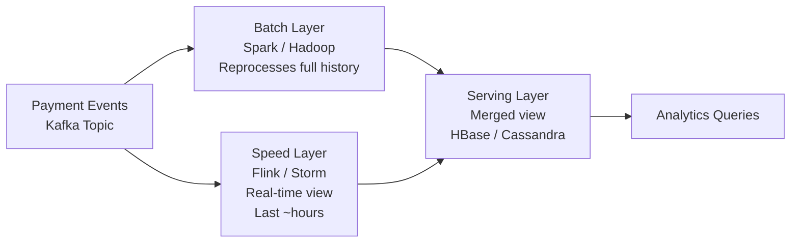
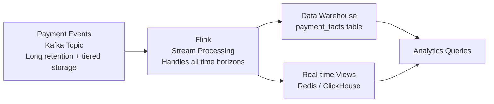
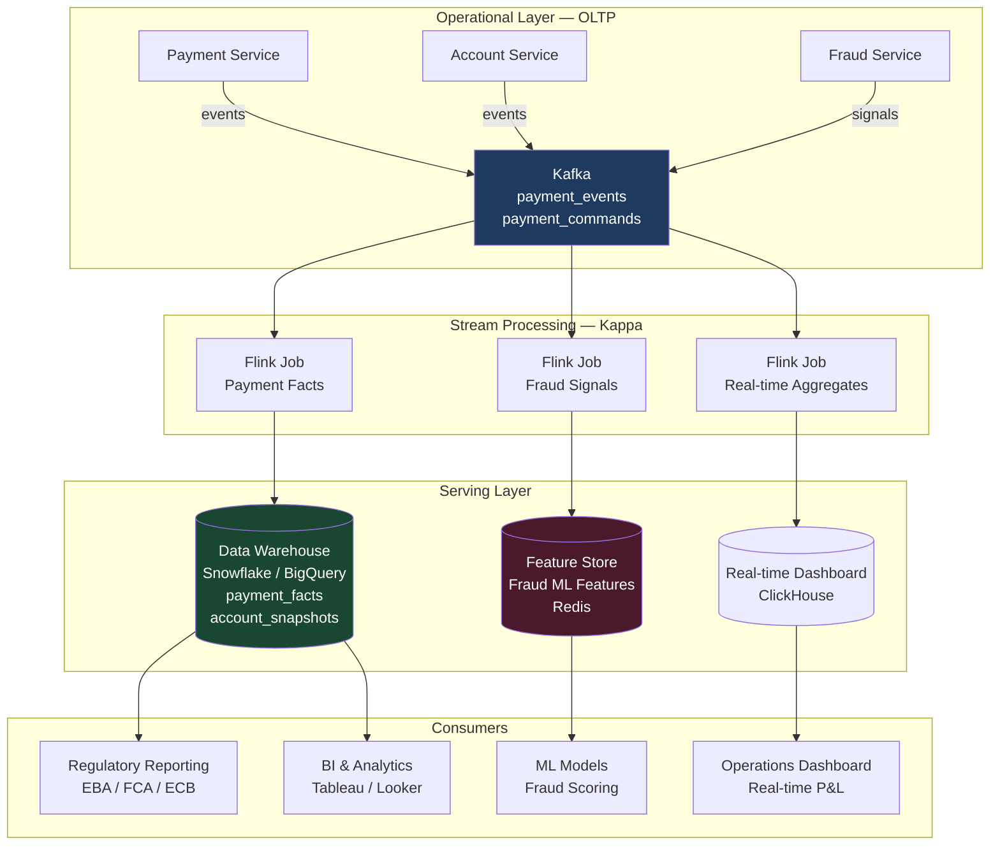

بنية البيانات في الخدمات المالية شأن تقني وتنظيمي وتنافسي في الوقت نفسه. فيجب أن تكون بيانات الدفع متاحة لتقييم الاحتيال لحظيًا في أقل من 50ms، وللتقارير التنظيمية خلال 24 ساعة، ولتحليلات العملاء خلال ساعات، وللمدققين لسبع سنوات إلى الوراء. ولا يمكن تلبية هذه المتطلبات بقاعدة بيانات واحدة مع نسخ متماثلة للقراءة. بل تتطلب بنية مقصودة تفصل مخازن البيانات التشغيلية عن المنصات التحليلية، وتحدد حدود ملكية البيانات على مستوى المجال، وتنفّذ تتبع أصل البيانات (data lineage) للوفاء بالتزامات EBA وFCA وGDPR معًا.

## أهداف التعلّم

- التمييز بين خصائص أحمال OLTP وOLAP وشرح لماذا تتطلب بنية تحتية منفصلة في أنظمة الدفع
- مقارنة بنيتي Lambda وKappa للتحليلات المالية، مع المفاضلات المحددة لمعالجة أحداث الدفع
- تطبيق مبادئ شبكة البيانات (Data Mesh) — ملكية البيانات الموجّهة بالمجال، والبيانات كمنتج — على مؤسسة مصرفية للأفراد
- تتبع موضوع Kafka ‏`payment_events` عبر معالجة التدفق في Flink إلى جدول المستودع `payment_facts`
- شرح متطلبات تتبع أصل البيانات وفق BCBS 239 والإرشادات الإشرافية، وكيف يدعمها سجل الأحداث
- تقييم مفاضلات "المخطط عند القراءة" مقابل "المخطط عند الكتابة" لبيانات المعاملات مع متطلبات عدم القابلية للتغيير التنظيمية
- تحديد آثار موقع تخزين البيانات وفق GDPR على منصات البيانات المالية متعددة المناطق
- تصميم استعلام تحليلي لحظي يعمل على طبقة البث دون المساس بقاعدة البيانات التشغيلية

## سياق العمل

لنأخذ بنكًا بريطانيًا منافسًا (مثال مركّب) تكلّف الجهة الرقابية لديه مراجعة من "شخص ماهر" (المادة 166) تتطلب تتبعًا كاملًا لأصل البيانات في نماذج مخاطر الائتمان — تحديدًا: لكل عميل رُفض طلب قرضه خلال الأشهر الأربعة والعشرين الماضية، ما مدخلات البيانات التي استُخدمت، وما التحويلات التي طُبقت عليها، ومن أين جاءت تلك المدخلات. كان لدى البنك بحيرة بيانات مركزية تفرغ فيها كل الفرق بياناتها عبر مهام دفعية ليلية. ولم يكن لديه أي تتبع لأصل البيانات، ولا عقود بيانات بين المنتجين والمستهلكين، ولا ملكية رسمية لمجموعات البيانات. واستغرقت الاستجابة 11 أسبوعًا وأكثر من مليون جنيه إسترليني في وقت المستشارين، ثم طلبت الجهة الرقابية برنامج معالجة رسميًا لحوكمة البيانات يُراقب كل ربع سنة.

لم تكن المشكلة الأساسية تقنية — بل معمارية. فقد عوملت البيانات كمورد مشترك بلا ملكية مجال، ولا عقود، ولا تتبع للمصدر. وشبكة البيانات تعالج هذا مباشرة.

## الفصل بين OLTP وOLAP

معالجة المدفوعات حمل OLTP. أما تقارير المخاطر، وتحليلات العملاء، والتقارير التنظيمية فأحمال OLAP. ومتطلباتهما لا يمكن التوفيق بينها على البنية التحتية نفسها.

| الخاصية | OLTP (معالجة المدفوعات) | OLAP (التحليلات والتقارير) |
|---|---|---|
| نمط الاستعلام | عمليات بحث كثيرة التكرار بعدد صفوف قليل | تجميعات قليلة التكرار بمسح كامل |
| متطلب الزمن | أقل من 10ms (بدء الدفع) | من ثوانٍ إلى دقائق (مقبول) |
| نموذج البيانات | مطبّع — تقليل شذوذ التحديث | مخطط نجمي/ثلجي غير مطبّع |
| التزامن | أكثر من 10 آلاف معاملة كتابة متزامنة | عشرات الاستعلامات التحليلية المتوازية |
| استراتيجية الفهارس | ‏B-tree على المفاتيح الأساسية والأجنبية | عمودية، وbitmap، وفهارس جزئية |
| حجم البيانات لكل استعلام | من صف إلى 10 صفوف | ملايين إلى مليارات الصفوف |
| متطلب الاتساق | ‏ACID صارم | نهائي — تأخر يوم أو ساعة مقبول |
| البنية التحتية | ‏PostgreSQL، وOracle RAC | ‏BigQuery، وRedshift، وClickHouse، وSnowflake |

تفرض مشاركة البنية التحتية تنازلات تضر الحملين. فعمليات المسح التحليلية الطويلة تتنافس مع كتابات OLTP على المعالج والإدخال/الإخراج وذاكرة التخزين المؤقت، والاستعلامات الطويلة تؤخر عملية التنظيف (vacuum) فتتضخم الجداول الساخنة. وفهارس OLTP تبطئ مسح OLAP. والتطبيع الذي يمنع شذوذ OLTP يتطلب عمليات ربط لا تتحملها استعلامات OLAP.

## بنية Lambda وبنية Kappa

تعالج البنيتان الحاجة إلى تحليلات لحظية وتاريخية معًا من مصدر البيانات نفسه (أحداث الدفع).

**بنية Lambda** تشغّل مسارَي معالجة متوازيين من تدفق الأحداث نفسه:



**بنية Kappa** تلغي الطبقة الدفعية تمامًا — فطبقة البث تعالج الأحداث اللحظية وإعادة التشغيل التاريخية معًا من موضوع Kafka محتفظ به:



| الجانب | Lambda | Kappa |
|---|---|---|
| التعقيد التشغيلي | عالٍ — صيانة نظامَي معالجة | أقل — عنقود Flink واحد |
| إعادة المعالجة التاريخية | طبقة دفعية مخصصة | إعادة تشغيل موضوع Kafka من الإزاحة 0 |
| زمن العرض اللحظي | منخفض — طبقة السرعة صغيرة | منخفض — مهمة Flink نفسها |
| الاتساق | تعقيد في دمج عرضي الدفعات والسرعة | خط معالجة واحد |
| **الحكم في التقنية المالية** | خيار قديم — ما زالت بنوك كثيرة تشغّله | المفضّل للأنظمة الجديدة |

## خط بيانات قائم على الأحداث: Kafka ← Flink ← مستودع البيانات

```java
// Flink job consuming payment_events topic and writing to payment_facts
public class PaymentFactsJob {

    public static void main(String[] args) throws Exception {
        StreamExecutionEnvironment env = StreamExecutionEnvironment.getExecutionEnvironment();
        env.enableCheckpointing(60_000);  // Checkpoint every 60 seconds for fault tolerance

        // Source: payment_events Kafka topic
        KafkaSource<PaymentEvent> source = KafkaSource.<PaymentEvent>builder()
            .setBootstrapServers("kafka:9092")
            .setTopics("payment_events")
            .setGroupId("payment-facts-processor")
            .setStartingOffsets(OffsetsInitializer.committedOffsets(OffsetResetStrategy.EARLIEST))
            .setValueOnlyDeserializer(new PaymentEventDeserializer())
            .build();

        DataStream<PaymentEvent> events = env.fromSource(
            source, WatermarkStrategy.forBoundedOutOfOrderness(Duration.ofSeconds(30)), "payment-events");

        // Individual facts: one row per completed payment
        DataStream<PaymentFact> facts = events
            .filter(e -> e.status() == PaymentStatus.COMPLETED)
            .map(PaymentFactsJob::toFact);

        // Separate per-minute volume aggregates for dashboards (own sink, not shown)
        DataStream<PaymentVolume> volumes = facts
            .keyBy(PaymentFact::currency)
            .window(TumblingEventTimeWindows.of(Duration.ofMinutes(1)))
            .aggregate(new PaymentVolumeAggregator());

        // Sink: payment_facts table in the data warehouse. Checkpointing gives
        // at-least-once delivery; ON CONFLICT makes replays and retries harmless.
        SinkFunction<PaymentFact> sink = JdbcSink.sink(
            """
            INSERT INTO payment_facts
                (payment_id, source_account_id, target_account_id, amount, currency,
                 completed_at, processing_time_ms, payment_type, corridor)
            VALUES (?, ?, ?, ?, ?, ?, ?, ?, ?)
            ON CONFLICT (payment_id) DO NOTHING
            """,
            (statement, fact) -> {
                statement.setObject(1, fact.paymentId());
                statement.setObject(2, fact.sourceAccountId());
                statement.setObject(3, fact.targetAccountId());
                statement.setBigDecimal(4, fact.amount());
                statement.setString(5, fact.currency());
                statement.setTimestamp(6, Timestamp.from(fact.completedAt()));
                statement.setLong(7, fact.processingTimeMs());
                statement.setString(8, fact.paymentType());
                statement.setString(9, fact.corridor());
            },
            JdbcExecutionOptions.builder().withBatchSize(500).build(),
            new JdbcConnectionOptions.JdbcConnectionOptionsBuilder()
                .withUrl("jdbc:postgresql://dw:5432/analytics")
                .withDriverName("org.postgresql.Driver")
                .build()
        );

        facts.addSink(sink);
        env.execute("payment-facts-pipeline");
    }

    private static PaymentFact toFact(PaymentEvent event) {
        return new PaymentFact(
            event.paymentId(),
            event.sourceAccountId(),
            event.targetAccountId(),
            event.amount(),
            event.currency(),
            event.completedAt(),
            Duration.between(event.initiatedAt(), event.completedAt()).toMillis(),
            event.paymentType(),
            deriveCorridorFromCurrencies(event.sourceCurrency(), event.targetCurrency())
        );
    }
}
```

يكتب الخط كل دفعة مكتملة كصف حقيقة مستقل، ويحسب في تدفق منفصل تجميعات الحجم لكل دقيقة للوحات المراقبة. ويعطي التحقق الدوري (checkpointing) تسليمًا "مرة واحدة على الأقل"؛ وتجعل `ON CONFLICT` إعادات التشغيل وإعادات المحاولة بلا ضرر.

## شبكة البيانات: ملكية البيانات الموجّهة بالمجال

تطبّق شبكة البيانات مبدأ ملكية المجال نفسه من DDD على البيانات: يملك كل فريق مجال بياناته كمنتج، بعقد صريح (مخطط)، واتفاقية مستوى خدمة، وضمان جودة للمستهلكين.

| مبدأ شبكة البيانات | بحيرة البيانات التقليدية | شبكة البيانات |
|---|---|---|
| **الملكية** | فريق هندسة بيانات مركزي يملك كل مجموعات البيانات | فريق المجال يملك مجموعات البيانات في مجاله |
| **المساءلة** | جودة البيانات تُدار مركزيًا، وبشكل سيئ | فريق المجال مسؤول عن جودة منتج البيانات |
| **الاكتشاف** | كتالوج بيانات يدوي، وغالبًا قديم | عقود بيانات قابلة للقراءة آليًا في سجل المخططات |
| **الوصول** | بحيرة بيانات موحّدة، كل شيء أو لا شيء | منصة بيانات بالخدمة الذاتية، مع تحكم في الوصول لكل مجال |
| **الجودة** | فحوص الجودة تعمل مركزيًا وعلى فترات متباعدة | الجودة مدمجة في خط CI/CD لمنتج البيانات |

```java
// Data product: payment-domain publishes a formal PaymentDataProduct contract
// Other teams consume this contract — not direct database access
// (@DataProduct is an illustrative in-house annotation, not a library API)

@DataProduct(
    domain = "payments",
    name = "completed-payments",
    version = "2.1.0",
    sla = @SLA(latencyMinutes = 15, availabilityPercent = 99.9),
    owner = "payments-team@bank.com"
)
public interface CompletedPaymentsDataProduct {

    /**
     * Returns completed payments enriched with corridor and fee data.
     * Schema guaranteed backward-compatible within major version.
     * Consumers: risk-team, analytics-team, regulatory-reporting-team
     */
    DataStream<CompletedPaymentRecord> stream();

    /**
     * Returns payment volume aggregates by currency and corridor.
     * Updated every 5 minutes. Suitable for dashboard queries.
     */
    DataSet<PaymentVolumeAggregate> volumeAggregates();
}
```

## متطلبات البيانات التنظيمية: تتبع الأصل وعدم القابلية للتغيير

تتوقع مبادئ BCBS 239 (مبادئ لجنة بازل لتجميع بيانات المخاطر والإبلاغ عنها) ودليل البنك المركزي الأوروبي لعام 2024 بشأن التجميع الفعّال لبيانات المخاطر والإبلاغ عنها أن تحتفظ البنوك بتتبع كامل لأصل البيانات: لأي رقم مُبلَّغ عنه، يجب أن يستطيع البنك تتبع البيانات من النظام المصدر مرورًا بكل تحويل وصولًا إلى الناتج المُبلَّغ عنه.

يوفر Event Sourcing عدم القابلية للتغيير: الأحداث حقائق حدثت؛ لا تُحدَّث ولا تُحذف أبدًا. وسجل الأحداث هو نقطة البداية لتتبع الأصل — ويبقى عليك تسجيل كل تحويل يُطبَّق عليه.

```java
// Immutable payment event — stored once, never mutated
public record PaymentCompletedEvent(
    UUID eventId,
    UUID paymentId,
    UUID sourceAccountId,
    UUID targetAccountId,
    BigDecimal amount,
    String currency,
    Instant completedAt,
    String processingNodeId,    // Which service instance processed it
    String schemaVersion,       // Avro schema version for lineage tracing
    Map<String, String> metadata // Corridor, payment type, regulatory flags
) {
    // Defensive copy — immutable record, no setters
}
```

```sql
-- Data lineage table: every transformation tracked
CREATE TABLE data_lineage (
    lineage_id      UUID PRIMARY KEY DEFAULT gen_random_uuid(),
    source_event_id UUID NOT NULL REFERENCES payment_events(event_id),
    target_dataset  VARCHAR(200) NOT NULL,  -- e.g., 'payment_facts', 'regulatory_report_q4_2026'
    transformation  VARCHAR(100) NOT NULL,  -- e.g., 'payment-facts-pipeline v2.1.0'
    transformed_at  TIMESTAMPTZ NOT NULL DEFAULT NOW(),
    schema_version  VARCHAR(20) NOT NULL
);
```

صف واحد لكل حدث لكل مجموعة بيانات هو أوضح طريقة لشرح تتبع الأصل، لكنه ينمو بسرعة مع ملايين المدفوعات يوميًا. وكثير من المنصات تسجّل تتبع الأصل لكل تشغيل لخط المعالجة بدلًا من ذلك (إزاحات المدخلات أو أقسامها، وإصدار الشيفرة، وجداول المخرجات)، مثلًا باستخدام معيار OpenLineage، وتحتفظ بالتفاصيل لكل حدث فقط لمجموعات البيانات التنظيمية.

## مخطط بنية منصة البيانات المالية



## المخطط عند القراءة أم المخطط عند الكتابة

| الأسلوب | المخطط عند الكتابة | المخطط عند القراءة |
|---|---|---|
| **التعريف** | يُفرض المخطط وقت الاستيعاب | يُطبَّق المخطط وقت الاستعلام |
| **مثال** | ‏Avro مع سجل المخططات، وجدول SQL | ملفات Parquet في S3، وJSON خام في بحيرة البيانات |
| **التحقق** | تُكتشف الأخطاء عند المنتِج | تُكتشف الأخطاء عند المستهلك |
| **المرونة** | منخفضة — تغييرات المخطط تتطلب تنسيقًا | عالية — يمكن إضافة حقول جديدة بحرية |
| **أداء الاستعلام** | عالٍ — المحسّن يعرف الأنواع | أقل — استنتاج الأنواع وقت الاستعلام |
| **تتبع الأصل التنظيمي** | ممتاز — إصدار المخطط مسجل لكل حدث | ضعيف — لا يُعرف ما كان المخطط وقت الكتابة |
| **التوصية في التقنية المالية** | الأحداث التشغيلية، والبيانات التنظيمية | التحليلات الاستكشافية، والطبقة الخام في بحيرة البيانات |

للتقارير التنظيمية، المخطط عند الكتابة إلزامي. فلا يمكنك أن تعود إلى FCA وتقول "لا نعرف بأي مخطط كانت البيانات عندما كُتبت". استخدم Avro مع سجل المخططات لكل الأحداث التي ستغذي التقارير التنظيمية.

## آثار موقع تخزين البيانات وفق GDPR

تقيّد المادة 44 من GDPR نقل البيانات الشخصية لسكان الاتحاد الأوروبي إلى ولايات قضائية خارجه دون ضمانات كافية. ولمنصة بيانات مالية متعددة المناطق:

```properties
# mm2.properties — MirrorMaker 2 between an EU cluster and a US cluster.
# Data residency comes from WHERE a cluster runs: personal data lives only on the
# EU cluster, and only aggregated, non-personal topics are mirrored out.
clusters = eu, us
eu.bootstrap.servers = kafka-eu-west-1:9092
us.bootstrap.servers = kafka-us-east-1:9092

eu->us.enabled = true
eu->us.topics = payment_volume_aggregates      # aggregated, no personal data
eu->us.topics.exclude = payment_events.*       # (tokenised) personal data stays in the EU
us->eu.enabled = false
```

يأتي الالتزام بموقع التخزين من مكان تشغيل العنقود: البيانات الشخصية تعيش فقط في عنقود الاتحاد الأوروبي، ولا يُنسخ إلى الخارج إلا الموضوعات المجمّعة غير الشخصية.

```java
// PII tokenisation at the event boundary — payment events contain token, not PAN
public record PaymentCompletedEvent(
    UUID paymentId,
    UUID sourceAccountToken,    // tokenised — reversible only in EU
    UUID targetAccountToken,    // tokenised — not the IBAN
    BigDecimal amount,
    String currency,
    Instant completedAt
    // No customer name, no IBAN, no PAN — PII stays in account service DB
) {}
```

> [!IMPORTANT]
> البيانات المرمّزة (pseudonymised) ما زالت بيانات شخصية وفق GDPR (الحيثية 26) ما دام هناك من يستطيع إعادة التعرف عليها. وإبقاء خزنة الرموز في الاتحاد الأوروبي يقلل خطر النقل، لكن إرسال أحداث دفع مرمّزة إلى منطقة أمريكية ما زال يحتاج آلية نقل قانونية (قرار كفاية مثل إطار خصوصية البيانات بين الاتحاد الأوروبي والولايات المتحدة، أو البنود التعاقدية القياسية). ولا يخرج من نطاق GDPR إلا البيانات المجمّعة أو المجهّلة بشكل صحيح.

## اختبر فهمك

**س1: تعمل مهمة Flink لحقائق المدفوعات لديك منذ 6 أشهر. يحتاج فريق المدفوعات إلى إضافة حقل جديد `corridor` إلى مخطط `PaymentCompletedEvent`. بعض الأحداث في Kafka قديمة (قبل حقل الممر). كيف تتعامل مع تطور المخطط دون كسر مهمة Flink أو إعادة المعالجة التاريخية؟**

ج: استخدم Avro مع سجل مخططات مضبوط على توافق BACKWARD_TRANSITIVE. وأضف الحقل `corridor` بقيمة افتراضية (`null` أو `"DOMESTIC"`). فالأحداث القديمة التي تفتقر إلى الحقل ستُفك بنجاح مع تطبيق القيمة الافتراضية. وتتعامل الدالة `toFact` في مهمة Flink مع الحقل القابل لأن يكون فارغًا — إما باشتقاق الممر من رموز العملات عند غياب الحقل، أو باستخدامه مباشرة عند وجوده. وللمعالجة التاريخية (إعادة تشغيل Kafka من الإزاحة 0)، ينطبق المنطق نفسه. ووثّق تغيير المخطط في سجل ADR، وسجّل إصدار المخطط الجديد قبل نشر مهمة Flink المحدّثة. ولا تستخدم أبدًا التوافق NONE لمخططات الأحداث المالية — فالحد الأدنى هو BACKWARD_TRANSITIVE (أو FULL_TRANSITIVE الأكثر صرامة) لإعادة تشغيل الأحداث التاريخية بأمان، لأن كل إصدار قديم في الموضوع يجب أن يبقى مقروءًا.

**س2: تطلب FCA تتبع أصل البيانات لكل قرارات القروض التي اتُّخذت باستخدام بيانات تاريخ المدفوعات خلال العامين الماضيين. تخزن بحيرة البيانات لديك ملفات Parquet خامًا من مهام ETL مختلفة بلا إصدارات للمخططات. ما المشكلة الجوهرية في بنيتك الحالية، وماذا ستغيّر؟**

ج: المشكلة الجوهرية هي "المخطط عند القراءة" دون تتبع للأصل. فملفات Parquet في بحيرة البيانات تحفظ البيانات لكنها لا تحفظ إصدار المخطط الذي كان ساريًا عند كتابتها، ولا منطق التحويل الذي أنتج الملف، ولا الحدث المصدر الذي أطلق التحويل. وسؤال FCA — "ما البيانات التي استُخدمت وكيف حُوّلت؟" — لا يمكن الإجابة عنه دون هذا المصدر. والإصلاح المعماري ثلاثي: (1) أرسل كل الأحداث المصدر إلى Kafka باستخدام Avro مع سجل مخططات، فيحمل كل حدث معرّف إصدار المخطط؛ (2) نفّذ جدول `data_lineage` يسجل معرّف الحدث المصدر، وإصدار خط التحويل، ومجموعة البيانات الناتجة لكل كتابة؛ (3) تبنَّ نموذج شبكة البيانات ليملك فريق مجال المدفوعات منتجات بياناته ويضمن جودتها. وهذا برنامج من 6 إلى 12 شهرًا، لا إصلاح سريع.

## تحدٍّ عملي

**السيناريو:** أنت معماري البيانات في بنك رقمي بريطاني. يعالج البنك 3 ملايين دفعة يوميًا. ولدى فريق البيانات بحيرة بيانات موحّدة (S3 + مهام Spark دفعية تعمل ليلًا) تفشل في تلبية المتطلبات التالية: توليد ميزات الاحتيال لحظيًا (زمن أقل من دقيقة)، والتقارير التنظيمية مع تتبع الأصل (الجاهزية لمراجعة المادة 166)، وموقع تخزين متوافق مع GDPR لبيانات عملاء الاتحاد الأوروبي.

**المهمة 1 — تصميم خط المعالجة:** صمّم مهمة بث في Flink تستهلك `payment_events` من Kafka، وتصفّي الدفعات المكتملة، وتحسب تجميعًا بنافذة متتالية من 5 دقائق لحجم المدفوعات لكل عملة ولكل ممر، وتكتب الحقائق الفردية والتجميعات إلى مصبّين منفصلين. واكتب هيكل مهمة Flink بتعريفات المصدر والتحويل والنافذة والمصب.

**المهمة 2 — تطور المخطط:** عرّف مخطط Avro لـ `PaymentCompletedEvent` بالإصدارين v1 وv2 (يضيف v2 الحقل `processingRegion`). واكتب إعدادات سجل المخططات لفرض توافق BACKWARD_TRANSITIVE. واكتب اختبار وحدة يتحقق من أن حدثًا بالإصدار v1 يُفك بنجاح بمخطط القارئ v2، مع قيمة افتراضية `"UNKNOWN"` للحقل `processingRegion`.

**المهمة 3 — تتبع الأصل:** صمّم مخطط SQL لجدول `data_lineage` يستطيع الإجابة عن سؤال FCA: "لقرار قرض العميل X في التاريخ Y، اذكر كل حدث دفع أثّر في القرار، وإصدار مخطط كل حدث، وإصدار خط المعالجة الذي حوّله." وضمّنه علاقات المفاتيح الأجنبية والاستعلام الذي ستنفذه للإجابة عن هذا السؤال.

**المهمة 4 — موقع التخزين وفق GDPR:** لدى البنك عملاء في ألمانيا وفرنسا والمملكة المتحدة. ومستودع البيانات في منطقة AWS ‏us-east-1 لأسباب تتعلق بالكلفة. حدّد الحقول في `PaymentCompletedEvent` التي تُعد بيانات شخصية وفق GDPR، واقترح استراتيجية ترميز، واكتب إعدادات موضوعات Kafka التي تضمن معالجة الأحداث التي تحتوي بيانات شخصية في مناطق الاتحاد الأوروبي فقط.

<!-- KNOWLEDGE-CHECK
{
  "questions": [
    {
      "id": "q1",
      "text": "تحتاج مهمة Flink لحقائق المدفوعات لديك إلى إعادة تشغيل 6 أشهر من أحداث الدفع التاريخية من Kafka لإعادة حساب التجميعات بعد إصلاح خطأ. ما الذي يجعل ذلك ممكنًا؟",
      "options": [
        "لا يدعم Kafka إعادة التشغيل — يجب جلب البيانات التاريخية من قاعدة البيانات",
        "مدة احتفاظ بالموضوع كافية لإعادة التشغيل (retention.ms، وغالبًا مع التخزين المتدرّج)، ومصدر Flink يبدأ من أقدم إزاحة (أو من طابع زمني)",
        "ضغط Kafka (compaction) يحتفظ فقط بآخر حدث لكل مفتاح — فإعادة التشغيل تتطلب قاعدة بيانات للقطات",
        "ينسخ MirrorMaker في Kafka الأحداث إلى S3 لإعادة التشغيل؛ وإعادة تشغيل الموضوع مباشرة غير مدعومة"
      ],
      "correct": 1,
      "explanation": "يحتفظ Kafka بالأحداث طالما تسمح مدة الاحتفاظ بالموضوع (retention.ms / retention.bytes). فبعض الفرق تحتفظ بسنوات من الأحداث في الموضوع باستخدام التخزين المتدرّج؛ وبعضها يؤرشف الأحداث الأقدم في مخزن كائنات ويعيد التشغيل من هناك. ويستطيع KafkaSource في Flink البدء من أقدم إزاحة، أو من طابع زمني، أو من إزاحات محددة. وهذه هي الميزة الحاسمة لبنية Kappa على Lambda: خط بث واحد يتولى المعالجة اللحظية والتاريخية معًا — والمصبات الآمنة من التكرار تجعل إعادة التشغيل آمنة."
    },
    {
      "id": "q2",
      "text": "ينص مبدأ في شبكة البيانات على أن فرق المجال تملك بياناتها كمنتج. ماذا يعني ذلك لعلاقة فريق المدفوعات بفريق التقارير التنظيمية؟",
      "options": [
        "يجب أن يوفر فريق المدفوعات وصولًا مباشرًا إلى قاعدة البيانات لفريق التقارير التنظيمية",
        "ينشر فريق المدفوعات منتج بيانات بإصدارات ومدعومًا باتفاقية مستوى خدمة (موضوع Kafka أو جدول في المستودع) يستهلكه الفريق التنظيمي عبر عقد رسمي",
        "يشغّل الفريق التنظيمي عمليات ETL خاصة به من قاعدة بيانات المدفوعات وفق جدول يتحكم فيه",
        "يملك فريق هندسة بيانات مركزي كل منتجات البيانات بغض النظر عن المجال الذي أنتجها"
      ],
      "correct": 1,
      "explanation": "تستبدل شبكة البيانات الوصول المشترك إلى قاعدة البيانات وعمليات ETL المركزية بمنتجات بيانات يملكها المجال. فينشر فريق المدفوعات منتج بيانات رسميًا — موضوع Kafka أو جدولًا في المستودع — بعقد مخطط، واتفاقية مستوى خدمة، وضمان جودة. ويستهلك فريق التقارير التنظيمية هذا المنتج عبر العقد، لا عبر الوصول المباشر إلى قاعدة البيانات. ويكون فريق المدفوعات مسؤولًا عن تطور المخطط، وجودة البيانات، والوفاء باتفاقية مستوى الخدمة. وهذا ما يجعل تتبع الأصل ممكنًا: كل مستهلك يعرف المنتِج وإصدار العقد."
    }
  ]
}
-->

<!-- PRACTICAL-CHALLENGE
{
  "title": "بنية البيانات للأنظمة المالية — تطبيق في بيئة الإنتاج",
  "difficulty": "advanced",
  "estimatedMinutes": 60,
  "tasks": [
    {
      "id": "1",
      "description": "صمّم مهمة بث في Flink تستهلك payment_events من Kafka، وتصفّي الدفعات المكتملة، وتحسب تجميعًا بنافذة متتالية من 5 دقائق لحجم المدفوعات لكل عملة ولكل ممر، وتكتب الحقائق الفردية والتجميعات إلى مصبّين منفصلين. واكتب هيكل المهمة بتعريفات المصدر والتحويل والنافذة والمصب."
    },
    {
      "id": "2",
      "description": "عرّف مخطط Avro لـ PaymentCompletedEvent بالإصدارين v1 وv2 (يضيف v2 الحقل processingRegion). واكتب إعدادات سجل المخططات لفرض توافق BACKWARD_TRANSITIVE، واختبار وحدة يتحقق من أن حدثًا بالإصدار v1 يُفك بمخطط القارئ v2 مع القيمة الافتراضية \"UNKNOWN\" للحقل processingRegion."
    },
    {
      "id": "3",
      "description": "صمّم مخطط SQL لجدول data_lineage يجيب عن السؤال: 'لقرار قرض العميل X في التاريخ Y، اذكر كل حدث دفع أثّر فيه، وإصدار مخططه، وإصدار خط المعالجة الذي حوّله'، مع علاقات المفاتيح الأجنبية والاستعلام الذي يجيب عن السؤال."
    },
    {
      "id": "4",
      "description": "لعملاء في ألمانيا وفرنسا والمملكة المتحدة ومستودع بيانات في us-east-1: حدّد حقول البيانات الشخصية في PaymentCompletedEvent، واقترح استراتيجية ترميز، واكتب إعدادات Kafka التي تضمن معالجة الأحداث التي تحتوي بيانات شخصية في مناطق الاتحاد الأوروبي فقط."
    }
  ]
}
-->
