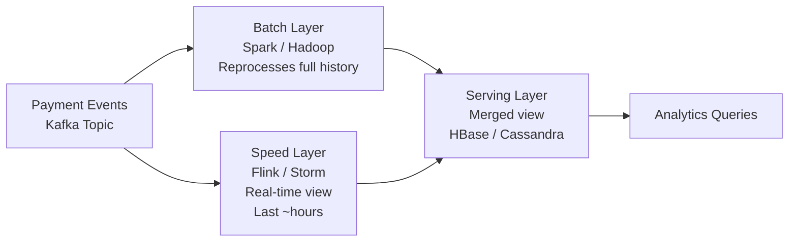
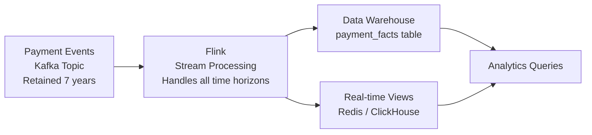
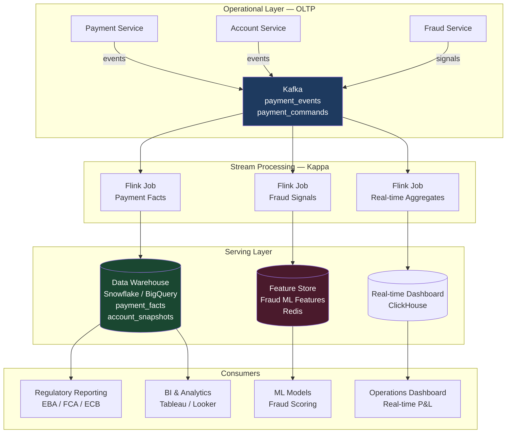

Data architecture in financial services is simultaneously a technical, regulatory, and competitive concern. Payment data must be available for real-time fraud scoring in under 50ms, for regulatory reporting within 24 hours, for customer analytics within hours, and for auditors going back seven years. These requirements cannot be satisfied by a single database with read replicas. They require a deliberate architecture that separates operational data stores from analytical platforms, defines ownership boundaries for data at the domain level, and implements lineage tracking to satisfy EBA, FCA, and GDPR obligations simultaneously.

## Learning Objectives

- Distinguish OLTP and OLAP workload characteristics and explain why they require separate infrastructure in payment systems
- Compare Lambda and Kappa architectures for financial analytics, with specific trade-offs for payment event processing
- Apply data mesh principles — domain-oriented data ownership, data as a product — to a retail banking organisation
- Trace a `payment_events` Kafka topic through Flink stream processing to a `payment_facts` data warehouse table
- Explain data lineage requirements under EBA data governance guidelines and how event sourcing satisfies them
- Evaluate schema-on-read vs schema-on-write trade-offs for transaction data with regulatory immutability requirements
- Identify GDPR data residency implications for multi-region financial data platforms
- Design a real-time analytics query that runs against a streaming layer without touching the operational database

## Business Context

In 2023, a UK challenger bank received an FCA Section 166 notice requesting complete data lineage for its credit risk models — specifically: for each customer who had been declined a loan in the previous 24 months, what data inputs had been used, what transformations had been applied, and where had those inputs originated. The bank had a centralised data lake into which all teams dumped data via nightly batch jobs. It had no lineage tracking, no data contracts between producers and consumers, and no formal ownership of datasets. Responding to the Section 166 took 11 weeks and cost approximately £1.4M in consultant time. The FCA subsequently required a formal data governance remediation programme monitored quarterly.

The core problem was not technical — it was architectural. Data was treated as a shared resource with no domain ownership, no contracts, and no provenance tracking. Data mesh directly addresses this.

## OLTP vs OLAP Separation

Payment processing is an OLTP workload. Risk reporting, customer analytics, and regulatory reporting are OLAP workloads. Their requirements are irreconcilable on the same infrastructure.

| Characteristic | OLTP (Payment Processing) | OLAP (Analytics & Reporting) |
|---|---|---|
| Query pattern | High-frequency, low-row-count lookups | Low-frequency, full-scan aggregations |
| Latency requirement | < 10ms (payment initiation) | Seconds to minutes (acceptable) |
| Data model | Normalised — minimise update anomalies | Denormalised star/snowflake schema |
| Concurrency | 10k+ concurrent write transactions | Tens of parallel analytical queries |
| Index strategy | B-tree on primary/foreign keys | Columnar, bitmap, partial indexes |
| Data volume per query | 1-10 rows | Millions to billions of rows |
| Consistency requirement | Strict ACID | Eventual — T-1 or T-hour acceptable |
| Infrastructure | PostgreSQL, Oracle RAC | BigQuery, Redshift, ClickHouse, Snowflake |

Sharing infrastructure forces compromises that harm both workloads. OLAP queries holding row-scan locks compete with OLTP writes. OLTP indexes slow OLAP scans. Normalisation that prevents OLTP anomalies requires joins that OLAP queries cannot afford.

## Lambda vs Kappa Architecture

Both architectures address the need for both real-time and historical analytics from the same data source (payment events).

**Lambda Architecture** runs two parallel processing paths from the same event stream:



**Kappa Architecture** eliminates the batch layer entirely — the streaming layer processes both real-time events and historical replay from a retained Kafka topic:



| Aspect | Lambda | Kappa |
|---|---|---|
| Operational complexity | High — maintain two processing systems | Lower — single Flink cluster |
| Historical reprocessing | Dedicated batch layer | Replay Kafka topic from offset 0 |
| Latency for real-time view | Low — speed layer is small | Low — same Flink job |
| Consistency | Complexity merging batch + speed views | Single processing pipeline |
| **Fintech verdict** | Legacy choice — many banks still run it | Preferred for new systems |

## Event-Driven Data Pipeline: Kafka → Flink → Data Warehouse

```java
// Flink job consuming payment_events topic and writing to payment_facts
public class PaymentFactsJob {

    public static void main(String[] args) throws Exception {
        StreamExecutionEnvironment env = StreamExecutionEnvironment.getExecutionEnvironment();
        env.enableCheckpointing(60_000);  // Checkpoint every 60 seconds for fault tolerance

        // Source: payment_events Kafka topic
        KafkaSource<PaymentEvent> source = KafkaSource.<PaymentEvent>builder()
            .setBootstrapServers("kafka:9092")
            .setTopics("payment_events")
            .setGroupId("payment-facts-processor")
            .setStartingOffsets(OffsetsInitializer.committedOffsets(OffsetResetStrategy.EARLIEST))
            .setValueOnlyDeserializer(new PaymentEventDeserializer())
            .build();

        DataStream<PaymentEvent> events = env.fromSource(
            source, WatermarkStrategy.forBoundedOutOfOrderness(Duration.ofSeconds(30)), "payment-events");

        // Enrich and transform to analytical fact record
        DataStream<PaymentFact> facts = events
            .filter(e -> e.status() == PaymentStatus.COMPLETED)
            .map(PaymentFactsJob::toFact)
            .keyBy(PaymentFact::currencyCode)
            .window(TumblingEventTimeWindows.of(Time.minutes(1)))
            .aggregate(new PaymentVolumeAggregator());

        // Sink: payment_facts table in data warehouse
        JdbcSink<PaymentFact> sink = JdbcSink.sink(
            """
            INSERT INTO payment_facts
                (payment_id, source_account_id, target_account_id, amount, currency,
                 completed_at, processing_time_ms, payment_type, corridor)
            VALUES (?, ?, ?, ?, ?, ?, ?, ?, ?)
            ON CONFLICT (payment_id) DO NOTHING
            """,
            (statement, fact) -> {
                statement.setObject(1, fact.paymentId());
                statement.setObject(2, fact.sourceAccountId());
                statement.setObject(3, fact.targetAccountId());
                statement.setBigDecimal(4, fact.amount());
                statement.setString(5, fact.currency());
                statement.setTimestamp(6, Timestamp.from(fact.completedAt()));
                statement.setLong(7, fact.processingTimeMs());
                statement.setString(8, fact.paymentType());
                statement.setString(9, fact.corridor());
            },
            JdbcExecutionOptions.builder().withBatchSize(500).build(),
            new JdbcConnectionOptions.JdbcConnectionOptionsBuilder()
                .withUrl("jdbc:postgresql://dw:5432/analytics")
                .withDriverName("org.postgresql.Driver")
                .build()
        );

        facts.addSink(sink);
        env.execute("payment-facts-pipeline");
    }

    private static PaymentFact toFact(PaymentEvent event) {
        return new PaymentFact(
            event.paymentId(),
            event.sourceAccountId(),
            event.targetAccountId(),
            event.amount(),
            event.currency(),
            event.completedAt(),
            Duration.between(event.initiatedAt(), event.completedAt()).toMillis(),
            event.paymentType(),
            deriveCorridorFromCurrencies(event.sourceCurrency(), event.targetCurrency())
        );
    }
}
```

## Data Mesh: Domain-Oriented Data Ownership

Data mesh applies the same domain-ownership principle from DDD to data: each domain team owns its data as a product, with an explicit contract (schema), SLA, and quality guarantee for consumers.

| Data Mesh Principle | Traditional Data Lake | Data Mesh |
|---|---|---|
| **Ownership** | Central data engineering team owns all datasets | Domain team owns datasets in their domain |
| **Accountability** | Data quality managed centrally, poorly | Domain team accountable for data product quality |
| **Discovery** | Manual data catalogue, often stale | Machine-readable data contracts in schema registry |
| **Access** | Monolithic data lake, all-or-nothing | Self-serve data platform, per-domain access control |
| **Quality** | Quality checks run centrally, infrequently | Quality embedded in data product CI/CD pipeline |

```java
// Data product: payment-domain publishes a formal PaymentDataProduct contract
// Other teams consume this contract — not direct database access

@DataProduct(
    domain = "payments",
    name = "completed-payments",
    version = "2.1.0",
    sla = @SLA(latencyMinutes = 15, availabilityPercent = 99.9),
    owner = "payments-team@bank.com"
)
public interface CompletedPaymentsDataProduct {

    /**
     * Returns completed payments enriched with corridor and fee data.
     * Schema guaranteed backward-compatible within major version.
     * Consumers: risk-team, analytics-team, regulatory-reporting-team
     */
    DataStream<CompletedPaymentRecord> stream();

    /**
     * Returns payment volume aggregates by currency and corridor.
     * Updated every 5 minutes. Suitable for dashboard queries.
     */
    DataSet<PaymentVolumeAggregate> volumeAggregates();
}
```

## Regulatory Data Requirements: Lineage and Immutability

EBA Guidelines on Internal Governance (2021) and the ECB's Data Reporting Framework require banks to maintain complete data lineage: for any reported figure, the bank must be able to trace the data from the source system through every transformation to the reported output.

Event sourcing satisfies immutability: events are facts that happened; they are never updated or deleted. The event log is the data lineage.

```java
// Immutable payment event — stored once, never mutated
public record PaymentCompletedEvent(
    UUID eventId,
    UUID paymentId,
    UUID sourceAccountId,
    UUID targetAccountId,
    BigDecimal amount,
    String currency,
    Instant completedAt,
    String processingNodeId,    // Which service instance processed it
    String schemaVersion,       // Avro schema version for lineage tracing
    Map<String, String> metadata // Corridor, payment type, regulatory flags
) {
    // Defensive copy — immutable record, no setters
}
```

```sql
-- Data lineage table: every transformation tracked
CREATE TABLE data_lineage (
    lineage_id      UUID PRIMARY KEY DEFAULT gen_random_uuid(),
    source_event_id UUID NOT NULL REFERENCES payment_events(event_id),
    target_dataset  VARCHAR(200) NOT NULL,  -- e.g., 'payment_facts', 'regulatory_report_q4_2026'
    transformation  VARCHAR(100) NOT NULL,  -- e.g., 'payment-facts-pipeline v2.1.0'
    transformed_at  TIMESTAMPTZ NOT NULL DEFAULT NOW(),
    schema_version  VARCHAR(20) NOT NULL
);
```

## Financial Data Platform Architecture Diagram



## Schema-on-Read vs Schema-on-Write

| Approach | Schema-on-Write | Schema-on-Read |
|---|---|---|
| **Definition** | Schema enforced at ingestion time | Schema applied at query time |
| **Example** | Avro with Schema Registry, SQL table | Parquet files in S3, raw JSON in data lake |
| **Validation** | Errors caught at producer | Errors discovered at consumer |
| **Flexibility** | Low — schema changes require coordination | High — new fields can be added freely |
| **Query performance** | High — optimiser knows types | Lower — type inference at query time |
| **Regulatory lineage** | Excellent — schema version tracked per event | Poor — unknown what schema was at time of write |
| **Fintech recommendation** | Operational events, regulatory data | Exploratory analytics, data lake raw layer |

For regulatory reporting, schema-on-write is mandatory. You cannot go back to the FCA and say "we don't know what schema the data was in when it was written." Use Avro with a Schema Registry for all events that will feed regulatory reports.

## GDPR Data Residency Implications

GDPR Article 44 restricts transfer of EU personal data to non-EU jurisdictions without adequate safeguards. For a multi-region financial data platform:

```yaml
# Kafka topic configuration — data residency enforcement
# EU personal data topics stay in EU-WEST-1
payment_events:
  replication-factor: 3
  min.insync.replicas: 2
  # Only replicate to EU regions
  replica.selector.class: org.apache.kafka.common.replica.RackAwareReplicaSelector

# Non-PII analytics topics can replicate globally
payment_volume_aggregates:
  replication-factor: 3
  # Can replicate to US-EAST-1 for latency
```

```java
// PII tokenisation at the event boundary — payment events contain token, not PAN
public record PaymentCompletedEvent(
    UUID paymentId,
    UUID sourceAccountToken,    // tokenised — reversible only in EU
    UUID targetAccountToken,    // tokenised — not the IBAN
    BigDecimal amount,
    String currency,
    Instant completedAt
    // No customer name, no IBAN, no PAN — PII stays in account service DB
) {}
```

## Knowledge Check

**Q1: Your Flink payment facts job has been running for 6 months. The payments team needs to add a new field `corridor` to the `PaymentCompletedEvent` schema. Some events in Kafka are old (pre-corridor field). How do you handle schema evolution without breaking the Flink job or historical reprocessing?**

A: Use Avro with a Schema Registry configured for BACKWARD_TRANSITIVE compatibility. Add the `corridor` field with a default value (`null` or `"DOMESTIC"`). Old events that lack the field will deserialise successfully, with the default applied. The Flink job's `toFact` method handles the nullable field — either deriving corridor from currency codes when the field is absent, or using it directly when present. For historical reprocessing (replaying Kafka from offset 0), the same logic applies. Document the schema change in an ADR and register the new schema version before deploying the updated Flink job. Never use FULL or NONE compatibility for financial event schemas — backward compatibility is the minimum requirement for safely replaying historical events.

**Q2: The FCA requests data lineage for all loan decisions made using payment history data over the past 2 years. Your data lake stores raw Parquet files from various ETL jobs with no schema versioning. What is the fundamental problem with your current architecture, and what would you change?**

A: The fundamental problem is schema-on-read without lineage tracking. Parquet files in a data lake preserve data but not the schema version that was current when the data was written, the transformation logic that produced the file, or the upstream source event that triggered the transformation. The FCA's question — "what data was used and how was it transformed?" — cannot be answered without that provenance. The architectural fix is threefold: (1) emit all source events to Kafka using Avro with a Schema Registry, so each event carries a schema version ID; (2) implement a `data_lineage` table that records source event ID, transformation pipeline version, and output dataset for every write; (3) adopt the data mesh model so the payments domain team owns and guarantees the quality of their data products. This is a 6-12 month programme, not a quick fix.

## Practical Challenge

**Scenario:** You are the data architect for a UK neobank. The bank processes 3 million payments per day. The data team has a monolithic data lake (S3 + Spark batch jobs running nightly) that is failing to meet the following requirements: real-time fraud feature generation (latency < 1 minute), regulatory reporting with lineage (FCA Section 166 readiness), and GDPR-compliant data residency for EU customer data.

**Task 1 — Pipeline Design:** Design a Flink streaming job that consumes `payment_events` from Kafka, filters for completed payments, computes a 5-minute tumbling window aggregate of payment volume per currency per corridor, and writes both individual facts and aggregates to separate sinks. Write the Flink job skeleton with source, transformation, window, and sink definitions.

**Task 2 — Schema Evolution:** Define an Avro schema for `PaymentCompletedEvent` v1 and v2 (v2 adds `processingRegion` field). Write the Schema Registry configuration to enforce BACKWARD_TRANSITIVE compatibility. Write a unit test that verifies a v1 event deserialises successfully with the v2 reader schema, with `processingRegion` defaulting to `"UNKNOWN"`.

**Task 3 — Data Lineage:** Design the SQL schema for a `data_lineage` table that can answer the FCA's question: "For customer X's loan decision on date Y, list every payment event that influenced the decision, the schema version of each event, and the pipeline version that transformed it." Include the foreign key relationships and the query you would run to answer this question.

**Task 4 — GDPR Residency:** The bank has customers in Germany, France, and the UK. The data warehouse is in AWS us-east-1 for cost reasons. Identify which fields in `PaymentCompletedEvent` are personal data under GDPR, propose a tokenisation strategy, and write the Kafka topic configuration that ensures PII events are only processed in EU regions.

<!-- KNOWLEDGE-CHECK
{
  "questions": [
    {
      "id": "q1",
      "text": "Your Flink payment facts job needs to replay 6 months of historical payment events from Kafka to recompute aggregates after a bug fix. What Kafka configuration makes this possible, and what is the typical retention setting for a fintech event log?",
      "options": [
        "Kafka does not support replay — historical data must be fetched from the database",
        "log.retention.ms set to 7 years (the regulatory retention period); Flink consumer seeks to offset 0 to replay",
        "Kafka compaction retains only the latest event per key — replay requires a snapshot database",
        "Kafka MirrorMaker replicates events to S3 for replay; direct topic replay is not supported"
      ],
      "correct": 1,
      "explanation": "Kafka's log retention (log.retention.ms or log.retention.bytes) controls how long events are kept. For financial event logs, retaining events for 7 years satisfies typical regulatory requirements and enables full historical replay. Flink's KafkaSource supports seeking to any offset including the beginning of the topic. This is the defining advantage of Kappa architecture over Lambda: a single streaming pipeline handles both real-time and historical reprocessing."
    },
    {
      "id": "q2",
      "text": "A data mesh principle states that domain teams own their data as a product. What does this mean for the payments team's relationship with the regulatory reporting team?",
      "options": [
        "The payments team must provide direct database access to the regulatory reporting team",
        "The payments team publishes a versioned, SLA-backed data product (Kafka topic or data warehouse table) that the regulatory team consumes via a formal contract",
        "The regulatory team runs their own ETL from the payments database on a schedule they control",
        "A central data engineering team owns all data products regardless of which domain produced the data"
      ],
      "correct": 1,
      "explanation": "Data mesh replaces shared database access and centralised ETL with domain-owned data products. The payments team publishes a formal data product — a Kafka topic or data warehouse table — with a schema contract, SLA, and quality guarantee. The regulatory reporting team consumes this product via the contract, not via direct database access. The payments team is accountable for schema evolution, data quality, and meeting the SLA. This is what makes data lineage tractable: every consumer knows the producer and the contract version."
    }
  ]
}
-->

<!-- PRACTICAL-CHALLENGE
{
  "title": "Data Architecture for Financial Systems \u2014 Production Implementation",
  "difficulty": "advanced",
  "estimatedMinutes": 60,
  "tasks": [
    {
      "id": "1",
      "description": "Write a Flink job consuming payment_events from Kafka, filtering completed payments, computing 5-minute tumbling window aggregates per currency/corridor, and writing facts and aggregates to separate s"
    },
    {
      "id": "2",
      "description": "Define Avro schemas for PaymentCompletedEvent v1 and v2 (adds processingRegion field). Configure Schema Registry BACKWARD_TRANSITIVE compatibility. Write a test verifying v1 events deserialise with v2"
    },
    {
      "id": "3",
      "description": "Design a data_lineage SQL table schema answering: \"For customer X's loan decision on date Y, list every payment event that influenced it, its schema version, and the pipeline version that transformed"
    },
    {
      "id": "4",
      "description": "Identify personal data fields in PaymentCompletedEvent, propose a tokenisation strategy, and write Kafka topic configuration ensuring PII events are processed only in EU regions"
    }
  ]
}
-->
