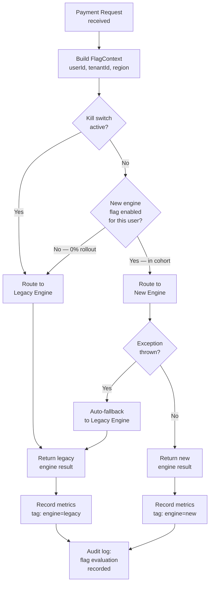

مفاتيح الميزات (Feature Flags) — وتُسمى أيضًا مبدّلات الميزات (feature toggles) — من أقوى الأدوات في عُدّة مهندس التقنية المالية ومن أكثرها سوءًا في الاستخدام. فعندما احتاج فريق معالجة المدفوعات في بنك أوروبي كبير إلى ترحيل 40 مليون حساب إلى محرك تفويض جديد، لم يجدول تحويلًا شاملًا دفعة واحدة في الثانية فجرًا يوم أحد. بل استخدم نشرًا تدريجيًا يتحكم فيه مفتاح ميزة، فانتقل من 0.1% من الحركة إلى 100% خلال ستة أسابيع، مع مفتاح إيقاف فوري (kill switch) يستطيع إعادة كل معاملة إلى المسار القديم خلال 200 مللي ثانية. ويشرح هذا الدرس كيف تصمم ذلك النظام بشكل صحيح.

## أهداف التعلّم

- التمييز بين الفئات الأربع لمفاتيح الميزات واختيار النوع الصحيح لحالة استخدام مصرفية معينة
- تنفيذ واجهة `FeatureFlagService` مدعومة بـ LaunchDarkly تعزل شيفرة التطبيق عن مزوّد المفاتيح
- تصميم قواعد الاستهداف — النشر بالنسبة المئوية، وشرائح المستخدمين، والمنطقة — وفهم كيف تتركب معًا
- تطبيق نمط مفتاح الإيقاف لحماية مسار شيفرة معالجة المدفوعات من تنفيذ جديد معيب
- تنفيذ إطلاق خفي (dark launch) لترحيل عالي المخاطر بتمرير حركة ظل عبر الخدمة الجديدة
- إدارة دورة حياة المفاتيح، وتحديد المفاتيح اليتيمة كدَين تقني، وتنفيذ عملية تنظيف آلية
- كتابة اختبارات تغطي كل مسار شيفرة يتحكم فيه مفتاح
- بناء سجل تدقيق يلبي متطلبات الامتثال لتغييرات السلوك التي تقودها المفاتيح

## سياق العمل

لنأخذ بنكًا رقميًا بريطانيًا (مثال مركّب) أطلق محركًا جديدًا لحساب حدود الدفع لحظيًا دون مفتاح ميزة. وخلال ذروة الحركة في الجمعة السوداء، ظهرت في المحرك الجديد حالة تسابق طبّقت حد إنفاق صفري على 180,000 عميل. وتطلب الإصلاح نشر إصلاح عاجل استغرق 23 دقيقة، لم يستطع خلالها هؤلاء العملاء الإنفاق. وبلغ الأثر المرئي للعملاء نحو 4.2 مليون جنيه إسترليني من المعاملات المرفوضة و14,000 شكوى. وخلصت مراجعة ما بعد الحادث إلى أن مفتاح إيقاف كان سيحل المشكلة في أقل من 30 ثانية. والتغيير المعماري الذي فُرض بعد الحادث: كل مسار شيفرة جديد يلمس تفويض الدفع يجب أن يكون خلف مفتاح ميزة تشغيلي لمدة 30 يومًا على الأقل بعد الإطلاق.

## تصنيف مفاتيح الميزات

يعرّف تصنيف Pete Hodgson (المنشور على موقع martinfowler.com) أربعة أنواع من المفاتيح، لكل منها خصائص مختلفة. واستخدام النوع الخاطئ يصنع دينًا تقنيًا وخطر امتثال.

| نوع المفتاح | العمر | المالك | نقطة القرار |
|---|---|---|---|
| **مفتاح إصدار (Release)** | أيام إلى أسابيع | الهندسة | عند النشر: هل الميزة جاهزة؟ |
| **مفتاح تجربة (Experiment)** | أسابيع إلى أشهر | المنتج/البيانات | اختبار A/B: أي نسخة تحقق تحويلًا أفضل؟ |
| **مفتاح تشغيل (Ops)** | دائم | المنصة/SRE | مفتاح إيقاف، وقاطع دائرة، وتخفيف الحمل |
| **مفتاح صلاحية (Permission)** | دائم | المنتج | الاستحقاق: هل دفع هذا المستأجر مقابل هذه الميزة؟ |

```java
// Flag type constants make intent explicit in code reviews
public enum FeatureFlagType {
    RELEASE,      // Temporary — must be removed after full rollout
    EXPERIMENT,   // Temporary — must be removed after conclusion
    OPS,          // Permanent — kill switch, ops override
    PERMISSION    // Permanent — entitlement gating
}

@Retention(RetentionPolicy.RUNTIME)
@Target(ElementType.METHOD)
public @interface FeatureFlag {
    String key();
    FeatureFlagType type();
    String jira() default "";  // Ticket to clean up RELEASE/EXPERIMENT flags
}
```

> [!WARNING]
> مفاتيح التشغيل ومفاتيح الصلاحية دائمة بطبيعتها ويجب ألا تُعامل أبدًا كأهداف للتنظيف. أما مفاتيح الإصدار والتجربة فمؤقتة وتتراكم كدَين تقني إذا لم تُزل.

## الواجهة FeatureFlagService

ربط شيفرة التطبيق مباشرة بـ SDK الخاص بـ LaunchDarkly يخلق اعتمادًا صلبًا على مكتبة طرف ثالث في كل أنحاء قاعدة الشيفرة. والأسلوب الصحيح واجهة ضيقة يستدعيها تطبيقك، مع LaunchDarkly كخلفية قابلة للاستبدال. (يوحّد مشروع OpenFeature التابع لـ CNCF هذا النوع من الواجهات المحايدة تجاه المزوّدين بالضبط، مع مزوّدات لـ LaunchDarkly وUnleash وflagd وغيرها.)

```java
// Core abstraction — application code only depends on this interface
public interface FeatureFlagService {
    boolean isEnabled(String flagKey, FlagContext context);
    <T> T getVariant(String flagKey, FlagContext context, Class<T> type, T defaultValue);
}

public record FlagContext(
    String userId,
    String tenantId,
    String region,
    Map<String, String> attributes
) {
    public static FlagContext forUser(String userId, String tenantId, String region) {
        return new FlagContext(userId, tenantId, region, Map.of());
    }
}

// LaunchDarkly implementation — isolated to infrastructure layer
@Component
@Profile("!test")
public class LaunchDarklyFeatureFlagService implements FeatureFlagService {

    private final LDClient ldClient;

    public LaunchDarklyFeatureFlagService(@Value("${launchdarkly.sdk-key}") String sdkKey) {
        LDConfig config = new LDConfig.Builder()
            .events(Components.sendEvents().flushInterval(Duration.ofSeconds(5)))
            .build();
        this.ldClient = new LDClient(sdkKey, config);
    }

    @Override
    public boolean isEnabled(String flagKey, FlagContext context) {
        LDContext ldContext = toLdContext(context);
        // The SDK serves the last value it received; 'false' is used only if it has
        // never connected. Choose each flag's default deliberately (safe = legacy path).
        return ldClient.boolVariation(flagKey, ldContext, false);
    }

    @Override
    public <T> T getVariant(String flagKey, FlagContext context, Class<T> type, T defaultValue) {
        LDContext ldContext = toLdContext(context);
        if (type == String.class) {
            return type.cast(ldClient.stringVariation(flagKey, ldContext, (String) defaultValue));
        }
        if (type == Integer.class) {
            return type.cast(ldClient.intVariation(flagKey, ldContext, (Integer) defaultValue));
        }
        // JSON variations for complex config objects
        LDValue json = ldClient.jsonValueVariation(flagKey, ldContext, LDValue.ofNull());
        if (json.isNull()) {
            return defaultValue;
        }
        try {
            return objectMapper.readValue(json.toJsonString(), type);
        } catch (JsonProcessingException e) {
            return defaultValue;
        }
    }

    private LDContext toLdContext(FlagContext ctx) {
        ContextBuilder builder = LDContext.builder(ctx.userId())
            .set("tenantId", ctx.tenantId())
            .set("region", ctx.region());
        ctx.attributes().forEach(builder::set);
        return builder.build();
    }
}

// Stub for tests — no network calls, no LaunchDarkly dependency
@Component
@Profile("test")
public class StubFeatureFlagService implements FeatureFlagService {
    private final Map<String, Boolean> flags = new ConcurrentHashMap<>();

    public void enable(String flagKey) { flags.put(flagKey, true); }
    public void disable(String flagKey) { flags.put(flagKey, false); }

    @Override
    public boolean isEnabled(String flagKey, FlagContext context) {
        return flags.getOrDefault(flagKey, false);
    }

    @Override
    public <T> T getVariant(String flagKey, FlagContext context, Class<T> type, T defaultValue) {
        return defaultValue;
    }
}
```

يخدم الـ SDK آخر قيمة تلقاها؛ ولا تُستخدم القيمة الافتراضية إلا إذا لم يتصل أبدًا. فاختر القيمة الافتراضية لكل مفتاح عن قصد (والآمن عادة هو المسار القديم).

## نمط مفتاح الإيقاف في معالجة المدفوعات

يجب تقييم المفتاح التشغيلي المستخدم كمفتاح إيقاف في كل طلب — لا تخزينه مؤقتًا لدقائق. ويجب أن يكون ذريًا أيضًا: عندما تقلب المفتاح، يجب أن تستخدم كل الطلبات الجارية التي لم تتخذ بعد القرار المحمي القيمة الجديدة.

```java
@Service
public class PaymentAuthorisationService {

    private static final String NEW_AUTH_ENGINE_FLAG = "payment-auth-new-engine";
    private static final String AUTH_ENGINE_KILL_SWITCH = "payment-auth-kill-switch";

    private final FeatureFlagService flags;
    private final LegacyAuthorisationEngine legacyEngine;
    private final NewAuthorisationEngine newEngine;
    private final MeterRegistry meterRegistry;

    public AuthorisationResult authorise(PaymentRequest request) {
        FlagContext ctx = FlagContext.forUser(
            request.customerId(),
            request.tenantId(),
            request.originRegion()
        );

        // Kill switch takes absolute priority — evaluated first, every time
        if (flags.isEnabled(AUTH_ENGINE_KILL_SWITCH, ctx)) {
            meterRegistry.counter("auth.kill-switch.triggered").increment();
            return legacyEngine.authorise(request);
        }

        boolean useNewEngine = flags.isEnabled(NEW_AUTH_ENGINE_FLAG, ctx);
        Timer.Sample sample = Timer.start(meterRegistry);

        try {
            AuthorisationResult result = useNewEngine
                ? newEngine.authorise(request)
                : legacyEngine.authorise(request);

            sample.stop(meterRegistry.timer("auth.engine.duration",
                "engine", useNewEngine ? "new" : "legacy",
                "outcome", result.decision().name()));

            return result;
        } catch (RuntimeException e) {
            if (!useNewEngine) {
                throw e;   // a legacy failure is not retried on the legacy engine
            }
            // Automatic fallback to legacy when the NEW engine fails. Safe only because
            // both engines are idempotent on the payment id and the new engine has no
            // side effects (holds, ledger writes) before it reaches a decision.
            meterRegistry.counter("auth.new-engine.fallback").increment();
            log.error("New auth engine failed, falling back to legacy", e);
            return legacyEngine.authorise(request);
        }
    }
}
```

لا يُعاد تشغيل المحرك القديم إذا كان هو نفسه من فشل. والرجوع التلقائي إلى المحرك القديم عند فشل المحرك الجديد آمن فقط لأن المحركين آمنان من التكرار على معرّف الدفعة، ولأن المحرك الجديد لا يحدث أي أثر جانبي (حجوزات، أو كتابات في دفتر الأستاذ) قبل أن يصل إلى قرار.

## الإطلاق الخفي للترحيلات عالية المخاطر

يشغّل الإطلاق الخفي مسار الشيفرة الجديد بالتوازي مع مسار الإنتاج، ويقارن النتائج دون تعريض المستخدمين للسلوك الجديد. وهذا أكثر أساليب الترحيل أمانًا للمنطق المالي عالي المخاطر — بشرط أن يكون تشغيل الظل تشغيلًا تجريبيًا (dry run): يحسب إجابته دون تحريك أي مال، أو الكتابة في دفتر الأستاذ، أو إرسال ملفات إلى شبكة دفع.

```java
@Service
public class DarkLaunchPaymentProcessor {

    private static final String DARK_LAUNCH_FLAG = "settlement-engine-dark-launch";

    private final FeatureFlagService flags;
    private final LegacySettlementEngine legacyEngine;
    private final NewSettlementEngine newEngine;
    private final DarkLaunchResultStore resultStore;
    private final Executor shadowExecutor;  // dedicated thread pool — never blocks main path

    public SettlementResult settle(SettlementRequest request) {
        FlagContext ctx = FlagContext.forUser(
            request.batchId(), request.tenantId(), request.region());

        // Always execute legacy — this is the production result
        SettlementResult legacyResult = legacyEngine.settle(request);

        // Dark launch: run new engine asynchronously, never on the critical path
        if (flags.isEnabled(DARK_LAUNCH_FLAG, ctx)) {
            shadowExecutor.execute(() -> runShadow(request, legacyResult));
        }

        return legacyResult;  // Always return legacy result during dark launch
    }

    private void runShadow(SettlementRequest request, SettlementResult legacyResult) {
        try {
            // Dry run: compute the result only — no money moved, no scheme files sent
            SettlementResult newResult = newEngine.simulate(request);
            DarkLaunchComparison comparison = compare(legacyResult, newResult);

            resultStore.record(DarkLaunchRecord.builder()
                .requestId(request.batchId())
                .legacyResult(legacyResult)
                .newResult(newResult)
                .matched(comparison.matched())
                .divergences(comparison.divergences())
                .timestamp(Instant.now())
                .build());

            if (!comparison.matched()) {
                log.warn("Dark launch divergence for batch {}: {}",
                    request.batchId(), comparison.divergences());
            }
        } catch (Exception e) {
            log.error("Shadow execution failed for batch {}", request.batchId(), e);
            // Shadow failures are never propagated to caller
        }
    }
}
```

## مسار شيفرة دفع يتحكم فيه مفتاح

يوضح المخطط التالي كيف يندمج تقييم المفاتيح في تدفق معالجة الدفع، مع تقييم مفتاح الإيقاف قبل أي عمليات مكلفة.



## دورة حياة المفاتيح وتنظيف المفاتيح اليتيمة

يجب إزالة مفاتيح الإصدار والتجربة بعد اكتمال النشر. والمفاتيح اليتيمة دَين تقني: تضيف فروعًا شرطية يجب على كل مهندس جديد فهمها، ويمكن إعادة تفعيلها بالخطأ، وتضيف زمن تقييم لا يخدم أي غرض.

```java
// Annotation-driven cleanup tracking
@FeatureFlag(
    key = "payment-auth-new-engine",
    type = FeatureFlagType.RELEASE,
    jira = "PAY-4421"  // Ticket to remove this flag after full rollout
)
public AuthorisationResult authorise(PaymentRequest request) { ... }

// Automated staleness detection — run as a scheduled job
@Component
public class OrphanedFlagDetector {

    private static final Duration STALE_RELEASE_THRESHOLD = Duration.ofDays(90);

    @Scheduled(cron = "0 0 9 * * MON")  // Monday mornings
    public void reportStaleFlags() {
        List<FlagMetadata> staleFlags = flagRegistry.findAll().stream()
            .filter(f -> f.type() == FeatureFlagType.RELEASE
                || f.type() == FeatureFlagType.EXPERIMENT)
            .filter(f -> f.createdAt().isBefore(Instant.now().minus(STALE_RELEASE_THRESHOLD)))
            .filter(f -> f.rolloutPercentage() == 100 || f.rolloutPercentage() == 0)
            .toList();

        if (!staleFlags.isEmpty()) {
            alertingService.sendSlackMessage("#platform-engineering",
                "Stale feature flags require cleanup: " + staleFlags.stream()
                    .map(f -> f.key() + " (created " + f.createdAt().toLocalDate() + ", jira: " + f.jira() + ")")
                    .collect(joining("\n")));
        }
    }
}
```

## الاختبار مع مفاتيح الميزات

كل مسار شيفرة يتحكم فيه مفتاح يجب أن تكون له اختبارات لحالتي التفعيل والتعطيل. استخدم `StubFeatureFlagService` لتجنب أي اعتماد للاختبارات على خدمة إدارة المفاتيح.

```java
@SpringBootTest
@ActiveProfiles("test")
class PaymentAuthorisationServiceTest {

    @Autowired
    private StubFeatureFlagService flagService;

    @Autowired
    private PaymentAuthorisationService authorisationService;

    @Test
    void whenKillSwitchEnabled_routesToLegacyEngine() {
        flagService.enable("payment-auth-kill-switch");
        flagService.enable("payment-auth-new-engine");

        PaymentRequest request = PaymentRequest.builder()
            .customerId("cust-001")
            .amount(Money.of(500, "GBP"))
            .build();

        AuthorisationResult result = authorisationService.authorise(request);

        assertThat(result.engineUsed()).isEqualTo("legacy");
    }

    @Test
    void whenNewEngineFlagEnabled_routesToNewEngine() {
        flagService.disable("payment-auth-kill-switch");
        flagService.enable("payment-auth-new-engine");

        AuthorisationResult result = authorisationService.authorise(
            PaymentRequest.builder().customerId("cust-001").amount(Money.of(100, "GBP")).build());

        assertThat(result.engineUsed()).isEqualTo("new");
    }

    @Test
    void whenNewEngineThrowsException_fallsBackToLegacy() {
        flagService.disable("payment-auth-kill-switch");
        flagService.enable("payment-auth-new-engine");
        newEngineStub.throwOnNextCall(new RuntimeException("simulated engine failure"));

        AuthorisationResult result = authorisationService.authorise(
            PaymentRequest.builder().customerId("cust-001").amount(Money.of(100, "GBP")).build());

        assertThat(result.engineUsed()).isEqualTo("legacy");
    }
}
```

## الامتثال: سجل تدقيق لتغييرات المفاتيح

في بيئات التقنية المالية الخاضعة للتنظيم، تغيير مفتاح ميزة تغيير جوهري في سلوك النظام. ويتوقع PCI DSS v4.0 أن تمر التغييرات على الأنظمة ضمن النطاق عبر ضبط التغيير (المتطلب 6.5) وأن تكون قابلة للتتبع في سجلات التدقيق (المتطلب 10)، ويتوقع المشرفون على المرونة التشغيلية الانضباط نفسه: كل تغيير في مفتاح يؤثر على معالجة المدفوعات يجب أن يسجل من غيّر ماذا ومتى.

```java
// LaunchDarkly audit webhook receiver — record every flag change
@RestController
@RequestMapping("/webhooks/launchdarkly")
public class LaunchDarklyAuditWebhook {

    private final AuditLogService auditLog;

    @PostMapping
    public ResponseEntity<Void> handleFlagChange(
            @RequestBody FlagChangeEvent event,
            @RequestHeader("X-LD-Signature") String signature) {

        validateSignature(event, signature);

        auditLog.record(AuditEntry.builder()
            .eventType("FEATURE_FLAG_CHANGE")
            .flagKey(event.flagKey())
            .changedBy(event.changedBy().email())
            .previousValue(event.previousVariation())
            .newValue(event.currentVariation())
            .targetingRuleChange(event.targetingRuleDescription())
            .timestamp(event.timestamp())
            .complianceNote("Flag change affects payment authorisation code path")
            .build());

        return ResponseEntity.ok().build();
    }
}
```

<!-- KNOWLEDGE-CHECK
{
  "questions": [
    {
      "id": "q1",
      "text": "أكمل فريقك للتو نشرًا بنسبة 100% لمحرك جديد لحساب حدود الدفع كان خلف مفتاح إصدار لمدة 60 يومًا. كل المقاييس سليمة. ما الإجراء الصحيح التالي؟",
      "options": [
        "إبقاء المفتاح دائمًا كمفتاح إيقاف",
        "تغيير نوع المفتاح من RELEASE إلى OPS ليصبح مفتاح إيقاف دائمًا",
        "إنشاء تذكرة Jira لإزالة المفتاح وكل الفروع الشرطية من قاعدة الشيفرة خلال السبرنت التالي",
        "تعطيل المفتاح وأرشفته في نظام إدارة المفاتيح"
      ],
      "correct": 2,
      "explanation": "مفتاح الإصدار مؤقت بتعريفه. وإبقاؤه يراكم دَينًا تقنيًا: فروع شيفرة ميتة، وزمن تقييم، وعبء ذهني على المهندسين في المستقبل. والإجراء الصحيح إزالة المفتاح وكل منطق التفرع من قاعدة الشيفرة. وإذا احتجت إلى مفتاح إيقاف دائم، فذلك مفتاح تشغيل منفصل بدلالات مختلفة ويجب تصميمه عن قصد."
    },
    {
      "id": "q2",
      "text": "أثناء إطلاق خفي، ينتج محرك التسوية الجديد نتائج تختلف عن المحرك القديم في 0.3% من الدفعات. لا يتأثر أي عميل لأن نتيجة المحرك القديم تُعاد دائمًا. ماذا يجب أن يحدث بعد ذلك؟",
      "options": [
        "نسبة الاختلاف أقل من 1%، فالتحويل إلى المحرك الجديد مقبول",
        "التحقيق في كل حالة اختلاف، وتصنيف سببها، وعدم المضي في التحويل إلا عندما تصبح نسبة الاختلاف صفرًا أو يُؤكَّد أن الاختلافات تحسينات مقصودة",
        "زيادة نسبة الإطلاق الخفي إلى 100% لجمع بيانات أكثر",
        "التراجع عن المحرك الجديد — أي اختلاف يعني أن المحرك الجديد خاطئ"
      ],
      "correct": 1,
      "explanation": "في الأنظمة المالية، نسبة اختلاف 0.3% ليست حدًا مقبولًا للتحويل. يجب التحقيق في كل اختلاف. فبعضها قد يكون أخطاء في المحرك الجديد، وبعضها أخطاء في المحرك القديم يصححها الجديد، وبعضها اختلافات متوقعة في معالجة حالات حدّية. ويجب أن تفهم كل اختلاف وتصنّفه قبل التحويل."
    }
  ]
}
-->

<!-- PRACTICAL-CHALLENGE
{
  "title": "مفاتيح الميزات والإطلاق التدريجي في البنوك — تطبيق في بيئة الإنتاج",
  "difficulty": "advanced",
  "estimatedMinutes": 60,
  "tasks": [
    {
      "id": "1",
      "description": "يرحّل بنكك محرك إرسال الدفعات الدائنة المباشرة BACS إلى تنفيذ جديد. صمّم تصنيف مفاتيح الميزات لهذا الترحيل: ما المفاتيح التي تحتاجها، ونوع كل منها، وقواعد استهدافها. وحدّد مراحل النشر (نقاط النسب المئوية) ومعايير الانتقال من مرحلة إلى التالية."
    },
    {
      "id": "2",
      "description": "نفّذ BacsSubmissionService بمفتاح إيقاف من نوع التشغيل يسري على الطلبات الجديدة خلال 200 مللي ثانية من قلبه. واشرح كيف تختبر مفتاح الإيقاف دون التأثير على حركة الإنتاج."
    },
    {
      "id": "3",
      "description": "يولّد المحرك الجديد قيم التجزئة لملفات BACS بطريقة مختلفة. صمّم منطق المقارنة في الإطلاق الخفي: أي الحقول تقارن، وأيها تستبعد كاختلافات متوقعة، وعند أي نسبة اختلاف — وبعد أي تحقيق — تسمح بالتحويل."
    },
    {
      "id": "4",
      "description": "يطلب فريق الامتثال لديك سجل تدقيق كاملًا لكل تغييرات المفاتيح من أجل PCI DSS. صمّم مخطط سجل التدقيق وعملية مراجعة تغييرات المفاتيح في نظام إدارة التغيير لديك (مثل ServiceNow)."
    }
  ]
}
-->
