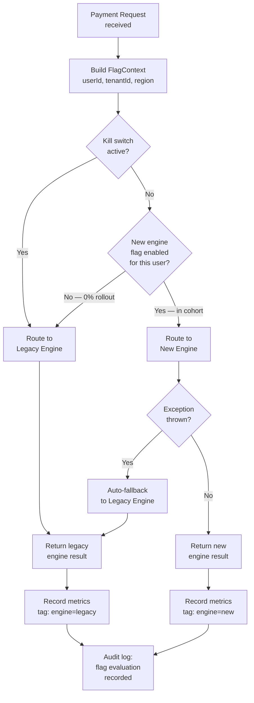

Feature flags — also called feature toggles — are one of the most powerful and most misused tools in a fintech engineer's toolkit. When a payment processing team at a large European bank needed to migrate 40 million accounts to a new authorisation engine, they did not schedule a big-bang cutover at 2 a.m. on a Sunday. They used a progressive rollout controlled by a feature flag, moving from 0.1% of traffic to 100% over six weeks, with an instantaneous kill switch that could revert every transaction within 200 milliseconds. This lesson covers how to design that system correctly.

## Learning Objectives

- Distinguish the four categories of feature flags and choose the correct type for a given banking use case
- Implement a `FeatureFlagService` abstraction backed by LaunchDarkly that isolates application code from the flag vendor
- Design targeting rules — percentage rollout, user segment, region — and understand how they compose
- Apply the kill switch pattern to protect a payment processing code path from a faulty new implementation
- Execute a dark launch for a high-risk migration by running shadow traffic through the new service
- Manage flag lifecycle, identify orphaned flags as technical debt, and implement an automated cleanup process
- Write tests that exercise every code path controlled by a flag
- Build an audit trail that satisfies compliance requirements for flag-driven behaviour changes

## Business Context

In 2021, a UK neobank shipped a new real-time payment limit calculation engine without a feature flag. During peak traffic on Black Friday, the new engine exhibited a race condition that applied a £0 spending limit to 180,000 customers. The fix required a hotfix deployment that took 23 minutes, during which those customers could not spend. Total estimated customer-visible impact: £4.2 million in declined transactions and 14,000 customer complaints. Post-incident review concluded that a kill switch would have resolved the issue in under 30 seconds. The architectural change mandated after the incident: every new code path touching payment authorisation must be gated by an operational feature flag for a minimum of 30 days post-launch.

## Feature Flag Taxonomy

Martin Fowler's taxonomy defines four flag types, each with different characteristics. Using the wrong type creates technical debt and compliance risk.

| Flag Type | Lifespan | Owner | Decision Point |
|---|---|---|---|
| **Release flag** | Days to weeks | Engineering | At deployment: is this feature ready? |
| **Experiment flag** | Weeks to months | Product/Data | A/B test: which variant converts better? |
| **Ops flag** | Permanent | Platform/SRE | Kill switch, circuit breaker, load shed |
| **Permission flag** | Permanent | Product | Entitlement: has this tenant paid for this feature? |

```java
// Flag type constants make intent explicit in code reviews
public enum FeatureFlagType {
    RELEASE,      // Temporary — must be removed after full rollout
    EXPERIMENT,   // Temporary — must be removed after conclusion
    OPS,          // Permanent — kill switch, ops override
    PERMISSION    // Permanent — entitlement gating
}

@Retention(RetentionPolicy.RUNTIME)
@Target(ElementType.METHOD)
public @interface FeatureFlag {
    String key();
    FeatureFlagType type();
    String jira() default "";  // Ticket to clean up RELEASE/EXPERIMENT flags
}
```

> [!WARNING]
> Ops flags and permission flags are permanent by design and should never be treated as cleanup targets. Release flags and experiment flags are temporary and accumulate as technical debt if not removed.

## FeatureFlagService Abstraction

Coupling application code directly to the LaunchDarkly SDK creates a hard dependency on a third-party library throughout your codebase. The correct approach is a narrow abstraction that your application calls, with LaunchDarkly as a pluggable backend.

```java
// Core abstraction — application code only depends on this interface
public interface FeatureFlagService {
    boolean isEnabled(String flagKey, FlagContext context);
    <T> T getVariant(String flagKey, FlagContext context, Class<T> type, T defaultValue);
}

public record FlagContext(
    String userId,
    String tenantId,
    String region,
    Map<String, String> attributes
) {
    public static FlagContext forUser(String userId, String tenantId, String region) {
        return new FlagContext(userId, tenantId, region, Map.of());
    }
}

// LaunchDarkly implementation — isolated to infrastructure layer
@Component
@Profile("!test")
public class LaunchDarklyFeatureFlagService implements FeatureFlagService {

    private final LDClient ldClient;

    public LaunchDarklyFeatureFlagService(@Value("${launchdarkly.sdk-key}") String sdkKey) {
        LDConfig config = new LDConfig.Builder()
            .events(Components.sendEvents().flushIntervalSeconds(5))
            .build();
        this.ldClient = new LDClient(sdkKey, config);
    }

    @Override
    public boolean isEnabled(String flagKey, FlagContext context) {
        LDContext ldContext = toLdContext(context);
        return ldClient.boolVariation(flagKey, ldContext, false);
    }

    @Override
    public <T> T getVariant(String flagKey, FlagContext context, Class<T> type, T defaultValue) {
        LDContext ldContext = toLdContext(context);
        if (type == String.class) {
            return type.cast(ldClient.stringVariation(flagKey, ldContext, (String) defaultValue));
        }
        if (type == Integer.class) {
            return type.cast(ldClient.intVariation(flagKey, ldContext, (Integer) defaultValue));
        }
        // JSON variations for complex config objects
        return ldClient.jsonValueVariation(flagKey, ldContext,
            LDValue.ofNull(), LDValue.class).as(type);
    }

    private LDContext toLdContext(FlagContext ctx) {
        return LDContext.builder(ctx.userId())
            .set("tenantId", ctx.tenantId())
            .set("region", ctx.region())
            .putAll(ctx.attributes().entrySet().stream()
                .collect(LDAttributeMap.collector()))
            .build();
    }
}

// Stub for tests — no network calls, no LaunchDarkly dependency
@Component
@Profile("test")
public class StubFeatureFlagService implements FeatureFlagService {
    private final Map<String, Boolean> flags = new ConcurrentHashMap<>();

    public void enable(String flagKey) { flags.put(flagKey, true); }
    public void disable(String flagKey) { flags.put(flagKey, false); }

    @Override
    public boolean isEnabled(String flagKey, FlagContext context) {
        return flags.getOrDefault(flagKey, false);
    }

    @Override
    public <T> T getVariant(String flagKey, FlagContext context, Class<T> type, T defaultValue) {
        return defaultValue;
    }
}
```

## Kill Switch Pattern for Payment Processing

An operational flag used as a kill switch must be evaluated on every request — not cached for minutes. It must also be atomic: when you flip the switch, all in-flight requests that have not yet made the guarded decision must use the new value.

```java
@Service
public class PaymentAuthorisationService {

    private static final String NEW_AUTH_ENGINE_FLAG = "payment-auth-new-engine";
    private static final String AUTH_ENGINE_KILL_SWITCH = "payment-auth-kill-switch";

    private final FeatureFlagService flags;
    private final LegacyAuthorisationEngine legacyEngine;
    private final NewAuthorisationEngine newEngine;
    private final MeterRegistry meterRegistry;

    public AuthorisationResult authorise(PaymentRequest request) {
        FlagContext ctx = FlagContext.forUser(
            request.customerId(),
            request.tenantId(),
            request.originRegion()
        );

        // Kill switch takes absolute priority — evaluated first, every time
        if (flags.isEnabled(AUTH_ENGINE_KILL_SWITCH, ctx)) {
            meterRegistry.counter("auth.kill-switch.triggered").increment();
            return legacyEngine.authorise(request);
        }

        boolean useNewEngine = flags.isEnabled(NEW_AUTH_ENGINE_FLAG, ctx);
        Timer.Sample sample = Timer.start(meterRegistry);

        try {
            AuthorisationResult result = useNewEngine
                ? newEngine.authorise(request)
                : legacyEngine.authorise(request);

            sample.stop(meterRegistry.timer("auth.engine.duration",
                "engine", useNewEngine ? "new" : "legacy",
                "outcome", result.decision().name()));

            return result;
        } catch (Exception e) {
            // Automatic fallback to legacy on any exception from new engine
            meterRegistry.counter("auth.new-engine.fallback").increment();
            log.error("New auth engine failed, falling back to legacy", e);
            return legacyEngine.authorise(request);
        }
    }
}
```

## Dark Launch for High-Risk Migrations

A dark launch runs the new code path in parallel with the production path, comparing results without exposing users to the new behaviour. This is the safest possible migration technique for high-risk financial logic.

```java
@Service
public class DarkLaunchPaymentProcessor {

    private static final String DARK_LAUNCH_FLAG = "settlement-engine-dark-launch";

    private final FeatureFlagService flags;
    private final LegacySettlementEngine legacyEngine;
    private final NewSettlementEngine newEngine;
    private final DarkLaunchResultStore resultStore;
    private final Executor shadowExecutor;  // dedicated thread pool — never blocks main path

    public SettlementResult settle(SettlementRequest request) {
        FlagContext ctx = FlagContext.forUser(
            request.batchId(), request.tenantId(), request.region());

        // Always execute legacy — this is the production result
        SettlementResult legacyResult = legacyEngine.settle(request);

        // Dark launch: run new engine asynchronously, never on the critical path
        if (flags.isEnabled(DARK_LAUNCH_FLAG, ctx)) {
            shadowExecutor.execute(() -> runShadow(request, legacyResult));
        }

        return legacyResult;  // Always return legacy result during dark launch
    }

    private void runShadow(SettlementRequest request, SettlementResult legacyResult) {
        try {
            SettlementResult newResult = newEngine.settle(request);
            DarkLaunchComparison comparison = compare(legacyResult, newResult);

            resultStore.record(DarkLaunchRecord.builder()
                .requestId(request.batchId())
                .legacyResult(legacyResult)
                .newResult(newResult)
                .matched(comparison.matched())
                .divergences(comparison.divergences())
                .timestamp(Instant.now())
                .build());

            if (!comparison.matched()) {
                log.warn("Dark launch divergence for batch {}: {}",
                    request.batchId(), comparison.divergences());
            }
        } catch (Exception e) {
            log.error("Shadow execution failed for batch {}", request.batchId(), e);
            // Shadow failures are never propagated to caller
        }
    }
}
```

## Flag-Controlled Payment Code Path

The following diagram shows how flag evaluation fits into a payment processing flow, with the kill switch evaluated before any expensive operations.



## Flag Lifecycle and Orphaned Flag Cleanup

Release and experiment flags must be removed once the rollout is complete. Orphaned flags are technical debt: they add conditional branches that every new engineer must understand, they can be accidentally re-enabled, and they add latency from flag evaluation that serves no purpose.

```java
// Annotation-driven cleanup tracking
@FeatureFlag(
    key = "payment-auth-new-engine",
    type = FeatureFlagType.RELEASE,
    jira = "PAY-4421"  // Ticket to remove this flag after full rollout
)
public AuthorisationResult authorise(PaymentRequest request) { ... }

// Automated staleness detection — run as a scheduled job
@Component
public class OrphanedFlagDetector {

    private static final Duration STALE_RELEASE_THRESHOLD = Duration.ofDays(90);

    @Scheduled(cron = "0 0 9 * * MON")  // Monday mornings
    public void reportStaleFlags() {
        List<FlagMetadata> staleFlags = flagRegistry.findAll().stream()
            .filter(f -> f.type() == FeatureFlagType.RELEASE
                || f.type() == FeatureFlagType.EXPERIMENT)
            .filter(f -> f.createdAt().isBefore(Instant.now().minus(STALE_RELEASE_THRESHOLD)))
            .filter(f -> f.rolloutPercentage() == 100 || f.rolloutPercentage() == 0)
            .toList();

        if (!staleFlags.isEmpty()) {
            alertingService.sendSlackMessage("#platform-engineering",
                "Stale feature flags require cleanup: " + staleFlags.stream()
                    .map(f -> f.key() + " (created " + f.createdAt().toLocalDate() + ", jira: " + f.jira() + ")")
                    .collect(joining("\n")));
        }
    }
}
```

## Testing with Feature Flags

Every code path controlled by a flag must have tests for both the flag-on and flag-off states. Use the `StubFeatureFlagService` to avoid any test dependency on a flag management service.

```java
@SpringBootTest
@ActiveProfiles("test")
class PaymentAuthorisationServiceTest {

    @Autowired
    private StubFeatureFlagService flagService;

    @Autowired
    private PaymentAuthorisationService authorisationService;

    @Test
    void whenKillSwitchEnabled_routesToLegacyEngine() {
        flagService.enable("payment-auth-kill-switch");
        flagService.enable("payment-auth-new-engine");

        PaymentRequest request = PaymentRequest.builder()
            .customerId("cust-001")
            .amount(Money.of(500, "GBP"))
            .build();

        AuthorisationResult result = authorisationService.authorise(request);

        assertThat(result.engineUsed()).isEqualTo("legacy");
    }

    @Test
    void whenNewEngineFlagEnabled_routesToNewEngine() {
        flagService.disable("payment-auth-kill-switch");
        flagService.enable("payment-auth-new-engine");

        AuthorisationResult result = authorisationService.authorise(
            PaymentRequest.builder().customerId("cust-001").amount(Money.of(100, "GBP")).build());

        assertThat(result.engineUsed()).isEqualTo("new");
    }

    @Test
    void whenNewEngineThrowsException_fallsBackToLegacy() {
        flagService.disable("payment-auth-kill-switch");
        flagService.enable("payment-auth-new-engine");
        newEngineStub.throwOnNextCall(new RuntimeException("simulated engine failure"));

        AuthorisationResult result = authorisationService.authorise(
            PaymentRequest.builder().customerId("cust-001").amount(Money.of(100, "GBP")).build());

        assertThat(result.engineUsed()).isEqualTo("legacy");
    }
}
```

## Compliance: Audit Trail for Flag Changes

In regulated fintech environments, a change to a feature flag is a material change to system behaviour. PCI DSS Requirement 10 and FCA SYSC 8 require that all configuration changes affecting payment processing be logged with who made the change and when.

```java
// LaunchDarkly audit webhook receiver — record every flag change
@RestController
@RequestMapping("/webhooks/launchdarkly")
public class LaunchDarklyAuditWebhook {

    private final AuditLogService auditLog;

    @PostMapping
    public ResponseEntity<Void> handleFlagChange(
            @RequestBody FlagChangeEvent event,
            @RequestHeader("X-LD-Signature") String signature) {

        validateSignature(event, signature);

        auditLog.record(AuditEntry.builder()
            .eventType("FEATURE_FLAG_CHANGE")
            .flagKey(event.flagKey())
            .changedBy(event.changedBy().email())
            .previousValue(event.previousVariation())
            .newValue(event.currentVariation())
            .targetingRuleChange(event.targetingRuleDescription())
            .timestamp(event.timestamp())
            .complianceNote("Flag change affects payment authorisation code path")
            .build());

        return ResponseEntity.ok().build();
    }
}
```

<!-- KNOWLEDGE-CHECK
{
  "questions": [
    {
      "id": "q1",
      "text": "Your team has just completed a 100% rollout of a new payment limit calculation engine that was gated by a release flag for 60 days. All metrics look healthy. What is the correct next action?",
      "options": [
        "Leave the flag in place permanently as a kill switch",
        "Change the flag type from RELEASE to OPS so it becomes a permanent kill switch",
        "Create a Jira ticket to remove the flag and all conditional branching from the codebase within the next sprint",
        "Disable the flag and archive it in the flag management system"
      ],
      "correct": 2,
      "explanation": "A release flag is temporary by definition. Leaving it in place accumulates technical debt: dead code branches, evaluation latency, and cognitive overhead for future engineers. The correct action is to remove the flag and all branching logic from the codebase. If you need a permanent kill switch, that is a separate ops flag with different semantics and should be designed deliberately."
    },
    {
      "id": "q2",
      "text": "During a dark launch, the new settlement engine produces results that differ from the legacy engine on 0.3% of batches. No customer is affected because the legacy result is always returned. What should happen next?",
      "options": [
        "The divergence rate is below 1% so it is acceptable to cut over to the new engine",
        "Investigate every divergent case, classify the cause, and only proceed with cutover when the divergence rate is zero or the divergences are confirmed as intentional improvements",
        "Increase the dark launch percentage to 100% to gather more data",
        "Roll back the new engine — any divergence means the new engine is incorrect"
      ],
      "correct": 1,
      "explanation": "In financial systems, a 0.3% divergence rate is not acceptable as a threshold for cutover. Each divergence must be investigated. Some may be bugs in the new engine, some may be bugs in the legacy engine that the new engine correctly fixes, and some may be expected differences in handling edge cases. You must understand and classify every divergence before cutover."
    }
  ]
}
-->

<!-- PRACTICAL-CHALLENGE
## Practical Challenge

**Scenario:** You are the principal engineer for a UK payment processor. You need to migrate from a legacy BACS payment submission engine to a new engine that supports both BACS and Faster Payments. This migration affects 2 million direct debit mandates.

**Task 1 — Flag Design**
Design the feature flag taxonomy for this migration. What flags do you need, what type is each, and what are their targeting rules? Define the rollout phases (percentage milestones) and the criteria for advancing to the next phase.

**Task 2 — Kill Switch Implementation**
Implement the `BacsSubmissionService` with an ops-type kill switch. The kill switch must revert all in-flight requests within 200ms of being activated. Describe how you test the kill switch without affecting production.

**Task 3 — Dark Launch Comparison**
The new engine generates BACS file hashes differently. Design the dark launch comparison logic. What fields do you compare, what fields do you exclude as expected differences, and at what divergence rate do you halt the dark launch?

**Task 4 — Compliance Audit Trail**
Your compliance team requires a full audit trail of all flag changes for PCI DSS. Design the audit log schema and the process for reviewing flag changes in your change management system (e.g., ServiceNow integration).
-->
