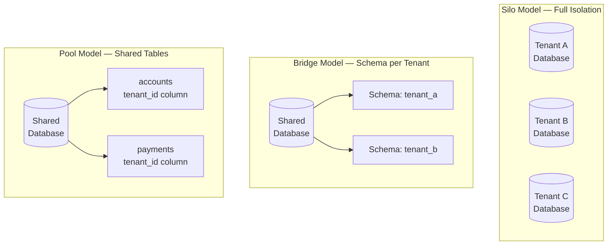

لنأخذ مزوّد بنية تحتية للمدفوعات في أوروبا (مثال مركّب) أطلق منصته كخدمة (SaaS) بإعطاء كل بنك عميل قاعدة بيانات مخصصة. وخلال عامين، ومع انضمام 400 عميل، استهلكت الكلفة التشغيلية لإدارة 400 عنقود قاعدة بيانات منفصل هامش المنصة كله. وأدت إعادة البناء إلى نموذج متعدد المستأجرين بقاعدة بيانات مشتركة — بشكل صحيح، مع ضمانات عزل قوية — إلى خفض كلفة البنية التحتية بنسبة 73% مع الحفاظ على فصل صارم للبيانات قابل للتدقيق وفق GDPR. ويغطي هذا الدرس الطيف الكامل لنماذج تعدد المستأجرين (multi-tenancy) وأنماط الهندسة اللازمة لبنائها بشكل صحيح.

## أهداف التعلّم

- مقارنة نماذج تعدد المستأجرين الثلاثة — الصومعة (silo)، والتجميع (pool)، والجسر (bridge) — واختيار النموذج المناسب بناءً على متطلبات العزل، وقيود الامتثال، والكلفة
- تنفيذ أمان مستوى الصف (Row-Level Security) في PostgreSQL لفرض عزل المستأجرين في طبقة قاعدة البيانات
- بناء `TenantContext` باستخدام تخزين محلي للخيط (thread-local) مع معترض Spring ينقل هوية المستأجر عبر كل الطبقات
- تصميم `TenantAwareDataSource` يوجّه الاتصالات إلى قاعدة البيانات أو المخطط الصحيح لكل طلب
- ضبط دعم تعدد المستأجرين في Hibernate باستخدام `CurrentTenantIdentifierResolver` و`MultiTenantConnectionProvider`
- أتمتة انضمام المستأجرين مع إنشاء المخططات وتعبئة البيانات الأساسية
- تحديد آثار "الجار المزعج" (noisy neighbour) وتخفيفها في نموذج بنية تحتية مشتركة
- ربط مفاضلات عزل البيانات بمتطلبات الامتثال، بما في ذلك موقع تخزين البيانات وفق GDPR وفصل المناطق وفق PCI DSS

## سياق العمل

لنأخذ منصة تمويل مدمج بريطانية (مثال مركّب) تتعرض لاختراق في عزل البيانات. فغياب مرشح `tenant_id` في استعلام SQL أصلي واحد في خدمة تاريخ الحسابات يجعل تاريخ معاملات مستأجر مرئيًا في لوحة مستأجر آخر لنحو 90 دقيقة قبل أن يطلق كشف الشذوذ تنبيهًا. كان أمان مستوى الصف *مفعّلًا* على الجدول لكنه غير *مفروض*، وكان التطبيق يتصل بصفته مالك الجدول — فلم تُطبَّق السياسة أبدًا. ويجلب الحادث تدقيقًا رقابيًا ومراجعة إلزامية لكل الاستعلامات الـ 1,400 في قاعدة البيانات. والدرس ليس أن تعدد المستأجرين خطير — بل أن عزل المستأجرين يجب أن يُفرض في طبقة قاعدة البيانات، لا في طبقة التطبيق وحدها.

## نماذج تعدد المستأجرين

تمثل النماذج الثلاثة نقاطًا على طيف العزل مقابل الكلفة. ولا يوجد نموذج واحد صحيح لكل المواقف.



| البُعد | الصومعة | الجسر (مخطط لكل مستأجر) | التجميع (جداول مشتركة) |
|---|---|---|---|
| **قوة العزل** | قصوى | عالية | تتطلب RLS |
| **الكلفة التشغيلية** | عالية جدًا | متوسطة | منخفضة |
| **خطر الجار المزعج** | لا يوجد | منخفض | عالٍ بدون خنق |
| **موقع تخزين البيانات** | سهل | تجميع حسب قاعدة البيانات | معقد |
| **انضمام المستأجر** | إنشاء عنقود جديد | إنشاء مخطط + ترحيل | إدخال صف إعدادات |
| **نطاق الأثر عند الاختراق** | مستأجر واحد | مخطط واحد | كل المستأجرين |
| **مناسب لـ** | البنوك الخاضعة للتنظيم، وPCI من المستوى 1 | منصات SaaS للسوق المتوسطة | مستأجرون متجانسون بحجم كبير |

## أمان مستوى الصف في PostgreSQL

يفرض أمان مستوى الصف (RLS) الأصيل في PostgreSQL عزل المستأجرين في طبقة التخزين. فحتى لو كان في شيفرة التطبيق خطأ يحذف مرشح `tenant_id`، سيطبق RLS المرشح الصحيح أو يمنع الوصول تمامًا.

```sql
-- Enable RLS on the payments table
ALTER TABLE payments ENABLE ROW LEVEL SECURITY;
ALTER TABLE payments FORCE ROW LEVEL SECURITY;

-- Policy: each database session can only see (and write) rows for its tenant.
-- current_setting() raises an error if the variable is unset: fail closed.
CREATE POLICY tenant_isolation_policy ON payments
    USING (tenant_id = current_setting('app.current_tenant')::uuid)
    WITH CHECK (tenant_id = current_setting('app.current_tenant')::uuid);

-- The application sets the tenant at the start of every transaction:
--   SELECT set_config('app.current_tenant', '<uuid>', true);   -- true = SET LOCAL
-- SET LOCAL lasts until the transaction ends, so it cannot leak to the next
-- user of a pooled connection.

-- Verify: even without a WHERE clause, only current tenant rows returned
SELECT count(*) FROM payments;
-- Returns only rows where tenant_id = current_setting('app.current_tenant')

-- Platform operations: a separate role that is allowed to bypass RLS
-- (never the role the application uses)
ALTER ROLE platform_admin BYPASSRLS;
```

> [!WARNING]
> الأمر `FORCE ROW LEVEL SECURITY` أساسي. فبدونه يتجاوز مالك الجدول (وهو عادة مستخدم قاعدة البيانات الخاص بالتطبيق) كل السياسات. وإذا كان تطبيقك يتصل بصفته مالك الجدول، فلن يوفر RLS أي حماية.

## سياق المستأجر ومعترض Spring

التخزين المحلي للخيط `TenantContext` هو المصدر الوحيد لهوية المستأجر داخل الطلب. ويجب ضبطه عند الحد (معترض HTTP أو مستهلك رسائل)، ونقله عبر الاستدعاءات غير المتزامنة، ومسحه دائمًا بعد اكتمال الطلب.

```java
// Thread-local tenant context
public final class TenantContext {

    // Plain ThreadLocal, NOT InheritableThreadLocal: pooled worker threads would keep
    // a stale tenant from whichever request created them. Propagate explicitly
    // (TaskDecorator, message headers). On Java 25+, ScopedValue is a safer option.
    private static final ThreadLocal<String> CURRENT_TENANT = new ThreadLocal<>();

    private TenantContext() {}

    public static void setCurrentTenant(String tenantId) {
        if (tenantId == null || tenantId.isBlank()) {
            throw new IllegalArgumentException("tenantId must not be null or blank");
        }
        CURRENT_TENANT.set(tenantId);
    }

    public static String getCurrentTenant() {
        String tenantId = CURRENT_TENANT.get();
        if (tenantId == null) {
            throw new TenantContextMissingException(
                "No tenant context set — this is a programming error");
        }
        return tenantId;
    }

    public static void clear() {
        CURRENT_TENANT.remove();
    }
}

// Spring interceptor — sets tenant from JWT claim on every request
@Component
public class TenantResolutionInterceptor implements HandlerInterceptor {

    private static final String TENANT_CLAIM = "tenant_id";

    @Override
    public boolean preHandle(HttpServletRequest request,
                             HttpServletResponse response,
                             Object handler) throws Exception {
        String tenantId = extractTenantFromJwt(request);
        TenantContext.setCurrentTenant(tenantId);
        return true;
    }

    @Override
    public void afterCompletion(HttpServletRequest request,
                                HttpServletResponse response,
                                Object handler, Exception ex) {
        TenantContext.clear();  // Always clear — prevents context leakage across requests
    }

    private String extractTenantFromJwt(HttpServletRequest request) {
        // Use the token Spring Security has already validated (signature, expiry,
        // audience) — never trust a tenant id from a header or the request body
        JwtAuthenticationToken auth = (JwtAuthenticationToken)
            SecurityContextHolder.getContext().getAuthentication();
        return auth.getToken().getClaimAsString(TENANT_CLAIM);
    }
}
```

يستخدم الصنف `ThreadLocal` عاديًا، لا `InheritableThreadLocal`: فخيوط العمل في المجمّعات ستحتفظ بمستأجر قديم من الطلب الذي أنشأها. انقل المستأجر صراحة (عبر TaskDecorator وترويسات الرسائل). ويؤخذ المستأجر من الرمز الذي تحقق منه Spring Security بالفعل — لا من ترويسة أو جسم الطلب أبدًا.

## توجيه مصدر البيانات حسب المستأجر

في نموذج الجسر (مخطط لكل مستأجر)، يستخدم التطبيق رابط JDBC واحدًا لكنه يبدّل المخطط النشط لكل طلب. ويوفر `AbstractRoutingDataSource` في Spring نقطة الربط لذلك.

```java
// Routes to the correct datasource or schema based on current tenant
public class TenantAwareDataSource extends AbstractRoutingDataSource {

    @Override
    protected Object determineCurrentLookupKey() {
        return TenantContext.getCurrentTenant();
    }
}

@Configuration
public class MultiTenantDataSourceConfig {

    @Bean
    public DataSource dataSource(TenantDataSourceRegistry registry) {
        TenantAwareDataSource routingDataSource = new TenantAwareDataSource();
        routingDataSource.setTargetDataSources(registry.getDataSourceMap());
        routingDataSource.setDefaultTargetDataSource(registry.getDefaultDataSource());
        return routingDataSource;
    }
}

// For the pool model: set the PostgreSQL variable at the start of every transaction
// (call it from an aspect around @Transactional service methods)
@Component
public class TenantTransactionInitializer {

    private final JdbcTemplate jdbc;

    public TenantTransactionInitializer(JdbcTemplate jdbc) {
        this.jdbc = jdbc;
    }

    public void applyTenant() {
        // Bind parameter — no string concatenation; 'true' makes it SET LOCAL
        jdbc.queryForObject("SELECT set_config('app.current_tenant', ?, true)",
            String.class, TenantContext.getCurrentTenant());
    }
}
```

## إعدادات تعدد المستأجرين في Hibernate

يوفر Hibernate دعمًا أصيلًا لتعدد المستأجرين عبر `CurrentTenantIdentifierResolver` و`MultiTenantConnectionProvider`. وهذا يدمج التوجيه حسب المستأجر مع طبقة ORM.

```java
@Component
public class TenantIdentifierResolver implements CurrentTenantIdentifierResolver<String> {

    @Override
    public String resolveCurrentTenantIdentifier() {
        try {
            return TenantContext.getCurrentTenant();
        } catch (TenantContextMissingException e) {
            // Hibernate calls this at bootstrap and for platform jobs: "system" must
            // map to a schema that holds NO tenant data
            return "system";
        }
    }

    @Override
    public boolean validateExistingCurrentSessions() {
        return true;
    }
}

@Component
public class SchemaBasedMultiTenantConnectionProvider
        implements MultiTenantConnectionProvider<String> {

    private final DataSource dataSource;

    @Override
    public Connection getConnection(String tenantIdentifier) throws SQLException {
        Connection connection = dataSource.getConnection();
        // Switch schema for bridge model — sanitise to prevent injection
        connection.createStatement()
            .execute("SET search_path TO tenant_"
                + sanitize(tenantIdentifier) + ", public");
        return connection;
    }

    @Override
    public void releaseConnection(String tenantIdentifier, Connection connection)
            throws SQLException {
        // Reset to default schema before returning connection to pool
        connection.createStatement().execute("SET search_path TO public");
        connection.close();
    }

    private String sanitize(String tenantId) {
        return tenantId.replaceAll("[^a-zA-Z0-9_]", "");
    }

    // Other required methods (getAnyConnection, releaseAnyConnection,
    // supportsAggressiveRelease, isUnwrappableAs, unwrap) omitted for brevity
}

@Configuration
public class HibernateMultiTenancyConfig {

    @Bean
    public LocalContainerEntityManagerFactoryBean entityManagerFactory(
            DataSource dataSource,
            TenantIdentifierResolver tenantResolver,
            SchemaBasedMultiTenantConnectionProvider connectionProvider) {

        Map<String, Object> jpaProperties = new HashMap<>();
        jpaProperties.put(AvailableSettings.MULTI_TENANT_IDENTIFIER_RESOLVER, tenantResolver);
        jpaProperties.put(AvailableSettings.MULTI_TENANT_CONNECTION_PROVIDER, connectionProvider);
        jpaProperties.put(AvailableSettings.JAKARTA_HBM2DDL_AUTO, "validate");

        LocalContainerEntityManagerFactoryBean factory =
            new LocalContainerEntityManagerFactoryBean();
        factory.setDataSource(dataSource);
        factory.setJpaPropertyMap(jpaProperties);
        return factory;
    }
}
```

## أتمتة انضمام المستأجرين

يجب أن يكون انضمام المستأجر آمنًا من التكرار وقابلًا للتدقيق. ولا يمكن أن يكون معاملة قاعدة بيانات واحدة — فأوامر DDL للمخطط والترحيلات تعمل على اتصالاتها الخاصة — لذا يستخدم عمود حالة (PROVISIONING ← ACTIVE) ويجعل كل خطوة آمنة للتكرار. وعندئذٍ يُكمَل الانضمام الجزئي بمجرد تشغيله مرة أخرى.

```java
@Service
public class TenantOnboardingService {   // deliberately NOT @Transactional

    private final TenantRepository tenantRepository;
    private final SchemaProvisioner schemaProvisioner;
    private final BaselineDataLoader baselineLoader;
    private final AuditLogService auditLog;

    public TenantOnboardingResult onboard(TenantOnboardingRequest request) {
        Optional<Tenant> existing = tenantRepository.findById(request.tenantId());
        if (existing.filter(t -> t.getStatus() == TenantStatus.ACTIVE).isPresent()) {
            return TenantOnboardingResult.alreadyExists(request.tenantId());
        }

        try {
            // A tenant left in PROVISIONING by a crash is simply provisioned again:
            // every step below is idempotent (CREATE SCHEMA IF NOT EXISTS, Flyway, upserts)
            Tenant tenant = existing.orElseGet(() -> tenantRepository.save(Tenant.builder()
                .id(request.tenantId())
                .name(request.name())
                .tier(request.tier())
                .region(request.region())
                .status(TenantStatus.PROVISIONING)
                .build()));

            schemaProvisioner.createSchema(request.tenantId());
            schemaProvisioner.runMigrations(request.tenantId());
            baselineLoader.load(request.tenantId(), request.tier());

            tenant.setStatus(TenantStatus.ACTIVE);
            tenantRepository.save(tenant);

            auditLog.record("TENANT_ONBOARDED", request.tenantId(), request.requestedBy());
            return TenantOnboardingResult.success(request.tenantId());

        } catch (Exception e) {
            // Leave the PROVISIONING row so a retry (or an operator) can finish or
            // clean up; drop the schema only if nothing was written into it
            schemaProvisioner.dropSchemaIfEmpty(request.tenantId());
            throw new TenantOnboardingException(
                "Onboarding failed for " + request.tenantId(), e);
        }
    }
}
```

## تخفيف أثر الجار المزعج

في نموذج التجميع، يُضعف مستأجر واحد ينفّذ استعلامات دفعية ثقيلة الأداء لكل المستأجرين الآخرين. والجمع بين حدود مجمّع الاتصالات لكل مستأجر ومهلات العبارات في PostgreSQL لكل دور يوفر دفاعًا متعدد الطبقات. وأعطِ مجمّعات مخصصة للمستأجرين الكبار فقط: فمع مئات المستأجرين، ستتجاوز مجمّعات منفصلة لكل منهم `max_connections`. أما المستأجرون الصغار فيتشاركون مجمّعًا مع حد تزامن لكل مستأجر (semaphore أو bulkhead)، عادة خلف PgBouncer.

```java
@Component
public class TenantAwareConnectionPoolManager {

    private final Map<String, HikariDataSource> tenantPools = new ConcurrentHashMap<>();

    public DataSource getPoolForTenant(String tenantId, TenantTier tier) {
        return tenantPools.computeIfAbsent(tenantId, id -> {
            HikariConfig config = new HikariConfig();
            config.setJdbcUrl(databaseUrl);
            config.setUsername(tier.databaseRole());   // e.g. tenant_bronze: carries the tier's statement_timeout
            // Tier-based caps: GOLD=20, SILVER=10, BRONZE=5 connections max
            config.setMaximumPoolSize(tier.maxConnections());
            config.setMinimumIdle(tier.minIdleConnections());
            config.setConnectionTimeout(tier.connectionTimeoutMs());
            config.addDataSourceProperty("ApplicationName",
                "fintech-platform-tenant-" + id);
            return new HikariDataSource(config);
        });
    }
}
```

```sql
-- PostgreSQL: statement timeouts by tier prevent runaway queries
ALTER ROLE tenant_bronze SET statement_timeout = '5000ms';
ALTER ROLE tenant_silver SET statement_timeout = '15000ms';
ALTER ROLE tenant_gold   SET statement_timeout = '60000ms';

-- Monitor connection consumption per tenant for noisy-neighbour detection
SELECT application_name AS tenant, count(*) AS connections,
       round(100.0 * count(*) /
           (SELECT setting::int FROM pg_settings WHERE name = 'max_connections'), 1) AS pct
FROM pg_stat_activity
WHERE application_name LIKE 'fintech-platform-tenant-%'
GROUP BY application_name
ORDER BY connections DESC;
```

<!-- KNOWLEDGE-CHECK
{
  "questions": [
    {
      "id": "q1",
      "text": "لدى منصة SaaS المالية لديك بنك من المستوى الأول كمستأجر. يشترط البنك ألا تتعايش بياناته أبدًا في نسخة قاعدة البيانات نفسها مع مستأجرين آخرين بسبب سياسة حوكمة البيانات الداخلية لديه. أي نموذج تعدد مستأجرين يجب أن تقدمه لهذا المستأجر؟",
      "options": [
        "نموذج التجميع مع أمان مستوى الصف — RLS يوفر عزلًا كافيًا",
        "نموذج الجسر بمخطط لكل مستأجر في عنقود قاعدة بيانات مشترك",
        "نموذج الصومعة بنسخة قاعدة بيانات مخصصة لهذا المستأجر",
        "نموذج التجميع بعمود tenant_id وتصفية في طبقة التطبيق"
      ],
      "correct": 2,
      "explanation": "نموذج الصومعة هو الخيار الوحيد الذي يلبي شرط 'ألا تتعايش البيانات أبدًا في نسخة قاعدة البيانات نفسها مع مستأجرين آخرين'. فـ RLS وعزل المخططات كلاهما يتشاركان عنقود قاعدة البيانات نفسه. وللبنوك الخاضعة للتنظيم ذات سياسات حوكمة البيانات الصارمة، نموذج الصومعة مطلوب. ويأتي ذلك بكلفة تشغيلية كبيرة يجب أن تنعكس في فئة تسعير المستأجر."
    },
    {
      "id": "q2",
      "text": "في نظام متعدد المستأجرين بنموذج التجميع، نسي مهندس إضافة الشرط WHERE tenant_id = ? إلى استعلام SQL أصلي. ما أكثر دفاع فاعلية يمنع تسرب البيانات إلى المستأجر الخطأ؟",
      "options": [
        "مراجعة الشيفرة — سيكتشف مهندس ثانٍ الشرط المفقود",
        "اختبارات تكامل مع بيانات اختبار لعدة مستأجرين",
        "أمان مستوى الصف في PostgreSQL مع تفعيل FORCE ROW LEVEL SECURITY وضبط متغير الجلسة في بداية كل معاملة",
        "تأكيدات في طبقة التطبيق تتحقق من مجموعات النتائج قبل إعادتها"
      ],
      "correct": 2,
      "explanation": "الفرض في طبقة قاعدة البيانات عبر RLS مع FORCE ROW LEVEL SECURITY هو الدفاع الوحيد الذي يعمل حتى عندما تحتوي شيفرة التطبيق على أخطاء. فمراجعة الشيفرة والاختبارات قيّمة لكنها ليست شاملة — قد تفوتها حالات حدّية. وتأكيدات طبقة التطبيق متأخرة جدًا — فالبيانات قُرئت بالفعل. ويضمن RLS مع FORCE ROW LEVEL SECURITY أن حتى مالك الجدول لا يستطيع تجاوز السياسة، فيصبح عزل المستأجرين ضمانًا من قاعدة البيانات لا عرفًا في التطبيق."
    }
  ]
}
-->

<!-- PRACTICAL-CHALLENGE
{
  "title": "بنية تعدد المستأجرين في منصات التقنية المالية — تطبيق في بيئة الإنتاج",
  "difficulty": "advanced",
  "estimatedMinutes": 60,
  "tasks": [
    {
      "id": "1",
      "description": "لمنصتك ثلاثة مستأجرين: بنك من المستوى الأول يمنع مشاركة نسخة قاعدة البيانات، ومُقرض متوسط الحجم، وشركة تقنية مالية ناشئة سريعة النمو. اكتب سجل ADR لنموذج تعدد المستأجرين: كيف تدعم الثلاثة من منصة واحدة دون صيانة ثلاث قواعد شيفرة منفصلة؟ وعرّف نموذج الفئات الذي يربط متطلبات المستأجرين بعمليات نشر الصومعة والجسر والتجميع."
    },
    {
      "id": "2",
      "description": "نفّذ إعداد RLS كاملًا في PostgreSQL لمستأجري نموذج التجميع: السياسة (USING وWITH CHECK)، والآلية التي تضبط متغير الجلسة في بداية كل معاملة، واختبارًا يثبت أن RLS يمنع القراءة بين المستأجرين حتى عند غياب شرط WHERE."
    },
    {
      "id": "3",
      "description": "عندما يطلق حدث دفع مستهلك Kafka غير متزامن، لا يُنقل TenantContext (وهو ThreadLocal) تلقائيًا إلى خيط المستهلك. صمّم حلًا ينقل المستأجر بشكل صحيح ونفّذه — مثلًا ترويسة مستأجر في كل رسالة يضبطها المستهلك ويمسحها دائمًا، وTaskDecorator للعمل غير المتزامن بـ @Async."
    },
    {
      "id": "4",
      "description": "تُظهر المراقبة أن مستأجر الشركة الناشئة يشغّل مهمة دفعية ليلية تستهلك 80% من اتصالات قاعدة البيانات، فتسبب انقضاء المهلات لدى المستأجرين الآخرين. صمّم حدود مجمّع الاتصالات والاستعلامات التي تمنع مستأجرًا واحدًا من تجويع الآخرين ونفّذها، واشرح كيف تكتشف المشكلة آليًا."
    }
  ]
}
-->
