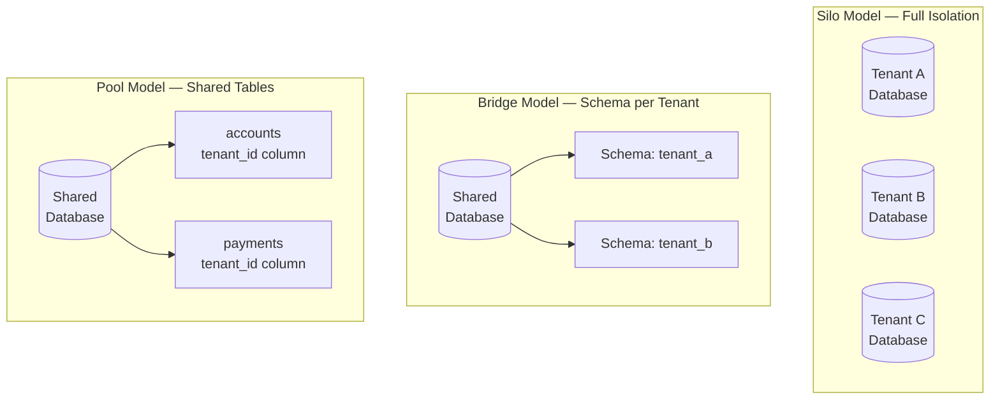

Consider a European payment infrastructure provider (a composite example) that launched its SaaS platform by giving every bank customer a dedicated database. Within two years, with 400 clients onboarded, the operational cost of managing 400 separate database clusters had consumed the entire platform margin. The re-architecture to a shared-database multi-tenant model — done correctly, with strong isolation guarantees — reduced infrastructure cost by 73% while maintaining strict data separation auditable under GDPR. This lesson covers the full spectrum of tenancy models and the engineering patterns needed to build them correctly.

## Learning Objectives

- Compare the three tenancy models — silo, pool, and bridge — and select the appropriate model based on isolation requirements, compliance constraints, and cost
- Implement row-level security in PostgreSQL to enforce tenant isolation at the database layer
- Build a `TenantContext` using thread-local storage with a Spring interceptor that propagates tenant identity through every layer
- Design a `TenantAwareDataSource` that routes connections to the correct database or schema per request
- Configure Hibernate's multi-tenancy support using `CurrentTenantIdentifierResolver` and `MultiTenantConnectionProvider`
- Automate tenant onboarding with schema provisioning and baseline data population
- Identify and mitigate noisy-neighbour effects in a shared-infrastructure tenancy model
- Map data isolation trade-offs to compliance requirements including GDPR data residency and PCI DSS zone separation

## Business Context

Consider a UK embedded finance platform (a composite example) that suffers a data isolation breach. A missing `tenant_id` filter in a single native SQL query in the account history service makes one tenant's transaction history visible in another tenant's dashboard for about 90 minutes before anomaly detection raises an alert. The table had row-level security *enabled* but not *forced*, and the application connected as the table owner — so the policy never applied. The incident brings regulatory scrutiny and a mandatory audit of all 1,400 database queries. The lesson is not that multi-tenancy is dangerous — it is that tenant isolation must be enforced at the database layer, not only at the application layer.

## Tenancy Models

The three models represent points on the isolation-versus-cost spectrum. No single model is correct for all situations.



| Dimension | Silo | Bridge (Schema) | Pool (Shared Table) |
|---|---|---|---|
| **Isolation strength** | Maximum | High | Requires RLS |
| **Operational cost** | Very high | Moderate | Low |
| **Noisy neighbour risk** | None | Low | High without throttling |
| **Data residency** | Trivial | Per-database grouping | Complex |
| **Tenant onboarding** | Provision new cluster | Create schema + migrate | Insert configuration row |
| **Blast radius on breach** | One tenant | One schema | All tenants |
| **Recommended for** | Regulated banks, PCI Tier 1 | Mid-market SaaS | High-volume, homogeneous tenants |

## Row-Level Security in PostgreSQL

PostgreSQL's native RLS enforces tenant isolation at the storage layer. Even if application code has a bug that omits the `tenant_id` filter, RLS will apply the correct filter or block access entirely.

```sql
-- Enable RLS on the payments table
ALTER TABLE payments ENABLE ROW LEVEL SECURITY;
ALTER TABLE payments FORCE ROW LEVEL SECURITY;

-- Policy: each database session can only see (and write) rows for its tenant.
-- current_setting() raises an error if the variable is unset: fail closed.
CREATE POLICY tenant_isolation_policy ON payments
    USING (tenant_id = current_setting('app.current_tenant')::uuid)
    WITH CHECK (tenant_id = current_setting('app.current_tenant')::uuid);

-- The application sets the tenant at the start of every transaction:
--   SELECT set_config('app.current_tenant', '<uuid>', true);   -- true = SET LOCAL
-- SET LOCAL lasts until the transaction ends, so it cannot leak to the next
-- user of a pooled connection.

-- Verify: even without a WHERE clause, only current tenant rows returned
SELECT count(*) FROM payments;
-- Returns only rows where tenant_id = current_setting('app.current_tenant')

-- Platform operations: a separate role that is allowed to bypass RLS
-- (never the role the application uses)
ALTER ROLE platform_admin BYPASSRLS;
```

> [!WARNING]
> `FORCE ROW LEVEL SECURITY` is essential. Without it, the table owner (typically the application database user) bypasses all policies. If your application connects as the table owner, RLS provides no protection.

## TenantContext and Spring Interceptor

The `TenantContext` thread-local is the single source of truth for tenant identity within a request. It must be set at the boundary (HTTP interceptor or message consumer), propagated through async calls, and always cleared after the request completes.

```java
// Thread-local tenant context
public final class TenantContext {

    // Plain ThreadLocal, NOT InheritableThreadLocal: pooled worker threads would keep
    // a stale tenant from whichever request created them. Propagate explicitly
    // (TaskDecorator, message headers). On Java 25+, ScopedValue is a safer option.
    private static final ThreadLocal<String> CURRENT_TENANT = new ThreadLocal<>();

    private TenantContext() {}

    public static void setCurrentTenant(String tenantId) {
        if (tenantId == null || tenantId.isBlank()) {
            throw new IllegalArgumentException("tenantId must not be null or blank");
        }
        CURRENT_TENANT.set(tenantId);
    }

    public static String getCurrentTenant() {
        String tenantId = CURRENT_TENANT.get();
        if (tenantId == null) {
            throw new TenantContextMissingException(
                "No tenant context set — this is a programming error");
        }
        return tenantId;
    }

    public static void clear() {
        CURRENT_TENANT.remove();
    }
}

// Spring interceptor — sets tenant from JWT claim on every request
@Component
public class TenantResolutionInterceptor implements HandlerInterceptor {

    private static final String TENANT_CLAIM = "tenant_id";

    @Override
    public boolean preHandle(HttpServletRequest request,
                             HttpServletResponse response,
                             Object handler) throws Exception {
        String tenantId = extractTenantFromJwt(request);
        TenantContext.setCurrentTenant(tenantId);
        return true;
    }

    @Override
    public void afterCompletion(HttpServletRequest request,
                                HttpServletResponse response,
                                Object handler, Exception ex) {
        TenantContext.clear();  // Always clear — prevents context leakage across requests
    }

    private String extractTenantFromJwt(HttpServletRequest request) {
        // Use the token Spring Security has already validated (signature, expiry,
        // audience) — never trust a tenant id from a header or the request body
        JwtAuthenticationToken auth = (JwtAuthenticationToken)
            SecurityContextHolder.getContext().getAuthentication();
        return auth.getToken().getClaimAsString(TENANT_CLAIM);
    }
}
```

## TenantAwareDataSource Routing

In a bridge model (schema-per-tenant), the application uses a single JDBC URL but switches the active schema per request. `AbstractRoutingDataSource` from Spring provides the hook.

```java
// Routes to the correct datasource or schema based on current tenant
public class TenantAwareDataSource extends AbstractRoutingDataSource {

    @Override
    protected Object determineCurrentLookupKey() {
        return TenantContext.getCurrentTenant();
    }
}

@Configuration
public class MultiTenantDataSourceConfig {

    @Bean
    public DataSource dataSource(TenantDataSourceRegistry registry) {
        TenantAwareDataSource routingDataSource = new TenantAwareDataSource();
        routingDataSource.setTargetDataSources(registry.getDataSourceMap());
        routingDataSource.setDefaultTargetDataSource(registry.getDefaultDataSource());
        return routingDataSource;
    }
}

// For the pool model: set the PostgreSQL variable at the start of every transaction
// (call it from an aspect around @Transactional service methods)
@Component
public class TenantTransactionInitializer {

    private final JdbcTemplate jdbc;

    public TenantTransactionInitializer(JdbcTemplate jdbc) {
        this.jdbc = jdbc;
    }

    public void applyTenant() {
        // Bind parameter — no string concatenation; 'true' makes it SET LOCAL
        jdbc.queryForObject("SELECT set_config('app.current_tenant', ?, true)",
            String.class, TenantContext.getCurrentTenant());
    }
}
```

## Hibernate Multi-Tenancy Configuration

Hibernate provides first-class multi-tenancy support through `CurrentTenantIdentifierResolver` and `MultiTenantConnectionProvider`. This integrates the tenant-aware routing with the ORM layer.

```java
@Component
public class TenantIdentifierResolver implements CurrentTenantIdentifierResolver<String> {

    @Override
    public String resolveCurrentTenantIdentifier() {
        try {
            return TenantContext.getCurrentTenant();
        } catch (TenantContextMissingException e) {
            // Hibernate calls this at bootstrap and for platform jobs: "system" must
            // map to a schema that holds NO tenant data
            return "system";
        }
    }

    @Override
    public boolean validateExistingCurrentSessions() {
        return true;
    }
}

@Component
public class SchemaBasedMultiTenantConnectionProvider
        implements MultiTenantConnectionProvider<String> {

    private final DataSource dataSource;

    @Override
    public Connection getConnection(String tenantIdentifier) throws SQLException {
        Connection connection = dataSource.getConnection();
        // Switch schema for bridge model — sanitise to prevent injection
        connection.createStatement()
            .execute("SET search_path TO tenant_"
                + sanitize(tenantIdentifier) + ", public");
        return connection;
    }

    @Override
    public void releaseConnection(String tenantIdentifier, Connection connection)
            throws SQLException {
        // Reset to default schema before returning connection to pool
        connection.createStatement().execute("SET search_path TO public");
        connection.close();
    }

    private String sanitize(String tenantId) {
        return tenantId.replaceAll("[^a-zA-Z0-9_]", "");
    }

    // Other required methods (getAnyConnection, releaseAnyConnection,
    // supportsAggressiveRelease, isUnwrappableAs, unwrap) omitted for brevity
}

@Configuration
public class HibernateMultiTenancyConfig {

    @Bean
    public LocalContainerEntityManagerFactoryBean entityManagerFactory(
            DataSource dataSource,
            TenantIdentifierResolver tenantResolver,
            SchemaBasedMultiTenantConnectionProvider connectionProvider) {

        Map<String, Object> jpaProperties = new HashMap<>();
        jpaProperties.put(AvailableSettings.MULTI_TENANT_IDENTIFIER_RESOLVER, tenantResolver);
        jpaProperties.put(AvailableSettings.MULTI_TENANT_CONNECTION_PROVIDER, connectionProvider);
        jpaProperties.put(AvailableSettings.JAKARTA_HBM2DDL_AUTO, "validate");

        LocalContainerEntityManagerFactoryBean factory =
            new LocalContainerEntityManagerFactoryBean();
        factory.setDataSource(dataSource);
        factory.setJpaPropertyMap(jpaProperties);
        return factory;
    }
}
```

## Tenant Onboarding Automation

Tenant onboarding must be idempotent and auditable. It cannot be one database transaction — schema DDL and migrations run on their own connections — so it uses a status column (PROVISIONING → ACTIVE) and makes every step safe to repeat. A partial onboarding is then finished by simply running it again.

```java
@Service
public class TenantOnboardingService {   // deliberately NOT @Transactional

    private final TenantRepository tenantRepository;
    private final SchemaProvisioner schemaProvisioner;
    private final BaselineDataLoader baselineLoader;
    private final AuditLogService auditLog;

    public TenantOnboardingResult onboard(TenantOnboardingRequest request) {
        Optional<Tenant> existing = tenantRepository.findById(request.tenantId());
        if (existing.filter(t -> t.getStatus() == TenantStatus.ACTIVE).isPresent()) {
            return TenantOnboardingResult.alreadyExists(request.tenantId());
        }

        try {
            // A tenant left in PROVISIONING by a crash is simply provisioned again:
            // every step below is idempotent (CREATE SCHEMA IF NOT EXISTS, Flyway, upserts)
            Tenant tenant = existing.orElseGet(() -> tenantRepository.save(Tenant.builder()
                .id(request.tenantId())
                .name(request.name())
                .tier(request.tier())
                .region(request.region())
                .status(TenantStatus.PROVISIONING)
                .build()));

            schemaProvisioner.createSchema(request.tenantId());
            schemaProvisioner.runMigrations(request.tenantId());
            baselineLoader.load(request.tenantId(), request.tier());

            tenant.setStatus(TenantStatus.ACTIVE);
            tenantRepository.save(tenant);

            auditLog.record("TENANT_ONBOARDED", request.tenantId(), request.requestedBy());
            return TenantOnboardingResult.success(request.tenantId());

        } catch (Exception e) {
            // Leave the PROVISIONING row so a retry (or an operator) can finish or
            // clean up; drop the schema only if nothing was written into it
            schemaProvisioner.dropSchemaIfEmpty(request.tenantId());
            throw new TenantOnboardingException(
                "Onboarding failed for " + request.tenantId(), e);
        }
    }
}
```

## Noisy-Neighbour Mitigation

In a pool model, one tenant executing heavy batch queries degrades performance for all others. Per-tenant connection-pool limits combined with PostgreSQL statement timeouts per role provide defence-in-depth. Give dedicated pools only to large tenants: with hundreds of tenants, one pool each would exceed `max_connections`. Small tenants share a pool with a per-tenant concurrency limit (a semaphore or bulkhead), usually behind PgBouncer.

```java
@Component
public class TenantAwareConnectionPoolManager {

    private final Map<String, HikariDataSource> tenantPools = new ConcurrentHashMap<>();

    public DataSource getPoolForTenant(String tenantId, TenantTier tier) {
        return tenantPools.computeIfAbsent(tenantId, id -> {
            HikariConfig config = new HikariConfig();
            config.setJdbcUrl(databaseUrl);
            config.setUsername(tier.databaseRole());   // e.g. tenant_bronze: carries the tier's statement_timeout
            // Tier-based caps: GOLD=20, SILVER=10, BRONZE=5 connections max
            config.setMaximumPoolSize(tier.maxConnections());
            config.setMinimumIdle(tier.minIdleConnections());
            config.setConnectionTimeout(tier.connectionTimeoutMs());
            config.addDataSourceProperty("ApplicationName",
                "fintech-platform-tenant-" + id);
            return new HikariDataSource(config);
        });
    }
}
```

```sql
-- PostgreSQL: statement timeouts by tier prevent runaway queries
ALTER ROLE tenant_bronze SET statement_timeout = '5000ms';
ALTER ROLE tenant_silver SET statement_timeout = '15000ms';
ALTER ROLE tenant_gold   SET statement_timeout = '60000ms';

-- Monitor connection consumption per tenant for noisy-neighbour detection
SELECT application_name AS tenant, count(*) AS connections,
       round(100.0 * count(*) /
           (SELECT setting::int FROM pg_settings WHERE name = 'max_connections'), 1) AS pct
FROM pg_stat_activity
WHERE application_name LIKE 'fintech-platform-tenant-%'
GROUP BY application_name
ORDER BY connections DESC;
```

<!-- KNOWLEDGE-CHECK
{
  "questions": [
    {
      "id": "q1",
      "text": "Your fintech SaaS platform has a Tier-1 bank as a tenant. The bank requires that its data never co-exists in the same database instance as other tenants due to its internal data governance policy. Which tenancy model must you offer this tenant?",
      "options": [
        "Pool model with row-level security — RLS provides sufficient isolation",
        "Bridge model with schema-per-tenant in a shared database cluster",
        "Silo model with a dedicated database instance for this tenant",
        "Pool model with tenant_id column and application-layer filtering"
      ],
      "correct": 2,
      "explanation": "The silo model is the only option that satisfies 'data never co-exists in the same database instance as other tenants.' RLS and schema isolation both share the underlying database cluster. For regulated banks with strict data governance policies, the silo model is required. This comes at significant operational cost and should be reflected in the tenant's pricing tier."
    },
    {
      "id": "q2",
      "text": "In a pool-model multi-tenant system, an engineer forgets to add a WHERE tenant_id = ? clause to a native SQL query. What is the most effective defence that prevents data leaking to the wrong tenant?",
      "options": [
        "Code review — a second engineer will catch the missing WHERE clause",
        "Integration tests with multi-tenant test fixtures",
        "PostgreSQL row-level security with FORCE ROW LEVEL SECURITY enabled and the session variable set by the interceptor",
        "Application-level assertions that validate result sets before returning them"
      ],
      "correct": 2,
      "explanation": "Database-layer enforcement via RLS with FORCE ROW LEVEL SECURITY is the only defence that works even when application code has bugs. Code review and tests are valuable but not exhaustive — they can miss edge cases. Application-layer assertions are too late — the data was already read. RLS with FORCE ROW LEVEL SECURITY ensures even the table owner cannot bypass the policy, making tenant isolation a database guarantee rather than an application convention."
    }
  ]
}
-->

<!-- PRACTICAL-CHALLENGE
{
  "title": "Multi-Tenancy Architecture in FinTech Platforms — Production Implementation",
  "difficulty": "advanced",
  "estimatedMinutes": 60,
  "tasks": [
    {
      "id": "1",
      "description": "Your platform has three tenants: a Tier-1 bank that forbids sharing a database instance, a mid-sized lender, and a fast-growing fintech startup. Write an ADR for the tenancy model: how do you support all three from a single platform without maintaining three separate codebases? Define the tiering model that maps tenant requirements to silo, bridge and pool deployments."
    },
    {
      "id": "2",
      "description": "Implement the full PostgreSQL RLS setup for the pool-model tenants: the policy (USING and WITH CHECK), the mechanism that sets the session variable at the start of every transaction, and a test that proves RLS blocks cross-tenant reads even when the WHERE clause is missing."
    },
    {
      "id": "3",
      "description": "When a payment event triggers an async Kafka consumer, `TenantContext` (a ThreadLocal) is not automatically propagated to the consumer thread. Design and implement a solution that propagates the tenant correctly — for example a tenant header on every message that the consumer sets and always clears, and a TaskDecorator for @Async work."
    },
    {
      "id": "4",
      "description": "Your monitoring shows the fintech startup tenant running a nightly batch job that consumes 80% of database connections, causing timeouts for other tenants. Design and implement the connection-pool and query limits that stop one tenant from starving the others, and explain how you would detect the problem automatically."
    }
  ]
}
-->
