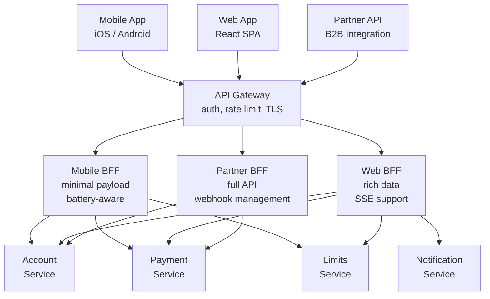

لنأخذ فريق تطبيق جوال مصرفي في بنك رقمي أوروبي (مثال مركّب) كان يرسل 11 طلب HTTP منفصلًا عند تحميل الشاشة الرئيسية — الحسابات، والمعاملات الأخيرة، وحدود الائتمان، ورصيد المكافآت، وأسعار الصرف، والإشعارات، وتحليلات الإنفاق، وحالة البطاقة، والمدفوعات المعلّقة، والخصومات المباشرة القادمة، وعروض المنتجات. وعلى اتصال 4G، استغرقت الطلبات المتتابعة 3.2 ثانية. ومع واجهة خلفية للواجهة الأمامية (Backend-for-Frontend) تجمع الردود الإحدى عشرة في طلب واحد، انخفض زمن التحميل إلى 380 مللي ثانية. وقلّلت الـ BFF أيضًا اقتران النشر لدى فريق الجوال: فبدل تنسيق الإصدارات مع 11 فريقًا خلفيًا، أصبح يملك الـ BFF الخاصة به ويستطيع التطوير باستقلال. ويشرح هذا الدرس كيف تبني طبقتي بوابة الواجهات والـ BFF بشكل صحيح.

## أهداف التعلّم

- تعداد مسؤوليات بوابة الواجهات — المصادقة، وتحديد المعدّل، والتوجيه، وإنهاء SSL، والتسجيل — وفهم ما ينتمي منها إلى البوابة وما ينتمي إلى الخدمات
- ضبط مسارات Spring Cloud Gateway بالشروط (predicates)، والمرشحات، وقواطع الدائرة
- تصميم واجهة خلفية للواجهة الأمامية (BFF) لكل نوع عميل — الجوال، والويب، وواجهة الشركاء — وشرح لماذا تُفشل BFF واحدة لكل العملاء الغرض منها
- تنفيذ `PaymentAggregationBff` تجمع بيانات الحسابات والمدفوعات والحدود في رد واحد باستخدام التركيب التفاعلي
- تطبيق قاطع دائرة على مستوى البوابة لحماية الخدمات الخلفية من الأعطال المتتالية
- حقن معرّفات الارتباط (correlation IDs) ونقلها للتتبع الموزع عبر سلسلة الطلب كاملة
- إدارة إصدارات الواجهات في طبقة البوابة دون تلويث الخدمات المنفردة
- فهم متى يكون GraphQL بديلًا أفضل من BFF ومتى لا يكون

## سياق العمل

لنأخذ بنكًا بريطانيًا منافسًا (مثال مركّب) لا يوجد في بوابة واجهات الشركاء لديه قاطع دائرة بين البوابة وخدمة التحقق من الهوية (KYC). فعندما يرتفع زمن استجابة مزوّد KYC من 200ms إلى 8 ثوانٍ، تراكم البوابة آلاف الطلبات الجارية التي تنتظر ردود KYC، وتُستنفد ذاكرتها ومجمّع اتصالاتها المشترك خلال 90 ثانية. ولأن البوابة مشتركة بين كل الواجهات — لا KYC وحدها — أسقط ذلك سطح الواجهات بالكامل 14 دقيقة، بما فيه واجهات الدفع التي لا تعتمد على KYC إطلاقًا. وتطلّب الإصلاح إضافة قاطع دائرة لكل خدمة لاحقة في طبقة البوابة، لضمان ألا تستنفد الأعطال في خدمة واحدة موارد البوابة المشتركة.

## مسؤوليات بوابة الواجهات

بوابة الواجهات ليست مجرد وكيل عكسي. تتجمع مسؤولياتها في عدة فئات، يجب أن تكون ملكية كل منها واضحة:

| المسؤولية | التنفيذ | الموقع |
|---|---|---|
| **المصادقة** | التحقق من JWT، والاستعلام عن رموز OAuth2 | البوابة — قبل التوجيه |
| **تحديد المعدّل** | دلو رموز لكل عميل ولكل نقطة نهاية | البوابة — بعد المصادقة |
| **التوجيه** | حسب المسار، أو الترويسة، أو الأوزان | البوابة |
| **إنهاء SSL** | تفريغ TLS، وتدوير الشهادات | البوابة / موازن الحمل |
| **قابلية المراقبة** | حقن معرّف الارتباط، وسجلات الوصول، والمقاييس | البوابة |
| **قطع الدائرة** | قاطع لكل خدمة لاحقة | البوابة |
| **تحويل الطلبات والردود** | إعادة كتابة الترويسات، ومطابقة الأجسام | البوابة باعتدال؛ والأفضل في الخدمة |

> [!WARNING]
> منطق العمل لا ينتمي إلى البوابة. فإذا وجدت نفسك تضيف قواعد تحقق من المدفوعات أو فحوص أهلية الحسابات إلى مرشحات البوابة، فذلك المنطق مكانه خدمة. والبوابات التي تراكم منطق العمل تصبح نظامًا موحّدًا عند الحافة لا يمكن صيانته.

## إعدادات Spring Cloud Gateway

```java
@Configuration
public class GatewayRouteConfig {

    private static final Pattern UUID_PATTERN =
        Pattern.compile("[0-9a-fA-F]{8}-[0-9a-fA-F]{4}-[0-9a-fA-F]{4}-[0-9a-fA-F]{4}-[0-9a-fA-F]{12}");

    @Bean
    public RouteLocator paymentGatewayRoutes(RouteLocatorBuilder builder,
                                              CircuitBreakerFactory cbFactory) {
        return builder.routes()

            // Payment service routes — authenticated, rate-limited, circuit-broken
            .route("payment-service", r -> r
                .path("/api/v1/payments/**")
                .filters(f -> f
                    .rewritePath("/api/v1/(?<segment>.*)", "/${segment}")
                    .addRequestHeader("X-Gateway-Version", "1.0")
                    .requestRateLimiter(config -> config
                        .setRateLimiter(redisRateLimiter())
                        .setKeyResolver(clientIdKeyResolver()))
                    .circuitBreaker(config -> config
                        .setName("payment-service-cb")
                        .setFallbackUri("forward:/fallback/payment")))
                .uri("lb://payment-service"))

            // Account service — read-heavy, higher rate limit
            .route("account-service", r -> r
                .path("/api/v1/accounts/**")
                .filters(f -> f
                    .rewritePath("/api/v1/(?<segment>.*)", "/${segment}")
                    .circuitBreaker(config -> config
                        .setName("account-service-cb")
                        .setFallbackUri("forward:/fallback/account")))
                .uri("lb://account-service"))

            // Mobile BFF — the gateway validates the token; the BFF reads the user
            // from that token (never from a client-supplied header)
            .route("mobile-bff", r -> r
                .path("/mobile/v1/**")
                .and()
                .header("X-Client-Type", "mobile")
                .filters(f -> f
                    .rewritePath("/mobile/v1/(?<segment>.*)", "/${segment}"))
                .uri("lb://mobile-bff"))

            .build();
    }

    // Correlation ID injection filter — applies to ALL routes
    @Bean
    public GlobalFilter correlationIdFilter() {
        return (exchange, chain) -> {
            String correlationId = exchange.getRequest().getHeaders()
                .getFirst("X-Correlation-ID");
            // Accept a client value only if it is a UUID (prevents log injection)
            if (correlationId == null || !UUID_PATTERN.matcher(correlationId).matches()) {
                correlationId = UUID.randomUUID().toString();
            }
            final String id = correlationId;
            exchange.getResponse().getHeaders().set("X-Correlation-ID", id);
            ServerWebExchange mutatedExchange = exchange.mutate()
                .request(r -> r.headers(h -> h.set("X-Correlation-ID", id)))
                .build();
            return chain.filter(mutatedExchange);
        };
    }
}
```

يقبل مرشح معرّف الارتباط قيمة العميل فقط إذا كانت UUID صالحًا (لمنع حقن السجلات)، وإلا ولّد معرّفًا جديدًا، ثم أضافه إلى الطلب المرسل للخدمات وإلى الرد.

## بنية BFF — واجهة خلفية لكل نوع عميل

يوصي نمط BFF (الذي نشره عام 2015 Phil Calçado من تجربته في SoundCloud، وSam Newman) بواجهة BFF منفصلة لكل نوع عميل. فـ "BFF" واحدة تخدم الجوال والويب والشركاء هي خدمة تجميع، لا BFF — ولا يمكن تحسينها لاحتياجات أي عميل دون الإضرار بالآخرين.



## الواجهة PaymentAggregationBff — تركيب تفاعلي

تركّب الـ BFF عدة استدعاءات لاحقة. واستخدام التدفقات التفاعلية (`Mono.zip`) يحقق انتشارًا متوازيًا، فيصبح الزمن الإجمالي زمن أبطأ استدعاء منفرد بدل مجموع كل الاستدعاءات.

```java
@RestController
@RequestMapping("/v1/home")
public class MobileHomeScreenBff {

    private final AccountServiceClient accountClient;
    private final PaymentServiceClient paymentClient;
    private final LimitsServiceClient limitsClient;
    private final NotificationServiceClient notificationClient;

    @GetMapping
    public Mono<MobileHomeResponse> homeScreen(
            @AuthenticationPrincipal Jwt jwt,   // validated token — not a client header
            @RequestHeader("X-Correlation-ID") String correlationId) {

        String userId = jwt.getSubject();

        // Fan out all calls in parallel — total latency = max(individual latencies).
        // For finer degradation, give each call its own timeout and fallback so one
        // slow service does not blank the whole screen.
        return Mono.zip(
            accountClient.getSummary(userId, correlationId),
            paymentClient.getRecentTransactions(userId, 5, correlationId),
            limitsClient.getCurrentLimits(userId, correlationId),
            notificationClient.getUnreadCount(userId, correlationId)
        ).map(tuple -> MobileHomeResponse.builder()
            .accountSummary(toMobileAccountSummary(tuple.getT1()))
            .recentTransactions(toMobileTransactions(tuple.getT2()))
            .spendingLimit(tuple.getT3().dailyLimit())
            .remainingLimit(tuple.getT3().remainingToday())
            .unreadNotifications(tuple.getT4())
            .build()
        ).timeout(Duration.ofSeconds(3))  // Mobile clients cannot wait longer
         .onErrorResume(TimeoutException.class, ex ->
             Mono.just(MobileHomeResponse.degraded(
                 "Some data temporarily unavailable")));
    }

    // Response tailored for mobile: minimal fields, mobile-friendly formats
    private MobileAccountSummary toMobileAccountSummary(AccountSummary full) {
        return MobileAccountSummary.builder()
            .maskedAccountNumber(full.accountNumber().replaceAll("\\d(?=\\d{4})", "*"))
            .displayBalance(formatCurrencyForLocale(full.availableBalance()))
            .build();
    }
}
```

يُقرأ المستخدم من الرمز الذي تحقق منه النظام (`@AuthenticationPrincipal Jwt`)، لا من ترويسة يرسلها العميل. ولتدهور أدق، أعطِ كل استدعاء مهلته وبديله الخاص حتى لا يُفرغ خادم بطيء واحد الشاشة كلها.

## قاطع الدائرة على مستوى البوابة

تحتاج كل خدمة لاحقة قاطع دائرة خاصًا بها. فالقاطع المشترك يعني أن خدمة بطيئة واحدة قد تفتح القاطع لكل الخدمات على البوابة.

```java
@Configuration
public class GatewayCircuitBreakerConfig {

    // Spring Cloud Gateway is reactive, so it uses the REACTIVE factory
    @Bean
    public Customizer<ReactiveResilience4JCircuitBreakerFactory> paymentServiceCb() {
        return factory -> factory.configure(builder -> builder
            .circuitBreakerConfig(CircuitBreakerConfig.custom()
                .failureRateThreshold(50)           // Open after 50% failures
                .waitDurationInOpenState(Duration.ofSeconds(30))
                .slidingWindowType(COUNT_BASED)
                .slidingWindowSize(20)
                .permittedNumberOfCallsInHalfOpenState(5)
                .build())
            .timeLimiterConfig(TimeLimiterConfig.custom()
                .timeoutDuration(Duration.ofSeconds(2))
                .build()),
        "payment-service-cb");
    }

    // Fallback controller — returns a safe degraded response when circuit is open
    @RestController
    @RequestMapping("/fallback")
    public static class GatewayFallbackController {

        // @RequestMapping, not @GetMapping: a forwarded POST keeps its method
        @RequestMapping("/payment")
        public ResponseEntity<Map<String, String>> paymentFallback(
                @RequestHeader("X-Correlation-ID") String correlationId) {
            return ResponseEntity.status(503)
                .header("X-Correlation-ID", correlationId)
                .header("Retry-After", "30")
                .body(Map.of(
                    "error", "PAYMENT_SERVICE_UNAVAILABLE",
                    "message", "Payment service is temporarily unavailable",
                    "correlationId", correlationId
                ));
        }
    }
}
```

Spring Cloud Gateway تفاعلية، لذا تستخدم المصنع التفاعلي `ReactiveResilience4JCircuitBreakerFactory`. ويستخدم متحكم البديل `@RequestMapping` لا `@GetMapping`، لأن طلب POST المحوَّل يحتفظ بفعله.

> [!IMPORTANT]
> الرد 503 من القاطع — أو انقضاء مهلة البوابة — **لا** يعني أن الدفعة فشلت: فقد يكون الطلب وصل إلى خدمة الدفع قبل أن تستسلم البوابة. ويجب أن يعيد العملاء المحاولة بمفتاح `Idempotency-Key` نفسه (أو يتحققوا من حالة الدفعة) بدل إرسال دفعة جديدة.

## إصدارات الواجهات في طبقة البوابة

يتيح الإصدار في البوابة تطوير الخدمات المنفردة دون كسر عقود واجهاتها العامة. فالبوابة تتولى توجيه الإصدارات، ويمكنها تطبيق مرشحات تحويل لتكييف ردود الخدمات القديمة مع عقود الواجهة الحالية.

```java
@Bean
public RouteLocator versionedRoutes(RouteLocatorBuilder builder) {
    return builder.routes()

        // v1 routes to current service
        .route("payment-v1", r -> r
            .path("/api/v1/payments/**")
            .uri("lb://payment-service"))

        // v2 routes to same service — service handles v2 internally
        .route("payment-v2", r -> r
            .path("/api/v2/payments/**")
            .filters(f -> f
                .rewritePath("/api/v2/(?<segment>.*)", "/${segment}")
                .addRequestHeader("X-API-Version", "2"))
            .uri("lb://payment-service"))

        // Legacy v0 — sunset header notifies clients to migrate
        .route("payment-v0-sunset", r -> r
            .path("/api/v0/payments/**")
            .filters(f -> f
                .addResponseHeader("Sunset", "Mon, 01 Mar 2027 00:00:00 GMT")   // RFC 8594
                .addResponseHeader("Deprecation", "@1767225600")                // RFC 9745: since 2026-01-01
                .rewritePath("/api/v0/(?<segment>.*)", "/${segment}"))
            .uri("lb://payment-service-v0"))

        .build();
}
```

## GraphQL كبديل لـ BFF

يعالج GraphQL المشكلة نفسها التي تعالجها BFF — جلب بيانات زائدة وتعدد الرحلات — لكن بمفاضلات مختلفة:

| الشأن | BFF | GraphQL |
|---|---|---|
| **من يتحكم في الاستعلام؟** | الخادم (فريق الـ BFF) | العميل (فريق الواجهة الأمامية) |
| **خطر استعلامات N+1** | منخفض — الـ BFF تعرف استعلاماتها | عالٍ — يتطلب DataLoader |
| **أمان الأنواع** | أنواع Java، وعقد يدوي | المخطط أولًا، وأنواع مولّدة |
| **التحسين للجوال** | عالٍ جدًا — BFF مفصّلة لكل عميل | جيد — الحقول تُختار في كل استعلام |
| **ملاءمة واجهة الشركاء** | تتطلب BFF منفصلة لكل شريك | ممتازة — يطلب الشركاء ما يحتاجونه |
| **التعقيد التشغيلي** | متوسط — BFF لكل نوع عميل | عالٍ — حوكمة المخطط، والاستعلامات المحفوظة |

للـ BFF الداخلية حيث يكون فريق العميل وفريق الـ BFF الفريق نفسه، تكون BFF عادة أبسط. أما لواجهات الشركاء والتكاملات الذاتية، فمرونة GraphQL تقدم قيمة أكبر.

<!-- KNOWLEDGE-CHECK
{
  "questions": [
    {
      "id": "q1",
      "text": "يقترح فريقك بناء 'BFF' واحدة تخدم تطبيق الجوال وتطبيق الويب معًا لتقليل التكرار. ما المشكلة المعمارية الأساسية في هذا الأسلوب؟",
      "options": [
        "يخالف مبدأ DRY لأن واجهات BFF يجب أن تتشارك الشيفرة",
        "BFF واحدة تخدم عدة أنواع عملاء تراكم متطلبات متعارضة، فيستحيل تصغير حجم الحمولة للجوال دون كسر الويب، وينشأ اقتران في النشر بين فرق العملاء",
        "ليست مشكلة — الـ BFF المشتركة أوفر كلفة، وحجم الحمولة الإضافي مقبول",
        "يزيد الزمن لأن الـ BFF يجب أن تتعامل مع أنواع طلبات أكثر"
      ],
      "correct": 1,
      "explanation": "يوجد نمط BFF تحديدًا ليتيح لكل نوع عميل طبقة تجميع قابلة للنشر باستقلال ومحسّنة لغرضه. فالجوال يحتاج حمولات صغيرة وأنماط استطلاع موفّرة للبطارية. والويب يحتاج بيانات أغنى وقد يحتاج SSE للتحديثات اللحظية. والـ BFF المشتركة لا يمكن تحسينها لأي منهما دون الإضرار بالآخر، وتصنع مشكلة اقتران النشر نفسها التي صُمم النمط لحلها."
    },
    {
      "id": "q2",
      "text": "أثناء حادث إنتاج، أصبحت خدمة KYC بطيئة (زمن استجابة 8 ثوانٍ). لا يوجد قاطع دائرة في البوابة. ما نمط الفشل الذي تتوقعه؟",
      "options": [
        "تتباطأ نقاط النهاية المعتمدة على KYC فقط — ولا تتأثر نقاط النهاية الأخرى",
        "تراكم البوابة طلبات جارية تنتظر ردود KYC، فتستنفد موارد البوابة المشتركة (مجمّع الاتصالات، والذاكرة، وخيوط العمل) حتى تبدأ كل المسارات بالفشل",
        "تنهي البوابة الطلبات البطيئة تلقائيًا بعد 30 ثانية وتعيد أخطاء لمستدعي KYC فقط",
        "يعيد Kubernetes تشغيل حاويات KYC، فتُحل المشكلة خلال 60 ثانية"
      ],
      "correct": 1,
      "explanation": "بدون قاطع دائرة، تتراكم الطلبات إلى خدمة KYC البطيئة. ولأن مجمّع اتصالات البوابة وذاكرتها وسعة العمل فيها مشتركة بين كل المسارات، يزاحم تراكم KYC واجهات الدفع والحسابات وكل واجهة أخرى. هذا فشل متتالٍ عبر استنفاد الموارد — ويمنعه قاطع دائرة (مع حد زمني) لكل خدمة لاحقة بالفشل السريع بمجرد تدهور KYC، فتبقى الموارد متاحة للمسارات الأخرى."
    }
  ]
}
-->

<!-- PRACTICAL-CHALLENGE
{
  "title": "بوابة الواجهات ونمط Backend-for-Frontend — تطبيق في بيئة الإنتاج",
  "difficulty": "advanced",
  "estimatedMinutes": 60,
  "tasks": [
    {
      "id": "1",
      "description": "صمّم إعدادات مسارات Spring Cloud Gateway كاملة لأنواع العملاء الثلاثة (الجوال، والويب، والشركاء). وضمّنها التحقق من JWT، وتحديد المعدّل لكل عميل، وقاطع دائرة لكل خدمة لاحقة، ونقل معرّف الارتباط، وقاعدة أن هوية المستخدم تؤخذ من الرمز المُتحقَّق منه، لا من ترويسة يرسلها العميل أبدًا."
    },
    {
      "id": "2",
      "description": "نفّذ MobileHomeScreenBff بانتشار تفاعلي إلى أربع خدمات لاحقة على الأقل. وضمّنها معالجة المهلات برد متدهور (لكل استدعاء، حتى لا تُفرغ خدمة بطيئة واحدة الشاشة)، وتحويل الحمولة الخاص بالجوال (إخفاء البيانات الحساسة مثل أرقام الحسابات)، واختبارات للمسار المتدهور."
    },
    {
      "id": "3",
      "description": "اتفاقية مستوى الخدمة لخدمة الدفع لديك p99 بزمن 200ms. صمّم إعدادات قاطع الدائرة — حد نسبة الفشل، وحجم النافذة المنزلقة، ومدة الحالة المفتوحة — وبرّر كل قيمة. ماذا يرى العميل عندما يكون القاطع مفتوحًا، وكيف يجب أن يعيد محاولة الدفعة بأمان؟"
    },
    {
      "id": "4",
      "description": "تحتاج إلى إيقاف واجهة الدفع v0 تدريجيًا خلال 90 يومًا. صمّم دورة الحياة كاملة ونفّذها: ترويستا Deprecation وSunset، ونقطة نهاية لدليل الترحيل تعيد ما يعادل طلب v0 في v1، ومراقبة حركة v0 المتبقية لكل عميل، والإيقاف النهائي."
    }
  ]
}
-->
