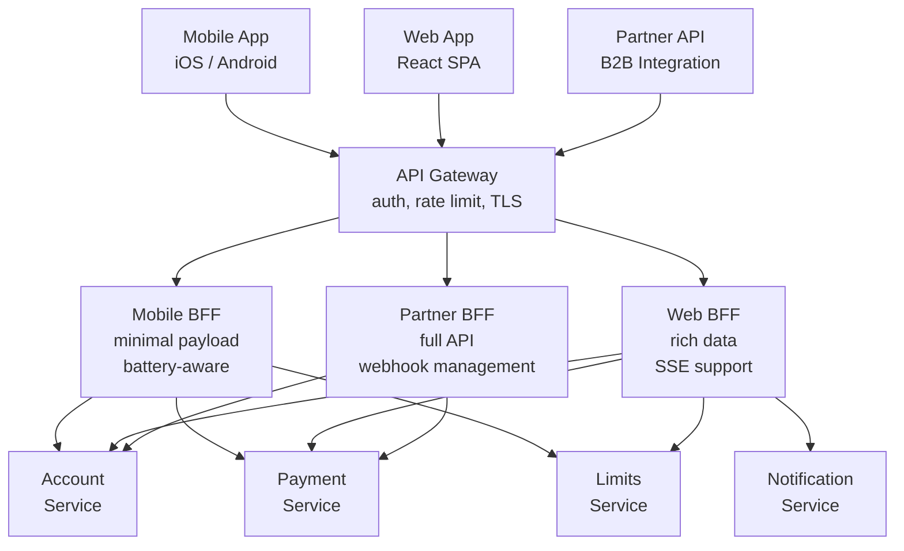

A mobile banking app team at a European neobank was making 11 separate HTTP calls on the home screen load — accounts, recent transactions, credit limits, rewards balance, exchange rates, notifications, spending insights, card status, pending payments, upcoming direct debits, and product offers. On a 4G connection, the sequential calls took 3.2 seconds. With a Backend-for-Frontend that composed all 11 responses into a single call, load time dropped to 380 milliseconds. The BFF also reduced the mobile team's deployment coupling: instead of coordinating releases with 11 backend teams, they owned their BFF and could iterate independently. This lesson covers how to build both the API gateway and BFF layers correctly.

## Learning Objectives

- Enumerate the responsibilities of an API gateway — authentication, rate limiting, routing, SSL termination, logging — and understand which belong at the gateway versus in services
- Configure Spring Cloud Gateway routes with predicates, filters, and circuit breakers
- Design a Backend-for-Frontend (BFF) per client type — mobile, web, partner API — and explain why a single BFF for all clients defeats the purpose
- Implement `PaymentAggregationBff` composing account, payment, and limit data in a single response using reactive composition
- Apply a circuit breaker at the gateway level to protect backend services from cascade failure
- Inject and propagate correlation IDs for distributed tracing through the full request chain
- Manage API versioning at the gateway layer without polluting individual services
- Understand where GraphQL is a superior alternative to BFF and where it is not

## Business Context

In 2022, a UK challenger bank's partner API gateway had no circuit breaker between its gateway and its KYC verification service. When the KYC provider experienced elevated latency (responses slowing from 200ms to 8 seconds), the gateway accumulated thousands of queued requests waiting for KYC responses. The connection thread pool exhausted within 90 seconds. Because the gateway was shared across all APIs — not just KYC — this brought down the entire API surface for 14 minutes, including payment APIs that had no dependency on KYC at all. The fix required adding circuit breakers per downstream service at the gateway layer, ensuring failures in one upstream cannot exhaust shared gateway resources.

## API Gateway Responsibilities

An API gateway is not just a reverse proxy. Its responsibilities cluster into five categories, each of which must be clearly owned:

| Responsibility | Implementation | Location |
|---|---|---|
| **Authentication** | JWT validation, OAuth2 token introspection | Gateway — before routing |
| **Rate limiting** | Per-client, per-endpoint token bucket | Gateway — after auth |
| **Routing** | Path-based, header-based, weighted | Gateway |
| **SSL termination** | TLS offload, cert rotation | Gateway / load balancer |
| **Observability** | Correlation ID injection, access logging, metrics | Gateway |
| **Circuit breaking** | Per-upstream breaker | Gateway |
| **Request/response transformation** | Header rewriting, body mapping | Gateway sparingly; prefer service |

> [!WARNING]
> Business logic does not belong in the gateway. If you find yourself adding payment validation rules or account eligibility checks to gateway filters, that logic belongs in a service. Gateways that accumulate business logic become an unmaintainable monolith-at-the-edge.

## Spring Cloud Gateway Configuration

```java
@Configuration
public class GatewayRouteConfig {

    @Bean
    public RouteLocator paymentGatewayRoutes(RouteLocatorBuilder builder,
                                              CircuitBreakerFactory cbFactory) {
        return builder.routes()

            // Payment service routes — authenticated, rate-limited, circuit-broken
            .route("payment-service", r -> r
                .path("/api/v1/payments/**")
                .filters(f -> f
                    .rewritePath("/api/v1/(?<segment>.*)", "/${segment}")
                    .addRequestHeader("X-Gateway-Version", "1.0")
                    .requestRateLimiter(config -> config
                        .setRateLimiter(redisRateLimiter())
                        .setKeyResolver(clientIdKeyResolver()))
                    .circuitBreaker(config -> config
                        .setName("payment-service-cb")
                        .setFallbackUri("forward:/fallback/payment")))
                .uri("lb://payment-service"))

            // Account service — read-heavy, higher rate limit
            .route("account-service", r -> r
                .path("/api/v1/accounts/**")
                .filters(f -> f
                    .rewritePath("/api/v1/(?<segment>.*)", "/${segment}")
                    .circuitBreaker(config -> config
                        .setName("account-service-cb")
                        .setFallbackUri("forward:/fallback/account")))
                .uri("lb://account-service"))

            // Mobile BFF — no auth at gateway, BFF handles token exchange
            .route("mobile-bff", r -> r
                .path("/mobile/v1/**")
                .and()
                .header("X-Client-Type", "mobile")
                .filters(f -> f
                    .rewritePath("/mobile/v1/(?<segment>.*)", "/${segment}"))
                .uri("lb://mobile-bff"))

            .build();
    }

    // Correlation ID injection filter — applies to ALL routes
    @Bean
    public GlobalFilter correlationIdFilter() {
        return (exchange, chain) -> {
            String correlationId = exchange.getRequest().getHeaders()
                .getFirst("X-Correlation-ID");
            if (correlationId == null) {
                correlationId = UUID.randomUUID().toString();
            }
            final String finalCorrelationId = correlationId;
            ServerWebExchange mutatedExchange = exchange.mutate()
                .request(r -> r.header("X-Correlation-ID", finalCorrelationId))
                .response(r -> r.getHeaders().add("X-Correlation-ID", finalCorrelationId))
                .build();
            return chain.filter(mutatedExchange);
        };
    }
}
```

## BFF Architecture — One BFF per Client Type

The original BFF pattern (Phil Calçado, SoundCloud, 2015) mandates a separate BFF per client type. A single "BFF" serving mobile, web, and partner clients is an aggregation service, not a BFF — it cannot be optimised for any client's needs without compromising others.



## PaymentAggregationBff — Reactive Composition

The BFF composes multiple downstream calls. Using reactive streams (`Mono.zip`) achieves parallel fan-out, reducing total latency to the slowest individual call rather than the sum of all calls.

```java
@RestController
@RequestMapping("/v1/home")
public class MobileHomeScreenBff {

    private final AccountServiceClient accountClient;
    private final PaymentServiceClient paymentClient;
    private final LimitsServiceClient limitsClient;
    private final NotificationServiceClient notificationClient;

    @GetMapping
    public Mono<MobileHomeResponse> homeScreen(
            @RequestHeader("X-User-ID") String userId,
            @RequestHeader("X-Correlation-ID") String correlationId) {

        // Fan out all calls in parallel — total latency = max(individual latencies)
        return Mono.zip(
            accountClient.getSummary(userId, correlationId),
            paymentClient.getRecentTransactions(userId, 5, correlationId),
            limitsClient.getCurrentLimits(userId, correlationId),
            notificationClient.getUnreadCount(userId, correlationId)
        ).map(tuple -> MobileHomeResponse.builder()
            .accountSummary(toMobileAccountSummary(tuple.getT1()))
            .recentTransactions(toMobileTransactions(tuple.getT2()))
            .spendingLimit(tuple.getT3().dailyLimit())
            .remainingLimit(tuple.getT3().remainingToday())
            .unreadNotifications(tuple.getT4())
            .build()
        ).timeout(Duration.ofSeconds(3))  // Mobile clients cannot wait longer
         .onErrorResume(TimeoutException.class, ex ->
             Mono.just(MobileHomeResponse.degraded(
                 "Some data temporarily unavailable")));
    }

    // Response tailored for mobile: minimal fields, mobile-friendly formats
    private MobileAccountSummary toMobileAccountSummary(AccountSummary full) {
        return MobileAccountSummary.builder()
            .maskedAccountNumber(full.accountNumber().replaceAll("\\d(?=\\d{4})", "*"))
            .displayBalance(formatCurrencyForLocale(full.availableBalance()))
            .build();
    }
}
```

## Circuit Breaker at the Gateway Level

Each upstream service needs its own circuit breaker. A shared breaker means one slow service can trip the breaker for all services on the gateway.

```java
@Configuration
public class GatewayCircuitBreakerConfig {

    @Bean
    public Customizer<Resilience4JCircuitBreakerFactory> paymentServiceCb() {
        return factory -> factory.configure(builder -> builder
            .circuitBreakerConfig(CircuitBreakerConfig.custom()
                .failureRateThreshold(50)           // Open after 50% failures
                .waitDurationInOpenState(Duration.ofSeconds(30))
                .slidingWindowType(COUNT_BASED)
                .slidingWindowSize(20)
                .permittedNumberOfCallsInHalfOpenState(5)
                .build())
            .timeLimiterConfig(TimeLimiterConfig.custom()
                .timeoutDuration(Duration.ofSeconds(2))
                .build()),
        "payment-service-cb");
    }

    // Fallback controller — returns a safe degraded response when circuit is open
    @RestController
    @RequestMapping("/fallback")
    public static class GatewayFallbackController {

        @GetMapping("/payment")
        public ResponseEntity<Map<String, String>> paymentFallback(
                @RequestHeader("X-Correlation-ID") String correlationId) {
            return ResponseEntity.status(503)
                .header("X-Correlation-ID", correlationId)
                .header("Retry-After", "30")
                .body(Map.of(
                    "error", "PAYMENT_SERVICE_UNAVAILABLE",
                    "message", "Payment service is temporarily unavailable",
                    "correlationId", correlationId
                ));
        }
    }
}
```

## API Versioning at the Gateway Layer

Versioning at the gateway allows you to evolve individual services without breaking their public API contracts. The gateway absorbs the version routing and can apply transformation filters to adapt legacy service responses to current API contracts.

```java
@Bean
public RouteLocator versionedRoutes(RouteLocatorBuilder builder) {
    return builder.routes()

        // v1 routes to current service
        .route("payment-v1", r -> r
            .path("/api/v1/payments/**")
            .uri("lb://payment-service"))

        // v2 routes to same service — service handles v2 internally
        .route("payment-v2", r -> r
            .path("/api/v2/payments/**")
            .filters(f -> f
                .rewritePath("/api/v2/(?<segment>.*)", "/${segment}")
                .addRequestHeader("X-API-Version", "2"))
            .uri("lb://payment-service"))

        // Legacy v0 — sunset header notifies clients to migrate
        .route("payment-v0-sunset", r -> r
            .path("/api/v0/payments/**")
            .filters(f -> f
                .addResponseHeader("Sunset", "Sat, 01 Mar 2026 00:00:00 GMT")
                .addResponseHeader("Deprecation", "true")
                .rewritePath("/api/v0/(?<segment>.*)", "/${segment}"))
            .uri("lb://payment-service-v0"))

        .build();
}
```

## GraphQL as an Alternative to BFF

GraphQL addresses the same problem as BFF — over-fetching and multiple round trips — but with a different trade-off profile:

| Concern | BFF | GraphQL |
|---|---|---|
| **Who controls the query?** | Server (BFF team) | Client (frontend team) |
| **N+1 query risk** | Low — BFF knows its own queries | High — requires DataLoader |
| **Type safety** | Java types, manual contract | Schema-first, generated types |
| **Mobile optimisation** | Very high — BFF tailored per client | Good — fields selected per query |
| **Partner API suitability** | Requires separate BFF per partner | Excellent — partners query what they need |
| **Operational complexity** | Medium — one BFF per client type | High — schema governance, persisted queries |

For internal BFFs where the client team and BFF team are the same, BFF is typically simpler. For partner APIs and self-service integrations, GraphQL's flexibility provides more value.

<!-- KNOWLEDGE-CHECK
{
  "questions": [
    {
      "id": "q1",
      "text": "Your team proposes building a single 'BFF' that serves both the mobile app and the web app to reduce duplication. What is the primary architectural problem with this approach?",
      "options": [
        "It violates the DRY principle because BFFs should share code",
        "A single BFF serving multiple client types accumulates conflicting requirements, making it impossible to optimise payload size for mobile without breaking web, and creating deployment coupling between client teams",
        "It is not a problem — a shared BFF is more cost-effective and the extra payload size is acceptable",
        "It increases latency because the BFF must handle more request types"
      ],
      "correct": 1,
      "explanation": "The BFF pattern exists specifically to allow each client type to have an independently deployable, purpose-optimised aggregation layer. Mobile needs small payloads and battery-efficient polling patterns. Web needs richer data and may need SSE for real-time updates. A shared BFF cannot be optimised for either without compromising the other, and it creates the same deployment coupling problem the BFF pattern was designed to solve."
    },
    {
      "id": "q2",
      "text": "During a production incident, the KYC service becomes slow (8-second response times). The gateway has no circuit breaker. What failure mode do you expect?",
      "options": [
        "Only KYC-dependent endpoints slow down — other endpoints are unaffected",
        "The gateway accumulates queued threads waiting for KYC responses, eventually exhausting the shared thread pool and causing all gateway routes to fail",
        "The gateway automatically times out slow requests after 30 seconds and returns errors only to KYC callers",
        "Kubernetes restarts the KYC pods, resolving the issue within 60 seconds"
      ],
      "correct": 1,
      "explanation": "Without a circuit breaker, threads accumulate waiting for KYC responses. Because the gateway's thread pool is shared across all routes, KYC threads crowd out payment, account, and all other API threads. This is a cascade failure via resource exhaustion — a circuit breaker per upstream service prevents this by failing fast once the KYC service is detected as degraded, freeing threads for unrelated routes."
    }
  ]
}
-->

<!-- PRACTICAL-CHALLENGE
## Practical Challenge

**Scenario:** You are the principal engineer for a fintech platform that serves three client types: a consumer mobile app, a web dashboard, and a partner API used by enterprise clients. Each has different payload, latency, and versioning requirements.

**Task 1 — Gateway Route Design**
Design the full Spring Cloud Gateway route configuration for all three client types. Include authentication filter (JWT validation), per-client rate limiting, circuit breakers per downstream service, and correlation ID injection. Specify the rate limit thresholds for each client type and justify them.

**Task 2 — Mobile BFF Implementation**
Implement the `MobileHomeScreenBff` with reactive fan-out to at least four downstream services. Include timeout handling with a degraded response, mobile-specific payload transformation (mask sensitive fields, format currency for locale), and unit tests that mock downstream clients.

**Task 3 — Circuit Breaker Calibration**
Your payment service has an SLA of 200ms p99. Design the circuit breaker configuration: what failure rate threshold, sliding window size, and open-state duration is appropriate? Justify each value. What monitoring do you add to alert when the circuit breaker transitions to open state?

**Task 4 — API Version Sunset**
You need to sunset the v0 payment API in 90 days. Design and implement the full lifecycle: add deprecation headers, build a migration guide endpoint that returns the v1 equivalent for any v0 request, track which partners are still calling v0 using gateway metrics, and define the process for forcing migration before the sunset date.
-->
