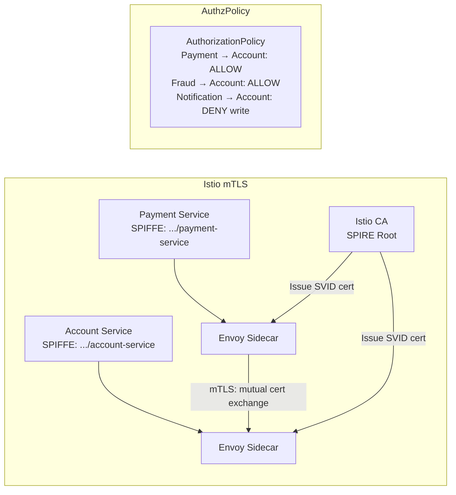

In 2020, a major payment processor discovered that an attacker who had compromised a single internal service had spent 11 months moving laterally through the internal network, harvesting credentials from memory and reading payment records from databases the initial compromised service had no legitimate reason to access. The internal network had no east-west authentication — services trusted each other by virtue of being on the same VLAN. This is the problem zero-trust architecture solves: the internal network is not a trust boundary. This lesson covers the full implementation of zero-trust principles in a Java-based payment platform, from workload identity through policy-as-code to PCI DSS compliance mapping.

## Learning Objectives

- Articulate the three core principles of zero-trust architecture — never trust, always verify; least privilege; assume breach — and demonstrate how each changes engineering decisions
- Use SPIFFE/SPIRE to issue workload identities and validate them in Spring Boot services
- Configure mutual TLS between services using Istio, understanding certificate issuance and rotation
- Implement JWT claims-based access control using Spring Security's `@PreAuthorize` with method-level security
- Design Kubernetes NetworkPolicy to enforce network segmentation at the pod level
- Use HashiCorp Vault for dynamic credentials with short TTLs, eliminating long-lived database passwords
- Build a Mermaid architecture diagram for a zero-trust payment service
- Map zero-trust controls to PCI DSS Requirement 1 (network segmentation) and Requirement 7 (least privilege)

## Business Context

The 2020 SolarWinds supply chain attack demonstrated that perimeter security is insufficient: attackers who gain a foothold inside the perimeter can move freely if east-west traffic is unauthenticated. For payment platforms under PCI DSS, the consequences are existential — a lateral movement attack that reaches a card data environment (CDE) triggers mandatory breach notification, fines, and potential suspension of card processing rights. PCI DSS v4.0 (effective 2024) explicitly references zero-trust principles in Requirement 1 (network controls), requiring that access between network segments be authenticated and that the principle of least privilege govern all access decisions.

## Zero-Trust Principles

Three principles define zero-trust. Each has direct engineering implications:

**Never trust, always verify** — Every request, regardless of source network, must carry verifiable identity. Services on the same Kubernetes cluster are not implicitly trusted. Database connections carry credentials rotated by Vault, not static passwords.

**Least privilege** — Each service has exactly the permissions it needs and no more. The payment service can read and write to `payments` table but cannot read `audit_logs`. The notification service can read account metadata but cannot initiate payments.

**Assume breach** — Design as if an attacker already has a foothold in one service. Lateral movement must be blocked by authentication at every hop, secrets must have short TTLs that limit the window of exploitation, and all access decisions must be logged for detection.

## SPIFFE/SPIRE for Workload Identity

SPIFFE (Secure Production Identity Framework for Everyone) assigns a cryptographically verifiable identity to every workload, independent of IP address or hostname. Each service gets a SPIFFE Verifiable Identity Document (SVID) — an X.509 certificate or JWT — that it presents to authenticate itself to other services.

```java
// SPIFFE SVID validation in a Spring Boot service
@Component
public class SpiffeIdentityValidator {

    private static final String TRUST_DOMAIN = "spiffe://fintech.internal";

    // Called by the mTLS layer — validates the peer SPIFFE ID from its certificate
    public ServiceIdentity validatePeerIdentity(X509Certificate peerCert) {
        // SPIFFE ID is in the Subject Alternative Name as a URI
        String spiffeId = extractSpiffeId(peerCert);

        if (!spiffeId.startsWith(TRUST_DOMAIN)) {
            throw new UnauthorizedWorkloadException(
                "Peer certificate has untrusted SPIFFE ID: " + spiffeId);
        }

        // e.g., spiffe://fintech.internal/ns/payments/sa/payment-service
        String[] parts = spiffeId.substring(TRUST_DOMAIN.length() + 1).split("/");
        return ServiceIdentity.builder()
            .namespace(parts[1])
            .serviceAccount(parts[3])
            .fullSpiffeId(spiffeId)
            .build();
    }

    private String extractSpiffeId(X509Certificate cert) {
        try {
            Collection<List<?>> sanEntries = cert.getSubjectAlternativeNames();
            return sanEntries.stream()
                .filter(entry -> entry.get(0).equals(6))  // 6 = URI SAN
                .map(entry -> (String) entry.get(1))
                .filter(uri -> uri.startsWith("spiffe://"))
                .findFirst()
                .orElseThrow(() -> new UnauthorizedWorkloadException(
                    "No SPIFFE SAN found in certificate"));
        } catch (CertificateParsingException e) {
            throw new UnauthorizedWorkloadException("Cannot parse peer certificate", e);
        }
    }
}
```

## mTLS Between Services

Mutual TLS requires both parties to present certificates. Istio manages the certificate lifecycle, rotating certificates every 24 hours without service restarts. Spring Boot services do not need to be aware of mTLS when Istio handles it — but they must validate the resulting SPIFFE identity from the extracted certificate.



```yaml
# Kubernetes: Istio AuthorizationPolicy — only payment-service can call account-service write endpoints
apiVersion: security.istio.io/v1beta1
kind: AuthorizationPolicy
metadata:
  name: account-service-writer-policy
  namespace: payments
spec:
  selector:
    matchLabels:
      app: account-service
  rules:
    - from:
        - source:
            principals:
              - "cluster.local/ns/payments/sa/payment-service"
      to:
        - operation:
            methods: ["POST", "PUT", "PATCH"]
            paths: ["/accounts/*"]
    - from:
        - source:
            principals:
              - "cluster.local/ns/payments/sa/payment-service"
              - "cluster.local/ns/fraud/sa/fraud-service"
      to:
        - operation:
            methods: ["GET"]
```

## JWT Claims-Based Access Control

After mTLS authenticates the service-to-service layer, JWT claims authorise individual operations. Spring Security's method-level security enforces this at the service boundary.

```java
@Configuration
@EnableMethodSecurity(prePostEnabled = true)
public class MethodSecurityConfig {}

@Service
public class PaymentService {

    // Only services with the payment:write scope can initiate payments
    @PreAuthorize("hasAuthority('SCOPE_payment:write')")
    public PaymentResult initiatePayment(PaymentRequest request) {
        auditLog.record("PAYMENT_INITIATION_REQUESTED",
            SecurityContextHolder.getContext().getAuthentication().getName(),
            request.transactionId());
        return processPayment(request);
    }

    // Read access is broader — any service with payment:read can query
    @PreAuthorize("hasAuthority('SCOPE_payment:read') or hasAuthority('SCOPE_payment:write')")
    public PaymentStatus getStatus(String transactionId) {
        return paymentRepository.findById(transactionId)
            .map(Payment::status)
            .orElseThrow(() -> new PaymentNotFoundException(transactionId));
    }

    // Admin operations require both scope and admin role
    @PreAuthorize("hasAuthority('SCOPE_payment:admin') and hasRole('PLATFORM_ADMIN')")
    public void reversePastSettlement(String settlementId, String reason) {
        auditLog.record("SETTLEMENT_REVERSAL_ATTEMPTED",
            SecurityContextHolder.getContext().getAuthentication().getName(),
            settlementId, reason);
        settlementEngine.reverse(settlementId, reason);
    }
}

// Security configuration — validates JWT from SPIRE JWT-SVID or OAuth2 server
@Configuration
@EnableWebSecurity
public class SecurityConfig {

    @Bean
    public SecurityFilterChain filterChain(HttpSecurity http) throws Exception {
        return http
            .authorizeHttpRequests(auth -> auth
                .requestMatchers("/actuator/health").permitAll()
                .anyRequest().authenticated())
            .oauth2ResourceServer(oauth2 -> oauth2
                .jwt(jwt -> jwt
                    .jwtAuthenticationConverter(jwtAuthConverter())))
            .build();
    }

    @Bean
    public JwtAuthenticationConverter jwtAuthConverter() {
        JwtGrantedAuthoritiesConverter scopeConverter =
            new JwtGrantedAuthoritiesConverter();
        scopeConverter.setAuthorityPrefix("SCOPE_");
        scopeConverter.setAuthoritiesClaimName("scope");

        JwtAuthenticationConverter converter = new JwtAuthenticationConverter();
        converter.setJwtGrantedAuthoritiesConverter(scopeConverter);
        return converter;
    }
}
```

## Kubernetes NetworkPolicy — Network Segmentation

NetworkPolicy enforces that even if an attacker compromises a pod, it cannot make arbitrary network connections to other services — lateral movement is blocked at the network layer.

```yaml
# Default deny all ingress/egress in the payments namespace
apiVersion: networking.k8s.io/v1
kind: NetworkPolicy
metadata:
  name: default-deny-all
  namespace: payments
spec:
  podSelector: {}
  policyTypes: [Ingress, Egress]
---
# Payment service: allow inbound from API gateway only, outbound to account + limits services
apiVersion: networking.k8s.io/v1
kind: NetworkPolicy
metadata:
  name: payment-service-policy
  namespace: payments
spec:
  podSelector:
    matchLabels:
      app: payment-service
  policyTypes: [Ingress, Egress]
  ingress:
    - from:
        - namespaceSelector:
            matchLabels:
              name: gateway
          podSelector:
            matchLabels:
              app: api-gateway
      ports:
        - port: 8080
  egress:
    - to:
        - podSelector:
            matchLabels:
              app: account-service
      ports:
        - port: 8080
    - to:
        - podSelector:
            matchLabels:
              app: limits-service
      ports:
        - port: 8080
    - to:  # Allow DNS resolution
        - namespaceSelector: {}
      ports:
        - port: 53
          protocol: UDP
```

## Vault Dynamic Credentials

Static database passwords in environment variables are a persistent vulnerability — they don't rotate, they appear in logs and config maps, and a single compromise exposes them indefinitely. Vault's dynamic secrets engine generates time-limited credentials on demand.

```java
@Configuration
public class VaultDynamicCredentialsConfig {

    @Bean
    @RefreshScope  // Credentials are refreshed before TTL expiry
    public DataSource dynamicCredentialsDataSource(VaultTemplate vaultTemplate) {
        // Vault generates a unique username and password, valid for 1 hour
        VaultResponse response = vaultTemplate.read(
            "database/creds/payment-service-role");

        Map<String, Object> data = response.getData();
        String username = (String) data.get("username");
        String password = (String) data.get("password");
        String leaseDuration = data.get("lease_duration").toString();

        log.info("Obtained dynamic DB credentials for user {}, TTL {}s",
            username, leaseDuration);

        HikariConfig config = new HikariConfig();
        config.setJdbcUrl(databaseUrl);
        config.setUsername(username);
        config.setPassword(password);
        // Max lifetime slightly less than Vault TTL to avoid mid-query expiry
        config.setMaxLifetime(Long.parseLong(leaseDuration) * 1000 - 30_000);
        return new HikariDataSource(config);
    }
}
```

## Audit Logging Every Access Decision

Zero-trust requires that every access decision — not just failures — be logged. This creates the event trail needed for both security monitoring and PCI DSS compliance reporting.

```java
@Aspect
@Component
public class AccessDecisionAuditAspect {

    private final AuditLogService auditLog;

    @AfterReturning(
        pointcut = "@annotation(org.springframework.security.access.prepost.PreAuthorize)",
        returning = "result")
    public void logSuccessfulAccess(JoinPoint jp, Object result) {
        Authentication auth = SecurityContextHolder.getContext().getAuthentication();
        auditLog.record(AccessAuditEntry.builder()
            .principal(auth.getName())
            .authorities(auth.getAuthorities().stream()
                .map(GrantedAuthority::getAuthority).toList())
            .method(jp.getSignature().toShortString())
            .outcome("GRANTED")
            .timestamp(Instant.now())
            .build());
    }

    @AfterThrowing(
        pointcut = "@annotation(org.springframework.security.access.prepost.PreAuthorize)",
        throwing = "ex")
    public void logDeniedAccess(JoinPoint jp, AccessDeniedException ex) {
        Authentication auth = SecurityContextHolder.getContext().getAuthentication();
        auditLog.record(AccessAuditEntry.builder()
            .principal(auth.getName())
            .method(jp.getSignature().toShortString())
            .outcome("DENIED")
            .reason(ex.getMessage())
            .timestamp(Instant.now())
            .build());
    }
}
```

<!-- KNOWLEDGE-CHECK
{
  "questions": [
    {
      "text": "An engineer argues that mTLS between internal services is unnecessary overhead because services are already on a private Kubernetes cluster behind a firewall. What is the strongest counter-argument?",
      "options": [
        "mTLS is a compliance requirement under PCI DSS and cannot be waived",
        "If a single pod is compromised, the absence of east-west authentication allows the attacker to call any service in the cluster freely with no identity verification or audit trail",
        "mTLS improves performance by allowing HTTP/2 multiplexing between services",
        "Without mTLS, Kubernetes NetworkPolicy cannot function correctly"
      ],
      "correct": 1,
      "explanation": "The assume-breach principle is the strongest argument. Perimeter security prevents external attackers from reaching the cluster but provides no protection once an attacker is inside — whether through a compromised dependency, a container escape, or a misconfigured pod. mTLS ensures that even a compromised pod cannot impersonate other services and that every inter-service call has a verifiable identity in the audit log."
    },
    {
      "text": "Your payment service uses a static database password stored in a Kubernetes Secret. What is the most significant security risk compared to Vault dynamic credentials?",
      "options": [
        "Static credentials have higher connection latency than dynamic credentials",
        "A compromised static credential has no automatic expiry — the attacker retains database access indefinitely until someone manually rotates it",
        "Static credentials cannot be used with PostgreSQL row-level security",
        "Vault is explicitly required by PCI DSS v4.0 and static credentials are a compliance violation"
      ],
      "correct": 1,
      "explanation": "The absence of automatic expiry is the core risk. If a static credential is leaked — via a log file, an etcd backup, a CI/CD pipeline, or a misconfigured RBAC policy — the attacker retains access indefinitely. Vault dynamic credentials have a TTL of minutes to hours, limiting the exploitation window to the credential lifetime even if the secret is compromised."
    },
    {
      "text": "A Kubernetes NetworkPolicy with `podSelector: {}` and `policyTypes: [Ingress, Egress]` but no `ingress` or `egress` rules is applied to the payments namespace. What is the effect?",
      "options": [
        "All traffic is allowed by default because no specific deny rules were added",
        "All ingress and egress traffic to all pods in the namespace is denied — this is the default-deny baseline for zero-trust network segmentation",
        "Only external traffic is blocked; pod-to-pod traffic within the namespace is unaffected",
        "The policy has no effect because it must specify at least one podSelector label"
      ],
      "correct": 1,
      "explanation": "A NetworkPolicy that selects all pods (`podSelector: {}`) and specifies policy types without any ingress/egress rules creates a default-deny posture — all traffic matching those types is blocked. This is the correct zero-trust starting point: deny everything, then add explicit allow rules for each required communication path. This prevents lateral movement even if an attacker compromises a pod."
    }
  ]
}
-->

<!-- PRACTICAL-CHALLENGE
{
  "title": "Implement Zero-Trust Security for a Payment Platform",
  "difficulty": "advanced",
  "estimatedMinutes": 60,
  "tasks": [
    {
      "id": "1",
      "description": "Design the SPIFFE ID scheme for a platform with five services: payment-service, account-service, fraud-service, notification-service, and audit-service. Write an Istio AuthorizationPolicy for each service defining exactly which services can call it and with which HTTP methods. Implement a SpiffeIdentityValidator that extracts and validates the SPIFFE URI SAN from a peer X.509 certificate, throwing UnauthorizedWorkloadException for untrusted trust domains."
    },
    {
      "id": "2",
      "description": "Implement the Vault dynamic credentials DataSource configuration with @RefreshScope. The payment service runs queries up to 10 minutes long — set Vault role TTL, HikariCP maxLifetime, and keepaliveTime correctly to prevent credential expiry during active queries. Write a VaultCredentialHealthIndicator that verifies lease validity and fires a PagerDuty alert if fewer than 10 minutes remain on the current lease."
    },
    {
      "id": "3",
      "description": "Write Kubernetes NetworkPolicy manifests for the payments namespace: (a) a default-deny-all policy, (b) policies for each of the five services allowing only their legitimate ingress sources and egress destinations. Include DNS egress (port 53 UDP) and Vault egress (port 8200) where needed. Write a test using a network policy validator tool (e.g. netassert or kubectl-netpol) that verifies payment-service cannot reach audit-service directly."
    },
    {
      "id": "4",
      "description": "Create a PCI DSS v4.0 compliance control matrix mapping your zero-trust controls to Requirements 1 (network controls), 7 (least privilege), and 10 (audit logging). For each requirement, specify: the control description, the zero-trust implementation (SPIFFE, NetworkPolicy, Vault, audit aspect), and the evidence artifact produced for auditors. Add an AccessDecisionAuditAspect that logs both GRANTED and DENIED decisions with principal, method, outcome, and timestamp to a tamper-evident audit table."
    }
  ]
}
-->
