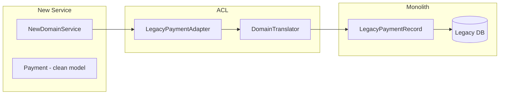
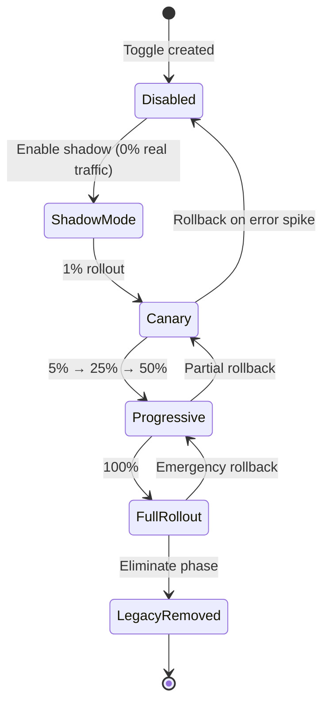
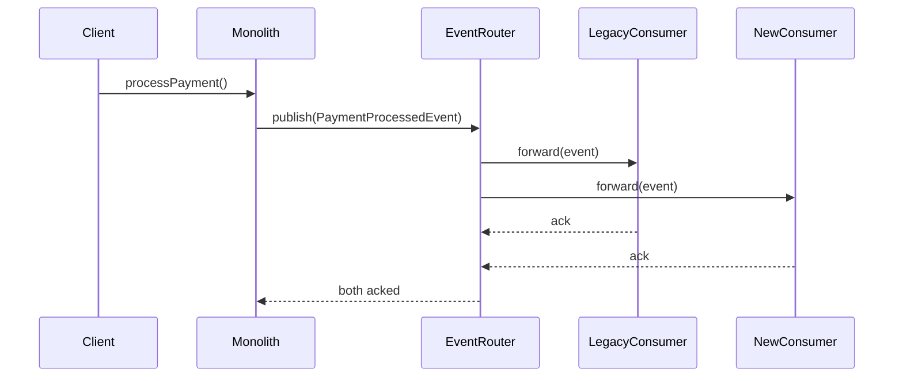
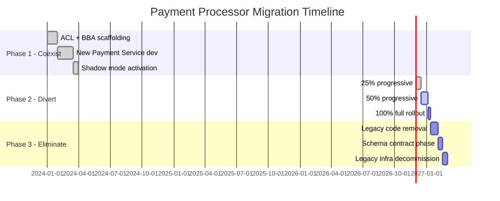

# نمط Strangler Fig وأنماط الترحيل التدريجي

## نظرة عامة

نمط الترحيل Strangler Fig هو الاستراتيجية السائدة لتفكيك نظام موحّد إلى خدمات مصغّرة بأمان دون إعادة كتابة كاملة. واسمه مأخوذ من شجرة التين الخانقة، التي تنمو حول شجرة مضيفة وتحل محلها في النهاية بالكامل بينما تستمر الشجرة المضيفة في العمل خلال الانتقال. وفي التقنية المالية، حيث يحمل التوقف عقوبات تنظيمية ومالية، ليس هذا الأسلوب التدريجي اختياريًا — بل هو المعيار المهني.

يغطي هذا الدرس دورة حياة الترحيل كاملة: النموذج ذو المراحل الثلاث (التعايش، والتحويل، والإزالة)، وطبقة مكافحة الفساد (ACL) التي تعزل منطق المجال القديم عن الجديد، والتفرع بالتجريد (Branch by Abstraction) للتبديل خلف الكواليس، ومفاتيح الميزات لتوجيه الحركة، ونمط التوسيع-التقليص (expand-contract) لتطوير مخطط قاعدة البيانات، واعتراض الأحداث أثناء الانتقال. ونختم بدراسة حالة مالية لترحيل معالج مدفوعات موحّد إلى خدمات مصغّرة.

---

## 1. الأصل والآليات الأساسية

### 1.1 لماذا لا نعيد الكتابة دفعة واحدة؟

إعادة الكتابة "دفعة واحدة" — حيث يجمّد الفريق النظام القديم، ويعيد البناء من الصفر، ويحوّل في إصدار واحد — من أخطر المشاريع التي يمكن أن تنفذها مؤسسة. ولمعالج مدفوعات يتعامل مع 50 مليون جنيه إسترليني يوميًا، فملف المخاطر غير مقبول:

- قواعد عمل غير مكتشفة مدفونة في الشيفرة القديمة
- عقود ضمنية بين الوحدات لم تُوثَّق أبدًا
- التزامات تنظيمية مرتبطة بصيغ بيانات محددة
- نافذة المخاطر تُقاس بالأشهر، لا بالساعات

يلغي نمط Strangler Fig التحويل الشامل بجعل الترحيل سلسلة من الخطوات الصغيرة القابلة للنشر باستقلال، تترك كل منها النظام في حالة تشغيل كاملة.

### 1.2 النموذج ذو المراحل الثلاث

```
┌─────────────────────────────────────────────────────────────────────┐
│                     STRANGLER FIG PHASES                            │
│                                                                     │
│  Phase 1: COEXIST         Phase 2: DIVERT         Phase 3: ELIMINATE│
│                                                                     │
│  ┌──────────┐             ┌──────────┐             ┌──────────┐     │
│  │  Monolith│             │  Monolith│             │          │     │
│  │  (100%)  │             │  (50%)   │             │ (deleted)│     │
│  └────┬─────┘             └────┬─────┘             └──────────┘     │
│       │                        │                                     │
│  ┌────▼─────┐             ┌────▼─────┐             ┌──────────┐     │
│  │  New Svc │             │  New Svc │             │  New Svc │     │
│  │  (0%)    │             │  (50%)   │             │  (100%)  │     │
│  └──────────┘             └──────────┘             └──────────┘     │
└─────────────────────────────────────────────────────────────────────┘
```

**المرحلة 1 — التعايش**: تُنشر الخدمة الجديدة بجانب النظام الموحّد. كلاهما يعمل، لكن الخدمة الجديدة لا تتلقى أي حركة إنتاج. وتُستخدم هذه المرحلة للتحقق من البنية التحتية والمراقبة والصحة.

**المرحلة 2 — التحويل**: تُنقل الحركة تدريجيًا من النظام الموحّد إلى الخدمة الجديدة. ويمكن ذلك بمفتاح ميزة (0/1)، أو بتوجيه نسبي (1%، 5%، 25%، 50%، 100%)، أو حسب شريحة العملاء.

**المرحلة 3 — الإزالة**: يُحذف مسار الشيفرة في النظام الموحّد للقدرة التي رُحّلت. وتُوقف الجداول والواجهات والإعدادات التي تخص المسار القديم وحده.

---

## 2. طبقة مكافحة الفساد (ACL)

### 2.1 المفهوم

طبقة مكافحة الفساد حد ترجمة يمنع نموذج مجال النظام القديم من "التسرب" إلى الخدمة الجديدة. وبدونها، تبدأ الخدمة الجديدة بالاعتماد على بنى البيانات والمفاهيم القديمة، فتعيد استيراد الدَّين التقني نفسه الذي تحاول الهرب منه.

تترجم الطبقة بين سياقين محدودين:
- **السياق القديم**: نموذج مجال النظام الموحّد (غالبًا هزيل، وغير متسق، بتسميات قديمة)
- **السياق الجديد**: نموذج المجال النظيف للخدمة الجديدة



### 2.2 واجهة ACL ومحوّلها في Java

عرّف رؤية الخدمة الجديدة للدفعة باستخدام أنواع مجال نظيفة:

```java
// New domain model — clean, ubiquitous language
public record Payment(
    PaymentId id,
    Money amount,
    AccountId debitAccount,
    AccountId creditAccount,
    PaymentStatus status,
    Instant createdAt
) {}

public record Money(BigDecimal amount, Currency currency) {
    public static Money of(BigDecimal amount, String currencyCode) {
        return new Money(amount, Currency.getInstance(currencyCode));
    }
}

// Port — defined entirely in terms of the new domain
public interface PaymentRepository {
    Optional<Payment> findById(PaymentId id);
    void save(Payment payment);
    List<Payment> findPendingOlderThan(Duration age);
}
```

يستخدم النظام القديم بنية مختلفة تمامًا — جدول مسطح برموز VARCHAR، ومبالغ BigDecimal خام، وأرقام صحيحة للحالة:

```java
// Legacy record — do NOT let this leak into the new domain
@Entity
@Table(name = "tbl_pmt_rec")
public class LegacyPaymentRecord {
    @Id
    public Long pmt_id;
    public BigDecimal pmt_amt;        // currency implicit from account
    public String debit_acct_no;
    public String credit_acct_no;
    public Integer status_cd;         // 0=PENDING, 1=CLEARED, 2=FAILED, 9=REVERSED
    public Timestamp insert_ts;
    public String ccy_iso;
}

// ACL Adapter — the only place that knows about LegacyPaymentRecord
@Component
public class LegacyPaymentRepositoryAdapter implements PaymentRepository {

    private final LegacyPaymentJpaRepository legacyJpa;
    private final LegacyDomainTranslator translator;

    public LegacyPaymentRepositoryAdapter(
            LegacyPaymentJpaRepository legacyJpa,
            LegacyDomainTranslator translator) {
        this.legacyJpa = legacyJpa;
        this.translator = translator;
    }

    @Override
    public Optional<Payment> findById(PaymentId id) {
        return legacyJpa.findById(id.value())
                .map(translator::toDomain);
    }

    @Override
    public void save(Payment payment) {
        LegacyPaymentRecord record = translator.toLegacy(payment);
        legacyJpa.save(record);
    }

    @Override
    public List<Payment> findPendingOlderThan(Duration age) {
        Timestamp cutoff = Timestamp.from(Instant.now().minus(age));
        return legacyJpa.findByStatusCdAndInsertTsBefore(0, cutoff)
                .stream()
                .map(translator::toDomain)
                .collect(Collectors.toList());
    }
}

// Translator — pure mapping logic, no business logic
@Component
public class LegacyDomainTranslator {

    private static final Map<Integer, PaymentStatus> STATUS_MAP = Map.of(
        0, PaymentStatus.PENDING,
        1, PaymentStatus.CLEARED,
        2, PaymentStatus.FAILED,
        9, PaymentStatus.REVERSED
    );

    public Payment toDomain(LegacyPaymentRecord rec) {
        PaymentStatus status = STATUS_MAP.getOrDefault(
            rec.status_cd, PaymentStatus.UNKNOWN
        );
        return new Payment(
            PaymentId.of(rec.pmt_id),
            Money.of(rec.pmt_amt, rec.ccy_iso),
            AccountId.of(rec.debit_acct_no),
            AccountId.of(rec.credit_acct_no),
            status,
            rec.insert_ts.toInstant()
        );
    }

    public LegacyPaymentRecord toLegacy(Payment payment) {
        LegacyPaymentRecord rec = new LegacyPaymentRecord();
        rec.pmt_id      = payment.id().value();
        rec.pmt_amt     = payment.amount().amount();
        rec.ccy_iso     = payment.amount().currency().getCurrencyCode();
        rec.debit_acct_no  = payment.debitAccount().value();
        rec.credit_acct_no = payment.creditAccount().value();
        rec.status_cd   = STATUS_MAP.entrySet().stream()
                            .filter(e -> e.getValue() == payment.status())
                            .map(Map.Entry::getKey)
                            .findFirst()
                            .orElseThrow();
        rec.insert_ts   = Timestamp.from(payment.createdAt());
        return rec;
    }
}
```

---

## 3. التفرع بالتجريد (Branch by Abstraction)

التفرع بالتجريد أسلوب يخفي الترحيل خلف واجهة ثابتة، فلا تحتاج بقية قاعدة الشيفرة أبدًا إلى معرفة أي تنفيذ هو النشط. وهذا مختلف عن ACL — فـ ACL تترجم بين نموذجي مجال؛ أما التفرع بالتجريد فيدير التبديل بين تنفيذين داخل قاعدة شيفرة واحدة.

### 3.1 الخطوات الأربع

```
Step 1: Extract interface              Step 2: Both impls exist
┌───────────────────────┐              ┌───────────────────────┐
│  PaymentService       │              │  PaymentService (iface)│
│  (concrete class)     │              │  ┌──────────────────┐ │
│  client code calls    │  ──────►     │  │LegacyImpl        │ │
│  this directly        │              │  │NewImpl           │ │
└───────────────────────┘              └──────────────────────┘

Step 3: Toggle selects impl            Step 4: Legacy deleted
┌───────────────────────┐              ┌───────────────────────┐
│  FeatureToggle        │              │  PaymentService (iface)│
│  → LegacyImpl or      │  ──────►     │  ┌──────────────────┐ │
│  → NewImpl            │              │  │NewImpl only      │ │
└───────────────────────┘              └──────────────────────┘
```

(1) استخراج واجهة، (2) وجود التنفيذين معًا، (3) مفتاح يختار التنفيذ، (4) حذف التنفيذ القديم.

### 3.2 تنفيذ التفرع بالتجريد في Java

```java
// Step 1 & 2: Extract the abstraction
public interface PaymentProcessor {
    ProcessingResult process(Payment payment);
    boolean canHandle(PaymentType type);
}

// Legacy implementation — untouched monolith code wrapped in interface
@Component("legacyPaymentProcessor")
public class LegacyPaymentProcessorAdapter implements PaymentProcessor {

    private final MonolithPaymentEngine monolithEngine; // the old beast

    @Override
    public ProcessingResult process(Payment payment) {
        // Convert to legacy types, delegate to monolith
        LegacyPaymentRequest req = LegacyConverter.toRequest(payment);
        LegacyResult result = monolithEngine.executePayment(req);
        return LegacyConverter.toResult(result);
    }

    @Override
    public boolean canHandle(PaymentType type) {
        return true; // legacy handles everything it always did
    }
}

// New microservice implementation
@Component("newPaymentProcessor")
public class NewPaymentProcessorAdapter implements PaymentProcessor {

    private final PaymentOrchestrator orchestrator;
    private final PaymentRepository repository;

    @Override
    public ProcessingResult process(Payment payment) {
        return orchestrator.execute(payment);
    }

    @Override
    public boolean canHandle(PaymentType type) {
        // New service handles only the types it has been validated for
        return Set.of(PaymentType.DOMESTIC_TRANSFER, PaymentType.BILL_PAYMENT)
                  .contains(type);
    }
}

// Step 3: Router selects implementation based on feature toggle
@Component
@Primary
public class BranchingPaymentProcessor implements PaymentProcessor {

    private final PaymentProcessor legacyProcessor;
    private final PaymentProcessor newProcessor;
    private final FeatureToggleService toggles;
    private final MeterRegistry meterRegistry;

    @Override
    public ProcessingResult process(Payment payment) {
        PaymentProcessor selected = selectProcessor(payment);
        String processorTag = selected == newProcessor ? "new" : "legacy";

        return meterRegistry.timer("payment.processor.duration",
                "processor", processorTag)
            .record(() -> {
                ProcessingResult result = selected.process(payment);
                meterRegistry.counter("payment.processor.calls",
                    "processor", processorTag,
                    "outcome", result.isSuccess() ? "success" : "failure"
                ).increment();
                return result;
            });
    }

    private PaymentProcessor selectProcessor(Payment payment) {
        if (!toggles.isEnabled("use-new-payment-processor")) {
            return legacyProcessor;
        }
        // Gradual rollout: check if this payment falls in enabled cohort
        if (!toggles.isEnabledForContext("new-processor-rollout", payment.id().value())) {
            return legacyProcessor;
        }
        // New processor must claim it can handle this type
        if (!newProcessor.canHandle(payment.type())) {
            return legacyProcessor;
        }
        return newProcessor;
    }

    @Override
    public boolean canHandle(PaymentType type) {
        return legacyProcessor.canHandle(type) || newProcessor.canHandle(type);
    }
}
```

---

## 4. مفاتيح الميزات لتوجيه الحركة

تفصل مفاتيح الميزات النشر عن الإصدار. وفي سيناريوهات الترحيل، توفر تحكمًا دقيقًا في نسبة الحركة التي تذهب إلى الخدمة الجديدة.

### 4.1 أنواع المفاتيح في الترحيل

| نوع المفتاح | حالة الاستخدام | المخاطر |
|-------------|----------|------|
| مفتاح إصدار | تفعيل مسار الشيفرة الجديد بعد النشر | منخفضة |
| مفتاح تجربة | اختبار A/B للجديد مقابل القديم للتحقق من الصحة | متوسطة |
| مفتاح تشغيل | مفتاح إيقاف طارئ أثناء الحوادث | منخفضة (يجب أن يكون سريعًا) |
| مفتاح صلاحية | النشر لعملاء محددين أولًا | منخفضة |

### 4.2 النشر بالنسبة المئوية

```java
@Service
public class PercentageFeatureToggleService implements FeatureToggleService {

    private final ToggleConfigRepository configRepo;

    @Override
    public boolean isEnabledForContext(String toggleName, String contextKey) {
        ToggleConfig config = configRepo.findByName(toggleName)
                .orElse(ToggleConfig.disabled(toggleName));

        if (!config.isEnabled()) return false;

        // Deterministic hash — same payment always goes to same processor
        // This avoids flip-flopping between processors for the same payment
        // floorMod, not Math.abs(...) % 100: Math.abs(Integer.MIN_VALUE) is negative
        int bucket = Math.floorMod(Objects.hash(toggleName, contextKey), 100); // 0–99

        return bucket < config.getRolloutPercentage();
    }
}

// Toggle configuration stored in database — can be changed without redeployment
@Entity
@Table(name = "feature_toggles")
public class ToggleConfig {
    @Id
    private String name;
    private boolean enabled;
    private int rolloutPercentage; // 0–100
    private String allowedAccountTypes; // e.g., "PERSONAL,BUSINESS"
    private Instant lastModified;
    private String modifiedBy;

    public static ToggleConfig disabled(String name) {
        ToggleConfig c = new ToggleConfig();
        c.name = name;
        c.enabled = false;
        c.rolloutPercentage = 0;
        return c;
    }
}
```

التجزئة حتمية: الدفعة نفسها تذهب دائمًا إلى المعالج نفسه، فلا تتقلب بين المعالجين. ويُستخدم `Math.floorMod` لأن `Math.abs(Integer.MIN_VALUE)` قيمة سالبة.

### 4.3 انتقالات حالة المفتاح



---

## 5. التوسيع-التقليص لترحيل المخطط

يُستخدم نمط التوسيع-التقليص (ويُسمى أيضًا التغيير المتوازي) عند ترحيل مخطط قاعدة البيانات دون توقف. وهو مهم خاصة لأنظمة التقنية المالية حيث تكون قاعدة البيانات مشتركة بين النظام الموحّد والخدمة الجديدة خلال مرحلتي التعايش والتحويل.

### 5.1 مراحل SQL الثلاث

**المرحلة 1 — التوسيع**: أضف العمود الجديد بجانب القديم. فيستطيع الشيفرة القديمة والجديدة العمل معًا. ويكون العمود الجديد قابلًا لأن يكون فارغًا حتى لا تنكسر عمليات الإدخال الحالية.

```sql
-- Phase 1: Expand — add new column without removing old
ALTER TABLE payments
  ADD COLUMN amount_minor_units BIGINT,       -- £10.50 stored as 1050
  ADD COLUMN currency_code      CHAR(3);       -- ISO 4217

-- New column is nullable: old code that doesn't know about it still works
-- Index on new column for future queries
CREATE INDEX CONCURRENTLY idx_payments_currency
  ON payments (currency_code)
  WHERE currency_code IS NOT NULL;
```

**المرحلة 2 — الترحيل**: املأ العمود الجديد من العمود القديم. شغّلها كمهمة خلفية على دفعات صغيرة لتجنب أقفال الجدول.

```sql
-- Phase 2: Migrate — back-fill in small batches, one COMMIT per batch
-- (COMMIT inside DO works on PostgreSQL 11+ when not run inside an outer transaction)
DO $$
DECLARE
    batch_size   INT := 1000;
    rows_updated INT;
BEGIN
    LOOP
        UPDATE payments
        SET amount_minor_units = (pmt_amt * 100)::BIGINT,  -- 2-decimal currencies only
            currency_code      = ccy_iso                   -- never guess a currency
        WHERE id IN (
            SELECT id FROM payments
            WHERE amount_minor_units IS NULL
              AND ccy_iso IS NOT NULL        -- NULL currencies: investigate by hand
            ORDER BY id
            LIMIT batch_size
        );

        GET DIAGNOSTICS rows_updated = ROW_COUNT;
        EXIT WHEN rows_updated = 0;

        COMMIT;                  -- release row locks; let replicas keep up
        PERFORM pg_sleep(0.1);   -- back-off between batches
    END LOOP;
END;
$$;

-- Verify 100% backfill before proceeding
SELECT COUNT(*) AS unmigrated
FROM payments
WHERE amount_minor_units IS NULL;
```

يلتزم السكربت بعد كل دفعة لتحرير الأقفال، ولا يخمّن عملة أبدًا: الصفوف ذات العملة الفارغة تُترك للتحقيق اليدوي.

ملاحظة: الضرب في 100 صحيح فقط للعملات ذات منزلتين عشريتين (الين الياباني بلا منازل، والدينار البحريني بثلاث) — استخدم أس كل عملة في الشيفرة الحقيقية، وتحقق من أن أي مبلغ لا يحتوي منازل عشرية أكثر مما تسمح به عملته قبل التحويل.

**المرحلة 3 — التقليص**: احذف العمود القديم. ولا يكون ذلك آمنًا إلا عندما لا تشير إليه أي شيفرة منشورة.

```sql
-- Phase 3: Contract — remove old columns after all services use new ones
-- First verify: no code references old columns (use search tools + test suite)
ALTER TABLE payments
  DROP COLUMN pmt_amt,
  DROP COLUMN ccy_iso;

-- Clean up: make new columns NOT NULL now that all rows are populated
ALTER TABLE payments
  ALTER COLUMN amount_minor_units SET NOT NULL,
  ALTER COLUMN currency_code      SET NOT NULL;
```

يأخذ `SET NOT NULL` قفلًا حصريًا ويمسح الجدول كله. وفي جدول كبير، أضف أولًا `CHECK (amount_minor_units IS NOT NULL) NOT VALID`، ثم نفّذ `VALIDATE CONSTRAINT` (الذي لا يحجب الكتابات)، ثم `SET NOT NULL` — فيستخدم PostgreSQL 12 وما بعده القيد المتحقق منه ويتخطى المسح.

### 5.2 الكتابة المزدوجة في التطبيق خلال المرحلة 2

خلال مرحلة الترحيل، يجب أن يكتب التطبيق في العمودين معًا، حتى يستطيع المسار القديم أو الجديد القراءة من عموده المفضّل:

```java
@Repository
public class DualWritePaymentRepository implements PaymentRepository {

    private final JdbcTemplate jdbc;
    private final MigrationPhaseService migrationPhase;

    @Override
    public void save(Payment payment) {
        if (migrationPhase.isExpand() || migrationPhase.isMigrate()) {
            // Write both old and new columns during transition
            jdbc.update("""
                INSERT INTO payments (
                    id, pmt_amt, ccy_iso,
                    amount_minor_units, currency_code,
                    debit_acct_no, credit_acct_no, status_cd, insert_ts
                ) VALUES (?, ?, ?, ?, ?, ?, ?, ?, ?)
                ON CONFLICT (id) DO UPDATE SET
                    pmt_amt            = EXCLUDED.pmt_amt,
                    ccy_iso            = EXCLUDED.ccy_iso,
                    amount_minor_units = EXCLUDED.amount_minor_units,
                    currency_code      = EXCLUDED.currency_code
                """,
                payment.id().value(),
                payment.amount().amount(),
                payment.amount().currency().getCurrencyCode(),
                payment.amount().toMinorUnits(),
                payment.amount().currency().getCurrencyCode(),
                payment.debitAccount().value(),
                payment.creditAccount().value(),
                StatusMapper.toLegacyCode(payment.status()),
                Timestamp.from(payment.createdAt())
            );
        } else {
            // Contract phase: write only new columns
            jdbc.update("""
                INSERT INTO payments (
                    id, amount_minor_units, currency_code,
                    debit_acct_no, credit_acct_no, status_cd, insert_ts
                ) VALUES (?, ?, ?, ?, ?, ?, ?)
                """,
                payment.id().value(),
                payment.amount().toMinorUnits(),
                payment.amount().currency().getCurrencyCode(),
                payment.debitAccount().value(),
                payment.creditAccount().value(),
                StatusMapper.toNewCode(payment.status()),
                Timestamp.from(payment.createdAt())
            );
        }
    }
}
```

---

## 6. اعتراض الأحداث أثناء الانتقال

عندما ينشر النظام الموحّد أحداث المجال (مثل `PaymentProcessed`)، قد تحتاج الخدمة الجديدة إلى استهلاكها، وخلال فترة الانتقال قد يكون المستهلكان القديم والجديد نشطين معًا. ويوجّه نمط اعتراض الأحداث الأحداث إلى المستهلكين كليهما.

عمليًا، الشكل الأبسط والأكثر موثوقية هو نشر كل حدث مرة واحدة إلى موضوع Kafka، وإعطاء المستهلك القديم والجديد مجموعتي مستهلكين منفصلتين: فيتلقى كل منهما كل حدث، بإزاحاته وإعادات محاولته الخاصة. ويُظهر الموجّه داخل العملية أدناه الفكرة، لكن لاحظ أنه يسجّل انقضاء المهلة فقط — فالحدث الذي تنقضي مهلته لا يُعاد تسليمه أبدًا.

### 6.1 بنية النشر المزدوج



```java
@Service
public class TransitionEventRouter {

    private final LegacyEventConsumer legacyConsumer;
    private final NewEventConsumer newConsumer;
    private final FeatureToggleService toggles;

    public void route(PaymentProcessedEvent event) {
        boolean sendToNew = toggles.isEnabled("route-events-to-new-service");

        // Always send to legacy during transition — it may still have
        // downstream processes that depend on these events
        CompletableFuture<Void> legacyFuture =
            CompletableFuture.runAsync(() -> legacyConsumer.consume(event));

        CompletableFuture<Void> newFuture = sendToNew
            ? CompletableFuture.runAsync(() -> newConsumer.consume(event))
            : CompletableFuture.completedFuture(null);

        try {
            CompletableFuture.allOf(legacyFuture, newFuture)
                .get(5, TimeUnit.SECONDS);
        } catch (TimeoutException e) {
            // Log but do not fail the original transaction
            log.error("Event routing timeout for payment {}", event.paymentId(), e);
            meterRegistry.counter("event.routing.timeout").increment();
        }
    }
}
```

---

## 7. الإطلاق الخفي (وضع الظل)

يرسل الإطلاق الخفي حركة الإنتاج الحقيقية إلى التنفيذين القديم والجديد في الوقت نفسه، لكن لا يُعاد للمستدعي إلا رد التنفيذ القديم. ويعمل التنفيذ الجديد بالتوازي، وتُقارن نتيجته بالقديم، وتُسجَّل الاختلافات — دون أن يعرف المستدعي أن الخدمة الجديدة شاركت.

```java
@Service
public class ShadowModePaymentProcessor {

    private final PaymentProcessor primaryProcessor;   // legacy
    private final PaymentProcessor shadowProcessor;    // new
    private final ShadowResultRecorder recorder;
    private final Executor shadowExecutor;

    public ProcessingResult process(Payment payment) {
        // Execute primary processor synchronously — this is what the caller gets
        ProcessingResult primaryResult = primaryProcessor.process(payment);

        // Execute shadow processor asynchronously — fire and forget
        // We must NOT let shadow errors propagate to the caller, and the shadow
        // must be a DRY RUN: it computes a result but moves no money, calls no
        // payment scheme and writes nothing to the ledger
        CompletableFuture.runAsync(() -> {
            try {
                ProcessingResult shadowResult = shadowProcessor.simulate(payment);
                recorder.record(payment.id(), primaryResult, shadowResult);
            } catch (Exception e) {
                recorder.recordShadowFailure(payment.id(), e);
            }
        }, shadowExecutor);

        return primaryResult; // caller only sees this
    }
}

@Service
public class ShadowResultRecorder {

    private final MeterRegistry meterRegistry;

    public void record(PaymentId id, ProcessingResult primary, ProcessingResult shadow) {
        boolean match = primary.getStatus() == shadow.getStatus()
                     && primary.getSettlementAmount().compareTo(shadow.getSettlementAmount()) == 0;

        if (!match) {
            log.warn("SHADOW_DIVERGENCE paymentId={} primaryStatus={} shadowStatus={} " +
                     "primaryAmt={} shadowAmt={}",
                id, primary.getStatus(), shadow.getStatus(),
                primary.getSettlementAmount(), shadow.getSettlementAmount()
            );
            meterRegistry.counter("shadow.divergence").increment();
        } else {
            meterRegistry.counter("shadow.match").increment();
        }
    }
}
```

يجب أن يكون تشغيل الظل تشغيلًا تجريبيًا (`simulate`): يحسب نتيجة لكنه لا يحرّك أي مال، ولا يستدعي شبكة دفع، ولا يكتب شيئًا في دفتر الأستاذ.

---

## 8. استراتيجية التراجع لكل مرحلة

تتطلب كل مرحلة ترحيل أسلوب تراجع مختلفًا. والمبدأ الأساسي: **يجب أن يكون التراجع بسيطًا وسريعًا مثل قلب مفتاح ميزة**.

| المرحلة | آلية التراجع | زمن التراجع | مخاطر البيانات |
|-------|-------------------|------------------|-----------|
| التعايش | لا حاجة للتراجع — الخدمة الجديدة غير نشطة | لا ينطبق | لا شيء |
| الظل (إطلاق خفي) | إيقاف منفّذ الظل؛ لا شيء يتغير للمستدعي | ثوانٍ | لا شيء |
| ‏Canary ‏(1-5%) | إعادة النسبة إلى 0% | ثوانٍ | ضئيلة — طابِق كتابات الظل |
| تدريجي (5-50%) | إعادة النسبة إلى 0% أو إلى النسبة السابقة | ثوانٍ | تتطلب مطابقة الكتابة المزدوجة |
| النشر الكامل (100%) | إعادة النسبة إلى 0% | ثوانٍ | تتطلب إعادة تشغيل الأحداث من الجديد إلى القديم |
| الإزالة (القديم حُذف) | استعادة القديم من نشر blue/green | دقائق | الاستعادة من نسخة احتياطية لنقطة زمنية |

```java
@RestController
@RequestMapping("/admin/migration")
public class MigrationRollbackController {

    private final ToggleConfigRepository toggleRepo;
    private final MigrationAuditLog auditLog;

    @PostMapping("/rollback/{toggleName}")
    @PreAuthorize("hasRole('MIGRATION_OPERATOR')")
    public ResponseEntity<RollbackResult> rollback(
            @PathVariable String toggleName,
            @RequestParam int targetPercentage,
            @RequestParam String reason,
            Principal operator) {

        ToggleConfig config = toggleRepo.findByName(toggleName)
                .orElseThrow(() -> new ToggleNotFoundException(toggleName));

        int previousPercentage = config.getRolloutPercentage();
        config.setRolloutPercentage(targetPercentage);
        config.setLastModified(Instant.now());
        config.setModifiedBy(operator.getName());
        toggleRepo.save(config);

        auditLog.record(AuditEntry.rollback(
            toggleName, previousPercentage, targetPercentage, reason, operator.getName()
        ));

        return ResponseEntity.ok(new RollbackResult(
            toggleName, previousPercentage, targetPercentage
        ));
    }
}
```

---

## 9. دراسة حالة مالية: ترحيل معالج مدفوعات موحّد

### 9.1 السياق

يعالج بنك رقمي بريطاني مليوني دفعة محلية يوميًا عبر نظام Java EE موحّد عمره 12 عامًا. ويتصل النظام الموحّد مباشرة بخدمة Faster Payments ‏(FPS) عبر تكامل مخصص. والهدف: الترحيل إلى بنية خدمات مصغّرة مع الحفاظ على توفر 99.95% والامتثال لـ ISO 20022.

### 9.2 تسلسل الترحيل



### 9.3 قرار معماري أساسي: Strangler يبدأ بالأحداث

في هذه الحالة، اختار الفريق أسلوبًا يبدأ بالأحداث: بدل توجيه استدعاءات HTTP، اعترضوا تدفق أحداث معالجة الدفع.

```
┌─────────────┐     HTTP      ┌─────────────────┐
│   Mobile    │──────────────►│   API Gateway   │
│   App       │               └────────┬────────┘
└─────────────┘                        │
                                       ▼
                               ┌───────────────┐      ┌──────────────┐
                               │  Event Broker │─────►│  Monolith    │
                               │  (Kafka)      │      │  (Phase 1)   │
                               └───────┬───────┘      └──────────────┘
                                       │
                                       ▼
                               ┌───────────────┐
                               │  New Payment  │
                               │  Service      │
                               │  (Phase 2+)   │
                               └───────┬───────┘
                                       │
                               ┌───────▼───────┐
                               │  FPS Gateway  │
                               └───────────────┘
```

---

## 10. أخطاء شائعة في الإنتاج

### الخطأ 1: اتساق الكتابة المزدوجة — مشكلة الكتابة الجزئية

خلال مرحلة الترحيل، تذهب الكتابات إلى التخزين القديم والجديد معًا. فإذا نجحت الكتابة في التخزين الجديد وفشلت في القديم (أو العكس)، يتباعد النظامان. وهذه أزمة اتساق بيانات.

```java
// WRONG: sequential writes — if second write fails, systems are inconsistent
public void save(Payment payment) {
    newRepository.save(payment);         // succeeds
    legacyRepository.save(payment);      // fails — now systems are out of sync!
}

// BETTER: use an outbox pattern to guarantee eventual consistency
@Transactional
public void save(Payment payment) {
    // Write to new storage and an outbox in the SAME local transaction
    newRepository.save(payment);
    outboxRepository.save(OutboxEvent.paymentSaved(payment));
    // Outbox relay picks up the event and writes to legacy asynchronously
    // If relay fails, it retries — eventual consistency is guaranteed
}

// Alternatively: synchronous dual-write with compensating transaction
@Transactional
public void save(Payment payment) {
    newRepository.save(payment);
    try {
        legacyRepository.save(payment);
    } catch (Exception e) {
        log.error("Legacy write failed for payment {}, triggering compensating action",
            payment.id(), e);
        compensationService.scheduleRetry(payment);   // must be durable (a DB row), not in memory
        // Do NOT rethrow — primary write succeeded; legacy is eventually consistent
        // only if the retry itself survives a crash
    }
}
```

**التخفيف**: استخدم جدول outbox في قاعدة بيانات الخدمة الجديدة. وتقرأ عملية ترحيل جدول outbox وتكتب في النظام القديم، مع إعادة المحاولة عند الفشل. فتبقى الكتابتان ضمن حدود معاملة واحدة في جانب الكتابة. وأي إعادة محاولة مجدولة يجب أن تكون دائمة (صفًا في قاعدة البيانات)، لا في الذاكرة.

### الخطأ 2: ذاكرة مؤقتة قديمة أثناء التحويل

عندما تُحوَّل الحركة إلى الخدمة الجديدة، تكون ذاكرتها المؤقتة باردة. والأسوأ أن الخدمة القديمة قد ملأت ذاكرة مؤقتة مشتركة ببيانات بالصيغة القديمة. فقد تصيب قراءات الخدمة الجديدة إدخالات لا يمكن فك تسلسلها إلى كائنات المجال الجديدة.

```java
// WRONG: shared cache with no namespace — new service reads legacy-format entries
@Cacheable("payments")
public Payment findById(PaymentId id) {
    // If legacy populated this cache, the entry is LegacyPaymentRecord format!
    // Deserialization will fail or silently return corrupted data
    return repository.findById(id).orElseThrow();
}

// CORRECT: namespace cache keys by service version
@Cacheable(value = "payments", key = "'v2:' + #id.value()")
public Payment findById(PaymentId id) {
    // Key is "v2:12345" — will never clash with legacy "12345" key
    return repository.findById(id).orElseThrow();
}

// ALSO: pre-warm cache for predictable high-traffic accounts before cutover
@Component
public class CacheWarmingService {

    private final PaymentRepository repository;
    private final CacheManager cacheManager;

    @EventListener(MigrationCutoverEvent.class)
    public void warmCacheOnCutover(MigrationCutoverEvent event) {
        log.info("Pre-warming payment cache for high-volume accounts");
        repository.findHighVolumeAccountIds(1000)
            .parallelStream()
            .forEach(accountId -> {
                try {
                    repository.findRecentPayments(accountId, 100);
                } catch (Exception e) {
                    log.warn("Cache warming failed for account {}", accountId, e);
                }
            });
    }
}
```

### الخطأ 3: طبقة ACL ناقصة تُسرّب نموذج المجال القديم

أخطر الأعطال حين تُبنى طبقة ACL في البداية ثم تُتجاوز تدريجيًا، عادة بسبب ضغط الوقت. فيبدأ المطورون باستدعاء المستودعات القديمة مباشرة من شيفرة الخدمة الجديدة "لهذه الحالة فقط". وخلال أسابيع لا تعود الطبقة طبقة — بل جبنة سويسرية مليئة بالثقوب.

```java
// WRONG: new service code importing legacy types directly
import com.bank.legacy.payments.LegacyPaymentRecord;  // ← red flag import

@Service
public class PaymentEnrichmentService {

    private final LegacyPaymentJpaRepository legacyRepo; // ← bypasses ACL!

    public EnrichedPayment enrich(PaymentId id) {
        LegacyPaymentRecord rec = legacyRepo.findById(id.value()).get(); // ← domain leak!
        return new EnrichedPayment(rec.pmt_id, rec.pmt_amt, rec.status_cd); // ← raw legacy fields
    }
}

// CORRECT: ACL is the only place where legacy types appear; enforced by ArchUnit
@AnalyzeClasses(packages = "com.bank.payments.newservice")
public class AclBoundaryTest {

    @ArchTest
    static final ArchRule noDirectLegacyImports = noClasses()
        .that().resideInAPackage("..newservice..")
        .and().areNotAnnotatedWith(AclComponent.class)
        .should().accessClassesThat()
        .resideInAPackage("..legacy..")
        .because("New service must access legacy domain only via the ACL");
}
```

**التخفيف**: افرض حد طبقة ACL باختبارات ArchUnit في CI. فأي صنف خارج حزمة ACL يستورد نوعًا قديمًا يُفشل البناء.

### الخطأ 4: غياب منع التكرار أثناء تقسيم الحركة

عندما يكون طلب دفع قيد التنفيذ أثناء قلب مفتاح — مثلًا تذهب المحاولة الأولى إلى النظام القديم وتنقضي مهلتها، ثم تذهب إعادة المحاولة إلى الخدمة الجديدة — يجب أن تكون الخدمة الجديدة آمنة من التكرار، ويجب أن يكون مخزن منع التكرار **مشتركًا بين المسار القديم والجديد**. وإلا لا يعرف كل مسار إلا محاولاته، وقد يُخصم من العميل مرتين.

```java
// REQUIRED: new service must reject duplicate payment attempts
@Service
public class IdempotentPaymentService {

    private final IdempotencyKeyStore keyStore;
    private final PaymentProcessor processor;

    public ProcessingResult process(Payment payment, IdempotencyKey key) {
        // Claim the key FIRST (INSERT ... ON CONFLICT DO NOTHING on a UNIQUE key).
        // A check-then-store would let two concurrent attempts both through.
        // Keep keys at least as long as the longest client retry window.
        ClaimResult claim = keyStore.claim(key, Duration.ofHours(24));
        if (claim.alreadyCompleted()) {
            log.info("Returning stored result for idempotency key {}", key);
            return claim.storedResult();              // replay the original outcome
        }
        if (claim.inProgressElsewhere()) {
            throw new PaymentInProgressException(key); // 409 — the client retries later
        }

        ProcessingResult result = processor.process(payment);
        keyStore.complete(key, result);
        return result;
    }
}
```

يُحجز المفتاح أولًا (إدخال على مفتاح فريد)، لأن "افحص ثم خزّن" يسمح لمحاولتين متزامنتين بالمرور. وتُحفظ المفاتيح على الأقل طوال أطول نافذة إعادة محاولة لدى العملاء.

---

## 11. قائمة التحقق

### التخطيط قبل الترحيل

- [ ] كل عقود الواجهات الحالية موثّقة وبإصدارات
- [ ] مخطط قاعدة البيانات موثّق مع مصفوفة ملكية الأعمدة (أي شيفرة تملك أي عمود)
- [ ] جرد مخططات الأحداث مكتمل
- [ ] تصميم طبقة ACL مراجع ومعتمد من خبراء المجال
- [ ] أدلة التراجع مكتوبة ومُتدرَّب عليها لكل مرحلة
- [ ] مفاتيح منع التكرار منفّذة في الخدمة الجديدة قبل وصول أي حركة
- [ ] لوحة مراقبة وضع الظل مضبوطة

### المرحلة 1 — التعايش

- [ ] طبقة ACL تُترجم وتنجح اختبارات وحدتها (تغطية 100% للمترجم)
- [ ] اختبارات ArchUnit تفرض حد طبقة ACL — ضمن خط CI
- [ ] الخدمة الجديدة منشورة في الإنتاج بوضع الظل (0% حركة حقيقية)
- [ ] نسبة اختلاف الظل أقل من 0.001% على مدى 72 ساعة، وكل اختلاف مُحقَّق فيه
- [ ] تقسيم مفاتيح الذاكرة المؤقتة بمساحات أسماء منفّذ
- [ ] بنية مفاتيح الميزات منشورة ومدققة

### المرحلة 2 — التحويل

- [ ] ‏Canary بنسبة 1% مستقر لمدة 48 ساعة (فرق نسبة الأخطاء أقل من 0.01%)
- [ ] اتساق الكتابة المزدوجة مُتحقَّق منه عبر مهمة مطابقة
- [ ] إجراء تسخين الذاكرة المؤقتة مختبر في بيئة ما قبل الإنتاج
- [ ] التراجع مختبر: النسبة إلى 0% ثم العودة خلال 30 ثانية
- [ ] ترحيل 100% من الحركة اكتمل دون أخطاء مرئية للعملاء

### المرحلة 3 — الإزالة

- [ ] صفر مراجع لأصناف قديمة خارج طبقة ACL (ArchUnit ناجح)
- [ ] ترحيل التوسيع-التقليص مكتمل: الأعمدة الجديدة NOT NULL
- [ ] حذف الأعمدة القديمة بعد فترة استقرار مدتها أسبوعان
- [ ] الخدمة القديمة متوقفة والبنية التحتية محررة
- [ ] المراقبة بعد الترحيل: لا مقاييس قديمة ما زالت تزيد

---

<!-- KNOWLEDGE-CHECK
{"questions":[{"text":"ما الغرض الأساسي من طبقة مكافحة الفساد (ACL) في ترحيل Strangler Fig؟","options":["تحسين الأداء بتخزين البيانات القديمة مؤقتًا","منع تلوث نموذج مجال الخدمة الجديدة بمفاهيم المجال القديم","مزامنة البيانات بين قاعدتي البيانات القديمة والجديدة","توجيه الحركة بين النظام الموحّد والخدمة الجديدة"],"correct":1,"explanation":"طبقة ACL حد ترجمة يربط بين نموذج المجال القديم ونموذج المجال النظيف للخدمة الجديدة. وبدونها تتسرب المفاهيم القديمة مثل رموز الحالة الرقمية الخام أو بنى الجداول المسطحة إلى قاعدة الشيفرة الجديدة، فيُعاد استيراد الدَّين التقني الذي تحاول إزالته."},{"text":"في نمط التوسيع-التقليص لترحيل المخطط، ما الترتيب الصحيح للعمليات؟","options":["حذف العمود القديم، ثم إضافة الجديد، ثم ترحيل البيانات","إضافة العمود الجديد (قابل لأن يكون فارغًا)، ثم ترحيل البيانات إليه، ثم حذف العمود القديم","ترحيل البيانات، ثم إضافة العمود الجديد، ثم حذف القديم","إضافة العمود الجديد (NOT NULL)، ثم ترحيل البيانات، ثم حذف القديم"],"correct":1,"explanation":"تضيف مرحلة التوسيع العمود الجديد قابلًا لأن يكون فارغًا حتى تستمر الشيفرة الحالية التي لا تكتب فيه بالعمل. وتملأ مرحلة الترحيل البيانات. وتحذف مرحلة التقليص العمود القديم. وإضافته NOT NULL قبل ترحيل البيانات ستكسر كل عمليات الإدخال الحالية."},{"text":"لماذا تُستخدم التجزئة الحتمية في النشر بالنسبة المئوية عبر مفاتيح الميزات في ترحيل المدفوعات؟","options":["لأنها تجعل حساب التجزئة أسرع","لأنها تضمن أن معرّف الدفعة نفسه يُوجَّه دائمًا إلى المعالج نفسه، فلا تتقلب الدفعة الواحدة بين المعالجين","لأنها تحسّن نسب الإصابة في الذاكرة المؤقتة","لأنها تلبي متطلبات PCI DSS لتوجيه الحركة"],"correct":1,"explanation":"إذا ذهبت محاولة الدفعة الأولى إلى المعالج الجديد وإعادة المحاولة إلى القديم، ينكسر منع التكرار ويتعرض العميل لخطر الخصم مرتين. والتجزئة الحتمية على معرّف الدفعة تضمن توجيهًا ثابتًا طوال دورة حياة الدفعة الواحدة — ومع ذلك يبقى مخزن منع التكرار المشترك بين المسارين شبكة الأمان الحقيقية."}]}
-->

<!-- PRACTICAL-CHALLENGE
{"title":"تنفيذ ترحيل Strangler Fig لوحدة مدفوعات","difficulty":"advanced","estimatedMinutes":120,"tasks":[{"id":"1","description":"نفّذ LegacyPaymentRepositoryAdapter يغلّف مستودع JPA للجدول القديم tbl_pmt_rec. واكتب LegacyDomainTranslator يربط بين LegacyPaymentRecord (رموز حالة رقمية، ومبالغ BigDecimal خام) وكائن مجال Payment نظيف. وأضف اختبار ArchUnit يضمن ألا يستورد أي صنف خارج حزمة acl من الحزمة legacy."},{"id":"2","description":"نفّذ BranchingPaymentProcessor يختار بين LegacyPaymentProcessorAdapter وNewPaymentProcessorAdapter بناءً على PercentageFeatureToggleService. ويجب أن يكون المفتاح حتميًا (معرّف الدفعة نفسه يُوجَّه دائمًا إلى المعالج نفسه). وأضف مقاييس Micrometer توسم كل استدعاء باسم المعالج والنتيجة."},{"id":"3","description":"اكتب سكربتات ترحيل SQL الثلاثة لنمط التوسيع-التقليص: (1) سكربت التوسيع يضيف amount_minor_units BIGINT وcurrency_code CHAR(3) مع فهرس CONCURRENTLY، (2) سكربت الترحيل يملأ البيانات على دفعات من 1000 صف مع COMMIT وpg_sleep(0.1) بين الدفعات، (3) سكربت التقليص يحذف الأعمدة القديمة ويضيف قيود NOT NULL."},{"id":"4","description":"نفّذ ShadowModePaymentProcessor ينفّذ المعالج الأساسي (القديم) بشكل متزامن، والمعالج الجديد بشكل غير متزامن وبتشغيل تجريبي عبر منفّذ منفصل. وتُقارن نتيجة الظل بالنتيجة الأساسية، وتُسجَّل الاختلافات وتُعدّ في عداد Micrometer. ويجب ألا تنتقل أخطاء الظل أبدًا إلى المستدعي."}]}
-->
