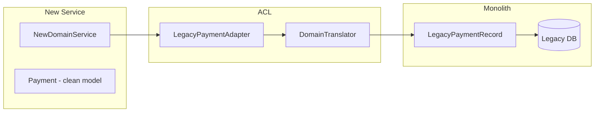
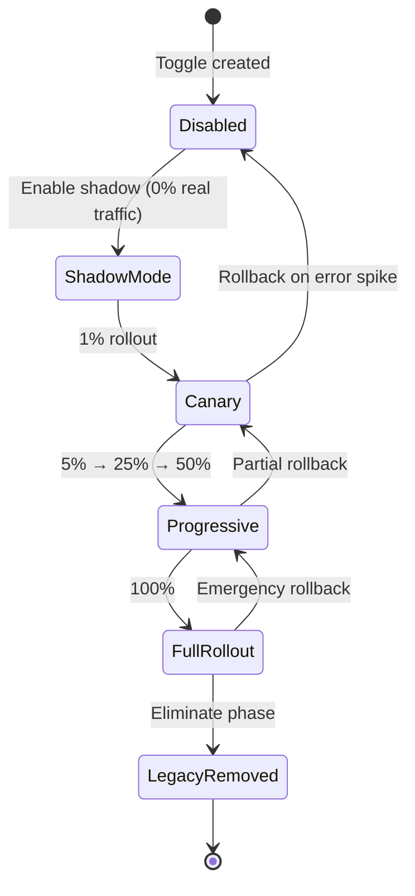
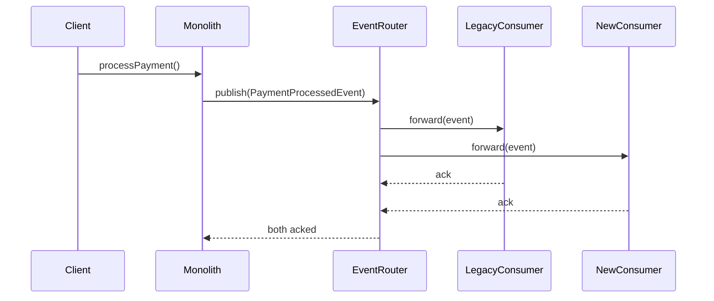
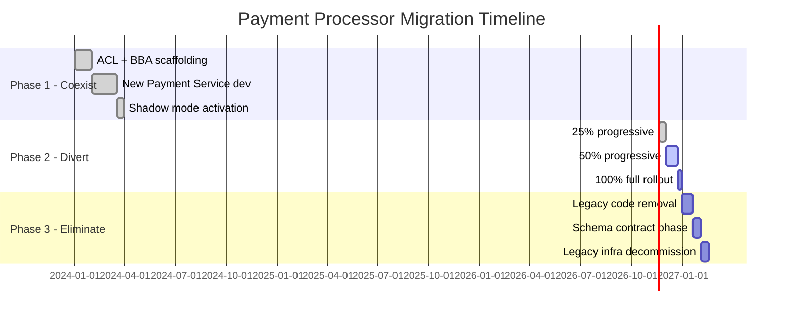

# Strangler Fig and Incremental Migration Patterns

## Overview

The Strangler Fig migration pattern is the dominant strategy for safely decomposing a monolithic system into microservices without a full rewrite. Its name comes from the strangler fig tree, which grows around a host tree and eventually replaces it entirely while the host continues to function during the transition. In fintech, where downtime carries regulatory and financial penalties, this incremental approach is not optional — it is the professional standard.

This lesson covers the full migration lifecycle: the three-phase model (coexist, divert, eliminate), the Anti-Corruption Layer (ACL) that isolates old domain logic from new, Branch by Abstraction for behind-the-scenes swapping, feature toggles for traffic routing, expand-contract for database schema evolution, and event interception during transition. We close with a fintech case study migrating a monolithic payment processor to microservices.

---

## 1. The Origin and Core Mechanics

### 1.1 Why Not a Big-Bang Rewrite?

A "big-bang" rewrite — where the team freezes the old system, rebuilds from scratch, and cuts over in a single release — has a failure rate exceeding 60% in enterprise contexts. For a payment processor handling £50 million per day, the risk profile is unacceptable:

- Undiscovered business rules embedded in legacy code
- Implicit contracts between modules never captured in documentation
- Regulatory obligations tied to specific data formats
- The risk window is measured in months, not hours

The Strangler Fig pattern eliminates the big-bang by making the migration a series of small, independently deployable steps, each of which leaves the system in a fully operational state.

### 1.2 The Three-Phase Model

```
┌─────────────────────────────────────────────────────────────────────┐
│                     STRANGLER FIG PHASES                            │
│                                                                     │
│  Phase 1: COEXIST         Phase 2: DIVERT         Phase 3: ELIMINATE│
│                                                                     │
│  ┌──────────┐             ┌──────────┐             ┌──────────┐     │
│  │  Monolith│             │  Monolith│             │          │     │
│  │  (100%)  │             │  (50%)   │             │ (deleted)│     │
│  └────┬─────┘             └────┬─────┘             └──────────┘     │
│       │                        │                                     │
│  ┌────▼─────┐             ┌────▼─────┐             ┌──────────┐     │
│  │  New Svc │             │  New Svc │             │  New Svc │     │
│  │  (0%)    │             │  (50%)   │             │  (100%)  │     │
│  └──────────┘             └──────────┘             └──────────┘     │
└─────────────────────────────────────────────────────────────────────┘
```

**Phase 1 — Coexist**: The new service is deployed alongside the monolith. Both are live but the new service receives zero production traffic. This phase is used to validate infrastructure, monitoring, and correctness.

**Phase 2 — Divert**: Traffic is progressively shifted from the monolith to the new service. This can be done by feature toggle (0/1), percentage routing (1%, 5%, 25%, 50%, 100%), or by customer segment.

**Phase 3 — Eliminate**: The monolith code path for the migrated capability is deleted. Database tables, APIs, and configuration belonging only to the old path are decommissioned.

---

## 2. Anti-Corruption Layer (ACL)

### 2.1 Concept

The Anti-Corruption Layer is a translation boundary that prevents the domain model of the legacy system from "leaking" into the new service. Without an ACL, the new service begins to depend on legacy data structures and concepts, re-importing exactly the technical debt you are trying to escape.

The ACL translates between two bounded contexts:
- **Legacy context**: the monolith's domain model (often anemic, inconsistent, legacy naming)
- **New context**: the clean domain model of the new service



### 2.2 ACL Java Interface and Adapter

Define the new service's view of a payment using clean domain types:

```java
// New domain model — clean, ubiquitous language
public record Payment(
    PaymentId id,
    Money amount,
    AccountId debitAccount,
    AccountId creditAccount,
    PaymentStatus status,
    Instant createdAt
) {}

public record Money(BigDecimal amount, Currency currency) {
    public static Money of(BigDecimal amount, String currencyCode) {
        return new Money(amount, Currency.getInstance(currencyCode));
    }
}

// Port — defined entirely in terms of the new domain
public interface PaymentRepository {
    Optional<Payment> findById(PaymentId id);
    void save(Payment payment);
    List<Payment> findPendingOlderThan(Duration age);
}
```

The legacy system uses a completely different structure — a flat table with VARCHAR codes, raw BigDecimal amounts and no currency, and status integers:

```java
// Legacy record — do NOT let this leak into the new domain
@Entity
@Table(name = "tbl_pmt_rec")
public class LegacyPaymentRecord {
    @Id
    public Long pmt_id;
    public BigDecimal pmt_amt;        // currency implicit from account
    public String debit_acct_no;
    public String credit_acct_no;
    public Integer status_cd;         // 0=PENDING, 1=CLEARED, 2=FAILED, 9=REVERSED
    public Timestamp insert_ts;
    public String ccy_iso;
}

// ACL Adapter — the only place that knows about LegacyPaymentRecord
@Component
public class LegacyPaymentRepositoryAdapter implements PaymentRepository {

    private final LegacyPaymentJpaRepository legacyJpa;
    private final LegacyDomainTranslator translator;

    public LegacyPaymentRepositoryAdapter(
            LegacyPaymentJpaRepository legacyJpa,
            LegacyDomainTranslator translator) {
        this.legacyJpa = legacyJpa;
        this.translator = translator;
    }

    @Override
    public Optional<Payment> findById(PaymentId id) {
        return legacyJpa.findById(id.value())
                .map(translator::toDomain);
    }

    @Override
    public void save(Payment payment) {
        LegacyPaymentRecord record = translator.toLegacy(payment);
        legacyJpa.save(record);
    }

    @Override
    public List<Payment> findPendingOlderThan(Duration age) {
        Timestamp cutoff = Timestamp.from(Instant.now().minus(age));
        return legacyJpa.findByStatusCdAndInsertTsBefore(0, cutoff)
                .stream()
                .map(translator::toDomain)
                .collect(Collectors.toList());
    }
}

// Translator — pure mapping logic, no business logic
@Component
public class LegacyDomainTranslator {

    private static final Map<Integer, PaymentStatus> STATUS_MAP = Map.of(
        0, PaymentStatus.PENDING,
        1, PaymentStatus.CLEARED,
        2, PaymentStatus.FAILED,
        9, PaymentStatus.REVERSED
    );

    public Payment toDomain(LegacyPaymentRecord rec) {
        PaymentStatus status = STATUS_MAP.getOrDefault(
            rec.status_cd, PaymentStatus.UNKNOWN
        );
        return new Payment(
            PaymentId.of(rec.pmt_id),
            Money.of(rec.pmt_amt, rec.ccy_iso),
            AccountId.of(rec.debit_acct_no),
            AccountId.of(rec.credit_acct_no),
            status,
            rec.insert_ts.toInstant()
        );
    }

    public LegacyPaymentRecord toLegacy(Payment payment) {
        LegacyPaymentRecord rec = new LegacyPaymentRecord();
        rec.pmt_id      = payment.id().value();
        rec.pmt_amt     = payment.amount().amount();
        rec.ccy_iso     = payment.amount().currency().getCurrencyCode();
        rec.debit_acct_no  = payment.debitAccount().value();
        rec.credit_acct_no = payment.creditAccount().value();
        rec.status_cd   = STATUS_MAP.entrySet().stream()
                            .filter(e -> e.getValue() == payment.status())
                            .map(Map.Entry::getKey)
                            .findFirst()
                            .orElseThrow();
        rec.insert_ts   = Timestamp.from(payment.createdAt());
        return rec;
    }
}
```

---

## 3. Branch by Abstraction

Branch by Abstraction (BBA) is a technique that hides the migration behind a stable interface so the rest of the codebase never needs to know which implementation is active. This is different from the ACL — the ACL translates between domain models; BBA manages the swap between implementations within a single codebase.

### 3.1 The Four Steps

```
Step 1: Extract interface              Step 2: Both impls exist
┌───────────────────────┐              ┌───────────────────────┐
│  PaymentService       │              │  PaymentService (iface)│
│  (concrete class)     │              │  ┌──────────────────┐ │
│  client code calls    │  ──────►     │  │LegacyImpl        │ │
│  this directly        │              │  │NewImpl           │ │
└───────────────────────┘              └──────────────────────┘

Step 3: Toggle selects impl            Step 4: Legacy deleted
┌───────────────────────┐              ┌───────────────────────┐
│  FeatureToggle        │              │  PaymentService (iface)│
│  → LegacyImpl or      │  ──────►     │  ┌──────────────────┐ │
│  → NewImpl            │              │  │NewImpl only      │ │
└───────────────────────┘              └──────────────────────┘
```

### 3.2 Java BBA Implementation

```java
// Step 1 & 2: Extract the abstraction
public interface PaymentProcessor {
    ProcessingResult process(Payment payment);
    boolean canHandle(PaymentType type);
}

// Legacy implementation — untouched monolith code wrapped in interface
@Component("legacyPaymentProcessor")
public class LegacyPaymentProcessorAdapter implements PaymentProcessor {

    private final MonolithPaymentEngine monolithEngine; // the old beast

    @Override
    public ProcessingResult process(Payment payment) {
        // Convert to legacy types, delegate to monolith
        LegacyPaymentRequest req = LegacyConverter.toRequest(payment);
        LegacyResult result = monolithEngine.executePayment(req);
        return LegacyConverter.toResult(result);
    }

    @Override
    public boolean canHandle(PaymentType type) {
        return true; // legacy handles everything it always did
    }
}

// New microservice implementation
@Component("newPaymentProcessor")
public class NewPaymentProcessorAdapter implements PaymentProcessor {

    private final PaymentOrchestrator orchestrator;
    private final PaymentRepository repository;

    @Override
    public ProcessingResult process(Payment payment) {
        return orchestrator.execute(payment);
    }

    @Override
    public boolean canHandle(PaymentType type) {
        // New service handles only the types it has been validated for
        return Set.of(PaymentType.DOMESTIC_TRANSFER, PaymentType.BILL_PAYMENT)
                  .contains(type);
    }
}

// Step 3: Router selects implementation based on feature toggle
@Component
@Primary
public class BranchingPaymentProcessor implements PaymentProcessor {

    private final PaymentProcessor legacyProcessor;
    private final PaymentProcessor newProcessor;
    private final FeatureToggleService toggles;
    private final MeterRegistry meterRegistry;

    @Override
    public ProcessingResult process(Payment payment) {
        PaymentProcessor selected = selectProcessor(payment);
        String processorTag = selected == newProcessor ? "new" : "legacy";

        return meterRegistry.timer("payment.processor.duration",
                "processor", processorTag)
            .record(() -> {
                ProcessingResult result = selected.process(payment);
                meterRegistry.counter("payment.processor.calls",
                    "processor", processorTag,
                    "outcome", result.isSuccess() ? "success" : "failure"
                ).increment();
                return result;
            });
    }

    private PaymentProcessor selectProcessor(Payment payment) {
        if (!toggles.isEnabled("use-new-payment-processor")) {
            return legacyProcessor;
        }
        // Gradual rollout: check if this payment falls in enabled cohort
        if (!toggles.isEnabledForContext("new-processor-rollout", payment.id().value())) {
            return legacyProcessor;
        }
        // New processor must claim it can handle this type
        if (!newProcessor.canHandle(payment.type())) {
            return legacyProcessor;
        }
        return newProcessor;
    }

    @Override
    public boolean canHandle(PaymentType type) {
        return legacyProcessor.canHandle(type) || newProcessor.canHandle(type);
    }
}
```

---

## 4. Feature Toggles for Traffic Routing

Feature toggles (also called feature flags) decouple deployment from release. For migration scenarios, they provide precise control over what percentage of traffic flows to the new service.

### 4.1 Toggle Categories for Migration

| Toggle Type | Use Case | Risk |
|-------------|----------|------|
| Release toggle | Enable new code path post-deployment | Low |
| Experiment toggle | A/B test new vs old for correctness | Medium |
| Ops toggle | Emergency off-switch during incident | Low (must be fast) |
| Permission toggle | Roll out to specific customers first | Low |

### 4.2 Percentage-Based Rollout

```java
@Service
public class PercentageFeatureToggleService implements FeatureToggleService {

    private final ToggleConfigRepository configRepo;

    @Override
    public boolean isEnabledForContext(String toggleName, String contextKey) {
        ToggleConfig config = configRepo.findByName(toggleName)
                .orElse(ToggleConfig.disabled(toggleName));

        if (!config.isEnabled()) return false;

        // Deterministic hash — same payment always goes to same processor
        // This avoids flip-flopping between processors for the same payment
        int hash = Math.abs(Objects.hash(toggleName, contextKey));
        int bucket = hash % 100; // 0–99

        return bucket < config.getRolloutPercentage();
    }
}

// Toggle configuration stored in database — can be changed without redeployment
@Entity
@Table(name = "feature_toggles")
public class ToggleConfig {
    @Id
    private String name;
    private boolean enabled;
    private int rolloutPercentage; // 0–100
    private String allowedAccountTypes; // e.g., "PERSONAL,BUSINESS"
    private Instant lastModified;
    private String modifiedBy;

    public static ToggleConfig disabled(String name) {
        ToggleConfig c = new ToggleConfig();
        c.name = name;
        c.enabled = false;
        c.rolloutPercentage = 0;
        return c;
    }
}
```

### 4.3 Toggle State Transitions



---

## 5. Expand-Contract for Schema Migration

The Expand-Contract pattern (also called parallel change) is used when migrating a database schema without downtime. It is especially important for fintech systems where the database is shared between the monolith and the new service during the coexist and divert phases.

### 5.1 The Three SQL Phases

**Phase 1 — Expand**: Add the new column alongside the old one. Both old and new code can run concurrently. The new column is nullable to avoid breaking existing inserts.

```sql
-- Phase 1: Expand — add new column without removing old
ALTER TABLE payments
  ADD COLUMN amount_minor_units BIGINT,       -- £10.50 stored as 1050
  ADD COLUMN currency_code      CHAR(3);       -- ISO 4217

-- New column is nullable: old code that doesn't know about it still works
-- Index on new column for future queries
CREATE INDEX CONCURRENTLY idx_payments_currency
  ON payments (currency_code)
  WHERE currency_code IS NOT NULL;
```

**Phase 2 — Migrate**: Back-fill the new column from the old column. Run as a background job in small batches to avoid table locks.

```sql
-- Phase 2: Migrate — back-fill in batches to avoid lock contention
DO $$
DECLARE
    batch_size  INT := 1000;
    last_id     BIGINT := 0;
    rows_updated INT;
BEGIN
    LOOP
        UPDATE payments
        SET
            amount_minor_units = (pmt_amt * 100)::BIGINT,
            currency_code      = COALESCE(ccy_iso, 'GBP')
        WHERE id > last_id
          AND amount_minor_units IS NULL
          AND id IN (
              SELECT id FROM payments
              WHERE id > last_id
                AND amount_minor_units IS NULL
              ORDER BY id
              LIMIT batch_size
          )
        RETURNING id INTO last_id;

        GET DIAGNOSTICS rows_updated = ROW_COUNT;
        EXIT WHEN rows_updated = 0;

        PERFORM pg_sleep(0.1); -- back-off between batches
    END LOOP;
END;
$$;

-- Verify 100% backfill before proceeding
SELECT COUNT(*) AS unmigrated
FROM payments
WHERE amount_minor_units IS NULL;
```

**Phase 3 — Contract**: Remove the old column. Only safe once no deployed code references it.

```sql
-- Phase 3: Contract — remove old columns after all services use new ones
-- First verify: no code references old columns (use search tools + test suite)
ALTER TABLE payments
  DROP COLUMN pmt_amt,
  DROP COLUMN ccy_iso;

-- Clean up: make new columns NOT NULL now that all rows are populated
ALTER TABLE payments
  ALTER COLUMN amount_minor_units SET NOT NULL,
  ALTER COLUMN currency_code      SET NOT NULL;
```

### 5.2 Application-Level Dual-Write During Phase 2

During the migration phase, the application must write to both columns simultaneously so either the old or new code path can read from its preferred column:

```java
@Repository
public class DualWritePaymentRepository implements PaymentRepository {

    private final JdbcTemplate jdbc;
    private final MigrationPhaseService migrationPhase;

    @Override
    public void save(Payment payment) {
        if (migrationPhase.isExpand() || migrationPhase.isMigrate()) {
            // Write both old and new columns during transition
            jdbc.update("""
                INSERT INTO payments (
                    id, pmt_amt, ccy_iso,
                    amount_minor_units, currency_code,
                    debit_acct_no, credit_acct_no, status_cd, insert_ts
                ) VALUES (?, ?, ?, ?, ?, ?, ?, ?, ?)
                ON CONFLICT (id) DO UPDATE SET
                    pmt_amt            = EXCLUDED.pmt_amt,
                    ccy_iso            = EXCLUDED.ccy_iso,
                    amount_minor_units = EXCLUDED.amount_minor_units,
                    currency_code      = EXCLUDED.currency_code
                """,
                payment.id().value(),
                payment.amount().amount(),
                payment.amount().currency().getCurrencyCode(),
                payment.amount().toMinorUnits(),
                payment.amount().currency().getCurrencyCode(),
                payment.debitAccount().value(),
                payment.creditAccount().value(),
                StatusMapper.toLegacyCode(payment.status()),
                Timestamp.from(payment.createdAt())
            );
        } else {
            // Contract phase: write only new columns
            jdbc.update("""
                INSERT INTO payments (
                    id, amount_minor_units, currency_code,
                    debit_acct_no, credit_acct_no, status_cd, insert_ts
                ) VALUES (?, ?, ?, ?, ?, ?, ?)
                """,
                payment.id().value(),
                payment.amount().toMinorUnits(),
                payment.amount().currency().getCurrencyCode(),
                payment.debitAccount().value(),
                payment.creditAccount().value(),
                StatusMapper.toNewCode(payment.status()),
                Timestamp.from(payment.createdAt())
            );
        }
    }
}
```

---

## 6. Event Interception During Transition

When the monolith publishes domain events (e.g., `PaymentProcessed`), the new service may need to consume them, and during the transition period, both old and new consumers may be active. The event interception pattern routes events to both consumers.

### 6.1 Dual-Publish Architecture



```java
@Service
public class TransitionEventRouter {

    private final LegacyEventConsumer legacyConsumer;
    private final NewEventConsumer newConsumer;
    private final FeatureToggleService toggles;

    public void route(PaymentProcessedEvent event) {
        boolean sendToNew = toggles.isEnabled("route-events-to-new-service");

        // Always send to legacy during transition — it may still have
        // downstream processes that depend on these events
        CompletableFuture<Void> legacyFuture =
            CompletableFuture.runAsync(() -> legacyConsumer.consume(event));

        CompletableFuture<Void> newFuture = sendToNew
            ? CompletableFuture.runAsync(() -> newConsumer.consume(event))
            : CompletableFuture.completedFuture(null);

        try {
            CompletableFuture.allOf(legacyFuture, newFuture)
                .get(5, TimeUnit.SECONDS);
        } catch (TimeoutException e) {
            // Log but do not fail the original transaction
            log.error("Event routing timeout for payment {}", event.paymentId(), e);
            meterRegistry.counter("event.routing.timeout").increment();
        }
    }
}
```

---

## 7. Dark Launching (Shadow Mode)

Dark launching sends real production traffic to both the old and new implementations simultaneously, but only the old implementation's response is returned to the caller. The new implementation runs in parallel, its result is compared against the old one, and discrepancies are logged — but the caller never knows the new service was involved.

```java
@Service
public class ShadowModePaymentProcessor {

    private final PaymentProcessor primaryProcessor;   // legacy
    private final PaymentProcessor shadowProcessor;    // new
    private final ShadowResultRecorder recorder;
    private final Executor shadowExecutor;

    public ProcessingResult process(Payment payment) {
        // Execute primary processor synchronously — this is what the caller gets
        ProcessingResult primaryResult = primaryProcessor.process(payment);

        // Execute shadow processor asynchronously — fire and forget
        // We must NOT let shadow errors propagate to the caller
        CompletableFuture.runAsync(() -> {
            try {
                ProcessingResult shadowResult = shadowProcessor.process(payment);
                recorder.record(payment.id(), primaryResult, shadowResult);
            } catch (Exception e) {
                recorder.recordShadowFailure(payment.id(), e);
            }
        }, shadowExecutor);

        return primaryResult; // caller only sees this
    }
}

@Service
public class ShadowResultRecorder {

    private final MeterRegistry meterRegistry;

    public void record(PaymentId id, ProcessingResult primary, ProcessingResult shadow) {
        boolean match = primary.getStatus() == shadow.getStatus()
                     && primary.getSettlementAmount().compareTo(shadow.getSettlementAmount()) == 0;

        if (!match) {
            log.warn("SHADOW_DIVERGENCE paymentId={} primaryStatus={} shadowStatus={} " +
                     "primaryAmt={} shadowAmt={}",
                id, primary.getStatus(), shadow.getStatus(),
                primary.getSettlementAmount(), shadow.getSettlementAmount()
            );
            meterRegistry.counter("shadow.divergence").increment();
        } else {
            meterRegistry.counter("shadow.match").increment();
        }
    }
}
```

---

## 8. Rollback Strategy Per Phase

Each migration phase requires a different rollback approach. The key principle: **rollback must be as simple and fast as a feature toggle flip**.

| Phase | Rollback Mechanism | Time to Rollback | Data Risk |
|-------|-------------------|------------------|-----------|
| Coexist | No rollback needed — new service is inactive | N/A | None |
| Shadow (dark launch) | Stop shadow executor; nothing changes for caller | Seconds | None |
| Canary (1-5%) | Toggle percentage back to 0% | Seconds | Minimal — reconcile shadow writes |
| Progressive (5-50%) | Toggle back to 0% or previous % | Seconds | Requires dual-write reconciliation |
| Full rollout (100%) | Toggle back to 0% | Seconds | Requires replay of events from new to legacy |
| Eliminate (legacy gone) | Restore legacy from blue/green deployment | Minutes | Restore from point-in-time backup |

```java
@RestController
@RequestMapping("/admin/migration")
public class MigrationRollbackController {

    private final ToggleConfigRepository toggleRepo;
    private final MigrationAuditLog auditLog;

    @PostMapping("/rollback/{toggleName}")
    @PreAuthorize("hasRole('MIGRATION_OPERATOR')")
    public ResponseEntity<RollbackResult> rollback(
            @PathVariable String toggleName,
            @RequestParam int targetPercentage,
            @RequestParam String reason,
            Principal operator) {

        ToggleConfig config = toggleRepo.findByName(toggleName)
                .orElseThrow(() -> new ToggleNotFoundException(toggleName));

        int previousPercentage = config.getRolloutPercentage();
        config.setRolloutPercentage(targetPercentage);
        config.setLastModified(Instant.now());
        config.setModifiedBy(operator.getName());
        toggleRepo.save(config);

        auditLog.record(AuditEntry.rollback(
            toggleName, previousPercentage, targetPercentage, reason, operator.getName()
        ));

        return ResponseEntity.ok(new RollbackResult(
            toggleName, previousPercentage, targetPercentage
        ));
    }
}
```

---

## 9. Fintech Case Study: Migrating a Monolithic Payment Processor

### 9.1 Context

A UK neobank processes 2 million domestic payments per day through a 12-year-old Java EE monolith. The monolith connects directly to Faster Payments Service (FPS) via a bespoke integration. The goal: migrate to a microservices architecture while maintaining 99.95% uptime and ISO 20022 compliance.

### 9.2 Migration Sequence



### 9.3 Key Architectural Decision: Event-First Strangler

For this case, the team chose an event-first approach: rather than routing HTTP calls, they intercepted the payment processing event stream.

```
┌─────────────┐     HTTP      ┌─────────────────┐
│   Mobile    │──────────────►│   API Gateway   │
│   App       │               └────────┬────────┘
└─────────────┘                        │
                                       ▼
                               ┌───────────────┐      ┌──────────────┐
                               │  Event Broker │─────►│  Monolith    │
                               │  (Kafka)      │      │  (Phase 1)   │
                               └───────┬───────┘      └──────────────┘
                                       │
                                       ▼
                               ┌───────────────┐
                               │  New Payment  │
                               │  Service      │
                               │  (Phase 2+)   │
                               └───────┬───────┘
                                       │
                               ┌───────▼───────┐
                               │  FPS Gateway  │
                               └───────────────┘
```

---

## 10. Production Pitfalls

### Pitfall 1: Dual-Write Consistency — The Partial Write Problem

During the migrate phase, writes go to both old and new storage. If the write to the new storage succeeds but the write to legacy storage fails (or vice versa), the two systems diverge. This is a data consistency crisis.

```java
// WRONG: sequential writes — if second write fails, systems are inconsistent
public void save(Payment payment) {
    newRepository.save(payment);         // succeeds
    legacyRepository.save(payment);      // fails — now systems are out of sync!
}

// BETTER: use an outbox pattern to guarantee eventual consistency
@Transactional
public void save(Payment payment) {
    // Write to new storage and an outbox in the SAME local transaction
    newRepository.save(payment);
    outboxRepository.save(OutboxEvent.paymentSaved(payment));
    // Outbox relay picks up the event and writes to legacy asynchronously
    // If relay fails, it retries — eventual consistency is guaranteed
}

// Alternatively: synchronous dual-write with compensating transaction
@Transactional
public void save(Payment payment) {
    newRepository.save(payment);
    try {
        legacyRepository.save(payment);
    } catch (Exception e) {
        log.error("Legacy write failed for payment {}, triggering compensating action",
            payment.id(), e);
        compensationService.scheduleRetry(payment);
        // Do NOT rethrow — primary write succeeded; legacy is eventually consistent
    }
}
```

**Mitigation**: Use an outbox table in the new service's database. A relay process reads the outbox and writes to legacy, retrying on failure. This keeps both writes within a single transaction boundary on the write side.

### Pitfall 2: Stale Cache During Cutover

When traffic is switched to the new service, the new service's cache is cold. Worse, the legacy service may have populated a shared cache with data in the legacy format. Reads from the new service may hit cache entries that cannot be deserialized into new domain objects.

```java
// WRONG: shared cache with no namespace — new service reads legacy-format entries
@Cacheable("payments")
public Payment findById(PaymentId id) {
    // If legacy populated this cache, the entry is LegacyPaymentRecord format!
    // Deserialization will fail or silently return corrupted data
    return repository.findById(id).orElseThrow();
}

// CORRECT: namespace cache keys by service version
@Cacheable(value = "payments", key = "'v2:' + #id.value()")
public Payment findById(PaymentId id) {
    // Key is "v2:12345" — will never clash with legacy "12345" key
    return repository.findById(id).orElseThrow();
}

// ALSO: pre-warm cache for predictable high-traffic accounts before cutover
@Component
public class CacheWarmingService {

    private final PaymentRepository repository;
    private final CacheManager cacheManager;

    @EventListener(MigrationCutoverEvent.class)
    public void warmCacheOnCutover(MigrationCutoverEvent event) {
        log.info("Pre-warming payment cache for high-volume accounts");
        repository.findHighVolumeAccountIds(1000)
            .parallelStream()
            .forEach(accountId -> {
                try {
                    repository.findRecentPayments(accountId, 100);
                } catch (Exception e) {
                    log.warn("Cache warming failed for account {}", accountId, e);
                }
            });
    }
}
```

### Pitfall 3: Incomplete ACL Leaking Legacy Domain Model

The most insidious failure is when the ACL is built initially but then bypassed incrementally, usually because of time pressure. Developers start calling legacy repositories directly from new service code "just for this one case." Within weeks the ACL is not a layer — it is Swiss cheese.

```java
// WRONG: new service code importing legacy types directly
import com.bank.legacy.payments.LegacyPaymentRecord;  // ← red flag import

@Service
public class PaymentEnrichmentService {

    private final LegacyPaymentJpaRepository legacyRepo; // ← bypasses ACL!

    public EnrichedPayment enrich(PaymentId id) {
        LegacyPaymentRecord rec = legacyRepo.findById(id.value()).get(); // ← domain leak!
        return new EnrichedPayment(rec.pmt_id, rec.pmt_amt, rec.status_cd); // ← raw legacy fields
    }
}

// CORRECT: ACL is the only place where legacy types appear; enforced by ArchUnit
@AnalyzeClasses(packages = "com.bank.payments.newservice")
public class AclBoundaryTest implements FreezingArchRule {

    @ArchTest
    static final ArchRule noDirectLegacyImports = noClasses()
        .that().resideInAPackage("..newservice..")
        .and().areNotAnnotatedWith(AclComponent.class)
        .should().accessClassesThat()
        .resideInAPackage("..legacy..")
        .because("New service must access legacy domain only via the ACL");
}
```

**Mitigation**: Enforce the ACL boundary with ArchUnit tests in CI. Any class outside the ACL package that imports a legacy type fails the build.

### Pitfall 4: Missing Idempotency During Traffic Split

When a payment request is in flight during a toggle flip — say the first attempt goes to legacy and fails, then the retry goes to the new service — the new service must be idempotent. Without idempotency, the customer could be charged twice.

```java
// REQUIRED: new service must reject duplicate payment attempts
@Service
public class IdempotentPaymentService {

    private final IdempotencyKeyStore keyStore;
    private final PaymentProcessor processor;

    public ProcessingResult process(Payment payment, IdempotencyKey key) {
        // Check if we have already processed this exact request
        Optional<ProcessingResult> cached = keyStore.find(key);
        if (cached.isPresent()) {
            log.info("Returning cached result for idempotency key {}", key);
            return cached.get();
        }

        ProcessingResult result = processor.process(payment);

        // Store result associated with idempotency key
        // TTL = 24 hours (FPS same-day settlement window)
        keyStore.store(key, result, Duration.ofHours(24));

        return result;
    }
}
```

---

## 11. Checklist

### Pre-Migration Planning

- [ ] All existing API contracts documented and versioned
- [ ] Database schema documented with column ownership matrix (which code owns which column)
- [ ] Event schema inventory complete
- [ ] ACL design reviewed and approved by domain experts
- [ ] Rollback runbooks written and rehearsed for each phase
- [ ] Idempotency keys implemented in new service before any traffic arrives
- [ ] Shadow mode monitoring dashboard configured

### Phase 1 — Coexist

- [ ] ACL compiles and unit tests pass (100% coverage on translator)
- [ ] ArchUnit tests enforce ACL boundary — in CI pipeline
- [ ] New service deployed to production in shadow mode (0% real traffic)
- [ ] Shadow divergence rate < 0.001% over 72 hours
- [ ] Cache namespacing implemented
- [ ] Feature toggle infrastructure deployed and audited

### Phase 2 — Divert

- [ ] 1% canary stable for 48 hours (error rate delta < 0.01%)
- [ ] Dual-write consistency verified via reconciliation job
- [ ] Cache warming procedure tested in staging
- [ ] Rollback tested: toggle to 0% and back within 30 seconds
- [ ] 100% traffic migration completed with no customer-visible errors

### Phase 3 — Eliminate

- [ ] Zero references to legacy classes outside ACL (ArchUnit green)
- [ ] Expand-contract migration complete: new columns NOT NULL
- [ ] Old columns dropped after two-week stabilisation period
- [ ] Legacy service decommissioned and infrastructure released
- [ ] Post-migration observability: no legacy metrics still incrementing

---

<!-- KNOWLEDGE-CHECK
{"questions":[{"text":"What is the primary purpose of the Anti-Corruption Layer (ACL) in a Strangler Fig migration?","options":["To improve performance by caching legacy data","To prevent the new service's domain model from being polluted by legacy domain concepts","To synchronise data between the old and new databases","To route traffic between the monolith and the new service"],"correct":1,"explanation":"The ACL is a translation boundary that maps between the legacy domain model and the new service's clean domain model. Without it, legacy concepts like raw status integer codes or flat table structures leak into the new codebase, re-importing the technical debt you are trying to eliminate."},{"text":"In the Expand-Contract pattern for schema migration, what is the correct order of operations?","options":["Drop old column, add new column, migrate data","Add new column (nullable), migrate data to new column, drop old column","Migrate data, add new column, drop old column","Add new column (NOT NULL), migrate data, drop old column"],"correct":1,"explanation":"The Expand phase adds the new column as nullable so existing code that does not write to it still works. The migrate phase back-fills data. The Contract phase drops the old column. Adding as NOT NULL before data migration would break all existing inserts."},{"text":"Why is deterministic hashing used for percentage-based feature toggle rollouts in a payment migration?","options":["It makes the hash faster to compute","It ensures the same payment ID always routes to the same processor, preventing flip-flopping between processors for the same payment","It improves cache hit rates","It satisfies PCI DSS requirements for traffic routing"],"correct":1,"explanation":"If a payment lands on the new processor for its first attempt and on the legacy processor on retry, idempotency is broken and the customer risks being charged twice. Deterministic hashing on the payment ID ensures consistent routing throughout the lifecycle of a single payment."}]}
-->

<!-- PRACTICAL-CHALLENGE
{"title":"Implement a Strangler Fig Migration for a Payments Module","difficulty":"advanced","estimatedMinutes":120,"tasks":[{"id":"1","description":"Implement a LegacyPaymentRepositoryAdapter that wraps a JPA repository for the legacy tbl_pmt_rec table. Write a LegacyDomainTranslator that maps between LegacyPaymentRecord (integer status codes, raw BigDecimal amounts) and a clean Payment domain object. Add an ArchUnit test ensuring no class outside the acl package imports from the legacy package."},{"id":"2","description":"Implement a BranchingPaymentProcessor that selects between LegacyPaymentProcessorAdapter and NewPaymentProcessorAdapter based on a PercentageFeatureToggleService. The toggle must be deterministic (same payment ID always routes to the same processor). Add Micrometer metrics tagging each call with the processor name and outcome."},{"id":"3","description":"Write the three SQL migration scripts for the Expand-Contract pattern: (1) expand script adding amount_minor_units BIGINT and currency_code CHAR(3) with a CONCURRENTLY index, (2) migrate script back-filling data in batches of 1000 rows with pg_sleep(0.1) between batches, and (3) contract script dropping old columns and adding NOT NULL constraints."},{"id":"4","description":"Implement a ShadowModePaymentProcessor that executes the primary (legacy) processor synchronously and the new processor asynchronously via a separate executor. The shadow result must be compared against the primary result and divergences logged and counted in a Micrometer counter. Shadow errors must never propagate to the caller."}]}
-->
