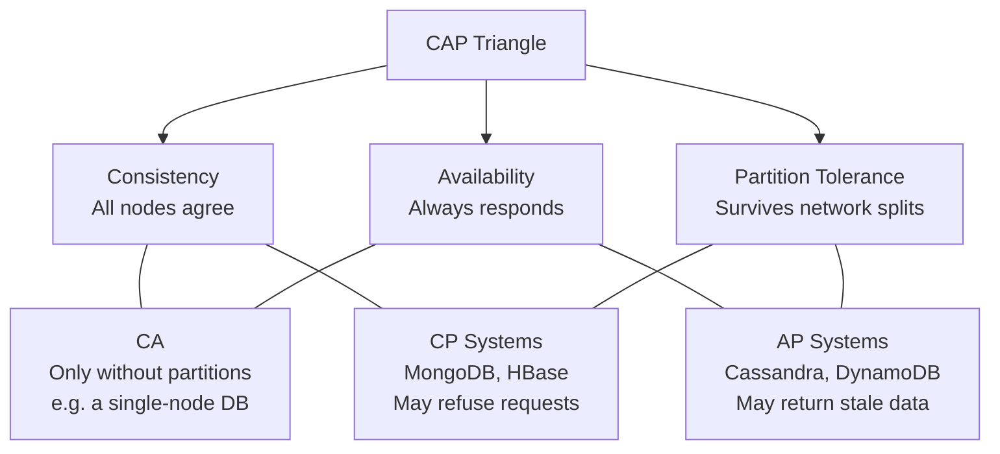
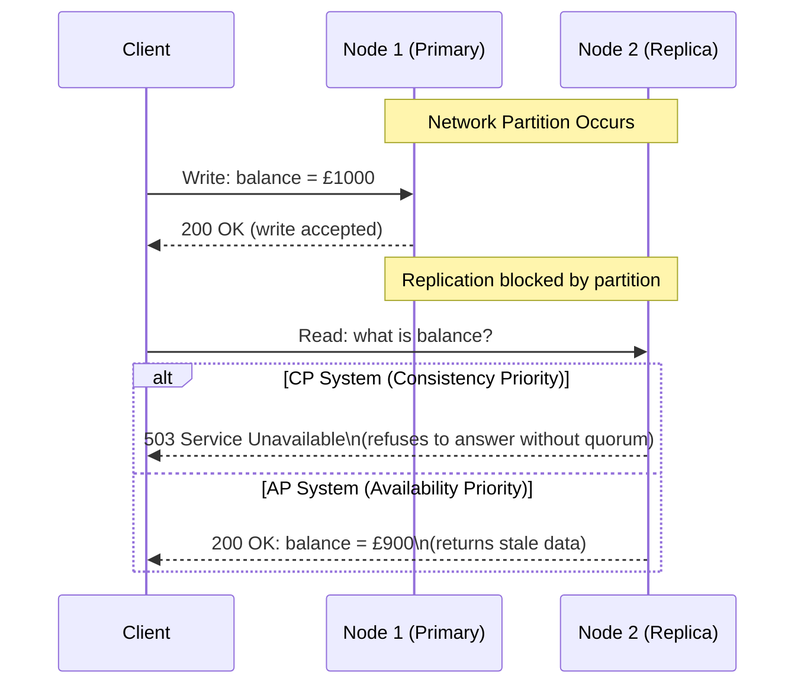
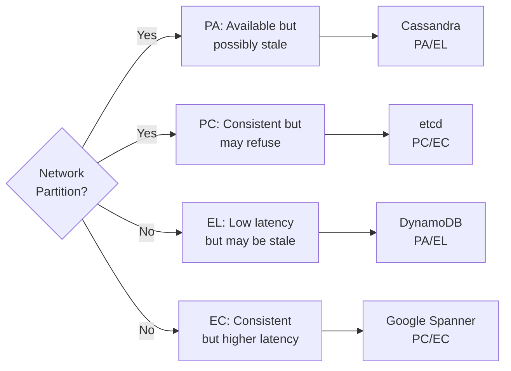
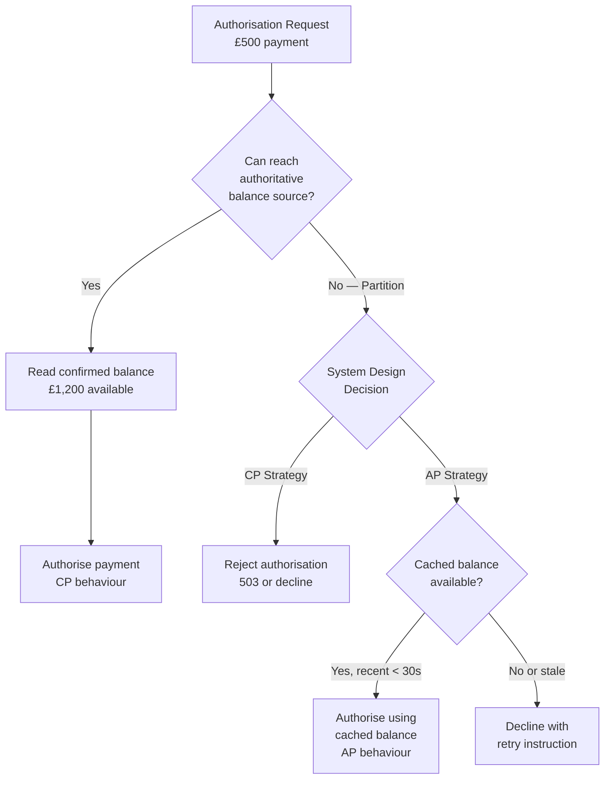

# نظرية CAP — الاتساق والإتاحة وتحمّل الانقسام

> [!NOTE]
> نظرية CAP هي القيد الأساسي في الأنظمة الموزعة. فكل قرار معماري في نظام مالي موزع مفاضلة تساعدك CAP — وخليفتها الأدق PACELC — على التفكير فيها.

## النظرية

في عام 2000 طرح Eric Brewer فرضية، أثبتها لاحقًا Gilbert وLynch، تقول إن مخزن البيانات الموزع لا يستطيع أن يوفر **أكثر من اثنين** من الضمانات الثلاثة التالية في الوقت نفسه:

- **الاتساق (C)** — كل قراءة تحصل على آخر كتابة أو على خطأ (رسميًا: الخطية، linearizability). فيتصرف النظام كأن هناك نسخة واحدة فقط من البيانات.
- **الإتاحة (A)** — كل طلب يحصل على رد (لا خطأ)، وإن كان الرد قد لا يحتوي آخر كتابة.
- **تحمّل الانقسام (P)** — يستمر النظام في العمل حتى عندما تضيع رسائل الشبكة بين العقد أو تتأخر.



> [!WARNING]
> الاختيار عمليًا ليس "اختر اثنين من ثلاثة". فانقسامات الشبكة **ستحدث** في أي نظام موزع. لذلك يكون الاختيار الحقيقي: **عندما يحدث انقسام، هل تضحي بالاتساق أم بالإتاحة؟**

---

## لماذا لا يكون تحمّل الانقسام اختياريًا

انقسام الشبكة هو أي موقف لا تستطيع فيه العقد التواصل:

- قطع كابل شبكة بين مراكز البيانات
- تعطل مبدّل تحت الحمل
- جار مزعج يُشبع واجهة شبكة
- حادث توجيه BGP لدى مزوّد سحابي

في أي نظام يمتد عبر أكثر من عملية واحدة (وهذا يشمل كل نظام مالي موزع)، يجب أن تتحمل الانقسامات. فالحرف P في CAP ليس خيارًا — بل متطلب.

والاختيار الحقيقي هو **CP مقابل AP**: ماذا تفعل *أثناء* الانقسام؟



---

## أنظمة CP — الاتساق قبل الإتاحة

ترفض أنظمة CP الرد عندما لا تستطيع ضمان أن الرد محدّث. فهي تقدّم **الصحة** على وقت التشغيل.

**أمثلة:** HBase، وMongoDB (مع write concern بالأغلبية)، وetcd، وZooKeeper، وConsul

**حالات استخدام مالية يكون فيها CP صحيحًا:**
- قراءات رصيد الحساب أثناء تفويض الدفع
- أخذ قفل موزع لمنع التكرار
- الإجماع على القائد الحالي في عنقود معالج المدفوعات
- تحويل رصيد ذري بين عدة حسابات

```java
// etcd CP lock — a transaction that creates the key only if it does not exist yet.
// The write needs a Raft majority: during a partition the minority side cannot
// take the lock — it fails instead of granting the lock twice.
ByteSequence key = ByteSequence.from("payment-lock/txn-abc123", UTF_8);
CompletableFuture<TxnResponse> response = etcdClient.getKVClient().txn()
    .If(new Cmp(key, Cmp.Op.EQUAL, CmpTarget.createRevision(0)))      // key absent
    .Then(Op.put(key, ByteSequence.from(nodeId, UTF_8),
                 PutOption.newBuilder().withLeaseId(leaseId).build()))  // TTL-based lock
    .commit();

try {
    TxnResponse result = response.get(500, TimeUnit.MILLISECONDS);
    if (!result.isSucceeded()) {
        throw new LockHeldException("Another node holds the lock");
    }
    // Lock acquired — safe to proceed (still protect the write with a DB constraint)
} catch (TimeoutException | ExecutionException e) {
    // Partition or quorum loss — cannot proceed safely
    throw new DistributedLockException("Cannot acquire lock during partition", e);
}
```

القفل الصحيح في etcd معاملة تُنشئ المفتاح فقط إذا لم يكن موجودًا؛ أما `put` العادي فيكتب فوق قفل عقدة أخرى بصمت. والكتابة تحتاج أغلبية Raft، فلا يستطيع الجانب الأقلية أثناء الانقسام أخذ القفل.

---

## أنظمة AP — الإتاحة قبل الاتساق

تستمر أنظمة AP في الرد أثناء الانقسام، وقد تعيد بيانات قديمة. فهي تقدّم **وقت التشغيل** على الصحة.

**أمثلة:** Cassandra، وDynamoDB، وCouchDB، وDNS

**حالات استخدام مالية يكون فيها AP صحيحًا:**
- قراءات ذاكرة درجات الاحتيال المؤقتة (القِدم البسيط مقبول؛ والرفض غير مقبول)
- تغذيات أسعار الصرف (سعر تقريبي أفضل من خطأ)
- قراءات كتالوج المنتجات وجداول الرسوم
- البيانات المرجعية كثيفة القراءة (بيانات الحسابات الوصفية، ورموز BIC)

```java
// Cassandra AP read — QUORUM consistency for most operations
// ONE consistency for latency-sensitive, stale-tolerant reads
Session session = cassandraCluster.connect("payments_keyspace");

// AP: accept potentially stale data for exchange rate lookup
Row exchangeRate = session.execute(
    QueryBuilder.select().all()
        .from("exchange_rates")
        .where(QueryBuilder.eq("currency_pair", "GBP/USD"))
        .setConsistencyLevel(ConsistencyLevel.ONE)  // AP: respond even during partition
).one();

// Stronger: QUORUM reads see the latest QUORUM write. But a read-modify-write of a
// balance still needs a lightweight transaction (IF ... with SERIAL consistency)
// to avoid lost updates — most teams keep balances in a relational database.
Row accountBalance = session.execute(
    QueryBuilder.select().all()
        .from("accounts")
        .where(QueryBuilder.eq("account_id", accountId))
        .setConsistencyLevel(ConsistencyLevel.QUORUM)  // needs a majority of replicas
).one();
```

قراءات QUORUM ترى آخر كتابة بـ QUORUM. لكن عملية قراءة-تعديل-كتابة على رصيد ما زالت تحتاج معاملة خفيفة (lightweight transaction بشرط IF واتساق SERIAL) لتجنب التحديثات المفقودة — ومعظم الفرق تحتفظ بالأرصدة في قاعدة بيانات علائقية.

---

## PACELC — النموذج الأكمل

تصف CAP السلوك *أثناء* الانقسامات فقط. وتوسّع **نظرية PACELC** ‏(Daniel Abadi، 2012) ذلك إلى التشغيل العادي:

> إذا كان هناك **انقسام (P)**، فاختر بين **الإتاحة (A)** و**الاتساق (C)**.
> **وإلا (E)** (بلا انقسام)، فاختر بين **زمن الاستجابة (L)** و**الاتساق (C)**.



| النظام | أثناء الانقسام | التشغيل العادي | الاستخدام في المال |
|---|---|---|---|
| Cassandra | PA | EL | البيانات المرجعية، وذاكرة الاحتيال المؤقتة |
| etcd | PC | EC | انتخاب القائد، والأقفال الموزعة |
| DynamoDB (افتراضيًا) | PA | EL | حالة الجلسة، وعدّادات تحديد المعدّل |
| Google Spanner | PC | EC | قيود دفتر الأستاذ، وأرصدة الحسابات |
| PostgreSQL بعقدة واحدة | — | EC | معاملات OLTP |
| CockroachDB | PC | EC | السجلات المالية متعددة المناطق |

---

## تطبيق CAP على تصميم الأنظمة المالية

### قرار تفويض الدفع

يجب أن يقرر تفويض الدفع: هل أفوّض هذه الدفعة عندما لا أستطيع تأكيد الرصيد الحالي للحساب؟



**قرار المهندس الرئيسي:** دفعة 500 جنيه على حساب فيه 1,200 جنيه مع ذاكرة مؤقتة عمرها 30 ثانية تكاد تكون آمنة للتفويض. أما دفعة 5,000 جنيه على حساب فيه 5,200 جنيه مع ذاكرة عمرها دقيقتان فليست كذلك — فقد يكون العميل أنفق ذلك المال بالفعل.

الإجابة الصحيحة تعتمد على:
- **أقصى نافذة قِدم** تتحملها مخاطر العمل
- **عاقبة عدم الاتساق** (هل يمكن عكسه؟ هل الاحتيال هو الهاجس؟)
- **عاقبة عدم الإتاحة** (دفعة مرفوضة عند الدفع = عميل ضائع)

---

## إطار قرار CAP للمهندس الرئيسي

عند اختيار مخزن بيانات أو تصميم بنية بيانات موزعة:

**الخطوة 1 — حدّد سيناريو الانقسام.** ماذا يحدث عندما لا تستطيع عقدتان التواصل؟ ماذا يرى المستخدم؟

**الخطوة 2 — صنّف البيانات حسب متطلب الاتساق:**

| فئة الاتساق | الوصف | نافذة القِدم المقبولة |
|---|---|---|
| **صارم** | أرصدة الحسابات، وقيود دفتر الأستاذ | صفر — محدّث دائمًا |
| **عالٍ** | حالة الدفع، ومفاتيح منع التكرار | أقل من ثانية |
| **متوسط** | درجات الاحتيال، وحدود الائتمان | أقل من 30 ثانية |
| **منخفض** | أسعار الصرف، والرسوم | أقل من 5 دقائق |
| **منخفض جدًا** | البيانات المرجعية، ورموز BIC | ساعات |

**الخطوة 3 — اربط المتطلبات باختيار النظام:**
- صارم/عالٍ ← أنظمة CP ‏(PostgreSQL، وSpanner، وetcd)
- متوسط ← اتساق قابل للضبط بنصاب قراءة (Cassandra QUORUM، وقراءات DynamoDB القوية)
- منخفض/منخفض جدًا ← أنظمة AP ‏(Cassandra ONE، وRedis، وقراءات DynamoDB النهائية)

**الخطوة 4 — صمّم سلوك الانقسام صراحة.** لا تتركه يحدث مصادفة — وثّق في سجل ADR ما يفعله نظامك أثناء الانقسام.

<!-- KNOWLEDGE-CHECK
{
  "questions": [
    {
      "id": "q1",
      "text": "أثناء انقسام في الشبكة، لا تستطيع خدمة تفويض الدفع لديك الوصول إلى قاعدة البيانات الأساسية. لديها رصيد مخزن مؤقتًا عمره 15 ثانية يُظهر 2,000 جنيه متاحة. وطلب الدفع بقيمة 1,500 جنيه. ما القرار الأكثر قابلية للدفاع عنه؟",
      "options": [
        "الرفض دائمًا أثناء الانقسام — الاتساق غير قابل للتفاوض في المدفوعات",
        "الموافقة دائمًا من الذاكرة المؤقتة — الإتاحة غير قابلة للتفاوض في المدفوعات",
        "الموافقة إذا كانت نافذة القِدم والمبلغ ضمن معايير مخاطر محددة، مع القدرة على العكس إذا فشلت المطابقة",
        "وضع الطلب في طابور وإعادة المحاولة عند التئام الانقسام"
      ],
      "correct": 2,
      "explanation": "تعتمد الإجابة الصحيحة على السياق، لكن الخيار C يمثل تصميم AP مبدئيًا: حدّد نوافذ القِدم المقبولة وحدود المبالغ صراحة، ووافق ضمن تلك الحدود، واحتفظ بمسار للمطابقة. أما CP الخالص (الرفض دائمًا) فتجربة مستخدم سيئة. وAP الخالص (الموافقة دائمًا) فشل في إدارة المخاطر. ووضع الطلب في طابور غير ممكن لتفويض الدفع اللحظي."
    },
    {
      "id": "q2",
      "text": "توسّع PACELC نظرية CAP بالنظر في أي سيناريو تتجاهله CAP؟",
      "options": [
        "المفاضلة بين زمن الاستجابة والاتساق أثناء التشغيل العادي (بلا انقسام)",
        "كلفة التخزين مقابل الأداء",
        "الاختيار بين قواعد بيانات SQL وNoSQL",
        "عدد النسخ اللازمة للديمومة"
      ],
      "correct": 0,
      "explanation": "تسأل PACELC: عندما لا يوجد انقسام، هل تحسّن زمن الاستجابة أم الاتساق؟ أما CAP فتعالج سيناريو الانقسام فقط. وهذا حاسم للأنظمة المالية لأن الاختيار بين قراءات سريعة قد تعيد بيانات قديمة قليلًا (EL) وقراءات متسقة بزمن أعلى (EC) قرار تصميمي دائم."
    },
    {
      "id": "q3",
      "text": "تصمم ذاكرة مؤقتة موزعة لدرجات الاحتيال. تُعاد حساب الدرجات كل 60 ثانية. وأثناء الانقسام تستمر العقد في خدمة الطلبات من ذاكرتها المحلية. أي تصنيف في CAP يمثله هذا؟",
      "options": [
        "CP — لأن درجات الاحتيال بيانات مالية",
        "CA — لأنك لا تقبل الانقسامات",
        "AP — لأن العقد تبقى متاحة لكنها قد تخدم بيانات قديمة",
        "CP — لأن العقد ستتقارب في النهاية"
      ],
      "correct": 2,
      "explanation": "هذا AP. فالعقد تستمر في الرد (متاحة) أثناء الانقسام (تتحمل الانقسام)، لكنها قد تخدم درجات احتيال حُسبت قبل الانقسام (غير متسقة). وهذا تصميم مناسب لتقييم الاحتيال حيث القِدم البسيط مقبول، والرفض يزيد الإنذارات الكاذبة."
    },
    {
      "id": "q4",
      "text": "يقترح مهندس استخدام Cassandra مع ConsistencyLevel.ONE لكتابات أرصدة الحسابات لتحقيق أقصى إنتاجية كتابة. ما الأثر وفق CAP؟",
      "options": [
        "لا بأس — Cassandra متسقة في النهاية فستلحق القراءات",
        "يجعل هذا مخزن الأرصدة AP: تنجح الكتابات حتى لو أكدتها نسخة واحدة فقط، فتتباعد الحالة أثناء الانقسامات",
        "يجعل هذا مخزن الأرصدة CP: النسخ في Cassandra يضمن الاتساق",
        "يؤثر ConsistencyLevel.ONE على زمن القراءة فقط، لا على ضمانات الاتساق"
      ],
      "correct": 1,
      "explanation": "يعني ConsistencyLevel.ONE أن الكتابة تنجح إذا أكدتها أي نسخة واحدة. وأثناء الانقسام قد تقبل نسخ مختلفة كتابات مختلفة، فتتباعد الحالة. وهذا سلوك AP. ولأرصدة الحسابات، QUORUM هو الحد الأدنى، وتحتاج تحديثات القراءة-التعديل-الكتابة أيضًا معاملات خفيفة (SERIAL) لتجنب التحديثات المفقودة — ولهذا تعيش الأرصدة عادة في قاعدة بيانات علائقية."
    }
  ]
}
-->

<!-- PRACTICAL-CHALLENGE
{
  "title": "CAP عمليًا — سلوك خدمة أرصدة الدفع أثناء الانقسام",
  "difficulty": "advanced",
  "estimatedMinutes": 85,
  "tasks": [
    {
      "id": "1",
      "description": "شغّل عنقود etcd (أو CockroachDB) من 3 عقد وعنقود Cassandra من 3 عقد في Testcontainers. استخدم Toxiproxy لعزل عقدة واحدة، وسجّل لكل مخزن هل تفشل القراءات والكتابات في الجانب الأقلية أم تعيد بيانات قديمة."
    },
    {
      "id": "2",
      "description": "نفّذ مخطط تدفق تفويض الدفع من هذا الدرس في خدمة Spring Boot: أثناء الانقسام، وافق من الرصيد المخزن مؤقتًا فقط عندما يكون عمر الذاكرة المؤقتة والمبلغ ضمن حدود مضبوطة؛ وإلا فارفض. واكتب اختبارًا لكل فرع."
    },
    {
      "id": "3",
      "description": "أضف مقاييس Micrometer للتفويضات المتخذة من الذاكرة المؤقتة مقابل المصدر الموثوق، وعمر الذاكرة المؤقتة وقت القرار، والرفض الناتج عن الانقسامات. وأضف تنبيهًا على نسبة الموافقات المعتمدة على الذاكرة المؤقتة."
    },
    {
      "id": "4",
      "description": "اكتب سجل ADR يصنّف بيانات الدفع لديك في فئات الاتساق الخمس من هذا الدرس، ويسمّي المخزن ومستوى الاتساق المستخدم لكل فئة، ويوثّق ما يفعله النظام أثناء الانقسام."
    }
  ]
}
-->
