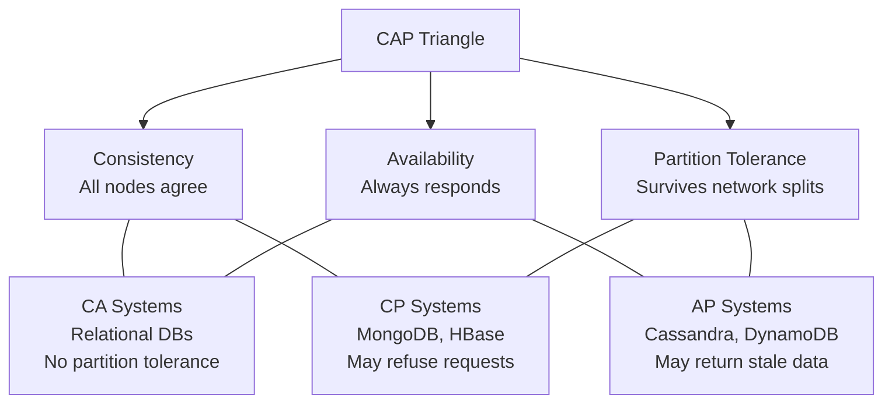
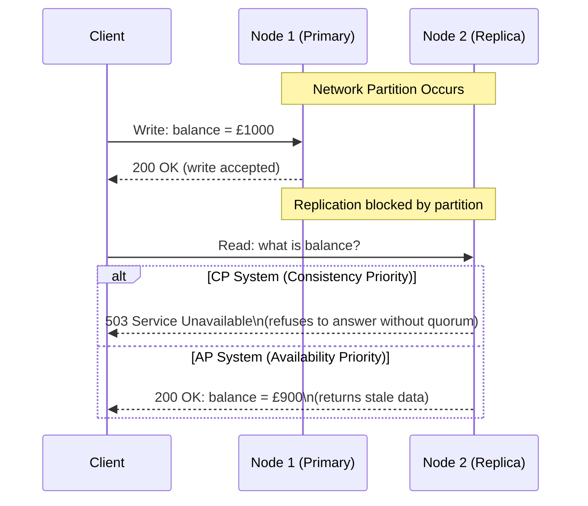
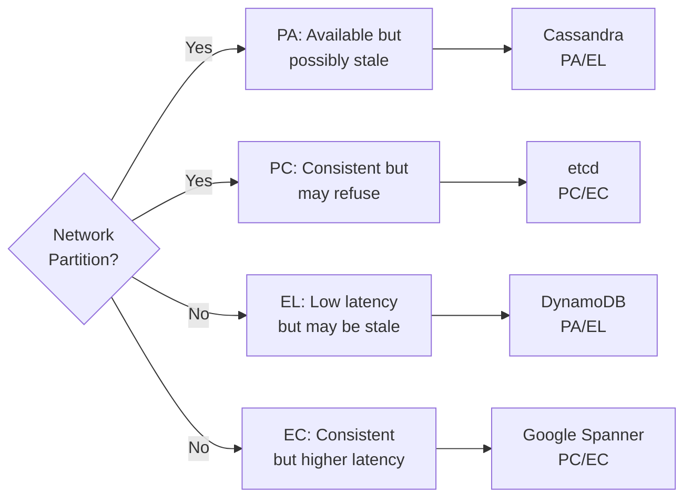
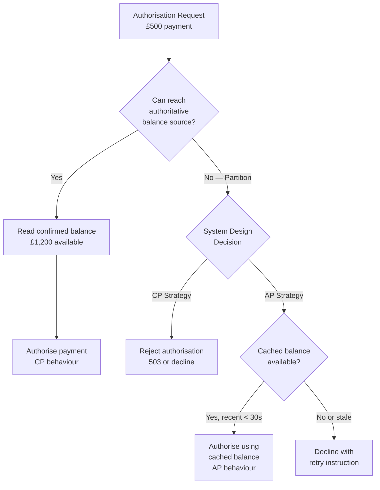

# The CAP Theorem — Consistency, Availability, Partition Tolerance

> [!NOTE]
> The CAP theorem is the foundational constraint of distributed systems. Every architectural decision in a distributed financial system is a trade-off that CAP — and its more nuanced successor, PACELC — helps you reason about.

## The Theorem

In 2000, Eric Brewer conjectured, and Gilbert and Lynch later proved, that a distributed data store can provide **at most two** of the following three guarantees simultaneously:

- **Consistency (C)** — Every read receives the most recent write or an error. All nodes see the same data at the same time.
- **Availability (A)** — Every request receives a response (not an error), though the response may not contain the most recent write.
- **Partition Tolerance (P)** — The system continues operating even when network messages between nodes are lost or delayed.



> [!WARNING]
> The choice is not "pick 2 of 3" in practice. Network partitions **will** occur in any distributed system. Therefore the real choice is: **when a partition happens, do you sacrifice consistency or availability?**

---

## Why Partition Tolerance Is Not Optional

A network partition is any scenario where nodes cannot communicate:

- A network cable is cut between data centres
- A switch fails under load
- A noisy neighbour saturates a network interface
- A cloud provider has a BGP routing incident

In any system spanning more than one process (which includes every distributed financial system), you must tolerate partitions. The P in CAP is therefore not a choice — it is a requirement.

The real choice is **CP vs AP**: what do you do *during* a partition?



---

## CP Systems — Consistency Over Availability

CP systems refuse to respond when they cannot guarantee the response is current. They prioritise **correctness** over uptime.

**Examples:** HBase, MongoDB (with majority write concern), etcd, ZooKeeper, Consul

**Financial use cases where CP is correct:**
- Account balance reads during a payment authorisation
- Distributed lock acquisition for idempotency
- Consensus on who is the current leader in a payment processor cluster
- Atomic multi-account balance transfer

```java
// etcd CP write — requires majority acknowledgement
// If partition prevents quorum, write fails rather than succeeding without consensus
CompletableFuture<PutResponse> response = etcdClient.getKVClient()
    .put(
        ByteSequence.from("payment-lock/txn-abc123", UTF_8),
        ByteSequence.from(nodeId, UTF_8),
        PutOption.newBuilder()
            .withLeaseId(leaseId)  // TTL-based lock
            .build()
    );

try {
    PutResponse result = response.get(500, TimeUnit.MILLISECONDS);
    // Lock acquired — safe to proceed
} catch (TimeoutException | ExecutionException e) {
    // Partition or quorum loss — cannot proceed safely
    throw new DistributedLockException("Cannot acquire lock during partition", e);
}
```

---

## AP Systems — Availability Over Consistency

AP systems continue responding during a partition, potentially returning stale data. They prioritise **uptime** over correctness.

**Examples:** Cassandra, DynamoDB, CouchDB, DNS

**Financial use cases where AP is correct:**
- Fraud score cache reads (slightly stale is acceptable; refusing is not)
- Exchange rate feeds (approximate rate is better than error)
- Product catalogue and fee schedule reads
- Read-heavy reference data (account metadata, BIC codes)

```java
// Cassandra AP read — QUORUM consistency for most operations
// ONE consistency for latency-sensitive, stale-tolerant reads
Session session = cassandraCluster.connect("payments_keyspace");

// AP: accept potentially stale data for exchange rate lookup
Row exchangeRate = session.execute(
    QueryBuilder.select().all()
        .from("exchange_rates")
        .where(QueryBuilder.eq("currency_pair", "GBP/USD"))
        .setConsistencyLevel(ConsistencyLevel.ONE)  // AP: respond even during partition
).one();

// CP: require quorum for balance-affecting operations
Row accountBalance = session.execute(
    QueryBuilder.select().all()
        .from("accounts")
        .where(QueryBuilder.eq("account_id", accountId))
        .setConsistencyLevel(ConsistencyLevel.QUORUM)  // CP: must have majority
).one();
```

---

## PACELC — The More Complete Model

CAP only describes behaviour *during* partitions. The **PACELC theorem** (Daniel Abadi, 2012) extends this to normal operations:

> If there is a **P**artition, choose between **A**vailability and **C**onsistency.
> **E**lse (no partition), choose between **L**atency and **C**onsistency.



| System | Partition | Normal Ops | Use in Finance |
|---|---|---|---|
| Cassandra | PA | EL | Reference data, fraud cache |
| etcd | PC | EC | Leader election, distributed locks |
| DynamoDB (default) | PA | EL | Session state, rate limit counters |
| Google Spanner | PC | EC | Ledger entries, account balances |
| PostgreSQL single-node | — | EC | OLTP transactions |
| CockroachDB | PC | EC | Multi-region financial records |

---

## Applying CAP to Financial System Design

### The Payment Authorisation Decision

A payment authorisation must decide: should I authorise this payment when I cannot confirm the current account balance?



**The principal engineer's decision:** A £500 payment on a £1,200 account with a 30-second-old cache is almost certainly safe to authorise. A £5,000 payment on a £5,200 account with a 2-minute-old cache is not — the customer may have already spent that money.

The right answer depends on:
- **Maximum stale window tolerated** by business risk
- **Consequence of inconsistency** (can it be reversed? Is fraud the concern?)
- **Consequence of unavailability** (declined payment at checkout = customer lost)

---

## Principal Engineer's CAP Decision Framework

When selecting a data store or designing a distributed data architecture:

**Step 1 — Identify the partition scenario.** What happens when two nodes cannot communicate? What does the user experience?

**Step 2 — Classify the data by consistency requirement:**

| Consistency Tier | Description | Acceptable Stale Window |
|---|---|---|
| **Strict** | Account balances, ledger entries | Zero — always current |
| **High** | Payment state, idempotency keys | < 1 second |
| **Moderate** | Fraud scores, credit limits | < 30 seconds |
| **Low** | Exchange rates, fees | < 5 minutes |
| **Very Low** | Reference data, BIC codes | Hours |

**Step 3 — Map requirements to system choice:**
- Strict/High → CP systems (PostgreSQL, Spanner, etcd)
- Moderate → Tunable consistency with read quorum (Cassandra QUORUM, DynamoDB Strong Reads)
- Low/Very Low → AP systems (Cassandra ONE, Redis, DynamoDB Eventual Reads)

**Step 4 — Design the partition behaviour explicitly.** Don't let it happen by accident — document what your system does during a partition in the ADR.

<!-- KNOWLEDGE-CHECK
{
  "questions": [
    {
      "id": "q1",
      "text": "During a network partition, your payment authorisation service cannot reach the primary database. It has a 15-second-old cached balance showing £2,000 available. The payment request is for £1,500. What is the most defensible decision?",
      "options": [
        "Always decline during a partition — consistency is non-negotiable for payments",
        "Always approve from cache — availability is non-negotiable for payments",
        "Approve if the stale window and amount are within defined risk parameters, with the ability to reverse if reconciliation fails",
        "Queue the request and retry when the partition heals"
      ],
      "correct": 2,
      "explanation": "The correct answer depends on context, but option C represents principled AP design: define acceptable stale windows and amount thresholds explicitly, approve within those bounds, and have a reconciliation path. Pure CP (always decline) is a poor UX. Pure AP (always approve) is a risk management failure. Queueing is not viable for real-time payment auth."
    },
    {
      "id": "q2",
      "text": "PACELC extends CAP by considering what scenario that CAP ignores?",
      "options": [
        "The latency-consistency trade-off during normal (non-partition) operation",
        "The cost of storage versus performance",
        "The choice between SQL and NoSQL databases",
        "The number of replicas needed for durability"
      ],
      "correct": 0,
      "explanation": "PACELC asks: when there is NO partition, do you optimise for Latency or Consistency? CAP only addresses the partition scenario. This is critical for financial systems because low-latency reads that return slightly stale data (EL) versus consistent reads with higher latency (EC) is a constant design decision."
    },
    {
      "id": "q3",
      "text": "You are designing a distributed fraud score cache. Fraud scores are recalculated every 60 seconds. During a partition, nodes continue serving requests from their local cache. Which CAP classification does this represent?",
      "options": [
        "CP — because fraud scores are financial data",
        "CA — because you're not accepting partitions",
        "AP — because nodes remain available but may serve stale data",
        "CP — because nodes will eventually converge"
      ],
      "correct": 2,
      "explanation": "This is AP. Nodes continue responding (Available) during a partition (Partition tolerant), but may serve fraud scores calculated before the partition (not Consistent). This is an appropriate design for fraud scoring where slight staleness is acceptable and refusing to serve increases false positives."
    },
    {
      "id": "q4",
      "text": "An engineer proposes using Cassandra with ConsistencyLevel.ONE for account balance writes to achieve maximum write throughput. What is the CAP implication?",
      "options": [
        "This is fine — Cassandra is eventually consistent so reads will catch up",
        "This makes the balance store AP: writes succeed even if only one replica acknowledges, creating diverged state during partitions",
        "This makes the balance store CP: Cassandra's replication ensures consistency",
        "ConsistencyLevel.ONE only affects read latency, not consistency guarantees"
      ],
      "correct": 1,
      "explanation": "ConsistencyLevel.ONE means a write succeeds if any single replica acknowledges it. During a partition, different replicas may accept different writes, creating diverged state. This is AP behaviour. For account balances, QUORUM or ALL should be used to ensure reads can detect the most recent write."
    }
  ]
}
-->

<!-- PRACTICAL-CHALLENGE
{
  "title": "The CAP Theorem \u2014 Consistency, Availability, Partition Tolerance \u2014 Production Implementation",
  "difficulty": "advanced",
  "estimatedMinutes": 85,
  "tasks": [
    {
      "id": "1",
      "description": "Implement the core the cap theorem \u2014 consistency, availability, partition tolerance mechanism in a Java Spring Boot service with proper error handling"
    },
    {
      "id": "2",
      "description": "Write integration tests using Testcontainers to validate the the cap theorem \u2014 consistency, availability, partition tolerance behaviour under concurrent load"
    },
    {
      "id": "3",
      "description": "Add observability: expose Micrometer metrics and structured log entries for key operations"
    },
    {
      "id": "4",
      "description": "Document architectural decisions: write an ADR and a production runbook covering rollout and rollback"
    }
  ]
}
-->
