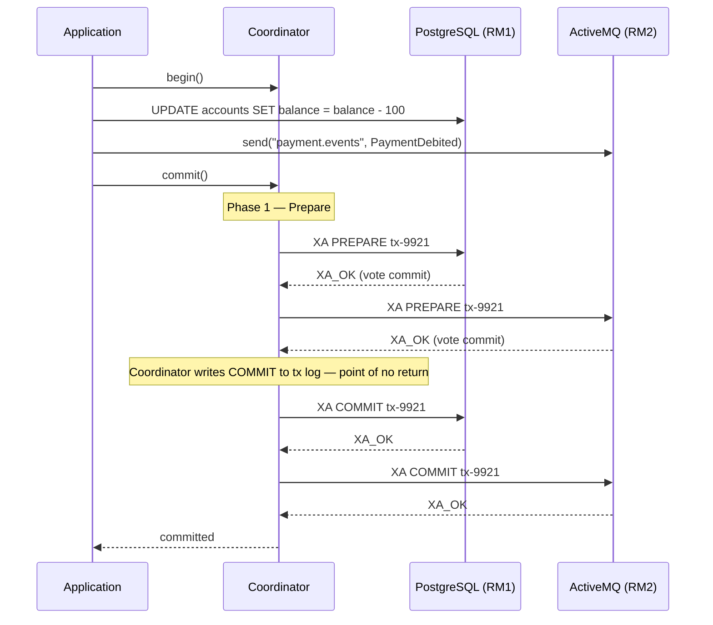
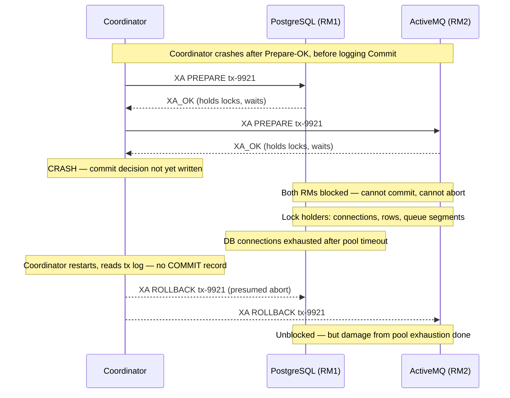

# الالتزام على مرحلتين ومعاملات XA

الالتزام على مرحلتين (2PC) هو البروتوكول الكلاسيكي الذي يضمن الذرية عبر عدة مديري موارد مستقلين — وهو أساس معاملات ACID الموزعة. وفي الأنظمة المالية يظهر 2PC حيثما يجب أن تمتد عملية عمل واحدة عبر قاعدة بيانات علائقية ووسيط رسائل معًا: سجّل الخصم وأرسل الحدث، أو لا تفعل أيًا منهما. وفهم 2PC بعمق يعني فهم كيف يعمل عندما يسير كل شيء على ما يرام، وأيضًا لماذا يتوقف بالضبط عندما تسوء الأمور، ولماذا ابتعدت الصناعة عنه إلى حد كبير في الأنظمة واسعة النطاق.

## أهداف التعلم

- شرح مرحلتي التحضير (Prepare) والالتزام (Commit) في 2PC ودور المنسّق والمشاركين
- وصف مشكلة التوقف (الحجب) الناتجة عن تعطل المنسّق بعد مرحلة التحضير
- تنفيذ معاملة XA في Java باستخدام `javax.transaction.xa.XAResource`
- إعداد Atomikos JTA لتنسيق PostgreSQL وActiveMQ داخل خدمة Spring Boot
- التعامل الصحيح مع `HeuristicMixedException` و`HeuristicRollbackException` في شيفرة الإنتاج
- ضبط `@Transactional` في Spring Boot مع مدير معاملات JTA
- شرح سبب ندرة 2PC في الأنظمة السحابية الحديثة وكلفته في الزمن والاحتفاظ بالأقفال
- تحديد السيناريوهات التي يبقى فيها 2PC الخيار الصحيح بدل sagas ونمط outbox

## سياق العمل

لنأخذ مثالًا مركّبًا مستمدًا من حوادث نموذجية. معالج دفع ينسّق PostgreSQL وActiveMQ عبر 2PC. أثناء تحويل احتياطي لقاعدة البيانات، يرسل المنسّق Prepare إلى المشاركَين، ويتلقى صوتي الموافقة — ثم يتعطل قبل أن يكتب قرار الالتزام في سجل المعاملات. فيحتفظ المشاركان الآن بأقفالهما وينتظران. وخلال نحو 90 ثانية تنفد مجموعة اتصالات قاعدة البيانات، وتبدأ الدفعات الجديدة بالفشل. وعندما يُعاد تشغيل المنسّق لا يجد سجل التزام لهذه المعاملات، فيتراجع عنها (الإلغاء المفترض، presumed abort) — لكن بحلول ذلك الوقت يكون نفاد الاتصالات قد امتد، وتبقى آلاف المعاملات التي تضرر سجل منسّقها في حالة PREPARED، وتحتاج ساعات من المعالجة اليدوية. ويُظهر المثال نقطة الضعف الأساسية في 2PC: بعد أن يصوّت المشارك بالموافقة لا يستطيع القرار وحده، ويجب أن ينتظر المنسّق مهما طال ذلك.

## بروتوكول الالتزام على مرحلتين

ينسّق 2PC الذرية عبر عدة مديري موارد (RM) بواسطة منسّق يقود بروتوكولًا حتميًا. وكل مدير موارد مشارك. ويدير المنسّق سجل المعاملات الذي يجعل الاسترداد ممكنًا.

**المرحلة 1 — التحضير:**
يرسل المنسّق `prepare` إلى كل المشاركين. ويجب على كل مشارك أن يكتب تغييراته على تخزين دائم، ويأخذ كل الأقفال اللازمة، ويرد بـ `vote-commit` أو `vote-abort`. وإذا صوّت أي مشارك بالإلغاء، يجب إلغاء المعاملة كلها.

**المرحلة 2 — الالتزام أو الإلغاء:**
إذا صوّت كل المشاركين بالالتزام، يسجّل المنسّق قرار الالتزام العام (نقطة الالتزام) ويرسل `commit` إلى كل المشاركين. وإذا صوّت أي مشارك بالإلغاء، يرسل المنسّق `abort` إلى الجميع.



### سيناريوهات تعطل المنسّق

النافذة الخطرة تقع بعد اكتمال المرحلة 1 وقبل أن يكتب المنسّق قراره:



هذه هي **مشكلة الحجب**: لا يستطيع المشاركون في حالة PREPARED أن يقرروا وحدهم الالتزام أو الإلغاء. بل يجب أن ينتظروا المنسّق. وهذه خاصية أساسية في البروتوكول، لا خلل في التنفيذ. فلا يعرف أي مشارك هل صوّت الآخرون بالالتزام أم بالإلغاء. وعند إعادة التشغيل دون سجل التزام، يتراجع المنسّق عن الفروع المحضّرة.

> [!WARNING]
> لا يمكن حل مشكلة الحجب داخل بروتوكول 2PC. يعالجها الالتزام على ثلاث مراحل (3PC) نظريًا، لكنه يُدخل أنماط فشل جديدة ولا يكاد يُستخدم عمليًا. والحل العملي هو جعل المنسّق نفسه متحملًا للأعطال بنسخ سجل قراراته عبر الإجماع (Paxos Commit؛ وSpanner يشغّل 2PC فوق مجموعات Paxos). أما لمعظم فرق التطبيقات، فالحل المفضل هو تجنب 2PC واستخدام أنماط بديلة.

## معاملات XA في Java

واجهة XA في Java معرّفة في `javax.transaction.xa`. وكل مدير موارد يدعم XA يوفر `XADataSource` أو `XAConnectionFactory` تكشف اتصالاته `XAResource` ينسّقه مدير المعاملات.

```java
// Low-level XA — illustrates the protocol; in production use JTA/Atomikos
import javax.transaction.xa.XAResource;
import javax.transaction.xa.Xid;
import javax.sql.XADataSource;
import javax.sql.XAConnection;

public class XAProtocolDemo {

    public void executeXaTransaction(
            XADataSource postgresXaDs,
            XADataSource secondaryXaDs) throws Exception {

        XAConnection xaConn1 = postgresXaDs.getXAConnection();
        XAConnection xaConn2 = secondaryXaDs.getXAConnection();

        XAResource rm1 = xaConn1.getXAResource();
        XAResource rm2 = xaConn2.getXAResource();

        // Coordinator generates a globally unique transaction id
        Xid xid = new XidImpl(
            /* formatId */ 1,
            /* globalTransactionId */ UUID.randomUUID().toString().getBytes(),
            /* branchQualifier */ "branch-1".getBytes()
        );

        boolean decidedCommit = false;
        try {
            // Enlist resource managers
            rm1.start(xid, XAResource.TMNOFLAGS);
            rm2.start(xid, XAResource.TMNOFLAGS);

            // Execute work on both connections
            try (var stmt = xaConn1.getConnection().prepareStatement(
                    "UPDATE accounts SET balance = balance - ? WHERE id = ?")) {
                stmt.setBigDecimal(1, amount);
                stmt.setLong(2, sourceAccountId);
                stmt.executeUpdate();
            }
            try (var stmt = xaConn2.getConnection().prepareStatement(
                    "INSERT INTO audit_log(tx_id, action) VALUES (?, ?)")) {
                stmt.setString(1, xid.toString());
                stmt.setString(2, "DEBIT");
                stmt.executeUpdate();
            }

            // End work
            rm1.end(xid, XAResource.TMSUCCESS);
            rm2.end(xid, XAResource.TMSUCCESS);

            // Phase 1 — Prepare
            int vote1 = rm1.prepare(xid); // XA_OK or XA_RDONLY
            int vote2 = rm2.prepare(xid);

            // *** Write commit decision to durable log here ***
            // If coordinator crashes after this point, recovery must commit
            decidedCommit = true;

            // Phase 2 — Commit (after the decision, failures are RETRIED, never rolled back)
            if (vote1 != XAResource.XA_RDONLY) {
                rm1.commit(xid, false); // false = one-phase not used
            }
            if (vote2 != XAResource.XA_RDONLY) {
                rm2.commit(xid, false);
            }

        } catch (Exception e) {
            if (decidedCommit) {
                // Decision is COMMIT: keep retrying commit (recovery does this
                // after a crash). Rolling back now would create a mixed outcome.
                throw new CommitPendingException(xid, e);
            }
            // Before the decision: roll back every branch
            try { rm1.rollback(xid); } catch (Exception ignored) {}
            try { rm2.rollback(xid); } catch (Exception ignored) {}
            throw e;
        } finally {
            xaConn1.close();
            xaConn2.close();
        }
    }
}
```

بعد كتابة قرار الالتزام، لا يجوز التراجع أبدًا: فشل الالتزام يُعاد محاولته (وهذا ما يفعله الاسترداد بعد التعطل)، لأن التراجع عندها يُنتج نتيجة مختلطة. أما قبل القرار فيُتراجع عن كل الفروع.

## Atomikos JTA مع PostgreSQL وActiveMQ

في الإنتاج لا تنفّذ 2PC يدويًا. فـ Atomikos هو مدير معاملات JTA المضمّن الأكثر استخدامًا مع Spring Boot. وهو يدير سجل المعاملات، واسترداد المنسّق، وتنسيق المشاركين. ملاحظة: أزال Spring Boot 3 الحزمة `spring-boot-starter-jta-atomikos` الخاصة به؛ استخدم الحزمة التي تنشرها Atomikos نفسها، ويجب أن تكون قيمة `max_prepared_transactions` في PostgreSQL أكبر من 0 (الافتراضي 0، وهو يعطّل XA).

```xml
<!-- pom.xml (Spring Boot 3) -->
<dependency>
    <groupId>com.atomikos</groupId>
    <artifactId>transactions-spring-boot3-starter</artifactId>
    <version>6.0.0</version>
</dependency>
<dependency>
    <groupId>org.postgresql</groupId>
    <artifactId>postgresql</artifactId>
</dependency>
<dependency>
    <groupId>org.apache.activemq</groupId>
    <artifactId>activemq-client</artifactId>
</dependency>
```

```java
@Configuration
public class XaTransactionConfig {

    @Bean
    @Primary
    public DataSource xaDataSource(@Value("${DB_PASSWORD}") String dbPassword) {
        AtomikosDataSourceBean ds = new AtomikosDataSourceBean();
        ds.setUniqueResourceName("postgres-xa");
        ds.setXaDataSourceClassName("org.postgresql.xa.PGXADataSource");

        Properties props = new Properties();
        props.setProperty("serverName", "localhost");
        props.setProperty("portNumber", "5432");
        props.setProperty("databaseName", "payments");
        props.setProperty("user", "app");
        props.setProperty("password", dbPassword);   // injected, never hard-coded
        ds.setXaProperties(props);

        ds.setMinPoolSize(5);
        ds.setMaxPoolSize(25);
        ds.setMaxLifetime(600);
        return ds;
    }

    @Bean
    public ConnectionFactory xaConnectionFactory() {
        AtomikosConnectionFactoryBean cf = new AtomikosConnectionFactoryBean();
        cf.setUniqueResourceName("activemq-xa");
        cf.setXaConnectionFactory(new ActiveMQXAConnectionFactory(
            "tcp://localhost:61616"));
        cf.setMinPoolSize(2);
        cf.setMaxPoolSize(10);
        return cf;
    }

    // No transaction manager bean here: the Atomikos starter auto-configures
    // a JtaTransactionManager (bean name "transactionManager") backed by
    // its UserTransactionManager.
}
```

```java
@Service
@Transactional   // the JTA transaction manager from the Atomikos starter
public class PaymentExecutionService {

    private final AccountRepository accountRepository;
    private final JmsTemplate jmsTemplate;

    public PaymentExecutionService(
            AccountRepository accountRepository,
            JmsTemplate jmsTemplate) {
        this.accountRepository = accountRepository;
        this.jmsTemplate = jmsTemplate;
    }

    // Both the DB write and the JMS send are covered by the same XA transaction.
    // If JMS send fails after DB update, the whole transaction rolls back.
    // If the coordinator crashes after logging COMMIT, Atomikos recovery commits on
    // restart; if it crashes before, recovery rolls the prepared branches back.
    public PaymentResult executePayment(PaymentCommand cmd) {
        Account source = accountRepository.findByIdForUpdate(cmd.sourceAccountId())
            .orElseThrow(() -> new AccountNotFoundException(cmd.sourceAccountId()));

        source.debit(cmd.amount()); // throws InsufficientFundsException
        accountRepository.save(source);

        PaymentExecutedEvent event = PaymentExecutedEvent.from(cmd);
        jmsTemplate.convertAndSend("payment.executed", event);

        return PaymentResult.success(event.paymentId());
    }
}
```

تغطي معاملة XA واحدة كتابة قاعدة البيانات وإرسال JMS معًا. فإذا فشل إرسال JMS بعد تحديث قاعدة البيانات، يُتراجع عن المعاملة كلها. وإذا تعطل المنسّق بعد تسجيل الالتزام، يلتزم استرداد Atomikos عند إعادة التشغيل؛ وإذا تعطل قبله، يتراجع الاسترداد عن الفروع المحضّرة.

## الاستثناءات الاستدلالية (Heuristic) والحل اليدوي

عندما يتخذ مشارك قرارًا منفردًا (التزامًا أو تراجعًا) بسبب انتهاء مهلة انتظار المنسّق، يسجّل **نتيجة استدلالية**. وهذا يفتح احتمال نتيجة مختلطة: مشارك التزم وآخر تراجع. وتعبّر Java عن ذلك باستثناءات مفحوصة.

```java
@Service
public class HeuristicRecoveryService {

    private static final Logger log = LoggerFactory.getLogger(HeuristicRecoveryService.class);
    private final HeuristicTransactionAuditRepository auditRepo;

    public void executeWithHeuristicHandling(Runnable txWork) {
        UserTransaction utx = resolveUserTransaction();
        try {
            utx.begin();
            txWork.run();
            utx.commit();

        } catch (HeuristicMixedException e) {
            // Some participants committed, some rolled back
            // State is now INCONSISTENT. Requires manual investigation.
            String txId = extractTransactionId(utx);
            log.error("HEURISTIC MIXED on tx={} — manual reconciliation required", txId, e);
            auditRepo.recordHeuristicIncident(txId, HeuristicType.MIXED, e.getMessage());
            // Alert ops team immediately — do not silently continue
            alertOps(txId, "HEURISTIC_MIXED");
            throw new IrrecoverableTransactionException(txId, e);

        } catch (HeuristicRollbackException e) {
            // All participants rolled back heuristically — data is consistent
            // but the transaction did not complete
            String txId = extractTransactionId(utx);
            log.warn("HEURISTIC ROLLBACK on tx={} — safe to retry", txId);
            auditRepo.recordHeuristicIncident(txId, HeuristicType.ROLLBACK, e.getMessage());
            throw new RetryableTransactionException(txId, e);

        } catch (RollbackException e) {
            // Normal rollback — no heuristic involvement
            log.info("Transaction rolled back normally");
        } catch (Exception e) {
            try { utx.rollback(); } catch (Exception ignored) {}
            throw new RuntimeException("Transaction failed", e);
        }
    }
}
```

`HeuristicMixedException` تعني أن بعض المشاركين التزموا وبعضهم تراجع — فالحالة غير متسقة وتحتاج تحقيقًا يدويًا فورًا وتنبيهًا لفريق العمليات. أما `HeuristicRollbackException` فتعني أن الجميع تراجع، فالبيانات متسقة ويمكن إعادة المحاولة.

> [!CAUTION]
> ‏`HeuristicMixedException` تعني أن بياناتك غير متسقة عبر مديري الموارد. ولا يوجد مسار استرداد تلقائي. يجب أن يكون لديك دليل تشغيل للمطابقة، ومسار تنبيه، وعملية تحقيق يدوي. وهذه ليست حالة هامشية تؤجلها — خطط لها قبل نشر 2PC.

## سجل معاملات Atomikos وإعداد الاسترداد

```properties
# jta.properties — Atomikos transaction service settings
# Transaction log directory — must be on durable storage that survives restarts
com.atomikos.icatch.log_base_dir=/var/data/atomikos/tx-logs
# Logging must stay on: without the log, crashed transactions cannot be recovered
com.atomikos.icatch.enable_logging=true
# Maximum timeout (ms) any transaction may request
com.atomikos.icatch.max_timeout=300000
# Default transaction timeout (ms)
com.atomikos.icatch.default_jta_timeout=10000
# Log checkpoint interval (number of writes) for log compaction
com.atomikos.icatch.checkpoint_interval=500
# Unique name per instance — two pods must never share a log directory
com.atomikos.icatch.tm_unique_name=payment-service-${POD_NAME}
```

> [!NOTE]
> يجب أن يكون مجلد سجل معاملات Atomikos على تخزين دائم ومستمر. وفي Kubernetes يعني ذلك PersistentVolumeClaim. وإذا ضاع السجل، لا يمكن استرداد المعاملات المحضّرة الجارية، ويجب حلها يدويًا في كل مدير موارد.

## لماذا أصبح 2PC نادرًا في الأنظمة الحديثة

كُلف 2PC كبيرة وتتضاعف مع الحجم:

| العامل | كلفة 2PC | الأثر |
|---|---|---|
| الزمن | رحلتان إضافيتان (Prepare + Commit) وكتابات سجل إجبارية | يضيف مللي ثوانٍ لكل معاملة، وأكثر بين مراكز البيانات |
| الاحتفاظ بالأقفال | الأقفال محجوزة حتى الالتزام النهائي في كل مديري الموارد | ارتفاع التنافس عندما يبطئ المنسّق |
| المنسّق نقطة فشل واحدة | كل المعاملات تتوقف أثناء عدم إتاحة المنسّق | الإتاحة محدودة بوقت تشغيل المنسّق |
| عدم ملاءمة السحابة | كثير من الخدمات المُدارة لا تدعم XA ‏(SQS، وDynamoDB، وPub/Sub، وKafka) | لا ينضم إلا مديرو الموارد الداعمون لـ XA؛ وفي RDS/Aurora PostgreSQL يجب رفع `max_prepared_transactions` |
| الإنتاجية | عمليات fsync لسجل المنسّق ومدة الأقفال تحدّ الإنتاجية | يصعب التوسع أفقيًا |
| التعقيد التشغيلي | حل الحالات الاستدلالية، وإدارة سجل المعاملات، واختبار الاسترداد | عبء كبير على فريق SRE |

البدائل الحديثة:

- **نمط Saga** — سلسلة من المعاملات المحلية مع معاملات تعويضية للتراجع. بلا أقفال موزعة. اتساق نهائي. ومفضّل للخدمات المصغّرة.
- **نمط Outbox** — اكتب الحدث في جدول outbox ضمن معاملة قاعدة البيانات المحلية نفسها التي تغيّر الحالة. ثم تنشر عملية ترحيل (بالاستطلاع أو بـ CDC عبر Debezium) من جدول outbox لاحقًا، مرة واحدة على الأقل. بلا حاجة إلى XA.
- **صندوق الوارد المعاملاتي (Transactional Inbox)** — يسجّل المستهلكون معرّف كل حدث عولج في المعاملة المحلية نفسها التي تُحدث أثره، فيصبح للتسليم "مرة واحدة على الأقل" أثر "مرة واحدة بالضبط" دون 2PC.

## متى يبقى 2PC مناسبًا

ما زال 2PC الخيار الصحيح في سيناريوهات محددة وواضحة:

| السيناريو | المبرر |
|---|---|
| مركز بيانات واحد، وكل مديري الموارد على العتاد نفسه | مخاوف الزمن والإتاحة ضئيلة |
| كل مديري الموارد من المورّد نفسه (Oracle DB + Oracle AQ) | مسارات XA محسّنة، واسترداد يديره المورّد |
| متطلب تنظيمي صارم لـ ACID عبر مخزنين | الامتثال يفرض ذرية متزامنة |
| حجم معاملات معتدل | سقف الإنتاجية مقبول |
| مشروع قصير الأجل بلا خطة ترحيل إلى السحابة | التعقيد التشغيلي مبرر |

> [!TIP]
> عند الشك، فضّل نمط outbox على 2PC. فهو يضمن أن تغيير الحالة الملتزم سيُنشر في النهاية (مرة واحدة على الأقل — ويجب على المستهلكين إزالة التكرار)، بزمن أقل، وبلا حجب، ومع توافق كامل مع الخدمات السحابية المُدارة. 2PC ملاذ أخير، لا خيار أول.

## اختبر معرفتك

**س1: تلقى منسّق صوتي XA_OK ‏(Prepare) من المشاركَين وكتب قرار الالتزام العام في سجل معاملاته. ثم تعطل. عند إعادة تشغيله، ماذا يجب أن يفعل بالمعاملة؟**

ج: يجب أن يلتزم بالمعاملة. فكتابة قرار الالتزام العام في السجل الدائم هي نقطة اللاعودة. ويقرأ الاسترداد السجل، ويجد قرار الالتزام، ويرسل XA COMMIT إلى كل المشاركين. وأي مشارك ما زال في حالة PREPARED سيقبل الالتزام. وهذا ضمان الصحة في 2PC: تسجيل القرار بشكل دائم قبل إرسال الالتزامات يعني أن الاسترداد يعرف دائمًا النتيجة الصحيحة.

**س2: تستخدم خدمة الدفع لديك Atomikos JTA لتنسيق مصدر بيانات PostgreSQL XA ومصنع اتصالات ActiveMQ XA. وفي اختبار الحمل بمعدل 8,000 معاملة في الثانية تلاحظ أن زمن P99 يتضاعف وأن أقفال صفوف PostgreSQL تُحتجز 180ms في المتوسط. ما السبب الأرجح، وماذا يجب أن تفعل؟**

ج: سبب زيادة الزمن هو التنافس على الأقفال: يحتفظ PostgreSQL بأقفال الصفوف التي أخذها التحديث حتى يصل `XA COMMIT`، والمعاملة المحضّرة تُبقيها عبر المرحلتين. وعند 8,000 معاملة في الثانية يتشبع المنسّق، فتزيد الفجوة بين Prepare وCommit وتطول مدة الأقفال. وتضاعف P99 هو سقف الإنتاجية الكلاسيكي في 2PC. والاستجابة المعمارية الصحيحة هي الانتقال إلى نمط outbox: اكتب حدث الدفع في جدول outbox ضمن معاملة PostgreSQL المحلية نفسها، واستخدم Debezium أو مرحّلًا بالاستطلاع للنشر إلى ActiveMQ. وهذا يلغي XA كليًا، ويزيل عنق زجاجة المنسّق، ويقلص مدة الأقفال إلى مدة معاملة محلية واحدة.

## التحدي العملي

**السيناريو:** أنت المهندس الرئيسي في معالج مدفوعات. يستخدم التنفيذ الحالي Atomikos JTA لتنسيق مصدر بيانات PostgreSQL XA ومصنع اتصالات ActiveMQ XA لكل تنفيذات الدفع. ويعالج النظام 3,000 معاملة في الثانية في الذروة، وهو على وشك الانتقال إلى AWS: ‏Aurora PostgreSQL لقاعدة البيانات، وAmazon SQS بدل ActiveMQ، مع التشغيل على Kubernetes.

**المهام:**

1. **حدّد عوائق الترحيل:** اشرح لماذا لن يعمل أسلوب 2PC/XA الحالي بعد الانتقال. فـ SQS لا يدعم XA إطلاقًا. وفي Aurora PostgreSQL، ما الخطأ الذي تحصل عليه من `PGXADataSource` ما دامت `max_prepared_transactions` تساوي 0، ولماذا يصعب الحفاظ على سجل معاملات Atomikos دائم لكل pod على Kubernetes؟

2. **صمّم البديل بنمط outbox:** ارسم مخطط جدول `payment_outbox` في PostgreSQL، واكتب طريقة خدمة Spring بـ `@Transactional` تخصم من حساب وتُدخل صفًا في outbox ذريًا — كل ذلك في معاملة محلية واحدة، بلا JTA.

3. **اكتب استعلام ترحيل بالاستطلاع:** اكتب استعلام SQL الذي تستخدمه عملية الترحيل لاستطلاع مدخلات outbox غير المنشورة، وجملة التحديث التي تعلّمها منشورة. واشرح لماذا يجب أن تستخدم عملية الترحيل قفل صفوف (`SELECT FOR UPDATE SKIP LOCKED`) بدل `SELECT` عادي.

4. **اكتب دليل تشغيل للحادث الاستدلالي:** اكتب دليل تشغيل خطوة بخطوة (5 خطوات على الأقل) للاستجابة لتنبيه `HeuristicMixedException` في نظام 2PC الحالي. وضمّنه كيفية الاستعلام في PostgreSQL عن المعاملات في حالة PREPARED، وكيفية الاستعلام في ActiveMQ عن جلسات XA غير المكتملة، ومعايير الحل لكل مدير موارد.

<!-- KNOWLEDGE-CHECK
{
  "questions": [
    {
      "id": "q1",
      "text": "كتب منسّق 2PC قرار الالتزام العام في سجله ثم تعطل قبل إرسال XA COMMIT إلى أي مشارك. والمشاركان في حالة PREPARED. بعد إعادة تشغيل المنسّق، ماذا يجب أن يفعل؟",
      "options": [
        "التراجع عن كل المشاركين المحضّرين لأنه لم يُسلَّم أي التزام",
        "الالتزام لدى كل المشاركين المحضّرين — قرار السجل هو المرجع",
        "مطالبة المشاركين بالتصويت مرة أخرى",
        "ترك المعاملة في حالة PREPARED للحل اليدوي"
      ],
      "correct": 1,
      "explanation": "كتابة قرار الالتزام العام في السجل الدائم هي نقطة الالتزام. فيقرأ الاسترداد السجل ويجد COMMIT، فيجب أن يرسل XA COMMIT إلى كل المشاركين في حالة PREPARED. والسجل هو المرجع بغض النظر عما سُلّم قبل التعطل."
    },
    {
      "id": "q2",
      "text": "تتلقى HeuristicMixedException من التزام Atomikos JTA. ماذا يعني ذلك لبياناتك؟",
      "options": [
        "تراجع كل المشاركين — البيانات متسقة وإعادة المحاولة آمنة",
        "التزم بعض المشاركين وتراجع بعضهم — البيانات غير متسقة وتتطلب مطابقة يدوية",
        "لم يستطع المنسّق الوصول إلى كل المشاركين — إعادة المحاولة ستحل المشكلة",
        "تلف سجل المعاملات — أعد تشغيل Atomikos للاسترداد"
      ],
      "correct": 1,
      "explanation": "تعني HeuristicMixedException أن المشاركين اتخذوا قرارات مستقلة (استدلالية) بنتائج مختلفة. فالنتيجة حالة غير متسقة عبر مديري الموارد. وهذا يتطلب تنبيه فريق العمليات فورًا ومطابقة يدوية — ولا يمكن حله تلقائيًا."
    }
  ]
}
-->

<!-- PRACTICAL-CHALLENGE
{
  "title": "استبدال 2PC عبر XA بنمط Outbox قبل الترحيل إلى السحابة",
  "difficulty": "advanced",
  "estimatedMinutes": 60,
  "tasks": [
    {
      "id": "1",
      "description": "حدّد عوائق الترحيل: اشرح لماذا لن يعمل إعداد Atomikos مع PostgreSQL وActiveMQ عبر XA بعد الانتقال إلى Aurora PostgreSQL وAmazon SQS على Kubernetes — فـ SQS لا يدعم XA، و PGXADataSource يفشل ما دامت max_prepared_transactions تساوي 0، ويصعب الحفاظ على سجل معاملات دائم لكل pod."
    },
    {
      "id": "2",
      "description": "صمّم البديل بنمط outbox: عرّف جدول payment_outbox في PostgreSQL، واكتب طريقة خدمة Spring بـ @Transactional تخصم من حساب وتُدخل صف outbox في معاملة محلية واحدة، بلا JTA."
    },
    {
      "id": "3",
      "description": "اكتب مرحّلًا بالاستطلاع: جملة SQL التي تختار صفوف outbox غير المنشورة بـ SELECT ... FOR UPDATE SKIP LOCKED، وجملة UPDATE التي تعلّمها منشورة. واشرح لماذا تحتاج SKIP LOCKED عند تشغيل عدة نسخ من المرحّل، ولماذا يجب على المستهلكين إزالة التكرار مع ذلك."
    },
    {
      "id": "4",
      "description": "اكتب دليل تشغيل لـ HeuristicMixedException (5 خطوات على الأقل) لنظام 2PC الحالي: كيف تعرض المعاملات المحضّرة في PostgreSQL ‏(pg_prepared_xacts)، وكيف تفحص جلسات XA غير المكتملة في ActiveMQ، ومعايير الالتزام بكل فرع أو التراجع عنه."
    }
  ]
}
-->
