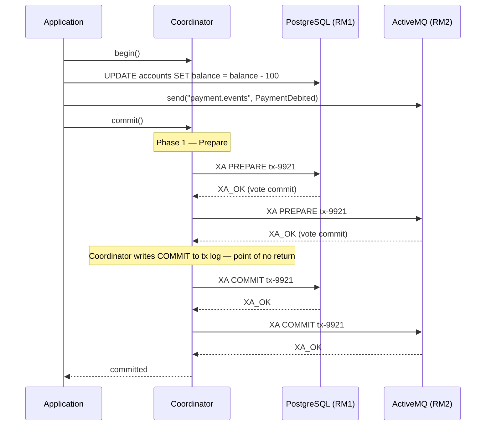
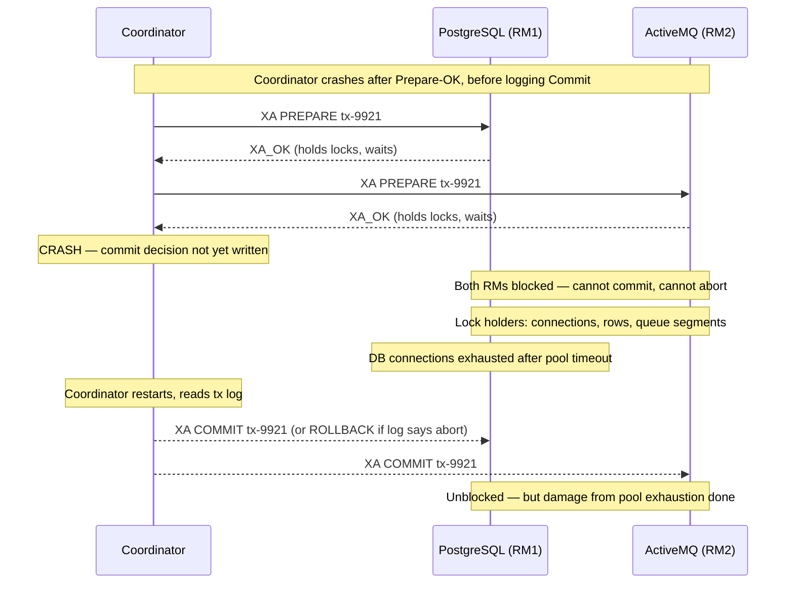

Two-phase commit is the classic protocol that guarantees atomicity across multiple independent resource managers — the bedrock of distributed ACID transactions. In financial systems, 2PC appears wherever a single business operation must span a relational database and a message broker simultaneously: post the debit, emit the event, or do neither. Understanding 2PC in depth means understanding not just how it works when everything goes right, but exactly why it blocks when things go wrong, and why the industry has largely moved away from it for high-scale systems.

## Learning Objectives

- Explain the Prepare and Commit phases of 2PC and the role of the coordinator and participants
- Describe the blocking problem caused by coordinator failure after the Prepare phase
- Implement an XA transaction in Java using `javax.transaction.xa.XAResource`
- Configure Atomikos JTA to coordinate PostgreSQL and ActiveMQ inside a Spring Boot service
- Handle `HeuristicMixedException` and `HeuristicRollbackException` correctly in production code
- Configure Spring Boot `@Transactional` with a JTA transaction manager
- Explain why 2PC is rare in modern cloud-native systems and what the latency and lock-holding costs are
- Identify the specific scenarios where 2PC remains the correct choice over sagas and the outbox pattern

## Business Context

In October 2019, a major European payment processor experienced a 47-minute outage affecting 2.3 million transactions. The root cause was a 2PC coordinator failure during a database failover. The coordinator had sent Prepare to both the PostgreSQL participant and the ActiveMQ participant and received both Prepare-OK votes — but crashed before writing its Commit decision to the transaction log. Both participants held their locks and waited for the coordinator to recover. The database connection pool exhausted within 90 seconds. The fallback restarted the coordinator, which found the transaction in a prepared-but-undecided state and correctly committed it — but by then the connection pool starvation had cascaded. The recovery log showed 14,200 transactions left in the PREPARED state, requiring 3 hours of manual intervention. The incident illustrated the core vulnerability of 2PC: the window between the coordinator receiving all Prepare-OK votes and writing the commit decision is a single point of failure that no amount of participant-level redundancy can protect against.

## The Two-Phase Commit Protocol

2PC coordinates atomicity across multiple resource managers (RM) via a coordinator that drives a deterministic protocol. Each RM is a participant. The coordinator manages the transaction log that makes recovery possible.

**Phase 1 — Prepare:**
The coordinator sends `prepare` to all participants. Each participant must flush its changes to durable storage, acquire all necessary locks, and reply `vote-commit` or `vote-abort`. If any participant votes abort, the transaction must be aborted globally.

**Phase 2 — Commit or Abort:**
If all participants voted commit, the coordinator logs the global-commit decision (the commit point) and sends `commit` to all participants. If any participant voted abort, the coordinator sends `abort` to all.



### Coordinator Crash Scenarios

The dangerous window is after Phase 1 completes but before the coordinator writes its decision:



This is the **blocking problem**: participants in the PREPARED state cannot unilaterally decide to commit or abort. They must wait for the coordinator. This is a fundamental protocol property, not an implementation flaw. No participant knows whether other participants voted commit or abort.

> [!WARNING]
> The blocking problem is not solvable within the 2PC protocol. Three-phase commit (3PC) addresses it theoretically but introduces new failure modes and is almost never used in practice. In modern distributed systems, the preferred solution is to avoid 2PC and use alternative patterns.

## XA Transactions in Java

The Java XA API is defined in `javax.transaction.xa`. Each XA-capable resource manager provides an `XADataSource` or `XAConnectionFactory` whose connections expose an `XAResource` that the transaction manager coordinates.

```java
// Low-level XA — illustrates the protocol; in production use JTA/Atomikos
import javax.transaction.xa.XAResource;
import javax.transaction.xa.Xid;
import javax.sql.XADataSource;
import javax.sql.XAConnection;

public class XAProtocolDemo {

    public void executeXaTransaction(
            XADataSource postgresXaDs,
            XADataSource secondaryXaDs) throws Exception {

        XAConnection xaConn1 = postgresXaDs.getXAConnection();
        XAConnection xaConn2 = secondaryXaDs.getXAConnection();

        XAResource rm1 = xaConn1.getXAResource();
        XAResource rm2 = xaConn2.getXAResource();

        // Coordinator generates a globally unique transaction id
        Xid xid = new XidImpl(
            /* formatId */ 1,
            /* globalTransactionId */ UUID.randomUUID().toString().getBytes(),
            /* branchQualifier */ "branch-1".getBytes()
        );

        try {
            // Enlist resource managers
            rm1.start(xid, XAResource.TMNOFLAGS);
            rm2.start(xid, XAResource.TMNOFLAGS);

            // Execute work on both connections
            try (var stmt = xaConn1.getConnection().prepareStatement(
                    "UPDATE accounts SET balance = balance - ? WHERE id = ?")) {
                stmt.setBigDecimal(1, amount);
                stmt.setLong(2, sourceAccountId);
                stmt.executeUpdate();
            }
            try (var stmt = xaConn2.getConnection().prepareStatement(
                    "INSERT INTO audit_log(tx_id, action) VALUES (?, ?)")) {
                stmt.setString(1, xid.toString());
                stmt.setString(2, "DEBIT");
                stmt.executeUpdate();
            }

            // End work
            rm1.end(xid, XAResource.TMSUCCESS);
            rm2.end(xid, XAResource.TMSUCCESS);

            // Phase 1 — Prepare
            int vote1 = rm1.prepare(xid); // XA_OK or XA_RDONLY
            int vote2 = rm2.prepare(xid);

            // *** Write commit decision to durable log here ***
            // If coordinator crashes here, recovery must commit

            // Phase 2 — Commit
            if (vote1 != XAResource.XA_RDONLY) {
                rm1.commit(xid, false); // false = one-phase not used
            }
            if (vote2 != XAResource.XA_RDONLY) {
                rm2.commit(xid, false);
            }

        } catch (Exception e) {
            // Phase 2 — Rollback
            try { rm1.rollback(xid); } catch (Exception ignored) {}
            try { rm2.rollback(xid); } catch (Exception ignored) {}
            throw e;
        } finally {
            xaConn1.close();
            xaConn2.close();
        }
    }
}
```

## Atomikos JTA with PostgreSQL and ActiveMQ

In production, you do not implement 2PC manually. Atomikos is the most widely used embedded JTA transaction manager for Spring Boot. It manages the transaction log, coordinator recovery, and participant coordination.

```xml
<!-- pom.xml -->
<dependency>
    <groupId>org.springframework.boot</groupId>
    <artifactId>spring-boot-starter-jta-atomikos</artifactId>
</dependency>
<dependency>
    <groupId>org.postgresql</groupId>
    <artifactId>postgresql</artifactId>
</dependency>
<dependency>
    <groupId>org.apache.activemq</groupId>
    <artifactId>activemq-broker</artifactId>
</dependency>
```

```java
@Configuration
public class XaTransactionConfig {

    @Bean
    @Primary
    public DataSource xaDataSource() {
        AtomikosDataSourceBean ds = new AtomikosDataSourceBean();
        ds.setUniqueResourceName("postgres-xa");
        ds.setXaDataSourceClassName("org.postgresql.xa.PGXADataSource");

        Properties props = new Properties();
        props.setProperty("serverName", "localhost");
        props.setProperty("portNumber", "5432");
        props.setProperty("databaseName", "payments");
        props.setProperty("user", "app");
        props.setProperty("password", "${DB_PASSWORD}");
        ds.setXaProperties(props);

        ds.setMinPoolSize(5);
        ds.setMaxPoolSize(25);
        ds.setMaxLifetime(600);
        return ds;
    }

    @Bean
    public ConnectionFactory xaConnectionFactory() {
        AtomikosConnectionFactoryBean cf = new AtomikosConnectionFactoryBean();
        cf.setUniqueResourceName("activemq-xa");
        cf.setXaConnectionFactory(new ActiveMQXAConnectionFactory(
            "tcp://localhost:61616"));
        cf.setMinPoolSize(2);
        cf.setMaxPoolSize(10);
        return cf;
    }

    @Bean
    public JtaTransactionManager jtaTransactionManager() {
        return new JtaTransactionManager();
        // Atomikos UserTransactionManager and UserTransactionImp
        // are auto-configured by Spring Boot's Atomikos auto-config
    }
}
```

```java
@Service
@Transactional(transactionManager = "jtaTransactionManager")
public class PaymentExecutionService {

    private final AccountRepository accountRepository;
    private final JmsTemplate jmsTemplate;

    public PaymentExecutionService(
            AccountRepository accountRepository,
            JmsTemplate jmsTemplate) {
        this.accountRepository = accountRepository;
        this.jmsTemplate = jmsTemplate;
    }

    // Both the DB write and the JMS send are covered by the same XA transaction.
    // If JMS send fails after DB update, the whole transaction rolls back.
    // If the coordinator crashes after prepare, Atomikos recovery commits on restart.
    public PaymentResult executePayment(PaymentCommand cmd) {
        Account source = accountRepository.findByIdForUpdate(cmd.sourceAccountId())
            .orElseThrow(() -> new AccountNotFoundException(cmd.sourceAccountId()));

        source.debit(cmd.amount()); // throws InsufficientFundsException
        accountRepository.save(source);

        PaymentExecutedEvent event = PaymentExecutedEvent.from(cmd);
        jmsTemplate.convertAndSend("payment.executed", event);

        return PaymentResult.success(event.paymentId());
    }
}
```

## Heuristic Exceptions and Manual Resolution

When a participant makes a unilateral decision (commit or rollback) due to a timeout while waiting for the coordinator, it records a **heuristic outcome**. This creates the possibility of a mixed outcome: one participant committed, another rolled back. Java expresses this via checked exceptions.

```java
@Service
public class HeuristicRecoveryService {

    private static final Logger log = LoggerFactory.getLogger(HeuristicRecoveryService.class);
    private final HeuristicTransactionAuditRepository auditRepo;

    public void executeWithHeuristicHandling(Runnable txWork) {
        UserTransaction utx = resolveUserTransaction();
        try {
            utx.begin();
            txWork.run();
            utx.commit();

        } catch (HeuristicMixedException e) {
            // Some participants committed, some rolled back
            // State is now INCONSISTENT. Requires manual investigation.
            String txId = extractTransactionId(utx);
            log.error("HEURISTIC MIXED on tx={} — manual reconciliation required", txId, e);
            auditRepo.recordHeuristicIncident(txId, HeuristicType.MIXED, e.getMessage());
            // Alert ops team immediately — do not silently continue
            alertOps(txId, "HEURISTIC_MIXED");
            throw new IrrecoverableTransactionException(txId, e);

        } catch (HeuristicRollbackException e) {
            // All participants rolled back heuristically — data is consistent
            // but the transaction did not complete
            String txId = extractTransactionId(utx);
            log.warn("HEURISTIC ROLLBACK on tx={} — safe to retry", txId);
            auditRepo.recordHeuristicIncident(txId, HeuristicType.ROLLBACK, e.getMessage());
            throw new RetryableTransactionException(txId, e);

        } catch (RollbackException e) {
            // Normal rollback — no heuristic involvement
            log.info("Transaction rolled back normally");
        } catch (Exception e) {
            try { utx.rollback(); } catch (Exception ignored) {}
            throw new RuntimeException("Transaction failed", e);
        }
    }
}
```

> [!CAUTION]
> `HeuristicMixedException` means your data is inconsistent across resource managers. There is no automatic recovery path. You must have a reconciliation runbook, an alerting pipeline, and a manual investigation process. This is not an edge case to defer — plan for it before deploying 2PC.

## Atomikos Transaction Log and Recovery Configuration

```yaml
# application.yml — Atomikos JTA configuration
spring:
  jta:
    atomikos:
      datasource:
        borrow-connection-timeout: 30
        max-lifetime: 600
        min-pool-size: 5
        max-pool-size: 20
      connectionfactory:
        borrow-connection-timeout: 30
      properties:
        service:
          # Transaction log directory — must survive restarts
          log-base-dir: /var/data/atomikos/tx-logs
          # How long to keep completed transaction entries
          max-timeout: 300000
          # Allow Atomikos to recover incomplete transactions on startup
          enable-logging: true
          # Checkpoint interval for log compaction
          checkpoint-interval: 500
```

> [!NOTE]
> The Atomikos transaction log directory (`log-base-dir`) must be on durable, persistent storage. In Kubernetes, this means a PersistentVolumeClaim. If the log is lost, in-flight prepared transactions cannot be recovered and must be resolved manually in each resource manager.

## Why 2PC Is Rare in Modern Systems

The costs of 2PC are significant and compound at scale:

| Factor | 2PC Cost | Impact |
|---|---|---|
| Latency | 2 round-trips (Prepare + Commit) across all RMs | P99 adds 20–80ms per remote participant |
| Lock holding | Locks held from Prepare until final Commit across all RMs | Contention spikes during coordinator slowness |
| Coordinator SPOF | All transactions block during coordinator unavailability | Availability limited by coordinator uptime |
| Cloud hostility | Most managed cloud services do not support XA | Cannot use RDS, Cloud Spanner, Pub/Sub with 2PC |
| Throughput | Coordinator is a bottleneck above ~5,000 TPS | Does not scale horizontally |
| Operational complexity | Heuristic resolution, tx log management, recovery testing | High SRE burden |

Modern alternatives:

- **Saga pattern** — a sequence of local transactions with compensating transactions for rollback. No distributed locking. Eventual consistency. Preferred for microservices.
- **Outbox pattern** — write an event to an outbox table in the same local DB transaction as the state change. A relay process publishes from the outbox atomically. No XA required.
- **Transactional inbox** — idempotent event consumers deduplication achieves at-least-once-effectively-exactly-once without 2PC.

## When 2PC Remains Appropriate

2PC is still the right choice in specific, well-defined scenarios:

| Scenario | Justification |
|---|---|
| Single data centre, all RMs on same hardware | Latency and availability concerns minimal |
| All RMs from same vendor (Oracle DB + Oracle AQ) | Optimised XA paths, vendor-managed recovery |
| Strict regulatory ACID requirement across two stores | Compliance mandates synchronous atomicity |
| Low transaction volume (< 500 TPS per coordinator) | Throughput ceiling acceptable |
| Short-lived project with no cloud migration planned | Operational complexity justified |

> [!TIP]
> When in doubt, prefer the outbox pattern over 2PC. The outbox pattern achieves the same effective guarantee (DB write and message publish are atomic) with lower latency, no blocking, and full compatibility with managed cloud services. 2PC is a last resort, not a first choice.

## Knowledge Check

**Q1: A coordinator has received XA_OK (Prepare) votes from both participants and has written the global-commit decision to its transaction log. It then crashes. When it restarts, what must it do with the transaction?**

A: It must commit the transaction. The write of the global-commit decision to the durable log is the point of no return. Recovery reads the log, finds the commit decision, and sends XA COMMIT to all participants. Any participant still in PREPARED state will accept the commit. This is the correctness guarantee of 2PC: durably logging the decision before sending commits means recovery always knows the correct outcome.

**Q2: Your payment service uses Atomikos JTA to coordinate a PostgreSQL XA datasource and an ActiveMQ XA connection factory. Under load testing at 8,000 TPS you observe that P99 latency doubles and PostgreSQL row locks are held for 180ms on average. What is the most likely cause, and what should you do?**

A: The latency increase is caused by lock contention during the Prepare phase: PostgreSQL holds row locks from the time `XA PREPARE` is received until `XA COMMIT` is sent. At 8,000 TPS the coordinator is saturated, increasing the gap between Prepare and Commit and extending lock hold time. The doubling of P99 is a classic 2PC throughput ceiling. The correct architectural response is to migrate to the outbox pattern: write the payment event to an outbox table in the same local PostgreSQL transaction, and use Debezium or a polling relay to publish to ActiveMQ. This eliminates XA entirely, removes the coordinator bottleneck, and reduces lock hold time to the duration of a single local transaction.

## Practical Challenge

**Scenario:** You are the principal engineer at a payment processor. The current implementation uses Atomikos JTA to coordinate a PostgreSQL XA datasource and an ActiveMQ XA connection factory for all payment executions. The system processes 3,000 TPS at peak and is about to migrate to AWS (RDS Aurora, Amazon MQ).

**Tasks:**

1. **Identify the migration blocker:** Explain why the existing 2PC/XA approach will not work with Amazon RDS Aurora and Amazon MQ. What specific AWS limitation prevents XA support, and what error would you expect when attempting to use `PGXADataSource` against Aurora?

2. **Design the outbox replacement:** Sketch the table schema for a `payment_outbox` table in PostgreSQL and write a Spring `@Transactional` service method that atomically debits an account and inserts a row into the outbox — all within a single local transaction, no JTA required.

3. **Write a Debezium-compatible relay query:** Write the SQL query a relay process would use to poll unpublished outbox entries, and write the update statement that marks them as published. Explain why the relay must use a row-level lock (`SELECT FOR UPDATE SKIP LOCKED`) rather than a plain `SELECT`.

4. **Handle the heuristic incident runbook:** Write a step-by-step runbook (minimum 5 steps) for responding to a `HeuristicMixedException` alert in the current 2PC system. Include how to query PostgreSQL for transactions in PREPARED state, how to query ActiveMQ for incomplete XA sessions, and what the resolution criteria for each resource manager are.

<!-- KNOWLEDGE-CHECK
{
  "questions": [
    {
      "id": "q1",
      "text": "A 2PC coordinator has written the global-commit decision to its log and then crashes before sending XA COMMIT to any participant. Both participants are in PREPARED state. After the coordinator restarts, what must it do?",
      "options": [
        "Roll back all prepared participants since no commit was delivered",
        "Commit all prepared participants — the log decision is authoritative",
        "Ask the participants to vote again",
        "Leave the transaction in PREPARED state for manual resolution"
      ],
      "correct": 1,
      "explanation": "The durable log write of the global-commit decision is the commit point. Recovery reads the log and finds COMMIT, so it must send XA COMMIT to all PREPARED participants. The log is authoritative regardless of what was delivered before the crash."
    },
    {
      "id": "q2",
      "text": "You receive a HeuristicMixedException from your Atomikos JTA commit. What does this mean for your data?",
      "options": [
        "All participants rolled back — data is consistent, retry is safe",
        "Some participants committed and some rolled back — data is inconsistent and requires manual reconciliation",
        "The coordinator could not reach all participants — retry will resolve it",
        "The transaction log was corrupted — restart Atomikos to recover"
      ],
      "correct": 1,
      "explanation": "HeuristicMixedException means participants made independent (heuristic) decisions with differing outcomes. The result is inconsistent state across resource managers. This requires immediate ops alerting and manual reconciliation — it cannot be resolved automatically."
    }
  ]
}
-->

<!-- PRACTICAL-CHALLENGE
## Practical Challenge

**Scenario:** You are the principal engineer at a payment processor. The current implementation uses Atomikos JTA to coordinate a PostgreSQL XA datasource and an ActiveMQ XA connection factory for all payment executions. The system processes 3,000 TPS at peak and is about to migrate to AWS (RDS Aurora, Amazon MQ).

**Tasks:**

1. **Identify the migration blocker:** Explain why the existing 2PC/XA approach will not work with Amazon RDS Aurora and Amazon MQ. What specific AWS limitation prevents XA support, and what error would you expect when attempting to use `PGXADataSource` against Aurora?

2. **Design the outbox replacement:** Sketch the table schema for a `payment_outbox` table in PostgreSQL and write a Spring `@Transactional` service method that atomically debits an account and inserts a row into the outbox — all within a single local transaction, no JTA required.

3. **Write a Debezium-compatible relay query:** Write the SQL query a relay process would use to poll unpublished outbox entries, and write the update statement that marks them as published. Explain why the relay must use a row-level lock (`SELECT FOR UPDATE SKIP LOCKED`) rather than a plain `SELECT`.

4. **Handle the heuristic incident runbook:** Write a step-by-step runbook (minimum 5 steps) for responding to a `HeuristicMixedException` alert in the current 2PC system. Include how to query PostgreSQL for transactions in PREPARED state, how to query ActiveMQ for incomplete XA sessions, and what the resolution criteria are.
-->
