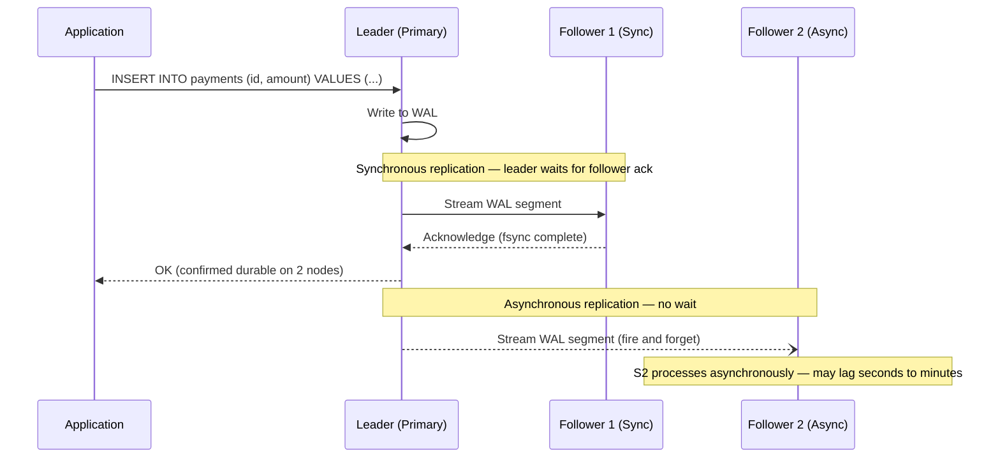

# استراتيجيات النسخ المتماثل — قائد وتابع، وعدة قادة، وبدون قائد

النسخ المتماثل للبيانات هو الاحتفاظ بنسخ من البيانات نفسها على عدة أجهزة. وفي الأنظمة المالية يخدم النسخ ثلاثة أغراض مختلفة: الإتاحة العالية (يصمد النظام أمام تعطل العقد)، وقابلية التوسع (تتوزع حركة القراءة على النسخ)، والتوزيع الجغرافي (البيانات قريبة من المستخدمين وتلبي متطلبات إقامة البيانات). وكل طوبولوجيا نسخ تُجري مفاضلات مختلفة بين الاتساق والزمن والتعقيد التشغيلي — مفاضلات تكون عواقبها كبيرة خاصة عندما تكون البيانات رصيد حساب أو دفتر أستاذ مدفوعات.

## أهداف التعلم

- التمييز بين النسخ بقائد واحد، وبعدة قادة، وبدون قائد، وتسمية مفاضلات كل منها
- شرح النسخ المتزامن مقابل غير المتزامن ومتى يناسب كل منهما في الأنظمة المالية
- وصف تأخر النسخ وعواقبه على القراءات القديمة واتساق قراءة كتاباتك
- إعداد النسخ المتدفق في PostgreSQL وتنفيذ توجيه القراءات إلى النسخ مع ضمان قراءة كتاباتك في Java
- شرح سيناريوهات تعارض الكتابة مع عدة قادة وتنفيذ استراتيجيتي "آخر كتابة تفوز" والحل على مستوى التطبيق
- وصف النسخ بدون قائد على طريقة Dynamo مع قراءات وكتابات بالنصاب في Cassandra
- ضبط `min.insync.replicas` في Kafka وشرح آلية ISR لتدفق أحداث دائم
- فهم دور Patroni في الإتاحة العالية لـ PostgreSQL وانتخاب القائد التلقائي

## سياق العمل

لنأخذ مثالًا مركّبًا مستمدًا من حوادث نموذجية. يجري بنك تجزئة تحويلًا مخططًا لنسخة PostgreSQL الأساسية إلى نسخة متزامنة. يكتمل التحويل نفسه في 11 ثانية؛ لكن الحادث الذي يليه يستمر ساعات. والمشكلة تأخر النسخ في أكثر من اثنتي عشرة نسخة قراءة غير متزامنة تخدم تطبيق البنك على الجوال. فبعد التبديل تتأخر نسخ القراءة بين 3 و47 ثانية من سجل الكتابة المسبقة. وخلال هذه النافذة يحوّل العملاء المال على النسخة الأساسية، ثم يفحصون رصيدهم فورًا على نسخة قديمة فيرون المبلغ قبل التحويل. ويتصل آلاف العملاء بالدعم بسبب أرصدة خاطئة. فمنطق التوجيه كان يرسل كل القراءات إلى أقرب نسخة دون أي وعي بقراءة كتاباتك. والحل: تتبّع موقع آخر كتابة لكل مستخدم وتوجيه قراءاته إلى النسخة الأساسية حتى تلحق النسخة المتماثلة. وللنسخة الاحتياطية التي تخدم قراءات الرصيد، يضبط البنك أيضًا `synchronous_commit = remote_apply`، فلا يعود الالتزام إلا بعد أن تطبقه تلك النسخة — مقابل رحلة شبكة إضافية لكل كتابة تغيّر الرصيد.

## النسخ بقائد واحد

في النسخ بقائد واحد (قائد وتابع)، تقبل عقدة واحدة كل الكتابات وتبث التغييرات إلى التابعين. والتابعون للقراءة فقط. وهذا هو النموذج السائد في قواعد البيانات العلائقية.



### مفاضلة المتزامن مقابل غير المتزامن

| البُعد | متزامن | غير متزامن |
|---|---|---|
| الديمومة | الكتابة مؤكدة على عقدتين أو أكثر | الكتابة مؤكدة على القائد فقط |
| زمن الكتابة | زمن القائد + رحلة التابع ذهابًا وإيابًا | زمن القائد فقط |
| الإتاحة | تتوقف الكتابة إذا تعذر الوصول إلى التابع المتزامن | تستمر الكتابات بغض النظر عن حالة التابعين |
| القراءات القديمة | لدى التابع المتزامن سجل WAL؛ وقراءاته ترى الكتابة فقط مع `remote_apply` | قد يتأخر التابعون ثوانيَ أو دقائق |
| الاستخدام النموذجي | تحديثات الرصيد، وحالة الدفع | التقارير، والتحليلات، وفهرسة البحث |

> [!WARNING]
> لكتابات دفتر أستاذ المدفوعات، استخدم دائمًا النسخ المتزامن إلى تابع واحد على الأقل. فالنسخ غير المتزامن وحده يعني أنك قد تفقد معاملات ملتزمة إذا تعطل القائد قبل أن يصل WAL إلى أي تابع. والرحلة الشبكية الإضافية لكل التزام (نحو 1-2ms داخل منطقة واحدة) تستحق ضمان الديمومة.

### إعداد النسخ المتدفق في PostgreSQL

```ini
# postgresql.conf on PRIMARY
wal_level = replica           # Enables streaming replication WAL format
max_wal_senders = 10          # Max concurrent follower connections
synchronous_standby_names = 'FIRST 1 (standby1, standby2)'
                              # At least one must ack before commit returns
synchronous_commit = on       # Default: wait for the sync standby to flush WAL

# synchronous_commit can also be set per transaction (SET LOCAL ...):
#   remote_apply  balance updates whose result is read on the standby
#   on            ledger writes (durable on 2 nodes)
#   local         audit log inserts that can tolerate standby lag
```

يمكن ضبط `synchronous_commit` لكل معاملة: `remote_apply` لتحديثات الرصيد التي تُقرأ نتيجتها من النسخة الاحتياطية، و`on` لكتابات دفتر الأستاذ (دائمة على عقدتين)، و`local` لإدخالات سجل التدقيق التي تتحمل التأخر.

```text
# pg_hba.conf on PRIMARY — allow replication connections
host replication replicator 10.0.1.0/24 scram-sha-256
```

```bash
# On STANDBY — initial base backup and streaming setup
pg_basebackup -h primary-host -U replicator -D /var/lib/postgresql/data \
  --progress --wal-method=stream --write-recovery-conf
# --write-recovery-conf creates standby.signal and fills primary_conninfo
```

```sql
-- Monitor replication lag on the primary
SELECT
    client_addr,
    application_name,
    state,
    sync_state,
    replay_lag,
    write_lag,
    flush_lag,
    pg_size_pretty(pg_wal_lsn_diff(sent_lsn, replay_lsn)) AS lag_bytes
FROM pg_stat_replication
ORDER BY replay_lag DESC NULLS LAST;
```

## اتساق قراءة كتاباتك مع توجيه القراءات إلى النسخ

توجيه القراءات إلى النسخ المتماثلة يحسّن الإنتاجية، لكنه يتطلب حذرًا لتجنب عرض بيانات قديمة على المستخدمين بعد كتاباتهم.

```java
// Simple time-window version. Two limits to know:
//  - the cache is per instance: behind a load balancer, store last-write info
//    in a shared store (e.g. Redis) or the user's session/token
//  - a fixed window fails when lag exceeds it; the precise version records the
//    primary's LSN after the write (pg_current_wal_lsn()) and reads from the
//    replica only once pg_last_wal_replay_lsn() has passed it
@Component
public class ReplicaAwareRoutingDataSource extends AbstractRoutingDataSource {

    // Maps userId -> timestamp of their last write
    private final Cache<Long, Instant> userLastWriteTime =
        Caffeine.newBuilder()
            .expireAfterWrite(Duration.ofSeconds(30))
            .maximumSize(100_000)
            .build();

    private static final String PRIMARY = "primary";
    private static final String REPLICA = "replica";
    private static final Duration WRITE_FRESHNESS_WINDOW = Duration.ofSeconds(5);

    // Thread-local userId set by an interceptor before each request
    private final ThreadLocal<Long> currentUserId = new ThreadLocal<>();

    @Override
    protected Object determineCurrentLookupKey() {
        Long userId = currentUserId.get();
        if (userId == null) return REPLICA; // anonymous reads go to replica

        Instant lastWrite = userLastWriteTime.getIfPresent(userId);
        if (lastWrite == null) return REPLICA;

        // Route to primary for WRITE_FRESHNESS_WINDOW after the user's last write
        boolean withinFreshnessWindow =
            Instant.now().isBefore(lastWrite.plus(WRITE_FRESHNESS_WINDOW));

        return withinFreshnessWindow ? PRIMARY : REPLICA;
    }

    public void recordUserWrite(long userId) {
        userLastWriteTime.put(userId, Instant.now());
    }

    public void setCurrentUser(long userId) {
        currentUserId.set(userId);
    }

    public void clearCurrentUser() {
        currentUserId.remove();
    }
}
```

لهذه النسخة البسيطة المعتمدة على نافذة زمنية حدّان: الذاكرة المؤقتة خاصة بكل نسخة من التطبيق، فخلف موازن الحمل يجب حفظ معلومات آخر كتابة في مخزن مشترك (مثل Redis) أو في جلسة المستخدم؛ والنافذة الثابتة تفشل عندما يتجاوز التأخر طولها. والنسخة الدقيقة تسجّل موقع LSN في النسخة الأساسية بعد الكتابة، ولا تقرأ من النسخة المتماثلة إلا بعد أن يتجاوزه موقع إعادة التشغيل فيها.

```java
@Service
public class AccountService {

    private final AccountRepository accountRepository;
    private final ReplicaAwareRoutingDataSource routingDs;

    @Transactional
    public void debitAccount(long userId, BigDecimal amount) {
        // ... execute debit ...
        // Signal that this user just wrote — subsequent reads go to primary
        routingDs.recordUserWrite(userId);
    }

    // No @Transactional — reads use the routing datasource
    public AccountBalance getBalance(long userId) {
        routingDs.setCurrentUser(userId);
        try {
            return accountRepository.findBalanceByUserId(userId)
                .orElseThrow(() -> new AccountNotFoundException(userId));
        } finally {
            routingDs.clearCurrentUser();
        }
    }
}
```

## النسخ بعدة قادة وحل التعارضات

يسمح النسخ بعدة قادة بالكتابة على أكثر من عقدة — عادة قائد في كل مركز بيانات. ويقبل كل قائد الكتابات وينسخها إلى القادة الآخرين بشكل غير متزامن. وهذا يتيح نشرًا نشطًا-نشطًا عبر عدة مراكز بيانات، لكنه يُدخل تعارضات الكتابة.

**سيناريو التعارض:**

```
Leader EU-West: UPDATE accounts SET credit_limit = 5000 WHERE id = 42
Leader US-East: UPDATE accounts SET credit_limit = 8000 WHERE id = 42
```

تنجح الكتابتان محليًا في الوقت نفسه. وعندما تتقاطع تدفقات النسخ، يجب على القائدين حل التعارض.

### استراتيجيات حل التعارض

**آخر كتابة تفوز (LWW):** تُستخدم طوابع ساعة الحائط لاختيار الكتابة الفائزة. بسيطة، لكنها تتطلب ساعات متزامنة وتتخلص من البيانات بصمت.

```java
public class LwwConflictResolver<T extends Versioned> {
    public T resolve(T local, T remote) {
        // Dangerous for financial data: a write can be silently lost
        return remote.updatedAt().isAfter(local.updatedAt()) ? remote : local;
    }
}
```

**الدمج على مستوى التطبيق:** منطق خاص بالمجال يحدد القيمة المدمجة الصحيحة. ويناسب عندما يكون الدمج الدلالي ممكنًا.

```java
@Component
public class AccountLimitConflictResolver {

    private static final Logger log =
        LoggerFactory.getLogger(AccountLimitConflictResolver.class);

    public Account resolve(Account local, Account remote) {
        // Financial safety rule: in a conflict, apply the lower (safer) limit.
        // Both values are preserved in the audit log.
        BigDecimal resolvedLimit = local.getCreditLimit()
            .min(remote.getCreditLimit());

        log.warn("Credit limit conflict on account={}: local={}, remote={}, resolved={}",
            local.getId(), local.getCreditLimit(),
            remote.getCreditLimit(), resolvedLimit);

        return local.toBuilder()
            .creditLimit(resolvedLimit)
            .conflictResolutionNote(String.format(
                "Multi-leader conflict resolved at %s: min(%s, %s) = %s",
                Instant.now(), local.getCreditLimit(),
                remote.getCreditLimit(), resolvedLimit))
            .build();
    }
}
```

قاعدة السلامة المالية هنا: عند التعارض، طبّق الحد الأدنى (الأكثر أمانًا)، واحفظ القيمتين في سجل التدقيق.

> [!CAUTION]
> ‏LWW تتخلص من الكتابات بصمت. ولأي بيانات مالية يجب الحفاظ فيها على كل كتابة — تغييرات الرصيد، وتحديثات حد الائتمان، وسجلات المعاملات — لا تكون LWW آمنة. استخدم الدمج على مستوى التطبيق أو تجنب النسخ بعدة قادة لتلك الحقول.

## النسخ بدون قائد — على طريقة Dynamo

في النسخ بدون قائد (Cassandra، وDynamoDB، وRiak) لا يوجد قائد محدد. فيرسل العميل (أو عقدة منسقة) الكتابات إلى عدة نسخ مباشرة. وتُرسل القراءات أيضًا إلى عدة نسخ، ويوفّق العميل بين أي اختلافات.

**ضمان النصاب:** مع N نسخة، وW تأكيد كتابة، وR تأكيد قراءة، يضمن النظام أن عقدة واحدة على الأقل في مجموعة القراءة تلقت آخر كتابة عندما `W + R > N`.

```java
@Repository
public class CassandraPaymentRepository {

    private final CqlSession session;

    // LOCAL_QUORUM write + LOCAL_QUORUM read overlap within the local DC
    // (W + R > N per DC), so a client reads its own writes in that DC.
    // Mixing QUORUM writes with LOCAL_QUORUM reads does NOT guarantee overlap
    // across DCs (2 DCs x 3 replicas: 4 + 2 = 6, not > 6).
    public void savePayment(Payment payment) {
        SimpleStatement stmt = SimpleStatement.newInstance(
            "INSERT INTO payments (id, account_id, amount, status, created_at) " +
            "VALUES (?, ?, ?, ?, ?)",   // no TTL: payment records must be retained for years
            payment.id(), payment.accountId(), payment.amount(),
            payment.status().name(), payment.createdAt()
        ).setConsistencyLevel(ConsistencyLevel.LOCAL_QUORUM);

        session.execute(stmt);
    }

    // LOCAL_QUORUM read: quorum within the local DC — lower latency than QUORUM;
    // the other DC sees the write eventually
    public Optional<Payment> findById(UUID paymentId) {
        SimpleStatement stmt = SimpleStatement.newInstance(
            "SELECT * FROM payments WHERE id = ?", paymentId
        ).setConsistencyLevel(ConsistencyLevel.LOCAL_QUORUM);

        Row row = session.execute(stmt).one();
        return Optional.ofNullable(row).map(this::toPayment);
    }

    private Payment toPayment(Row row) {
        return new Payment(
            row.getUuid("id"),
            row.getUuid("account_id"),
            row.getBigDecimal("amount"),
            PaymentStatus.valueOf(row.getString("status")),
            row.getInstant("created_at")
        );
    }
}
```

الكتابة والقراءة بـ LOCAL_QUORUM تتداخلان داخل مركز البيانات المحلي، فيقرأ العميل كتاباته في ذلك المركز، ويرى المركز الآخر الكتابة في النهاية. أما خلط كتابات QUORUM بقراءات LOCAL_QUORUM فلا يضمن التداخل بين المراكز. ولا تُوضع مدة صلاحية (TTL) على سجلات الدفع، لأنها يجب أن تُحفظ سنوات.

### مستويات الاتساق في Cassandra للأنظمة المالية

| المستوى | الكتابات المطلوبة | القراءات المطلوبة | الاستخدام في التقنية المالية |
|---|---|---|---|
| `ONE` | نسخة واحدة | نسخة واحدة | أحداث التدقيق كثيرة الحجم حيث القراءة القديمة مقبولة |
| `QUORUM` | floor(N/2)+1 | floor(N/2)+1 | قراءات حالة الدفع التي تتطلب اتساقًا قويًا |
| `LOCAL_QUORUM` | نصاب في المركز المحلي | نصاب في المركز المحلي | نشر عبر عدة مراكز مع متطلب زمن منخفض |
| `EACH_QUORUM` | نصاب في كل مركز | — | كتابات عبر عدة مراكز يجب أن تؤكدها كل المراكز |
| `ALL` | كل النسخ N | كل النسخ N | أعلى ديمومة — غير موصى به للإتاحة العالية |

## النسخ في Kafka — ISR و min.insync.replicas

ينسخ Kafka أقسام الموضوعات عبر الوسطاء. ومجموعة النسخ المتزامنة (ISR) تضم كل الوسطاء الذين لحقوا تمامًا بقائد القسم. ولا يحق إلا لأعضاء ISR أن يُنتخبوا قادة عند التحويل.

```java
@Configuration
public class KafkaDurableProducerConfig {

    @Bean
    public ProducerFactory<String, PaymentEvent> paymentEventProducerFactory() {
        Map<String, Object> config = new HashMap<>();
        config.put(ProducerConfig.BOOTSTRAP_SERVERS_CONFIG,
            "kafka1:9092,kafka2:9092,kafka3:9092");
        config.put(ProducerConfig.KEY_SERIALIZER_CLASS_CONFIG,
            StringSerializer.class);
        config.put(ProducerConfig.VALUE_SERIALIZER_CLASS_CONFIG,
            JsonSerializer.class);

        // acks=all: leader waits for ALL ISR members to acknowledge the write
        // Combined with min.insync.replicas=2 at broker level, this means
        // at least 2 brokers must confirm before the producer receives success
        config.put(ProducerConfig.ACKS_CONFIG, "all");

        // Idempotent producer: prevents duplicate messages on retry
        // (on by default since Kafka 3.0; set explicitly so it is never lost)
        config.put(ProducerConfig.ENABLE_IDEMPOTENCE_CONFIG, true);
        config.put(ProducerConfig.RETRIES_CONFIG, Integer.MAX_VALUE);
        config.put(ProducerConfig.MAX_IN_FLIGHT_REQUESTS_PER_CONNECTION, 5);

        // Batching for throughput without sacrificing durability
        config.put(ProducerConfig.LINGER_MS_CONFIG, 5);
        config.put(ProducerConfig.BATCH_SIZE_CONFIG, 16384);

        return new DefaultKafkaProducerFactory<>(config);
    }
}
```

مع `acks=all` ينتظر القائد تأكيد كل أعضاء ISR، ومع `min.insync.replicas=2` على مستوى الوسيط يجب أن يؤكد وسيطان على الأقل قبل أن يتلقى المنتج النجاح.

```java
@Component
public class KafkaReplicationHealthIndicator implements HealthIndicator {

    private final AdminClient adminClient;
    private static final String TOPIC = "payment-events";
    private static final int MIN_ISR = 2;

    @Override
    public Health health() {
        try {
            DescribeTopicsResult result = adminClient.describeTopics(
                List.of(TOPIC));
            TopicDescription desc = result.topicNameValues()
                .get(TOPIC).get(5, TimeUnit.SECONDS);

            List<String> underReplicated = desc.partitions().stream()
                .filter(p -> p.isr().size() < MIN_ISR)
                .map(p -> "partition-" + p.partition() +
                    " isr=" + p.isr().size())
                .toList();

            if (underReplicated.isEmpty()) {
                return Health.up()
                    .withDetail("topic", TOPIC)
                    .withDetail("partitions", desc.partitions().size())
                    .build();
            }
            return Health.down()
                .withDetail("under_replicated", underReplicated)
                .withDetail("min_isr_required", MIN_ISR)
                .build();

        } catch (Exception e) {
            return Health.down(e).build();
        }
    }
}
```

## Patroni للإتاحة العالية في PostgreSQL

يوفر Patroni انتخاب قائد وتحويلًا تلقائيين لـ PostgreSQL باستخدام مخزن إجماع موزع (etcd، أو Consul، أو ZooKeeper). ويمنع الدماغ المنقسم باستخدام هذا المخزن كمرجع تسييج.

```yaml
# patroni.yml — node configuration
scope: payments-postgres
namespace: /patroni/
name: pg-node-1

restapi:
  listen: 0.0.0.0:8008
  connect_address: 10.0.1.10:8008

etcd3:
  hosts: etcd1:2379,etcd2:2379,etcd3:2379

bootstrap:
  dcs:
    ttl: 30                           # Seconds before leader considered dead
    loop_wait: 10                     # Patroni heartbeat interval
    retry_timeout: 10
    maximum_lag_on_failover: 1048576  # 1 MB — reject promotion if lagging more
    synchronous_mode: true            # Only sync standbys can be promoted

  postgresql:
    parameters:
      wal_level: replica
      hot_standby: "on"
      max_wal_senders: 10
      max_replication_slots: 10
      synchronous_commit: "on"
      # synchronous_standby_names is managed by Patroni in synchronous_mode

postgresql:
  listen: 0.0.0.0:5432
  connect_address: 10.0.1.10:5432
  data_dir: /var/lib/postgresql/15/main
  pgpass: /tmp/pgpass
  authentication:
    # Passwords come from the environment, never from this file:
    # PATRONI_REPLICATION_PASSWORD and PATRONI_SUPERUSER_PASSWORD
    replication:
      username: replicator
    superuser:
      username: postgres
```

> [!NOTE]
> إعداد `maximum_lag_on_failover` في Patroni حاسم للصحة المالية. فإذا رُقّيت نسخة احتياطية وهي متأخرة كثيرًا، ستفتقد كتابات حديثة التُزم بها على النسخة الأساسية القديمة ولم تُنسخ بعد. اضبطه بتحفظ — 1 MB حد أعلى معقول لمعظم أحمال الدفع. ومع `synchronous_mode: true` لا يرقّي Patroni إلا نسخة متزامنة، لديها كل المعاملات الملتزمة؛ فيحمي حد التأخر حينها حالات الاحتياط غير المتزامنة.

## اختبر معرفتك

**س1: تُظهر نسخة القراءة لديك `replay_lag = 00:00:08` في `pg_stat_replication`. حوّل عميل للتو مالًا على النسخة الأساسية. ويستعلم تطبيق الجوال فورًا عن رصيد الحساب من هذه النسخة. أي رصيد سيرى العميل، وماذا يجب أن يفعل منطق التوجيه؟**

ج: سيرى العميل الرصيد قبل التحويل — فالنسخة متأخرة 8 ثوانٍ ولم تطبق بعد مدخلات سجل الكتابة المسبقة الخاصة بالتحويل. ويجب أن يكتشف منطق التوجيه أن هذا المستخدم أجرى كتابة، ويوجّه استعلامات رصيده إلى النسخة الأساسية حتى تلحق النسخة المتماثلة — إما لنافذة أطول من أسوأ تأخر للنسخ، أو الأفضل حتى يتجاوز موقع إعادة التشغيل (LSN) في النسخة موقع كتابة المستخدم. وهذا ضمان قراءة كتاباتك منفّذًا في طبقة التطبيق.

**س2: لدى Kafka ثلاثة وسطاء مع `min.insync.replicas=2` و`acks=all`. خرج الوسيطان 2 و3 من مجموعة ISR، فبقي الوسيط 1 وحده فيها. يرسل منتج حدث دفع. ماذا يحدث؟**

ج: يتلقى المنتج `NotEnoughReplicasException`. فلن يقبل القسم كتابات جديدة لأن حجم ISR ‏(1) أقل من `min.insync.replicas` ‏(2). وهذا سلوك السلامة الصحيح: قبول كتابة على نسخة واحدة بينما الحد الأدنى المطلوب اثنتان يخاطر بفقدان دائم للبيانات إذا تعطل الوسيط 1 أيضًا. ويجب أن يعيد المنتج المحاولة بتراجع أسّي بينما يحقق فريق العمليات في صحة الوسطاء. ويعود القسم قابلًا للكتابة بمجرد عودة وسيط آخر على الأقل إلى ISR.

## التحدي العملي

**السيناريو:** أنت المهندس الرئيسي لمنصة الخدمات المصرفية الأساسية في بنك رقمي. تعالج نسخة PostgreSQL الأساسية 4,000 كتابة في الثانية. ولديك ثلاث نسخ قراءة: `replica-1` (متزامنة)، و`replica-2` (غير متزامنة)، و`replica-3` (غير متزامنة، للتحليلات). وواجهة تطبيق الجوال توجّه كل القراءات إلى أقرب نسخة غير متزامنة.

**المهام:**

1. **توجيه واعٍ بالتأخر:** اكتب `AbstractRoutingDataSource` في Spring يستعلم `pg_stat_replication` على النسخة الأساسية كل 5 ثوانٍ، ويوجّه قراءات الرصيد إلى النسخة المتزامنة `replica-1` عندما يتجاوز `replay_lag` لأي نسخة غير متزامنة ثانيتين. وضمّن استعلام المراقبة ومنطق قرار التوجيه.

2. **توجيه قراءة كتاباتك:** وسّع الموجّه بحيث تُوجَّه كل قراءات مستخدم `userId` إلى `replica-1` (المضبوطة بـ `synchronous_commit = remote_apply`) لمدة 10 ثوانٍ بعد أي كتابة منه، باستخدام ذاكرة مؤقتة مفتاحها `userId` تتشاركها كل نسخ الواجهة. واكتب إعداد الذاكرة المؤقتة وطريقة قرار التوجيه.

3. **حل التعارضات عبر عدة مراكز بيانات:** يفتتح بنكك مركز بيانات ثانيًا. اكتب `OverdraftLimitConflictResolver` يتعامل مع التحديثات المتزامنة لـ `overdraft_limit` على القائدين. طبّق قاعدة السلامة المالية (احتفظ بالحد الأدنى)، وسجّل القيمتين، وأضف مدخلًا في `conflict_resolution_audit`.

4. **اختبار تحويل Patroni:** صف دليل تشغيل لاختبار أن Patroni يرقّي `pg-node-2` بشكل صحيح خلال 30 ثانية عند قتل `pg-node-1` (القائد الحالي). وضمّنه: أمر قتل القائد، واستدعاء واجهة REST في Patroni للتحقق من القائد الجديد، وفحص صحة التطبيق للتأكد من إعادة اتصال مجموعة الاتصالات، والاستعلام للتحقق من عدم فقدان أي معاملات ملتزمة.

<!-- KNOWLEDGE-CHECK
{
  "questions": [
    {
      "id": "q1",
      "text": "يحوّل عميل مالًا على نسخة PostgreSQL الأساسية. ونسخة القراءة غير المتزامنة متأخرة 8 ثوانٍ. ويستعلم العميل فورًا عن رصيده من هذه النسخة. ماذا يرى؟",
      "options": [
        "الرصيد المحدّث — نسخ PostgreSQL تخدم دائمًا بيانات حالية",
        "الرصيد قبل التحويل — لم تنسخ النسخة الكتابة بعد",
        "خطأ — تكتشف النسخة أنها متأخرة فترفض الاستعلام",
        "قيمة مخزنة مؤقتًا من مجموعة الاتصالات"
      ],
      "correct": 1,
      "explanation": "النسخة غير المتزامنة المتأخرة 8 ثوانٍ تعيد بيانات قديمة للقراءات التي تصل خلال نافذة التأخر. فسيظهر الرصيد قبل التحويل. والحل توجيه قراءة كتاباتك: وجّه قراءات هذا المستخدم إلى النسخة الأساسية أو إلى نسخة متزامنة لفترة بعد كتابته."
    },
    {
      "id": "q2",
      "text": "مع min.insync.replicas=2 وacks=all في Kafka، وسيط واحد فقط من ثلاثة في ISR لموضوع payment-events. يرسل منتج حدث دفع. ما النتيجة؟",
      "options": [
        "نجاح — تُقبل الكتابة على الوسيط المتاح",
        "NotEnoughReplicasException — تُرفض الكتابة",
        "ينتظر المنتج إلى ما لا نهاية حتى ينضم وسيط آخر إلى ISR",
        "يُسجَّل تحذير لكن الكتابة تنجح على نسخة واحدة"
      ],
      "correct": 1,
      "explanation": "يعني min.insync.replicas=2 أن الوسيط يرفض الكتابات عندما يكون عدد النسخ المتزامنة أقل من 2. فيتلقى المنتج فورًا NotEnoughReplicasException. وهذا يمنع فقدان البيانات على حساب إتاحة الكتابة — وهي المفاضلة الصحيحة لتدفق أحداث دفع دائم."
    }
  ]
}
-->

<!-- PRACTICAL-CHALLENGE
{
  "title": "توجيه القراءات وحل التعارضات والتحويل لقاعدة بيانات مصرفية أساسية",
  "difficulty": "advanced",
  "estimatedMinutes": 60,
  "tasks": [
    {
      "id": "1",
      "description": "اكتب AbstractRoutingDataSource واعيًا بالتأخر يستعلم pg_stat_replication على النسخة الأساسية كل 5 ثوانٍ، ويوجّه قراءات الرصيد إلى النسخة المتزامنة replica-1 عندما يتجاوز replay_lag لأي نسخة غير متزامنة ثانيتين."
    },
    {
      "id": "2",
      "description": "أضف توجيه قراءة كتاباتك: لمدة 10 ثوانٍ بعد كتابة من userId (أو حتى يتجاوز موقع إعادة التشغيل في النسخة موقع LSN للكتابة)، أرسل قراءات ذلك المستخدم إلى replica-1 المضبوطة بـ synchronous_commit = remote_apply، باستخدام ذاكرة مؤقتة تتشاركها كل نسخ الواجهة."
    },
    {
      "id": "3",
      "description": "اكتب OverdraftLimitConflictResolver للنسخ بعدة قادة يحتفظ بالحد الأدنى للسحب على المكشوف، ويسجّل القيمتين، ويضيف مدخلًا في conflict_resolution_audit."
    },
    {
      "id": "4",
      "description": "اكتب دليل تشغيل لاختبار تحويل Patroni: أمر قتل القائد، واستدعاء واجهة REST في Patroni الذي يتحقق من القائد الجديد، وفحص صحة التطبيق الذي يؤكد إعادة اتصال مجموعة الاتصالات، والاستعلام الذي يتحقق من عدم فقدان أي معاملات ملتزمة."
    }
  ]
}
-->
