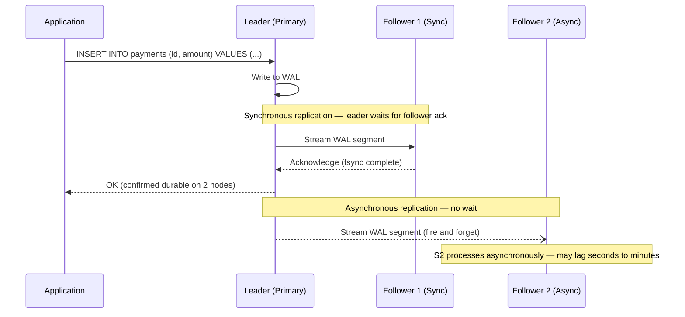

Data replication is the act of maintaining copies of the same data on multiple machines. For financial systems, replication serves three distinct purposes: high availability (the system survives node failures), scalability (read traffic is spread across replicas), and geographic distribution (data is close to users and meets data residency requirements). Each replication topology makes different trade-offs between consistency, latency, and operational complexity — trade-offs that are especially consequential when the data is an account balance or a payment ledger.

## Learning Objectives

- Distinguish single-leader, multi-leader, and leaderless replication and name the trade-offs of each
- Explain synchronous versus asynchronous replication and when each is appropriate in financial systems
- Describe replication lag and its consequences for stale reads and read-your-writes consistency
- Configure PostgreSQL streaming replication and implement replica routing with read-your-writes guarantees in Java
- Explain multi-leader write conflict scenarios and implement last-write-wins and application-level resolution strategies
- Describe Dynamo-style leaderless replication with quorum reads and writes in Cassandra
- Configure Kafka `min.insync.replicas` and explain the ISR mechanism for durable event streaming
- Understand Patroni's role in PostgreSQL high availability and automatic leader election

## Business Context

In April 2021, a retail bank in the UK performed a planned failover of its primary PostgreSQL instance to a synchronous replica. The failover itself completed in 11 seconds. The incident that followed lasted 4 hours. The problem was replication lag on 14 async read replicas serving the mobile banking application. When the new primary came up, the read replicas had not yet caught up: they lagged between 3 and 47 seconds of write-ahead log. During this window, customers could successfully transfer money on the write primary, then immediately check their balance on a stale read replica and see the pre-transfer amount. 8,400 customers called support reporting incorrect balances. The bank's routing logic sent all reads to the nearest replica without any read-your-writes awareness. The fix required changing the mobile API to track per-user write timestamps and route reads to the primary for 5 seconds after any write by that user. Post-incident, they also set `synchronous_commit = on` for balance-critical write paths, accepting 2ms of additional latency to avoid stale reads for account balance queries.

## Single-Leader Replication

In single-leader (leader-follower) replication, one node accepts all writes and streams changes to followers. Followers are read-only. This is the dominant model for relational databases.



### Synchronous vs Asynchronous Trade-Off

| Dimension | Synchronous | Asynchronous |
|---|---|---|
| Durability | Write confirmed on 2+ nodes | Write confirmed on leader only |
| Write latency | Leader latency + follower RTT | Leader latency only |
| Availability | Write stalls if sync follower is unreachable | Writes continue regardless of follower state |
| Stale reads | Sync follower always current | Followers may be seconds to minutes behind |
| Typical use | Balance updates, payment state | Reporting, analytics, search indexing |

> [!WARNING]
> For payment ledger writes, always use synchronous replication to at least one follower. Async-only replication means you can lose committed transactions if the leader crashes before the WAL reaches any follower. The 2ms latency overhead of synchronous commit is worth the durability guarantee.

### PostgreSQL Streaming Replication Configuration

```sql
-- postgresql.conf on PRIMARY
wal_level = replica           -- Enables streaming replication WAL format
max_wal_senders = 10          -- Max concurrent follower connections
synchronous_standby_names = 'FIRST 1 (standby1, standby2)'
                              -- At least one must ack before commit returns
synchronous_commit = on       -- Default: wait for sync standbys to flush

-- For balance updates (strict durability): synchronous_commit = on
-- For audit log inserts (can tolerate lag): synchronous_commit = local
```

```sql
-- pg_hba.conf on PRIMARY — allow replication connections
host replication replicator 10.0.1.0/24 scram-sha-256
```

```bash
# On STANDBY — initial base backup and streaming setup
pg_basebackup -h primary-host -U replicator -D /var/lib/postgresql/data \
  --progress --wal-method=stream --write-recovery-conf
# --write-recovery-conf creates standby.signal and fills primary_conninfo
```

```sql
-- Monitor replication lag on the primary
SELECT
    client_addr,
    application_name,
    state,
    sync_state,
    replay_lag,
    write_lag,
    flush_lag,
    pg_size_pretty(pg_wal_lsn_diff(sent_lsn, replay_lsn)) AS lag_bytes
FROM pg_stat_replication
ORDER BY replay_lag DESC NULLS LAST;
```

## Read-Your-Writes Consistency with Replica Routing

Routing reads to replicas improves throughput but requires care to avoid showing users stale data after their own writes.

```java
@Component
public class ReplicaAwareRoutingDataSource extends AbstractRoutingDataSource {

    // Maps userId -> timestamp of their last write
    private final Cache<Long, Instant> userLastWriteTime =
        Caffeine.newBuilder()
            .expireAfterWrite(Duration.ofSeconds(30))
            .maximumSize(100_000)
            .build();

    private static final String PRIMARY = "primary";
    private static final String REPLICA = "replica";
    private static final Duration WRITE_FRESHNESS_WINDOW = Duration.ofSeconds(5);

    // Thread-local userId set by an interceptor before each request
    private final ThreadLocal<Long> currentUserId = new ThreadLocal<>();

    @Override
    protected Object determineCurrentLookupKey() {
        Long userId = currentUserId.get();
        if (userId == null) return REPLICA; // anonymous reads go to replica

        Instant lastWrite = userLastWriteTime.getIfPresent(userId);
        if (lastWrite == null) return REPLICA;

        // Route to primary for WRITE_FRESHNESS_WINDOW after the user's last write
        boolean withinFreshnessWindow =
            Instant.now().isBefore(lastWrite.plus(WRITE_FRESHNESS_WINDOW));

        return withinFreshnessWindow ? PRIMARY : REPLICA;
    }

    public void recordUserWrite(long userId) {
        userLastWriteTime.put(userId, Instant.now());
    }

    public void setCurrentUser(long userId) {
        currentUserId.set(userId);
    }

    public void clearCurrentUser() {
        currentUserId.remove();
    }
}
```

```java
@Service
public class AccountService {

    private final AccountRepository accountRepository;
    private final ReplicaAwareRoutingDataSource routingDs;

    @Transactional
    public void debitAccount(long userId, BigDecimal amount) {
        // ... execute debit ...
        // Signal that this user just wrote — subsequent reads go to primary
        routingDs.recordUserWrite(userId);
    }

    // No @Transactional — reads use the routing datasource
    public AccountBalance getBalance(long userId) {
        routingDs.setCurrentUser(userId);
        try {
            return accountRepository.findBalanceByUserId(userId)
                .orElseThrow(() -> new AccountNotFoundException(userId));
        } finally {
            routingDs.clearCurrentUser();
        }
    }
}
```

## Multi-Leader Replication and Conflict Resolution

Multi-leader replication allows writes on more than one node — typically one per datacenter. Each leader accepts writes and replicates to other leaders asynchronously. This enables active-active multi-DC deployments but introduces write conflicts.

**Conflict scenario:**
```
Leader EU-West: UPDATE accounts SET credit_limit = 5000 WHERE id = 42
Leader US-East: UPDATE accounts SET credit_limit = 8000 WHERE id = 42
```

Both writes succeed locally at the same time. When the replication streams cross, both leaders must resolve the conflict.

### Conflict Resolution Strategies

**Last Write Wins (LWW):** Use wall-clock timestamps to pick the winning write. Simple, but requires synchronised clocks and silently discards data.

```java
public class LwwConflictResolver<T extends Versioned> {
    public T resolve(T local, T remote) {
        // Dangerous for financial data: a write can be silently lost
        return remote.updatedAt().isAfter(local.updatedAt()) ? remote : local;
    }
}
```

**Application-level merge:** Domain-specific logic determines the correct merged value. Appropriate when semantic merging is possible.

```java
@Component
public class AccountLimitConflictResolver {

    private static final Logger log =
        LoggerFactory.getLogger(AccountLimitConflictResolver.class);

    public Account resolve(Account local, Account remote) {
        // Financial safety rule: in a conflict, apply the lower (safer) limit.
        // Both values are preserved in the audit log.
        BigDecimal resolvedLimit = local.getCreditLimit()
            .min(remote.getCreditLimit());

        log.warn("Credit limit conflict on account={}: local={}, remote={}, resolved={}",
            local.getId(), local.getCreditLimit(),
            remote.getCreditLimit(), resolvedLimit);

        return local.toBuilder()
            .creditLimit(resolvedLimit)
            .conflictResolutionNote(String.format(
                "Multi-leader conflict resolved at %s: min(%s, %s) = %s",
                Instant.now(), local.getCreditLimit(),
                remote.getCreditLimit(), resolvedLimit))
            .build();
    }
}
```

> [!CAUTION]
> LWW silently discards writes. For any financial data where every write must be preserved — balance changes, credit limit updates, transaction records — LWW is not safe. Use application-level merge or avoid multi-leader replication for those fields.

## Leaderless Replication — Dynamo Style

In leaderless replication (Cassandra, DynamoDB, Riak), there is no designated leader. The client (or a coordinator node) sends writes to multiple replicas directly. Reads are also sent to multiple replicas, and the client reconciles any differences.

**Quorum guarantee:** With N replicas, W write confirmations, and R read confirmations, the system guarantees at least one node in a read set also received the latest write when `W + R > N`.

```java
@Repository
public class CassandraPaymentRepository {

    private final CqlSession session;

    // QUORUM write: majority of replicas must acknowledge before success
    public void savePayment(Payment payment) {
        SimpleStatement stmt = SimpleStatement.newInstance(
            "INSERT INTO payments (id, account_id, amount, status, created_at) " +
            "VALUES (?, ?, ?, ?, ?) USING TTL 7776000", // 90-day TTL
            payment.id(), payment.accountId(), payment.amount(),
            payment.status().name(), payment.createdAt()
        ).setConsistencyLevel(ConsistencyLevel.QUORUM);

        session.execute(stmt);
    }

    // LOCAL_QUORUM read: quorum within the local DC — lower latency than QUORUM
    public Optional<Payment> findById(UUID paymentId) {
        SimpleStatement stmt = SimpleStatement.newInstance(
            "SELECT * FROM payments WHERE id = ?", paymentId
        ).setConsistencyLevel(ConsistencyLevel.LOCAL_QUORUM);

        Row row = session.execute(stmt).one();
        return Optional.ofNullable(row).map(this::toPayment);
    }

    private Payment toPayment(Row row) {
        return new Payment(
            row.getUuid("id"),
            row.getUuid("account_id"),
            row.getBigDecimal("amount"),
            PaymentStatus.valueOf(row.getString("status")),
            row.getInstant("created_at")
        );
    }
}
```

### Cassandra Consistency Levels for Financial Systems

| Level | Writes required | Reads required | Use case in fintech |
|---|---|---|---|
| `ONE` | 1 replica | 1 replica | High-volume audit events where stale read is acceptable |
| `QUORUM` | ceil(N/2)+1 | ceil(N/2)+1 | Payment status reads requiring strong consistency |
| `LOCAL_QUORUM` | Quorum in local DC | Quorum in local DC | Multi-DC deployment with low-latency requirement |
| `EACH_QUORUM` | Quorum in every DC | — | Multi-DC writes where all DCs must confirm |
| `ALL` | All N replicas | All N replicas | Highest durability — not recommended for high availability |

## Kafka Replication — ISR and min.insync.replicas

Kafka replicates topic partitions across brokers. The In-Sync Replica (ISR) set contains all brokers fully caught up with the partition leader. Only ISR members are eligible for leader election on failover.

```java
@Configuration
public class KafkaDurableProducerConfig {

    @Bean
    public ProducerFactory<String, PaymentEvent> paymentEventProducerFactory() {
        Map<String, Object> config = new HashMap<>();
        config.put(ProducerConfig.BOOTSTRAP_SERVERS_CONFIG,
            "kafka1:9092,kafka2:9092,kafka3:9092");
        config.put(ProducerConfig.KEY_SERIALIZER_CLASS_CONFIG,
            StringSerializer.class);
        config.put(ProducerConfig.VALUE_SERIALIZER_CLASS_CONFIG,
            JsonSerializer.class);

        // acks=all: leader waits for ALL ISR members to acknowledge the write
        // Combined with min.insync.replicas=2 at broker level, this means
        // at least 2 brokers must confirm before the producer receives success
        config.put(ProducerConfig.ACKS_CONFIG, "all");

        // Idempotent producer: prevents duplicate messages on retry
        // Required when acks=all and retries > 0
        config.put(ProducerConfig.ENABLE_IDEMPOTENCE_CONFIG, true);
        config.put(ProducerConfig.RETRIES_CONFIG, Integer.MAX_VALUE);
        config.put(ProducerConfig.MAX_IN_FLIGHT_REQUESTS_PER_CONNECTION, 5);

        // Batching for throughput without sacrificing durability
        config.put(ProducerConfig.LINGER_MS_CONFIG, 5);
        config.put(ProducerConfig.BATCH_SIZE_CONFIG, 16384);

        return new DefaultKafkaProducerFactory<>(config);
    }
}
```

```java
@Component
public class KafkaReplicationHealthIndicator implements HealthIndicator {

    private final AdminClient adminClient;
    private static final String TOPIC = "payment-events";
    private static final int MIN_ISR = 2;

    @Override
    public Health health() {
        try {
            DescribeTopicsResult result = adminClient.describeTopics(
                List.of(TOPIC));
            TopicDescription desc = result.topicNameValues()
                .get(TOPIC).get(5, TimeUnit.SECONDS);

            List<String> underReplicated = desc.partitions().stream()
                .filter(p -> p.isr().size() < MIN_ISR)
                .map(p -> "partition-" + p.partition() +
                    " isr=" + p.isr().size())
                .toList();

            if (underReplicated.isEmpty()) {
                return Health.up()
                    .withDetail("topic", TOPIC)
                    .withDetail("partitions", desc.partitions().size())
                    .build();
            }
            return Health.down()
                .withDetail("under_replicated", underReplicated)
                .withDetail("min_isr_required", MIN_ISR)
                .build();

        } catch (Exception e) {
            return Health.down(e).build();
        }
    }
}
```

## Patroni for PostgreSQL High Availability

Patroni provides automatic leader election and failover for PostgreSQL using a distributed consensus store (etcd, Consul, or ZooKeeper). It prevents split-brain by using the DCS as an authoritative fence.

```yaml
# patroni.yml — node configuration
scope: payments-postgres
namespace: /patroni/
name: pg-node-1

restapi:
  listen: 0.0.0.0:8008
  connect_address: 10.0.1.10:8008

etcd3:
  hosts: etcd1:2379,etcd2:2379,etcd3:2379

bootstrap:
  dcs:
    ttl: 30                           # Seconds before leader considered dead
    loop_wait: 10                     # Patroni heartbeat interval
    retry_timeout: 10
    maximum_lag_on_failover: 1048576  # 1 MB — reject promotion if lagging more
    synchronous_mode: true            # Only sync standbys can be promoted

  postgresql:
    parameters:
      wal_level: replica
      hot_standby: "on"
      max_wal_senders: 10
      max_replication_slots: 10
      synchronous_commit: "on"
      synchronous_standby_names: "ANY 1 (*)"

postgresql:
  listen: 0.0.0.0:5432
  connect_address: 10.0.1.10:5432
  data_dir: /var/lib/postgresql/15/main
  pgpass: /tmp/pgpass
  authentication:
    replication:
      username: replicator
      password: "${REPLICATOR_PASSWORD}"
    superuser:
      username: postgres
      password: "${POSTGRES_PASSWORD}"
```

> [!NOTE]
> Patroni's `maximum_lag_on_failover` setting is critical for financial correctness. If a standby is promoted while lagging significantly, it will be missing recent writes that were committed on the old primary but not yet replicated. Set this conservatively — 1 MB is a reasonable upper bound for most payment workloads.

## Knowledge Check

**Q1: Your read replica reports `replay_lag = 00:00:08` in `pg_stat_replication`. A customer just transferred money on the primary. The mobile app immediately queries the account balance on this replica. What balance will the customer see, and what should your routing logic do?**

A: The customer will see the pre-transfer balance — the replica is 8 seconds behind and has not yet applied the write-ahead log entries for the transfer. The routing logic should detect that this user made a write (via a write timestamp cache) and route balance queries for this user to the primary for a window of at least 10–15 seconds after the write. After the window, reads can safely return to the async replica. This is the read-your-writes consistency guarantee implemented at the application layer.

**Q2: Kafka has 3 brokers with `min.insync.replicas=2` and `acks=all`. Brokers 2 and 3 fall out of the ISR set, leaving only Broker 1 in ISR. A producer sends a payment event. What happens?**

A: The producer receives `NotEnoughReplicasException`. The partition will not accept new writes because the ISR size (1) is below `min.insync.replicas` (2). This is the correct safety behaviour: accepting a write to 1 replica when the minimum required is 2 would risk permanent data loss if Broker 1 also fails. The producer should retry with exponential backoff while operations investigates the broker health. The partition becomes writable again once at least one more broker rejoins the ISR.

## Practical Challenge

**Scenario:** You are the principal engineer for a neo-bank's core banking platform. The PostgreSQL primary processes 4,000 write TPS. You have three read replicas: `replica-1` (synchronous), `replica-2` (async), and `replica-3` (async, used for analytics). The mobile banking API routes all reads to the nearest async replica.

**Tasks:**

1. **Lag-aware replica routing:** Write a Spring `AbstractRoutingDataSource` that queries `pg_stat_replication` on the primary every 5 seconds and routes balance reads to the synchronous `replica-1` when any async replica's `replay_lag` exceeds 2 seconds. Include the monitoring query and the routing decision logic.

2. **Write-your-reads routing:** Extend the router so that for 10 seconds after any write by a specific `userId`, all reads from that user are directed to `replica-1`, using a Caffeine cache keyed by `userId`. Write the cache configuration and the routing decision method.

3. **Multi-DC conflict resolution:** Your bank is opening a second datacenter. Write an `OverdraftLimitConflictResolver` that handles simultaneous updates to `overdraft_limit` on both leaders. Apply the financial-safety rule (preserve the lower limit), log both values, and record a `conflict_resolution_audit` entry.

4. **Patroni failover test:** Describe a runbook for testing that Patroni correctly promotes `pg-node-2` within 30 seconds when `pg-node-1` (current leader) is killed. Include: the command to kill the leader, the Patroni REST API call to verify the new leader, the application health check to confirm the connection pool reconnects, and the query to verify no committed transactions were lost.

<!-- KNOWLEDGE-CHECK
{
  "questions": [
    {
      "id": "q1",
      "text": "A customer transfers money on the PostgreSQL primary. The async read replica has 8-second replay lag. The customer immediately queries their balance on the replica. What do they see?",
      "options": [
        "The updated balance — PostgreSQL replicas always serve current data",
        "The pre-transfer balance — the replica has not yet replicated the write",
        "An error — the replica detects it is behind and refuses the query",
        "A cached value from the connection pool"
      ],
      "correct": 1,
      "explanation": "An async replica with 8-second lag returns stale data for reads that arrive during the lag window. The pre-transfer balance will be shown. The fix is read-your-writes routing: direct this user's reads to the primary or synchronous replica for a window after their write."
    },
    {
      "id": "q2",
      "text": "With Kafka min.insync.replicas=2 and acks=all, only 1 of 3 brokers is in the ISR for the payment-events topic. A producer sends a payment event. What is the outcome?",
      "options": [
        "Success — the write is accepted on the available broker",
        "NotEnoughReplicasException — the write is rejected",
        "The producer waits indefinitely for another broker to join ISR",
        "A warning is logged but the write succeeds to 1 replica"
      ],
      "correct": 1,
      "explanation": "min.insync.replicas=2 means the broker rejects writes when fewer than 2 replicas are in sync. The producer immediately receives NotEnoughReplicasException. This prevents data loss at the cost of write availability — the correct trade-off for a durable payment event stream."
    }
  ]
}
-->

<!-- PRACTICAL-CHALLENGE
## Practical Challenge

**Scenario:** You are the principal engineer for a neo-bank's core banking platform. The PostgreSQL primary processes 4,000 write TPS with three read replicas.

**Tasks:**

1. Write a lag-aware `AbstractRoutingDataSource` that queries `pg_stat_replication` and routes to the synchronous replica when async replica lag exceeds 2 seconds.

2. Add write-your-reads routing using a Caffeine cache keyed by `userId` with 10-second TTL.

3. Write an `OverdraftLimitConflictResolver` for multi-leader conflict resolution that preserves the lower value and logs both.

4. Write a Patroni failover test runbook including kill command, API verification, connection pool reconnect check, and data-loss verification query.
-->
