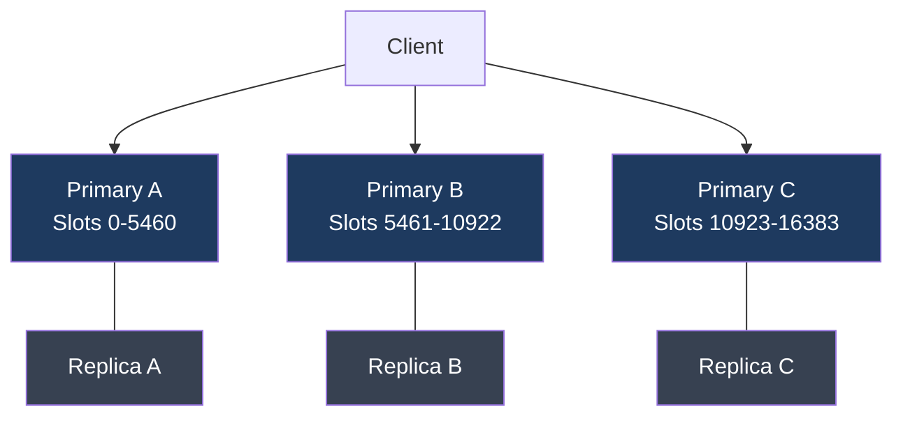
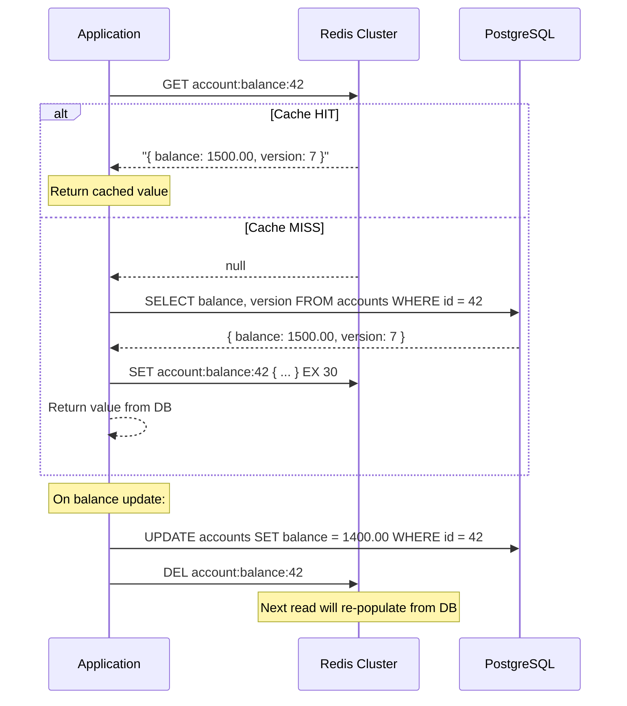

# التخزين المؤقت الموزع — بنية Redis Cluster

التخزين المؤقت الموزع هو أكثر تقنية فاعلية لتخفيف الحمل عن قاعدة البيانات في الأنظمة المالية عالية الإنتاجية. فخدمة دفع بمعدل 10,000 معاملة في الثانية تضرب نسخة قراءة PostgreSQL مباشرة مكلفة؛ أما توجيه 95% من تلك القراءات إلى عنقود Redis فيقلل كثيرًا عدد اتصالات قاعدة البيانات، وزمن تنفيذ الاستعلامات، وكلفة البنية التحتية. لكن التخزين المؤقت في الخدمات المالية يحمل مخاطر خاصة: رصيد مخزن قديم قد يسبب فحص حدود خاطئًا، وتدافع الذاكرة المؤقتة (cache stampede) عند بدء التشغيل قد يُغرق قاعدة البيانات قبل خدمة أي حركة، وعدم ملاءمة سياسة الطرد قد يُخرج بيانات حرجة في أسوأ لحظة ممكنة. ويغطي هذا الدرس البنية والأنماط وأنماط الفشل التي تحتاجها لتشغيل Redis بشكل صحيح في بيئة مالية.

## أهداف التعلم

- شرح بنية Redis Cluster بما فيها 16,384 خانة تجزئة (hash slot) والتقسيم المتسق
- التمييز بين Redis Sentinel (الإتاحة العالية) وRedis Cluster (التقسيم والإتاحة معًا)
- ضبط `LettuceConnectionFactory` لعنقود Redis في Spring Boot
- تنفيذ نمط cache-aside لرصيد الحساب مع إبطال صحيح عند التحديث
- منع تدافع الذاكرة المؤقتة بالانتهاء المبكر الاحتمالي والقفل الموزع
- استخدام `@Cacheable` و`@CacheEvict` و`CacheManager` بفاعلية في Spring
- مقارنة سياسات الطرد LRU وLFU وTTL واختيار المناسبة للبيانات المالية
- تنفيذ تخزين مؤقت على مستويين (Redis كمستوى L2 + ذاكرة JVM محلية كمستوى L1) لمعالجة المفاتيح الساخنة

## سياق العمل

لنأخذ مثالًا مركّبًا مستمدًا من حوادث نموذجية. أثناء عرض موسمي كبير، تعيد شركة "اشترِ الآن وادفع لاحقًا" تشغيل عنقود Redis لتغيير في الإعداد، فتُمسح كل بيانات حدود الائتمان المخزنة. وبعد دقيقة تتلقى كل نسخ التطبيق إخفاقات في الذاكرة المؤقتة لعشرات آلاف الحسابات الساخنة نفسها — عملاء مسجلون في العرض — فتستعلم كلها نسخة قراءة PostgreSQL في الوقت نفسه. فتتشبع مجموعة اتصالات النسخة البالغة 300 اتصال خلال ثوانٍ، وينمو طابور الاستعلامات إلى الآلاف، وتبدأ النسخة بانتهاء المهل. وتدخل النسخ في حلقات إعادة محاولة ضد قاعدة البيانات، ويستمر التدهور أكثر من 20 دقيقة حتى تمتلئ الذاكرة المؤقتة ببطء، مع رفض كثير من عمليات الدفع. وتكشف مراجعة ما بعد الحادث ثلاث ضمانات مفقودة: لا تسخين للذاكرة المؤقتة قبل إعادة التشغيل، ولا حماية من انتهاء أو إخفاق مفاتيح كثيرة في آن واحد، ولا ذاكرة محلية داخل العملية لامتصاص الحمل عن الحسابات الساخنة.

## بنية Redis Cluster

يقسّم Redis Cluster البيانات على عدة عقد باستخدام **خانات التجزئة**. فمساحة المفاتيح مقسومة إلى 16,384 خانة. ويُعيَّن كل مفتاح لخانة باستخدام `CRC16(key) % 16384`. وكل عقدة مسؤولة عن نطاق من الخانات.

```
3-node cluster, each node owns ~5,461 slots:
Node A: slots 0–5460
Node B: slots 5461–10922
Node C: slots 10923–16383

Key "account:12345" → CRC16("account:12345") % 16384 = slot X → owner of X
(Use CLUSTER KEYSLOT account:12345 to see the real slot)

Keys "{acct:42}:balance" and "{acct:42}:limit" share the hash tag {acct:42},
so they land in the same slot and can be used together in MULTI or Lua.
```

استخدم `CLUSTER KEYSLOT` لمعرفة الخانة الحقيقية لأي مفتاح. والمفاتيح التي تشترك في وسم تجزئة مثل `{acct:42}` تقع في الخانة نفسها، فيمكن استخدامها معًا في MULTI أو Lua.

لكل عقدة نسخة متماثلة واحدة على الأقل للإتاحة العالية. وإذا تعطلت عقدة أساسية، تُرقّى نسختها تلقائيًا.



### Redis Sentinel مقابل Cluster

| الميزة | Redis Sentinel | Redis Cluster |
|---|---|---|
| الغرض | إتاحة عالية لجزء واحد | إتاحة عالية + تقسيم أفقي |
| التقسيم | لا | نعم (16,384 خانة تجزئة) |
| أقل عدد عقد للإتاحة العالية | 3 Sentinel + نسخة أساسية + نسخة متماثلة | 6 (3 أساسية + 3 متماثلة) |
| العمليات على عدة مفاتيح | نعم (عقدة واحدة) | فقط داخل خانة التجزئة نفسها |
| حالة الاستخدام | بيانات أقل من 100GB، وإعداد بسيط | أكثر من 100GB أو إنتاجية كتابة عالية |

## إعداد Redis Cluster في Spring Boot

```java
@Configuration
public class RedisClusterConfig {

    @Value("${redis.cluster.nodes}")
    private List<String> clusterNodes; // ["redis1:6379","redis2:6379","redis3:6379"]

    @Bean
    public RedisConnectionFactory redisConnectionFactory() {
        RedisClusterConfiguration clusterConfig =
            new RedisClusterConfiguration(clusterNodes);
        clusterConfig.setMaxRedirects(3); // Allow 3 MOVED/ASK redirects

        LettuceClientConfiguration clientConfig = LettuceClientConfiguration.builder()
            // Read from primaries: a replica can still hold an entry that was just
            // deleted on its primary, re-serving a stale balance after invalidation.
            // REPLICA_PREFERRED is fine for data like FX rates or reference data.
            .readFrom(ReadFrom.UPSTREAM)
            .commandTimeout(Duration.ofMillis(500))
            .clientOptions(ClusterClientOptions.builder()
                .autoReconnect(true)
                .topologyRefreshOptions(
                    ClusterTopologyRefreshOptions.builder()
                        .enablePeriodicRefresh(Duration.ofSeconds(30))
                        .enableAllAdaptiveRefreshTriggers()
                        .build())
                .build())
            .build();

        return new LettuceConnectionFactory(clusterConfig, clientConfig);
    }

    @Bean
    public RedisTemplate<String, Object> redisTemplate(
            RedisConnectionFactory connectionFactory) {
        RedisTemplate<String, Object> template = new RedisTemplate<>();
        template.setConnectionFactory(connectionFactory);
        template.setKeySerializer(new StringRedisSerializer());
        template.setValueSerializer(new GenericJackson2JsonRedisSerializer());
        template.setHashKeySerializer(new StringRedisSerializer());
        template.setHashValueSerializer(new GenericJackson2JsonRedisSerializer());
        template.afterPropertiesSet();
        return template;
    }

    @Bean
    public CacheManager cacheManager(RedisConnectionFactory connectionFactory) {
        RedisCacheConfiguration defaultConfig = RedisCacheConfiguration.defaultCacheConfig()
            .entryTtl(Duration.ofMinutes(5))
            .serializeKeysWith(
                RedisSerializationContext.SerializationPair.fromSerializer(
                    new StringRedisSerializer()))
            .serializeValuesWith(
                RedisSerializationContext.SerializationPair.fromSerializer(
                    new GenericJackson2JsonRedisSerializer()))
            .disableCachingNullValues();

        // Per-cache TTL overrides
        Map<String, RedisCacheConfiguration> cacheConfigs = Map.of(
            "account-balances", defaultConfig.entryTtl(Duration.ofSeconds(30)),
            "credit-limits",    defaultConfig.entryTtl(Duration.ofMinutes(10)),
            "fx-rates",         defaultConfig.entryTtl(Duration.ofMinutes(1))
        );

        return RedisCacheManager.builder(connectionFactory)
            .cacheDefaults(defaultConfig)
            .withInitialCacheConfigurations(cacheConfigs)
            .transactionAware()   // @CacheEvict inside a transaction runs after commit
            .build();
    }
}
```

تُقرأ الأرصدة من النسخ الأساسية: فالنسخة المتماثلة قد تحتفظ بمدخل حُذف للتو من نسختها الأساسية، فتعيد رصيدًا قديمًا بعد الإبطال. أما القراءة من النسخ المتماثلة فمناسبة لبيانات مثل أسعار الصرف والبيانات المرجعية. ومدير الذاكرة المؤقتة "واعٍ بالمعاملات" (`transactionAware`)، فيؤجل الإبطال حتى ما بعد الالتزام.

## نمط Cache-Aside لرصيد الحساب

نمط cache-aside (التحميل الكسول) هو الأسلوب المعياري: يفحص التطبيق الذاكرة المؤقتة أولًا؛ وعند الإخفاق يجلب القيمة من قاعدة البيانات ويملأ الذاكرة المؤقتة. وعند الكتابة **يحذف** مدخل الذاكرة المؤقتة (ولا يحدّثه أبدًا) — بعد التزام المعاملة.

> [!IMPORTANT]
> الرصيد المخزن مؤقتًا للعرض فقط. ويجب أن يقرأ تفويض الدفع وفحص الحدود الرصيد من قاعدة البيانات (مع قفل الصف)، لا من الذاكرة المؤقتة أبدًا.



```java
@Service
public class AccountBalanceService {

    private final AccountRepository accountRepository;
    private final RedisTemplate<String, AccountBalance> redisTemplate;

    private static final String BALANCE_KEY_PREFIX = "account:balance:";
    private static final Duration BALANCE_TTL = Duration.ofSeconds(30);

    public AccountBalance getBalance(long accountId) {
        String key = BALANCE_KEY_PREFIX + accountId;

        // 1. Check cache
        AccountBalance cached = redisTemplate.opsForValue().get(key);
        if (cached != null) {
            return cached;
        }

        // 2. Cache miss — fetch from DB
        AccountBalance balance = accountRepository
            .findBalanceById(accountId)
            .orElseThrow(() -> new AccountNotFoundException(accountId));

        // 3. Populate cache — delete not update on next write
        redisTemplate.opsForValue().set(key, balance, BALANCE_TTL);
        return balance;
    }

    @Transactional
    public void updateBalance(long accountId, BigDecimal newBalance) {
        // Update DB first
        accountRepository.updateBalance(accountId, newBalance);

        // DELETE (not update) the cache entry — and only AFTER COMMIT.
        // Deleting inside the transaction would let a concurrent reader miss,
        // read the old (uncommitted-away) row, and re-cache the old balance.
        String key = BALANCE_KEY_PREFIX + accountId;
        TransactionSynchronizationManager.registerSynchronization(
            new TransactionSynchronization() {
                @Override public void afterCommit() { redisTemplate.delete(key); }
            });
        // A small race remains (a slow reader can write back an old value after
        // the delete); the short TTL bounds it. Some teams delete twice
        // ("delayed double delete") or version the cached value.
    }
}
```

لو حُذف المدخل داخل المعاملة، لأمكن لقارئ متزامن أن يُخفق، فيقرأ الصف القديم، ويعيد تخزين الرصيد القديم. لذلك يتم الحذف بعد الالتزام. ويبقى سباق صغير (قارئ بطيء قد يكتب قيمة قديمة بعد الحذف)، وتحدّه المدة القصيرة؛ وبعض الفرق تحذف مرتين ("الحذف المزدوج المتأخر") أو تضع رقم إصدار على القيمة المخزنة.

> [!WARNING]
> احذف (أبطل) المدخلات المخزنة دائمًا بعد الكتابة — ولا تحدّثها في مكانها أبدًا. فتحديث القيمة المخزنة قبل التزام كتابة قاعدة البيانات يُنشئ نافذة تحمل فيها الذاكرة المؤقتة قيمة لم تُكتب بشكل دائم قط. وإذا تراجعت المعاملة، تبقى الذاكرة المؤقتة خاطئة حتى تنتهي مدتها.

## منع تدافع الذاكرة المؤقتة

يحدث تدافع الذاكرة المؤقتة عندما تتلقى طلبات متزامنة كثيرة إخفاقًا في الوقت نفسه (مثلًا فور مسح الذاكرة المؤقتة أو انتهاء مدة مفتاح شائع)، فتستعلم كلها قاعدة البيانات في آن واحد.

### الاستراتيجية 1: الانتهاء المبكر الاحتمالي

أعد حساب المدخل قبل انتهائه بقليل، موزعًا على الطلبات بالعشوائية (خوارزمية "XFetch"). فكلما اقترب المدخل من الانتهاء، وكلما طال زمن إعادة حسابه، زاد احتمال أن يحدّثه طلب مبكرًا — فيحدّثه عادة طلب واحد بالضبط قبل انتهائه.

```java
@Component
public class ProbabilisticCacheService {

    private final RedisTemplate<String, CacheEntry> redisTemplate;
    private final AccountRepository accountRepository;

    // Beta controls how aggressively to recompute early.
    // Higher beta = recompute earlier = safer but slightly more DB load.
    private static final double BETA = 1.0;

    public AccountBalance getBalanceWithEarlyExpiry(long accountId) {
        String key = "account:balance:" + accountId;
        CacheEntry entry = redisTemplate.opsForValue().get(key);

        if (entry == null || shouldRecomputeEarly(entry)) {
            long started = System.nanoTime();
            AccountBalance fresh = accountRepository.findBalanceById(accountId)
                .orElseThrow(() -> new AccountNotFoundException(accountId));
            long recomputeMillis = (System.nanoTime() - started) / 1_000_000;

            Duration ttl = Duration.ofSeconds(30);
            CacheEntry newEntry = new CacheEntry(
                fresh,
                Instant.now().plus(ttl),   // expiresAt
                recomputeMillis            // how long a refresh takes (delta)
            );
            redisTemplate.opsForValue().set(key, newEntry, ttl);
            return fresh;
        }

        return entry.value();
    }

    /**
     * XFetch (Vattani et al.): refresh early when
     *   now - delta * BETA * ln(random) >= expiresAt
     * ln(random) is negative, so the term adds a random head start that is
     * usually small but grows with delta (slow recomputes start earlier).
     */
    private boolean shouldRecomputeEarly(CacheEntry entry) {
        double rand = ThreadLocalRandom.current().nextDouble();   // (0, 1)
        long headStartMillis =
            (long) (-entry.recomputeMillis() * BETA * Math.log(rand));
        return Instant.now().plusMillis(headStartMillis)
                      .isAfter(entry.expiresAt());
    }
}
```

### الاستراتيجية 2: منع التدافع بالقفل

خيط واحد فقط يعيد ملء الذاكرة المؤقتة؛ وينتظر الآخرون أو يعيدون قيمة قديمة.

```java
@Component
public class LockingCacheService {

    private final RedisTemplate<String, AccountBalance> redisTemplate;
    private final StringRedisTemplate lockRedis;
    private final AccountRepository accountRepository;
    private static final Duration LOCK_TTL = Duration.ofSeconds(5);

    // Delete the lock only if we still own it (compare token, then DEL — atomically)
    private static final RedisScript<Long> RELEASE = RedisScript.of(
        "if redis.call('get', KEYS[1]) == ARGV[1] then " +
        "  return redis.call('del', KEYS[1]) else return 0 end", Long.class);

    public AccountBalance getBalance(long accountId) {
        String key = "account:balance:" + accountId;
        String lockKey = "lock:account:balance:" + accountId;

        AccountBalance cached = redisTemplate.opsForValue().get(key);
        if (cached != null) return cached;

        // Try to acquire the refill lock: SET lockKey <token> NX EX 5
        String token = UUID.randomUUID().toString();
        Boolean acquired = lockRedis.opsForValue()
            .setIfAbsent(lockKey, token, LOCK_TTL);

        if (Boolean.TRUE.equals(acquired)) {
            try {
                // This pod won the lock — refill from DB
                AccountBalance fresh = accountRepository
                    .findBalanceById(accountId)
                    .orElseThrow(() -> new AccountNotFoundException(accountId));
                redisTemplate.opsForValue().set(key, fresh, Duration.ofSeconds(30));
                return fresh;
            } finally {
                // A plain DELETE could remove ANOTHER pod's lock if ours expired
                lockRedis.execute(RELEASE, List.of(lockKey), token);
            }
        }

        // Another pod is refilling — poll the cache for up to ~100ms
        for (int i = 0; i < 4; i++) {
            try { Thread.sleep(25); } catch (InterruptedException e) {
                Thread.currentThread().interrupt();
                break;
            }
            AccountBalance retried = redisTemplate.opsForValue().get(key);
            if (retried != null) return retried;
        }
        // Fall through to DB as last resort
        return accountRepository.findBalanceById(accountId)
            .orElseThrow(() -> new AccountNotFoundException(accountId));
    }
}
```

يُؤخذ القفل بقيمة رمز عشوائي، ويُحرر بنص Lua يقارن الرمز ثم يحذف ذريًا — لأن الحذف العادي قد يزيل قفل نسخة أخرى إذا انتهت مدة قفلنا. وتنتظر النسخ الأخرى حتى نحو 100ms ثم تقرأ من قاعدة البيانات مباشرة.

## ‏@Cacheable في Spring مع CacheManager

```java
@Service
public class CreditLimitService {

    @Cacheable(
        value = "credit-limits",
        key = "#accountId",
        unless = "#result == null"
    )
    public CreditLimit getCreditLimit(long accountId) {
        // Only called on cache miss — Spring handles the cache interaction
        return creditLimitRepository.findByAccountId(accountId)
            .orElseThrow(() -> new AccountNotFoundException(accountId));
    }

    // Delete from cache when the credit limit is updated
    @CacheEvict(value = "credit-limits", key = "#cmd.accountId()")
    @Transactional
    public void updateCreditLimit(UpdateCreditLimitCommand cmd) {
        creditLimitRepository.updateLimit(cmd.accountId(), cmd.newLimit());
        // @CacheEvict runs only if the method returns normally (an exception
        // means no eviction). With transactionAware() on the RedisCacheManager
        // the eviction is deferred until after COMMIT; without it, it may run
        // before the commit and a concurrent reader can re-cache the old limit.
        // If the commit itself fails after an eviction, the only effect is a
        // cache miss on the next read — harmless.
    }

    // Evict all entries — use sparingly, only during admin operations
    @CacheEvict(value = "credit-limits", allEntries = true)
    public void invalidateAllCreditLimits() {
        // Triggered after schema migration or bulk limit reset
    }
}
```

يعمل `@CacheEvict` فقط إذا عادت الطريقة بشكل طبيعي (الاستثناء يعني لا إبطال). ومع `transactionAware()` يؤجَّل الإبطال حتى ما بعد الالتزام؛ وبدونه قد يحدث قبل الالتزام فيعيد قارئ متزامن تخزين الحد القديم.

## مقارنة سياسات الطرد

| السياسة | الخوارزمية | الأنسب لـ | المخاطر في التقنية المالية |
|---|---|---|---|
| `allkeys-lru` | طرد المفتاح الأقل استخدامًا مؤخرًا | الأحمال العامة ذات المحلية الزمنية | طرد مفاتيح حرجة قليلة الوصول (مثل حدود الحسابات الخاملة) |
| `allkeys-lfu` | طرد المفتاح الأقل تكرارًا في الاستخدام | نمط وصول بفصل واضح بين الساخن والبارد | المفاتيح التي كانت ساخنة يومًا تبقى؛ والمفاتيح الساخنة الجديدة قد تُطرد مبكرًا |
| `volatile-lru` | LRU فقط بين المفاتيح ذات المدة | خليط من بيانات دائمة ومؤقتة | المفاتيح بلا مدة لا تُطرد أبدًا — خطر نفاد الذاكرة |
| `volatile-ttl` | طرد المفاتيح ذات أقصر مدة متبقية | إدارة صريحة للمدة لكل نوع مفتاح | البيانات قصيرة المدة (غالبًا الأحدث) تُطرد أولًا |
| `noeviction` | رفض الكتابات الجديدة عند الامتلاء | الامتثال — لا فقدان للبيانات بسبب الطرد | تصبح الذاكرة المؤقتة غير قابلة للكتابة عند أقصى ذاكرة |
| `allkeys-random` | طرد عشوائي | غير موصى به في الإنتاج | طرد بيانات حرجة عشوائيًا |

> [!TIP]
> للذاكرة المؤقتة المالية، فضّل `volatile-lru` وتأكد أن لكل المدخلات المخزنة مدة صريحة. واستخدم `noeviction` فقط للذاكرة المؤقتة التي يفرض الامتثال فيها أن فقدان البيانات أسوأ من فشل الكتابة. واضبط `maxmemory-policy` صراحة — فالقيمة الافتراضية `noeviction`، وهي تجعل Redis يرفض الكتابات عند امتلاء الذاكرة.

## مشكلة المفتاح الساخن والتخزين المؤقت على مستويين

المفتاح الساخن مفتاح Redis يتلقى حصة غير متناسبة من الحركة — مثل سعر صرف EUR/USD الذي يُفحص في كل دفعة. وعقدة Redis واحدة تتعامل مع كل الطلبات لخانة تجزئة معينة، فيُنشئ المفتاح الساخن عنق زجاجة على جزء واحد.

```java
@Component
public class TwoTierFxRateCache {

    // L1: JVM-local Caffeine cache — no network hop, no Redis bottleneck
    private final Cache<String, BigDecimal> l1Cache = Caffeine.newBuilder()
        .expireAfterWrite(Duration.ofSeconds(5))  // Very short TTL — L1 is a buffer
        .maximumSize(500)
        .recordStats()
        .build();

    // L2: Redis cluster — shared across all pods
    private final RedisTemplate<String, BigDecimal> l2Cache;
    private final ExchangeRateRepository exchangeRateRepository;

    public BigDecimal getExchangeRate(String currencyPair) {
        // 1. Check L1 (JVM local — zero latency)
        BigDecimal l1Hit = l1Cache.getIfPresent(currencyPair);
        if (l1Hit != null) return l1Hit;

        // 2. Check L2 (Redis cluster — ~0.5ms)
        String redisKey = "fx:rate:" + currencyPair;
        BigDecimal l2Hit = l2Cache.opsForValue().get(redisKey);
        if (l2Hit != null) {
            l1Cache.put(currencyPair, l2Hit); // Promote to L1
            return l2Hit;
        }

        // 3. Fetch from DB (source of truth — ~5ms)
        BigDecimal rate = exchangeRateRepository.findCurrentRate(currencyPair);
        l2Cache.opsForValue().set(redisKey, rate, Duration.ofMinutes(1));
        l1Cache.put(currencyPair, rate);
        return rate;
    }
}
```

المستوى L1 ذاكرة Caffeine محلية داخل JVM بلا رحلة شبكة، بمدة قصيرة جدًا (5 ثوانٍ) تعمل كمخزن مؤقت. والمستوى L2 عنقود Redis مشترك بين كل النسخ. والمصدر الموثوق قاعدة البيانات.

## استراتيجية تسخين الذاكرة المؤقتة

بدء التشغيل دون تسخين الذاكرة المؤقتة يسبب تدافعًا عند وصول الطلبات الأولى. ولخدمات الدفع، سخّن الذاكرة المؤقتة الحرجة قبل قبول الحركة. ولا يعلن Spring Boot جاهزية التطبيق للحركة إلا بعد انتهاء كل `ApplicationRunner`، فالمسخّن الذي يعمل هناك يكتمل قبل نجاح فحص الجاهزية.

```java
@Component
public class PaymentCacheWarmer implements ApplicationRunner {

    private final AccountRepository accountRepository;
    private final RedisTemplate<String, AccountBalance> redisTemplate;
    private static final int WARM_BATCH_SIZE = 500;

    @Override
    public void run(ApplicationArguments args) throws Exception {
        log.info("Starting cache warming for active accounts...");
        Instant start = Instant.now();

        // Warm the top N most-active accounts in batches
        List<Long> hotAccountIds = accountRepository.findTopActiveAccountIds(50_000);

        List<List<Long>> batches = partition(hotAccountIds, WARM_BATCH_SIZE);
        for (List<Long> batch : batches) {
            List<AccountBalance> balances = accountRepository.findBalancesByIds(batch);
            warmBatch(balances);
        }

        Duration elapsed = Duration.between(start, Instant.now());
        log.info("Cache warming complete: {} accounts in {}ms",
            hotAccountIds.size(), elapsed.toMillis());
    }

    private void warmBatch(List<AccountBalance> balances) {
        // Use Redis pipeline for bulk set — single network round trip per batch
        redisTemplate.executePipelined((RedisCallback<Object>) connection -> {
            for (AccountBalance balance : balances) {
                String key = "account:balance:" + balance.accountId();
                byte[] keyBytes = key.getBytes(StandardCharsets.UTF_8);
                byte[] valueBytes = serialize(balance);
                // SET with a 30-45 second TTL — the jitter stops all warmed
                // keys from expiring in the same second
                connection.setEx(keyBytes,
                    30 + ThreadLocalRandom.current().nextInt(16), valueBytes);
            }
            return null;
        });
    }
}
```

تُكتب المفاتيح على دفعات عبر pipeline (رحلة شبكة واحدة لكل دفعة)، وبمدة عشوائية بين 30 و45 ثانية حتى لا تنتهي كل المفاتيح المسخّنة في الثانية نفسها.

## الاستمرارية في Redis

تتيح استمرارية Redis للذاكرة المؤقتة أن تعود بعد إعادة التشغيل دافئة لا فارغة، فتتجنب تدافعًا على قاعدة البيانات. لكنها لا تجعل Redis نظام سجل أبدًا: الأرصدة، والمدفوعات، وبيانات التدقيق مكانها قاعدة البيانات. ويقدم Redis آليتين للاستمرارية:

| الآلية | الوصف | زمن الاسترداد | الملاءمة |
|---|---|---|---|
| ‏RDB (لقطة) | لقطة لنقطة زمنية على فترات قابلة للضبط | بدء سريع، وتضيع التغييرات منذ آخر لقطة | مناسب لمعظم الذاكرة المؤقتة |
| ‏AOF (ملف إلحاق) | تسجيل كل أمر كتابة وإعادة تشغيله عند البدء | بدء أبطأ، وفقدان بيانات ضئيل | بيانات مكلفة الإعادة (مثل حالة تحديد المعدّل) |
| ‏AOF + RDB معًا | AOF للديمومة وRDB للبدء السريع | أفضل ما في الاثنين — بدء من RDB وإعادة تشغيل AOF الحديث | افتراضي جيد عند الحاجة للاستمرارية |

```
# redis.conf — AOF + RDB hybrid configuration
# (redis.conf comments must be on their own lines)

# RDB: snapshot if 1 key changed in 900 seconds, or 10 keys in 300 seconds
save 900 1
save 300 10

# Enable AOF; fsync once per second — balances durability vs performance
appendonly yes
appendfsync everysec

# Hybrid: RDB preamble in the AOF file for fast restart
aof-use-rdb-preamble yes
```

## اختبر معرفتك

**س1: تستخدم خدمة الدفع لديك `@CacheEvict` على طريقة `updateCreditLimit`. تتراجع معاملة قاعدة البيانات بسبب انتهاك قيد، لكن `@CacheEvict` كان قد عمل. ما حالة الذاكرة المؤقتة بعد التراجع؟**

ج: (لا يحدث هذا إلا إذا فشل الالتزام بعد عودة الطريقة، لأن `@CacheEvict` لا يعمل عندما ترمي الطريقة استثناء.) أُبطل مدخل الذاكرة المؤقتة رغم أن قاعدة البيانات لم تتغير. فستكون القراءة التالية إخفاقًا يعيد ملء الذاكرة المؤقتة من قاعدة البيانات بالقيمة الأصلية (قبل التحديث). وهذه عدم كفاءة بسيطة لا مشكلة صحة: ستخدم الذاكرة المؤقتة القيمة الصحيحة (غير المتغيرة) في القراءة التالية. ولهذا يكون الحذف أكثر أمانًا من التحديث: الإبطال العرضي يسبب إخفاقًا لكنه لا يسبب بيانات قديمة أبدًا. أما البديل — تحديث الذاكرة المؤقتة بالقيمة الجديدة قبل الالتزام — فسيترك بيانات خاطئة فيها إذا تراجعت المعاملة.

**س2: عنقود Redis لديك فيه 3 عقد أساسية مع سياسة `allkeys-lru`. ومفتاح سعر صرف EUR/USD يُطلب مليوني مرة في الدقيقة. بعد مسح الذاكرة المؤقتة، تتلقى كل نسخ التطبيق البالغة 3,000 إخفاقًا لـ `fx:rate:EUR/USD` في الوقت نفسه وتستعلم قاعدة البيانات. ما النمط الذي يمنع ذلك، وكيف تساعد الذاكرة المؤقتة على مستويين؟**

ج: هذا تدافع ذاكرة مؤقتة لمفتاح ساخن. واستراتيجيات المنع: (1) الانتهاء المبكر الاحتمالي — إعادة الحساب قبل الانتهاء، موزعة على النسخ فلا تُخفق كلها معًا؛ (2) إعادة الملء بالقفل — نسخة واحدة فقط تعيد ملء المفتاح، والبقية تنتظر أو تعيد قيمة L1 قديمة قليلًا؛ (3) التخزين على مستويين — كل نسخة تحتفظ بالسعر في ذاكرة Caffeine محلية بمدة 5 ثوانٍ. فحتى بعد مسح Redis، تنتهي ذاكرات L1 في النسخ في أوقات مختلفة (لأنها مُلئت في أوقات مختلفة)، فلا يضرب Redis في اللحظة نفسها إلا جزء من النسخ، ولا يصل إلى قاعدة البيانات إلا إخفاقات Redis (وهي جزء صغير).

## التحدي العملي

**السيناريو:** تبني خدمة الدفع لمنصة مالية. تُخزن أرصدة الحسابات في PostgreSQL. وتتلقى الخدمة 12,000 معاملة في الثانية في الذروة. وأعلى 10,000 حساب تمثل 60% من كل قراءات الرصيد. وتستخدم عنقود Redis من 6 عقد (3 أساسية و3 متماثلة).

**المهام:**

1. **اضبط Redis Cluster مع Lettuce:** اكتب صنف الإعداد `RedisClusterConfig` في Spring مع `LettuceClientConfiguration` صحيح يتضمن مصدر القراءة، وتحديث الطوبولوجيا، وإعداد المدة لكل ذاكرة مؤقتة: `account-balances` ‏(30 ثانية)، و`credit-limits` ‏(10 دقائق)، و`fx-rates` ‏(60 ثانية).

2. **نفّذ cache-aside مع إبطال صحيح:** اكتب `AccountBalanceCacheService` بالطريقتين `getBalance(long accountId)` و`updateBalance(long accountId, BigDecimal newBalance)`. وبيّن صراحة لماذا تحذف مفتاح الذاكرة المؤقتة بدل تحديثه. وأضف تعليقًا يشرح ما يحدث إذا تراجعت معاملة قاعدة البيانات بعد تحديث الذاكرة المؤقتة.

3. **منع التدافع:** نفّذ `StampedeResistantCacheService` تستخدم قفل Redis موزعًا (SET NX EX) لضمان أن نسخة واحدة فقط تعيد ملء الذاكرة المؤقتة لمفتاح معين. ويجب أن تنتظر النسخ الأخرى حتى 100ms ثم تقرأ من قاعدة البيانات مباشرة. واكتب التنفيذ كاملًا بما فيه أخذ القفل، وإعادة الملء، وتحرير القفل، والتعامل مع انتهاء المهلة.

4. **معالجة المفتاح الساخن:** يتلقى المفتاح `fx:rate:EUR/USD` نحو 400,000 قراءة في الثانية في الذروة، كلها على جزء Redis واحد. اكتب `TwoTierFxRateCache` تستخدم ذاكرة Caffeine L1 بمدة 5 ثوانٍ لكل نسخة، مدعومة بـ Redis L2 بمدة 60 ثانية. واحسب أقصى عدد لقراءات Redis في الدقيقة لهذا المفتاح مع 20 نسخة، واشرح كيف يمنع تبعثر مدد L1 تدافعًا متزامنًا.

<!-- KNOWLEDGE-CHECK
{
  "questions": [
    {
      "id": "q1",
      "text": "عادت طريقة @CacheEvict بشكل طبيعي وأُبطل المدخل، لكن التزام المعاملة فشل بعد ذلك وتراجع. ما حالة الذاكرة المؤقتة؟",
      "options": [
        "تحتفظ الذاكرة المؤقتة بالقيمة القديمة — @CacheEvict معاملاتي",
        "أُبطل المدخل رغم أن قاعدة البيانات لم تتغير — والقراءة التالية إخفاق يعيد الملء بشكل صحيح",
        "تلفت الذاكرة المؤقتة ويجب مسحها يدويًا",
        "يعيد Spring تلقائيًا ملء الذاكرة المؤقتة بالقيمة المتراجع عنها"
      ],
      "correct": 1,
      "explanation": "حدث الإبطال بالفعل، لكن قاعدة البيانات ما زالت تحتفظ بالقيمة الأصلية. فالقراءة التالية إخفاق يعيد الملء من قاعدة البيانات بالقيمة الصحيحة غير المتغيرة. وهذه عدم كفاءة بسيطة، لا مشكلة صحة — ولهذا يكون الحذف أكثر أمانًا من التحديث في المكان. (لو رمت الطريقة استثناء لما عمل @CacheEvict أصلًا؛ ومدير RedisCacheManager الواعي بالمعاملات يؤجل الإبطال حتى ما بعد الالتزام.)"
    },
    {
      "id": "q2",
      "text": "تلاحظ أن سياسة allkeys-lru تطرد مدخلات حدود الائتمان للحسابات الخاملة أثناء الذروة، فتحدث قراءات غير متوقعة من قاعدة البيانات للحسابات النادرة. أي سياسة طرد يجب أن تستخدم؟",
      "options": [
        "allkeys-lfu — تطرد الأقل تكرارًا، فتبقى الحسابات الخاملة عرضة للطرد",
        "volatile-lru — LRU فقط بين المفاتيح ذات المدة؛ لا تضع مدة على مدخلات الحسابات الخاملة الحرجة لمنع طردها",
        "noeviction — ارفض كل الكتابات عند امتلاء الذاكرة",
        "allkeys-random — الطرد العشوائي أكثر عدلًا"
      ],
      "correct": 1,
      "explanation": "تطبق volatile-lru طرد LRU فقط على المفاتيح التي لها مدة. فإذا لم تضع مدة على مدخلات الحسابات الخاملة الحرجة، فلن تطردها volatile-lru أبدًا. وهذا يتيح لك التحكم في المفاتيح القابلة للطرد. والمفاضلات: المفاتيح بلا مدة تتراكم، فيجب إدارة الذاكرة بعناية، ولا تتجدد إلا بالإبطال الصريح عند كل تحديث."
    }
  ]
}
-->

<!-- PRACTICAL-CHALLENGE
{
  "title": "التخزين المؤقت في Redis Cluster لخدمة دفع بمعدل 12,000 معاملة في الثانية",
  "difficulty": "advanced",
  "estimatedMinutes": 60,
  "tasks": [
    {
      "id": "1",
      "description": "اكتب RedisClusterConfig مع Lettuce: تحديث الطوبولوجيا، وقراءة الأرصدة من النسخ الأساسية، ومدد لكل ذاكرة مؤقتة: account-balances ‏(30 ثانية)، وcredit-limits ‏(10 دقائق)، وfx-rates ‏(60 ثانية)، مع مدير ذاكرة مؤقتة واعٍ بالمعاملات."
    },
    {
      "id": "2",
      "description": "نفّذ AccountBalanceCacheService.getBalance() وupdateBalance() بإبطال بالحذف لا بالتحديث يعمل بعد الالتزام، واشرح في التعليقات ما الخطأ الذي يحدث إذا حُدّثت الذاكرة المؤقتة أو حُذف منها قبل الالتزام."
    },
    {
      "id": "3",
      "description": "نفّذ StampedeResistantCacheService بقفل Redis ‏(SET NX EX برمز عشوائي، يُحرر بنص مقارنة-ثم-حذف) لتعيد نسخة واحدة فقط ملء المفتاح؛ وتستطلع النسخ الأخرى الذاكرة المؤقتة حتى 100ms ثم تقرأ من قاعدة البيانات مباشرة."
    },
    {
      "id": "4",
      "description": "نفّذ TwoTierFxRateCache بمستوى Caffeine L1 ‏(مدة 5 ثوانٍ) مدعوم بـ Redis L2 ‏(مدة 60 ثانية). احسب أقصى قراءات Redis في الدقيقة للمفتاح fx:rate:EUR/USD مع 20 نسخة، واشرح كيف يمنع تبعثر أوقات انتهاء L1 بين النسخ تدافعًا متزامنًا."
    }
  ]
}
-->
