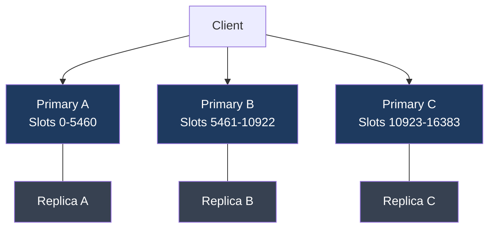
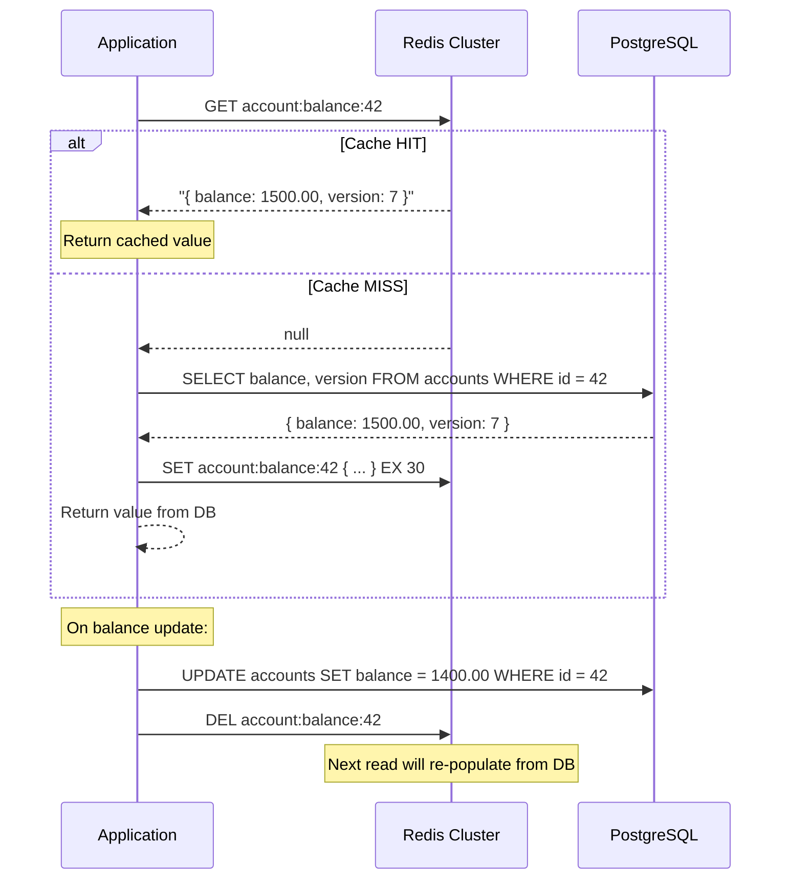

Distributed caching is the single most effective technique for reducing database load in high-throughput financial systems. A payment service at 10,000 TPS hitting a PostgreSQL read replica directly is expensive; hitting a Redis cluster for 95% of those reads dramatically reduces database connection count, query execution time, and infrastructure cost. But caching in financial services carries unique risks: a stale cached balance can cause incorrect limit checks, a cache stampede during startup can overwhelm the database before any traffic has been served, and an eviction policy mismatch can cause critical data to be ejected at the worst possible moment. This lesson covers the architecture, patterns, and failure modes you need to operate Redis correctly in a fintech environment.

## Learning Objectives

- Explain Redis Cluster architecture including 16,384 hash slots and consistent sharding
- Distinguish Redis Sentinel (high availability) from Redis Cluster (sharding and HA combined)
- Configure `LettuceConnectionFactory` for a Redis Cluster in Spring Boot
- Implement the cache-aside pattern for account balance with correct invalidation on update
- Prevent cache stampedes using probabilistic early expiry and distributed locking
- Use `@Cacheable`, `@CacheEvict`, and `CacheManager` effectively in Spring
- Compare LRU, LFU, and TTL eviction policies and select the right one for financial data
- Implement a two-tier caching strategy (Redis L2 + local JVM L1) for hot key mitigation

## Business Context

During the Black Friday 2022 promotion, a European buy-now-pay-later provider experienced a 23-minute degradation affecting 180,000 checkout requests. The sequence of events: the Redis cluster underwent a rolling restart for a configuration change at 11:47 AM, flushing all cached credit limit data. At 11:48 AM, all application pods simultaneously received cache misses for the same 50,000 hot accounts — customers enrolled in the promotion. All pods simultaneously queried the PostgreSQL read replica for those 50,000 accounts. The replica's connection pool of 300 connections was saturated in 4 seconds. Query queue depth grew to 14,000. The replica began timing out. Application pods fell into error loops retrying the database. The cascade lasted 23 minutes until the cache was refilled by gradually recovering read traffic. Post-incident analysis identified three missing safeguards: no cache warming before the rolling restart, no probabilistic early expiry to prevent simultaneous expirations, and no local JVM cache as a circuit breaker for hot accounts. The engineering team estimated the financial cost at €340,000 in declined transactions.

## Redis Cluster Architecture

Redis Cluster partitions data across multiple nodes using **hash slots**. The key space is divided into 16,384 slots. Each key is assigned to a slot using `CRC16(key) % 16384`. Each node is responsible for a range of slots.

```
3-node cluster, each node owns ~5,461 slots:
Node A: slots 0–5460
Node B: slots 5461–10922
Node C: slots 10923–16383

Key "account:12345" → CRC16("account:12345") % 16384 = 7291 → Node B
Key "account:99001" → CRC16("account:99001") % 16384 = 2104 → Node A
```

Each node has at least one replica (secondary) for HA. If a primary node fails, its replica is promoted automatically.



### Redis Sentinel vs Cluster

| Feature | Redis Sentinel | Redis Cluster |
|---|---|---|
| Purpose | HA for single shard | HA + horizontal sharding |
| Sharding | No | Yes (16,384 hash slots) |
| Minimum nodes | 3 Sentinels + 1 Redis | 6 (3 primary + 3 replica) |
| Multi-key operations | Yes (single node) | Only within same hash slot |
| Use case | < 100GB dataset, simple setup | > 100GB or high write throughput |

## Spring Boot Redis Cluster Configuration

```java
@Configuration
public class RedisClusterConfig {

    @Value("${redis.cluster.nodes}")
    private List<String> clusterNodes; // ["redis1:6379","redis2:6379","redis3:6379"]

    @Bean
    public RedisConnectionFactory redisConnectionFactory() {
        RedisClusterConfiguration clusterConfig =
            new RedisClusterConfiguration(clusterNodes);
        clusterConfig.setMaxRedirects(3); // Allow 3 MOVED/ASK redirects

        LettuceClientConfiguration clientConfig = LettuceClientConfiguration.builder()
            .readFrom(ReadFrom.REPLICA_PREFERRED) // Prefer replica for reads
            .commandTimeout(Duration.ofMillis(500))
            .clientOptions(ClusterClientOptions.builder()
                .autoReconnect(true)
                .topologyRefreshOptions(
                    ClusterTopologyRefreshOptions.builder()
                        .enablePeriodicRefresh(Duration.ofSeconds(30))
                        .enableAllAdaptiveRefreshTriggers()
                        .build())
                .build())
            .build();

        return new LettuceConnectionFactory(clusterConfig, clientConfig);
    }

    @Bean
    public RedisTemplate<String, Object> redisTemplate(
            RedisConnectionFactory connectionFactory) {
        RedisTemplate<String, Object> template = new RedisTemplate<>();
        template.setConnectionFactory(connectionFactory);
        template.setKeySerializer(new StringRedisSerializer());
        template.setValueSerializer(new GenericJackson2JsonRedisSerializer());
        template.setHashKeySerializer(new StringRedisSerializer());
        template.setHashValueSerializer(new GenericJackson2JsonRedisSerializer());
        template.afterPropertiesSet();
        return template;
    }

    @Bean
    public CacheManager cacheManager(RedisConnectionFactory connectionFactory) {
        RedisCacheConfiguration defaultConfig = RedisCacheConfiguration.defaultCacheConfig()
            .entryTtl(Duration.ofMinutes(5))
            .serializeKeysWith(
                RedisSerializationContext.SerializationPair.fromSerializer(
                    new StringRedisSerializer()))
            .serializeValuesWith(
                RedisSerializationContext.SerializationPair.fromSerializer(
                    new GenericJackson2JsonRedisSerializer()))
            .disableCachingNullValues();

        // Per-cache TTL overrides
        Map<String, RedisCacheConfiguration> cacheConfigs = Map.of(
            "account-balances", defaultConfig.entryTtl(Duration.ofSeconds(30)),
            "credit-limits",    defaultConfig.entryTtl(Duration.ofMinutes(10)),
            "fx-rates",         defaultConfig.entryTtl(Duration.ofMinutes(1))
        );

        return RedisCacheManager.builder(connectionFactory)
            .cacheDefaults(defaultConfig)
            .withInitialCacheConfigurations(cacheConfigs)
            .build();
    }
}
```

## Cache-Aside Pattern for Account Balance

The cache-aside (lazy loading) pattern is the standard approach: the application checks the cache first; on a miss, it fetches from the database and populates the cache. On a write, it **deletes** the cache entry (never updates it).



```java
@Service
public class AccountBalanceService {

    private final AccountRepository accountRepository;
    private final RedisTemplate<String, AccountBalance> redisTemplate;

    private static final String BALANCE_KEY_PREFIX = "account:balance:";
    private static final Duration BALANCE_TTL = Duration.ofSeconds(30);

    public AccountBalance getBalance(long accountId) {
        String key = BALANCE_KEY_PREFIX + accountId;

        // 1. Check cache
        AccountBalance cached = redisTemplate.opsForValue().get(key);
        if (cached != null) {
            return cached;
        }

        // 2. Cache miss — fetch from DB
        AccountBalance balance = accountRepository
            .findBalanceById(accountId)
            .orElseThrow(() -> new AccountNotFoundException(accountId));

        // 3. Populate cache — delete not update on next write
        redisTemplate.opsForValue().set(key, balance, BALANCE_TTL);
        return balance;
    }

    @Transactional
    public void updateBalance(long accountId, BigDecimal newBalance) {
        // Update DB first
        accountRepository.updateBalance(accountId, newBalance);

        // DELETE (not update) the cache entry after the DB write succeeds.
        // Updating the cache can lead to race conditions; deleting is safe.
        String key = BALANCE_KEY_PREFIX + accountId;
        redisTemplate.delete(key);
    }
}
```

> [!WARNING]
> Always delete (evict) cached entries after a write — never update them in-place. Updating a cached value before the database write commits creates a window where the cache holds a value that was never durably written. If the transaction rolls back, the cache is permanently wrong until TTL expiry.

## Cache Stampede Prevention

A cache stampede occurs when many concurrent requests all receive a cache miss at the same time (e.g., immediately after cache flush or TTL expiry of a popular key) and all simultaneously query the database.

### Strategy 1: Probabilistic Early Expiry

Recompute the cache entry slightly before it expires, staggered across requests using randomness. This prevents simultaneous expiry of the same key across all pods.

```java
@Component
public class ProbabilisticCacheService {

    private final RedisTemplate<String, CacheEntry> redisTemplate;
    private final AccountRepository accountRepository;
    private final Random random = new Random();

    // Beta controls how aggressively to recompute early.
    // Higher beta = recompute earlier = safer but slightly more DB load.
    private static final double BETA = 1.0;

    public AccountBalance getBalanceWithEarlyExpiry(long accountId) {
        String key = "account:balance:" + accountId;
        CacheEntry entry = redisTemplate.opsForValue().get(key);

        if (entry == null || shouldRecomputeEarly(entry)) {
            // Fetch fresh value and re-cache
            AccountBalance fresh = accountRepository.findBalanceById(accountId)
                .orElseThrow(() -> new AccountNotFoundException(accountId));

            long ttlSeconds = 30;
            CacheEntry newEntry = new CacheEntry(
                fresh,
                Instant.now(),
                Duration.ofSeconds(ttlSeconds)
            );
            redisTemplate.opsForValue().set(key, newEntry,
                Duration.ofSeconds(ttlSeconds));
            return fresh;
        }

        return entry.value();
    }

    private boolean shouldRecomputeEarly(CacheEntry entry) {
        Duration remaining = Duration.between(Instant.now(), entry.expiresAt());
        if (remaining.isNegative()) return true;

        // Probabilistic early recompute:
        // P(recompute) increases as TTL decreases
        double remainingSeconds = remaining.toSeconds();
        double totalTtlSeconds = entry.originalTtl().toSeconds();
        double recomputeProbability =
            -BETA * Math.log(remainingSeconds / totalTtlSeconds);
        return random.nextDouble() < recomputeProbability;
    }
}
```

### Strategy 2: Lock-Based Stampede Prevention

Only one thread refills the cache; others wait or return a stale value.

```java
@Component
public class LockingCacheService {

    private final RedisTemplate<String, AccountBalance> redisTemplate;
    private final AccountRepository accountRepository;
    private static final Duration LOCK_TTL = Duration.ofSeconds(5);

    public AccountBalance getBalance(long accountId) {
        String key = "account:balance:" + accountId;
        String lockKey = "lock:account:balance:" + accountId;

        AccountBalance cached = redisTemplate.opsForValue().get(key);
        if (cached != null) return cached;

        // Try to acquire the refill lock
        Boolean acquired = redisTemplate.opsForValue()
            .setIfAbsent(lockKey, new AccountBalance(), LOCK_TTL);

        if (Boolean.TRUE.equals(acquired)) {
            try {
                // This pod won the lock — refill from DB
                AccountBalance fresh = accountRepository
                    .findBalanceById(accountId)
                    .orElseThrow(() -> new AccountNotFoundException(accountId));
                redisTemplate.opsForValue().set(key, fresh, Duration.ofSeconds(30));
                return fresh;
            } finally {
                redisTemplate.delete(lockKey);
            }
        } else {
            // Another pod is refilling — wait briefly and retry from cache
            try { Thread.sleep(50); } catch (InterruptedException e) {
                Thread.currentThread().interrupt();
            }
            AccountBalance retried = redisTemplate.opsForValue().get(key);
            if (retried != null) return retried;
            // Fall through to DB as last resort
            return accountRepository.findBalanceById(accountId)
                .orElseThrow(() -> new AccountNotFoundException(accountId));
        }
    }
}
```

## Spring @Cacheable with CacheManager

```java
@Service
public class CreditLimitService {

    @Cacheable(
        value = "credit-limits",
        key = "#accountId",
        unless = "#result == null"
    )
    public CreditLimit getCreditLimit(long accountId) {
        // Only called on cache miss — Spring handles the cache interaction
        return creditLimitRepository.findByAccountId(accountId)
            .orElseThrow(() -> new AccountNotFoundException(accountId));
    }

    // Delete from cache when the credit limit is updated
    @CacheEvict(value = "credit-limits", key = "#cmd.accountId")
    @Transactional
    public void updateCreditLimit(UpdateCreditLimitCommand cmd) {
        creditLimitRepository.updateLimit(cmd.accountId(), cmd.newLimit());
        // @CacheEvict fires AFTER the method returns successfully
        // If the transaction rolls back, the eviction still fires —
        // acceptable since it just causes a cache miss on next read
    }

    // Evict all entries — use sparingly, only during admin operations
    @CacheEvict(value = "credit-limits", allEntries = true)
    public void invalidateAllCreditLimits() {
        // Triggered after schema migration or bulk limit reset
    }
}
```

## Eviction Policies Comparison

| Policy | Algorithm | Best for | Risk in fintech |
|---|---|---|---|
| `allkeys-lru` | Evicts least recently used key | General workloads with temporal locality | Evicts infrequently accessed but critical keys (e.g., dormant account limits) |
| `allkeys-lfu` | Evicts least frequently used key | Access pattern has clear hot/cold split | Hot keys never evicted even if stale |
| `volatile-lru` | LRU only among keys with TTL set | Mix of persistent and ephemeral data | Keys without TTL never evicted — OOM risk |
| `volatile-ttl` | Evicts key closest to expiry | Explicit TTL management per key type | Newest data with short TTL evicted first |
| `noeviction` | Reject new writes when full | Compliance — no data loss from eviction | Cache becomes write-unavailable at max memory |
| `allkeys-random` | Random eviction | Not recommended in production | Evicts critical data randomly |

> [!TIP]
> For financial caches, prefer `volatile-lru` and ensure all cached entries have an explicit TTL. Use `noeviction` only for compliance-mandated caches where losing data is worse than write failures. Set `maxmemory-policy` explicitly — the default is `noeviction` which will cause Redis to reject writes when memory is full.

## Hot Key Problem and Two-Tier Caching

A hot key is a Redis key that receives a disproportionate share of traffic — for example, the exchange rate for EUR/USD that is checked on every payment. A single Redis node handles all requests for a given hash slot, so a hot key creates a bottleneck on one shard.

```java
@Component
public class TwoTierFxRateCache {

    // L1: JVM-local Caffeine cache — no network hop, no Redis bottleneck
    private final Cache<String, BigDecimal> l1Cache = Caffeine.newBuilder()
        .expireAfterWrite(Duration.ofSeconds(5))  // Very short TTL — L1 is a buffer
        .maximumSize(500)
        .recordStats()
        .build();

    // L2: Redis cluster — shared across all pods
    private final RedisTemplate<String, BigDecimal> l2Cache;
    private final ExchangeRateRepository exchangeRateRepository;

    public BigDecimal getExchangeRate(String currencyPair) {
        // 1. Check L1 (JVM local — zero latency)
        BigDecimal l1Hit = l1Cache.getIfPresent(currencyPair);
        if (l1Hit != null) return l1Hit;

        // 2. Check L2 (Redis cluster — ~0.5ms)
        String redisKey = "fx:rate:" + currencyPair;
        BigDecimal l2Hit = l2Cache.opsForValue().get(redisKey);
        if (l2Hit != null) {
            l1Cache.put(currencyPair, l2Hit); // Promote to L1
            return l2Hit;
        }

        // 3. Fetch from DB (source of truth — ~5ms)
        BigDecimal rate = exchangeRateRepository.findCurrentRate(currencyPair);
        l2Cache.opsForValue().set(redisKey, rate, Duration.ofMinutes(1));
        l1Cache.put(currencyPair, rate);
        return rate;
    }
}
```

## Cache Warming Strategy

Startup without cache warming causes a thundering herd when the first requests arrive. For payment services, warm critical caches before accepting traffic.

```java
@Component
public class PaymentCacheWarmer implements ApplicationRunner {

    private final AccountRepository accountRepository;
    private final RedisTemplate<String, AccountBalance> redisTemplate;
    private static final int WARM_BATCH_SIZE = 500;

    @Override
    public void run(ApplicationArguments args) throws Exception {
        log.info("Starting cache warming for active accounts...");
        Instant start = Instant.now();

        // Warm the top N most-active accounts in batches
        List<Long> hotAccountIds = accountRepository.findTopActiveAccountIds(50_000);

        List<List<Long>> batches = partition(hotAccountIds, WARM_BATCH_SIZE);
        for (List<Long> batch : batches) {
            List<AccountBalance> balances = accountRepository.findBalancesByIds(batch);
            warmBatch(balances);
        }

        Duration elapsed = Duration.between(start, Instant.now());
        log.info("Cache warming complete: {} accounts in {}ms",
            hotAccountIds.size(), elapsed.toMillis());
    }

    private void warmBatch(List<AccountBalance> balances) {
        // Use Redis pipeline for bulk set — single network round trip per batch
        redisTemplate.executePipelined((RedisCallback<Object>) connection -> {
            for (AccountBalance balance : balances) {
                String key = "account:balance:" + balance.accountId();
                byte[] keyBytes = key.getBytes(StandardCharsets.UTF_8);
                byte[] valueBytes = serialize(balance);
                // SET with 30-second TTL
                connection.setEx(keyBytes, 30, valueBytes);
            }
            return null;
        });
    }
}
```

## Redis Persistence for Compliance

Financial audit requirements may mandate that the cache can be restored after failure without full DB re-read. Redis offers two persistence mechanisms:

| Mechanism | Description | Recovery time | Compliance fit |
|---|---|---|---|
| RDB (snapshot) | Point-in-time snapshot at configurable intervals | Fast start, potential data loss since last snapshot | Acceptable for non-critical caches |
| AOF (append-only file) | Log every write command, replay on start | Slower start, minimal data loss | Preferred for compliance-sensitive caches |
| AOF + RDB hybrid | Use both: AOF for durability, RDB for fast restart | Best of both — restart from RDB, replay recent AOF | Recommended for fintech |

```
# redis.conf — AOF + RDB hybrid configuration
save 900 1          # RDB: snapshot if 1 key changed in 900 seconds
save 300 10         # RDB: snapshot if 10 keys changed in 300 seconds
appendonly yes      # Enable AOF
appendfsync everysec # fsync once per second — balance durability vs performance
aof-use-rdb-preamble yes # Hybrid: RDB preamble in AOF file for fast restart
```

## Knowledge Check

**Q1: Your payment service uses `@CacheEvict` on the `updateCreditLimit` method. The database transaction rolls back due to a constraint violation, but `@CacheEvict` has already fired. What is the state of the cache after the rollback?**

A: The cache entry has been evicted even though the database did not change. The next read will be a cache miss and will re-populate the cache from the database with the original (pre-update) value. This is a minor inefficiency but not a correctness problem: the cache will serve the correct (unchanged) value on the next read. This is why delete is safer than update: an accidental eviction causes a cache miss but never causes stale data. The alternative — updating the cache with the new value before commit — would leave stale incorrect data in the cache if the transaction rolled back.

**Q2: Your Redis cluster has 3 primary nodes with `allkeys-lru` eviction. The EUR/USD exchange rate key is accessed 2 million times per minute. After a cache flush, all 3,000 application pods simultaneously receive a miss for `fx:rate:EUR/USD` and query the database. What pattern prevents this, and how does the two-tier cache help?**

A: This is a cache stampede for a hot key. Prevention strategies: (1) probabilistic early expiry — recompute before expiry, staggered across pods so they don't all miss simultaneously; (2) lock-based refill — only one pod refills the key, others wait or return a slightly stale L1 value; (3) two-tier caching — each pod holds the rate in a local Caffeine L1 cache with a 5-second TTL. Even after a Redis flush, L1 caches across pods expire at different times (because they were populated at different times), so only a fraction of pods hit Redis at once, and only Redis misses (a small fraction) hit the database.

## Practical Challenge

**Scenario:** You are building the payment service for a fintech platform. Account balances are stored in PostgreSQL. The service receives 12,000 TPS at peak. The top 10,000 accounts account for 60% of all balance reads. You are using a 6-node Redis Cluster (3 primaries, 3 replicas).

**Tasks:**

1. **Configure Redis Cluster with Lettuce:** Write the `RedisClusterConfig` Spring configuration class with correct `LettuceClientConfiguration` including read-from-replica, topology refresh, and per-cache TTL configuration for `account-balances` (30s), `credit-limits` (10m), and `fx-rates` (60s).

2. **Implement cache-aside with correct invalidation:** Write the `AccountBalanceCacheService` with `getBalance(long accountId)` and `updateBalance(long accountId, BigDecimal newBalance)`. Show explicitly why you delete the cache key rather than updating it. Add a comment explaining what happens if the database transaction rolls back after the cache update.

3. **Stampede prevention:** Implement `StampedeResistantCacheService` that uses a Redis distributed lock (SET NX EX) to ensure only one pod refills the cache for a given key. Other pods should wait up to 100ms, then fall back to a direct DB read. Write the full implementation including lock acquisition, refill, lock release, and timeout handling.

4. **Hot key mitigation:** The `fx:rate:EUR/USD` key receives 400,000 reads/second during peak, all landing on a single Redis shard. Write a `TwoTierFxRateCache` that uses a Caffeine L1 cache with 5-second TTL per pod, backed by Redis L2 with 60-second TTL. Calculate the maximum number of Redis reads per minute for this key given 20 pods, and explain how L1 TTL scatter prevents a synchronised stampede.

<!-- KNOWLEDGE-CHECK
{
  "questions": [
    {
      "id": "q1",
      "text": "Your @CacheEvict method fires but the underlying database transaction rolls back. What is the state of the cache?",
      "options": [
        "The cache retains the old value — @CacheEvict is transactional",
        "The cache entry is evicted even though the DB did not change — next read is a miss that re-populates correctly",
        "The cache is corrupted and must be manually flushed",
        "Spring automatically re-populates the cache with the rolled-back value"
      ],
      "correct": 1,
      "explanation": "@CacheEvict fires after the method returns, regardless of transaction outcome. The cache entry is gone, but the DB holds the original value. The next read is a cache miss that re-populates from the DB with the correct unchanged value. This is a minor inefficiency, not a correctness problem — which is why delete is safer than in-place update."
    },
    {
      "id": "q2",
      "text": "You observe that allkeys-lru eviction is removing your dormant account credit limit entries during peak traffic, causing unexpected DB reads for rare accounts. What eviction policy should you use?",
      "options": [
        "allkeys-lfu — evicts least frequently used, so dormant accounts are still evicted",
        "volatile-lru — LRU only among keys with TTL; set no TTL on critical dormant entries to prevent eviction",
        "noeviction — reject all writes when memory is full",
        "allkeys-random — random eviction is fairer"
      ],
      "correct": 1,
      "explanation": "volatile-lru applies LRU eviction only to keys that have a TTL set. If you do not set a TTL on critical dormant account entries, they will never be evicted by volatile-lru. This lets you control which keys are eviction-eligible. The trade-off is that keys without TTL accumulate and you must manage memory carefully."
    }
  ]
}
-->

<!-- PRACTICAL-CHALLENGE
{
  "title": "Distributed Caching \u2014 Redis Cluster Architecture \u2014 Production Implementation",
  "difficulty": "advanced",
  "estimatedMinutes": 60,
  "tasks": [
    {
      "id": "1",
      "description": "Write the full `RedisClusterConfig` with Lettuce, read-from-replica, topology refresh, and per-cache TTL for `account-balances` (30s), `credit-limits`"
    },
    {
      "id": "2",
      "description": "Implement `AccountBalanceCacheService.getBalance()` and `updateBalance()` with correct delete-not-update invalidation and rollback commentary"
    },
    {
      "id": "3",
      "description": "Implement `StampedeResistantCacheService` using a Redis distributed lock (SET NX EX) so only one pod refills the cache; others wait 100ms then fall bac"
    },
    {
      "id": "4",
      "description": "Implement `TwoTierFxRateCache` with Caffeine L1 (5s TTL) backed by Redis L2 (60s TTL). Calculate max Redis reads per minute for 20 pods and explain TTL"
    }
  ]
}
-->
