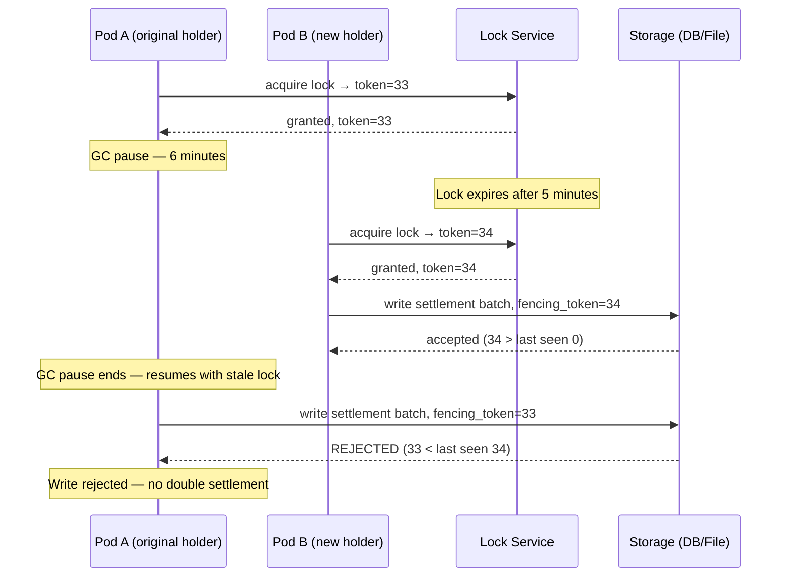

# الأقفال الموزعة — Redlock والأقفال الاستشارية

تنسّق الأقفال الموزعة الوصول الحصري إلى مورد مشترك عبر عدة عمليات أو عقد. وفي الأنظمة المالية تمنع المعالجة المزدوجة لملفات الدفع، وتتجنب تشغيل التسوية مرتين، وتضمن أن المهام التي يجب أن تعمل في نسخة واحدة (المطابقة في نهاية اليوم، واحتساب الفوائد) تُنفّذ مرة واحدة بالضبط رغم وجود عدة نسخ من الخدمة. والقفل الموزع الصحيح أصعب مما يبدو: فقد تأخذ عملية قفلًا، ثم تتوقف 30 ثانية بسبب دورة GC، ثم تستأنف بعد أن انتهى القفل وأخذته عملية أخرى، فتكمل العمل على المورد كأنها ما زالت تملك القفل وحدها — فينتج سباق بيانات لا يختلف عن عدم وجود قفل أصلًا.

## أهداف التعلم

- تحديد السيناريوهات التي تحتاج فعلًا إلى أقفال موزعة مقابل تلك التي يكفي فيها منع التكرار وإزالة المكررات
- شرح خوارزمية Redlock بما فيها نصاب الأغلبية من N عقدة وحساب المهلة
- تنفيذ قفل موزع باستخدام `RLock` في Redisson بمدة وسياسة إعادة محاولة مناسبتين
- شرح نمط رمز التسييج وتنفيذه للحماية من انتهاء القفل أثناء توقف GC
- تنفيذ الأقفال الاستشارية في PostgreSQL باستخدام `pg_try_advisory_lock` للاستبعاد المتبادل على مستوى الملف
- كتابة `PaymentFileProcessor` يستخدم قفلًا استشاريًا لمنع المعالجة المتزامنة للملف نفسه
- شرح انحراف الساعات وتوقفات GC وانقسامات الشبكة كأنماط فشل للأقفال الموزعة
- مقارنة الأقفال الموزعة بمفاتيح منع التكرار واختيار الأداة المناسبة لكل سيناريو

## سياق العمل

لنأخذ مثالًا مركّبًا مستمدًا من حوادث نموذجية. يشغّل معالج دفع مهمة تسوية نهاية اليوم على ثلاث نسخ، محمية بقفل Redis مأخوذ بـ `SET NX EX 300` (مدة 5 دقائق) ودون رموز تسييج. تأخذ النسخة A القفل عند 23:00:00 وتبدأ المعالجة. وعند 23:03:00 تتجمد النسخة A في توقف GC كامل يستمر نحو 5 دقائق. وعند 23:05:00 ينتهي القفل، وعند 23:05:02 تأخذه النسخة B وتبدأ معالجة دفعة التسوية نفسها. وعند 23:08:00 تستيقظ النسخة A، وما زالت تظن أنها تملك القفل، فتكمل. فترسل النسختان ملفات التسوية إلى شبكة الدفع، فتقبلهما — فتُسوّى آلاف المعاملات مرتين، ويتبع ذلك أسابيع من عمل المطابقة. والإصلاحات: (1) رموز تسييج على كل كتابة، لترفض طبقة التخزين مالك القفل القديم؛ (2) مراقب (watchdog) يمدد القفل ما دامت المهمة تعمل — وهذا يساعد المهام الطويلة لا التوقفات؛ (3) فحص منع تكرار (معرّف فريد لملف التسوية) في المحوّل الذي يرسل إلى شبكة الدفع.

## متى نحتاج الأقفال الموزعة

قبل اللجوء إلى قفل موزع، تحقق من أن المشكلة لا يمكن حلها بمنع التكرار وإزالة المكررات. فالأقفال الموزعة ذات تعقيد تشغيلي عالٍ وأنماط فشل دقيقة.

| السيناريو | هل القفل مناسب؟ | البديل |
|---|---|---|
| منع المعالجة المزدوجة لملف دفع | نعم — الملف غير آمن من التكرار على مستوى الشبكة | قفل استشاري على معرّف الملف |
| منع تشغيل مهمة cron مرتين (مثل احتساب الفوائد) | نعم — للمهمة آثار جانبية يجب أن تحدث مرة واحدة بالضبط | ShedLock، أو عنقود Quartz |
| منع إرسال الدفعة مرتين | لا — مفتاح منع التكرار في الواجهة اللاحقة أكثر أمانًا | مفتاح منع تكرار + جدول إزالة المكررات |
| منع التحديثات المتزامنة للحساب نفسه | لا — القفل المتفائل أو قفل الصف في قاعدة البيانات أفضل | `SELECT FOR UPDATE` أو `@Version` |
| تنسيق تحديد المعدّل الموزع | جزئيًا — فكّر في token bucket في Redis دون قفل كامل | زيادة ذرية في Redis + انتهاء مدة |

## خوارزمية Redlock

اقترح Salvatore Sanfilippo، مبتكر Redis، خوارزمية Redlock لتوفير قفل موزع يبقى آمنًا عند تعطل عقد Redis منفردة. وتستخدم الخوارزمية N عقدة Redis مستقلة (لا عنقودًا — فالعنقود نطاق فشل واحد).

**الخوارزمية:**
1. سجّل الوقت الحالي `T1`.
2. حاول أخذ القفل على العقد N بالتتابع باستخدام `SET key uuid PX timeout NX`. واستخدم مهلة لكل عقدة أصغر بكثير من مدة القفل (مثل 5–50ms لمدة 10 ثوانٍ) لتجنب انتظار العقد البطيئة.
3. عُدّ مرات النجاح. إذا كان العدد `floor(N/2) + 1` على الأقل (نصاب الأغلبية) **و**كان الزمن المنقضي الكلي أقل من مدة القفل، فقد أُخذ القفل.
4. مدة صلاحية القفل الفعلية هي `TTL - elapsed - هامش انحراف الساعة`.
5. للتحرير، احذف المفتاح من كل العقد التي أُخذ عليها، باستخدام نص Lua يتحقق من تطابق UUID قبل الحذف (لمنع تحرير قفل مالك آخر).

```
Example: N=5, TTL=10,000ms
Acquired on nodes: 1, 3, 4 (3 out of 5 — majority quorum)
Elapsed time: 42ms
Effective validity: 10,000 - 42 = 9,958ms ✓ Lock acquired

Acquired on nodes: 1, 2 (2 out of 5 — not a majority)
Elapsed time: 11ms ✗ Lock NOT acquired — release acquired nodes
```

> [!WARNING]
> ‏Redlock مثيرة للجدل. فتحليل Martin Kleppmann يُظهر أن انحراف الساعات وتوقفات GC قد تسبب انتهاكات للسلامة حتى مع نصاب الأغلبية. وفي الأنظمة المالية، فضّل نسخة Redis واحدة مع رموز تسييج (أبسط وأسرع)، أو قفلًا استشاريًا في PostgreSQL، أو خدمة تنسيق CP مثل etcd أو ZooKeeper. ولا تستخدم Redlock إلا إذا كنت تتحمل انتهاكات نادرة لسلامة القفل ولديك حماية برموز التسييج في طبقة التخزين.

## تنفيذ RLock في Redisson

‏Redisson عميل Java جاهز للإنتاج لـ Redis يقدم كثيرًا من العناصر الموزعة. و`RLock` فيه قفل على نشر Redis واحد (وصنف RedLock فيه مهمل). ويتضمن مراقبًا يمدد مدة القفل تلقائيًا ما دام المالك حيًا — لكن فقط عندما لا تمرر مدة إيجار (leaseTime).

```java
@Service
public class SettlementJobService {

    private final RedissonClient redissonClient;
    private final SettlementBatchProcessor batchProcessor;
    private static final String LOCK_KEY = "settlement:daily-run";
    private static final long WAIT_TIMEOUT_SECONDS = 5;

    public void runDailySettlement(LocalDate settlementDate) {
        RLock lock = redissonClient.getLock(LOCK_KEY + ":" + settlementDate);

        boolean acquired = false;
        try {
            // waitTime: how long to wait if the lock is held by another node.
            // No leaseTime: the lock starts with lockWatchdogTimeout (30s) and the
            // watchdog renews it while this JVM is alive. Passing an explicit
            // leaseTime (e.g. tryLock(5, 1200, SECONDS)) DISABLES the watchdog.
            acquired = lock.tryLock(WAIT_TIMEOUT_SECONDS, TimeUnit.SECONDS);

            if (!acquired) {
                log.info("Settlement for {} already running on another node — skipping",
                    settlementDate);
                return;
            }

            log.info("Acquired settlement lock for {} — proceeding", settlementDate);
            batchProcessor.processSettlement(settlementDate);

        } catch (InterruptedException e) {
            Thread.currentThread().interrupt();
            throw new SettlementInterruptedException(settlementDate, e);
        } finally {
            // Always release the lock — but only if we acquired it
            // and only if this thread still holds it (Redisson checks this)
            if (acquired && lock.isHeldByCurrentThread()) {
                lock.unlock();
                log.info("Released settlement lock for {}", settlementDate);
            }
        }
    }
}
```

بدون leaseTime يبدأ القفل بمدة المراقب (30 ثانية) ويجددها المراقب ما دامت JVM حية. أما تمرير leaseTime صريح (مثل `tryLock(5, 1200, SECONDS)`) **فيعطّل** المراقب.

```java
@Configuration
public class RedissonConfig {

    @Bean(destroyMethod = "shutdown")
    public RedissonClient redissonClient() {
        Config config = new Config();

        // For single Redis instance (not cluster):
        config.useSingleServer()
            .setAddress("redis://localhost:6379")
            .setConnectionPoolSize(10)
            .setConnectionMinimumIdleSize(2)
            // Watchdog extends lock TTL every watchdogTimeout/3 ms
            // Default watchdog timeout = 30 seconds
            .setTimeout(3000)
            .setRetryAttempts(3)
            .setRetryInterval(1500);

        // Watchdog: renews locks taken WITHOUT a leaseTime every 10s while the
        // JVM is alive. It protects long jobs, not GC pauses: a paused JVM
        // cannot renew, so the lock still expires — hence fencing tokens.
        config.setLockWatchdogTimeout(30_000); // 30 seconds

        return Redisson.create(config);
    }
}
```

المراقب يحمي المهام الطويلة، لا توقفات GC: فالـ JVM المتوقفة لا تستطيع التجديد، فينتهي القفل مع ذلك — ولهذا نحتاج رموز التسييج.

## نمط رمز التسييج

حتى مع قفل موزع، قد تحمل عملية قفلًا منتهيًا (بسبب توقف GC، أو انقسام شبكة، أو تعليق جهاز افتراضي) وتكتب في التخزين دون أن تعرف أن القفل ضاع. ونمط رمز التسييج يحل ذلك بإدراج رمز متزايد باستمرار في كل كتابة، فيستطيع التخزين رفض كتابات مالكي الأقفال القدامى.



```java
@Service
public class FencedSettlementStorage {

    private final JdbcTemplate jdbc;

    // Write with fencing token — storage rejects if token is not newer.
    // The token must come from the lock service at acquisition time, e.g.
    // INCR settlement:lock:token in Redis, a database sequence, the etcd key
    // revision, or Redisson's RFencedLock.
    public void writeSettlementBatch(
            String batchId,
            List<SettlementEntry> entries,
            long fencingToken) {

        // Update the token and write the batch in ONE atomic statement.
        // (A separate SELECT-then-write would race with a newer holder.)
        int rows = jdbc.update("""
            WITH token_update AS (
                UPDATE settlement_locks
                SET last_fencing_token = ?
                WHERE batch_type = 'daily-settlement'
                  AND (last_fencing_token IS NULL OR last_fencing_token < ?)
                RETURNING 1
            )
            INSERT INTO settlement_batches (batch_id, entries, fencing_token)
            SELECT ?, ?, ?
            WHERE EXISTS (SELECT 1 FROM token_update)
            """,
            fencingToken, fencingToken,
            batchId, serializeEntries(entries), fencingToken);

        if (rows == 0) {
            throw new StaleLockException(
                "Fencing token " + fencingToken + " rejected — a newer lock " +
                "holder has already written. This process held an expired lock.");
        }
    }
}
```

يجب أن يأتي الرمز من خدمة القفل لحظة الأخذ: مثل `INCR` على عدّاد في Redis، أو تسلسل في قاعدة البيانات، أو مراجعة المفتاح في etcd، أو `RFencedLock` في Redisson. ويُحدَّث الرمز وتُكتب الدفعة في جملة ذرية واحدة، لأن SELECT منفصلًا ثم الكتابة يتسابق مع مالك أحدث. وإذا لم يُكتب أي صف، يُرمى استثناء.

> [!NOTE]
> يستخدم `RLock` في Redisson نص Lua لتحرير ذري يتحقق من UUID المالك، لكنه لا يعطيك رمز تسييج (الإصدارات الأحدث من Redisson تضيف `RFencedLock` الذي يعطيه)، ولا تستطيع أي مكتبة أقفال فحص الرموز في طبقة التخزين لديك. يجب أن تنفّذ التسييج في طبقة التخزين بنفسك للحصول على ضمانات سلامة قوية. فالقفل يمنع الوصول المتزامن في الحالة الشائعة؛ ورمز التسييج يحمي من حالة التوقف النادرة بسبب GC أو الشبكة.

## الأقفال الاستشارية في PostgreSQL

الأقفال الاستشارية في PostgreSQL أقفال على مستوى الجلسة أو المعاملة تُخزن في الذاكرة المشتركة. وهي غير مرتبطة بجدول أو صف محدد — بل تُعرّف بمفتاح رقمي تحدده أنت. وهي مثالية للتنسيق على مستوى التطبيق، مثل منع نسختين من معالجة ملف الدفع نفسه.

```java
@Service
public class PaymentFileProcessor {

    private final JdbcTemplate jdbc;
    private final FileStorageService fileStorage;
    private final PaymentParser paymentParser;
    private final PaymentSubmitter paymentSubmitter;

    private final DataSource dataSource;

    // Uses a PostgreSQL SESSION advisory lock keyed on a hash of the file name.
    // A session lock belongs to ONE connection, so lock and unlock must run on
    // the same connection. With a pool, JdbcTemplate may hand out a different
    // connection per call — and a pooled connection is not closed, so a lock
    // left on it would stay held. Hence a dedicated connection for the lock.
    public ProcessingResult processFile(String fileName) {
        long lockKey = computeLockKey(fileName);

        try (Connection lockConn = dataSource.getConnection()) {
            if (!tryAdvisoryLock(lockConn, lockKey)) {
                log.info("File {} is already being processed by another pod — skipping",
                    fileName);
                return ProcessingResult.skipped(fileName);
            }
            try {
                return processLocked(fileName);
            } finally {
                // Explicit release on the SAME connection before it goes back to the pool
                try (PreparedStatement ps =
                         lockConn.prepareStatement("SELECT pg_advisory_unlock(?)")) {
                    ps.setLong(1, lockKey);
                    ps.execute();
                }
                log.info("Released advisory lock {} for file {}", lockKey, fileName);
            }
        } catch (SQLException e) {
            throw new FileProcessingException(fileName, e);
        }
    }

    private boolean tryAdvisoryLock(Connection conn, long key) throws SQLException {
        // pg_try_advisory_lock is non-blocking — returns false if the lock is held
        try (PreparedStatement ps = conn.prepareStatement("SELECT pg_try_advisory_lock(?)")) {
            ps.setLong(1, key);
            try (ResultSet rs = ps.executeQuery()) {
                return rs.next() && rs.getBoolean(1);
            }
        }
    }

    private ProcessingResult processLocked(String fileName) {
        // Idempotency guard: a file that already COMPLETED is never processed again
        jdbc.update(
            "INSERT INTO processed_files (name, status, started_at) " +
            "VALUES (?, 'PROCESSING', NOW()) ON CONFLICT (name) DO NOTHING",
            fileName);
        Integer completed = jdbc.queryForObject(
            "SELECT COUNT(*) FROM processed_files WHERE name = ? AND status = 'COMPLETED'",
            Integer.class, fileName);
        if (completed != null && completed > 0) {
            log.info("File {} already completed — skipping duplicate", fileName);
            return ProcessingResult.duplicate(fileName);
        }

        byte[] fileContent = fileStorage.download(fileName);
        List<Payment> payments = paymentParser.parse(fileContent);

        // A crash mid-batch leaves status PROCESSING; the retry resubmits, so
        // each payment must carry its own idempotency key downstream
        int submitted = paymentSubmitter.submitBatch(payments);

        jdbc.update(
            "UPDATE processed_files SET status = 'COMPLETED', " +
            "completed_at = NOW(), payment_count = ? WHERE name = ?",
            submitted, fileName);
        return ProcessingResult.success(fileName, submitted);
    }

    private long computeLockKey(String fileName) {
        // Deterministic hash — same file name always maps to same lock key
        // Use a stable hash — not Java's hashCode() which is not stable across JVMs
        return Hashing.murmur3_128().hashString(fileName, StandardCharsets.UTF_8)
            .asLong();
    }
}
```

القفل الاستشاري على مستوى الجلسة ينتمي إلى اتصال واحد، فيجب أن يتم الأخذ والتحرير على الاتصال نفسه. ومع مجموعة اتصالات قد يعطي JdbcTemplate اتصالًا مختلفًا لكل استدعاء — والاتصال في المجموعة لا يُغلق، فيبقى القفل المتروك عليه محجوزًا. لذلك يُستخدم اتصال مخصص للقفل. وإذا تعطلت العملية في منتصف الدفعة تبقى الحالة PROCESSING، وتعيد المحاولة الإرسال، لذا يجب أن يحمل كل دفع مفتاح منع تكرار خاصًا به.

```sql
-- PostgreSQL advisory lock reference
SELECT pg_advisory_lock(12345);         -- Session lock, blocks until acquired
SELECT pg_try_advisory_lock(12345);     -- Session lock, returns false if unavailable
SELECT pg_advisory_lock_shared(12345);  -- Shared (reader) session lock
SELECT pg_advisory_unlock(12345);       -- Explicit release
-- Transaction-scoped variants (auto-released at transaction end):
SELECT pg_advisory_xact_lock(12345);
SELECT pg_try_advisory_xact_lock(12345);

-- Check currently held advisory locks
SELECT pid, classid, objid, mode, granted
FROM pg_locks
WHERE locktype = 'advisory';
```

## انتهاء القفل والحيوية والمدة

اضبط دائمًا مدة على الأقفال الموزعة. فالقفل بلا مدة لن يُحرر أبدًا إذا تعطل مالكه، فيحجب كل المالكين الآخرين إلى الأبد — جمود (deadlock).

```java
// WRONG — no TTL: if the holder crashes, lock is held forever
redisTemplate.opsForValue().setIfAbsent("lock:settlement", holderId);

// CORRECT — TTL set atomically with acquisition (SET NX PX in single command)
Boolean acquired = redisTemplate.opsForValue()
    .setIfAbsent("lock:settlement", holderId, Duration.ofMinutes(20));

// CORRECT with watchdog (Redisson) — TTL extended automatically while JVM alive
RLock lock = redissonClient.getLock("settlement:daily-run");
lock.tryLock(5, TimeUnit.SECONDS);        // wait 5s, no leaseTime => watchdog active
// lock.tryLock(5, 1200, TimeUnit.SECONDS) would set a fixed 20-min TTL, NO watchdog
```

## لماذا تصعب الأقفال الموزعة

| نمط الفشل | الوصف | الحماية |
|---|---|---|
| توقف GC | تتوقف JVM 30 ثانية أو أكثر؛ ينتهي القفل؛ ويتقدم مالك آخر | رمز تسييج في طبقة التخزين |
| انحراف الساعات | تنحرف الساعات بين العقد؛ فيخطئ حساب مدة Redlock | NTP + هوامش مدة متحفظة |
| انقسام الشبكة | مالك القفل معزول عن Redis؛ ينتهي القفل؛ مالكان معًا | رمز تسييج + نصاب كتابة |
| تعليق العملية | ترحيل حي للجهاز الافتراضي أو إيقاف المنسّق للحاوية | مثل توقف GC — رمز تسييج |
| تحويل Redis الاحتياطي | النسخ غير متزامن: قد لا يكون القفل لدى النسخة المرقّاة | رموز التسييج؛ أو مخزن CP ‏(etcd، ZooKeeper) للقفل |

## بدائل الأقفال الموزعة

| النمط | متى تستخدمه | المفاضلة |
|---|---|---|
| مفتاح منع تكرار + جدول إزالة المكررات | منع إرسال الدفعة مرتين | يتطلب دعم الخدمة اللاحقة لمنع التكرار |
| القفل المتفائل (`@Version`) | التحديثات المتزامنة للحساب | كلفة إعادة المحاولة عند التنافس |
| `SELECT FOR UPDATE` | التنسيق على مستوى الصف في قاعدة البيانات | يتوسع فقط داخل طبقة قاعدة البيانات |
| ShedLock | تنفيذ المهام المجدولة في نسخة واحدة | يتطلب قاعدة بيانات أو Redis مشتركًا |
| الكتابات الشرطية (CAS) | مقارنة-وتبديل في Redis أو DynamoDB | ذرية، بلا كلفة قفل |

## اختبر معرفتك

**س1: تأخذ النسخة A قفل Redis بمدة 5 دقائق لتشغيل مهمة التسوية الليلية. ثم تتوقف 6 دقائق بسبب دورة GC. وتأخذ النسخة B القفل نفسه في الدقيقة 5 وتبدأ المعالجة. وتستأنف النسخة A في الدقيقة 6 وتكمل المعالجة أيضًا. ما النتيجة دون رموز تسييج، وكيف تمنع رموز التسييج المشكلة؟**

ج: دون رموز تسييج تكتب النسختان بيانات التسوية بالتزامن. والنتيجة تسوية مزدوجة — تنجح عمليتا الكتابة في طبقة التخزين، التي لا تستطيع التمييز بين مالك القفل القديم (A) والمالك الحالي (B). ومع رموز التسييج: عندما أخذت B القفل تلقت الرمز 34، وعندما أخذته A تلقت الرمز 33. وتتضمن كتابات A الرمز 33؛ وقد رأى التخزين بالفعل الرمز 34 من B، فيرفض كتابات A كقديمة. فتتم التسوية مرة واحدة بالضبط.

**س2: تختار بين قفل Redis موزع وقفل استشاري في PostgreSQL لمنع نسختين من معالجة ملف الدفع نفسه. تستغرق المعالجة 2–10 دقائق، ويستخدم التطبيق PostgreSQL كقاعدة بيانات أساسية. أيهما تستخدم؟**

ج: استخدم الأقفال الاستشارية في PostgreSQL. والأسباب: (1) لديك بالفعل اتصال PostgreSQL لتسجيل حالة المعالجة — فاستخدامه يتجنب اعتمادًا إضافيًا على Redis؛ (2) لا مدة تديرها: يعيش القفل بالضبط ما دامت جلسة قاعدة البيانات التي تملكه؛ (3) إذا تعطلت نسخة التطبيق يُغلق اتصالها فيحرر PostgreSQL القفل (فورًا عند انقطاع نظيف، أو بعد أن يكتشف TCP keepalive اختفاء المضيف). وتحفّظ واحد: مع مجموعة اتصالات، خذ القفل وحرره على الاتصال المخصص نفسه — فالاتصال في المجموعة لا يُغلق، والقفل المنسي يبقى محجوزًا. والأقفال الاستشارية الأداة الصحيحة عندما يكون نطاق التنسيق هو نطاق التخزين نفسه.

## التحدي العملي

**السيناريو:** تبني خدمة معالجة التسوية لمعالج دفع. تعمل مهام التسوية كل ليلة عند 23:00. وتعالج كل مهمة 500,000 معاملة. وثلاث نسخ تشغّل الخدمة. ويجب أن تعمل التسوية مرة واحدة بالضبط كل ليلة. وتستغرق المعالجة 8–15 دقيقة.

**المهام:**

1. **قفل Redisson مع المراقب:** نفّذ `NightlySettlementJob` باستخدام `RLock` في Redisson بمهلة انتظار 5 ثوانٍ. واشرح لماذا يكون `leaseTime = -1` مع المراقب أكثر أمانًا من `leaseTime = 1200` لمهمة قد تستغرق حتى 15 دقيقة. وأظهر التحرير الصحيح للقفل في كتلة `finally` مع فحص `isHeldByCurrentThread()`.

2. **تنفيذ رمز التسييج:** اكتب الطريقة `SettlementAuditStore.writeSettlementRecord(SettlementRecord record, long fencingToken)` التي تستخدم كتابة CAS في PostgreSQL لرفض الكتابات حيث `fencing_token <= last_accepted_token`. وضمّن SQL، ونوع الاستثناء عند الرفض، وشرحًا لماذا لا يكفي فحص UUID البسيط على القفل (المدمج في Redisson).

3. **القفل الاستشاري في PostgreSQL:** اكتب `PaymentFileProcessor.processFile(String s3Key)` باستخدام `pg_try_advisory_lock` على تجزئة `s3Key`. وضمّن: الأخذ غير الحاجب، ومنطق التخطي إذا كان محجوزًا، ومعالجة الملف، وحماية منع التكرار من إعادة معالجة الملفات المكتملة، و`pg_advisory_unlock` صريحًا في كتلة `finally`.

4. **حدّد النمط الخاطئ:** يأخذ فريق `SELECT balance FROM accounts WHERE id = ? FOR UPDATE`، ثم يستدعي — وهو ما زال يحمل قفل الصف — خدمة احتيال بعيدة قد تستغرق حتى ثانيتين. قفل الصف القصير للخصم نفسه صحيح؛ أما حمله عبر استدعاء بعيد فخاطئ. اشرح المشكلتين على نطاق واسع (تلميح: نفاد مجموعة الاتصالات وانتظار الأقفال عبر حدود الخدمات)، واقترح الإصلاح: أجرِ الاستدعاءات البعيدة قبل المعاملة وأبقِ القفل قصيرًا، أو استخدم القفل المتفائل بـ `@Version` مع إعادة المحاولة.

<!-- KNOWLEDGE-CHECK
{
  "questions": [
    {
      "id": "q1",
      "text": "تحمل النسخة A قفل Redis بالرمز 33 لكنها تتوقف في دورة GC أطول من مدة القفل. تأخذ النسخة B القفل بالرمز 34 وتكتب في التخزين. ثم تستأنف A وتحاول الكتابة. ماذا يحدث مع رموز التسييج؟",
      "options": [
        "تنجح كتابة A — فقد حملت القفل قبل B",
        "تُرفض كتابة A — يرى التخزين أن الرمز 33 أقل من آخر رمز 34",
        "تنجح الكتابتان — لا يستطيع Redis منع الكتابات المتزامنة",
        "تُعكس كتابة B — للمالك الأول الأولوية"
      ],
      "correct": 1,
      "explanation": "يسجّل التخزين أعلى رمز تسييج رآه (34 من B). وعندما تقدم A الرمز 33 يرفضه التخزين لأن 33 أقل من 34. فرمز التسييج يجعل التخزين المرجع في ترتيب الأقفال، لا خدمة القفل. وهذا يحمي من توقفات GC، وانقسامات الشبكة، وتعليق الأجهزة الافتراضية التي قد تُنهي الأقفال بصمت."
    },
    {
      "id": "q2",
      "text": "تحتاج إلى منع نسختين من معالجة ملف الدفع نفسه. ويستخدم التطبيق PostgreSQL. أي آلية قفل هي الأنسب؟",
      "options": [
        "Redis Redlock عبر 5 عقد Redis مستقلة",
        "SELECT FOR UPDATE على صف جدول payment_files",
        "pg_try_advisory_lock في PostgreSQL مع تجزئة معرّف الملف",
        "كتلة synchronized في Java على متغير ساكن"
      ],
      "correct": 2,
      "explanation": "‏pg_try_advisory_lock مثالي: يستخدم قاعدة بيانات PostgreSQL التي تعتمد عليها الخدمة أصلًا، ويُحرر عندما تنتهي الجلسة المالكة (تعطل النسخة يغلق الاتصال)، وهو غير حاجب (يعيد false بدل الانتظار). خذه وحرره على اتصال مخصص واحد، لأن الاتصال في المجموعة لا يُغلق. أما SELECT FOR UPDATE فسيحمل قفل صف داخل معاملة طوال دقائق المعالجة. وRedis Redlock يضيف تعقيدًا في البنية التحتية بلا مبرر عندما يكون PostgreSQL متاحًا. وكتلة synchronized في Java محصورة في عملية واحدة، لا موزعة."
    }
  ]
}
-->

<!-- PRACTICAL-CHALLENGE
{
  "title": "تسوية ليلية مرة واحدة بالضبط بالأقفال ورموز التسييج",
  "difficulty": "advanced",
  "estimatedMinutes": 60,
  "tasks": [
    {
      "id": "1",
      "description": "نفّذ NightlySettlementJob باستخدام RLock في Redisson مأخوذًا دون leaseTime (فيجدده المراقب)، بمهلة انتظار 5 ثوانٍ، وكتلة finally لا تحرر القفل إلا إذا كان isHeldByCurrentThread() صحيحًا. واشرح لماذا يعطّل leaseTime صريح بقيمة 1200 ثانية المراقب."
    },
    {
      "id": "2",
      "description": "اكتب SettlementAuditStore.writeSettlementRecord(record, fencingToken) كجملة PostgreSQL ذرية واحدة ترفض الكتابات حيث fencing_token <= last_accepted_token وترمي استثناء عندما لا يُكتب أي صف. واشرح من أين يأتي الرمز ولماذا لا يكفي فحص UUID في Redisson عند التحرير."
    },
    {
      "id": "3",
      "description": "اكتب PaymentFileProcessor.processFile(String s3Key) باستخدام pg_try_advisory_lock على تجزئة s3Key، على اتصال مخصص واحد: أخذ غير حاجب، وتخطٍّ إذا كان محجوزًا، وحماية منع تكرار للملفات المكتملة، وpg_advisory_unlock على الاتصال نفسه في finally."
    },
    {
      "id": "4",
      "description": "يحمل فريق SELECT ... FOR UPDATE على صف حساب أثناء استدعاء خدمة احتيال بعيدة بطيئة. اشرح لماذا يستنزف هذا مجموعات الاتصالات وينشر انتظار الأقفال عبر الخدمات، واقترح الإصلاح: الاستدعاءات البعيدة قبل المعاملة، وأقفال قصيرة، أو القفل المتفائل بـ @Version مع إعادة المحاولة."
    }
  ]
}
-->
