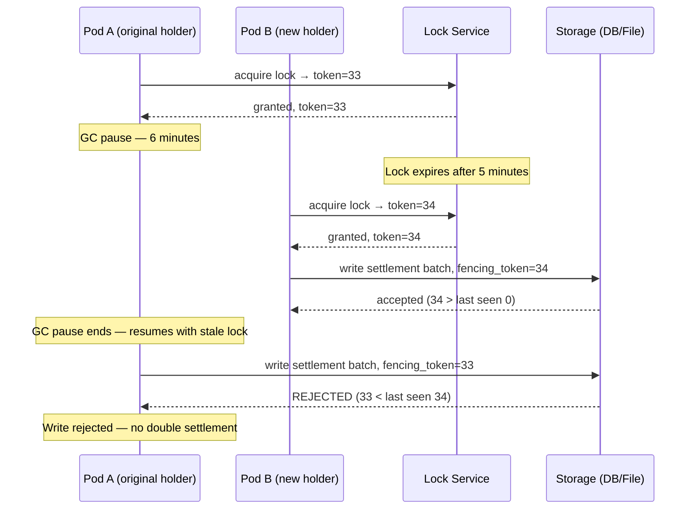

Distributed locks coordinate exclusive access to a shared resource across multiple processes or nodes. In financial systems, they prevent double processing of payment files, avoid duplicate settlement runs, and ensure single-instance jobs (end-of-day reconciliation, interest accrual) execute exactly once despite multiple service pods. Getting distributed locking right is harder than it looks: a process can acquire a lock, pause for 30 seconds due to a GC cycle, resume after the lock has expired and been acquired by another process, and then proceed to operate on the resource as though it still holds the lock exclusively — producing a data race indistinguishable from having no lock at all.

## Learning Objectives

- Identify the scenarios where distributed locks are genuinely necessary versus where idempotency and deduplication suffice
- Explain the Redlock algorithm including the N-node majority quorum and timeout calculation
- Implement a distributed lock using Redisson `RLock` with appropriate TTL and retry policy
- Explain the fencing token pattern and implement it to protect against GC pause lock expiry
- Implement PostgreSQL advisory locks using `pg_try_advisory_lock` for file-level mutual exclusion
- Write a `PaymentFileProcessor` that uses an advisory lock to prevent concurrent processing of the same file
- Explain clock skew, GC pauses, and network partitions as failure modes for distributed locks
- Compare distributed locks to idempotency keys and choose the right primitive for each scenario

## Business Context

In November 2020, a fintech payment processor experienced a double-settlement incident affecting 2,100 transactions totalling £1.4 million. The root cause was a distributed lock implementation that did not use fencing tokens. The end-of-day settlement job ran on three pods. The team had implemented a Redis-based lock using `SET NX EX 300` (a 5-minute TTL). On the day of the incident: Pod A acquired the lock at 23:00:00 and began processing. At 23:03:15, Pod A paused for a full GC cycle lasting 4 minutes and 52 seconds. At 23:03:15 + 300s = 23:08:15, the lock expired. Pod B acquired the lock at 23:08:17 and began processing the same settlement batch. Pod A resumed at 23:08:07, 8 seconds before the lock expired on Pod B, and both pods submitted settlement files to the payment network simultaneously. The settlement network accepted both. The fix required: (1) fencing tokens on every write so storage could reject stale lock holders, (2) lock TTL increased to 20 minutes with a watchdog heartbeat to extend while the job is running, (3) idempotency checks in the downstream payment network adapter. The incident cost the company £1.4M in duplicate settlements and £280,000 in reconciliation labour.

## When Distributed Locks Are Needed

Before reaching for a distributed lock, verify that the problem cannot be solved with idempotency and deduplication. Distributed locks have high operational complexity and subtle failure modes.

| Scenario | Lock appropriate? | Alternative |
|---|---|---|
| Prevent double processing of a payment file | Yes — file is not idempotent at the network level | Advisory lock on file identifier |
| Prevent duplicate cron job execution (e.g., interest accrual) | Yes — job produces side effects that must run exactly once | ShedLock, Quartz cluster |
| Prevent duplicate payment submission | No — idempotency key in the downstream API is safer | Idempotency key + deduplication table |
| Prevent concurrent updates to the same account | No — optimistic locking or database-level row lock is better | `SELECT FOR UPDATE` or `@Version` |
| Coordinate distributed rate limiting | Partially — consider token bucket in Redis without full lock | Redis atomic increment + expire |

## The Redlock Algorithm

Redlock was proposed by Redis creator Salvatore Sanfilippo to provide a distributed lock that remains safe when individual Redis nodes fail. The algorithm uses N independent Redis nodes (not a cluster — a cluster is a single failure domain).

**Algorithm:**
1. Record the current time `T1`.
2. Sequentially attempt to acquire the lock on all N Redis nodes using `SET key uuid PX timeout NX`. Use a small per-node timeout (e.g., `timeout / N / 10`) to avoid waiting on slow nodes.
3. Count the number of successful acquisitions. If the count is at least `ceil(N/2) + 1` (majority quorum) **and** the total elapsed time is less than the lock TTL, the lock is acquired.
4. The effective lock validity time is `TTL - elapsed`.
5. To release, DELETE the key from all nodes where it was acquired, using a Lua script to verify the UUID matches before deleting (prevents releasing another holder's lock).

```
Example: N=5, TTL=10,000ms
Acquired on nodes: 1, 3, 4 (3 out of 5 — majority quorum)
Elapsed time: 42ms
Effective validity: 10,000 - 42 = 9,958ms ✓ Lock acquired

Acquired on nodes: 1, 2 (2 out of 5 — not a majority)
Elapsed time: 11ms ✗ Lock NOT acquired — release acquired nodes
```

> [!WARNING]
> Redlock is controversial. Martin Kleppmann's analysis shows that clock drift and GC pauses can cause safety violations even with the majority quorum. For financial systems, prefer a single Redis instance with a fencing token (simpler, faster, still requires fencing) or a database advisory lock backed by MVCC. Use Redlock only when you can tolerate rare lock safety violations and have fencing token protection at the storage layer.

## Redisson RLock Implementation

Redisson is the production-grade Java client for Redis that implements Redlock (and many other distributed primitives). It includes a watchdog that automatically extends the lock TTL while the holder is alive.

```java
@Service
public class SettlementJobService {

    private final RedissonClient redissonClient;
    private final SettlementBatchProcessor batchProcessor;
    private static final String LOCK_KEY = "settlement:daily-run";
    private static final long LOCK_TTL_SECONDS = 1200; // 20 minutes
    private static final long WAIT_TIMEOUT_SECONDS = 5;

    public void runDailySettlement(LocalDate settlementDate) {
        RLock lock = redissonClient.getLock(LOCK_KEY + ":" + settlementDate);

        boolean acquired = false;
        try {
            // waitTime: how long to wait if lock is held by another node
            // leaseTime: lock TTL — Redisson watchdog extends this automatically
            //            while this JVM is alive; -1 means watchdog only
            acquired = lock.tryLock(
                WAIT_TIMEOUT_SECONDS, LOCK_TTL_SECONDS, TimeUnit.SECONDS);

            if (!acquired) {
                log.info("Settlement for {} already running on another node — skipping",
                    settlementDate);
                return;
            }

            log.info("Acquired settlement lock for {} — proceeding", settlementDate);
            batchProcessor.processSettlement(settlementDate);

        } catch (InterruptedException e) {
            Thread.currentThread().interrupt();
            throw new SettlementInterruptedException(settlementDate, e);
        } finally {
            // Always release the lock — but only if we acquired it
            // and only if this thread still holds it (Redisson checks this)
            if (acquired && lock.isHeldByCurrentThread()) {
                lock.unlock();
                log.info("Released settlement lock for {}", settlementDate);
            }
        }
    }
}
```

```java
@Configuration
public class RedissonConfig {

    @Bean(destroyMethod = "shutdown")
    public RedissonClient redissonClient() {
        Config config = new Config();

        // For single Redis instance (not cluster):
        config.useSingleServer()
            .setAddress("redis://localhost:6379")
            .setConnectionPoolSize(10)
            .setConnectionMinimumIdleSize(2)
            // Watchdog extends lock TTL every watchdogTimeout/3 ms
            // Default watchdog timeout = 30 seconds
            .setTimeout(3000)
            .setRetryAttempts(3)
            .setRetryInterval(1500);

        // Watchdog: automatically renews lock every 10s if the JVM is alive
        // This protects against false expiry during long-running operations
        config.setLockWatchdogTimeout(30_000); // 30 seconds

        return Redisson.create(config);
    }
}
```

## The Fencing Token Pattern

Even with a distributed lock, a process can hold a lock that has expired (due to GC pause, network partition, or VM suspend) and proceed to write to storage without knowing the lock is gone. The fencing token pattern solves this by embedding a monotonically increasing token in every write, allowing storage to reject writes from stale lock holders.



```java
@Service
public class FencedSettlementStorage {

    private final JdbcTemplate jdbc;

    // Write with fencing token — storage rejects if token is not newer
    public void writeSettlementBatch(
            String batchId,
            List<SettlementEntry> entries,
            long fencingToken) {

        // Check the last accepted fencing token for this batch type
        Long lastToken = jdbc.queryForObject(
            "SELECT last_fencing_token FROM settlement_locks WHERE batch_type = ?",
            Long.class, "daily-settlement");

        if (lastToken != null && fencingToken <= lastToken) {
            throw new StaleLockException(String.format(
                "Fencing token %d rejected — storage has seen token %d. " +
                "This write is from a process that held an expired lock.",
                fencingToken, lastToken));
        }

        // Update the token and write the batch atomically
        jdbc.update("""
            WITH token_update AS (
                UPDATE settlement_locks
                SET last_fencing_token = ?
                WHERE batch_type = 'daily-settlement'
                  AND (last_fencing_token IS NULL OR last_fencing_token < ?)
                RETURNING 1
            )
            INSERT INTO settlement_batches (batch_id, entries, fencing_token)
            SELECT ?, ?, ?
            WHERE EXISTS (SELECT 1 FROM token_update)
            """,
            fencingToken, fencingToken,
            batchId, serializeEntries(entries), fencingToken);
    }
}
```

> [!NOTE]
> Redisson's `RLock` uses a Lua script for atomic lock release that checks the holder's UUID, but it does not implement fencing tokens at the storage layer. You must implement fencing at the storage layer yourself for strong safety guarantees. The lock prevents concurrent access in the common case; the fencing token protects against the rare GC/network pause scenario.

## PostgreSQL Advisory Locks

PostgreSQL advisory locks are session-scoped or transaction-scoped locks stored in shared memory. They are not associated with any specific table or row — they are identified by a numeric key that you define. Advisory locks are ideal for application-level coordination such as preventing two pods from processing the same payment file.

```java
@Service
public class PaymentFileProcessor {

    private final JdbcTemplate jdbc;
    private final FileStorageService fileStorage;
    private final PaymentParser paymentParser;
    private final PaymentSubmitter paymentSubmitter;

    // Uses PostgreSQL advisory lock keyed on a hash of the file name.
    // Prevents concurrent processing of the same file across pods.
    public ProcessingResult processFile(String fileName) {
        long lockKey = computeLockKey(fileName);

        // pg_try_advisory_lock is non-blocking — returns false if lock is held
        Boolean acquired = jdbc.queryForObject(
            "SELECT pg_try_advisory_lock(?)", Boolean.class, lockKey);

        if (!Boolean.TRUE.equals(acquired)) {
            log.info("File {} is already being processed by another pod — skipping",
                fileName);
            return ProcessingResult.skipped(fileName);
        }

        // Lock is held for the duration of this DB session (connection).
        // The connection is returned to the pool at the end of this method,
        // which releases the advisory lock automatically.
        try {
            log.info("Acquired advisory lock {} for file {}", lockKey, fileName);

            byte[] fileContent = fileStorage.download(fileName);
            List<Payment> payments = paymentParser.parse(fileContent);

            // Mark the file as in-progress in DB (idempotency guard)
            jdbc.update(
                "INSERT INTO processed_files (name, status, started_at) " +
                "VALUES (?, 'PROCESSING', NOW()) " +
                "ON CONFLICT (name) DO NOTHING",
                fileName);

            // Check if the INSERT succeeded (no conflict = not yet processed)
            int alreadyProcessed = jdbc.queryForObject(
                "SELECT COUNT(*) FROM processed_files " +
                "WHERE name = ? AND status = 'COMPLETED'",
                Integer.class, fileName);

            if (alreadyProcessed > 0) {
                log.info("File {} already completed — skipping duplicate", fileName);
                return ProcessingResult.duplicate(fileName);
            }

            int submitted = paymentSubmitter.submitBatch(payments);

            jdbc.update(
                "UPDATE processed_files SET status = 'COMPLETED', " +
                "completed_at = NOW(), payment_count = ? WHERE name = ?",
                submitted, fileName);

            return ProcessingResult.success(fileName, submitted);

        } finally {
            // Explicitly release the advisory lock before returning connection to pool
            jdbc.update("SELECT pg_advisory_unlock(?)", lockKey);
            log.info("Released advisory lock {} for file {}", lockKey, fileName);
        }
    }

    private long computeLockKey(String fileName) {
        // Deterministic hash — same file name always maps to same lock key
        // Use a stable hash — not Java's hashCode() which is not stable across JVMs
        return Hashing.murmur3_128().hashString(fileName, StandardCharsets.UTF_8)
            .asLong();
    }
}
```

```sql
-- PostgreSQL advisory lock reference
SELECT pg_advisory_lock(12345);         -- Session lock, blocks until acquired
SELECT pg_try_advisory_lock(12345);     -- Session lock, returns false if unavailable
SELECT pg_advisory_lock_shared(12345);  -- Shared (reader) session lock
SELECT pg_advisory_unlock(12345);       -- Explicit release
-- Transaction-scoped variants (auto-released at transaction end):
SELECT pg_advisory_xact_lock(12345);
SELECT pg_try_advisory_xact_lock(12345);

-- Check currently held advisory locks
SELECT pid, classid, objid, mode, granted
FROM pg_locks
WHERE locktype = 'advisory';
```

## Lock Expiry, Liveness, and TTL

Always set a TTL on distributed locks. A lock without TTL will never be released if the holder crashes, permanently blocking all other holders — a deadlock.

```java
// WRONG — no TTL: if the holder crashes, lock is held forever
redisTemplate.opsForValue().setIfAbsent("lock:settlement", holderId);

// CORRECT — TTL set atomically with acquisition (SET NX PX in single command)
Boolean acquired = redisTemplate.opsForValue()
    .setIfAbsent("lock:settlement", holderId, Duration.ofMinutes(20));

// CORRECT with watchdog (Redisson) — TTL extended automatically while JVM alive
RLock lock = redissonClient.getLock("settlement:daily-run");
lock.tryLock(5, 1200, TimeUnit.SECONDS); // wait 5s, TTL 20 min, watchdog active
```

## Why Distributed Locks Are Hard

| Failure mode | Description | Protection |
|---|---|---|
| GC pause | JVM pauses for 30s+; lock expires; another holder proceeds | Fencing token at storage layer |
| Clock skew | Clocks drift between nodes; Redlock TTL calculation incorrect | Use NTP + conservative TTL margins |
| Network partition | Lock holder partitioned from Redis; lock expires; dual holders | Fencing token + write quorum |
| Process suspend | VM live-migrated or container paused by orchestrator | Same as GC pause — fencing token |
| Redis failover | Redis replica promoted; in-memory lock state lost | Redlock (N independent nodes) or Redisson with persistence |

## Alternatives to Distributed Locks

| Pattern | When to use | Trade-off |
|---|---|---|
| Idempotency key + dedup table | Duplicate payment submission prevention | Requires downstream to support idempotency |
| Optimistic locking (`@Version`) | Concurrent account updates | Retry cost on contention |
| `SELECT FOR UPDATE` | Row-level DB coordination | Scales only within the DB tier |
| ShedLock | Scheduled job single-instance execution | Requires shared DB or Redis |
| Conditional writes (CAS) | Compare-and-swap in Redis or DynamoDB | Atomic, no lock overhead |

## Knowledge Check

**Q1: Pod A acquires a Redis lock with a 5-minute TTL to run the nightly settlement job. It pauses for 6 minutes due to a GC cycle. Pod B acquires the same lock at minute 5 and begins processing. Pod A resumes at minute 6 and also continues processing. What is the outcome without fencing tokens, and how do fencing tokens prevent the problem?**

A: Without fencing tokens, both pods write settlement data concurrently. The result is double settlement — both write operations succeed at the storage layer, which cannot distinguish the stale lock holder (Pod A) from the current holder (Pod B). With fencing tokens: when Pod B acquires the lock it receives token=34. When Pod A acquired the lock it received token=33. Pod A's writes to storage include token=33; storage has already seen token=34 from Pod B, so it rejects Pod A's writes as stale. The settlement proceeds exactly once.

**Q2: You are choosing between a Redis distributed lock and a PostgreSQL advisory lock for preventing two pods from processing the same payment file. The processing takes 2–10 minutes and the application uses PostgreSQL as its primary database. Which should you use?**

A: Use PostgreSQL advisory locks. The reasons: (1) you already have a PostgreSQL connection for recording processing status — using the same connection for the advisory lock avoids an extra Redis dependency; (2) the lock is automatically released when the connection is returned to the pool, providing liveness guarantee without TTL management; (3) advisory locks are durable within the session — if the application pod crashes, the connection is closed and PostgreSQL releases the lock immediately. Redis locks require a watchdog to handle pod crashes, which adds complexity. Advisory locks are the right tool when the coordination domain is the same as the storage domain.

## Practical Challenge

**Scenario:** You are building the settlement processing service for a payment processor. Settlement jobs run every night at 23:00. Each job processes 500,000 transactions. Three pods run the service. The settlement must run exactly once per night. Processing takes 8–15 minutes.

**Tasks:**

1. **Redisson lock with watchdog:** Implement `NightlySettlementJob` using Redisson `RLock` with a 20-minute TTL and 5-second wait timeout. Explain why `leaseTime = -1` with watchdog is safer than `leaseTime = 1200` for a job that may take up to 15 minutes. Show correct lock release in the `finally` block with the `isHeldByCurrentThread()` check.

2. **Fencing token implementation:** Write the `SettlementAuditStore.writeSettlementRecord(SettlementRecord record, long fencingToken)` method that uses a PostgreSQL CAS write to reject writes where `fencing_token <= last_accepted_token`. Include the SQL, the exception type for rejection, and an explanation of why a simple UUID check on the lock (Redisson's built-in) is not sufficient.

3. **PostgreSQL advisory lock:** Write `PaymentFileProcessor.processFile(String s3Key)` using `pg_try_advisory_lock` on a hash of `s3Key`. Include: non-blocking acquisition, skip logic if held, file processing, idempotency guard against re-processing completed files, and explicit `pg_advisory_unlock` in the `finally` block.

4. **Identify the anti-pattern:** A team proposes using `SELECT balance FROM accounts WHERE id = ? FOR UPDATE` as a distributed lock to prevent two pods from debiting the same account simultaneously. Explain the two problems with this approach at scale (hint: consider connection pool exhaustion and lock timeout across service boundaries), and propose the correct alternative using optimistic locking.

<!-- KNOWLEDGE-CHECK
{
  "questions": [
    {
      "id": "q1",
      "text": "Pod A holds a Redis lock with token=33 but pauses for a GC cycle longer than the TTL. Pod B acquires the lock with token=34 and writes to storage. Pod A resumes and tries to write. What happens with fencing tokens?",
      "options": [
        "Pod A's write succeeds — it held the lock before Pod B",
        "Pod A's write is rejected — storage sees token 33 < last token 34",
        "Both writes succeed — Redis cannot prevent concurrent writes",
        "Pod B's write is reversed — the first holder has priority"
      ],
      "correct": 1,
      "explanation": "Storage records the highest fencing token it has seen (34 from Pod B). When Pod A presents token 33, storage rejects it because 33 < 34. The fencing token makes storage the authority on lock ordering, not the lock service. This protects against GC pauses, network partitions, and VM suspends that can expire locks silently."
    },
    {
      "id": "q2",
      "text": "You need to prevent two pods from processing the same payment file. The application uses PostgreSQL. Which locking mechanism is most appropriate?",
      "options": [
        "Redis Redlock across 5 independent Redis nodes",
        "SELECT FOR UPDATE on the payment_files table row",
        "PostgreSQL pg_try_advisory_lock with a hash of the file identifier",
        "Java synchronized block on a static variable"
      ],
      "correct": 2,
      "explanation": "pg_try_advisory_lock is ideal: it uses the same PostgreSQL connection already open for processing state, it auto-releases when the connection closes (pod crash = immediate release), and it is non-blocking (pg_try_advisory_lock returns false rather than waiting). SELECT FOR UPDATE holds a row lock for the entire processing duration which is too long. Redis Redlock adds infrastructure complexity that is unwarranted when PostgreSQL is already available. A Java synchronized block is process-scoped, not distributed."
    }
  ]
}
-->

<!-- PRACTICAL-CHALLENGE
{
  "title": "Distributed Locks \u2014 Redlock and Advisory Locks \u2014 Production Implementation",
  "difficulty": "advanced",
  "estimatedMinutes": 60,
  "tasks": [
    {
      "id": "1",
      "description": "Implement `NightlySettlementJob` with Redisson `RLock`, watchdog (`leaseTime = -1`), 5-second wait, and correct `isHeldByCurrentThread()` release guard"
    },
    {
      "id": "2",
      "description": "Write `SettlementAuditStore.writeSettlementRecord()` with PostgreSQL CAS fencing token check that rejects writes where `fencing_token <= last_accepted_"
    },
    {
      "id": "3",
      "description": "Write `PaymentFileProcessor.processFile(String s3Key)` using `pg_try_advisory_lock` with skip logic, idempotency guard, and explicit `pg_advisory_unloc"
    },
    {
      "id": "4",
      "description": "Explain why `SELECT FOR UPDATE` as a distributed lock causes connection pool exhaustion at scale and propose the correct optimistic locking alternative"
    }
  ]
}
-->
