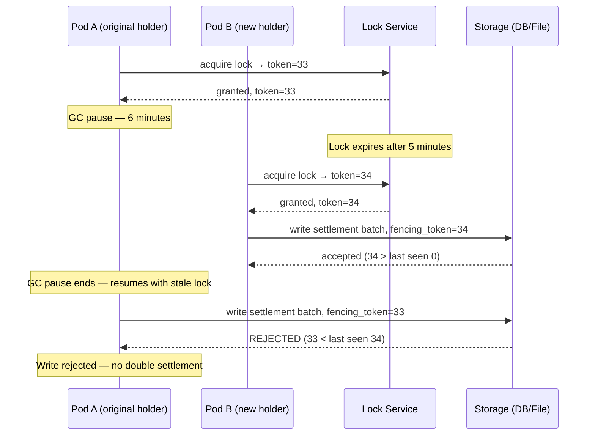

Distributed locks coordinate exclusive access to a shared resource across multiple processes or nodes. In financial systems, they prevent double processing of payment files, avoid duplicate settlement runs, and ensure single-instance jobs (end-of-day reconciliation, interest accrual) execute exactly once despite multiple service pods. Getting distributed locking right is harder than it looks: a process can acquire a lock, pause for 30 seconds due to a GC cycle, resume after the lock has expired and been acquired by another process, and then proceed to operate on the resource as though it still holds the lock exclusively — producing a data race indistinguishable from having no lock at all.

## Learning Objectives

- Identify the scenarios where distributed locks are genuinely necessary versus where idempotency and deduplication suffice
- Explain the Redlock algorithm including the N-node majority quorum and timeout calculation
- Implement a distributed lock using Redisson `RLock` with appropriate TTL and retry policy
- Explain the fencing token pattern and implement it to protect against GC pause lock expiry
- Implement PostgreSQL advisory locks using `pg_try_advisory_lock` for file-level mutual exclusion
- Write a `PaymentFileProcessor` that uses an advisory lock to prevent concurrent processing of the same file
- Explain clock skew, GC pauses, and network partitions as failure modes for distributed locks
- Compare distributed locks to idempotency keys and choose the right primitive for each scenario

## Business Context

Consider a composite example drawn from typical incidents. A payment processor runs its end-of-day settlement job on three pods, protected by a Redis lock taken with `SET NX EX 300` (a 5-minute TTL) and no fencing tokens. Pod A takes the lock at 23:00:00 and starts processing. At 23:03:00 Pod A freezes in a stop-the-world GC pause that lasts about 5 minutes. At 23:05:00 the lock expires, and at 23:05:02 Pod B takes it and starts processing the same settlement batch. At 23:08:00 Pod A wakes up, still believing it holds the lock, and continues. Both pods submit settlement files to the payment network, which accepts both — thousands of transactions are settled twice, followed by weeks of reconciliation work. The fixes: (1) fencing tokens on every write, so storage rejects a stale lock holder; (2) a watchdog that extends the lock while the job runs — which helps with long jobs but not with pauses; (3) an idempotency check (a unique settlement-file ID) in the adapter that submits to the payment network.

## When Distributed Locks Are Needed

Before reaching for a distributed lock, verify that the problem cannot be solved with idempotency and deduplication. Distributed locks have high operational complexity and subtle failure modes.

| Scenario | Lock appropriate? | Alternative |
|---|---|---|
| Prevent double processing of a payment file | Yes — file is not idempotent at the network level | Advisory lock on file identifier |
| Prevent duplicate cron job execution (e.g., interest accrual) | Yes — job produces side effects that must run exactly once | ShedLock, Quartz cluster |
| Prevent duplicate payment submission | No — idempotency key in the downstream API is safer | Idempotency key + deduplication table |
| Prevent concurrent updates to the same account | No — optimistic locking or database-level row lock is better | `SELECT FOR UPDATE` or `@Version` |
| Coordinate distributed rate limiting | Partially — consider token bucket in Redis without full lock | Redis atomic increment + expire |

## The Redlock Algorithm

Redlock was proposed by Redis creator Salvatore Sanfilippo to provide a distributed lock that remains safe when individual Redis nodes fail. The algorithm uses N independent Redis nodes (not a cluster — a cluster is a single failure domain).

**Algorithm:**
1. Record the current time `T1`.
2. Sequentially attempt to acquire the lock on all N Redis nodes using `SET key uuid PX timeout NX`. Use a per-node timeout much smaller than the TTL (e.g., 5–50ms for a 10-second TTL) to avoid waiting on slow nodes.
3. Count the number of successful acquisitions. If the count is at least `floor(N/2) + 1` (majority quorum) **and** the total elapsed time is less than the lock TTL, the lock is acquired.
4. The effective lock validity time is `TTL - elapsed - clock drift allowance`.
5. To release, DELETE the key from all nodes where it was acquired, using a Lua script to verify the UUID matches before deleting (prevents releasing another holder's lock).

```
Example: N=5, TTL=10,000ms
Acquired on nodes: 1, 3, 4 (3 out of 5 — majority quorum)
Elapsed time: 42ms
Effective validity: 10,000 - 42 = 9,958ms ✓ Lock acquired

Acquired on nodes: 1, 2 (2 out of 5 — not a majority)
Elapsed time: 11ms ✗ Lock NOT acquired — release acquired nodes
```

> [!WARNING]
> Redlock is controversial. Martin Kleppmann's analysis shows that clock drift and GC pauses can cause safety violations even with the majority quorum. For financial systems, prefer a single Redis instance plus fencing tokens (simpler, faster), a PostgreSQL advisory lock, or a CP coordination service such as etcd or ZooKeeper. Use Redlock only when you can tolerate rare lock safety violations and have fencing token protection at the storage layer.

## Redisson RLock Implementation

Redisson is a production-grade Java client for Redis with many distributed primitives. Its `RLock` is a lock on one Redis deployment (its RedLock class is deprecated). It includes a watchdog that automatically extends the lock TTL while the holder is alive — but only when you do not pass a lease time.

```java
@Service
public class SettlementJobService {

    private final RedissonClient redissonClient;
    private final SettlementBatchProcessor batchProcessor;
    private static final String LOCK_KEY = "settlement:daily-run";
    private static final long WAIT_TIMEOUT_SECONDS = 5;

    public void runDailySettlement(LocalDate settlementDate) {
        RLock lock = redissonClient.getLock(LOCK_KEY + ":" + settlementDate);

        boolean acquired = false;
        try {
            // waitTime: how long to wait if the lock is held by another node.
            // No leaseTime: the lock starts with lockWatchdogTimeout (30s) and the
            // watchdog renews it while this JVM is alive. Passing an explicit
            // leaseTime (e.g. tryLock(5, 1200, SECONDS)) DISABLES the watchdog.
            acquired = lock.tryLock(WAIT_TIMEOUT_SECONDS, TimeUnit.SECONDS);

            if (!acquired) {
                log.info("Settlement for {} already running on another node — skipping",
                    settlementDate);
                return;
            }

            log.info("Acquired settlement lock for {} — proceeding", settlementDate);
            batchProcessor.processSettlement(settlementDate);

        } catch (InterruptedException e) {
            Thread.currentThread().interrupt();
            throw new SettlementInterruptedException(settlementDate, e);
        } finally {
            // Always release the lock — but only if we acquired it
            // and only if this thread still holds it (Redisson checks this)
            if (acquired && lock.isHeldByCurrentThread()) {
                lock.unlock();
                log.info("Released settlement lock for {}", settlementDate);
            }
        }
    }
}
```

```java
@Configuration
public class RedissonConfig {

    @Bean(destroyMethod = "shutdown")
    public RedissonClient redissonClient() {
        Config config = new Config();

        // For single Redis instance (not cluster):
        config.useSingleServer()
            .setAddress("redis://localhost:6379")
            .setConnectionPoolSize(10)
            .setConnectionMinimumIdleSize(2)
            // Watchdog extends lock TTL every watchdogTimeout/3 ms
            // Default watchdog timeout = 30 seconds
            .setTimeout(3000)
            .setRetryAttempts(3)
            .setRetryInterval(1500);

        // Watchdog: renews locks taken WITHOUT a leaseTime every 10s while the
        // JVM is alive. It protects long jobs, not GC pauses: a paused JVM
        // cannot renew, so the lock still expires — hence fencing tokens.
        config.setLockWatchdogTimeout(30_000); // 30 seconds

        return Redisson.create(config);
    }
}
```

## The Fencing Token Pattern

Even with a distributed lock, a process can hold a lock that has expired (due to GC pause, network partition, or VM suspend) and proceed to write to storage without knowing the lock is gone. The fencing token pattern solves this by embedding a monotonically increasing token in every write, allowing storage to reject writes from stale lock holders.



```java
@Service
public class FencedSettlementStorage {

    private final JdbcTemplate jdbc;

    // Write with fencing token — storage rejects if token is not newer.
    // The token must come from the lock service at acquisition time, e.g.
    // INCR settlement:lock:token in Redis, a database sequence, the etcd key
    // revision, or Redisson's RFencedLock.
    public void writeSettlementBatch(
            String batchId,
            List<SettlementEntry> entries,
            long fencingToken) {

        // Update the token and write the batch in ONE atomic statement.
        // (A separate SELECT-then-write would race with a newer holder.)
        int rows = jdbc.update("""
            WITH token_update AS (
                UPDATE settlement_locks
                SET last_fencing_token = ?
                WHERE batch_type = 'daily-settlement'
                  AND (last_fencing_token IS NULL OR last_fencing_token < ?)
                RETURNING 1
            )
            INSERT INTO settlement_batches (batch_id, entries, fencing_token)
            SELECT ?, ?, ?
            WHERE EXISTS (SELECT 1 FROM token_update)
            """,
            fencingToken, fencingToken,
            batchId, serializeEntries(entries), fencingToken);

        if (rows == 0) {
            throw new StaleLockException(
                "Fencing token " + fencingToken + " rejected — a newer lock " +
                "holder has already written. This process held an expired lock.");
        }
    }
}
```

> [!NOTE]
> Redisson's `RLock` uses a Lua script for atomic lock release that checks the holder's UUID, but it does not give you a fencing token (newer Redisson versions add `RFencedLock`, which does), and no lock library can check tokens at your storage layer. You must implement fencing at the storage layer yourself for strong safety guarantees. The lock prevents concurrent access in the common case; the fencing token protects against the rare GC/network pause scenario.

## PostgreSQL Advisory Locks

PostgreSQL advisory locks are session-scoped or transaction-scoped locks stored in shared memory. They are not associated with any specific table or row — they are identified by a numeric key that you define. Advisory locks are ideal for application-level coordination such as preventing two pods from processing the same payment file.

```java
@Service
public class PaymentFileProcessor {

    private final JdbcTemplate jdbc;
    private final FileStorageService fileStorage;
    private final PaymentParser paymentParser;
    private final PaymentSubmitter paymentSubmitter;

    private final DataSource dataSource;

    // Uses a PostgreSQL SESSION advisory lock keyed on a hash of the file name.
    // A session lock belongs to ONE connection, so lock and unlock must run on
    // the same connection. With a pool, JdbcTemplate may hand out a different
    // connection per call — and a pooled connection is not closed, so a lock
    // left on it would stay held. Hence a dedicated connection for the lock.
    public ProcessingResult processFile(String fileName) {
        long lockKey = computeLockKey(fileName);

        try (Connection lockConn = dataSource.getConnection()) {
            if (!tryAdvisoryLock(lockConn, lockKey)) {
                log.info("File {} is already being processed by another pod — skipping",
                    fileName);
                return ProcessingResult.skipped(fileName);
            }
            try {
                return processLocked(fileName);
            } finally {
                // Explicit release on the SAME connection before it goes back to the pool
                try (PreparedStatement ps =
                         lockConn.prepareStatement("SELECT pg_advisory_unlock(?)")) {
                    ps.setLong(1, lockKey);
                    ps.execute();
                }
                log.info("Released advisory lock {} for file {}", lockKey, fileName);
            }
        } catch (SQLException e) {
            throw new FileProcessingException(fileName, e);
        }
    }

    private boolean tryAdvisoryLock(Connection conn, long key) throws SQLException {
        // pg_try_advisory_lock is non-blocking — returns false if the lock is held
        try (PreparedStatement ps = conn.prepareStatement("SELECT pg_try_advisory_lock(?)")) {
            ps.setLong(1, key);
            try (ResultSet rs = ps.executeQuery()) {
                return rs.next() && rs.getBoolean(1);
            }
        }
    }

    private ProcessingResult processLocked(String fileName) {
        // Idempotency guard: a file that already COMPLETED is never processed again
        jdbc.update(
            "INSERT INTO processed_files (name, status, started_at) " +
            "VALUES (?, 'PROCESSING', NOW()) ON CONFLICT (name) DO NOTHING",
            fileName);
        Integer completed = jdbc.queryForObject(
            "SELECT COUNT(*) FROM processed_files WHERE name = ? AND status = 'COMPLETED'",
            Integer.class, fileName);
        if (completed != null && completed > 0) {
            log.info("File {} already completed — skipping duplicate", fileName);
            return ProcessingResult.duplicate(fileName);
        }

        byte[] fileContent = fileStorage.download(fileName);
        List<Payment> payments = paymentParser.parse(fileContent);

        // A crash mid-batch leaves status PROCESSING; the retry resubmits, so
        // each payment must carry its own idempotency key downstream
        int submitted = paymentSubmitter.submitBatch(payments);

        jdbc.update(
            "UPDATE processed_files SET status = 'COMPLETED', " +
            "completed_at = NOW(), payment_count = ? WHERE name = ?",
            submitted, fileName);
        return ProcessingResult.success(fileName, submitted);
    }

    private long computeLockKey(String fileName) {
        // Deterministic hash — same file name always maps to same lock key
        // Use a stable hash — not Java's hashCode() which is not stable across JVMs
        return Hashing.murmur3_128().hashString(fileName, StandardCharsets.UTF_8)
            .asLong();
    }
}
```

```sql
-- PostgreSQL advisory lock reference
SELECT pg_advisory_lock(12345);         -- Session lock, blocks until acquired
SELECT pg_try_advisory_lock(12345);     -- Session lock, returns false if unavailable
SELECT pg_advisory_lock_shared(12345);  -- Shared (reader) session lock
SELECT pg_advisory_unlock(12345);       -- Explicit release
-- Transaction-scoped variants (auto-released at transaction end):
SELECT pg_advisory_xact_lock(12345);
SELECT pg_try_advisory_xact_lock(12345);

-- Check currently held advisory locks
SELECT pid, classid, objid, mode, granted
FROM pg_locks
WHERE locktype = 'advisory';
```

## Lock Expiry, Liveness, and TTL

Always set a TTL on distributed locks. A lock without TTL will never be released if the holder crashes, permanently blocking all other holders — a deadlock.

```java
// WRONG — no TTL: if the holder crashes, lock is held forever
redisTemplate.opsForValue().setIfAbsent("lock:settlement", holderId);

// CORRECT — TTL set atomically with acquisition (SET NX PX in single command)
Boolean acquired = redisTemplate.opsForValue()
    .setIfAbsent("lock:settlement", holderId, Duration.ofMinutes(20));

// CORRECT with watchdog (Redisson) — TTL extended automatically while JVM alive
RLock lock = redissonClient.getLock("settlement:daily-run");
lock.tryLock(5, TimeUnit.SECONDS);        // wait 5s, no leaseTime => watchdog active
// lock.tryLock(5, 1200, TimeUnit.SECONDS) would set a fixed 20-min TTL, NO watchdog
```

## Why Distributed Locks Are Hard

| Failure mode | Description | Protection |
|---|---|---|
| GC pause | JVM pauses for 30s+; lock expires; another holder proceeds | Fencing token at storage layer |
| Clock skew | Clocks drift between nodes; Redlock TTL calculation incorrect | Use NTP + conservative TTL margins |
| Network partition | Lock holder partitioned from Redis; lock expires; dual holders | Fencing token + write quorum |
| Process suspend | VM live-migrated or container paused by orchestrator | Same as GC pause — fencing token |
| Redis failover | Async replication: a promoted replica may not have the lock | Fencing tokens; or a CP store (etcd, ZooKeeper) for the lock |

## Alternatives to Distributed Locks

| Pattern | When to use | Trade-off |
|---|---|---|
| Idempotency key + dedup table | Duplicate payment submission prevention | Requires downstream to support idempotency |
| Optimistic locking (`@Version`) | Concurrent account updates | Retry cost on contention |
| `SELECT FOR UPDATE` | Row-level DB coordination | Scales only within the DB tier |
| ShedLock | Scheduled job single-instance execution | Requires shared DB or Redis |
| Conditional writes (CAS) | Compare-and-swap in Redis or DynamoDB | Atomic, no lock overhead |

## Knowledge Check

**Q1: Pod A acquires a Redis lock with a 5-minute TTL to run the nightly settlement job. It pauses for 6 minutes due to a GC cycle. Pod B acquires the same lock at minute 5 and begins processing. Pod A resumes at minute 6 and also continues processing. What is the outcome without fencing tokens, and how do fencing tokens prevent the problem?**

A: Without fencing tokens, both pods write settlement data concurrently. The result is double settlement — both write operations succeed at the storage layer, which cannot distinguish the stale lock holder (Pod A) from the current holder (Pod B). With fencing tokens: when Pod B acquires the lock it receives token=34. When Pod A acquired the lock it received token=33. Pod A's writes to storage include token=33; storage has already seen token=34 from Pod B, so it rejects Pod A's writes as stale. The settlement proceeds exactly once.

**Q2: You are choosing between a Redis distributed lock and a PostgreSQL advisory lock for preventing two pods from processing the same payment file. The processing takes 2–10 minutes and the application uses PostgreSQL as its primary database. Which should you use?**

A: Use PostgreSQL advisory locks. The reasons: (1) you already have a PostgreSQL connection for recording processing status — using the same connection for the advisory lock avoids an extra Redis dependency; (2) no TTL to manage: the lock lives exactly as long as the database session that holds it; (3) if the application pod crashes, its connection closes and PostgreSQL releases the lock (immediately on a clean disconnect, or after TCP keepalive detects a vanished host). One caveat: with a connection pool, take and release the lock on the same dedicated connection — a pooled connection is not closed, so a forgotten session lock stays held. Redis locks require a watchdog to handle pod crashes, which adds complexity. Advisory locks are the right tool when the coordination domain is the same as the storage domain.

## Practical Challenge

**Scenario:** You are building the settlement processing service for a payment processor. Settlement jobs run every night at 23:00. Each job processes 500,000 transactions. Three pods run the service. The settlement must run exactly once per night. Processing takes 8–15 minutes.

**Tasks:**

1. **Redisson lock with watchdog:** Implement `NightlySettlementJob` using Redisson `RLock` with a 20-minute TTL and 5-second wait timeout. Explain why `leaseTime = -1` with watchdog is safer than `leaseTime = 1200` for a job that may take up to 15 minutes. Show correct lock release in the `finally` block with the `isHeldByCurrentThread()` check.

2. **Fencing token implementation:** Write the `SettlementAuditStore.writeSettlementRecord(SettlementRecord record, long fencingToken)` method that uses a PostgreSQL CAS write to reject writes where `fencing_token <= last_accepted_token`. Include the SQL, the exception type for rejection, and an explanation of why a simple UUID check on the lock (Redisson's built-in) is not sufficient.

3. **PostgreSQL advisory lock:** Write `PaymentFileProcessor.processFile(String s3Key)` using `pg_try_advisory_lock` on a hash of `s3Key`. Include: non-blocking acquisition, skip logic if held, file processing, idempotency guard against re-processing completed files, and explicit `pg_advisory_unlock` in the `finally` block.

4. **Identify the anti-pattern:** A team takes `SELECT balance FROM accounts WHERE id = ? FOR UPDATE` and then, while still holding the row lock, calls a remote fraud service that can take up to 2 seconds. A short row lock for the debit itself is correct; holding it across a remote call is not. Explain the two problems at scale (hint: connection pool exhaustion and lock waits across service boundaries), and propose the fix: make remote calls before the transaction and keep the lock short, or use optimistic locking with `@Version` and a retry.

<!-- KNOWLEDGE-CHECK
{
  "questions": [
    {
      "id": "q1",
      "text": "Pod A holds a Redis lock with token=33 but pauses for a GC cycle longer than the TTL. Pod B acquires the lock with token=34 and writes to storage. Pod A resumes and tries to write. What happens with fencing tokens?",
      "options": [
        "Pod A's write succeeds — it held the lock before Pod B",
        "Pod A's write is rejected — storage sees token 33 < last token 34",
        "Both writes succeed — Redis cannot prevent concurrent writes",
        "Pod B's write is reversed — the first holder has priority"
      ],
      "correct": 1,
      "explanation": "Storage records the highest fencing token it has seen (34 from Pod B). When Pod A presents token 33, storage rejects it because 33 < 34. The fencing token makes storage the authority on lock ordering, not the lock service. This protects against GC pauses, network partitions, and VM suspends that can expire locks silently."
    },
    {
      "id": "q2",
      "text": "You need to prevent two pods from processing the same payment file. The application uses PostgreSQL. Which locking mechanism is most appropriate?",
      "options": [
        "Redis Redlock across 5 independent Redis nodes",
        "SELECT FOR UPDATE on the payment_files table row",
        "PostgreSQL pg_try_advisory_lock with a hash of the file identifier",
        "Java synchronized block on a static variable"
      ],
      "correct": 2,
      "explanation": "pg_try_advisory_lock is ideal: it uses the PostgreSQL database the service already depends on, it is released when the holding session ends (a pod crash closes the connection), and it is non-blocking (it returns false rather than waiting). Take and release it on one dedicated connection, because a pooled connection is not closed. SELECT FOR UPDATE would hold a row lock inside a transaction for the entire multi-minute processing time. Redis Redlock adds infrastructure complexity that is unwarranted when PostgreSQL is already available. A Java synchronized block is process-scoped, not distributed."
    }
  ]
}
-->

<!-- PRACTICAL-CHALLENGE
{
  "title": "Exactly-Once Nightly Settlement with Locks and Fencing Tokens",
  "difficulty": "advanced",
  "estimatedMinutes": 60,
  "tasks": [
    {
      "id": "1",
      "description": "Implement NightlySettlementJob with Redisson RLock taken without a leaseTime (so the watchdog renews it), a 5-second wait, and a finally block that unlocks only when isHeldByCurrentThread() is true. Explain why an explicit leaseTime of 1200 seconds disables the watchdog."
    },
    {
      "id": "2",
      "description": "Write SettlementAuditStore.writeSettlementRecord(record, fencingToken) as a single atomic PostgreSQL statement that rejects writes where fencing_token <= last_accepted_token and throws when no row was written. Explain where the token comes from and why Redisson's UUID check on unlock is not enough."
    },
    {
      "id": "3",
      "description": "Write PaymentFileProcessor.processFile(String s3Key) using pg_try_advisory_lock on a hash of s3Key, on one dedicated connection: non-blocking acquisition, skip if held, an idempotency guard for completed files, and pg_advisory_unlock on the same connection in finally."
    },
    {
      "id": "4",
      "description": "A team holds SELECT ... FOR UPDATE on an account row while calling a slow remote fraud service. Explain why this exhausts connection pools and spreads lock waits across services, and propose the fix: remote calls before the transaction, short locks, or optimistic locking with @Version and retry."
    }
  ]
}
-->
