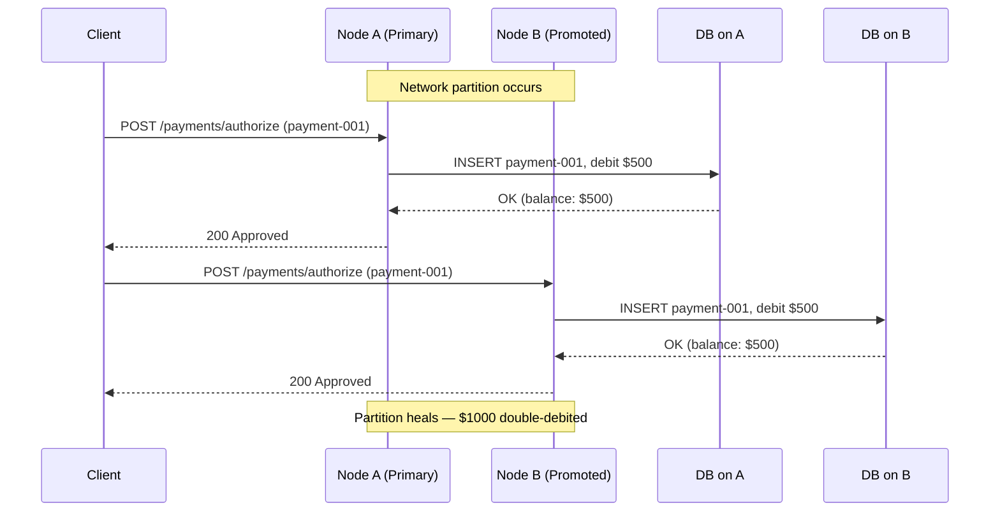

# Split-Brain and Network Partition Handling

> [!NOTE]
> Split-brain is not a rare edge case — it is an inevitable consequence of running any distributed system in production. For financial systems processing payments and ledger updates, the difference between detecting a split-brain and missing one is the difference between a reconcilable discrepancy and undetectable double-spending.

## What is Split-Brain?

A **split-brain** occurs when two or more nodes in a distributed cluster each believe they are the authoritative leader (or primary) simultaneously, with no network path between them to coordinate. Each partition continues accepting writes independently, leading to divergent state that cannot be automatically reconciled.

The term originates from high-availability clustering: when the heartbeat network between nodes fails, each node assumes the other has died and promotes itself to primary. Both nodes then process transactions against the same logical dataset, creating two independent histories.

```
Time ─────────────────────────────────────────────────────►

Node A: [Primary]──────[Network partition]──────[Still primary?]──[Writes continue]
                               │
                        Network failure
                               │
Node B: [Standby]──────[Network partition]──────[Promotes self]──[Writes continue]

Both A and B process Account #12345 debit of $500.
Account balance: $1000 → goes to $500 on A, $500 on B.
Actual combined debit: $1000 (double-spend).
```

In a payment processing system, split-brain during a network partition means:
- Two nodes accept the same payment authorization, charging a customer twice
- Both sides of a fund transfer debit the same source account independently
- Risk limits are enforced independently on each partition, allowing aggregate exposure that exceeds thresholds
- Idempotency keys are checked against different stores, preventing deduplication



---

## Detecting Split-Brain

### Heartbeat and Witness Nodes

The most common detection mechanism is a heartbeat combined with a **witness** or **arbitrator** — a third node that breaks ties. If Node A and Node B cannot reach each other, whichever can still reach the witness is considered the surviving partition.

```java
@Component
public class ClusterHeartbeatMonitor {

    private final NodeRegistry nodeRegistry;
    private final WitnessClient witnessClient;
    private final ClusterStatePublisher statePublisher;

    private static final Duration HEARTBEAT_TIMEOUT = Duration.ofSeconds(6);

    @Scheduled(fixedDelayString = "2000")
    public void sendHeartbeat() {
        HeartbeatMessage hb = HeartbeatMessage.builder()
            .nodeId(nodeRegistry.localNodeId())
            .timestamp(Instant.now())
            .term(nodeRegistry.currentTerm())
            .lastCommittedOffset(nodeRegistry.lastCommittedLedgerOffset())
            .build();

        for (NodeDescriptor peer : nodeRegistry.peers()) {
            try {
                peer.client().sendHeartbeat(hb);
            } catch (HeartbeatFailureException e) {
                handlePeerUnreachable(peer, e);
            }
        }
    }

    private void handlePeerUnreachable(NodeDescriptor peer, HeartbeatFailureException e) {
        peer.recordFailure(Instant.now());

        if (peer.failureDuration().compareTo(HEARTBEAT_TIMEOUT) > 0) {
            log.warn("Peer {} unreachable for {}ms — querying witness",
                peer.nodeId(), peer.failureDuration().toMillis());

            WitnessResponse wr = witnessClient.queryNodeHealth(peer.nodeId());
            if (wr.isAlive()) {
                // We cannot reach peer but witness can — WE may be the isolated partition
                log.error("SPLIT-BRAIN RISK: peer {} reachable by witness but not by us. " +
                    "Initiating self-fencing.", peer.nodeId());
                statePublisher.publishSelfFencingRequired(peer.nodeId());
            } else {
                // Witness also cannot reach peer — peer is likely dead
                log.warn("Peer {} confirmed unreachable by witness — marking as failed",
                    peer.nodeId());
                nodeRegistry.markFailed(peer.nodeId());
            }
        }
    }
}
```

### Epoch/Term-Based Detection

Consensus protocols like Raft use a **term** (or epoch) number. Any node receiving a message from a higher term immediately recognizes it is out of date and steps down. This is split-brain prevention by design.

```java
@Service
public class RaftTermGuard {

    private final AtomicLong currentTerm = new AtomicLong(0);
    private final NodeRole roleRef;  // LEADER, FOLLOWER, CANDIDATE

    /**
     * Any RPC handler must call this first. If the incoming term is higher,
     * we immediately step down. This prevents a partitioned former leader
     * from continuing to process payment authorizations.
     */
    public void checkIncomingTerm(long incomingTerm, String sourceNodeId) {
        long local = currentTerm.get();
        if (incomingTerm > local) {
            log.warn("Received higher term {} from {} (local={}). " +
                "Stepping down from {} to FOLLOWER.",
                incomingTerm, sourceNodeId, local, roleRef.current());
            currentTerm.set(incomingTerm);
            roleRef.transitionTo(NodeRole.FOLLOWER);
            // Critical: stop accepting payment write requests immediately
            PaymentWriteGate.close("stepped-down-higher-term");
        }
    }

    public boolean isLeaderForTerm(long term) {
        return roleRef.current() == NodeRole.LEADER
            && currentTerm.get() == term;
    }
}
```

### Fencing Tokens

A **fencing token** is a monotonically increasing number issued by a lock service (e.g., ZooKeeper, etcd) when a node acquires leadership. The token is included in every write request to downstream services. If the downstream sees a higher token than the one on an incoming request, it rejects the write — the sender is a stale leader.

```java
@Service
public class FencedPaymentWriter {

    private final PaymentLedgerClient ledgerClient;
    private final LeadershipToken leadershipToken;  // Obtained from etcd/ZooKeeper

    /**
     * Every payment write MUST include the current fencing token.
     * The ledger storage layer enforces monotonicity — it will reject
     * any write arriving with a token lower than the last seen token.
     */
    public PaymentConfirmation writePayment(PaymentInstruction instruction) {
        long token = leadershipToken.current();

        if (token == LeadershipToken.NONE) {
            throw new NotLeaderException(
                "Node does not hold leadership — refusing payment write");
        }

        FencedWriteRequest request = FencedWriteRequest.builder()
            .fencingToken(token)
            .payload(instruction)
            .idempotencyKey(instruction.idempotencyKey())
            .build();

        try {
            return ledgerClient.write(request);
        } catch (StaleFencingTokenException e) {
            // Our token was rejected — a new leader has emerged
            log.error("Fencing token {} rejected (current accepted: {}). " +
                "We are a stale leader. Halting writes immediately.",
                token, e.currentToken());
            leadershipToken.invalidate();
            throw new StaleLeaderException(
                "Payment write rejected — stale fencing token", e);
        }
    }
}
```

```sql
-- Ledger table enforces fencing token monotonicity at the storage layer
CREATE TABLE payment_ledger (
    ledger_entry_id  BIGSERIAL   PRIMARY KEY,
    payment_id       UUID        NOT NULL,
    fencing_token    BIGINT      NOT NULL,
    amount_cents     BIGINT      NOT NULL,
    currency         CHAR(3)     NOT NULL,
    debit_account    VARCHAR(34) NOT NULL,
    credit_account   VARCHAR(34) NOT NULL,
    recorded_at      TIMESTAMPTZ NOT NULL DEFAULT NOW()
);

-- Stored procedure that enforces fencing token at write time
CREATE OR REPLACE FUNCTION write_payment_fenced(
    p_payment_id      UUID,
    p_fencing_token   BIGINT,
    p_amount_cents    BIGINT,
    p_currency        CHAR(3),
    p_debit_account   VARCHAR(34),
    p_credit_account  VARCHAR(34)
) RETURNS BIGINT AS $$
DECLARE
    v_max_token BIGINT;
    v_new_id    BIGINT;
BEGIN
    SELECT COALESCE(MAX(fencing_token), 0)
    INTO v_max_token
    FROM payment_ledger
    FOR UPDATE;  -- Serialize concurrent writes

    IF p_fencing_token < v_max_token THEN
        RAISE EXCEPTION 'STALE_FENCING_TOKEN: incoming=% max_seen=%',
            p_fencing_token, v_max_token;
    END IF;

    INSERT INTO payment_ledger (
        payment_id, fencing_token, amount_cents, currency,
        debit_account, credit_account
    ) VALUES (
        p_payment_id, p_fencing_token, p_amount_cents, p_currency,
        p_debit_account, p_credit_account
    )
    RETURNING ledger_entry_id INTO v_new_id;

    RETURN v_new_id;
END;
$$ LANGUAGE plpgsql;
```

---

## STONITH: Shoot The Other Node In The Head

**STONITH** (Shoot The Other Node In The Head) is a fencing mechanism used in high-availability clusters to guarantee that a potentially rogue node is physically powered off or isolated before the surviving partition resumes operations. When you cannot confirm a node is dead, you must make it dead before proceeding.

STONITH is implemented via **IPMI** (Intelligent Platform Management Interface), **iLO** (HP Integrated Lights-Out), **DRAC** (Dell Remote Access Controller), PDU power switches, or cloud provider APIs.

```java
@Component
public class StonithFencer {

    private final IpmiClient ipmiClient;
    private final CloudInstanceController cloudController;
    private final NodeRegistry nodeRegistry;
    private final AuditLogger auditLogger;

    /**
     * Called when split-brain is detected and the local node wins the quorum.
     * We must physically isolate the other node before resuming payment writes.
     */
    public FencingResult fenceNode(String targetNodeId, String reason) {
        log.warn("STONITH initiated against node {} — reason: {}", targetNodeId, reason);
        auditLogger.logStonithEvent(targetNodeId, reason, Instant.now());

        NodeDescriptor target = nodeRegistry.get(targetNodeId);
        FencingResult result;

        if (target.hasIpmiEndpoint()) {
            result = attemptIpmiFence(target);
        } else {
            result = attemptCloudFence(target);
        }

        if (!result.isSuccessful()) {
            // CRITICAL: If we cannot confirm the node is fenced, we must NOT proceed.
            // Uncertainty means halt — never assume safety in a financial system.
            log.error("STONITH failed for node {}. Cannot confirm isolation. " +
                "Refusing to resume payment writes until fencing is confirmed.",
                targetNodeId);
            throw new FencingFailureException(
                "Cannot confirm STONITH for " + targetNodeId
                    + " — payment writes suspended");
        }

        log.info("STONITH confirmed for node {}. Resuming as sole primary.", targetNodeId);
        return result;
    }

    private FencingResult attemptIpmiFence(NodeDescriptor target) {
        try {
            IpmiResponse response = ipmiClient.powerOff(
                target.ipmiHost(),
                target.ipmiCredentials(),
                IpmiCommand.CHASSIS_POWER_OFF
            );

            // Verify the node is actually off — do not trust the IPMI response alone
            boolean confirmed = pollNodeDead(target, Duration.ofSeconds(10));
            return FencingResult.of(confirmed, response.rawOutput());
        } catch (IpmiException e) {
            log.error("IPMI fencing failed for {}: {}", target.nodeId(), e.getMessage());
            return FencingResult.failed(e.getMessage());
        }
    }

    private FencingResult attemptCloudFence(NodeDescriptor target) {
        try {
            cloudController.stopInstance(target.cloudInstanceId());
            InstanceState finalState = cloudController.waitForState(
                target.cloudInstanceId(),
                InstanceState.STOPPED,
                Duration.ofSeconds(30)
            );
            return FencingResult.of(
                finalState == InstanceState.STOPPED,
                finalState.name());
        } catch (CloudApiException e) {
            return FencingResult.failed(e.getMessage());
        }
    }

    private boolean pollNodeDead(NodeDescriptor target, Duration timeout) {
        Instant deadline = Instant.now().plus(timeout);
        while (Instant.now().isBefore(deadline)) {
            try {
                target.client().ping();
                Thread.sleep(500);
            } catch (Exception e) {
                return true; // Cannot reach node — fencing confirmed
            }
        }
        return false;
    }
}
```

### STONITH via AWS EC2 Stop API

In cloud environments the equivalent of IPMI fencing is using the cloud provider instance management API:

```java
@Service
public class AwsStonithProvider {

    private final Ec2Client ec2Client;
    private final SnsClient snsClient;

    public FencingResult fence(String instanceId, String reason) {
        log.warn("AWS STONITH: stopping instance {} — reason: {}", instanceId, reason);

        try {
            StopInstancesRequest request = StopInstancesRequest.builder()
                .instanceIds(instanceId)
                .force(true)  // Force stop — do not wait for OS shutdown
                .build();

            StopInstancesResponse response = ec2Client.stopInstances(request);
            InstanceStateChange change = response.stoppingInstances().get(0);

            log.info("Instance {} transitioning from {} to {}",
                instanceId,
                change.previousState().name(),
                change.currentState().name());

            snsClient.publish(PublishRequest.builder()
                .topicArn(System.getenv("STONITH_ALERT_TOPIC_ARN"))
                .subject("STONITH Event: " + instanceId)
                .message(buildStonithAlert(instanceId, reason, change))
                .build());

            return waitForStopped(instanceId);

        } catch (Ec2Exception e) {
            return FencingResult.failed("AWS API error: " + e.getMessage());
        }
    }

    private FencingResult waitForStopped(String instanceId) {
        Ec2Waiter waiter = ec2Client.waiter();
        WaiterResponse<DescribeInstancesResponse> waiterResponse =
            waiter.waitUntilInstanceStopped(
                DescribeInstancesRequest.builder()
                    .instanceIds(instanceId)
                    .build()
            );

        return waiterResponse.matched().response()
            .map(r -> FencingResult.successful("Instance stopped"))
            .orElse(FencingResult.failed("Waiter timed out"));
    }
}
```

---

## Quorum-Based Membership

The clean mathematical solution to split-brain is **quorum**: only the partition that can reach a majority (N/2 + 1) of nodes is allowed to operate. A minority partition must refuse all writes.

For a 3-node cluster (N=3), quorum requires 2 nodes. If node A is isolated and cannot reach B or C, it cannot form quorum and must reject writes. If B and C can still reach each other, they form quorum and continue.

```
Cluster size │ Quorum required │ Tolerated failures
─────────────┼─────────────────┼───────────────────
      3      │        2        │         1
      5      │        3        │         2
      7      │        4        │         3
```

```java
@Service
public class QuorumMembershipService {

    private final NodeRegistry nodeRegistry;
    private final int clusterSize;

    public QuorumMembershipService(
            NodeRegistry nodeRegistry,
            @Value("${cluster.size}") int clusterSize) {
        this.nodeRegistry = nodeRegistry;
        this.clusterSize = clusterSize;
    }

    public int requiredQuorum() {
        return (clusterSize / 2) + 1;
    }

    /**
     * Returns true only if this node is part of a majority partition.
     * Payment writes must check this before proceeding.
     */
    public boolean hasQuorum() {
        int reachableNodes = 1; // Count self
        for (NodeDescriptor peer : nodeRegistry.peers()) {
            if (peer.isReachable()) {
                reachableNodes++;
            }
        }
        boolean quorum = reachableNodes >= requiredQuorum();
        if (!quorum) {
            log.warn("Quorum check FAILED: reachable={} required={} total={}",
                reachableNodes, requiredQuorum(), clusterSize);
        }
        return quorum;
    }

    /**
     * Guards payment write operations. Any write attempted without quorum
     * throws a QuorumLostException, preventing split-brain writes.
     */
    public void assertQuorum() {
        if (!hasQuorum()) {
            throw new QuorumLostException(
                String.format(
                    "Cannot proceed: only %d/%d nodes reachable, need %d",
                    countReachable(), clusterSize, requiredQuorum())
            );
        }
    }

    private int countReachable() {
        return 1 + (int) nodeRegistry.peers().stream()
            .filter(NodeDescriptor::isReachable)
            .count();
    }
}
```

---

## PostgreSQL Synchronous Replication

PostgreSQL streaming replication is asynchronous by default. When the primary fails and a standby promotes itself, there is no guarantee that all WAL (Write-Ahead Log) has been replicated. If the old primary recovers and both nodes accept writes, you have split-brain in your financial database.

### Synchronous Replication Configuration

```sql
-- postgresql.conf on primary
-- Require at least one standby to confirm receipt before acknowledging write
synchronous_commit = on
synchronous_standby_names = 'FIRST 1 (standby1, standby2)'

-- For maximum safety (any two of three standbys must ack):
-- synchronous_standby_names = 'ANY 2 (standby1, standby2, standby3)'

-- wal_level must be replica or logical for streaming replication
wal_level = replica
max_wal_senders = 5
wal_keep_size = 1GB
```

### Recovery Target Timeline

After a failover, the old primary must be rewound to the new primary's timeline before rejoining as a standby:

```sql
-- recovery.conf (or postgresql.conf in PG12+)
recovery_target_timeline = 'latest'

-- After split-brain recovery, rewind from the shell on the old-primary host:
-- pg_rewind --target-pgdata=/var/lib/postgresql/data \
--           --source-server="host=new-primary port=5432 user=replicator"
```

### Detecting Timeline Divergence

```java
@Service
public class PostgresReplicationMonitor {

    private final DataSource primaryDataSource;
    private final DataSource standbyDataSource;

    /**
     * Detects if the standby is on a different timeline than the primary,
     * indicating a split-brain recovery scenario.
     */
    public ReplicationHealthStatus checkTimelineConsistency() {
        try (
            Connection primary = primaryDataSource.getConnection();
            Connection standby = standbyDataSource.getConnection()
        ) {
            long primaryTimeline = queryCurrentTimeline(primary);
            long standbyTimeline = queryCurrentTimeline(standby);
            String primaryLsn   = queryCurrentLsn(primary);
            String standbyLsn   = queryCurrentLsn(standby);
            String replayLag    = queryReplayLag(standby);

            if (primaryTimeline != standbyTimeline) {
                log.error(
                    "TIMELINE DIVERGENCE DETECTED: primary={} standby={}. " +
                    "POSSIBLE SPLIT-BRAIN. Manual intervention required.",
                    primaryTimeline, standbyTimeline);
                return ReplicationHealthStatus.splitBrainDetected(
                    primaryTimeline, standbyTimeline);
            }

            return ReplicationHealthStatus.healthy(primaryLsn, standbyLsn, replayLag);

        } catch (SQLException e) {
            return ReplicationHealthStatus.error(e.getMessage());
        }
    }

    private long queryCurrentTimeline(Connection conn) throws SQLException {
        try (PreparedStatement ps = conn.prepareStatement(
                "SELECT timeline_id FROM pg_control_checkpoint()");
             ResultSet rs = ps.executeQuery()) {
            rs.next();
            return rs.getLong(1);
        }
    }

    private String queryCurrentLsn(Connection conn) throws SQLException {
        try (PreparedStatement ps = conn.prepareStatement(
                "SELECT pg_current_wal_lsn()::text");
             ResultSet rs = ps.executeQuery()) {
            rs.next();
            return rs.getString(1);
        }
    }

    private String queryReplayLag(Connection conn) throws SQLException {
        try (PreparedStatement ps = conn.prepareStatement(
                "SELECT EXTRACT(EPOCH FROM replay_lag)::text " +
                "FROM pg_stat_replication LIMIT 1");
             ResultSet rs = ps.executeQuery()) {
            if (rs.next()) return rs.getString(1);
            return "unknown";
        }
    }
}
```

---

## Patroni: PostgreSQL High-Availability Cluster

**Patroni** is the de-facto standard for managing PostgreSQL HA clusters in production. It uses a Distributed Configuration Store (etcd, Consul, or ZooKeeper) as a consensus backbone. The DCS provides the fencing token: only the node that holds the DCS leader lock is allowed to run as PostgreSQL primary. When the primary loses its DCS lease, Patroni fences it immediately — before any standby is promoted.

```yaml
# patroni.yml — configuration for the primary node
scope: payment-cluster
namespace: /fintech/
name: pg-node-1

restapi:
  listen: 0.0.0.0:8008
  connect_address: 10.0.1.11:8008

etcd3:
  hosts:
    - 10.0.0.1:2379
    - 10.0.0.2:2379
    - 10.0.0.3:2379

bootstrap:
  dcs:
    ttl: 30                            # DCS lease TTL — node must renew every 30s
    loop_wait: 10                      # Patroni loop interval
    retry_timeout: 10
    maximum_lag_on_failover: 1048576   # 1 MB — max lag before standby is excluded from election
    synchronous_mode: true             # Require at least one sync standby
    synchronous_mode_strict: false     # Do not refuse writes if no sync standby available
    postgresql:
      use_pg_rewind: true
      use_slots: true
      parameters:
        wal_level: replica
        hot_standby: "on"
        max_wal_senders: 5
        max_replication_slots: 5
        synchronous_commit: "on"
        synchronous_standby_names: "ANY 1 (*)"

postgresql:
  listen: 0.0.0.0:5432
  connect_address: 10.0.1.11:5432
  data_dir: /var/lib/postgresql/data
  pg_hba:
    - host replication replicator 10.0.0.0/24 md5
    - host all all 0.0.0.0/0 md5
  authentication:
    replication:
      username: replicator
      password: "${REPLICATION_PASSWORD}"
    superuser:
      username: postgres
      password: "${POSTGRES_PASSWORD}"

watchdog:
  mode: required       # Kernel-level watchdog prevents split-brain
  device: /dev/watchdog
  safety_margin: 5

tags:
  nofailover: false
  noloadbalance: false
  clonedfrom: false
  nosync: false
```

### Patroni Cluster Architecture

```
                    ┌─────────────────────────────┐
                    │  etcd cluster (3 nodes)      │
                    │  provides DCS leader lock    │
                    └────────┬────────┬────────────┘
                             │        │
                    ┌────────▼──┐  ┌──▼────────┐  ┌───────────┐
                    │ Patroni   │  │ Patroni   │  │ Patroni   │
                    │ pg-node-1 │  │ pg-node-2 │  │ pg-node-3 │
                    │ [PRIMARY] │  │ [STANDBY] │  │ [STANDBY] │
                    └────────┬──┘  └──▲────────┘  └──▲────────┘
                             │        │               │
                             └────────┴───────────────┘
                                WAL streaming replication

Failover sequence:
1. pg-node-1 loses etcd lease (network partition / crash)
2. etcd lease expires after ttl=30s
3. Patroni on pg-node-2 and pg-node-3 detect leader absence
4. Election: pg-node-2 acquires etcd lock (fencing token increments)
5. Patroni on pg-node-1 detects lost lock → triggers watchdog → kernel resets node
6. pg-node-2 promotes to primary (pg_ctl promote)
7. pg-node-3 reconfigures streaming replication from pg-node-2
8. HAProxy health checks pick up new primary on port 5432
```

### Monitoring Patroni Cluster Health from Java

```java
@Service
public class PatroniClusterMonitor {

    private final RestTemplate restTemplate;
    private final List<String> patroniEndpoints;  // e.g. http://10.0.1.11:8008, ...

    /**
     * Patroni exposes a REST API for cluster state.
     * GET /patroni returns JSON with role, state, timeline, lag.
     * GET /primary returns 200 only on the current primary — use as health check.
     */
    @Scheduled(fixedDelayString = "5000")
    public void checkClusterHealth() {
        for (String endpoint : patroniEndpoints) {
            try {
                PatroniStatus status = restTemplate.getForObject(
                    endpoint + "/patroni", PatroniStatus.class);

                if (status == null) continue;

                log.info("Node {} role={} state={} timeline={} lagBytes={}",
                    status.name(), status.role(), status.state(),
                    status.timeline(), status.replicationLagBytes());

                if ("primary".equals(status.role()) && !"running".equals(status.state())) {
                    log.error("PRIMARY NODE {} IS NOT IN RUNNING STATE: {}",
                        status.name(), status.state());
                    alertingService.sendP1Alert("Patroni primary not running: " + status.name());
                }

                if (status.replicationLagBytes() != null
                        && status.replicationLagBytes() > 10_485_760L) { // 10 MB
                    log.warn("Replication lag on {} is {} bytes — approaching failover threshold",
                        status.name(), status.replicationLagBytes());
                }

            } catch (RestClientException e) {
                log.error("Cannot reach Patroni endpoint {}: {}", endpoint, e.getMessage());
            }
        }
    }
}
```

---

## CP vs AP: The Architectural Decision for Payment Systems

The CAP theorem states that a distributed system can guarantee at most two of: Consistency, Availability, and Partition Tolerance. Because network partitions are inevitable in production, the real choice is between **CP** (consistency over availability) and **AP** (availability over consistency).

```
                    CP Choice                    AP Choice
                    ──────────                   ─────────
System type         Core banking ledger          Read-heavy analytics
                    Payment authorization        Fraud scoring cache
                    Balance inquiry              Product catalog

Partition behavior  Reject writes on minority    Accept writes on both sides
                    partition. Return 503.       Reconcile after partition heals.

Data model          Single authoritative copy    Eventually consistent replicas
                    with synchronous replication with conflict resolution

Risk                Temporary unavailability     Potential data inconsistency;
                    during partition             requires reconciliation logic

Regulatory fit      Required for PSD2 and        Acceptable for non-financial
                    core banking                 reference data

Recovery            Automatic — partition        Manual reconciliation may
                    heals, writes resume         be required for conflicts
```

### Implementing the CP Pattern for Payments

```java
@RestController
@RequestMapping("/payments")
public class PaymentController {

    private final QuorumMembershipService quorumService;
    private final PaymentAuthorizationService authService;

    @PostMapping("/authorize")
    public ResponseEntity<AuthorizationResult> authorize(
            @RequestBody PaymentRequest request) {

        try {
            quorumService.assertQuorum();
        } catch (QuorumLostException e) {
            // 503 with Retry-After — do not silently queue the payment
            return ResponseEntity.status(HttpStatus.SERVICE_UNAVAILABLE)
                .header("Retry-After", "10")
                .header("X-Cluster-Status", "partition-detected")
                .body(AuthorizationResult.unavailable(
                    "Payment system is operating in degraded mode " +
                    "due to network partition. Please retry in a few seconds."));
        }

        return ResponseEntity.ok(authService.authorizePayment(request));
    }
}
```

### Majority Quorum Writes

For systems that use replication directly (without a consensus protocol), enforcing majority quorum writes requires tracking acknowledgments from replicas:

```java
@Service
public class QuorumPaymentReplicator {

    private final List<ReplicaClient> replicas;
    private final int writeQuorum;

    public QuorumPaymentReplicator(List<ReplicaClient> replicas) {
        this.replicas = replicas;
        this.writeQuorum = (replicas.size() / 2) + 1;
    }

    public ReplicationResult writeWithQuorum(PaymentEntry entry) {
        List<CompletableFuture<ReplicaAck>> futures = replicas.stream()
            .map(r -> CompletableFuture
                .supplyAsync(() -> r.replicate(entry))
                .orTimeout(2, TimeUnit.SECONDS)
                .exceptionally(ex -> ReplicaAck.failed(r.nodeId(), ex.getMessage())))
            .collect(Collectors.toList());

        int ackCount = 0;
        List<String> failedNodes = new ArrayList<>();

        for (CompletableFuture<ReplicaAck> future : futures) {
            ReplicaAck ack = future.join();
            if (ack.isSuccessful()) {
                ackCount++;
            } else {
                failedNodes.add(ack.nodeId());
            }
        }

        if (ackCount < writeQuorum) {
            throw new QuorumWriteFailedException(
                String.format(
                    "Write quorum not met: %d/%d acks received (need %d). " +
                    "Failed nodes: %s",
                    ackCount, replicas.size(), writeQuorum, failedNodes)
            );
        }

        return ReplicationResult.success(ackCount, replicas.size());
    }
}
```

---

## Operational Recovery from Split-Brain

When split-brain is detected and both partitions have accepted writes, recovery requires:

1. **Stop all writes** to both partitions immediately
2. **Identify the divergence point** — the last common log entry/LSN
3. **Choose the authoritative partition** — the one endorsed by quorum, or with the most recent committed offset
4. **Replay and reconcile** the conflicting transactions from the rejected partition
5. **Alert operations and compliance** — financial regulators may require notification

```java
@Service
public class SplitBrainRecoveryCoordinator {

    private final LedgerAuditService auditService;
    private final TransactionReconciler reconciler;
    private final ComplianceNotifier complianceNotifier;
    private final AlertingService alerting;
    private final OutOfBandClient outOfBandClient;

    public RecoveryReport coordinateRecovery(SplitBrainEvent event) {
        log.error(
            "SPLIT-BRAIN RECOVERY INITIATED: partitionA={} partitionB={} " +
            "divergencePoint={}",
            event.partitionA(), event.partitionB(), event.divergencePoint());

        // 1. Freeze all writes on both partitions via out-of-band channel
        outOfBandClient.sendFreeze(event.partitionA());
        outOfBandClient.sendFreeze(event.partitionB());

        // 2. Identify diverging transactions
        List<Transaction> divergingOnA = auditService.getTransactionsAfter(
            event.partitionA(), event.divergencePoint());
        List<Transaction> divergingOnB = auditService.getTransactionsAfter(
            event.partitionB(), event.divergencePoint());

        log.info("Divergence analysis: partitionA={} transactions, partitionB={}",
            divergingOnA.size(), divergingOnB.size());

        // 3. Determine canonical partition
        String canonical = event.quorumEndorsedPartition();
        List<Transaction> rejected = canonical.equals(event.partitionA())
            ? divergingOnB : divergingOnA;

        // 4. Reconcile — some may be re-applicable, others must be reversed
        ReconciliationResult reconciliation = reconciler.reconcile(rejected, canonical);

        // 5. Notify compliance (may be a regulatory obligation)
        complianceNotifier.notifySplitBrainRecovery(event, reconciliation, Instant.now());

        // 6. Resume operations on canonical partition only
        outOfBandClient.resumeWrites(canonical);

        RecoveryReport report = buildRecoveryReport(event, reconciliation);
        alerting.sendP0Alert("Split-brain recovery complete", report.summary());
        return report;
    }
}
```

---

## Production Pitfalls

### Pitfall 1: Trusting Heartbeats Alone

Heartbeats detect network failure, not node failure. A node undergoing a JVM GC pause or disk I/O saturation may miss heartbeats without being dead. The heartbeat timeout fires, the witness decides the node is dead, and the surviving partition promotes itself — only for the GC-paused node to wake up 8 seconds later and continue accepting writes as primary.

**Mitigation:** Use application-level health checks that verify actual write capability, not just network reachability:

```java
@RestController
public class ApplicationLevelHealthCheck {

    private final DataSource dataSource;

    @GetMapping("/internal/health/detailed")
    public HealthDetail checkHealth() {
        return HealthDetail.builder()
            .databaseWritable(checkDatabaseWrite())
            .lastSuccessfulWrite(lastWriteTimestamp())
            .replicationLagMs(checkReplicationLag())
            .jvmGcPressure(checkGcPressure())
            .build();
    }

    private boolean checkDatabaseWrite() {
        try (Connection conn = dataSource.getConnection()) {
            conn.setAutoCommit(false);
            try (PreparedStatement ps = conn.prepareStatement(
                    "INSERT INTO health_check_pings (checked_at) VALUES (NOW())")) {
                ps.executeUpdate();
            }
            conn.rollback(); // Rollback — just testing writability
            return true;
        } catch (SQLException e) {
            log.warn("Database write check failed: {}", e.getMessage());
            return false;
        }
    }

    private long checkGcPressure() {
        // If the last GC pause was > 5 seconds, we may have missed heartbeats
        return ManagementFactory.getGarbageCollectorMXBeans().stream()
            .mapToLong(GarbageCollectorMXBean::getCollectionTime)
            .max()
            .orElse(0L);
    }
}
```

### Pitfall 2: Not Testing Partition Scenarios in CI

Most teams only discover split-brain behavior during production incidents. The fencing logic must be tested before it matters. Use a cluster simulator in integration tests:

```java
@Test
@Tag("chaos")
public class SplitBrainScenarioTest {

    @Test
    public void minorityPartitionMustRejectPaymentWrites() {
        ClusterSimulator cluster = ClusterSimulator.create(3);
        cluster.partitionNode(1); // Node 1 isolated from nodes 2 and 3

        assertThatThrownBy(() ->
            cluster.node(1).authorizePayment(testPayment())
        ).isInstanceOf(QuorumLostException.class);

        // Majority partition must continue
        assertThatCode(() ->
            cluster.node(2).authorizePayment(testPayment())
        ).doesNotThrowAnyException();
    }

    @Test
    public void fencingTokenMustPreventStaleLeaderWrites() {
        ClusterSimulator cluster = ClusterSimulator.create(3);
        long originalToken = cluster.node(0).currentFencingToken();

        cluster.failNode(0);
        cluster.node(1).electAsLeader();
        long newToken = cluster.node(1).currentFencingToken();
        assertThat(newToken).isGreaterThan(originalToken);

        cluster.recoverNode(0);
        // Recovered node has stale token — must be rejected
        assertThatThrownBy(() ->
            cluster.node(0).writePaymentWithToken(testPayment(), originalToken)
        ).isInstanceOf(StaleFencingTokenException.class);
    }

    @Test
    public void stonithMustBeConfirmedBeforeResumingWrites() {
        ClusterSimulator cluster = ClusterSimulator.create(3);
        cluster.partitionNode(0); // Node 0 loses quorum

        // Node 0 wins the quorum vote by coincidence — must fence node 1
        // before resuming writes
        StonithFencer fencer = cluster.node(0).stonithFencer();
        fencer.setFencingSimulation(FencingSimulation.ALWAYS_FAIL);

        // If STONITH cannot be confirmed, writes must be suspended
        assertThatThrownBy(() ->
            cluster.node(0).resumeWrites()
        ).isInstanceOf(FencingFailureException.class);
    }
}
```

### Pitfall 3: Synchronous Replication Latency Under Load

Requiring all replicas to acknowledge before returning to the client adds latency proportional to the slowest standby. Under high write load, a lagging standby can cause primary write latency to spike by 50-200 ms.

**Mitigation:** Monitor replication lag continuously and alert before it reaches the failover threshold:

```sql
-- Monitor PostgreSQL synchronous replication lag
SELECT
    application_name,
    client_addr,
    state,
    sent_lsn,
    write_lsn,
    flush_lsn,
    replay_lsn,
    write_lag,
    flush_lag,
    replay_lag,
    sync_state
FROM pg_stat_replication
ORDER BY replay_lag DESC NULLS LAST;

-- Alert if any sync standby replay_lag > 500ms
SELECT application_name, replay_lag
FROM   pg_stat_replication
WHERE  sync_state IN ('sync', 'quorum')
  AND  EXTRACT(EPOCH FROM replay_lag) > 0.5;
```

### Pitfall 4: Forgetting to Fence Before Rejoining

After a partitioned node recovers, it must not automatically rejoin as a peer without first being re-synchronized from the current primary. Automatic rejoin can cause the node to replay old writes from its diverged state. The fix is a mandatory `pg_rewind` before the node restarts as a standby:

```bash
# 1. Stop the recovered (formerly split-brained) node
pg_ctl stop -D /var/lib/postgresql/data -m fast

# 2. Rewind to new primary timeline — MUST succeed before restart
pg_rewind \
  --target-pgdata=/var/lib/postgresql/data \
  --source-server="host=new-primary port=5432 user=replicator dbname=postgres" \
  --progress

# 3. Write recovery configuration
cat > /var/lib/postgresql/data/postgresql.auto.conf <<EOF
primary_conninfo = 'host=new-primary port=5432 user=replicator'
recovery_target_timeline = 'latest'
EOF
touch /var/lib/postgresql/data/standby.signal

# 4. Only after pg_rewind succeeds, start the node in standby mode
pg_ctl start -D /var/lib/postgresql/data
```

**In Patroni**, this is handled automatically via `use_pg_rewind: true` in the cluster configuration — but only if the `wal_log_hints = on` parameter is set before the split-brain occurs. Teams that discover this parameter is missing after a split-brain find that `pg_rewind` fails and manual recovery is required.

---

## Lesson Checklist

- [ ] Understand why split-brain causes double-debit in payment systems — not just data inconsistency
- [ ] Implement fencing tokens at the storage layer (SQL procedure or NoSQL check-and-set)
- [ ] Configure STONITH or cloud instance stop as a fencing mechanism for HA clusters
- [ ] Add quorum checks as the first gate in every payment write path
- [ ] Configure PostgreSQL synchronous replication with `synchronous_commit = on`
- [ ] Deploy Patroni (or equivalent) with `use_pg_rewind: true` and a kernel watchdog
- [ ] Understand `synchronous_standby_names` syntax: `FIRST N`, `ANY N`, wildcard
- [ ] Write chaos engineering tests that verify minority partition rejection
- [ ] Monitor replication lag and alert before it exceeds the failover threshold
- [ ] Document the operational runbook for split-brain recovery before it is needed
- [ ] Notify compliance when split-brain recovery occurs in production

---

## Summary

Split-brain is a fundamental risk in any distributed financial system with replication or clustering. The defense-in-depth approach combines:

- **Fencing tokens** to prevent stale leaders from writing to storage
- **STONITH / cloud fencing** to physically isolate nodes whose state is uncertain
- **Quorum checks** in the application layer before any financial write
- **Synchronous replication** in PostgreSQL to minimize the window for divergence
- **Patroni** for automated failover with built-in fencing via etcd lease expiry
- **CP over AP** for core banking — temporary unavailability is recoverable; double-spend is not
- **Operational runbooks** for structured recovery when split-brain does occur

<!-- KNOWLEDGE-CHECK
{
  "questions": [
    {
      "text": "What is the primary financial risk of a split-brain condition in a payment processing cluster?",
      "options": [
        "Increased query latency on both partitions",
        "Two nodes independently accepting the same payment authorization, causing double-charging or double-debit",
        "Loss of audit log entries on the minority partition",
        "Slower end-of-day reconciliation due to divergent ledger state"
      ],
      "correct": 1,
      "explanation": "In a split-brain, both partitions independently accept writes. For payments this means the same authorization can be approved on both sides of the partition, resulting in a customer being charged twice or funds being double-debited from the same account."
    },
    {
      "text": "What is the role of STONITH (Shoot The Other Node In The Head) in split-brain prevention?",
      "options": [
        "It monitors heartbeat latency between nodes and pages on-call engineers",
        "It physically powers off or resets the node that lost the quorum vote, ensuring only one partition continues writing",
        "It replicates write-ahead logs to a witness node using IPMI channels",
        "It routes client traffic away from the minority partition at the load balancer"
      ],
      "correct": 1,
      "explanation": "STONITH is a fencing mechanism that physically isolates a potentially split-brained node via IPMI, cloud provider APIs, or storage fence, ensuring the node is completely stopped before the surviving partition resumes writes. If STONITH cannot be confirmed, the surviving partition must also halt."
    },
    {
      "text": "In Patroni, what prevents the old primary from continuing to accept writes after losing the etcd leader lease?",
      "options": [
        "The application layer detects the missing etcd key and stops sending requests",
        "Patroni triggers the kernel watchdog device, which resets the node if Patroni cannot refresh its etcd lease within the TTL",
        "PostgreSQL synchronous_commit blocks all writes until the etcd lease is renewed",
        "The standby nodes send a SIGTERM to the primary process via the replication connection"
      ],
      "correct": 1,
      "explanation": "With watchdog mode set to required, Patroni arms the kernel watchdog on startup. The watchdog must be reset every few seconds by Patroni. If Patroni loses the etcd lease and cannot reset the watchdog, the kernel reboots the node. This is the hardware-enforced fencing that makes Patroni safe for financial HA."
    }
  ]
}
-->

<!-- PRACTICAL-CHALLENGE
{
  "title": "Split-Brain Detection and Fencing in a PostgreSQL High-Availability Cluster",
  "difficulty": "advanced",
  "estimatedMinutes": 85,
  "tasks": [
    {
      "id": "1",
      "description": "Set up a 3-node PostgreSQL streaming replication cluster using Patroni and etcd (Docker Compose). Configure synchronous_mode: true, use_pg_rewind: true, and watchdog mode: required. Verify the cluster state using the Patroni REST API and confirm that only one node reports role primary."
    },
    {
      "id": "2",
      "description": "Simulate a network partition using iptables rules to block traffic between pg-node-1 and both remaining nodes. Observe Patroni logs to confirm: (a) pg-node-1 loses the etcd lease after the TTL expires, (b) pg-node-2 or pg-node-3 is elected as new primary, (c) pg-node-1 is fenced before the new primary starts accepting writes. Document the total time from partition to safe failover."
    },
    {
      "id": "3",
      "description": "Implement a QuorumMembershipService in a Spring Boot payment service that queries the Patroni REST API health endpoints before every payment write. If the local node is not the current Patroni primary (GET /primary returns non-200), the service must return HTTP 503 with a Retry-After header rather than writing to PostgreSQL. Write a JUnit 5 test that mocks the Patroni endpoint returning 503 and verifies the service raises QuorumLostException."
    },
    {
      "id": "4",
      "description": "Implement the write_payment_fenced SQL stored procedure from this lesson. Write an integration test using Testcontainers that: (a) inserts a payment with fencing token 100, (b) attempts to insert another payment with fencing token 50, (c) asserts the second insert raises STALE_FENCING_TOKEN, (d) confirms only the first payment is in the ledger table. Run with PostgreSQL 15."
    }
  ]
}
-->

The key principle: **when in doubt, halt**. A system that refuses to process a payment is recoverable. A system that processes the same payment twice, or debits an account twice, creates financial and regulatory harm that may never be fully resolved.
