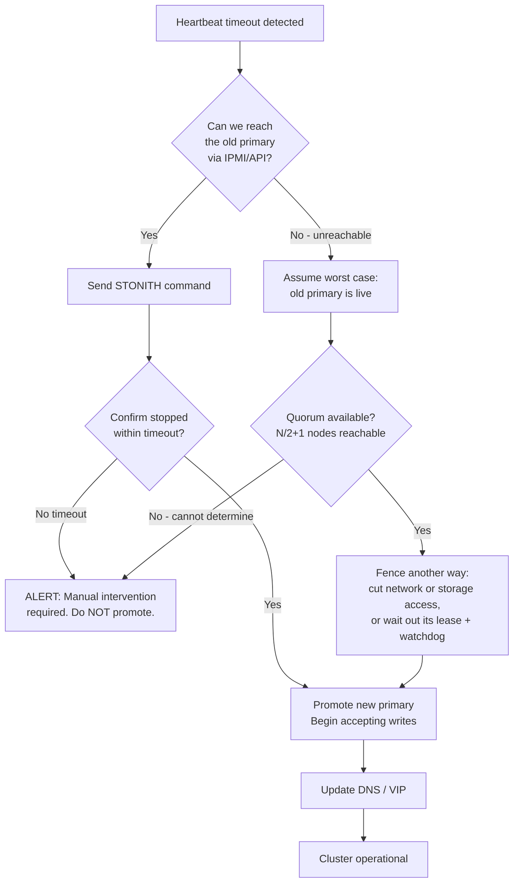
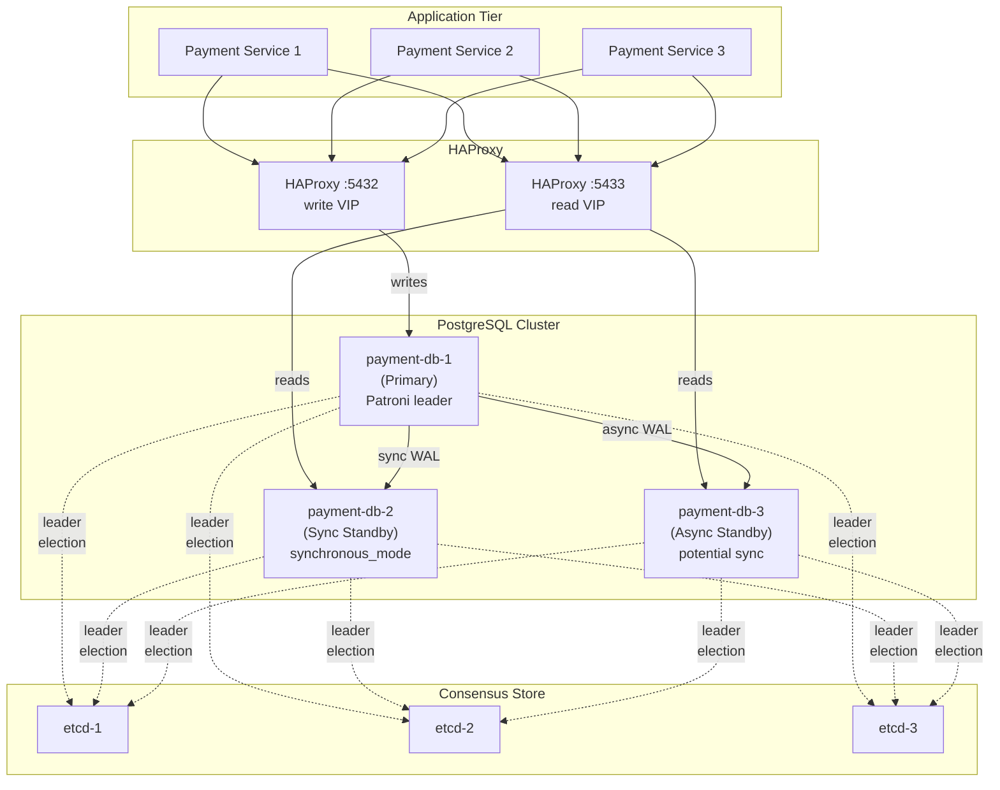

# الدماغ المنقسم (Split-Brain) والتعامل مع انقسام الشبكة

## نظرة عامة

الدماغ المنقسم من أخطر أنماط الفشل في الأنظمة المالية الموزعة. ويحدث عندما يجعل انقسام الشبكة عدة عقد تعتقد في الوقت نفسه أنها النسخة الأساسية الموثوقة، فتقبل كل منها الكتابات باستقلال. وفي نظام دفع قد يؤدي هذا إلى خصم الحساب نفسه مرتين، أو تسوية دفعتين منفصلتين من الأموال نفسها، أو تناقضات في دفتر الأستاذ تتطلب مطابقة يدوية تكلف مئات الساعات الهندسية.

يتناول هذا الدرس الدماغ المنقسم بعمق: تعريفه، وآليات اكتشافه، وأسلوب الحقب/الفترات (epoch/term) الذي يستخدمه Raft وPatroni، ورموز التسييج لمنع العقد القديمة من إكمال الكتابات، وSTONITH ‏(Shoot The Other Node In The Head) للعزل المضمون، واتخاذ القرار بالنصاب، وإعداد النسخ المتزامن في PostgreSQL. ونختم بمنسّق استرداد تشغيلي وأخطاء الإنتاج الشائعة.

---

## 1. الدماغ المنقسم: التعريف والأثر الكارثي

### 1.1 ما الدماغ المنقسم؟

يحدث الدماغ المنقسم عندما يفقد عنقود من عقدتين أو أكثر مسار الشبكة بينها (انقسام)، فيرقّي كل جانب من الانقسام نفسه إلى نسخة أساسية.

```
BEFORE PARTITION:

  ┌───────────┐  heartbeat  ┌───────────┐
  │ Primary   │◄───────────►│ Standby   │
  │ Node A    │             │ Node B    │
  │ (writes)  │  replication│           │
  └───────────┘  ──────────►└───────────┘

DURING PARTITION (catastrophic):

  ┌───────────┐             ┌───────────┐
  │ Node A    │   NETWORK   │ Node B    │
  │ PRIMARY ✓ │ ░░░░░░░░░░░ │ PRIMARY ✓ │
  │ writing   │  PARTITION  │ writing   │
  └───────────┘             └───────────┘
       ▲                         ▲
       │                         │
  clients on                clients on
  network seg A             network seg B
  writing to A              writing to B
```

تتباعد العقدتان الآن. فكل كتابة على العقدة A مجهولة للعقدة B والعكس. وعندما يلتئم الانقسام يتعارض سجلا المعاملات ولا يمكن دمجهما تلقائيًا.

### 1.2 الأثر المالي

لنأخذ حساب عميل رصيده 1,000 جنيه:

```
Node A (thinks it's primary):       Node B (thinks it's primary):
  Time 10:00 — balance = £1,000       Time 10:00 — balance = £1,000
  Time 10:01 — debit £500 → £500      Time 10:01 — debit £800 → £200
  Time 10:02 — debit £400 → £100      Time 10:02 — payment confirmed to customer

Partition heals:
  Conflict detected on account balance
  Which state is "true"? Neither and both.
  Customer has overspent by £300.
  Bank may have settled payments it cannot fund.
  The books no longer agree: records must be reconciled by hand.
```

تخصم العقدة A مبلغي 500 و400 جنيه، وتخصم العقدة B مبلغ 800 جنيه، فينفق العميل أكثر من رصيده بـ 300 جنيه، وقد يكون البنك سوّى مدفوعات لا يستطيع تمويلها، ولا تعود السجلات متطابقة فتجب مطابقتها يدويًا.

تؤدي حوادث الدماغ المنقسم في الأنظمة المالية عادة إلى:
- مدفوعات مكررة تتطلب عكسًا يدويًا، ولكل منها كلفة في وقت الموظفين وثقة العملاء
- أرصدة مكشوفة لم يأذن بها العميل
- سجلات تدقيق متناقضة (خطر مخالفة المتطلب 10 في PCI DSS)
- ضرر في السمعة بسبب أخطاء يراها العملاء

---

## 2. الاكتشاف بالنبض والعقدة الشاهدة

### 2.1 آلية النبض الأساسية

ترسل العقد نبضات دورية لتأكيد أنها حية. وإذا لم تتلقَّ عقدة نبضة من النسخة الأساسية خلال نافذة مهلة، فإنها تشتبه في أن الأساسية غير متاحة.

```
Timeline of heartbeat failure detection:

  t=0s   Primary → Standby: heartbeat ACK
  t=1s   Primary → Standby: heartbeat ACK
  t=2s   Primary → Standby: heartbeat ACK
  t=3s   NETWORK PARTITION
  t=4s   Primary → Standby: [lost]
  t=5s   Primary → Standby: [lost]
  t=6s   Standby: missed_heartbeats=2
  t=7s   Primary → Standby: [lost]
  t=8s   Standby: missed_heartbeats=3 → THRESHOLD REACHED
  t=9s   Standby: initiating leader election
```

**المشكلة**: مهلة النبض استدلال، لا برهان. فقد تكون الأساسية حية لكنها مثقلة مؤقتًا (توقف GC، أو اضطراب شبكة). والمهلة القصيرة جدًا تسبب إنذارات كاذبة (تحويلات غير ضرورية). والمهلة الطويلة جدًا تزيد متوسط زمن الاكتشاف.

في PostgreSQL مع Patroni، القيم الافتراضية نقطة بداية جيدة:
- `loop_wait: 10` — تفحص كل عقدة حالة العنقود كل 10 ثوانٍ
- `ttl: 30` — ينتهي مفتاح القائد بعد 30 ثانية من آخر تجديد، فيبدأ التحويل
- القيم الأقصر تكتشف العطل أسرع لكنها تسبب تحويلات كاذبة أكثر

### 2.2 العقدة الشاهدة

العقدة الشاهدة (كاسرة التعادل) عقدة ثالثة خفيفة لا تحمل بيانات لكنها تشارك في الانتخابات. وهي تمنع الدماغ المنقسم المتماثل في العناقيد ذات العقدتين.

```
  ┌───────────┐             ┌───────────┐
  │ Node A    │             │ Node B    │
  │ (Primary) │  partition  │ (Standby) │
  └─────┬─────┘             └─────┬─────┘
        │                         │
        └──────────┬──────────────┘
                   │
            ┌──────▼──────┐
            │  Witness    │
            │  (no data)  │
            └─────────────┘

If the partition cuts B off from both A and the witness:
  A cannot reach B, but CAN reach Witness → A has quorum (2/3) → stays primary
  B cannot reach A or the Witness → B has no quorum (1/3) → stays standby
If both A and B can still reach the witness, the witness votes for only
one of them, so there is still exactly one primary.
```

إذا عزل الانقسام العقدة B عن A وعن الشاهدة معًا، تبقى A أساسية لأن لديها النصاب (2 من 3)، وتبقى B احتياطية. وإذا كانت A وB تصلان إلى الشاهدة، فإن الشاهدة تصوّت لواحدة فقط منهما، فتبقى هناك نسخة أساسية واحدة بالضبط.

---

## 3. اكتشاف القائد بالحقب والفترات

### 3.1 أرقام الفترات في Raft

يستخدم Raft رقم فترة متزايدًا (حقبة) لتحديد الأحدث. وكل انتخاب يبدأ فترة جديدة. وأي عقدة تتلقى رسالة برقم فترة أعلى تعود فورًا تابعًا وتحدّث فترتها المحلية.

```
Term 1: Node A is leader
  [A: term=1, leader] ←→ [B: term=1, follower] ←→ [C: term=1, follower]

Partition: A is isolated from B and C
  [A: term=1, leader (thinks)]    [B: term=1, follower]
                                   [C: term=1, follower]

B and C hold election:
  [A: term=1, leader (stale)]     [B: term=2, candidate]
  Partition                        [C: term=2, votes for B]
                                   [B: term=2, leader]

Partition heals: A receives message from B with term=2
  A: term=2 > my term=1 → I am no longer leader → revert to follower
  [A: term=2, follower]           [B: term=2, leader]
  [C: term=2, follower]
```

هذا ضمان السلامة الأساسي في Raft: قائد واحد على الأكثر في كل فترة. ولا يمكن التزام أي كتابة في الفترة N+1 دون أن تنتقل أغلبية العقد إلى الفترة N+1.

### 3.2 التحقق من الحقبة في شيفرة التطبيق

```java
public class EpochAwareLeaderService {

    private final AtomicLong currentEpoch = new AtomicLong(0);
    private final AtomicBoolean isLeader   = new AtomicBoolean(false);
    private final EpochStore epochStore;   // durable storage (etcd or Postgres)

    /**
     * Called by consensus layer when this node wins an election.
     * The epoch is persisted durably before isLeader is set.
     */
    public void onElectedLeader(long newEpoch) {
        if (newEpoch <= currentEpoch.get()) {
            log.warn("Rejecting stale election notification: epoch {} <= current {}",
                newEpoch, currentEpoch.get());
            return;
        }
        // Persist epoch BEFORE marking as leader — this is the critical order
        epochStore.persist(newEpoch);
        currentEpoch.set(newEpoch);
        isLeader.set(true);
        log.info("Became leader for epoch {}", newEpoch);
    }

    /**
     * Called by consensus layer when a higher epoch is observed.
     * This node must immediately stop acting as leader.
     */
    public void onHigherEpochObserved(long observedEpoch) {
        if (observedEpoch > currentEpoch.get()) {
            isLeader.set(false);  // stop leader behaviour BEFORE updating epoch
            currentEpoch.set(observedEpoch);
            log.warn("Stepping down: observed higher epoch {}", observedEpoch);
        }
    }

    public void executeAsLeader(Runnable action) {
        if (!isLeader.get()) {
            throw new NotLeaderException(currentEpoch.get());
        }
        long epochAtStart = currentEpoch.get();
        action.run();
        // This check DETECTS a lost leadership but cannot undo the action —
        // only fencing at the storage layer actually prevents the damage
        if (currentEpoch.get() != epochAtStart) {
            throw new EpochChangedDuringExecutionException(epochAtStart, currentEpoch.get());
        }
    }
}
```

تُحفظ الحقبة بشكل دائم قبل تعيين العقدة قائدًا — وهذا هو الترتيب الحاسم. وعند رؤية حقبة أعلى يتوقف سلوك القائد فورًا. ولاحظ أن الفحص بعد تنفيذ الإجراء **يكتشف** فقدان القيادة لكنه لا يستطيع التراجع عن الإجراء — فالتسييج في طبقة التخزين وحده يمنع الضرر فعلًا.

---

## 4. رموز التسييج

رمز التسييج رقم متزايد باستمرار تصدره خدمة القفل الموزع (أو نظام الإجماع) في كل مرة تأخذ فيها عقدة القيادة. وترفض طبقة التخزين أي كتابة تقدم رمزًا أقل من أعلى رمز رأته. وهذا يمنع عقدة كانت قائدًا في حقبة سابقة من إكمال كتابة بعد أن حلت محلها عقدة أخرى.

### 4.1 المشكلة التي يحلها التسييج

```
Without fencing:

  t=1  Node A acquires lock (token=5), starts writing
  t=2  Node A experiences GC pause (60 seconds)
  t=3  Lock service times out Node A's lock
  t=4  Node B acquires lock (token=6), writes committed
  t=5  Node A wakes up from GC pause, still thinks it has the lock
  t=6  Node A's write completes — STALE WRITE, OVERRIDES Node B's data!

With fencing:

  t=5  Node A wakes up, presents token=5 to storage
  t=5  Storage: max_seen_token=6, 5 < 6 → REJECT Node A's write
  t=5  Node A receives rejection, throws exception, marks self as not-leader
```

دون تسييج، تستيقظ العقدة A من توقف GC وما زالت تظن أنها تملك القفل، فتكتب فوق بيانات العقدة B. ومع التسييج تقدم A الرمز 5، بينما أعلى رمز رآه التخزين 6، فتُرفض كتابتها.

### 4.2 صنف رمز التسييج في Java

```java
public record FencingToken(long value) implements Comparable<FencingToken> {

    public static final FencingToken ZERO = new FencingToken(0L);

    public boolean isNewerThan(FencingToken other) {
        return this.value > other.value;
    }

    @Override
    public int compareTo(FencingToken other) {
        return Long.compare(this.value, other.value);
    }

    @Override
    public String toString() {
        return "FencingToken{" + value + "}";
    }
}

@Service
public class FencedWriteService {

    private final JdbcTemplate jdbc;
    private final FencingToken myToken;

    public FencedWriteService(JdbcTemplate jdbc, FencingToken myToken) {
        this.jdbc     = jdbc;
        this.myToken  = myToken;
    }

    /**
     * Writes a payment ledger entry only if our fencing token is still the
     * highest the database has seen. The check and write are atomic within
     * the PostgreSQL function, which returns 1 (written) or 0 (rejected).
     */
    public void writeLedgerEntry(LedgerEntry entry) {
        Integer rowsAffected = jdbc.queryForObject(   // a SELECT returns a result set
            "SELECT write_ledger_entry(?, ?, ?, ?)",
            Integer.class,
            entry.accountId(),
            entry.amount(),
            entry.description(),
            myToken.value()   // passed to the stored procedure
        );

        if (rowsAffected == null || rowsAffected == 0) {
            throw new StaleTokenException(
                "Write rejected: our fencing token " + myToken +
                " has been superseded. We are no longer the leader."
            );
        }
    }
}
```

تُرجع دالة PostgreSQL القيمة 1 (كُتب) أو 0 (رُفض)، ولأنها تُستدعى بجملة SELECT تُقرأ النتيجة بـ `queryForObject`.

### 4.3 إجراء مخزن في PostgreSQL يفرض رموز التسييج

```sql
-- Stores the highest fencing token the database has seen.
-- One row serialises ALL fenced writes; at high volume use one row per
-- resource or shard. Note: this fences stale APPLICATION leaders — it cannot
-- help if the database itself is split-brained (that is what quorum is for).
CREATE TABLE cluster_fence_state (
    singleton_key  CHAR(1)  PRIMARY KEY DEFAULT 'X',
    max_token      BIGINT   NOT NULL DEFAULT 0,
    updated_at     TIMESTAMPTZ NOT NULL DEFAULT now()
);

INSERT INTO cluster_fence_state (singleton_key, max_token) VALUES ('X', 0)
ON CONFLICT DO NOTHING;

-- Stored procedure: atomic token check + write
CREATE OR REPLACE FUNCTION write_ledger_entry(
    p_account_id  UUID,
    p_amount      NUMERIC,
    p_description TEXT,
    p_token       BIGINT
) RETURNS INTEGER AS $$
DECLARE
    v_max_token BIGINT;
BEGIN
    -- Lock the fence state row (single row in table)
    SELECT max_token INTO v_max_token
    FROM cluster_fence_state
    WHERE singleton_key = 'X'
    FOR UPDATE;

    -- Reject stale writes
    IF p_token < v_max_token THEN
        RAISE WARNING 'Fencing token % is stale (max seen: %)', p_token, v_max_token;
        RETURN 0;
    END IF;

    -- Update high-water mark
    UPDATE cluster_fence_state
    SET max_token  = p_token,
        updated_at = now()
    WHERE singleton_key = 'X';

    -- Perform the actual write
    INSERT INTO ledger_entries (account_id, amount, description, created_at, fencing_token)
    VALUES (p_account_id, p_amount, p_description, now(), p_token);

    RETURN 1;
END;
$$ LANGUAGE plpgsql;
```

صف واحد للتسييج يسلسل كل الكتابات المسيّجة؛ وعند الحجم الكبير استخدم صفًا لكل مورد أو جزء. ولاحظ أن هذا يسيّج قادة **التطبيق** القدامى — ولا يساعد إذا كانت قاعدة البيانات نفسها في حالة دماغ منقسم (فهذا دور النصاب).

---

## 5. STONITH — أطلق النار على رأس العقدة الأخرى

‏STONITH هو ضمان إطفاء العقدة التي قد تكون حية لكن لا يمكن الوصول إليها، بشكل قاطع، قبل أن تبدأ النسخة الأساسية الجديدة بقبول الكتابات. وبدون STONITH توجد نافذة زمنية قد تقبل فيها العقدتان الكتابات (رُقّيت الأساسية الجديدة، ولم تتوقف الأساسية القديمة بعد).

### 5.1 STONITH عبر IPMI (الخوادم الفعلية)

في الخوادم داخل المؤسسة، توفر واجهة IPMI ‏(Intelligent Platform Management Interface) تحكمًا في الطاقة خارج النطاق:

```bash
# -E reads the password from the IPMI_PASSWORD environment variable
# (never put it on the command line, where it shows up in ps and shell history)

# Confirm the old primary's BMC is reachable before attempting STONITH
ipmitool -I lanplus -H 10.10.0.5 -U admin -E chassis power status

# STONITH: power off the old primary node
ipmitool -I lanplus -H 10.10.0.5 -U admin -E chassis power off

# Verify power state
ipmitool -I lanplus -H 10.10.0.5 -U admin -E chassis power status
# → Chassis Power is off

# Only after confirmation: promote the new primary (if Patroni has not already)
patronictl -c /etc/patroni/config.yml failover payment-cluster \
  --candidate node-b --force
```

يقرأ الخيار `-E` كلمة المرور من متغير البيئة — فلا تضعها أبدًا في سطر الأوامر حيث تظهر في `ps` وتاريخ الصدفة. ولا تُرقّى النسخة الجديدة إلا بعد تأكيد إطفاء القديمة.

### 5.2 STONITH عبر واجهة إيقاف EC2 في AWS

في النشر السحابي، المكافئ هو إيقاف نسخة EC2 (لا إعادة تشغيلها). وإذا تعلّق الإيقاف، فالبديل هو التسييج الشبكي: استبدال مجموعات أمان النسخة بمجموعة تحجب كل حركة قاعدة البيانات.

```java
@Service
public class AwsStonithService {

    private final Ec2Client ec2Client;
    private final StonithAuditRepository auditRepo;

    /**
     * Shoot the old primary node. This MUST be called before the new primary
     * begins accepting writes. The method blocks until the instance reaches
     * the STOPPED state.
     */
    public StonithResult fenceNode(String instanceId, String reason) {
        log.warn("STONITH initiated for instance {} reason: {}", instanceId, reason);

        auditRepo.recordStonithInitiated(instanceId, reason, Instant.now());

        // Stop the instance — this is not a reboot
        StopInstancesRequest stopRequest = StopInstancesRequest.builder()
            .instanceIds(instanceId)
            .force(true)  // bypass graceful shutdown; we cannot trust the OS
            .build();

        ec2Client.stopInstances(stopRequest);

        // Wait for the instance to reach stopped state — with timeout
        Instant deadline = Instant.now().plusSeconds(120);
        InstanceStateName finalState = null;

        while (Instant.now().isBefore(deadline)) {
            DescribeInstancesResponse desc = ec2Client.describeInstances(
                DescribeInstancesRequest.builder().instanceIds(instanceId).build()
            );
            finalState = desc.reservations().get(0).instances().get(0)
                             .state().name();

            if (finalState == InstanceStateName.STOPPED) {
                log.info("STONITH confirmed: instance {} is STOPPED", instanceId);
                auditRepo.recordStonithCompleted(instanceId, Instant.now());
                return StonithResult.success(instanceId, finalState);
            }

            try { Thread.sleep(2000); } catch (InterruptedException e) {
                Thread.currentThread().interrupt();
                break;
            }
        }

        log.error("STONITH TIMEOUT: instance {} did not stop within 120s. " +
                  "MANUAL INTERVENTION REQUIRED. Final state: {}", instanceId, finalState);
        auditRepo.recordStonithTimeout(instanceId, Instant.now());
        return StonithResult.timeout(instanceId, finalState);
    }
}
```

يجب استدعاء هذه الطريقة قبل أن تبدأ الأساسية الجديدة بقبول الكتابات، وهي تنتظر حتى تبلغ النسخة حالة STOPPED. وعند انتهاء المهلة يجب ألا تستمر الترقية — بل يلزم تدخل يدوي.

### 5.3 مسار قرار STONITH



إذا تعذر الوصول إلى الأساسية القديمة عبر IPMI أو الواجهة، فافترض الأسوأ: أنها حية. فإن كان النصاب متاحًا، فسيّجها بطريقة أخرى (قطع الوصول إلى الشبكة أو التخزين، أو انتظار انتهاء إيجارها مع المراقب) ثم رقِّ الجديدة. وإن لم يكن النصاب متاحًا، فلا ترقِّ شيئًا واطلب تدخلًا يدويًا.

---

## 6. النصاب — قرار الأغلبية

يمنع النصاب الدماغ المنقسم باشتراط أن تؤكد أغلبية العقد أي قرار (انتخاب القائد، أو التزام الكتابة). ولـ N عقدة يتطلب النصاب floor(N/2)+1 صوتًا على الأقل.

| حجم العنقود | النصاب المطلوب | الأعطال المحتملة |
|---|---|---|
| 1 | 1 | 0 |
| 2 | 2 | 0 (بلا تحمّل للأعطال!) |
| 3 | 2 | 1 |
| 5 | 3 | 2 |
| 7 | 4 | 3 |

**عنقود العقدتين بلا تحمّل للأعطال** — فهو يتطلب العقدتين معًا لتشكيل النصاب. وفي التقنية المالية، ثلاث عقد على الأقل هي المعيار التشغيلي.

```
3-node cluster, one node partitioned:

  ┌────────────┐         ┌────────────┐
  │  Node A    │◄───────►│  Node B    │
  │ (can reach │         │ (can reach │
  │  B and C)  │         │  A and C)  │
  └────────────┘         └────────────┘
         ▲                      ▲
         │       partition       │
         │                      │
         └──────────────────────┘
                    ║
              ┌─────╨──────┐
              │  Node C    │
              │ (isolated) │
              └────────────┘

A and B have quorum (2/3).
C does not have quorum (1/3) → C must NOT promote itself.
If C was primary before partition, A and B elect a new primary.
C steps down when partition heals and it receives higher epoch.
```

لدى A وB النصاب (2 من 3)، وليس لدى C نصاب، فيجب ألا ترقّي نفسها. وإذا كانت C هي الأساسية قبل الانقسام، تنتخب A وB أساسية جديدة، وتتنحى C عند التئام الانقسام وتلقيها حقبة أعلى.

### 6.1 التصويت بالنصاب في Java

```java
public class QuorumVoter {

    private final List<ClusterNode> allNodes;
    private final int quorumSize;

    public QuorumVoter(List<ClusterNode> allNodes) {
        this.allNodes  = List.copyOf(allNodes);
        this.quorumSize = (allNodes.size() / 2) + 1;
    }

    /**
     * Attempt to gather votes for leader election in the given epoch.
     * Returns true only if we obtained quorum.
     */
    // One executor for all vote requests (not one per request, which leaks)
    private final ExecutorService voteExecutor =
        Executors.newVirtualThreadPerTaskExecutor();

    public boolean seekQuorum(long epoch) {
        List<CompletableFuture<VoteResponse>> futures = allNodes.stream()
            .filter(node -> !node.isSelf())
            .map(node -> CompletableFuture.supplyAsync(
                () -> node.requestVote(epoch), voteExecutor))
            .collect(Collectors.toList());

        // We always vote for ourselves
        AtomicInteger voteCount = new AtomicInteger(1);

        for (CompletableFuture<VoteResponse> future : futures) {
            try {
                VoteResponse resp = future.get(500, TimeUnit.MILLISECONDS);
                if (resp.granted() && resp.term() == epoch) {
                    int total = voteCount.incrementAndGet();
                    if (total >= quorumSize) {
                        log.info("Quorum achieved: {}/{} votes for epoch {}",
                            total, allNodes.size(), epoch);
                        return true;
                    }
                }
            } catch (TimeoutException | ExecutionException e) {
                log.debug("Vote request failed for epoch {}", epoch, e);
            } catch (InterruptedException e) {
                Thread.currentThread().interrupt();
                return false;
            }
        }

        log.warn("Quorum not achieved: {}/{} votes, need {}",
            voteCount.get(), allNodes.size(), quorumSize);
        return false;
    }
}
```

---

## 7. النسخ المتزامن في PostgreSQL

يضمن النسخ المتزامن في PostgreSQL ألا يُؤكد التزام المعاملة للعميل حتى تكتب نسخة احتياطية واحدة على الأقل سجل WAL على القرص. وهذا يعطي صفر فقدان للبيانات عند تعطل الأساسية — بشرط أن يرقّي التحويل تلك النسخة المتزامنة (ووضع `synchronous_mode` في Patroni يضمن ذلك).

### 7.1 إعدادات postgresql.conf

```ini
# postgresql.conf on the primary

# Synchronous replication: commit waits for at least 1 standby
synchronous_commit = on                      # never acknowledge before standby confirms

# Naming the standbys that must confirm commits
# Format: [FIRST N (standby_names)] or [ANY N (standby_names)]
synchronous_standby_names = 'FIRST 1 (payment-standby-1, payment-standby-2)'
# FIRST 1: wait for the first (priority) standby to confirm
# If payment-standby-1 fails, payment-standby-2 becomes synchronous

# WAL settings
wal_level = replica                          # minimum for streaming replication
max_wal_senders = 10                         # max simultaneous replication connections
wal_keep_size = 1024                         # keep 1 GB of WAL for slow standbys
```

```ini
# postgresql.conf on each standby

hot_standby = on                             # allow reads on standby
hot_standby_feedback = on                    # prevent primary vacuuming rows standby still needs
recovery_min_apply_delay = 0                 # apply WAL immediately (set >0 for delayed replica)
```

### 7.2 pg_hba.conf للنسخ

```
# pg_hba.conf — allow replication connections from standby hosts
# TYPE   DATABASE     USER          ADDRESS            METHOD
host     replication  replicator    10.10.0.2/32       scram-sha-256
host     replication  replicator    10.10.0.3/32       scram-sha-256
```

### 7.3 التحقق من تأخر النسخ

```sql
-- On primary: check replication status
SELECT
    client_addr,
    application_name,
    state,
    sent_lsn,
    write_lsn,
    flush_lsn,
    replay_lsn,
    write_lag,
    flush_lag,
    replay_lag,
    sync_state
FROM pg_stat_replication;

-- Expected output for synchronous standby:
-- client_addr | application_name | state     | sync_state
-- 10.10.0.2   | payment-standby-1| streaming | sync
-- 10.10.0.3   | payment-standby-2| streaming | potential
```

---

## 8. إعداد Patroni للإتاحة العالية

‏Patroni هو حل الإتاحة العالية المعياري لعناقيد PostgreSQL في الأنظمة المالية الإنتاجية. وهو يستخدم مخزن إعداد موزعًا (etcd، أو Consul، أو ZooKeeper) لانتخاب القائد، ويحفظ فيه حالة العنقود.

### 8.1 ملف إعداد Patroni

```yaml
# /etc/patroni/config.yml — payment-db-primary

scope: payment-cluster
namespace: /fintech/
name: payment-db-1

restapi:
  listen: 0.0.0.0:8008
  connect_address: 10.10.0.1:8008
  authentication:
    username: patroni
    # password: set PATRONI_RESTAPI_PASSWORD in the environment (Patroni does
    # not expand ${...} inside this file)

etcd3:
  hosts:
    - 10.10.1.1:2379
    - 10.10.1.2:2379
    - 10.10.1.3:2379
  username: patroni
  # password: PATRONI_ETCD3_PASSWORD environment variable

bootstrap:
  dcs:
    ttl: 30                                # leader TTL — primary must renew every 30s
    loop_wait: 10                          # Patroni main loop interval
    retry_timeout: 10                      # timeout for DCS operations
    maximum_lag_on_failover: 1048576       # 1 MB max WAL lag allowed for promotion
    synchronous_mode: true                 # enforce synchronous replication
    synchronous_mode_strict: true          # never fall back to async: block writes if no sync standby

    postgresql:
      use_pg_rewind: true                  # use pg_rewind to resync old primary
      use_slots: true                      # use replication slots to prevent WAL loss

  pg_hba:
    - host replication replicator 10.10.0.0/24 scram-sha-256
    - host all         all        10.10.0.0/24 scram-sha-256

postgresql:
  listen: 0.0.0.0:5432
  connect_address: 10.10.0.1:5432
  data_dir: /var/lib/postgresql/16/main
  bin_dir: /usr/lib/postgresql/16/bin
  pgpass: /tmp/.pgpass

  parameters:
    wal_level:                 replica
    hot_standby:               "on"
    max_connections:           500
    synchronous_commit:        "on"
    # synchronous_standby_names is managed by Patroni in synchronous_mode
    max_wal_senders:           10
    wal_keep_size:             "1024"

  authentication:
    # Passwords: PATRONI_REPLICATION_PASSWORD and PATRONI_SUPERUSER_PASSWORD
    replication:
      username: replicator
    superuser:
      username: postgres

tags:
  nofailover:  false
  noloadbalance: false
  clonefrom:   false
  nosync:      false

watchdog:
  mode: required                           # watchdog REQUIRED — Patroni refuses to start without it
  device: /dev/watchdog
  safety_margin: 5
```

لا يوسّع Patroni صيغة `${...}` داخل الملف، لذلك تأتي كلمات المرور من متغيرات البيئة `PATRONI_*`. ويدير Patroni `synchronous_standby_names` بنفسه في `synchronous_mode`. ويعني `synchronous_mode_strict` عدم الرجوع أبدًا إلى النسخ غير المتزامن: تُحجب الكتابات إذا لم توجد نسخة متزامنة.

### 8.2 بنية عنقود Patroni



---

## 9. CP مقابل AP لأنظمة الدفع

تنص نظرية CAP على أنه عند وجود انقسام في الشبكة، يجب أن يختار النظام الموزع بين الاتساق (C) والإتاحة (A).

| الخاصية | CP (متسق ويتحمل الانقسام) | AP (متاح ويتحمل الانقسام) |
|---|---|---|
| عند الانقسام | رفض الكتابات وإعادة خطأ | قبول الكتابات على الجانبين |
| خطر فقدان البيانات | لا شيء — الكتابات المرفوضة لا تحدث أصلًا | عالٍ — يتباعد الجانبان |
| خطر التوقف | نعم — النظام غير متاح أثناء الانقسام | لا — يبقى الجانبان عاملين |
| مناسب لـ | الحسابات المالية، ودفاتر الأستاذ، وحالة الدفع | سلال التسوق، وتفضيلات المستخدم، والعدّادات |

**لأنظمة الدفع، CP غير قابل للتفاوض للأرصدة ودفاتر الأستاذ.** فلا يمكن أن يصبح حساب فيه 1,000 جنيه 2,000 جنيه ولو مؤقتًا. ومن الأفضل دائمًا رفض الدفعة بخطأ على قبولها وإحداث خصم مزدوج. كما تطلب قواعد المرونة التشغيلية (FCA PS21/3) من الشركات البقاء ضمن حدود تحمّل الأثر للانقطاعات — ولهذا يجب أن يتحول نظام CP بسرعة وتلقائيًا، لكن دون قبول الكتابات أبدًا على جانبي الانقسام.

```java
// CP-first configuration: fail writes if quorum is unavailable
@Configuration
public class PaymentDataSourceConfig {

    @Bean
    public DataSource paymentDataSource(DataSourceProperties props) {
        HikariDataSource ds = new HikariDataSource();
        // List every node; the PostgreSQL JDBC driver connects only to the one
        // that is currently primary (read-write) and never to a standby
        ds.setJdbcUrl("jdbc:postgresql://payment-db-1:5432,payment-db-2:5432,"
            + "payment-db-3:5432/payments?targetServerType=primary");
        ds.setUsername(props.getUsername());
        ds.setPassword(props.getPassword());

        // Fail fast if no primary is available — do NOT fall back to a stale standby
        ds.setConnectionTimeout(5_000);    // 5s to get a connection
        ds.setMaximumPoolSize(50);
        return ds;
    }
}
```

تُدرج كل العقد في عنوان الاتصال، ويتصل مشغّل JDBC في PostgreSQL فقط بالعقدة الأساسية الحالية (القابلة للكتابة) ولا يتصل أبدًا بنسخة احتياطية.

---

## 10. منسّق الاسترداد التشغيلي

عند وقوع حادث دماغ منقسم، يجب أن تكون عملية الاسترداد منهجية. والخدمة التالية في Java تنسّق خطوات الاسترداد.

```java
@Service
@Slf4j
public class SplitBrainRecoveryCoordinator {

    private final DatabaseInspector dbInspector;
    private final LedgerReconciliationService reconciler;
    private final AlertingService alerting;
    private final IncidentRepository incidentRepo;

    /**
     * Execute recovery after a confirmed split-brain event.
     * This method performs each step and gates progression on success.
     */
    @Transactional(propagation = Propagation.NOT_SUPPORTED) // runs outside any transaction
    public RecoveryReport executeRecovery(SplitBrainIncident incident) {

        log.error("SPLIT_BRAIN_RECOVERY INITIATED: incident={}", incident.id());
        alerting.page(AlertLevel.P1, "Split-brain recovery in progress on " + incident.cluster());

        RecoveryReport.Builder report = RecoveryReport.builder()
            .incidentId(incident.id())
            .startedAt(Instant.now());

        // Step 1: Identify divergence window
        Duration divergenceWindow = Duration.between(
            incident.partitionStartedAt(),
            incident.partitionHealedAt()
        );
        log.info("Divergence window: {}", divergenceWindow);
        report.divergenceWindow(divergenceWindow);

        // Step 2: Identify conflicting transactions in divergence window
        List<ConflictingTransaction> conflicts =
            dbInspector.findConflicts(incident.nodeA(), incident.nodeB(),
                                      incident.partitionStartedAt(),
                                      incident.partitionHealedAt());

        log.info("Found {} conflicting transactions", conflicts.size());
        report.conflictCount(conflicts.size());

        if (conflicts.isEmpty()) {
            log.info("No conflicts found — partition healed cleanly via synchronous replication");
            report.outcome(RecoveryOutcome.CLEAN_RECOVERY);
            return report.build();
        }

        // Step 3: Categorise conflicts
        List<ConflictingTransaction> doubleDebits = conflicts.stream()
            .filter(t -> t.type() == ConflictType.DOUBLE_DEBIT)
            .collect(Collectors.toList());

        List<ConflictingTransaction> stateConflicts = conflicts.stream()
            .filter(t -> t.type() == ConflictType.STATUS_CONFLICT)
            .collect(Collectors.toList());

        // Step 4: Automated resolution for safe cases
        stateConflicts.forEach(conflict -> {
            try {
                reconciler.resolveStatusConflict(conflict);
                log.info("Auto-resolved status conflict for txn {}", conflict.transactionId());
            } catch (Exception e) {
                log.error("Auto-resolution failed for txn {}", conflict.transactionId(), e);
                incidentRepo.flagForManualReview(conflict.transactionId(), e.getMessage());
            }
        });

        // Step 5: Double-debits ALWAYS require manual review
        if (!doubleDebits.isEmpty()) {
            log.error("MANUAL_REVIEW_REQUIRED: {} double-debit conflicts detected", doubleDebits.size());
            doubleDebits.forEach(dd ->
                incidentRepo.flagForManualReview(dd.transactionId(),
                    "Double-debit: nodes diverged on account " + dd.accountId())
            );
            report.manualReviewRequired(true);
            report.outcome(RecoveryOutcome.PARTIAL_RECOVERY_MANUAL_REVIEW_REQUIRED);
            alerting.page(AlertLevel.P1, doubleDebits.size() + " double-debits require manual review");
        }

        return report.build();
    }
}
```

الخطوات: تحديد نافذة التباعد، ثم إيجاد المعاملات المتعارضة فيها، ثم تصنيفها. وتُحل تعارضات الحالة تلقائيًا حيث يكون ذلك آمنًا، أما الخصومات المزدوجة فتتطلب دائمًا مراجعة يدوية وتنبيهًا عاجلًا.

---

## 11. أخطاء الإنتاج الشائعة

### الخطأ 1: النسخ المتزامن يحجب الكتابات عندما تتعطل النسخة الاحتياطية

مع `synchronous_commit = on`، إذا لم تكن النسخة المتزامنة متاحة، تحجب الأساسية كل الكتابات إلى أجل غير مسمى بانتظار التأكيد. وفي حادث عاجل قد يتوقف مسار معالجة المدفوعات كليًا.

```sql
-- WRONG: synchronous_commit = on with no fallback
-- If synchronous standby goes down, ALL writes block until it returns

-- BETTER: set synchronous_commit = local under controlled conditions
-- This falls back to local durability (data persisted to primary WAL)
-- when no synchronous standby is available.
-- Use this ONLY as a temporary measure during standby maintenance.
-- Requires a deliberate operational decision and must be reversed.

-- To set at session level (temporary, only for this connection):
SET synchronous_commit = local;

-- To set at database level (requires deliberate ops decision):
ALTER DATABASE payment_db SET synchronous_commit = local;

-- ALERT: set an alert for when this fallback is active
-- Query to detect if synchronous_commit degraded:
SELECT
    name,
    setting,
    source
FROM pg_settings
WHERE name = 'synchronous_commit'
  AND setting != 'on';
```

**التخفيف**: اضبط `synchronous_standby_names` بقائمة من النسخ الاحتياطية واستخدم صيغة `FIRST 1 (...)` حتى يوجد مرشح واحد على الأقل دائمًا. ومع Patroni يجعل `synchronous_mode` غير الصارم هذا الخيار صريحًا: ينتقل إلى نسخة احتياطية أخرى، أو إلى النسخ غير المتزامن عند نفادها (مع قبول خطر صغير لفقدان البيانات)، بينما يحجب `synchronous_mode_strict` الكتابات بدلًا من ذلك. وأضف مراقبة تنبّه خلال 60 ثانية إذا تأخرت النسخة المتزامنة أو انقطعت.

### الخطأ 2: اكتشاف دماغ منقسم كاذب يسبب تحويلًا غير ضروري

قد تفوّت أساسية مثقلة (مثلًا أثناء تشغيل دفعي كبير) مواعيد النبض، فيُطلق ذلك استجابة دماغ منقسم رغم أن الأساسية سليمة. فتُرقّى النسخة الاحتياطية، وتقبل العقدتان الكتابات لفترة قصيرة.

```java
// WRONG: simple heartbeat timeout with no jitter or cooldown
if (missedHeartbeats >= THRESHOLD) {
    promoteSelf(); // triggers immediately — susceptible to false positive
}

// BETTER: graduated response with confirmation period
@Service
public class GraduatedFailoverService {

    private final AtomicInteger consecutiveMisses = new AtomicInteger(0);
    private final ScheduledExecutorService scheduler =
        Executors.newSingleThreadScheduledExecutor();

    public void onHeartbeatMiss() {
        int misses = consecutiveMisses.incrementAndGet();

        if (misses == WARN_THRESHOLD) {
            // First level: alert ops team, do not promote
            alerting.warn("Primary heartbeat degraded: {} consecutive misses", misses);
        } else if (misses == CONFIRM_THRESHOLD) {
            // Second level: request quorum vote before promoting
            if (quorumVoter.seekQuorum(nextEpoch())) {
                log.warn("Quorum achieved, initiating STONITH before promotion");
                stonithService.fenceNode(currentPrimaryInstanceId, "split-brain prevention");
                promoteSelf();
            } else {
                log.warn("Quorum not achieved — not promoting. Waiting for partition to heal.");
            }
        }
    }

    public void onHeartbeatSuccess() {
        consecutiveMisses.set(0); // reset on any successful heartbeat
    }
}
```

الاستجابة المتدرجة: في المستوى الأول نبّه فريق العمليات دون ترقية؛ وفي المستوى الثاني اطلب تصويت النصاب، ثم نفّذ STONITH قبل الترقية.

### الخطأ 3: عدم فحص رمز التسييج في مسار القراءة

كثيرًا ما تنفّذ الفرق التسييج في مسار الكتابة وتنسى مسار القراءة. فقد يخدم قائد قديم قراءة رصيد حساب أصبحت قديمة، فيُتخذ قرار (مثل "في الحساب أموال كافية") بناءً على بيانات قديمة.

```java
// WRONG: fencing only on writes
public ProcessingResult processPayment(Payment payment) {
    // read without fencing check — may read stale data from old primary!
    AccountBalance balance = balanceRepository.findById(payment.debitAccount());
    if (balance.isSufficient(payment.amount())) {
        ledgerService.writeLedgerEntry(payment); // fenced write
    }
}

// CORRECT: fence check before any read-then-write operation
public ProcessingResult processPayment(Payment payment) {
    // Verify we are still the leader before reading
    if (!leaderService.isLeaderForCurrentEpoch()) {
        throw new NotLeaderException("Cannot process payment: not current leader");
    }

    AccountBalance balance = balanceRepository.findById(payment.debitAccount());

    // Re-verify leadership after read — epoch may have changed during the read
    if (!leaderService.isLeaderForCurrentEpoch()) {
        throw new NotLeaderException("Leadership lost during balance read — aborting");
    }

    if (balance.isSufficient(payment.amount())) {
        ledgerService.writeLedgerEntry(payment); // also fenced
    }
    // The leader checks only narrow the window. The robust fix is to do the
    // balance check and the fenced write in ONE transaction (lock the balance
    // row with SELECT ... FOR UPDATE inside write_ledger_entry).
}
```

فحوص القيادة تضيّق النافذة فقط. والإصلاح المتين هو إجراء فحص الرصيد والكتابة المسيّجة في معاملة واحدة (قفل صف الرصيد بـ `SELECT ... FOR UPDATE` داخل `write_ledger_entry`).

### الخطأ 4: etcd أو ZooKeeper كنقطة فشل واحدة للإجماع

يتطلب Patroni عنقود etcd سليمًا لانتخاب القائد. فإذا فقد عنقود etcd النصاب (مثلًا تعطلت عقدتان من ثلاث)، لا يستطيع Patroni انتخاب قائد، ويصبح عنقود PostgreSQL كله للقراءة فقط أو غير متاح. وكثيرًا ما تهمل الفرق الإتاحة العالية لمخزن الإجماع نفسه.

```yaml
# WRONG: single etcd node
etcd:
  host: 10.10.1.1:2379   # single node — if this fails, all Patroni operations fail

# CORRECT: 3-node etcd cluster across availability zones
etcd3:
  hosts:
    - 10.10.1.1:2379   # etcd-1 — AZ eu-west-1a
    - 10.10.1.2:2379   # etcd-2 — AZ eu-west-1b
    - 10.10.1.3:2379   # etcd-3 — AZ eu-west-1c
```

```java
// Also: health check the consensus store independently of PostgreSQL
@Component
public class ConsensusStoreHealthIndicator implements HealthIndicator {

    private final Client etcdClient;   // io.etcd.jetcd.Client

    @Override
    public Health health() {
        try {
            StatusResponse status = etcdClient.getMaintenanceClient()
                .statusMember("http://10.10.1.1:2379")   // check each member in turn
                .get(2, TimeUnit.SECONDS);

            long leader = status.getLeader();
            if (leader == 0) {
                return Health.down()
                    .withDetail("reason", "etcd has no leader — split-brain risk elevated")
                    .build();
            }
            return Health.up()
                .withDetail("etcd_leader", leader)
                .build();
        } catch (Exception e) {
            return Health.down(e)
                .withDetail("reason", "Cannot reach etcd — failovers will not function")
                .build();
        }
    }
}
```

---

## 12. قائمة التحقق

### البنية التحتية

- [ ] عنقود PostgreSQL فيه 3 عقد على الأقل (أساسية + نسختان احتياطيتان)
- [ ] ‏`synchronous_commit = on` مع نسخة متزامنة مسمّاة واحدة على الأقل
- [ ] ‏`synchronous_standby_names` يستخدم `FIRST 1 (...)` مع مرشحَين (أو يديره `synchronous_mode` في Patroni)
- [ ] عنقود etcd فيه 3 عقد في مناطق توفر منفصلة
- [ ] وضع المراقب (watchdog) في Patroni مضبوط على `required`
- [ ] آلية STONITH مختبرة كل ربع سنة في تمرين تحويل مضبوط
- [ ] فحوص صحة HAProxy تستعلم `pg_is_in_recovery()` للتمييز بين الأساسية والاحتياطية

### التسييج والحقب

- [ ] رموز التسييج منفّذة في كل مسارات الكتابة
- [ ] إجراء مخزن في PostgreSQL يرفض الكتابات ذات الرموز القديمة
- [ ] التحقق من الحقبة قبل عمليات القراءة-ثم-الكتابة
- [ ] ‏`NotLeaderException` يطلق التنبيه وقاطع الدائرة في شبكة الخدمات

### المراقبة

- [ ] تنبيه: تأخر النسخة المتزامنة أكبر من 10 MB
- [ ] تنبيه: فشل تجديد مدة القائد في Patroni
- [ ] تنبيه: فقدان نصاب عنقود etcd
- [ ] تنبيه: نسبة رفض رموز التسييج أكبر من 0 (يدل على قائد قديم نشط)
- [ ] تنبيه: تغيّر `pg_is_in_recovery()` بشكل غير متوقع على مضيف الأساسية
- [ ] لوحة: تأخر النسخ لكل نسخة احتياطية (write_lag، وflush_lag، وreplay_lag)

### الجاهزية التشغيلية

- [ ] دليل استرداد الدماغ المنقسم مراجع ومُتدرَّب عليه سنويًا
- [ ] محاكاة وجود أساسيتين مختبرة في بيئة ما قبل الإنتاج
- [ ] تأكيد RTO: أقل من 30 ثانية للتحويل التلقائي
- [ ] تأكيد RPO: صفر فقدان للبيانات مع synchronous_commit = on والتحويل إلى النسخة المتزامنة فقط
- [ ] منسّق الاسترداد يصنّف التعارضات ويوجّهها تلقائيًا

---

<!-- KNOWLEDGE-CHECK
{"questions":[{"text":"لماذا يُعد عنقود PostgreSQL من عقدتين بلا شاهدة غير كافٍ للإنتاج في التقنية المالية؟","options":["لا يدعم النسخ المتزامن","تحتاج العقدتان معًا إلى النصاب (2 من 2) لانتخاب قائد، فأي عطل في عقدة واحدة يترك العنقود بلا نصاب وبلا قدرة على انتخاب أساسية جديدة","لا يدعم رموز التسييج","غير متوافق مع Patroni"],"correct":1,"explanation":"يحتاج عنقود العقدتين إلى العقدتين معًا لتشكيل النصاب (2 من 2 = 100%). فإذا تعطلت عقدة، لا تستطيع الباقية تحقيق النصاب ومن ثم لا تستطيع ترقية نفسها بأمان. وإضافة عقدة شاهدة تُنشئ عنقودًا من 3 عقد نصابه 2 من 3، فيتحمل عطل عقدة واحدة مع بقاء القدرة على انتخاب أساسية."},{"text":"ما الغرض الأساسي من رمز التسييج في منع الدماغ المنقسم؟","options":["تشفير حركة النسخ بين الأساسية والاحتياطية","السماح لطبقة التخزين برفض كتابات عقدة حملت القيادة في حقبة سابقة، حتى لو ظنت تلك العقدة أنها ما زالت القائد","مصادقة Patroni مع etcd","قياس تأخر النسخ بين الأساسية والاحتياطية"],"correct":1,"explanation":"رمز التسييج رقم متزايد باستمرار. وتتتبع طبقة التخزين أعلى رمز رأته. فإذا استيقظ قائد قديم بعد توقف GC وحاول الكتابة برمز قديم، ترفض طبقة التخزين الكتابة. وهذا يمنع القادة القدامى من إفساد البيانات حتى لو كان STONITH أبطأ من المتوقع."},{"text":"لأنظمة الدفع، أي مفاضلة في CAP هي الصحيحة ولماذا؟","options":["AP — الإتاحة أهم لأن رفض الدفعة أسوأ من دفعة مكررة","CP — الاتساق غير قابل للتفاوض لأن الخصم المزدوج أو الرصيد المكشوف الناتج عن تباعد الحالة فشل تنظيمي وفشل في سلامة البيانات المالية","AP — يجب أن يقبل النظام الكتابات دائمًا ويطابق لاحقًا","لا C ولا P — أنظمة الدفع تستخدم BASE لا ACID"],"correct":1,"explanation":"يجب أن تكون أنظمة الدفع CP (متسقة وتتحمل الانقسام). فأثناء انقسام الشبكة، السلوك الصحيح هو رفض الكتابات بدل قبولها على جانبي الانقسام. فالدفعة المرفوضة يمكن إعادة محاولتها؛ أما الخصم المزدوج أو الرصيد المكشوف الناتج عن تباعد دفتر الأستاذ فيتطلب مطابقة يدوية معقدة وقد يسبب مخالفات تنظيمية."}]}
-->

<!-- PRACTICAL-CHALLENGE
{"title":"تنفيذ منع الدماغ المنقسم لعنقود دفع","difficulty":"advanced","estimatedMinutes":130,"tasks":[{"id":"1","description":"نفّذ سجل FencingToken وخدمة FencedWriteService تستدعي الإجراء المخزن write_ledger_entry في PostgreSQL. يجب أن يتحقق الإجراء ذريًا من أن الرمز الوارد ليس أقل من max_token في جدول cluster_fence_state، ويحدّث max_token، وينفّذ إدخال دفتر الأستاذ. ويجب أن ترمي الخدمة StaleTokenException عندما يعيد الإجراء 0."},{"id":"2","description":"نفّذ AwsStonithService تستدعي واجهة stopInstances في EC2 مع force=true، ثم تستطلع DescribeInstances حتى تبلغ النسخة حالة STOPPED أو تنقضي مهلة 120 ثانية. ويجب أن تسجّل الخدمة مدخل تدقيق عند البدء وعند الاكتمال أو انتهاء المهلة. وعند انتهاء المهلة يجب أن تسجّل خطأ وتعيد StonithResult.timeout() — ويجب ألا تستمر في ترقية القائد."},{"id":"3","description":"اكتب ملف إعداد Patroni بصيغة YAML لعنقود دفع من 3 عقد يستخدم etcd3 للإجماع. يجب أن يفعّل الإعداد synchronous_mode: true وsynchronous_mode_strict: true (مع ترك إدارة synchronous_standby_names لـ Patroni، وsynchronous_node_count: 1)، ويضبط maximum_lag_on_failover على 1 MB، ويضبط المراقب على required، ويأخذ كل كلمات المرور من متغيرات البيئة PATRONI_*. وضمّن قواعد pg_hba لاتصالات النسخ من الشبكة الفرعية 10.10.0.0/24."},{"id":"4","description":"نفّذ QuorumVoter يتتبع كل عقد العنقود، ويحسب quorumSize على أنه (N/2)+1، ويطلب الأصوات من كل العقد غير الذاتية باستخدام CompletableFuture بمهلة 500ms لكل صوت. ويجب أن تعيد الطريقة true فور جمع أصوات النصاب (مع احتساب صوت الذات واحدًا)، وأن تسجّل تحذيرًا بالحصيلة النهائية إذا لم يتحقق النصاب. وأضف GraduatedFailoverService لا تستدعي QuorumVoter إلا بعد بلوغ CONFIRM_THRESHOLD من النبضات الفائتة، وليس عند أول نبضة فائتة أبدًا."}]}
-->
