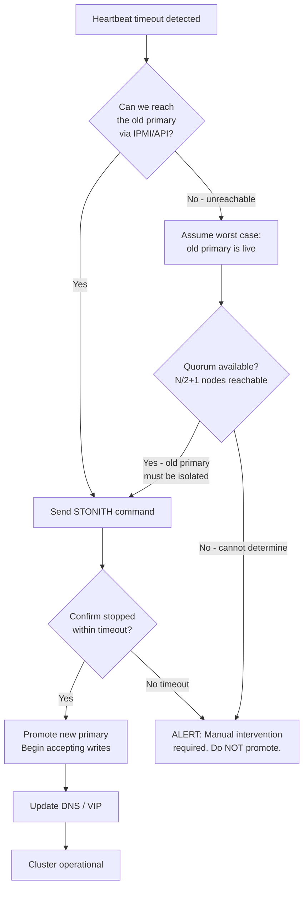
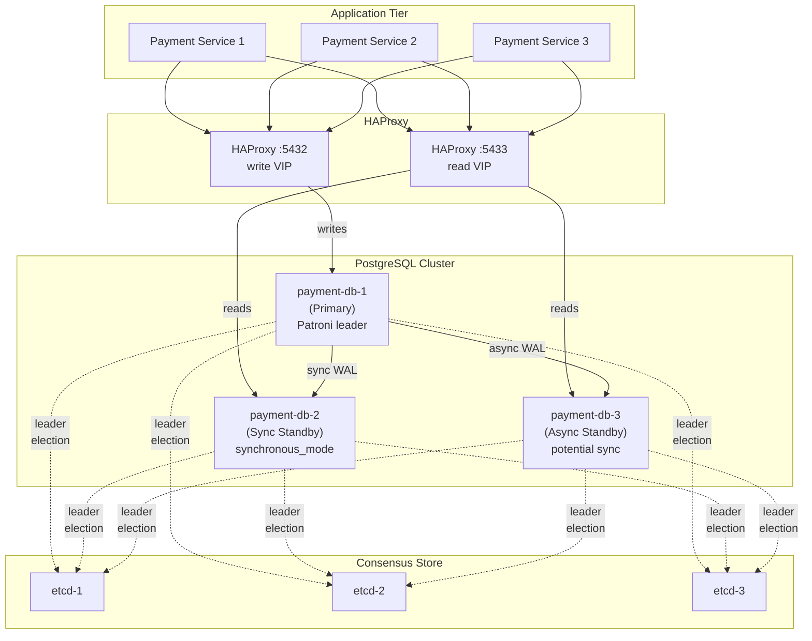

# Split-Brain and Network Partition Handling

## Overview

Split-brain is one of the most dangerous failure modes in distributed financial systems. It occurs when a network partition causes multiple nodes to simultaneously believe they are the authoritative primary, each accepting writes independently. In a payment system, this can result in the same account being debited twice, two separate payments being settled against the same funds, or ledger inconsistencies that require manual reconciliation costing hundreds of engineer-hours to resolve.

This lesson examines split-brain in depth: its definition, detection mechanisms, the epoch/term-based approach used by Raft and Patroni, fencing tokens to prevent stale nodes from completing writes, STONITH (Shoot The Other Node In The Head) for guaranteed isolation, quorum-based decision making, and PostgreSQL synchronous replication configuration. We conclude with an operational recovery coordinator and production pitfalls.

---

## 1. Split-Brain: Definition and Catastrophic Impact

### 1.1 What Is Split-Brain?

Split-brain occurs when a cluster of two or more nodes loses the network path between them (a partition), and both sides of the partition promote themselves to primary status.

```
BEFORE PARTITION:

  ┌───────────┐  heartbeat  ┌───────────┐
  │ Primary   │◄───────────►│ Standby   │
  │ Node A    │             │ Node B    │
  │ (writes)  │  replication│           │
  └───────────┘  ──────────►└───────────┘

DURING PARTITION (catastrophic):

  ┌───────────┐             ┌───────────┐
  │ Node A    │   NETWORK   │ Node B    │
  │ PRIMARY ✓ │ ░░░░░░░░░░░ │ PRIMARY ✓ │
  │ writing   │  PARTITION  │ writing   │
  └───────────┘             └───────────┘
       ▲                         ▲
       │                         │
  clients on                clients on
  network seg A             network seg B
  writing to A              writing to B
```

Both nodes now diverge. Every write to Node A is unknown to Node B, and vice versa. When the partition heals, the two transaction logs conflict and cannot be automatically merged.

### 1.2 The Financial Impact

Consider a customer account with a balance of £1,000:

```
Node A (thinks it's primary):       Node B (thinks it's primary):
  Time 10:00 — balance = £1,000       Time 10:00 — balance = £1,000
  Time 10:01 — debit £500 → £500      Time 10:01 — debit £800 → £200
  Time 10:02 — debit £400 → £100      Time 10:02 — payment confirmed to customer

Partition heals:
  Conflict detected on account balance
  Which state is "true"? Neither and both.
  Customer has overspent by £300. 
  Bank may have settled payments it cannot fund.
  Potential regulatory breach: FCA requires accurate records within T+1.
```

This is not a hypothetical. High-profile financial incidents caused by split-brain have resulted in:
- Duplicate payments requiring manual reversal (average cost: £80–£200 per payment)
- Overdraft positions the customer did not authorise
- Audit trails that contradict each other (Requirement 10 PCI DSS violation risk)
- Reputational damage from customer-visible errors

---

## 2. Heartbeat and Witness Detection

### 2.1 Basic Heartbeat Mechanism

Nodes emit periodic heartbeats to confirm liveness. If a node does not receive a heartbeat from the primary within a timeout window, it suspects the primary is unavailable.

```
Timeline of heartbeat failure detection:

  t=0s   Primary → Standby: heartbeat ACK
  t=1s   Primary → Standby: heartbeat ACK
  t=2s   Primary → Standby: heartbeat ACK
  t=3s   NETWORK PARTITION
  t=4s   Primary → Standby: [lost]
  t=5s   Primary → Standby: [lost]
  t=6s   Standby: missed_heartbeats=2
  t=7s   Primary → Standby: [lost]
  t=8s   Standby: missed_heartbeats=3 → THRESHOLD REACHED
  t=9s   Standby: initiating leader election
```

**The problem**: heartbeat timeout is a heuristic, not a proof. The primary might be alive but temporarily overloaded (GC pause, network blip). Too short a timeout causes false positives (unnecessary failovers). Too long a timeout increases mean time to detection.

For fintech, recommended heartbeat settings for PostgreSQL/Patroni:
- Heartbeat interval: 2 seconds
- Failover timeout: 10–30 seconds (depending on RPO/RTO trade-off)

### 2.2 Witness Node

A witness (tiebreaker) node is a lightweight third node that holds no data but participates in elections. It prevents symmetric split-brain on two-node clusters.

```
  ┌───────────┐             ┌───────────┐
  │ Node A    │             │ Node B    │
  │ (Primary) │  partition  │ (Standby) │
  └─────┬─────┘             └─────┬─────┘
        │                         │
        └──────────┬──────────────┘
                   │
            ┌──────▼──────┐
            │  Witness    │
            │  (no data)  │
            └─────────────┘

If A and B are partitioned:
  A cannot reach B, but CAN reach Witness → A has quorum (2/3) → stays primary
  B cannot reach A, but CANNOT reach Witness → B has no quorum (1/3) → stays standby
```

---

## 3. Epoch/Term-Based Leader Detection

### 3.1 Raft Term Numbers

Raft uses an incrementing term number (epoch) to establish recency. Each election starts a new term. Any node that receives a message with a higher term immediately reverts to follower status and updates its local term.

```
Term 1: Node A is leader
  [A: term=1, leader] ←→ [B: term=1, follower] ←→ [C: term=1, follower]

Partition: A is isolated from B and C
  [A: term=1, leader (thinks)]    [B: term=1, follower]
                                   [C: term=1, follower]

B and C hold election:
  [A: term=1, leader (stale)]     [B: term=2, candidate]
  Partition                        [C: term=2, votes for B]
                                   [B: term=2, leader]

Partition heals: A receives message from B with term=2
  A: term=2 > my term=1 → I am no longer leader → revert to follower
  [A: term=2, follower]           [B: term=2, leader]
  [C: term=2, follower]
```

This is Raft's core safety guarantee: at most one leader per term. No write can be committed in term N+1 without a majority of nodes advancing to term N+1.

### 3.2 Epoch Verification in Application Code

```java
public class EpochAwareLeaderService {

    private final AtomicLong currentEpoch = new AtomicLong(0);
    private final AtomicBoolean isLeader   = new AtomicBoolean(false);
    private final EpochStore epochStore;   // durable storage (etcd or Postgres)

    /**
     * Called by consensus layer when this node wins an election.
     * The epoch is persisted durably before isLeader is set.
     */
    public void onElectedLeader(long newEpoch) {
        if (newEpoch <= currentEpoch.get()) {
            log.warn("Rejecting stale election notification: epoch {} <= current {}",
                newEpoch, currentEpoch.get());
            return;
        }
        // Persist epoch BEFORE marking as leader — this is the critical order
        epochStore.persist(newEpoch);
        currentEpoch.set(newEpoch);
        isLeader.set(true);
        log.info("Became leader for epoch {}", newEpoch);
    }

    /**
     * Called by consensus layer when a higher epoch is observed.
     * This node must immediately stop acting as leader.
     */
    public void onHigherEpochObserved(long observedEpoch) {
        if (observedEpoch > currentEpoch.get()) {
            isLeader.set(false);  // stop leader behaviour BEFORE updating epoch
            currentEpoch.set(observedEpoch);
            log.warn("Stepping down: observed higher epoch {}", observedEpoch);
        }
    }

    public void executeAsLeader(Runnable action) {
        if (!isLeader.get()) {
            throw new NotLeaderException(currentEpoch.get());
        }
        // Double-check after acquiring intent — epoch may have changed
        long epochAtStart = currentEpoch.get();
        action.run();
        if (currentEpoch.get() != epochAtStart) {
            throw new EpochChangedDuringExecutionException(epochAtStart, currentEpoch.get());
        }
    }
}
```

---

## 4. Fencing Tokens

A fencing token is a monotonically increasing number issued by the distributed lock service (or consensus system) each time a node acquires leadership. The storage layer rejects any write that presents a token lower than the highest token it has ever seen. This prevents a node that was the leader in a previous epoch from completing a write after it has been superseded.

### 4.1 The Problem Fencing Solves

```
Without fencing:

  t=1  Node A acquires lock (token=5), starts writing
  t=2  Node A experiences GC pause (60 seconds)
  t=3  Lock service times out Node A's lock
  t=4  Node B acquires lock (token=6), writes committed
  t=5  Node A wakes up from GC pause, still thinks it has the lock
  t=6  Node A's write completes — STALE WRITE, OVERRIDES Node B's data!

With fencing:

  t=5  Node A wakes up, presents token=5 to storage
  t=5  Storage: max_seen_token=6, 5 < 6 → REJECT Node A's write
  t=5  Node A receives rejection, throws exception, marks self as not-leader
```

### 4.2 Java Fencing Token Class

```java
public record FencingToken(long value) implements Comparable<FencingToken> {

    public static final FencingToken ZERO = new FencingToken(0L);

    public boolean isNewerThan(FencingToken other) {
        return this.value > other.value;
    }

    @Override
    public int compareTo(FencingToken other) {
        return Long.compare(this.value, other.value);
    }

    @Override
    public String toString() {
        return "FencingToken{" + value + "}";
    }
}

@Service
public class FencedWriteService {

    private final JdbcTemplate jdbc;
    private final FencingToken myToken;

    public FencedWriteService(JdbcTemplate jdbc, FencingToken myToken) {
        this.jdbc     = jdbc;
        this.myToken  = myToken;
    }

    /**
     * Writes a payment ledger entry only if our fencing token is still the
     * highest the database has seen. The check and write are atomic within
     * the PostgreSQL stored procedure.
     */
    public void writeLedgerEntry(LedgerEntry entry) {
        int rowsAffected = jdbc.update(
            "SELECT write_ledger_entry(?, ?, ?, ?)",
            entry.accountId(),
            entry.amount(),
            entry.description(),
            myToken.value()   // passed to the stored procedure
        );

        if (rowsAffected == 0) {
            throw new StaleTokenException(
                "Write rejected: our fencing token " + myToken +
                " has been superseded. We are no longer the leader."
            );
        }
    }
}
```

### 4.3 PostgreSQL Stored Procedure Enforcing Fencing Tokens

```sql
-- Stores the highest fencing token this node has ever seen
CREATE TABLE cluster_fence_state (
    singleton_key  CHAR(1)  PRIMARY KEY DEFAULT 'X',
    max_token      BIGINT   NOT NULL DEFAULT 0,
    updated_at     TIMESTAMPTZ NOT NULL DEFAULT now()
);

INSERT INTO cluster_fence_state (singleton_key, max_token) VALUES ('X', 0)
ON CONFLICT DO NOTHING;

-- Stored procedure: atomic token check + write
CREATE OR REPLACE FUNCTION write_ledger_entry(
    p_account_id  UUID,
    p_amount      NUMERIC,
    p_description TEXT,
    p_token       BIGINT
) RETURNS INTEGER AS $$
DECLARE
    v_max_token BIGINT;
BEGIN
    -- Lock the fence state row (single row in table)
    SELECT max_token INTO v_max_token
    FROM cluster_fence_state
    WHERE singleton_key = 'X'
    FOR UPDATE;

    -- Reject stale writes
    IF p_token < v_max_token THEN
        RAISE WARNING 'Fencing token % is stale (max seen: %)', p_token, v_max_token;
        RETURN 0;
    END IF;

    -- Update high-water mark
    UPDATE cluster_fence_state
    SET max_token  = p_token,
        updated_at = now()
    WHERE singleton_key = 'X';

    -- Perform the actual write
    INSERT INTO ledger_entries (account_id, amount, description, created_at, fencing_token)
    VALUES (p_account_id, p_amount, p_description, now(), p_token);

    RETURN 1;
END;
$$ LANGUAGE plpgsql;
```

---

## 5. STONITH — Shoot The Other Node In The Head

STONITH is the guarantee that a potentially-alive-but-unreachable node is definitively powered off before the new primary begins accepting writes. Without STONITH, there is a time window during which both nodes could be accepting writes (the new primary has promoted, but the old primary has not yet stopped).

### 5.1 STONITH via IPMI (Bare Metal)

For on-premise servers, IPMI (Intelligent Platform Management Interface) provides out-of-band power control:

```bash
# Confirm old primary is reachable before attempting STONITH
ipmitool -H 10.10.0.5 -U admin -P secret chassis power status

# STONITH: power off the old primary node
ipmitool -H 10.10.0.5 -U admin -P secret chassis power off

# Verify power state
ipmitool -H 10.10.0.5 -U admin -P secret chassis power status
# → Chassis Power is off

# Only after confirmation: bring up new primary
patronictl -c /etc/patroni/config.yml failover payment-cluster \
  --master node-b --force
```

### 5.2 STONITH via AWS EC2 Stop API

For cloud deployments, the equivalent is stopping (not rebooting) the EC2 instance:

```java
@Service
public class AwsStonithService {

    private final Ec2Client ec2Client;
    private final StonithAuditRepository auditRepo;

    /**
     * Shoot the old primary node. This MUST be called before the new primary
     * begins accepting writes. The method blocks until the instance reaches
     * the STOPPED state.
     */
    public StonithResult fenceNode(String instanceId, String reason) {
        log.warn("STONITH initiated for instance {} reason: {}", instanceId, reason);

        auditRepo.recordStonithInitiated(instanceId, reason, Instant.now());

        // Stop the instance — this is not a reboot
        StopInstancesRequest stopRequest = StopInstancesRequest.builder()
            .instanceIds(instanceId)
            .force(true)  // bypass graceful shutdown; we cannot trust the OS
            .build();

        ec2Client.stopInstances(stopRequest);

        // Wait for the instance to reach stopped state — with timeout
        Instant deadline = Instant.now().plusSeconds(120);
        InstanceStateName finalState = null;

        while (Instant.now().isBefore(deadline)) {
            DescribeInstancesResponse desc = ec2Client.describeInstances(
                DescribeInstancesRequest.builder().instanceIds(instanceId).build()
            );
            finalState = desc.reservations().get(0).instances().get(0)
                             .state().name();

            if (finalState == InstanceStateName.STOPPED) {
                log.info("STONITH confirmed: instance {} is STOPPED", instanceId);
                auditRepo.recordStonithCompleted(instanceId, Instant.now());
                return StonithResult.success(instanceId, finalState);
            }

            try { Thread.sleep(2000); } catch (InterruptedException e) {
                Thread.currentThread().interrupt();
                break;
            }
        }

        log.error("STONITH TIMEOUT: instance {} did not stop within 120s. " +
                  "MANUAL INTERVENTION REQUIRED. Final state: {}", instanceId, finalState);
        auditRepo.recordStonithTimeout(instanceId, Instant.now());
        return StonithResult.timeout(instanceId, finalState);
    }
}
```

### 5.3 STONITH Decision Flow



---

## 6. Quorum — Majority Decision

Quorum prevents split-brain by requiring that any decision (leader election, write commit) is acknowledged by a majority of nodes. For N nodes, quorum requires at least N/2+1 votes.

| Cluster Size | Quorum Required | Tolerated Failures |
|---|---|---|
| 1 | 1 | 0 |
| 2 | 2 | 0 (no fault tolerance!) |
| 3 | 2 | 1 |
| 5 | 3 | 2 |
| 7 | 4 | 3 |

**A two-node cluster has no fault tolerance** — it requires both nodes to form quorum. For fintech, three nodes minimum is the operational standard.

```
3-node cluster, one node partitioned:

  ┌────────────┐         ┌────────────┐
  │  Node A    │◄───────►│  Node B    │
  │ (can reach │         │ (can reach │
  │  B and C)  │         │  A and C)  │
  └────────────┘         └────────────┘
         ▲                      ▲
         │       partition       │
         │                      │
         └──────────────────────┘
                    ║
              ┌─────╨──────┐
              │  Node C    │
              │ (isolated) │
              └────────────┘

A and B have quorum (2/3).
C does not have quorum (1/3) → C must NOT promote itself.
If C was primary before partition, A and B elect a new primary.
C steps down when partition heals and it receives higher epoch.
```

### 6.1 Quorum Voting in Java

```java
public class QuorumVoter {

    private final List<ClusterNode> allNodes;
    private final int quorumSize;

    public QuorumVoter(List<ClusterNode> allNodes) {
        this.allNodes  = List.copyOf(allNodes);
        this.quorumSize = (allNodes.size() / 2) + 1;
    }

    /**
     * Attempt to gather votes for leader election in the given epoch.
     * Returns true only if we obtained quorum.
     */
    public boolean seekQuorum(long epoch) {
        List<CompletableFuture<VoteResponse>> futures = allNodes.stream()
            .filter(node -> !node.isSelf())
            .map(node -> CompletableFuture.supplyAsync(
                () -> node.requestVote(epoch),
                Executors.newVirtualThreadPerTaskExecutor()
            ))
            .collect(Collectors.toList());

        // We always vote for ourselves
        AtomicInteger voteCount = new AtomicInteger(1);

        for (CompletableFuture<VoteResponse> future : futures) {
            try {
                VoteResponse resp = future.get(500, TimeUnit.MILLISECONDS);
                if (resp.granted() && resp.term() == epoch) {
                    int total = voteCount.incrementAndGet();
                    if (total >= quorumSize) {
                        log.info("Quorum achieved: {}/{} votes for epoch {}",
                            total, allNodes.size(), epoch);
                        return true;
                    }
                }
            } catch (TimeoutException | ExecutionException e) {
                log.debug("Vote request failed for epoch {}", epoch, e);
            } catch (InterruptedException e) {
                Thread.currentThread().interrupt();
                return false;
            }
        }

        log.warn("Quorum not achieved: {}/{} votes, need {}",
            voteCount.get(), allNodes.size(), quorumSize);
        return false;
    }
}
```

---

## 7. PostgreSQL Synchronous Replication

PostgreSQL synchronous replication ensures that a transaction commit is not acknowledged to the client until at least one standby has written the WAL to disk. This guarantees zero data loss on primary failure.

### 7.1 postgresql.conf Settings

```ini
# postgresql.conf on the primary

# Synchronous replication: commit waits for at least 1 standby
synchronous_commit = on                      # never acknowledge before standby confirms

# Naming the standbys that must confirm commits
# Format: [FIRST N (standby_names)] or [ANY N (standby_names)]
synchronous_standby_names = 'FIRST 1 (payment-standby-1, payment-standby-2)'
# FIRST 1: wait for the first (priority) standby to confirm
# If payment-standby-1 fails, payment-standby-2 becomes synchronous

# WAL settings
wal_level = replica                          # minimum for streaming replication
max_wal_senders = 10                         # max simultaneous replication connections
wal_keep_size = 1024                         # keep 1 GB of WAL for slow standbys
```

```ini
# postgresql.conf on each standby

hot_standby = on                             # allow reads on standby
hot_standby_feedback = on                    # prevent primary vacuuming rows standby still needs
recovery_min_apply_delay = 0                 # apply WAL immediately (set >0 for delayed replica)
```

### 7.2 pg_hba.conf for Replication

```
# pg_hba.conf — allow replication connections from standby hosts
# TYPE   DATABASE     USER          ADDRESS            METHOD
host     replication  replicator    10.10.0.2/32       scram-sha-256
host     replication  replicator    10.10.0.3/32       scram-sha-256
```

### 7.3 Verify Replication Lag

```sql
-- On primary: check replication status
SELECT
    client_addr,
    application_name,
    state,
    sent_lsn,
    write_lsn,
    flush_lsn,
    replay_lsn,
    write_lag,
    flush_lag,
    replay_lag,
    sync_state
FROM pg_stat_replication;

-- Expected output for synchronous standby:
-- client_addr | application_name | state     | sync_state
-- 10.10.0.2   | payment-standby-1| streaming | sync
-- 10.10.0.3   | payment-standby-2| streaming | potential
```

---

## 8. Patroni HA Setup

Patroni is the standard HA solution for PostgreSQL clusters in production financial systems. It uses a distributed configuration store (etcd, Consul, or ZooKeeper) for leader election and stores the fencing token (DCS term) alongside cluster state.

### 8.1 Patroni Configuration YAML

```yaml
# /etc/patroni/config.yml — payment-db-primary

scope: payment-cluster
namespace: /fintech/
name: payment-db-1

restapi:
  listen: 0.0.0.0:8008
  connect_address: 10.10.0.1:8008
  authentication:
    username: patroni
    password: "${PATRONI_REST_PASSWORD}"  # from environment / secrets manager

etcd3:
  hosts:
    - 10.10.1.1:2379
    - 10.10.1.2:2379
    - 10.10.1.3:2379
  username: patroni
  password: "${ETCD_PASSWORD}"

bootstrap:
  dcs:
    ttl: 30                                # leader TTL — primary must renew every 30s
    loop_wait: 10                          # Patroni main loop interval
    retry_timeout: 10                      # timeout for DCS operations
    maximum_lag_on_failover: 1048576       # 1 MB max WAL lag allowed for promotion
    synchronous_mode: true                 # enforce synchronous replication
    synchronous_mode_strict: true          # refuse to promote async standby

    postgresql:
      use_pg_rewind: true                  # use pg_rewind to resync old primary
      use_slots: true                      # use replication slots to prevent WAL loss

  pg_hba:
    - host replication replicator 10.10.0.0/24 scram-sha-256
    - host all         all        10.10.0.0/24 scram-sha-256

postgresql:
  listen: 0.0.0.0:5432
  connect_address: 10.10.0.1:5432
  data_dir: /var/lib/postgresql/16/main
  bin_dir: /usr/lib/postgresql/16/bin
  pgpass: /tmp/.pgpass

  parameters:
    wal_level:                 replica
    hot_standby:               "on"
    max_connections:           500
    synchronous_commit:        "on"
    synchronous_standby_names: "FIRST 1 (payment-db-2, payment-db-3)"
    max_wal_senders:           10
    wal_keep_size:             "1024"

  authentication:
    replication:
      username: replicator
      password: "${REPLICATION_PASSWORD}"
    superuser:
      username: postgres
      password: "${POSTGRES_SUPERUSER_PASSWORD}"

tags:
  nofailover:  false
  noloadbalance: false
  clonedfrom:  false
  nosync:      false

watchdog:
  mode: required                           # watchdog REQUIRED — Patroni refuses to start without it
  device: /dev/watchdog
  safety_margin: 5
```

### 8.2 Patroni Cluster Architecture



---

## 9. CP vs AP for Payment Systems

CAP theorem states that in the presence of a network partition, a distributed system must choose between Consistency (C) and Availability (A).

| Property | CP (Consistent + Partition-tolerant) | AP (Available + Partition-tolerant) |
|---|---|---|
| On partition | Reject writes, return error | Accept writes on both sides |
| Data loss risk | None — rejected writes never happen | High — both sides diverge |
| Downtime risk | Yes — system is unavailable during partition | No — both sides remain operational |
| Suitable for | Financial accounts, ledgers, payment state | Shopping carts, user preferences, counters |

**For payment systems, CP is non-negotiable.** A £1,000 account cannot be £2,000 even temporarily. It is always better to reject a payment with an error than to accept it and create a double-debit. FCA Principle 3 (management and control) and PS 2/22 (operational resilience) require that the system maintains accurate data, not just availability.

```java
// CP-first configuration: fail writes if quorum is unavailable
@Configuration
public class PaymentDataSourceConfig {

    @Bean
    public DataSource paymentDataSource(DataSourceProperties props) {
        HikariDataSource ds = new HikariDataSource();
        ds.setJdbcUrl(props.getUrl());
        ds.setUsername(props.getUsername());
        ds.setPassword(props.getPassword());

        // Fail fast if no primary is available — do NOT fall back to a stale standby
        ds.setConnectionTimeout(5_000);    // 5s to get a connection
        ds.setMaximumPoolSize(50);
        ds.setConnectionTestQuery(
            "SELECT 1 FROM pg_is_in_recovery() WHERE pg_is_in_recovery() = false"
            // This query fails on standbys — ensures we only connect to primary
        );
        return ds;
    }
}
```

---

## 10. Operational Recovery Coordinator

When a split-brain incident has occurred, the recovery process must be methodical. The following Java service coordinates recovery steps.

```java
@Service
@Slf4j
public class SplitBrainRecoveryCoordinator {

    private final DatabaseInspector dbInspector;
    private final LedgerReconciliationService reconciler;
    private final AlertingService alerting;
    private final IncidentRepository incidentRepo;

    /**
     * Execute recovery after a confirmed split-brain event.
     * This method performs each step and gates progression on success.
     */
    @Transactional(propagation = Propagation.NOT_SUPPORTED) // runs outside any transaction
    public RecoveryReport executeRecovery(SplitBrainIncident incident) {

        log.error("SPLIT_BRAIN_RECOVERY INITIATED: incident={}", incident.id());
        alerting.page(AlertLevel.P1, "Split-brain recovery in progress on " + incident.cluster());

        RecoveryReport.Builder report = RecoveryReport.builder()
            .incidentId(incident.id())
            .startedAt(Instant.now());

        // Step 1: Identify divergence window
        Duration divergenceWindow = Duration.between(
            incident.partitionStartedAt(),
            incident.partitionHealedAt()
        );
        log.info("Divergence window: {}", divergenceWindow);
        report.divergenceWindow(divergenceWindow);

        // Step 2: Identify conflicting transactions in divergence window
        List<ConflictingTransaction> conflicts =
            dbInspector.findConflicts(incident.nodeA(), incident.nodeB(),
                                      incident.partitionStartedAt(),
                                      incident.partitionHealedAt());

        log.info("Found {} conflicting transactions", conflicts.size());
        report.conflictCount(conflicts.size());

        if (conflicts.isEmpty()) {
            log.info("No conflicts found — partition healed cleanly via synchronous replication");
            report.outcome(RecoveryOutcome.CLEAN_RECOVERY);
            return report.build();
        }

        // Step 3: Categorise conflicts
        List<ConflictingTransaction> doubleDebits = conflicts.stream()
            .filter(t -> t.type() == ConflictType.DOUBLE_DEBIT)
            .collect(Collectors.toList());

        List<ConflictingTransaction> stateConflicts = conflicts.stream()
            .filter(t -> t.type() == ConflictType.STATUS_CONFLICT)
            .collect(Collectors.toList());

        // Step 4: Automated resolution for safe cases
        stateConflicts.forEach(conflict -> {
            try {
                reconciler.resolveStatusConflict(conflict);
                log.info("Auto-resolved status conflict for txn {}", conflict.transactionId());
            } catch (Exception e) {
                log.error("Auto-resolution failed for txn {}", conflict.transactionId(), e);
                incidentRepo.flagForManualReview(conflict.transactionId(), e.getMessage());
            }
        });

        // Step 5: Double-debits ALWAYS require manual review
        if (!doubleDebits.isEmpty()) {
            log.error("MANUAL_REVIEW_REQUIRED: {} double-debit conflicts detected", doubleDebits.size());
            doubleDebits.forEach(dd ->
                incidentRepo.flagForManualReview(dd.transactionId(),
                    "Double-debit: nodes diverged on account " + dd.accountId())
            );
            report.manualReviewRequired(true);
            report.outcome(RecoveryOutcome.PARTIAL_RECOVERY_MANUAL_REVIEW_REQUIRED);
            alerting.page(AlertLevel.P1, doubleDebits.size() + " double-debits require manual review");
        }

        return report.build();
    }
}
```

---

## 11. Production Pitfalls

### Pitfall 1: Synchronous Replication Blocking Writes When Standby Is Down

With `synchronous_commit = on`, if the synchronous standby is unavailable, the primary will block all writes indefinitely waiting for acknowledgement. In an urgent incident, this can cause the payment processing pipeline to stall completely.

```sql
-- WRONG: synchronous_commit = on with no fallback
-- If synchronous standby goes down, ALL writes block until it returns

-- BETTER: set synchronous_commit = local under controlled conditions
-- This falls back to local durability (data persisted to primary WAL)
-- when no synchronous standby is available.
-- Use this ONLY as a temporary measure during standby maintenance.
-- Requires a deliberate operational decision and must be reversed.

-- To set at session level (temporary, only for this connection):
SET synchronous_commit = local;

-- To set at database level (requires deliberate ops decision):
ALTER DATABASE payment_db SET synchronous_commit = local;

-- ALERT: set an alert for when this fallback is active
-- Query to detect if synchronous_commit degraded:
SELECT
    name,
    setting,
    source
FROM pg_settings
WHERE name = 'synchronous_commit'
  AND setting != 'on';
```

**Mitigation**: Configure `synchronous_standby_names` with a list of standbys and use `FIRST 1 (...)` semantics so there is always at least one candidate. Add monitoring that alerts within 60 seconds if the synchronous standby falls behind or disconnects.

### Pitfall 2: False Split-Brain Detection Causing Unnecessary Failover

An overloaded primary (e.g., during a large batch run) may miss heartbeat deadlines, triggering a split-brain response even though the primary is healthy. The standby promotes, the primary receives the promotion event, and both briefly accept writes.

```java
// WRONG: simple heartbeat timeout with no jitter or cooldown
if (missedHeartbeats >= THRESHOLD) {
    promoteSelf(); // triggers immediately — susceptible to false positive
}

// BETTER: graduated response with confirmation period
@Service
public class GraduatedFailoverService {

    private final AtomicInteger consecutiveMisses = new AtomicInteger(0);
    private final ScheduledExecutorService scheduler =
        Executors.newSingleThreadScheduledExecutor();

    public void onHeartbeatMiss() {
        int misses = consecutiveMisses.incrementAndGet();

        if (misses == WARN_THRESHOLD) {
            // First level: alert ops team, do not promote
            alerting.warn("Primary heartbeat degraded: {} consecutive misses", misses);
        } else if (misses == CONFIRM_THRESHOLD) {
            // Second level: request quorum vote before promoting
            if (quorumVoter.seekQuorum(nextEpoch())) {
                log.warn("Quorum achieved, initiating STONITH before promotion");
                stonithService.fenceNode(currentPrimaryInstanceId, "split-brain prevention");
                promoteSelf();
            } else {
                log.warn("Quorum not achieved — not promoting. Waiting for partition to heal.");
            }
        }
    }

    public void onHeartbeatSuccess() {
        consecutiveMisses.set(0); // reset on any successful heartbeat
    }
}
```

### Pitfall 3: Fencing Token Not Checked on Read Path

Teams often implement fencing on the write path but forget the read path. A stale leader might serve a read of an account balance that is already obsolete, leading to a decision (e.g., "this account has sufficient funds") based on stale data.

```java
// WRONG: fencing only on writes
public ProcessingResult processPayment(Payment payment) {
    // read without fencing check — may read stale data from old primary!
    AccountBalance balance = balanceRepository.findById(payment.debitAccount());
    if (balance.isSufficient(payment.amount())) {
        ledgerService.writeLedgerEntry(payment); // fenced write
    }
}

// CORRECT: fence check before any read-then-write operation
public ProcessingResult processPayment(Payment payment) {
    // Verify we are still the leader before reading
    if (!leaderService.isLeaderForCurrentEpoch()) {
        throw new NotLeaderException("Cannot process payment: not current leader");
    }

    AccountBalance balance = balanceRepository.findById(payment.debitAccount());

    // Re-verify leadership after read — epoch may have changed during the read
    if (!leaderService.isLeaderForCurrentEpoch()) {
        throw new NotLeaderException("Leadership lost during balance read — aborting");
    }

    if (balance.isSufficient(payment.amount())) {
        ledgerService.writeLedgerEntry(payment); // also fenced
    }
}
```

### Pitfall 4: etcd/ZooKeeper as Single Point of Failure for Consensus

Patroni requires a healthy etcd cluster for leader election. If the etcd cluster loses quorum (e.g., two of three etcd nodes fail), Patroni cannot perform leader election and the entire PostgreSQL cluster becomes read-only or unavailable. Teams often neglect the consensus store's own HA.

```yaml
# WRONG: single etcd node
etcd:
  host: 10.10.1.1:2379   # single node — if this fails, all Patroni operations fail

# CORRECT: 3-node etcd cluster across availability zones
etcd3:
  hosts:
    - 10.10.1.1:2379   # etcd-1 — AZ eu-west-1a
    - 10.10.1.2:2379   # etcd-2 — AZ eu-west-1b
    - 10.10.1.3:2379   # etcd-3 — AZ eu-west-1c
```

```java
// Also: health check the consensus store independently of PostgreSQL
@Component
public class ConsensusStoreHealthIndicator implements HealthIndicator {

    private final EtcdClient etcdClient;

    @Override
    public Health health() {
        try {
            StatusResponse status = etcdClient.maintenance()
                .statusMember(0L)
                .get(2, TimeUnit.SECONDS);

            long leader = status.getLeader();
            if (leader == 0) {
                return Health.down()
                    .withDetail("reason", "etcd has no leader — split-brain risk elevated")
                    .build();
            }
            return Health.up()
                .withDetail("etcd_leader", leader)
                .build();
        } catch (Exception e) {
            return Health.down(e)
                .withDetail("reason", "Cannot reach etcd — failovers will not function")
                .build();
        }
    }
}
```

---

## 12. Checklist

### Infrastructure

- [ ] PostgreSQL cluster has minimum 3 nodes (1 primary + 2 standbys)
- [ ] `synchronous_commit = on` with at least 1 named synchronous standby
- [ ] `synchronous_standby_names` uses `FIRST 1 (...)` with 2 candidates listed
- [ ] etcd cluster has 3 nodes across separate availability zones
- [ ] Patroni watchdog mode set to `required`
- [ ] STONITH mechanism tested quarterly in controlled failover drill
- [ ] HAProxy health checks query `pg_is_in_recovery()` to detect primary/standby

### Fencing and Epochs

- [ ] Fencing tokens implemented in all write paths
- [ ] PostgreSQL stored procedure rejects writes with stale tokens
- [ ] Epoch/term verified before read-then-write operations
- [ ] `NotLeaderException` triggers alerting and circuit breaker in service mesh

### Monitoring

- [ ] Alert: synchronous standby lag > 10 MB
- [ ] Alert: Patroni leader TTL renewal failure
- [ ] Alert: etcd cluster quorum lost
- [ ] Alert: fencing token rejection rate > 0 (indicates stale leader is active)
- [ ] Alert: `pg_is_in_recovery()` changes unexpectedly on primary host
- [ ] Dashboard: replication lag per standby (write_lag, flush_lag, replay_lag)

### Operational Readiness

- [ ] Split-brain recovery runbook reviewed and practised annually
- [ ] Dual-primary simulation tested in staging environment
- [ ] RTO confirmed: < 30 seconds for automatic failover
- [ ] RPO confirmed: 0 data loss with synchronous_commit = on
- [ ] Recovery coordinator can categorise and route conflicts automatically

---

<!-- KNOWLEDGE-CHECK
{"questions":[{"text":"Why is a two-node PostgreSQL cluster with no witness considered inadequate for fintech production use?","options":["It cannot support synchronous replication","Both nodes require quorum (2/2) to elect a leader, meaning any single-node failure leaves the cluster with no quorum and no ability to elect a new primary","It does not support fencing tokens","It is incompatible with Patroni"],"correct":1,"explanation":"A two-node cluster requires both nodes to form quorum (2/2 = 100%). If one node fails, the surviving node cannot achieve quorum and therefore cannot safely promote itself. Adding a witness node creates a 3-node cluster where quorum is 2/3, allowing one node failure while still electing a primary."},{"text":"What is the primary purpose of a fencing token in split-brain prevention?","options":["To encrypt replication traffic between primary and standby","To allow the storage layer to reject writes from a node that held leadership in a previous epoch, even if that node believes it is still the leader","To authenticate Patroni with etcd","To measure replication lag between primary and standby"],"correct":1,"explanation":"A fencing token is a monotonically increasing number. The storage layer tracks the highest token it has ever seen. If a stale leader wakes up after a GC pause and attempts to write with an old token value, the storage layer rejects the write. This prevents stale leaders from corrupting data even if STONITH was slower than expected."},{"text":"For payment systems, which CAP trade-off is correct and why?","options":["AP — availability is more important because a payment rejection is worse than a duplicate payment","CP — consistency is non-negotiable because a double-debit or overdraft caused by diverged state is a regulatory and financial integrity failure","AP — the system should always accept writes and reconcile later","Neither C nor P — payment systems use BASE not ACID"],"correct":1,"explanation":"Payment systems must be CP (Consistent + Partition-tolerant). During a network partition, the correct behaviour is to reject writes rather than accept them on both sides of the partition. A rejected payment can be retried; a double-debit or overdraft caused by diverged ledger state requires complex manual reconciliation and may cause regulatory breaches."}]}
-->

<!-- PRACTICAL-CHALLENGE
{"title":"Implement Split-Brain Prevention for a Payment Cluster","difficulty":"advanced","estimatedMinutes":130,"tasks":[{"id":"1","description":"Implement a FencingToken record class and a FencedWriteService that calls a PostgreSQL stored procedure write_ledger_entry. The stored procedure must atomically check that the incoming token is not less than the max_token in a cluster_fence_state table, update the max_token, and perform the ledger insert. The service must throw StaleTokenException when the stored procedure returns 0 rows affected."},{"id":"2","description":"Implement an AwsStonithService that calls the EC2 stopInstances API with force=true, then polls DescribeInstances until the instance state is STOPPED or a 120-second timeout is reached. The service must record an audit entry at initiation and at completion or timeout. On timeout it must log an error and return a StonithResult.timeout() — it must NOT proceed with leader promotion."},{"id":"3","description":"Write a Patroni configuration YAML for a 3-node payment cluster using etcd3 for consensus. The configuration must enable synchronous_mode: true, synchronous_mode_strict: true, set synchronous_standby_names to FIRST 1 with two named standbys, set maximum_lag_on_failover to 1 MB, and configure the watchdog as required. Include pg_hba rules for replication connections from a 10.10.0.0/24 subnet."},{"id":"4","description":"Implement a QuorumVoter that tracks all cluster nodes, computes quorumSize as (N/2)+1, and solicits votes from all non-self nodes using CompletableFuture with a 500ms timeout per node vote. The method must return true as soon as it accumulates quorum votes (counting self-vote as 1), and log a warning with the final vote tally if quorum is not achieved. Add a GraduatedFailoverService that only calls QuorumVoter after a CONFIRM_THRESHOLD of missed heartbeats, never on the first miss."}]}
-->
