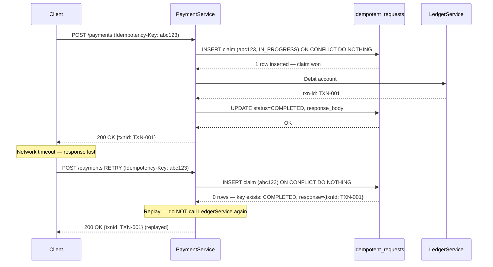

# منع التكرار (Idempotency) في الأنظمة المالية الموزعة

> [!NOTE]
> منع التكرار هو الضمان التعاقدي بأن تنفيذ العملية نفسها عدة مرات يُنتج النتيجة نفسها التي يُنتجها تنفيذها مرة واحدة. وفي الأنظمة المالية، حيث التسليم "مرة واحدة على الأقل" هو القاعدة، ليس منع التكرار ميزة إضافية — بل متطلب صحة. فالدفعة المخصومة مرتين تهدم ثقة العميل وتستدعي تدقيقًا تنظيميًا.

## لماذا يُنشئ التسليم "مرة واحدة على الأقل" خطر التكرار

كل استدعاء HTTP، وكل استهلاك من Kafka، وكل استدعاء gRPC يمكن إعادة محاولته. فالشبكات تنقسم، والاتصالات تنتهي مهلتها قبل وصول الرد. ولا تستطيع الخدمة المستدعية التمييز بين "تعطل الخادم قبل المعالجة" و"عالج الخادم لكن الرد ضاع". والخيار الآمن هو إعادة المحاولة — لذلك التكرار حتمي.

```
Client → POST /payments (timeout after 2s, no response received)
Server  → Payment processed, response sent — LOST IN NETWORK
Client → POST /payments RETRY (same request)
Server  → Payment processed AGAIN — DUPLICATE DEBIT
```

الدفاع المتين الوحيد هو جعل **الخادم** آمنًا من التكرار، لا الاعتماد على **العميل** لتجنب إعادة المحاولة.

---

## تصميم مفتاح منع التكرار

يحدد مفتاح منع التكرار عملية منطقية واحدة بشكل فريد. ويخزن الخادم سجلًا للتنفيذ الأول ويعيد النتيجة المخزنة عند التكرار.

### UUID v4 مقابل المفاتيح المركّبة

**UUID v4** هو الأسلوب الأبسط: يولّد العميل مفتاحًا عشوائيًا ويضمّنه في كل طلب. ويخزنه الخادم في عمود بقيد فريد.

```java
// Client side — generate once, store durably, include on every attempt
String idempotencyKey = UUID.randomUUID().toString();
// Store in client's DB before making the call
clientDb.saveOutboundRequest(paymentId, idempotencyKey);

// Include in request header
httpClient.post("/payments")
    .header("Idempotency-Key", idempotencyKey)
    .body(paymentRequest)
    .execute();
```

**المفاتيح المركّبة** تُشتق المفتاح حتميًا من بيانات العمل. وهي تصمد أمام تعطل العميل قبل حفظ الـ UUID المولّد:

```java
// Composite key: stable across restarts without prior persistence
String idempotencyKey = String.format(
    "pay:%s:%s:%s:%s",
    senderId,
    recipientId,
    amountInMinorUnits,
    businessDate   // prevents same sender/recipient/amount on a different day colliding
);
// SHA-256 hash to normalise length and avoid delimiter injection
String hashedKey = DigestUtils.sha256Hex(idempotencyKey);
```

> [!WARNING]
> تخاطر المفاتيح المركّبة بـ **إيجابيات كاذبة** إذا تشاركت عمليتان مختلفتان فعلًا حقول العمل نفسها (مثلًا يدفع المرسل نفسه للمستلم نفسه المبلغ نفسه مرتين في يوم واحد). أضف رقمًا تسلسليًا من العميل أو معرّف ارتباط إلى المفتاح المركّب إذا كان التكرار في اليوم نفسه ممكنًا.

---

## جدول `idempotent_requests`

يخزن الخادم كل طلب معالَج مفهرسًا بمفتاح منع التكرار:

```sql
CREATE TABLE idempotent_requests (
    idempotency_key   VARCHAR(64)  NOT NULL,
    created_at        TIMESTAMPTZ  NOT NULL DEFAULT NOW(),
    expires_at        TIMESTAMPTZ  NOT NULL,
    request_hash      VARCHAR(64)  NOT NULL,  -- SHA-256 of request body
    status            VARCHAR(16)  NOT NULL,  -- IN_PROGRESS | COMPLETED
    response_status   SMALLINT,               -- NULL while IN_PROGRESS
    response_body     JSONB,                  -- NULL while IN_PROGRESS
    lock_acquired_at  TIMESTAMPTZ,            -- set during processing, NULL = done
    CONSTRAINT pk_idempotent_requests PRIMARY KEY (idempotency_key)
);

-- Partial index: fast lookup of in-flight requests (lock held)
CREATE INDEX idx_idempotent_requests_in_flight
    ON idempotent_requests (idempotency_key)
    WHERE lock_acquired_at IS NOT NULL;

-- Cleanup index
CREATE INDEX idx_idempotent_requests_expiry
    ON idempotent_requests (expires_at);
```

القيد الفريد على `idempotency_key` (عبر PRIMARY KEY) هو حارس قاعدة البيانات ضد الإدخالات المكررة المتزامنة. وتكون أعمدة الرد فارغة ما دامت الحالة IN_PROGRESS.

---

## ‏`IdempotentPaymentService` — احجز أولًا ثم عالج

```java
@Service
@RequiredArgsConstructor
public class IdempotentPaymentService {

    private final IdempotentRequestRepository idempotentRepo;
    private final PaymentProcessor            paymentProcessor;
    private final TransactionTemplate         tx;   // short, separate transactions
    private final ObjectMapper                objectMapper;

    // NOT one big @Transactional: inside a single transaction the claim row is
    // invisible to other requests until commit, so "in progress" could never
    // be seen, and a rollback would erase the record of a payment that the
    // processor (often another service) has already executed.
    public PaymentResponse processPayment(String idempotencyKey, PaymentRequest request) {
        String requestHash = sha256(request);

        // 1. CLAIM the key first, in its own committed transaction:
        //    INSERT ... (status = 'IN_PROGRESS', lock_acquired_at = now())
        //    ON CONFLICT (idempotency_key) DO NOTHING
        //    The PRIMARY KEY lets exactly one concurrent request win.
        boolean claimed = tx.execute(st ->
            idempotentRepo.insertClaimIfAbsent(idempotencyKey, requestHash,
                Instant.now().plus(Duration.ofHours(24))));

        if (!claimed) {
            IdempotentRequest record = idempotentRepo.findByKey(idempotencyKey).orElseThrow();

            // Guard: same key but different body = client bug -> 422
            if (!record.getRequestHash().equals(requestHash)) {
                throw new IdempotencyKeyConflictException(
                    "Idempotency key reused with different request body: " + idempotencyKey);
            }
            if ("IN_PROGRESS".equals(record.getStatus())) {
                // Another request is mid-flight -> 409 so the client backs off
                throw new RequestInProgressException(idempotencyKey);
            }
            // COMPLETED: replay the stored response — do NOT reprocess
            log.info("Replaying idempotent response for key={}", idempotencyKey);
            return deserialize(record.getResponseBody(), PaymentResponse.class);
        }

        // 2. Process the payment (pass the key on, so the processor is idempotent too)
        PaymentResponse response;
        try {
            response = paymentProcessor.execute(request, idempotencyKey);
        } catch (DefinitelyNotProcessedException e) {
            // e.g. validation failure: nothing happened, so release the claim
            tx.executeWithoutResult(st -> idempotentRepo.deleteByKey(idempotencyKey));
            throw e;
        }
        // Any OTHER failure (timeout, crash) leaves the claim IN_PROGRESS: the
        // outcome is unknown. A recovery job finds claims older than a few
        // minutes and asks the processor what really happened, by this key.

        // 3. Store the response and mark the claim COMPLETED
        tx.executeWithoutResult(st ->
            idempotentRepo.complete(idempotencyKey, 200, serialize(response)));
        return response;
    }

    private String sha256(Object obj) {
        try {
            // Hash a canonical form (fixed field order) so that the same request
            // always produces the same hash
            byte[] bytes = objectMapper.writeValueAsBytes(obj);
            return DigestUtils.sha256Hex(bytes);
        } catch (JsonProcessingException e) {
            throw new IllegalStateException("Cannot hash request", e);
        }
    }
}
```

ليست العملية كلها معاملة واحدة كبيرة: فداخل معاملة واحدة يبقى صف الحجز غير مرئي للطلبات الأخرى حتى الالتزام، فلا تُرى حالة "قيد المعالجة" أبدًا، والتراجع سيمحو سجل دفعة نفّذها المعالج (غالبًا خدمة أخرى) بالفعل. لذلك:
1. **احجز** المفتاح أولًا في معاملة ملتزمة خاصة به (`INSERT ... ON CONFLICT DO NOTHING`)، فيفوز طلب متزامن واحد بالضبط.
2. إن لم تفز: جسم مختلف بالمفتاح نفسه ← 422؛ وطلب آخر قيد المعالجة ← 409؛ وإن اكتمل ← أعد الرد المخزن.
3. عالج الدفعة. فإذا فشلت بشكل مؤكد دون تنفيذ (مثل فشل التحقق) حرّر الحجز. وأي فشل آخر (انتهاء مهلة، تعطل) يترك الحجز IN_PROGRESS لأن النتيجة مجهولة، وتسأل مهمة استرداد المعالج عما حدث فعلًا بهذا المفتاح.
4. خزّن الرد وعلّم الحجز COMPLETED.

---

## مخطط تسلسلي — إعادة محاولة آمنة من التكرار



---

## منع التكرار في مستهلكي Kafka

تضمن وسطاء الرسائل التسليم مرة واحدة على الأقل. فتعطل المستهلك بعد المعالجة وقبل التزام الإزاحة يعيد تسليم الرسالة. ويجب على المستهلك إزالة التكرار:

```java
@Component
@RequiredArgsConstructor
public class PaymentEventConsumer {

    private final DeduplicationRepository deduplicationRepo;
    private final LedgerService           ledgerService;

    @KafkaListener(topics = "payment-instructions", groupId = "ledger-processor")
    @Transactional
    public void consume(ConsumerRecord<String, PaymentInstruction> record) {
        // lastHeader() returns a Header or null — not an Optional
        String messageId = Optional.ofNullable(record.headers().lastHeader("message-id"))
            .map(h -> new String(h.value(), StandardCharsets.UTF_8))
            .orElseThrow(() -> new InvalidMessageException("Missing message-id header"));

        // Idempotency check using deduplication table (same UNIQUE constraint pattern)
        if (deduplicationRepo.existsByMessageId(messageId)) {
            log.debug("Duplicate message skipped: {}", messageId);
            return;
        }

        // Process and record atomically within the same DB transaction
        // (the PRIMARY KEY on message_id also stops a concurrent duplicate)
        ledgerService.applyInstruction(record.value());
        deduplicationRepo.save(new ProcessedMessage(messageId, Instant.now()));
        // The Kafka offset is committed separately, after this method returns.
        // A crash in between redelivers the message — and the dedup row,
        // committed with the ledger change, makes the redelivery a no-op.
    }
}
```

تُلتزم إزاحة Kafka بشكل منفصل بعد عودة الطريقة. فالتعطل بينهما يعيد تسليم الرسالة — وصف إزالة التكرار، الملتزم مع تغيير دفتر الأستاذ، يجعل إعادة التسليم بلا أثر.

```sql
-- Deduplication table for Kafka consumers
CREATE TABLE processed_messages (
    message_id  VARCHAR(128) NOT NULL,
    processed_at TIMESTAMPTZ NOT NULL DEFAULT NOW(),
    CONSTRAINT pk_processed_messages PRIMARY KEY (message_id)
);
```

---

## منع التكرار الموزع مع `SETNX` في Redis

في المسارات منخفضة الزمن (متطلب أقل من 10ms)، يضيف فحص PostgreSQL من 2 إلى 5ms. ويوفر `SETNX` في Redis ‏(Set if Not eXists) إزالة تكرار ذرية في نحو 0.1ms:

```java
@Component
@RequiredArgsConstructor
public class RedisIdempotencyGuard {

    private final StringRedisTemplate redis;
    private static final Duration TTL = Duration.ofHours(24);

    /**
     * Returns true if this is the FIRST time we have seen this key.
     * Returns false if the key already exists (duplicate request).
     */
    public boolean tryAcquire(String idempotencyKey) {
        Boolean acquired = redis.opsForValue()
            .setIfAbsent("idmp:" + idempotencyKey, "1", TTL);
        return Boolean.TRUE.equals(acquired);
    }

    /**
     * Store the serialised response so duplicates can replay it.
     */
    public void storeResponse(String idempotencyKey, String responseJson) {
        redis.opsForValue().set(
            "idmp:resp:" + idempotencyKey,
            responseJson,
            TTL
        );
    }

    public Optional<String> getStoredResponse(String idempotencyKey) {
        return Optional.ofNullable(
            redis.opsForValue().get("idmp:resp:" + idempotencyKey));
    }
}
```

**نص Lua للفحص والتعيين الذري** (رحلة واحدة، يتجنب سباق الفحص-ثم-الاستخدام):

```lua
-- KEYS[1] = idempotency key,  KEYS[2] = response cache key
-- (in Redis Cluster both keys need the same hash tag, e.g. idmp:{abc123})
-- ARGV[1] = TTL in seconds
-- Returns: 1 = acquired (first time)
--          the stored response = duplicate of a completed request
--          0 = duplicate whose first attempt is still in progress
local acquired = redis.call('SET', KEYS[1], '1', 'NX', 'EX', ARGV[1])
if acquired then
    return 1
end
local response = redis.call('GET', KEYS[2])
return response or 0
```

يعيد النص 1 عند الحجز الأول، أو الرد المخزن إذا كان الطلب مكررًا لطلب مكتمل، أو 0 إذا كانت المحاولة الأولى ما زالت قيد المعالجة. وفي Redis Cluster يحتاج المفتاحان وسم التجزئة نفسه.

> [!WARNING]
> ‏Redis غير دائم افتراضيًا. فمع الإعداد الشائع `appendfsync everysec` قد يضيّع التعطل ما يصل إلى ثانية من المفاتيح؛ ولأن النسخ غير متزامن، قد يضيّع التحويل إلى نسخة متماثلة مفاتيح حتى مع `appendfsync always`. استخدم Redis كفحص أول سريع، واحتفظ بسجل دائم في قاعدة البيانات (بقيد فريد) للعمليات التي تحرّك المال.

---

## سياسة انتهاء صلاحية مخزن منع التكرار

يجب أن تنتهي صلاحية مفاتيح منع التكرار. فتخزينها إلى الأبد ليس عمليًا ولا ضروريًا.

| نوع العملية | المدة الموصى بها | المبرر |
|---|---|---|
| بدء الدفع | 24 ساعة | نوافذ إعادة المحاولة لدى العميل من دقائق إلى ساعات |
| إزالة تكرار رسائل Kafka | 7 أيام | نافذة إعادة المعالجة لمجموعة المستهلكين |
| إرسال دفعة مجدولة | 48 ساعة | دورات إعادة المحاولة الدفعية |
| حجز صفقة صرف عملات | ساعة واحدة | تسوية في اليوم نفسه فقط |
| إنشاء حساب | 72 ساعة | نافذة إعادة المحاولة التشغيلية |

يجب تنظيف السجلات المنتهية بمهمة مجدولة، لا في المسار الساخن — وعلى دفعات (مثلًا 10,000 صف لكل معاملة)، حتى لا يقفل حذف ضخم واحد الجدول أو يضخّمه:

```java
@Scheduled(cron = "0 0 2 * * *")  // 02:00 daily
@Transactional
public void purgeExpiredIdempotencyKeys() {
    int deleted = idempotentRepo.deleteExpired(Instant.now());
    log.info("Purged {} expired idempotency records", deleted);
    metrics.gauge("idempotency.store.size", idempotentRepo.count());
}
```

---

## منع التكرار عند النجاح الجزئي

أصعب مشكلة في منع التكرار: خُصمت الدفعة لكن الإشعار اللاحق فشل.

```
Step 1: Debit account      ✓  (committed to DB)
Step 2: Send notification  ✗  (HTTP 503 from notification service)
Step 3: Client retries entire request
```

يجب ألا تخصم إعادة المحاولة مرة أخرى. والنمط هو **تتبع حالة سير العمل**. (والأفضل ألا يكون الإشعار جزءًا من الطلب أصلًا: اكتبه في outbox وأرسله بشكل غير متزامن.)

```java
@Entity
@Table(name = "payment_workflows")
public class PaymentWorkflow {
    @Id
    private String idempotencyKey;

    @Enumerated(EnumType.STRING)
    private WorkflowState state;  // PENDING, DEBITED, NOTIFIED, COMPLETE

    private String transactionId;
    private Instant updatedAt;
}

public enum WorkflowState {
    PENDING, DEBITED, NOTIFIED, COMPLETE
}
```

```java
// No @Transactional around the whole method: if the notification failed, a
// single transaction would roll back the DEBITED state too — and the retry
// would debit again. Each state change commits on its own.
public PaymentResponse processWithPartialSuccessHandling(
        String idempotencyKey, PaymentRequest request) {

    PaymentWorkflow workflow = workflowRepo
        .findById(idempotencyKey)
        .orElseGet(() -> new PaymentWorkflow(idempotencyKey, WorkflowState.PENDING));

    // Resume from wherever we left off
    if (workflow.getState() == WorkflowState.PENDING) {
        // The ledger call carries a child key, so a crash between the debit and
        // the state save is safe: the retried debit returns the same txnId
        String txnId = ledgerService.debit(request,
            deriveChildKey(idempotencyKey, "ledger", "debit"));
        workflow.setTransactionId(txnId);
        workflow.setState(WorkflowState.DEBITED);
        tx.executeWithoutResult(st -> workflowRepo.save(workflow));   // commit now
    }

    if (workflow.getState() == WorkflowState.DEBITED) {
        notificationService.send(workflow.getTransactionId(), request);
        workflow.setState(WorkflowState.NOTIFIED);
        tx.executeWithoutResult(st -> workflowRepo.save(workflow));
    }

    if (workflow.getState() == WorkflowState.NOTIFIED) {
        workflow.setState(WorkflowState.COMPLETE);
        tx.executeWithoutResult(st -> workflowRepo.save(workflow));
    }

    return PaymentResponse.success(workflow.getTransactionId());
}
```

لا توجد `@Transactional` حول الطريقة كلها: فلو فشل الإشعار، لتراجعت معاملة واحدة عن حالة DEBITED أيضًا — ولخصمت إعادة المحاولة مرة أخرى. لذلك تلتزم كل خطوة وحدها. ويحمل استدعاء دفتر الأستاذ مفتاحًا فرعيًا، فيكون التعطل بين الخصم وحفظ الحالة آمنًا: يعيد الخصم المكرر رقم المعاملة نفسه.

---

## منع التكرار من طرف إلى طرف عبر حدود الخدمات

تعبر الدفعة الواحدة عدة خدمات. ويجب نقل منع التكرار عبرها، لا استبداله أبدًا بمفتاح عشوائي جديد — فالمفتاح العشوائي الجديد في كل محاولة يُلغي الحماية:

```
Client → API Gateway → Payment Service → Ledger Service → Notification Service
         (key: abc123)   (key: abc123)     (key: H(abc123:ledger:debit))
                                                              (key: H(abc123:notification:send))
```

تولّد كل خدمة **مفتاحًا فرعيًا** مشتقًا من المفتاح الأصلي ومن عمليتها الخاصة:

```java
public String deriveChildKey(String parentKey, String serviceName, String operation) {
    // Deterministic: same parent always produces same child
    return DigestUtils.sha256Hex(parentKey + ":" + serviceName + ":" + operation);
}

// Usage in Ledger Service:
String ledgerKey = deriveChildKey(incomingIdempotencyKey, "ledger", "debit");
// Usage in Notification Service:
String notifKey  = deriveChildKey(incomingIdempotencyKey, "notification", "send");
```

يُنقل المفتاح الفرعي في ترويسات HTTP:

```java
// Spring RestTemplate / WebClient interceptor
request.getHeaders().set("Idempotency-Key",
    deriveChildKey(currentIdempotencyKey, "downstream-service", "operation"));
```

---

## الخلاصات الأساسية

- التسليم "مرة واحدة على الأقل" هو الافتراضي في كل بروتوكول موزع؛ ومنع التكرار هو الدفاع في جهتي العميل والخادم.
- مفاتيح UUID v4 أبسط؛ والمفاتيح المركّبة أكثر صمودًا أمام تعطل العميل قبل الحفظ.
- جدول `idempotent_requests` بمفتاح أساسي فريد هو الأساس؛ احجز المفتاح أولًا (`INSERT ... ON CONFLICT DO NOTHING`، ملتزمًا) حتى يعالجه طلب متزامن واحد بالضبط.
- يناسب `SETNX` في Redis المسارات منخفضة الزمن لكنه يتطلب إعداد ديمومة دقيقًا.
- النجاح الجزئي يتطلب تتبع حالة سير العمل، مع التزام كل خطوة وحدها، لا مجرد إزالة تكرار الطلبات.
- انقل مفاتيح منع التكرار عبر حدود الخدمات باشتقاق حتمي للمفاتيح الفرعية.

<!-- KNOWLEDGE-CHECK
{
  "questions": [
    {
      "id": "q1",
      "text": "تتلقى خدمة دفع إعادة محاولة بمفتاح Idempotency-Key نفسه لكن بجسم طلب مختلف (مبلغ مختلف). ما الرد الصحيح؟",
      "options": [
        "عالج الطلب الجديد — العميل أدرى",
        "أعد 422 Unprocessable Entity — المفتاح أُعيد استخدامه بحمولة مختلفة",
        "أعد الرد الأصلي — المفتاح نفسه",
        "أعد 409 Conflict — المفتاح مستخدم بالفعل"
      ],
      "correct": 1,
      "explanation": "مفتاح منع تكرار مرتبط بجسم طلب مختلف خطأ في العميل. ويجب أن يرفضه الخادم بـ 422 لإظهار الخطأ. أما إعادة الرد القديم بصمت أو معالجة الطلب الجديد فكلاهما يُخفي الخطأ وقد يؤدي إلى نتائج مالية خاطئة."
    },
    {
      "id": "q2",
      "text": "لماذا لا يكفي SETNX في Redis وحده لمنع التكرار بمستوى مالي في كل الحالات؟",
      "options": [
        "Redis بطيء جدًا للأحمال المالية",
        "قد يضيّع Redis مفاتيح عند إعادة التشغيل إذا لم يُضبط على appendfsync always، فتنشأ نافذة قد يُعالج فيها طلب مكرر",
        "لا يدعم SETNX مدة الصلاحية",
        "لا يستطيع Redis تخزين أجسام ردود JSON"
      ],
      "correct": 1,
      "explanation": "قد يضيّع Redis مع fsync الافتراضي أو everysec آخر الكتابات عند التعطل، فتنشأ نافذة يُعامل فيها المفتاح نفسه كجديد. وحتى appendfsync always لا يحمي من التحويل إلى نسخة متماثلة لم تصلها الكتابة. وللمدفوعات الحرجة، احتفظ بسجل منع التكرار في مخزن قاعدة بيانات دائم."
    },
    {
      "id": "q3",
      "text": "خُصمت الدفعة بنجاح لكن خدمة الإشعارات أعادت 503. ويعيد العميل المحاولة. ما الذي يجب ألا يحدث؟",
      "options": [
        "يجب ألا يُرسل الإشعار مرة أخرى",
        "يجب ألا يُطبق الخصم مرة أخرى",
        "يجب ألا تُعاد حالة سير العمل إلى البداية",
        "كل ما سبق"
      ],
      "correct": 1,
      "explanation": "الخصم هو العملية المالية غير القابلة للعكس. ويضمن متتبع حالة سير العمل أن تستأنف إعادة المحاولة من حالة DEBITED، فتتخطى الخصم وتعيد محاولة الإشعار فقط. وهذا نمط منع التكرار عند النجاح الجزئي."
    }
  ]
}
-->

<!-- PRACTICAL-CHALLENGE
{
  "title": "دفعة دولية آمنة من التكرار: قفل سعر الصرف وفحص العقوبات وإرسال SWIFT",
  "difficulty": "principal",
  "estimatedMinutes": 85,
  "tasks": [
    {
      "id": "1",
      "description": "صمّم جدول idempotent_requests (حالة الحجز، وتجزئة الطلب، والرد المخزن، والانتهاء) بفهارس لـ 10 ملايين سجل، ومهمة تنظيف على دفعات تحذف الصفوف المنتهية 10,000 صف في كل مرة."
    },
    {
      "id": "2",
      "description": "نفّذ IdempotentSWIFTDispatcher: فحص SET NX في Redis كمرور أول سريع، وسجل PostgreSQL يُحجز أولًا (INSERT ... ON CONFLICT DO NOTHING) كحارس دائم قبل إرسال رسالة SWIFT."
    },
    {
      "id": "3",
      "description": "نفّذ اشتقاقًا حتميًا للمفاتيح الفرعية بحيث يحصل قفل سعر الصرف، وفحص العقوبات، وإرسال SWIFT كل منها على مفتاح منع تكرار خاص مشتق من مفتاح العميل، ومرّر كل مفتاح إلى الاستدعاء اللاحق."
    },
    {
      "id": "4",
      "description": "اكتب اختبارًا يحاكي انتهاء مهلة الشبكة بعد نجاح الخصم وقبل اكتمال إرسال SWIFT، ثم يتحقق من أن إعادة المحاولة لا تخصم مرة أخرى ولا ترسل رسالة SWIFT ثانية، وأنها تستأنف من حالة سير العمل المسجلة."
    }
  ]
}
-->
