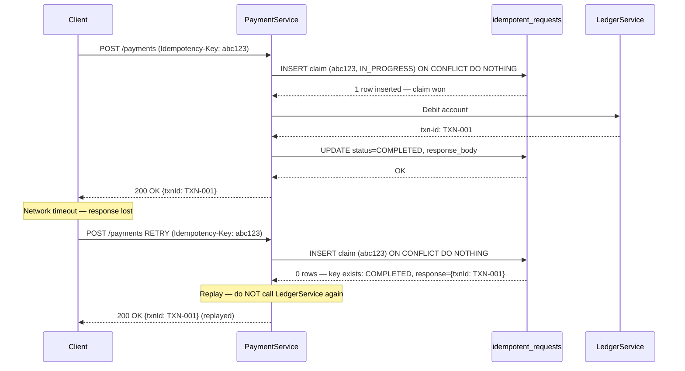

# Idempotency in Distributed Financial Systems

> [!NOTE]
> Idempotency is the contractual guarantee that executing the same operation multiple times produces the same result as executing it once. In financial systems, where at-least-once delivery is the norm, idempotency is not a nice-to-have — it is a correctness requirement. A payment debited twice destroys customer trust and triggers regulatory scrutiny.

## Why At-Least-Once Delivery Creates Duplicate Risk

Every HTTP call, every Kafka consume, every gRPC invocation can be retried. Networks partition. Connections time out before the response arrives. The calling service cannot distinguish between "the server failed before processing" and "the server processed but the response was lost". The safe choice is to retry — and so duplicates are inevitable.

```
Client → POST /payments (timeout after 2s, no response received)
Server  → Payment processed, response sent — LOST IN NETWORK
Client → POST /payments RETRY (same request)
Server  → Payment processed AGAIN — DUPLICATE DEBIT
```

The only robust defence is to make the **server** idempotent, not to trust the **client** to avoid retries.

---

## Idempotency Key Design

An idempotency key uniquely identifies a logical operation. The server stores a record of the first execution and replays the stored result on duplicates.

### UUID v4 vs Composite Keys

**UUID v4** is the simplest approach: the client generates a random key and includes it on every request. The server stores it in a unique-constrained column.

```java
// Client side — generate once, store durably, include on every attempt
String idempotencyKey = UUID.randomUUID().toString();
// Store in client's DB before making the call
clientDb.saveOutboundRequest(paymentId, idempotencyKey);

// Include in request header
httpClient.post("/payments")
    .header("Idempotency-Key", idempotencyKey)
    .body(paymentRequest)
    .execute();
```

**Composite keys** derive the key deterministically from business data. This survives client crashes where the generated UUID was not persisted:

```java
// Composite key: stable across restarts without prior persistence
String idempotencyKey = String.format(
    "pay:%s:%s:%s:%s",
    senderId,
    recipientId,
    amountInMinorUnits,
    businessDate   // prevents same sender/recipient/amount on a different day colliding
);
// SHA-256 hash to normalise length and avoid delimiter injection
String hashedKey = DigestUtils.sha256Hex(idempotencyKey);
```

> [!WARNING]
> Composite keys risk **false positives** if two genuinely different operations share identical business fields (e.g., the same sender pays the same recipient the same amount twice in one day). Add a client-side sequence number or correlation ID to the composite if same-day duplicates are possible.

---

## The `idempotent_requests` Table

The server stores every processed request keyed on the idempotency key:

```sql
CREATE TABLE idempotent_requests (
    idempotency_key   VARCHAR(64)  NOT NULL,
    created_at        TIMESTAMPTZ  NOT NULL DEFAULT NOW(),
    expires_at        TIMESTAMPTZ  NOT NULL,
    request_hash      VARCHAR(64)  NOT NULL,  -- SHA-256 of request body
    status            VARCHAR(16)  NOT NULL,  -- IN_PROGRESS | COMPLETED
    response_status   SMALLINT,               -- NULL while IN_PROGRESS
    response_body     JSONB,                  -- NULL while IN_PROGRESS
    lock_acquired_at  TIMESTAMPTZ,            -- set during processing, NULL = done
    CONSTRAINT pk_idempotent_requests PRIMARY KEY (idempotency_key)
);

-- Partial index: fast lookup of in-flight requests (lock held)
CREATE INDEX idx_idempotent_requests_in_flight
    ON idempotent_requests (idempotency_key)
    WHERE lock_acquired_at IS NOT NULL;

-- Cleanup index
CREATE INDEX idx_idempotent_requests_expiry
    ON idempotent_requests (expires_at);
```

The `UNIQUE` constraint on `idempotency_key` (via PRIMARY KEY) is the database-level guard against concurrent duplicate inserts.

---

## `IdempotentPaymentService` — Claim First, Then Process

```java
@Service
@RequiredArgsConstructor
public class IdempotentPaymentService {

    private final IdempotentRequestRepository idempotentRepo;
    private final PaymentProcessor            paymentProcessor;
    private final TransactionTemplate         tx;   // short, separate transactions
    private final ObjectMapper                objectMapper;

    // NOT one big @Transactional: inside a single transaction the claim row is
    // invisible to other requests until commit, so "in progress" could never
    // be seen, and a rollback would erase the record of a payment that the
    // processor (often another service) has already executed.
    public PaymentResponse processPayment(String idempotencyKey, PaymentRequest request) {
        String requestHash = sha256(request);

        // 1. CLAIM the key first, in its own committed transaction:
        //    INSERT ... (status = 'IN_PROGRESS', lock_acquired_at = now())
        //    ON CONFLICT (idempotency_key) DO NOTHING
        //    The PRIMARY KEY lets exactly one concurrent request win.
        boolean claimed = tx.execute(st ->
            idempotentRepo.insertClaimIfAbsent(idempotencyKey, requestHash,
                Instant.now().plus(Duration.ofHours(24))));

        if (!claimed) {
            IdempotentRequest record = idempotentRepo.findByKey(idempotencyKey).orElseThrow();

            // Guard: same key but different body = client bug -> 422
            if (!record.getRequestHash().equals(requestHash)) {
                throw new IdempotencyKeyConflictException(
                    "Idempotency key reused with different request body: " + idempotencyKey);
            }
            if ("IN_PROGRESS".equals(record.getStatus())) {
                // Another request is mid-flight -> 409 so the client backs off
                throw new RequestInProgressException(idempotencyKey);
            }
            // COMPLETED: replay the stored response — do NOT reprocess
            log.info("Replaying idempotent response for key={}", idempotencyKey);
            return deserialize(record.getResponseBody(), PaymentResponse.class);
        }

        // 2. Process the payment (pass the key on, so the processor is idempotent too)
        PaymentResponse response;
        try {
            response = paymentProcessor.execute(request, idempotencyKey);
        } catch (DefinitelyNotProcessedException e) {
            // e.g. validation failure: nothing happened, so release the claim
            tx.executeWithoutResult(st -> idempotentRepo.deleteByKey(idempotencyKey));
            throw e;
        }
        // Any OTHER failure (timeout, crash) leaves the claim IN_PROGRESS: the
        // outcome is unknown. A recovery job finds claims older than a few
        // minutes and asks the processor what really happened, by this key.

        // 3. Store the response and mark the claim COMPLETED
        tx.executeWithoutResult(st ->
            idempotentRepo.complete(idempotencyKey, 200, serialize(response)));
        return response;
    }

    private String sha256(Object obj) {
        try {
            // Hash a canonical form (fixed field order) so that the same request
            // always produces the same hash
            byte[] bytes = objectMapper.writeValueAsBytes(obj);
            return DigestUtils.sha256Hex(bytes);
        } catch (JsonProcessingException e) {
            throw new IllegalStateException("Cannot hash request", e);
        }
    }
}
```

---

## Mermaid Sequence Diagram — Idempotent Retry



---

## Idempotency in Kafka Consumers

Message brokers guarantee at-least-once delivery. A consumer crash after processing but before committing the offset will re-deliver the message. The consumer must deduplicate:

```java
@Component
@RequiredArgsConstructor
public class PaymentEventConsumer {

    private final DeduplicationRepository deduplicationRepo;
    private final LedgerService           ledgerService;

    @KafkaListener(topics = "payment-instructions", groupId = "ledger-processor")
    @Transactional
    public void consume(ConsumerRecord<String, PaymentInstruction> record) {
        // lastHeader() returns a Header or null — not an Optional
        String messageId = Optional.ofNullable(record.headers().lastHeader("message-id"))
            .map(h -> new String(h.value(), StandardCharsets.UTF_8))
            .orElseThrow(() -> new InvalidMessageException("Missing message-id header"));

        // Idempotency check using deduplication table (same UNIQUE constraint pattern)
        if (deduplicationRepo.existsByMessageId(messageId)) {
            log.debug("Duplicate message skipped: {}", messageId);
            return;
        }

        // Process and record atomically within the same DB transaction
        // (the PRIMARY KEY on message_id also stops a concurrent duplicate)
        ledgerService.applyInstruction(record.value());
        deduplicationRepo.save(new ProcessedMessage(messageId, Instant.now()));
        // The Kafka offset is committed separately, after this method returns.
        // A crash in between redelivers the message — and the dedup row,
        // committed with the ledger change, makes the redelivery a no-op.
    }
}
```

```sql
-- Deduplication table for Kafka consumers
CREATE TABLE processed_messages (
    message_id  VARCHAR(128) NOT NULL,
    processed_at TIMESTAMPTZ NOT NULL DEFAULT NOW(),
    CONSTRAINT pk_processed_messages PRIMARY KEY (message_id)
);
```

---

## Distributed Idempotency with Redis `SETNX`

For low-latency paths (sub-10ms requirement), a PostgreSQL check adds 2-5ms of overhead. Redis `SETNX` (Set if Not eXists) provides atomic deduplication at ~0.1ms:

```java
@Component
@RequiredArgsConstructor
public class RedisIdempotencyGuard {

    private final StringRedisTemplate redis;
    private static final Duration TTL = Duration.ofHours(24);

    /**
     * Returns true if this is the FIRST time we have seen this key.
     * Returns false if the key already exists (duplicate request).
     */
    public boolean tryAcquire(String idempotencyKey) {
        Boolean acquired = redis.opsForValue()
            .setIfAbsent("idmp:" + idempotencyKey, "1", TTL);
        return Boolean.TRUE.equals(acquired);
    }

    /**
     * Store the serialised response so duplicates can replay it.
     */
    public void storeResponse(String idempotencyKey, String responseJson) {
        redis.opsForValue().set(
            "idmp:resp:" + idempotencyKey,
            responseJson,
            TTL
        );
    }

    public Optional<String> getStoredResponse(String idempotencyKey) {
        return Optional.ofNullable(
            redis.opsForValue().get("idmp:resp:" + idempotencyKey));
    }
}
```

**Lua script for atomic check-and-set** (single round-trip, avoids TOCTOU race):

```lua
-- KEYS[1] = idempotency key,  KEYS[2] = response cache key
-- (in Redis Cluster both keys need the same hash tag, e.g. idmp:{abc123})
-- ARGV[1] = TTL in seconds
-- Returns: 1 = acquired (first time)
--          the stored response = duplicate of a completed request
--          0 = duplicate whose first attempt is still in progress
local acquired = redis.call('SET', KEYS[1], '1', 'NX', 'EX', ARGV[1])
if acquired then
    return 1
end
local response = redis.call('GET', KEYS[2])
return response or 0
```

> [!WARNING]
> Redis is not durable by default. With the common `appendfsync everysec`, a crash can lose up to a second of keys; and because replication is asynchronous, a failover to a replica can lose keys even with `appendfsync always`. Use Redis as a fast first check, and keep a durable database record (with a unique constraint) for money-moving operations.

---

## Expiry Policy for the Idempotency Store

Idempotency keys must expire. Storing them forever is neither practical nor necessary.

| Operation Type | Recommended TTL | Rationale |
|---|---|---|
| Payment initiation | 24 hours | Client retry windows are minutes to hours |
| Kafka message deduplication | 7 days | Consumer group reprocessing window |
| Scheduled payment submission | 48 hours | Batch retry cycles |
| FX trade booking | 1 hour | Same-day settlement only |
| Account creation | 72 hours | Operational retry window |

Expired records should be cleaned up by a scheduled job, not on the hot path — and in batches (for example 10,000 rows per transaction), so that one huge DELETE does not lock or bloat the table:

```java
@Scheduled(cron = "0 0 2 * * *")  // 02:00 daily
@Transactional
public void purgeExpiredIdempotencyKeys() {
    int deleted = idempotentRepo.deleteExpired(Instant.now());
    log.info("Purged {} expired idempotency records", deleted);
    metrics.gauge("idempotency.store.size", idempotentRepo.count());
}
```

---

## Partial Success Idempotency

The hardest idempotency problem: the payment was debited but the downstream notification failed.

```
Step 1: Debit account      ✓  (committed to DB)
Step 2: Send notification  ✗  (HTTP 503 from notification service)
Step 3: Client retries entire request
```

The retry must NOT re-debit. The pattern is **workflow state tracking**. (Better still, the notification should not be part of the request at all: write it to an outbox and send it asynchronously.)

```java
@Entity
@Table(name = "payment_workflows")
public class PaymentWorkflow {
    @Id
    private String idempotencyKey;

    @Enumerated(EnumType.STRING)
    private WorkflowState state;  // PENDING, DEBITED, NOTIFIED, COMPLETE

    private String transactionId;
    private Instant updatedAt;
}

public enum WorkflowState {
    PENDING, DEBITED, NOTIFIED, COMPLETE
}
```

```java
// No @Transactional around the whole method: if the notification failed, a
// single transaction would roll back the DEBITED state too — and the retry
// would debit again. Each state change commits on its own.
public PaymentResponse processWithPartialSuccessHandling(
        String idempotencyKey, PaymentRequest request) {

    PaymentWorkflow workflow = workflowRepo
        .findById(idempotencyKey)
        .orElseGet(() -> new PaymentWorkflow(idempotencyKey, WorkflowState.PENDING));

    // Resume from wherever we left off
    if (workflow.getState() == WorkflowState.PENDING) {
        // The ledger call carries a child key, so a crash between the debit and
        // the state save is safe: the retried debit returns the same txnId
        String txnId = ledgerService.debit(request,
            deriveChildKey(idempotencyKey, "ledger", "debit"));
        workflow.setTransactionId(txnId);
        workflow.setState(WorkflowState.DEBITED);
        tx.executeWithoutResult(st -> workflowRepo.save(workflow));   // commit now
    }

    if (workflow.getState() == WorkflowState.DEBITED) {
        notificationService.send(workflow.getTransactionId(), request);
        workflow.setState(WorkflowState.NOTIFIED);
        tx.executeWithoutResult(st -> workflowRepo.save(workflow));
    }

    if (workflow.getState() == WorkflowState.NOTIFIED) {
        workflow.setState(WorkflowState.COMPLETE);
        tx.executeWithoutResult(st -> workflowRepo.save(workflow));
    }

    return PaymentResponse.success(workflow.getTransactionId());
}
```

---

## End-to-End Idempotency Across Service Boundaries

A single payment crosses multiple services. Idempotency must be propagated, never replaced with a fresh random key — a new random key on each retry would defeat it:

```
Client → API Gateway → Payment Service → Ledger Service → Notification Service
         (key: abc123)   (key: abc123)     (key: H(abc123:ledger:debit))
                                                              (key: H(abc123:notification:send))
```

Each service generates a **child key** derived from the parent key and its own operation:

```java
public String deriveChildKey(String parentKey, String serviceName, String operation) {
    // Deterministic: same parent always produces same child
    return DigestUtils.sha256Hex(parentKey + ":" + serviceName + ":" + operation);
}

// Usage in Ledger Service:
String ledgerKey = deriveChildKey(incomingIdempotencyKey, "ledger", "debit");
// Usage in Notification Service:
String notifKey  = deriveChildKey(incomingIdempotencyKey, "notification", "send");
```

The child key is propagated in HTTP headers:

```java
// Spring RestTemplate / WebClient interceptor
request.getHeaders().set("Idempotency-Key",
    deriveChildKey(currentIdempotencyKey, "downstream-service", "operation"));
```

---

## Key Takeaways

- At-least-once delivery is the default in every distributed protocol; idempotency is the client-side and server-side defence.
- UUID v4 keys are simpler; composite keys are more resilient to client crash-before-persist.
- The `idempotent_requests` table with a UNIQUE PRIMARY KEY is the foundation; claim the key first (`INSERT ... ON CONFLICT DO NOTHING`, committed) so that exactly one concurrent request processes it.
- Redis `SETNX` suits low-latency paths but requires careful durability configuration.
- Partial success requires workflow state tracking, with each step committed separately, not just request deduplication.
- Propagate idempotency keys across service boundaries using deterministic child key derivation.

<!-- KNOWLEDGE-CHECK
{
  "questions": [
    {
      "id": "q1",
      "text": "A payment service receives a retry with the same Idempotency-Key but a different request body (different amount). What is the correct response?",
      "options": [
        "Process the new request — the client knows best",
        "Return 422 Unprocessable Entity — the key is reused with a different payload",
        "Return the original response — the key is the same",
        "Return 409 Conflict — the key is already in use"
      ],
      "correct": 1,
      "explanation": "An idempotency key tied to a different request body is a client bug. The server must reject with 422 to surface the error. Silently replaying the old response or processing the new one both hide the bug and can lead to incorrect financial outcomes."
    },
    {
      "id": "q2",
      "text": "Why is Redis SETNX alone insufficient for financial-grade idempotency in all cases?",
      "options": [
        "Redis is too slow for financial workloads",
        "Redis may lose keys on restart if not configured with appendfsync always, creating a window where a duplicate could be processed",
        "SETNX does not support TTL",
        "Redis cannot store JSON response bodies"
      ],
      "correct": 1,
      "explanation": "Redis with default or everysec fsync can lose the last writes on a crash, creating a window where the same key is treated as new. For critical payments, use appendfsync always or fall back to a durable database store for the idempotency record."
    },
    {
      "id": "q3",
      "text": "Payment is debited successfully but the notification service returns 503. The client retries. What must NOT happen?",
      "options": [
        "The notification must not be sent again",
        "The debit must not be applied again",
        "The workflow state must not be reset",
        "All of the above"
      ],
      "correct": 1,
      "explanation": "The debit is the irreversible financial operation. The workflow state tracker ensures the retry resumes from the DEBITED state, skipping the debit and re-attempting only the notification. This is the partial success idempotency pattern."
    }
  ]
}
-->

<!-- PRACTICAL-CHALLENGE
{
  "title": "Idempotent Cross-Border Payment: FX Lock, Sanctions Check, and SWIFT Dispatch",
  "difficulty": "principal",
  "estimatedMinutes": 85,
  "tasks": [
    {
      "id": "1",
      "description": "Design the idempotent_requests table (claim status, request hash, stored response, expiry) with indexes for 10 million records, and a batched cleanup job that deletes expired rows 10,000 at a time."
    },
    {
      "id": "2",
      "description": "Implement IdempotentSWIFTDispatcher: a Redis SET NX check as the fast first pass, and a claim-first PostgreSQL record (INSERT ... ON CONFLICT DO NOTHING) as the durable guard before the SWIFT message is sent."
    },
    {
      "id": "3",
      "description": "Implement deterministic child-key derivation so the FX rate lock, the sanctions check, and the SWIFT dispatch each get their own idempotency key derived from the client's key, and pass each key to the downstream call."
    },
    {
      "id": "4",
      "description": "Write a test that simulates a network timeout after the debit succeeds but before the SWIFT dispatch completes, then verifies that the retry neither debits again nor sends a second SWIFT message, and that it resumes from the recorded workflow state."
    }
  ]
}
-->
