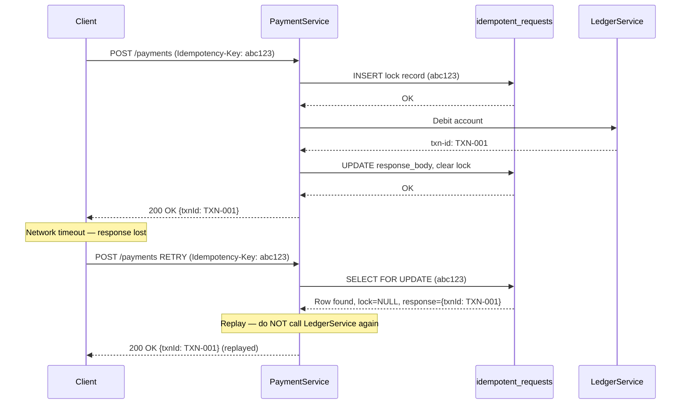

# Idempotency in Distributed Financial Systems

> [!NOTE]
> Idempotency is the contractual guarantee that executing the same operation multiple times produces the same result as executing it once. In financial systems, where at-least-once delivery is the norm, idempotency is not a nice-to-have — it is a correctness requirement. A payment debited twice destroys customer trust and triggers regulatory scrutiny.

## Why At-Least-Once Delivery Creates Duplicate Risk

Every HTTP call, every Kafka consume, every gRPC invocation can be retried. Networks partition. Connections time out before the response arrives. The calling service cannot distinguish between "the server failed before processing" and "the server processed but the response was lost". The safe choice is to retry — and so duplicates are inevitable.

```
Client → POST /payments (timeout after 2s, no response received)
Server  → Payment processed, response sent — LOST IN NETWORK
Client → POST /payments RETRY (same request)
Server  → Payment processed AGAIN — DUPLICATE DEBIT
```

The only robust defence is to make the **server** idempotent, not to trust the **client** to avoid retries.

---

## Idempotency Key Design

An idempotency key uniquely identifies a logical operation. The server stores a record of the first execution and replays the stored result on duplicates.

### UUID v4 vs Composite Keys

**UUID v4** is the simplest approach: the client generates a random key and includes it on every request. The server stores it in a unique-constrained column.

```java
// Client side — generate once, store durably, include on every attempt
String idempotencyKey = UUID.randomUUID().toString();
// Store in client's DB before making the call
clientDb.saveOutboundRequest(paymentId, idempotencyKey);

// Include in request header
httpClient.post("/payments")
    .header("Idempotency-Key", idempotencyKey)
    .body(paymentRequest)
    .execute();
```

**Composite keys** derive the key deterministically from business data. This survives client crashes where the generated UUID was not persisted:

```java
// Composite key: stable across restarts without prior persistence
String idempotencyKey = String.format(
    "pay:%s:%s:%s:%s",
    senderId,
    recipientId,
    amountInMinorUnits,
    businessDate   // prevents same sender/recipient/amount on a different day colliding
);
// SHA-256 hash to normalise length and avoid delimiter injection
String hashedKey = DigestUtils.sha256Hex(idempotencyKey);
```

> [!WARNING]
> Composite keys risk **false positives** if two genuinely different operations share identical business fields (e.g., the same sender pays the same recipient the same amount twice in one day). Add a client-side sequence number or correlation ID to the composite if same-day duplicates are possible.

---

## The `idempotent_requests` Table

The server stores every processed request keyed on the idempotency key:

```sql
CREATE TABLE idempotent_requests (
    idempotency_key   VARCHAR(64)  NOT NULL,
    created_at        TIMESTAMPTZ  NOT NULL DEFAULT NOW(),
    expires_at        TIMESTAMPTZ  NOT NULL,
    request_hash      VARCHAR(64)  NOT NULL,  -- SHA-256 of request body
    response_status   SMALLINT     NOT NULL,
    response_body     JSONB        NOT NULL,
    lock_acquired_at  TIMESTAMPTZ,            -- set during processing, NULL = done
    CONSTRAINT pk_idempotent_requests PRIMARY KEY (idempotency_key)
);

-- Partial index: fast lookup of in-flight requests (lock held)
CREATE INDEX idx_idempotent_requests_in_flight
    ON idempotent_requests (idempotency_key)
    WHERE lock_acquired_at IS NOT NULL;

-- Cleanup index
CREATE INDEX idx_idempotent_requests_expiry
    ON idempotent_requests (expires_at);
```

The `UNIQUE` constraint on `idempotency_key` (via PRIMARY KEY) is the database-level guard against concurrent duplicate inserts.

---

## `IdempotentPaymentService` — Check Before Processing

```java
@Service
@RequiredArgsConstructor
public class IdempotentPaymentService {

    private final IdempotentRequestRepository idempotentRepo;
    private final PaymentProcessor            paymentProcessor;
    private final ObjectMapper                objectMapper;

    @Transactional
    public PaymentResponse processPayment(
            String idempotencyKey,
            PaymentRequest request) {

        String requestHash = sha256(request);

        // 1. Check for existing record (SELECT ... FOR UPDATE to prevent races)
        Optional<IdempotentRequest> existing =
            idempotentRepo.findByKeyForUpdate(idempotencyKey);

        if (existing.isPresent()) {
            IdempotentRequest record = existing.get();

            // Guard: same key but different body = client bug
            if (!record.getRequestHash().equals(requestHash)) {
                throw new IdempotencyKeyConflictException(
                    "Idempotency key reused with different request body: "
                    + idempotencyKey);
            }

            if (record.getLockAcquiredAt() != null) {
                // Another thread is mid-flight — return 409 so client backs off
                throw new RequestInProgressException(idempotencyKey);
            }

            // Replay stored response — do NOT reprocess
            log.info("Replaying idempotent response for key={}", idempotencyKey);
            return deserialize(record.getResponseBody(), PaymentResponse.class);
        }

        // 2. Insert lock record — will fail with ConstraintViolationException if race
        IdempotentRequest lock = IdempotentRequest.builder()
            .idempotencyKey(idempotencyKey)
            .requestHash(requestHash)
            .expiresAt(Instant.now().plus(Duration.ofHours(24)))
            .lockAcquiredAt(Instant.now())
            .build();
        idempotentRepo.save(lock);  // throws on duplicate key → let caller handle

        // 3. Process the payment
        PaymentResponse response;
        try {
            response = paymentProcessor.execute(request);
        } catch (Exception e) {
            // Remove lock so client can retry
            idempotentRepo.deleteByKey(idempotencyKey);
            throw e;
        }

        // 4. Persist the response and release the lock
        lock.setResponseStatus((short) 200);
        lock.setResponseBody(serialize(response));
        lock.setLockAcquiredAt(null);  // lock released — record is now a replay cache
        idempotentRepo.save(lock);

        return response;
    }

    private String sha256(Object obj) {
        try {
            byte[] bytes = objectMapper.writeValueAsBytes(obj);
            return DigestUtils.sha256Hex(bytes);
        } catch (JsonProcessingException e) {
            throw new IllegalStateException("Cannot hash request", e);
        }
    }
}
```

---

## Mermaid Sequence Diagram — Idempotent Retry



---

## Idempotency in Kafka Consumers

Message brokers guarantee at-least-once delivery. A consumer crash after processing but before committing the offset will re-deliver the message. The consumer must deduplicate:

```java
@Component
@RequiredArgsConstructor
public class PaymentEventConsumer {

    private final DeduplicationRepository deduplicationRepo;
    private final LedgerService           ledgerService;

    @KafkaListener(topics = "payment-instructions", groupId = "ledger-processor")
    @Transactional
    public void consume(ConsumerRecord<String, PaymentInstruction> record) {
        String messageId = record.headers()
            .lastHeader("message-id")
            .map(h -> new String(h.value(), StandardCharsets.UTF_8))
            .orElseThrow(() -> new InvalidMessageException("Missing message-id header"));

        // Idempotency check using deduplication table (same UNIQUE constraint pattern)
        if (deduplicationRepo.existsByMessageId(messageId)) {
            log.debug("Duplicate message skipped: {}", messageId);
            return;
        }

        // Process and record atomically within the same transaction
        ledgerService.applyInstruction(record.value());
        deduplicationRepo.save(new ProcessedMessage(messageId, Instant.now()));
        // Offset committed on transaction commit — no gap between process + dedup record
    }
}
```

```sql
-- Deduplication table for Kafka consumers
CREATE TABLE processed_messages (
    message_id  VARCHAR(128) NOT NULL,
    processed_at TIMESTAMPTZ NOT NULL DEFAULT NOW(),
    CONSTRAINT pk_processed_messages PRIMARY KEY (message_id)
);
```

---

## Distributed Idempotency with Redis `SETNX`

For low-latency paths (sub-10ms requirement), a PostgreSQL check adds 2-5ms of overhead. Redis `SETNX` (Set if Not eXists) provides atomic deduplication at ~0.1ms:

```java
@Component
@RequiredArgsConstructor
public class RedisIdempotencyGuard {

    private final StringRedisTemplate redis;
    private static final Duration TTL = Duration.ofHours(24);

    /**
     * Returns true if this is the FIRST time we have seen this key.
     * Returns false if the key already exists (duplicate request).
     */
    public boolean tryAcquire(String idempotencyKey) {
        Boolean acquired = redis.opsForValue()
            .setIfAbsent("idmp:" + idempotencyKey, "1", TTL);
        return Boolean.TRUE.equals(acquired);
    }

    /**
     * Store the serialised response so duplicates can replay it.
     */
    public void storeResponse(String idempotencyKey, String responseJson) {
        redis.opsForValue().set(
            "idmp:resp:" + idempotencyKey,
            responseJson,
            TTL
        );
    }

    public Optional<String> getStoredResponse(String idempotencyKey) {
        return Optional.ofNullable(
            redis.opsForValue().get("idmp:resp:" + idempotencyKey));
    }
}
```

**Lua script for atomic check-and-set** (single round-trip, avoids TOCTOU race):

```lua
-- KEYS[1] = idempotency key,  KEYS[2] = response cache key
-- ARGV[1] = TTL in seconds
-- Returns: 1 = acquired (first time), 0 = duplicate
local acquired = redis.call('SET', KEYS[1], '1', 'NX', 'EX', ARGV[1])
if acquired then
    return 1
end
local response = redis.call('GET', KEYS[2])
return response or 0
```

> [!WARNING]
> Redis is not durable by default. If Redis restarts before `appendfsync always`, idempotency keys written in the last second may be lost. Use `appendfsync always` for critical idempotency stores, or accept the slim window and fall back to database idempotency for genuinely critical operations.

---

## Expiry Policy for the Idempotency Store

Idempotency keys must expire. Storing them forever is neither practical nor necessary.

| Operation Type | Recommended TTL | Rationale |
|---|---|---|
| Payment initiation | 24 hours | Client retry windows are minutes to hours |
| Kafka message deduplication | 7 days | Consumer group reprocessing window |
| Scheduled payment submission | 48 hours | Batch retry cycles |
| FX trade booking | 1 hour | Same-day settlement only |
| Account creation | 72 hours | Operational retry window |

Expired records should be cleaned up by a scheduled job, not on the hot path:

```java
@Scheduled(cron = "0 0 2 * * *")  // 02:00 daily
@Transactional
public void purgeExpiredIdempotencyKeys() {
    int deleted = idempotentRepo.deleteExpired(Instant.now());
    log.info("Purged {} expired idempotency records", deleted);
    metrics.gauge("idempotency.store.size", idempotentRepo.count());
}
```

---

## Partial Success Idempotency

The hardest idempotency problem: the payment was debited but the downstream notification failed.

```
Step 1: Debit account      ✓  (committed to DB)
Step 2: Send notification  ✗  (HTTP 503 from notification service)
Step 3: Client retries entire request
```

The retry must NOT re-debit. The pattern is **workflow state tracking**:

```java
@Entity
@Table(name = "payment_workflows")
public class PaymentWorkflow {
    @Id
    private String idempotencyKey;

    @Enumerated(EnumType.STRING)
    private WorkflowState state;  // PENDING, DEBITED, NOTIFIED, COMPLETE

    private String transactionId;
    private Instant updatedAt;
}

public enum WorkflowState {
    PENDING, DEBITED, NOTIFIED, COMPLETE
}
```

```java
@Transactional
public PaymentResponse processWithPartialSuccessHandling(
        String idempotencyKey, PaymentRequest request) {

    PaymentWorkflow workflow = workflowRepo
        .findById(idempotencyKey)
        .orElseGet(() -> new PaymentWorkflow(idempotencyKey, WorkflowState.PENDING));

    // Resume from wherever we left off
    if (workflow.getState() == WorkflowState.PENDING) {
        String txnId = ledgerService.debit(request);
        workflow.setTransactionId(txnId);
        workflow.setState(WorkflowState.DEBITED);
        workflowRepo.save(workflow);
    }

    if (workflow.getState() == WorkflowState.DEBITED) {
        notificationService.send(workflow.getTransactionId(), request);
        workflow.setState(WorkflowState.NOTIFIED);
        workflowRepo.save(workflow);
    }

    if (workflow.getState() == WorkflowState.NOTIFIED) {
        workflow.setState(WorkflowState.COMPLETE);
        workflowRepo.save(workflow);
    }

    return PaymentResponse.success(workflow.getTransactionId());
}
```

---

## End-to-End Idempotency Across Service Boundaries

A single payment crosses multiple services. Idempotency must be propagated, not regenerated:

```
Client → API Gateway → Payment Service → Ledger Service → Notification Service
         (key: abc123)   (key: abc123)     (key: abc123)     (key: abc123)
```

Each service generates a **child key** derived from the parent key and its own operation:

```java
public String deriveChildKey(String parentKey, String serviceName, String operation) {
    // Deterministic: same parent always produces same child
    return DigestUtils.sha256Hex(parentKey + ":" + serviceName + ":" + operation);
}

// Usage in Ledger Service:
String ledgerKey = deriveChildKey(incomingIdempotencyKey, "ledger", "debit");
// Usage in Notification Service:
String notifKey  = deriveChildKey(incomingIdempotencyKey, "notification", "send");
```

The child key is propagated in HTTP headers:

```java
// Spring RestTemplate / WebClient interceptor
request.getHeaders().set("Idempotency-Key",
    deriveChildKey(currentIdempotencyKey, "downstream-service", "operation"));
```

---

## Key Takeaways

- At-least-once delivery is the default in every distributed protocol; idempotency is the client-side and server-side defence.
- UUID v4 keys are simpler; composite keys are more resilient to client crash-before-persist.
- The `idempotent_requests` table with a UNIQUE PRIMARY KEY is the foundation; the `SELECT FOR UPDATE` prevents concurrent duplicate processing.
- Redis `SETNX` suits low-latency paths but requires careful durability configuration.
- Partial success requires workflow state tracking, not just request deduplication.
- Propagate idempotency keys across service boundaries using deterministic child key derivation.

<!-- KNOWLEDGE-CHECK
{
  "questions": [
    {
      "id": "q1",
      "text": "A payment service receives a retry with the same Idempotency-Key but a different request body (different amount). What is the correct response?",
      "options": [
        "Process the new request — the client knows best",
        "Return 422 Unprocessable Entity — the key is reused with a different payload",
        "Return the original response — the key is the same",
        "Return 409 Conflict — the key is already in use"
      ],
      "correct": 1,
      "explanation": "An idempotency key tied to a different request body is a client bug. The server must reject with 422 to surface the error. Silently replaying the old response or processing the new one both hide the bug and can lead to incorrect financial outcomes."
    },
    {
      "id": "q2",
      "text": "Why is Redis SETNX alone insufficient for financial-grade idempotency in all cases?",
      "options": [
        "Redis is too slow for financial workloads",
        "Redis may lose keys on restart if not configured with appendfsync always, creating a window where a duplicate could be processed",
        "SETNX does not support TTL",
        "Redis cannot store JSON response bodies"
      ],
      "correct": 1,
      "explanation": "Redis with default or everysec fsync can lose the last writes on a crash, creating a window where the same key is treated as new. For critical payments, use appendfsync always or fall back to a durable database store for the idempotency record."
    },
    {
      "id": "q3",
      "text": "Payment is debited successfully but the notification service returns 503. The client retries. What must NOT happen?",
      "options": [
        "The notification must not be sent again",
        "The debit must not be applied again",
        "The workflow state must not be reset",
        "All of the above"
      ],
      "correct": 1,
      "explanation": "The debit is the irreversible financial operation. The workflow state tracker ensures the retry resumes from the DEBITED state, skipping the debit and re-attempting only the notification. This is the partial success idempotency pattern."
    }
  ]
}
-->

<!-- PRACTICAL-CHALLENGE
## Practical Challenge

**Scenario:** You are building a cross-border payment service. Each payment calls: (1) FX rate lock (100ms timeout), (2) sanctions screening (500ms timeout — no fallback), (3) ledger debit (must be idempotent), (4) SWIFT message dispatch (at-least-once delivery, must not send twice).

**Tasks:**

1. Design the `idempotent_requests` table with appropriate indexes for 10 million records with a 24-hour TTL cleanup job.

2. Implement `IdempotentSWIFTDispatcher` that uses Redis SETNX for the first-pass fast check but falls back to PostgreSQL for durability on the SWIFT dispatch step.

3. Implement child key derivation so that the FX lock, sanctions check, and SWIFT dispatch each have isolated idempotency namespaces derived from the client-provided key.

4. Write a test that simulates a network timeout after the debit succeeds but before the SWIFT dispatch completes, then verifies that the retry does not debit a second time but does successfully dispatch the SWIFT message.

5. What TTL would you set for the SWIFT dispatch deduplication key, and why?
-->
