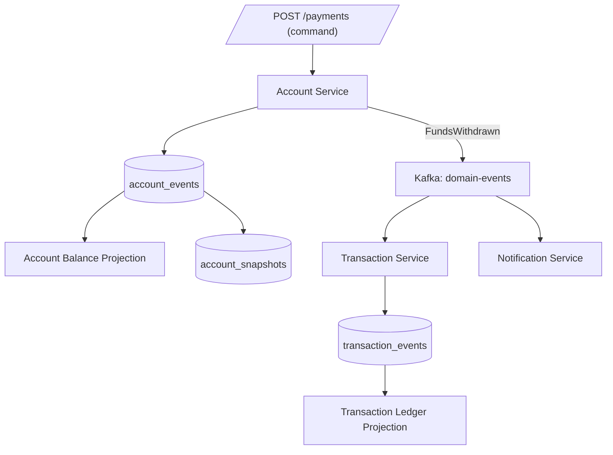

# Event Sourcing in Distributed Systems

> [!NOTE]
> Event sourcing replaces mutable state with an immutable, ordered log of facts. Instead of storing "the current balance is £500", you store "account opened with £0, deposited £600, withdrew £100" — and derive the balance by replaying those facts. In distributed financial systems this provides a natural audit trail, temporal query capability, and a foundation for event-driven integration between services.

## What Changes in a Distributed Context

In a monolith, event sourcing is relatively straightforward: one event store, one aggregate per request, one projection rebuild job. In a distributed system, each service owns its own event store. Events flow across service boundaries as integration events on a message bus. Each service projects its own read models from its own events, plus subscriptions to events from other services.

```
┌─────────────────────────────────┐    ┌──────────────────────────────────┐
│  Account Service                │    │  Transaction Service              │
│  event store: account_events    │    │  event store: transaction_events  │
│  projections: account_read      │◄──►│  projections: txn_read            │
└─────────────────────────────────┘    └──────────────────────────────────┘
         │  AccountOpened                       │  PaymentInitiated
         │  FundsDeposited      Kafka           │  PaymentSettled
         └──────────────────────────────────────┘
```

**Domain events** are facts that happened within a service and are stored in the local event store. **Integration events** are published to the message bus for other services to consume. Keep these separate — domain events carry full internal state; integration events carry only what other services need to know.

---

## `account_events` — The Append-Only Table

```sql
CREATE TABLE account_events (
    event_id          UUID         NOT NULL DEFAULT gen_random_uuid(),
    stream_id         VARCHAR(128) NOT NULL,   -- e.g. "account:ACC-001"
    sequence_number   BIGINT       NOT NULL,   -- monotonically increasing per stream
    event_type        VARCHAR(128) NOT NULL,   -- e.g. "FundsDeposited"
    event_data        JSONB        NOT NULL,   -- domain payload
    metadata          JSONB        NOT NULL DEFAULT '{}',
    occurred_at       TIMESTAMPTZ  NOT NULL DEFAULT NOW(),
    causation_id      UUID,                    -- id of the command that caused this
    correlation_id    UUID,                    -- id of the originating request chain
    schema_version    SMALLINT     NOT NULL DEFAULT 1,
    CONSTRAINT pk_account_events PRIMARY KEY (event_id),
    CONSTRAINT uq_account_events_stream_seq
        UNIQUE (stream_id, sequence_number)    -- optimistic concurrency guard
);

-- Fast stream replay
CREATE INDEX idx_account_events_stream
    ON account_events (stream_id, sequence_number ASC);

-- Global ordering for projections (append-only, so this index grows monotonically)
CREATE INDEX idx_account_events_global
    ON account_events (occurred_at ASC, event_id ASC);

-- For catch-up subscriptions by event type
CREATE INDEX idx_account_events_type
    ON account_events (event_type, occurred_at ASC);
```

The `UNIQUE (stream_id, sequence_number)` constraint is the database-level optimistic concurrency check: if two writers try to append with the same sequence number, only one succeeds. The `schema_version` column supports event upcasting when the event schema evolves.

---

## Appending Events with Optimistic Concurrency

```java
@Repository
@RequiredArgsConstructor
public class PostgresEventStore {

    private final JdbcTemplate jdbc;

    /**
     * Appends events to a stream.
     * expectedVersion is the sequence_number of the last known event (or -1 for new stream).
     * Throws OptimisticConcurrencyException if another writer has advanced the stream.
     */
    @Transactional
    public void appendToStream(
            String streamId,
            long expectedVersion,
            List<UnpersistedEvent> events) {

        long currentVersion = currentVersion(streamId);

        if (currentVersion != expectedVersion) {
            throw new OptimisticConcurrencyException(
                "Stream %s expected version %d but was %d"
                    .formatted(streamId, expectedVersion, currentVersion));
        }

        long nextSeq = expectedVersion + 1;
        for (UnpersistedEvent event : events) {
            jdbc.update("""
                INSERT INTO account_events
                    (stream_id, sequence_number, event_type, event_data,
                     metadata, causation_id, correlation_id, schema_version)
                VALUES (?, ?, ?, ?::jsonb, ?::jsonb, ?, ?, ?)
                """,
                streamId, nextSeq++, event.getType(),
                event.getDataJson(), event.getMetadataJson(),
                event.getCausationId(), event.getCorrelationId(),
                event.getSchemaVersion()
            );
        }
    }

    public List<PersistedEvent> loadStream(String streamId) {
        return jdbc.query("""
            SELECT event_id, stream_id, sequence_number, event_type,
                   event_data, metadata, occurred_at, schema_version
            FROM account_events
            WHERE stream_id = ?
            ORDER BY sequence_number ASC
            """,
            new EventRowMapper(), streamId);
    }

    public List<PersistedEvent> loadStreamFrom(String streamId, long fromSequence) {
        return jdbc.query("""
            SELECT event_id, stream_id, sequence_number, event_type,
                   event_data, metadata, occurred_at, schema_version
            FROM account_events
            WHERE stream_id = ? AND sequence_number >= ?
            ORDER BY sequence_number ASC
            """,
            new EventRowMapper(), streamId, fromSequence);
    }

    public List<PersistedEvent> loadStreamUpTo(String streamId, Instant pointInTime) {
        return jdbc.query("""
            SELECT event_id, stream_id, sequence_number, event_type,
                   event_data, metadata, occurred_at, schema_version
            FROM account_events
            WHERE stream_id = ? AND occurred_at <= ?
            ORDER BY sequence_number ASC
            """,
            new EventRowMapper(), streamId, Timestamp.from(pointInTime));
    }

    public List<PersistedEvent> loadGlobalFrom(long globalPosition, int batchSize) {
        return jdbc.query("""
            SELECT event_id, stream_id, sequence_number, event_type,
                   event_data, metadata, occurred_at, schema_version,
                   ROW_NUMBER() OVER (ORDER BY occurred_at, event_id) AS global_position
            FROM account_events
            WHERE ROW_NUMBER() OVER (ORDER BY occurred_at, event_id) >= ?
            ORDER BY occurred_at ASC, event_id ASC
            LIMIT ?
            """,
            new EventRowMapper(), globalPosition, batchSize);
    }

    private long currentVersion(String streamId) {
        Long max = jdbc.queryForObject(
            "SELECT MAX(sequence_number) FROM account_events WHERE stream_id = ?",
            Long.class, streamId);
        return max == null ? -1L : max;
    }
}
```

> [!TIP]
> The `loadGlobalFrom` using `ROW_NUMBER()` is expensive at scale. In production, use a dedicated `global_position` sequence column populated by a trigger or add a `BIGSERIAL global_position` column to the table.

---

## `AccountProjector` — Rebuilding State from Events

```java
public class Account {
    private String    accountId;
    private BigDecimal balance;
    private AccountStatus status;
    private long      version;   // last applied sequence_number

    // Private constructor — built only via projection
    private Account() {}

    public static Account fromEvents(List<PersistedEvent> events) {
        Account account = new Account();
        for (PersistedEvent event : events) {
            account.apply(event);
        }
        return account;
    }

    private void apply(PersistedEvent event) {
        // Upcast if needed before dispatching
        PersistedEvent current = EventUpcaster.upcast(event);

        switch (current.getType()) {
            case "AccountOpened" -> {
                AccountOpenedData data = current.dataAs(AccountOpenedData.class);
                this.accountId = data.getAccountId();
                this.balance   = BigDecimal.ZERO;
                this.status    = AccountStatus.ACTIVE;
            }
            case "FundsDeposited" -> {
                FundsDepositedData data = current.dataAs(FundsDepositedData.class);
                this.balance = this.balance.add(data.getAmount());
            }
            case "FundsWithdrawn" -> {
                FundsWithdrawnData data = current.dataAs(FundsWithdrawnData.class);
                this.balance = this.balance.subtract(data.getAmount());
            }
            case "AccountFrozen"  -> this.status = AccountStatus.FROZEN;
            case "AccountClosed"  -> this.status = AccountStatus.CLOSED;
            default -> log.warn("Unknown event type: {} — skipping", current.getType());
        }
        this.version = current.getSequenceNumber();
    }
}
```

---

## Event Schema Evolution and Upcasting

Event schemas evolve over time. Never mutate stored events — instead, **upcast** old events to new versions on the read path:

```java
/**
 * Upcasters transform old event versions to the current version.
 * They run on the read path only — the event store is never modified.
 */
@Component
public class EventUpcaster {

    private static final Map<String, Map<Integer, Function<JsonNode, JsonNode>>> UPCASTERS
        = new HashMap<>();

    static {
        // FundsDeposited v1 → v2: added "currency" field (default "GBP")
        register("FundsDeposited", 1, event -> {
            ObjectNode upgraded = event.deepCopy();
            if (!upgraded.has("currency")) {
                upgraded.put("currency", "GBP");
            }
            return upgraded;
        });
    }

    public static PersistedEvent upcast(PersistedEvent event) {
        Map<Integer, Function<JsonNode, JsonNode>> versions =
            UPCASTERS.getOrDefault(event.getType(), Map.of());

        if (versions.isEmpty()) return event;

        int currentSchemaVersion = event.getSchemaVersion();
        int targetSchemaVersion  = currentSchemaVersion;
        JsonNode data = event.getDataNode();

        // Chain upcasters from current version to latest
        for (int v = currentSchemaVersion; versions.containsKey(v); v++) {
            data = versions.get(v).apply(data);
            targetSchemaVersion = v + 1;
        }

        return event.withData(data, targetSchemaVersion);
    }

    private static void register(String eventType, int fromVersion,
                                 Function<JsonNode, JsonNode> upcaster) {
        UPCASTERS
            .computeIfAbsent(eventType, k -> new TreeMap<>())
            .put(fromVersion, upcaster);
    }
}
```

**Rules for event schema evolution:**
- Adding a nullable field: safe — upcast adds the default value.
- Renaming a field: requires upcast for every old event that hits this code path.
- Removing a field: safe if no projection uses it — but keep it in the upcast output for safety.
- Changing a field type: requires upcast + careful migration of any snapshots.

---

## Snapshot Strategy for Large Aggregate Histories

Replaying 50,000 events every time an account is loaded is impractical. Snapshots cache the aggregate state at a point in time:

```sql
CREATE TABLE account_snapshots (
    account_id       VARCHAR(128) NOT NULL,
    snapshot_version BIGINT       NOT NULL,   -- sequence_number at which snapshot was taken
    snapshot_data    JSONB        NOT NULL,   -- serialised Account state
    schema_version   SMALLINT     NOT NULL DEFAULT 1,
    created_at       TIMESTAMPTZ  NOT NULL DEFAULT NOW(),
    CONSTRAINT pk_account_snapshots PRIMARY KEY (account_id, snapshot_version)
);

-- Only need the latest snapshot per account
CREATE INDEX idx_account_snapshots_latest
    ON account_snapshots (account_id, snapshot_version DESC);
```

```java
@Service
@RequiredArgsConstructor
public class AccountRepository {

    private final PostgresEventStore eventStore;
    private final SnapshotRepository snapshotRepo;
    private static final int SNAPSHOT_THRESHOLD = 100;

    public Account load(String accountId) {
        String streamId = "account:" + accountId;

        Optional<AccountSnapshot> snapshot = snapshotRepo.loadLatest(accountId);

        Account account;
        long    fromVersion;

        if (snapshot.isPresent()) {
            account     = snapshot.get().toAccount();
            fromVersion = snapshot.get().getSnapshotVersion() + 1;
        } else {
            account     = new Account();
            fromVersion = 0;
        }

        List<PersistedEvent> recentEvents =
            eventStore.loadStreamFrom(streamId, fromVersion);
        account.applyAll(recentEvents);

        return account;
    }

    @Transactional
    public void save(Account account, List<UnpersistedEvent> newEvents) {
        eventStore.appendToStream(
            "account:" + account.getAccountId(),
            account.getVersion(),
            newEvents
        );

        if (shouldSnapshot(account)) {
            snapshotRepo.save(AccountSnapshot.from(account));
        }
    }

    private boolean shouldSnapshot(Account account) {
        long lastSnapshotVersion = snapshotRepo
            .loadLatestVersion(account.getAccountId())
            .orElse(-1L);
        return (account.getVersion() - lastSnapshotVersion) >= SNAPSHOT_THRESHOLD;
    }
}
```

**Snapshot invalidation rules:**
- Never delete a snapshot if the event log prior to it has been truncated.
- When schema_version on the snapshot is older than the current aggregate version, rebuild from the nearest valid snapshot (or from scratch if no valid snapshot exists).
- Snapshots are a performance optimisation — the event log is always the source of truth.

---

## EventStoreDB vs PostgreSQL as Event Store

| Concern | EventStoreDB | PostgreSQL |
|---|---|---|
| Purpose-built | Yes — append-only, stream-first API | No — generic RDBMS adapted |
| Subscription (push) | Native persistent subscriptions | Polling or LISTEN/NOTIFY |
| Projection engine | Built-in (JavaScript projections) | Custom code |
| Optimistic concurrency | Native `expectedVersion` parameter | UNIQUE constraint + app check |
| Operational complexity | Separate cluster to operate | Reuses existing DB infra |
| ACID guarantees | Yes (single-node), Eventual (cluster) | Full ACID |
| Recommended for | Greenfield, event-sourcing-first teams | Teams already on PostgreSQL |

For most fintech teams with an existing PostgreSQL footprint, the PostgreSQL approach is pragmatic. EventStoreDB is worth considering when you have many aggregates, complex projection logic, or need native catch-up subscriptions.

---

## Projection Rebuilding

Projections are derived read models. Because the event log is immutable, any projection can be rebuilt from scratch:

```java
@Component
@RequiredArgsConstructor
public class AccountBalanceProjection {

    private final EventStore     eventStore;
    private final BalanceReadRepo readRepo;

    /**
     * Full rebuild — truncates and replays all events.
     * Run offline or against a shadow read replica.
     */
    @Transactional
    public void rebuild() {
        readRepo.truncate();

        long globalPosition = 0;
        int  batchSize      = 500;
        List<PersistedEvent> batch;

        do {
            batch = eventStore.loadGlobalFrom(globalPosition, batchSize);
            for (PersistedEvent event : batch) {
                handleEvent(event);
                globalPosition = event.getGlobalPosition() + 1;
            }
        } while (batch.size() == batchSize);
    }

    private void handleEvent(PersistedEvent event) {
        switch (event.getType()) {
            case "AccountOpened"   -> readRepo.create(event.getStreamId(), BigDecimal.ZERO);
            case "FundsDeposited"  -> readRepo.addBalance(event.getStreamId(),
                                           event.dataAs(FundsDepositedData.class).getAmount());
            case "FundsWithdrawn"  -> readRepo.subtractBalance(event.getStreamId(),
                                           event.dataAs(FundsWithdrawnData.class).getAmount());
        }
    }
}
```

**Projection rebuild strategy in production:**
1. Build the new projection on a shadow table while the live projection continues serving reads.
2. Once the shadow catches up to within a few seconds of the live event position, swap the read alias atomically.
3. Drop the old projection table.

---

## Catch-Up Subscriptions with PostgreSQL LISTEN/NOTIFY

For real-time projection updates (without polling), use PostgreSQL's LISTEN/NOTIFY:

```sql
-- Trigger that notifies on every new event insertion
CREATE OR REPLACE FUNCTION notify_new_event()
RETURNS TRIGGER LANGUAGE plpgsql AS $$
BEGIN
    PERFORM pg_notify(
        'account_events_channel',
        json_build_object(
            'stream_id',       NEW.stream_id,
            'sequence_number', NEW.sequence_number,
            'event_type',      NEW.event_type,
            'global_position', NEW.ctid
        )::text
    );
    RETURN NEW;
END;
$$;

CREATE TRIGGER account_events_notify_trigger
    AFTER INSERT ON account_events
    FOR EACH ROW EXECUTE FUNCTION notify_new_event();
```

```java
@Component
@RequiredArgsConstructor
public class AccountEventSubscription {

    private final PgConnection pgConnection;
    private final AccountBalanceProjection projection;

    @PostConstruct
    public void subscribe() throws SQLException {
        pgConnection.addNotificationProcessor(notification -> {
            if ("account_events_channel".equals(notification.getName())) {
                AccountEventNotification n = parseNotification(notification.getParameter());
                projection.handleStreamEvent(n.streamId(), n.sequenceNumber());
            }
        });
        pgConnection.execSQLUpdate("LISTEN account_events_channel");
    }
}
```

> [!WARNING]
> LISTEN/NOTIFY notifications are not persisted. If your projection consumer restarts, it will miss notifications received while it was down. Always combine LISTEN/NOTIFY with a catch-up query on startup to close the gap.

---

## Mermaid Diagram — Event Sourcing in a Distributed Payment Platform



---

## Temporal Queries — What Was the Balance at Time T?

Event sourcing enables point-in-time queries by replaying only events up to a given timestamp:

```java
public Account loadAt(String accountId, Instant pointInTime) {
    String streamId = "account:" + accountId;

    // Load snapshot taken before or at pointInTime
    Optional<AccountSnapshot> snapshot =
        snapshotRepo.loadLatestBefore(accountId, pointInTime);

    Account account;
    long    fromVersion;

    if (snapshot.isPresent()) {
        account     = snapshot.get().toAccount();
        fromVersion = snapshot.get().getSnapshotVersion() + 1;
    } else {
        account     = new Account();
        fromVersion = 0;
    }

    List<PersistedEvent> events =
        eventStore.loadStreamFromUpTo(streamId, fromVersion, pointInTime);
    account.applyAll(events);

    return account;
}
```

```sql
-- Load events up to a point in time (from a specific sequence)
SELECT * FROM account_events
WHERE stream_id = ?
  AND sequence_number >= ?
  AND occurred_at <= ?
ORDER BY sequence_number ASC;
```

This is invaluable for regulatory reporting ("What was the customer's balance on 31 December?") and dispute resolution. Financial regulators in the EU require the ability to reconstruct account state at any point in time for up to 7 years.

---

## Sagas with Event Sourcing

A saga coordinates a multi-step distributed transaction using events. In event-sourced systems, the saga state is itself event-sourced:

```java
// Saga events stored in saga_events table
// "PaymentSagaStarted"     → {sagaId, paymentId, accountId, amount}
// "FundsReserved"          → {sagaId, reservationId}
// "BeneficiaryNotified"    → {sagaId, notificationId}
// "PaymentSagaCompleted"   → {sagaId, transactionId}
// "PaymentSagaFailed"      → {sagaId, reason, compensatingTxnId}

@Component
@RequiredArgsConstructor
public class PaymentSaga {

    private final SagaEventStore sagaEventStore;
    private final AccountService accountService;
    private final NotificationService notificationService;

    @Transactional
    public void handle(PaymentInitiated event) {
        // Start saga — append PaymentSagaStarted
        sagaEventStore.append(SagaEvent.started(event.getSagaId(), event));

        try {
            // Step 1: Reserve funds
            String reservationId = accountService.reserveFunds(
                event.getAccountId(), event.getAmount(), event.getSagaId());
            sagaEventStore.append(SagaEvent.fundsReserved(
                event.getSagaId(), reservationId));

            // Step 2: Notify beneficiary
            String notificationId = notificationService.notifyBeneficiary(
                event.getBeneficiaryId(), event.getAmount(), event.getSagaId());
            sagaEventStore.append(SagaEvent.beneficiaryNotified(
                event.getSagaId(), notificationId));

            // Complete
            sagaEventStore.append(SagaEvent.completed(event.getSagaId()));

        } catch (Exception ex) {
            // Compensate — release any reserved funds
            accountService.releaseReservation(event.getAccountId(), event.getSagaId());
            sagaEventStore.append(SagaEvent.failed(event.getSagaId(), ex.getMessage()));
        }
    }
}
```

Each saga step appends an event. The saga can be replayed to understand exactly why a payment succeeded or failed, with full timestamp history.

---

## Process Manager Pattern

A process manager is a long-running coordinator that reacts to events from multiple aggregates. Unlike a saga (which is a simple sequence), a process manager handles branching logic:

```java
@Component
@RequiredArgsConstructor
public class SettlementProcessManager {

    private final ProcessStateRepository stateRepo;
    private final EventPublisher          publisher;

    // Triggered by AccountService event
    @EventHandler
    public void on(FundsWithdrawn event) {
        ProcessState state = stateRepo.loadOrCreate(event.getCorrelationId());
        state.recordFundsWithdrawn(event.getAccountId(), event.getAmount());

        if (state.isReadyForSettlement()) {
            publisher.publish(new SettlementReadyEvent(state.getCorrelationId()));
        }
        stateRepo.save(state);
    }

    // Triggered by ComplianceService event
    @EventHandler
    public void on(ComplianceApproved event) {
        ProcessState state = stateRepo.load(event.getCorrelationId());
        state.recordComplianceApproval();

        if (state.isReadyForSettlement()) {
            publisher.publish(new SettlementReadyEvent(state.getCorrelationId()));
        }
        stateRepo.save(state);
    }
}
```

---

## Production Pitfalls

### 1. Storing Commands, Not Events

```java
// WRONG — stores an intent, not a fact
eventStore.append("PaymentRequested", { accountId, amount });

// CORRECT — stores what happened
eventStore.append("FundsWithdrawn", { accountId, amount, newBalance, timestamp });
```

A command is a request that might fail. An event is a fact that cannot be undone. Only store events.

### 2. Including Business Logic in Projections

```java
// WRONG — business logic bleeds into the projection
case "FundsWithdrawn" -> {
    if (account.getBalance().compareTo(BigDecimal.ZERO) < 0) {
        // THIS SHOULD NEVER HAPPEN — event implies it was valid
        throw new RuntimeException("Invalid event: overdraft");
    }
    readRepo.subtractBalance(...);
}

// CORRECT — projection trusts events, no validation
case "FundsWithdrawn" -> readRepo.subtractBalance(streamId, amount);
```

Validation belongs in the command handler, before an event is written. A projection must handle any valid event.

### 3. Using Wall Clock Time for Event Ordering

```java
// DANGEROUS — two events at the same millisecond are unordered
eventStore.append(event.withOccurredAt(Instant.now()));

// SAFE — sequence_number within a stream is the source of order
// occurred_at is for display and temporal queries only, not ordering
```

Always use `sequence_number` for ordering within a stream. `occurred_at` is for human readability and temporal queries, not for event replay order.

### 4. Not Planning for Projection Evolution

A new business requirement needs a new field in the read model. If you built no rebuild tooling:

```java
// BUILD THIS FROM DAY ONE
@Component
public class ProjectionRebuildTool {

    // Rebuild a named projection from event position 0
    public void rebuildProjection(String projectionName, long fromGlobalPosition);

    // Shadow rebuild — build in background, swap when caught up
    public void shadowRebuild(String projectionName, String newTableSuffix);

    // Status: how far behind is each projection?
    public Map<String, ProjectionStatus> status();
}
```

---

## Checklist: Event Sourcing in Production

- [ ] Event table has `UNIQUE (stream_id, sequence_number)` constraint for optimistic concurrency
- [ ] `schema_version` tracked on each event for upcasting
- [ ] Upcaster chain implemented and tested before any schema evolution
- [ ] Snapshot strategy defined: threshold, invalidation policy
- [ ] Projection rebuild tooling built and tested before go-live
- [ ] `occurred_at` indexed for temporal queries; ordering uses `sequence_number`
- [ ] Integration events are separate from domain events
- [ ] Catch-up subscription combines LISTEN/NOTIFY with a startup catch-up query
- [ ] Saga state is event-sourced (not mutable state) for auditability

<!-- KNOWLEDGE-CHECK
{
  "questions": [
    {
      "text": "A payment account has 200,000 events. Without snapshots, loading the account for every transaction takes 400ms. After implementing snapshots every 100 events, what is the worst-case replay?",
      "options": [
        "Still 200,000 events — snapshots don't help replay",
        "99 events — only the events since the last snapshot need to be replayed",
        "1 event — the snapshot replaces all events",
        "200 events — two snapshots are loaded"
      ],
      "correct": 1,
      "explanation": "The latest snapshot captures the aggregate state at event N. Only events from N+1 to current need to be replayed. With a snapshot every 100 events, the worst case is 99 events replayed after the snapshot, reducing 400ms to sub-millisecond in this example."
    },
    {
      "text": "Two concurrent requests try to append to stream 'account:ACC-001' with expectedVersion=42. What happens?",
      "options": [
        "Both succeed — the event store merges the events",
        "One succeeds, the other receives an OptimisticConcurrencyException",
        "Both fail — concurrent writes are not supported",
        "The last writer wins — the first write is overwritten"
      ],
      "correct": 1,
      "explanation": "The UNIQUE (stream_id, sequence_number) constraint means only one INSERT with sequence 43 can succeed. The second writer gets a constraint violation, which the application translates to OptimisticConcurrencyException. The caller must reload the stream and retry its command."
    },
    {
      "text": "A new business requirement adds a 'currency' field to FundsDeposited events. 2 million existing events lack this field. What is the correct approach?",
      "options": [
        "Run a migration script to UPDATE all existing events with currency='GBP'",
        "Implement an upcaster that adds currency='GBP' on the read path; never modify the event store",
        "Drop and rebuild the event store with the new schema",
        "Add a nullable currency column and treat NULL as GBP in application code"
      ],
      "correct": 1,
      "explanation": "The event store is immutable — stored events are never modified. The correct pattern is an upcaster: a function on the read path that transforms old event versions to the new schema. When a v1 FundsDeposited event is loaded, the upcaster adds currency='GBP' before the aggregate applies it. This preserves the historical record while supporting the new schema."
    }
  ]
}
-->

<!-- PRACTICAL-CHALLENGE
{
  "title": "Event-Sourced Savings Account with Temporal Queries",
  "difficulty": "advanced",
  "estimatedMinutes": 75,
  "tasks": [
    {
      "id": "1",
      "description": "Design the complete `savings_events` table schema for 50 million events across 1 million accounts. Include: optimistic concurrency constraint, schema_version column, indexes for stream replay, global ordering for projections, and a partitioning strategy to keep query performance acceptable as the table grows."
    },
    {
      "id": "2",
      "description": "Implement the `SavingsAccount` aggregate with `apply()` for: AccountOpened, InterestAccrued, FundsDeposited, FundsWithdrawn, AccountFrozen, AccountUnfrozen, AccountClosed. Include an upcaster for a schema change: InterestAccrued v1 had no 'rate' field; v2 adds 'rate' (BigDecimal, default 0.025)."
    },
    {
      "id": "3",
      "description": "Implement `loadAt(accountId, LocalDate)` that returns the account state as of midnight on that date. The method must use the latest snapshot taken before that date, then replay only events between the snapshot version and midnight of the target date."
    },
    {
      "id": "4",
      "description": "Write a test verifying that loading an account with 150 events (snapshot taken at event 100) only replays events 101–150. Use a spy on the event store's loadStreamFrom method to assert the fromSequence parameter equals 101."
    },
    {
      "id": "5",
      "description": "Design the snapshot invalidation strategy. Define: (a) when a snapshot should trigger, (b) what makes a snapshot stale (schema_version mismatch, corrupted data), (c) how to handle the case where the most recent snapshot is stale but older valid snapshots exist."
    }
  ]
}
-->
