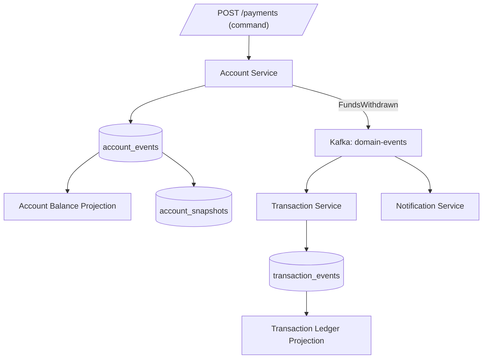

# Event Sourcing في الأنظمة الموزعة

> [!NOTE]
> يستبدل Event Sourcing الحالة القابلة للتغيير بسجل مرتب غير قابل للتغيير من الوقائع. فبدل تخزين "الرصيد الحالي 500 جنيه"، تخزن "فُتح الحساب بـ 0 جنيه، وأُودع 600 جنيه، وسُحب 100 جنيه" — وتستنتج الرصيد بإعادة تشغيل تلك الوقائع. وفي الأنظمة المالية الموزعة يوفر هذا سجل تدقيق طبيعيًا، وقدرة على الاستعلام الزمني، وأساسًا للتكامل المدفوع بالأحداث بين الخدمات.

## ما الذي يتغير في السياق الموزع

في النظام الموحّد، يكون Event Sourcing بسيطًا نسبيًا: مخزن أحداث واحد، وتجميعة واحدة لكل طلب، ومهمة واحدة لإعادة بناء الإسقاطات. أما في النظام الموزع فتملك كل خدمة مخزن أحداثها. وتتدفق الأحداث عبر حدود الخدمات كأحداث تكامل على ناقل رسائل. وتبني كل خدمة نماذج قراءتها من أحداثها، إضافة إلى الاشتراك في أحداث الخدمات الأخرى.

```
┌─────────────────────────────────┐    ┌──────────────────────────────────┐
│  Account Service                │    │  Transaction Service              │
│  event store: account_events    │    │  event store: transaction_events  │
│  projections: account_read      │◄──►│  projections: txn_read            │
└─────────────────────────────────┘    └──────────────────────────────────┘
         │  AccountOpened                       │  PaymentInitiated
         │  FundsDeposited      Kafka           │  PaymentSettled
         └──────────────────────────────────────┘
```

**أحداث المجال** وقائع حدثت داخل خدمة وتُخزن في مخزن أحداثها المحلي. و**أحداث التكامل** تُنشر على ناقل الرسائل لتستهلكها الخدمات الأخرى. افصل بينهما — فأحداث المجال تحمل الحالة الداخلية الكاملة؛ وأحداث التكامل تحمل فقط ما تحتاج الخدمات الأخرى معرفته.

---

## ‏`account_events` — الجدول الذي يُلحق به فقط

```sql
CREATE TABLE account_events (
    event_id          UUID         NOT NULL DEFAULT gen_random_uuid(),
    global_position   BIGSERIAL,               -- store-wide order for projections
    stream_id         VARCHAR(128) NOT NULL,   -- e.g. "account:ACC-001"
    sequence_number   BIGINT       NOT NULL,   -- monotonically increasing per stream
    event_type        VARCHAR(128) NOT NULL,   -- e.g. "FundsDeposited"
    event_data        JSONB        NOT NULL,   -- domain payload
    metadata          JSONB        NOT NULL DEFAULT '{}',
    occurred_at       TIMESTAMPTZ  NOT NULL DEFAULT NOW(),
    causation_id      UUID,                    -- id of the command that caused this
    correlation_id    UUID,                    -- id of the originating request chain
    schema_version    SMALLINT     NOT NULL DEFAULT 1,
    CONSTRAINT pk_account_events PRIMARY KEY (event_id),
    CONSTRAINT uq_account_events_stream_seq
        UNIQUE (stream_id, sequence_number)    -- optimistic concurrency guard
);

-- Fast stream replay: already covered by the index behind
-- uq_account_events_stream_seq (stream_id, sequence_number)

-- Global ordering for projections. Not occurred_at: NOW() is the transaction
-- START time, so a later-committed event can carry an earlier timestamp.
CREATE UNIQUE INDEX idx_account_events_global
    ON account_events (global_position);

-- For catch-up subscriptions by event type
CREATE INDEX idx_account_events_type
    ON account_events (event_type, occurred_at ASC);
```

قيد `UNIQUE (stream_id, sequence_number)` هو فحص التزامن المتفائل على مستوى قاعدة البيانات: إذا حاول كاتبان الإلحاق بالرقم التسلسلي نفسه، ينجح واحد فقط. ويدعم عمود `schema_version` ترقية الأحداث (upcasting) عند تطور مخططها. ولا يُستخدم `occurred_at` للترتيب العام، لأن `NOW()` هو وقت **بدء** المعاملة، فقد يحمل حدث التُزم لاحقًا طابعًا أقدم — لذلك يوجد عمود `global_position`.

---

## إلحاق الأحداث مع التزامن المتفائل

```java
@Repository
@RequiredArgsConstructor
public class PostgresEventStore {

    private final JdbcTemplate jdbc;

    /**
     * Appends events to a stream.
     * expectedVersion is the sequence_number of the last known event (or -1 for new stream).
     * Throws OptimisticConcurrencyException if another writer has advanced the stream.
     */
    @Transactional
    public void appendToStream(
            String streamId,
            long expectedVersion,
            List<UnpersistedEvent> events) {

        long currentVersion = currentVersion(streamId);

        if (currentVersion != expectedVersion) {
            throw new OptimisticConcurrencyException(
                "Stream %s expected version %d but was %d"
                    .formatted(streamId, expectedVersion, currentVersion));
        }

        long nextSeq = expectedVersion + 1;
        try {
            for (UnpersistedEvent event : events) {
                jdbc.update("""
                    INSERT INTO account_events
                        (stream_id, sequence_number, event_type, event_data,
                         metadata, causation_id, correlation_id, schema_version)
                    VALUES (?, ?, ?, ?::jsonb, ?::jsonb, ?, ?, ?)
                    """,
                    streamId, nextSeq++, event.getType(),
                    event.getDataJson(), event.getMetadataJson(),
                    event.getCausationId(), event.getCorrelationId(),
                    event.getSchemaVersion()
                );
            }
        } catch (DuplicateKeyException e) {
            // The version check above can race; the UNIQUE constraint cannot
            throw new OptimisticConcurrencyException(
                "Stream %s was appended to concurrently".formatted(streamId), e);
        }
    }

    public List<PersistedEvent> loadStream(String streamId) {
        return jdbc.query("""
            SELECT event_id, stream_id, sequence_number, event_type,
                   event_data, metadata, occurred_at, schema_version
            FROM account_events
            WHERE stream_id = ?
            ORDER BY sequence_number ASC
            """,
            new EventRowMapper(), streamId);
    }

    public List<PersistedEvent> loadStreamFrom(String streamId, long fromSequence) {
        return jdbc.query("""
            SELECT event_id, stream_id, sequence_number, event_type,
                   event_data, metadata, occurred_at, schema_version
            FROM account_events
            WHERE stream_id = ? AND sequence_number >= ?
            ORDER BY sequence_number ASC
            """,
            new EventRowMapper(), streamId, fromSequence);
    }

    public List<PersistedEvent> loadStreamUpTo(String streamId, Instant pointInTime) {
        return jdbc.query("""
            SELECT event_id, stream_id, sequence_number, event_type,
                   event_data, metadata, occurred_at, schema_version
            FROM account_events
            WHERE stream_id = ? AND occurred_at <= ?
            ORDER BY sequence_number ASC
            """,
            new EventRowMapper(), streamId, Timestamp.from(pointInTime));
    }

    public List<PersistedEvent> loadGlobalFrom(long globalPosition, int batchSize) {
        return jdbc.query("""
            SELECT event_id, stream_id, sequence_number, event_type,
                   event_data, metadata, occurred_at, schema_version,
                   global_position
            FROM account_events
            WHERE global_position >= ?
            ORDER BY global_position ASC
            LIMIT ?
            """,
            new EventRowMapper(), globalPosition, batchSize);
    }

    private long currentVersion(String streamId) {
        Long max = jdbc.queryForObject(
            "SELECT MAX(sequence_number) FROM account_events WHERE stream_id = ?",
            Long.class, streamId);
        return max == null ? -1L : max;
    }
}
```

فحص الإصدار في الشيفرة قد يتسابق؛ أما القيد الفريد فلا. لذلك يُترجم خطأ المفتاح المكرر إلى `OptimisticConcurrencyException`.

> [!TIP]
> للموقع التسلسلي `BIGSERIAL` فخ واحد: تُؤخذ قيم التسلسل عند الإدخال لكنها تظهر عند الالتزام، فقد يظهر الموقع 1001 قبل 1000. والمشترك الذي قرأ حتى 1001 سيتخطى 1000 إلى الأبد. والحلول الشائعة: قراءة المواقع الأقدم من تأخير أمان قصير فقط (مثل 2–5 ثوانٍ)، أو تتبع الفجوات وانتظار امتلائها، أو تسلسل عمليات الإلحاق (كاتب واحد، أو قفل استشاري حول الإلحاق). ولا يمكن استخدام دوال النوافذ مثل `ROW_NUMBER()` في `WHERE` أصلًا.

---

## ‏`AccountProjector` — إعادة بناء الحالة من الأحداث

```java
public class Account {
    private String    accountId;
    private BigDecimal balance;
    private AccountStatus status;
    private long      version;   // last applied sequence_number

    // Built only via events (or a snapshot) — never "new" from outside
    private Account() {}

    public static Account empty() { return new Account(); }

    public static Account fromEvents(List<PersistedEvent> events) {
        Account account = new Account();
        for (PersistedEvent event : events) {
            account.apply(event);
        }
        return account;
    }

    private void apply(PersistedEvent event) {
        // Upcast if needed before dispatching
        PersistedEvent current = EventUpcaster.upcast(event);

        switch (current.getType()) {
            case "AccountOpened" -> {
                AccountOpenedData data = current.dataAs(AccountOpenedData.class);
                this.accountId = data.getAccountId();
                this.balance   = BigDecimal.ZERO;
                this.status    = AccountStatus.ACTIVE;
            }
            case "FundsDeposited" -> {
                FundsDepositedData data = current.dataAs(FundsDepositedData.class);
                this.balance = this.balance.add(data.getAmount());
            }
            case "FundsWithdrawn" -> {
                FundsWithdrawnData data = current.dataAs(FundsWithdrawnData.class);
                this.balance = this.balance.subtract(data.getAmount());
            }
            case "AccountFrozen"  -> this.status = AccountStatus.FROZEN;
            case "AccountClosed"  -> this.status = AccountStatus.CLOSED;
            default -> log.warn("Unknown event type: {} — skipping", current.getType());
        }
        this.version = current.getSequenceNumber();
    }
}
```

---

## تطور مخطط الأحداث والترقية (Upcasting)

تتطور مخططات الأحداث مع الوقت. لا تعدّل الأحداث المخزنة أبدًا — بل **رقِّ** الأحداث القديمة إلى الإصدارات الجديدة في مسار القراءة:

```java
/**
 * Upcasters transform old event versions to the current version.
 * They run on the read path only — the event store is never modified.
 */
@Component
public class EventUpcaster {

    private static final Map<String, Map<Integer, Function<JsonNode, JsonNode>>> UPCASTERS
        = new HashMap<>();

    static {
        // FundsDeposited v1 → v2: added "currency" field (default "GBP").
        // A default is only safe if it is TRUE for every v1 event — here,
        // a bank that took only GBP deposits before v2.
        register("FundsDeposited", 1, data -> {
            ObjectNode upgraded = (ObjectNode) data.deepCopy();
            if (!upgraded.has("currency")) {
                upgraded.put("currency", "GBP");
            }
            return upgraded;
        });
    }

    public static PersistedEvent upcast(PersistedEvent event) {
        Map<Integer, Function<JsonNode, JsonNode>> versions =
            UPCASTERS.getOrDefault(event.getType(), Map.of());

        if (versions.isEmpty()) return event;

        int currentSchemaVersion = event.getSchemaVersion();
        int targetSchemaVersion  = currentSchemaVersion;
        JsonNode data = event.getDataNode();

        // Chain upcasters from current version to latest
        for (int v = currentSchemaVersion; versions.containsKey(v); v++) {
            data = versions.get(v).apply(data);
            targetSchemaVersion = v + 1;
        }

        return event.withData(data, targetSchemaVersion);
    }

    private static void register(String eventType, int fromVersion,
                                 Function<JsonNode, JsonNode> upcaster) {
        UPCASTERS
            .computeIfAbsent(eventType, k -> new TreeMap<>())
            .put(fromVersion, upcaster);
    }
}
```

القيمة الافتراضية في الترقية آمنة فقط إذا كانت **صحيحة** لكل أحداث الإصدار القديم — هنا بنك لم يقبل قبل الإصدار 2 إلا إيداعات بالجنيه.

**قواعد تطور مخطط الأحداث:**
- إضافة حقل قابل لأن يكون فارغًا: آمنة — تضيف الترقية القيمة الافتراضية.
- إعادة تسمية حقل: تتطلب ترقية لكل حدث قديم يمر بهذا المسار.
- إزالة حقل: آمنة إذا لم يستخدمه أي إسقاط — لكن أبقِه في مخرجات الترقية للأمان.
- تغيير نوع حقل: يتطلب ترقية + ترحيلًا دقيقًا لأي لقطات.

---

## استراتيجية اللقطات للتجميعات ذات التاريخ الطويل

إعادة تشغيل 50,000 حدث في كل مرة يُحمّل فيها حساب غير عملية. فاللقطات تخزن حالة التجميعة عند نقطة زمنية:

```sql
CREATE TABLE account_snapshots (
    account_id       VARCHAR(128) NOT NULL,
    snapshot_version BIGINT       NOT NULL,   -- sequence_number at which snapshot was taken
    snapshot_data    JSONB        NOT NULL,   -- serialised Account state
    schema_version   SMALLINT     NOT NULL DEFAULT 1,
    created_at       TIMESTAMPTZ  NOT NULL DEFAULT NOW(),
    CONSTRAINT pk_account_snapshots PRIMARY KEY (account_id, snapshot_version)
);

-- Only need the latest snapshot per account
CREATE INDEX idx_account_snapshots_latest
    ON account_snapshots (account_id, snapshot_version DESC);
```

```java
@Service
@RequiredArgsConstructor
public class AccountRepository {

    private final PostgresEventStore eventStore;
    private final SnapshotRepository snapshotRepo;
    private static final int SNAPSHOT_THRESHOLD = 100;

    public Account load(String accountId) {
        String streamId = "account:" + accountId;

        Optional<AccountSnapshot> snapshot = snapshotRepo.loadLatest(accountId);

        Account account;
        long    fromVersion;

        if (snapshot.isPresent()) {
            account     = snapshot.get().toAccount();
            fromVersion = snapshot.get().getSnapshotVersion() + 1;
        } else {
            account     = Account.empty();
            fromVersion = 0;
        }

        List<PersistedEvent> recentEvents =
            eventStore.loadStreamFrom(streamId, fromVersion);
        account.applyAll(recentEvents);

        return account;
    }

    @Transactional
    public void save(Account account, List<UnpersistedEvent> newEvents) {
        eventStore.appendToStream(
            "account:" + account.getAccountId(),
            account.getVersion(),
            newEvents
        );

        if (shouldSnapshot(account)) {
            snapshotRepo.save(AccountSnapshot.from(account));
        }
    }

    private boolean shouldSnapshot(Account account) {
        long lastSnapshotVersion = snapshotRepo
            .loadLatestVersion(account.getAccountId())
            .orElse(-1L);
        return (account.getVersion() - lastSnapshotVersion) >= SNAPSHOT_THRESHOLD;
    }
}
```

**قواعد إبطال اللقطات:**
- لا تحذف لقطة أبدًا إذا كان سجل الأحداث قبلها قد قُطع.
- عندما يكون schema_version في اللقطة أقدم من إصدار التجميعة الحالي، أعد البناء من أقرب لقطة صالحة (أو من الصفر إذا لم توجد لقطة صالحة).
- اللقطات تحسين للأداء — وسجل الأحداث هو دائمًا مصدر الحقيقة.

---

## EventStoreDB مقابل PostgreSQL كمخزن أحداث

| المسألة | EventStoreDB | PostgreSQL |
|---|---|---|
| مصمم للغرض | نعم — إلحاق فقط، وواجهة قائمة على التدفقات | لا — قاعدة علائقية عامة مكيّفة |
| الاشتراك (دفع) | اشتراكات دائمة أصلية | استطلاع أو LISTEN/NOTIFY |
| محرك الإسقاطات | مدمج (إسقاطات JavaScript) | شيفرة مخصصة |
| التزامن المتفائل | معامل `expectedVersion` أصلي | قيد UNIQUE + فحص في التطبيق |
| التعقيد التشغيلي | عنقود منفصل يجب تشغيله | يعيد استخدام بنية قاعدة البيانات الموجودة |
| الديمومة في العنقود | الكتابات تُنسخ إلى نصاب من العقد | نسخ متزامن إذا ضُبط |
| موصى به لـ | المشاريع الجديدة، والفرق التي تبدأ بـ Event Sourcing | الفرق التي تستخدم PostgreSQL أصلًا |

لمعظم فرق التقنية المالية التي تعتمد PostgreSQL بالفعل، أسلوب PostgreSQL عملي. ويستحق EventStoreDB ‏(أُعيدت تسميته KurrentDB في 2025) النظر عندما تكون لديك تجميعات كثيرة، أو منطق إسقاطات معقد، أو حاجة إلى اشتراكات لحاق أصلية.

---

## إعادة بناء الإسقاطات

الإسقاطات نماذج قراءة مشتقة. ولأن سجل الأحداث غير قابل للتغيير، يمكن إعادة بناء أي إسقاط من الصفر:

```java
@Component
@RequiredArgsConstructor
public class AccountBalanceProjection {

    private final EventStore     eventStore;
    private final BalanceReadRepo readRepo;

    /**
     * Full rebuild — truncates and replays all events.
     * Run offline or into a shadow table (see the strategy below). For large
     * stores, commit per batch and record the position reached, so that a
     * failed rebuild can resume instead of starting again.
     */
    public void rebuild() {
        readRepo.truncate();

        long globalPosition = 0;
        int  batchSize      = 500;
        List<PersistedEvent> batch;

        do {
            batch = eventStore.loadGlobalFrom(globalPosition, batchSize);
            for (PersistedEvent event : batch) {
                handleEvent(event);
                globalPosition = event.getGlobalPosition() + 1;
            }
        } while (batch.size() == batchSize);
    }

    private void handleEvent(PersistedEvent event) {
        switch (event.getType()) {
            case "AccountOpened"   -> readRepo.create(event.getStreamId(), BigDecimal.ZERO);
            case "FundsDeposited"  -> readRepo.addBalance(event.getStreamId(),
                                           event.dataAs(FundsDepositedData.class).getAmount());
            case "FundsWithdrawn"  -> readRepo.subtractBalance(event.getStreamId(),
                                           event.dataAs(FundsWithdrawnData.class).getAmount());
        }
    }
}
```

في المخازن الكبيرة، التزم بعد كل دفعة وسجّل الموقع الذي بلغته، حتى تستأنف إعادة البناء الفاشلة بدل البدء من جديد.

**استراتيجية إعادة بناء الإسقاط في الإنتاج:**
1. ابنِ الإسقاط الجديد في جدول ظل بينما يستمر الإسقاط الحي في خدمة القراءات.
2. عندما يلحق الظل بموقع الأحداث الحي بفارق ثوانٍ قليلة، بدّل اسم القراءة المستعار ذريًا.
3. احذف جدول الإسقاط القديم.

---

## اشتراكات اللحاق مع LISTEN/NOTIFY في PostgreSQL

لتحديث الإسقاطات لحظيًا (دون استطلاع)، استخدم LISTEN/NOTIFY في PostgreSQL:

```sql
-- Trigger that notifies on every new event insertion
CREATE OR REPLACE FUNCTION notify_new_event()
RETURNS TRIGGER LANGUAGE plpgsql AS $$
BEGIN
    PERFORM pg_notify(
        'account_events_channel',
        json_build_object(
            'stream_id',       NEW.stream_id,
            'sequence_number', NEW.sequence_number,
            'event_type',      NEW.event_type,
            'global_position', NEW.global_position
        )::text
    );
    RETURN NEW;
END;
$$;

CREATE TRIGGER account_events_notify_trigger
    AFTER INSERT ON account_events
    FOR EACH ROW EXECUTE FUNCTION notify_new_event();
```

```java
@Component
@RequiredArgsConstructor
public class AccountEventSubscription {

    private final DataSource dataSource;
    private final AccountBalanceProjection projection;

    // One dedicated connection, kept open: LISTEN belongs to a session.
    // Notifications arrive only when the inserting transaction COMMITS.
    public void listenLoop() throws SQLException {
        try (Connection conn = dataSource.getConnection()) {
            try (Statement st = conn.createStatement()) {
                st.execute("LISTEN account_events_channel");
            }
            projection.catchUp();   // close any gap from before LISTEN started

            PGConnection pg = conn.unwrap(PGConnection.class);
            while (!Thread.currentThread().isInterrupted()) {
                // Blocks up to 10s waiting for notifications (pgjdbc 42.x)
                PGNotification[] notes = pg.getNotifications(10_000);
                if (notes != null && notes.length > 0) {
                    // Treat a notification as a wake-up call only: read the new
                    // events by global_position rather than trusting the payload
                    projection.catchUp();
                }
            }
        }
    }
}
```

يحتاج LISTEN إلى اتصال مخصص يبقى مفتوحًا، لأنه مرتبط بالجلسة. ولا تصل الإشعارات إلا عند **التزام** معاملة الإدخال. وعامل الإشعار كمنبّه فقط: اقرأ الأحداث الجديدة حسب `global_position` بدل الوثوق بحمولة الإشعار.

> [!WARNING]
> إشعارات LISTEN/NOTIFY غير محفوظة. فإذا أُعيد تشغيل مستهلك الإسقاط، سيفوته ما وصل من إشعارات أثناء توقفه. لذلك اجمع دائمًا LISTEN/NOTIFY مع استعلام لحاق عند البدء لسد الفجوة.

---

## مخطط — Event Sourcing في منصة دفع موزعة



---

## الاستعلامات الزمنية — كم كان الرصيد في الوقت T؟

يتيح Event Sourcing استعلامات النقطة الزمنية بإعادة تشغيل الأحداث حتى طابع زمني معين فقط:

```java
public Account loadAt(String accountId, Instant pointInTime) {
    String streamId = "account:" + accountId;

    // Load the latest snapshot whose LAST EVENT occurred at or before
    // pointInTime (not the snapshot's own created_at)
    Optional<AccountSnapshot> snapshot =
        snapshotRepo.loadLatestBefore(accountId, pointInTime);

    Account account;
    long    fromVersion;

    if (snapshot.isPresent()) {
        account     = snapshot.get().toAccount();
        fromVersion = snapshot.get().getSnapshotVersion() + 1;
    } else {
        account     = Account.empty();
        fromVersion = 0;
    }

    List<PersistedEvent> events =
        eventStore.loadStreamFromUpTo(streamId, fromVersion, pointInTime);
    account.applyAll(events);

    return account;
}
```

```sql
-- Load events up to a point in time (from a specific sequence)
SELECT * FROM account_events
WHERE stream_id = ?
  AND sequence_number >= ?
  AND occurred_at <= ?
ORDER BY sequence_number ASC;
```

يجب اختيار أحدث لقطة وقع **آخر حدث** فيها في النقطة الزمنية المطلوبة أو قبلها — لا حسب وقت إنشاء اللقطة نفسها.

وهذا لا يُقدّر بثمن للتقارير التنظيمية ("كم كان رصيد العميل في 31 ديسمبر؟") وحل النزاعات. فقواعد حفظ السجلات — مثل فترات الاحتفاظ لخمس سنوات في قواعد مكافحة غسل الأموال في الاتحاد الأوروبي وفي MiFID II — تعني أنك يجب أن تستطيع إظهار نشاط الحساب التاريخي لسنوات.

---

## Sagas مع Event Sourcing

تنسّق Saga معاملة موزعة متعددة الخطوات باستخدام الأحداث. وفي الأنظمة المبنية على Event Sourcing، تُخزن حالة Saga نفسها كأحداث:

```java
// Saga events stored in saga_events table
// "PaymentSagaStarted"     → {sagaId, paymentId, accountId, amount}
// "FundsReserved"          → {sagaId, reservationId}
// "BeneficiaryNotified"    → {sagaId, notificationId}
// "PaymentSagaCompleted"   → {sagaId, transactionId}
// "PaymentSagaFailed"      → {sagaId, reason, compensatingTxnId}

@Component
@RequiredArgsConstructor
public class PaymentSaga {

    private final SagaEventStore sagaEventStore;
    private final AccountService accountService;
    private final NotificationService notificationService;

    // Simplified, synchronous version to show the event trail. A production
    // saga reacts to each step's event asynchronously and is driven by its
    // stored state, so it can resume after a crash; every call it makes
    // (reserve, notify, release) must be idempotent on sagaId.
    public void handle(PaymentInitiated event) {
        // Start saga — append PaymentSagaStarted
        sagaEventStore.append(SagaEvent.started(event.getSagaId(), event));

        try {
            // Step 1: Reserve funds
            String reservationId = accountService.reserveFunds(
                event.getAccountId(), event.getAmount(), event.getSagaId());
            sagaEventStore.append(SagaEvent.fundsReserved(
                event.getSagaId(), reservationId));

            // Step 2: Notify beneficiary
            String notificationId = notificationService.notifyBeneficiary(
                event.getBeneficiaryId(), event.getAmount(), event.getSagaId());
            sagaEventStore.append(SagaEvent.beneficiaryNotified(
                event.getSagaId(), notificationId));

            // Complete
            sagaEventStore.append(SagaEvent.completed(event.getSagaId()));

        } catch (Exception ex) {
            // Compensate — release any reserved funds (idempotent: a no-op if
            // nothing was reserved)
            accountService.releaseReservation(event.getAccountId(), event.getSagaId());
            sagaEventStore.append(SagaEvent.failed(event.getSagaId(), ex.getMessage()));
        }
    }
}
```

هذه نسخة متزامنة مبسطة لإظهار مسار الأحداث. أما Saga في الإنتاج فتتفاعل مع حدث كل خطوة بشكل غير متزامن وتقودها حالتها المخزنة، فتستطيع الاستئناف بعد التعطل؛ ويجب أن يكون كل استدعاء تجريه (الحجز، والإشعار، والتحرير) آمنًا من التكرار على sagaId.

كل خطوة في Saga تُلحق حدثًا. ويمكن إعادة تشغيل Saga لفهم سبب نجاح الدفعة أو فشلها بالضبط، مع تاريخ زمني كامل.

---

## نمط مدير العمليات (Process Manager)

مدير العمليات منسّق طويل الأمد يتفاعل مع أحداث من عدة تجميعات. وعلى خلاف Saga (التي تكون تسلسلًا بسيطًا)، يتعامل مدير العمليات مع منطق متفرع:

```java
@Component
@RequiredArgsConstructor
public class SettlementProcessManager {

    private final ProcessStateRepository stateRepo;
    private final EventPublisher          publisher;

    // Triggered by AccountService event
    @EventHandler
    public void on(FundsWithdrawn event) {
        ProcessState state = stateRepo.loadOrCreate(event.getCorrelationId());
        state.recordFundsWithdrawn(event.getAccountId(), event.getAmount());

        // Publish once: both handlers can find the state "ready", and an event
        // can be delivered twice
        if (state.isReadyForSettlement() && !state.isSettlementRequested()) {
            state.markSettlementRequested();
            publisher.publish(new SettlementReadyEvent(state.getCorrelationId()));
        }
        stateRepo.save(state);   // in practice: save + publish via an outbox
    }

    // Triggered by ComplianceService event
    @EventHandler
    public void on(ComplianceApproved event) {
        ProcessState state = stateRepo.load(event.getCorrelationId());
        state.recordComplianceApproval();

        // Publish once: both handlers can find the state "ready", and an event
        // can be delivered twice
        if (state.isReadyForSettlement() && !state.isSettlementRequested()) {
            state.markSettlementRequested();
            publisher.publish(new SettlementReadyEvent(state.getCorrelationId()));
        }
        stateRepo.save(state);   // in practice: save + publish via an outbox
    }
}
```

انشر حدث الجاهزية للتسوية مرة واحدة فقط: فقد يجد المعالجان الحالة "جاهزة"، وقد يُسلَّم الحدث مرتين. وعمليًا يكون الحفظ والنشر عبر outbox.

---

## أخطاء الإنتاج الشائعة

### 1. تخزين الأوامر بدل الأحداث

```java
// WRONG — stores an intent, not a fact
eventStore.append("PaymentRequested", { accountId, amount });

// CORRECT — stores what happened
eventStore.append("FundsWithdrawn", { accountId, amount, newBalance, timestamp });
```

الأمر طلب قد يفشل. والحدث واقعة لا يمكن التراجع عنها. خزّن الأحداث فقط.

### 2. وضع منطق العمل في الإسقاطات

```java
// WRONG — business logic bleeds into the projection
case "FundsWithdrawn" -> {
    if (account.getBalance().compareTo(BigDecimal.ZERO) < 0) {
        // THIS SHOULD NEVER HAPPEN — event implies it was valid
        throw new RuntimeException("Invalid event: overdraft");
    }
    readRepo.subtractBalance(...);
}

// CORRECT — projection trusts events, no validation
case "FundsWithdrawn" -> readRepo.subtractBalance(streamId, amount);
```

مكان التحقق في معالج الأوامر، قبل كتابة الحدث. ويجب أن يتعامل الإسقاط مع أي حدث صالح.

### 3. استخدام وقت ساعة الحائط لترتيب الأحداث

```java
// DANGEROUS — two events at the same millisecond are unordered
eventStore.append(event.withOccurredAt(Instant.now()));

// SAFE — sequence_number within a stream is the source of order
// occurred_at is for display and temporal queries only, not ordering
```

استخدم دائمًا `sequence_number` للترتيب داخل التدفق. أما `occurred_at` فللقراءة البشرية والاستعلامات الزمنية، لا لترتيب إعادة تشغيل الأحداث.

### 4. عدم التخطيط لتطور الإسقاطات

يحتاج متطلب عمل جديد حقلًا جديدًا في نموذج القراءة. فإذا لم تبنِ أدوات لإعادة البناء:

```java
// BUILD THIS FROM DAY ONE
public interface ProjectionRebuildTool {

    // Rebuild a named projection from a global position (0 = from the start)
    void rebuildProjection(String projectionName, long fromGlobalPosition);

    // Shadow rebuild — build in background, swap when caught up
    void shadowRebuild(String projectionName, String newTableSuffix);

    // Status: how far behind is each projection?
    Map<String, ProjectionStatus> status();
}
```

---

## قائمة التحقق: Event Sourcing في الإنتاج

- [ ] جدول الأحداث فيه قيد `UNIQUE (stream_id, sequence_number)` للتزامن المتفائل
- [ ] ‏`schema_version` مسجّل لكل حدث للترقية
- [ ] سلسلة الترقية منفّذة ومختبرة قبل أي تطور في المخطط
- [ ] استراتيجية اللقطات محددة: العتبة، وسياسة الإبطال
- [ ] أدوات إعادة بناء الإسقاطات مبنية ومختبرة قبل الإطلاق
- [ ] ‏`occurred_at` مفهرس للاستعلامات الزمنية؛ والترتيب يستخدم `sequence_number` (لكل تدفق) و`global_position` (على مستوى المخزن، مع معالجة الفجوات)
- [ ] أحداث التكامل منفصلة عن أحداث المجال
- [ ] اشتراك اللحاق يجمع LISTEN/NOTIFY مع استعلام لحاق عند البدء
- [ ] حالة Saga مخزنة كأحداث (لا حالة قابلة للتغيير) لقابلية التدقيق

<!-- KNOWLEDGE-CHECK
{
  "questions": [
    {
      "text": "حساب دفع فيه 200,000 حدث. دون لقطات، يستغرق تحميل الحساب لكل معاملة 400ms. بعد تنفيذ لقطة كل 100 حدث، ما أسوأ حالة لإعادة التشغيل؟",
      "options": [
        "ما زالت 200,000 حدث — اللقطات لا تساعد إعادة التشغيل",
        "99 حدثًا — تحتاج فقط إلى إعادة تشغيل الأحداث منذ آخر لقطة",
        "حدث واحد — تحل اللقطة محل كل الأحداث",
        "200 حدث — تُحمّل لقطتان"
      ],
      "correct": 1,
      "explanation": "تلتقط أحدث لقطة حالة التجميعة عند الحدث N. ولا تحتاج إلا إلى إعادة تشغيل الأحداث من N+1 حتى الحالي. ومع لقطة كل 100 حدث، تكون أسوأ حالة 99 حدثًا بعد اللقطة، فتنخفض 400ms إلى أقل من مللي ثانية في هذا المثال."
    },
    {
      "text": "يحاول طلبان متزامنان الإلحاق بالتدفق 'account:ACC-001' بقيمة expectedVersion=42. ماذا يحدث؟",
      "options": [
        "ينجح الاثنان — يدمج مخزن الأحداث الأحداث",
        "ينجح واحد، ويتلقى الآخر OptimisticConcurrencyException",
        "يفشل الاثنان — الكتابات المتزامنة غير مدعومة",
        "يفوز آخر كاتب — وتُكتب فوق الكتابة الأولى"
      ],
      "correct": 1,
      "explanation": "يعني قيد UNIQUE (stream_id, sequence_number) أن إدخالًا واحدًا فقط بالرقم 43 يمكن أن ينجح. ويحصل الكاتب الثاني على انتهاك للقيد، يترجمه التطبيق إلى OptimisticConcurrencyException. ويجب على المستدعي إعادة تحميل التدفق وإعادة محاولة أمره."
    },
    {
      "text": "يضيف متطلب عمل جديد حقل 'currency' إلى أحداث FundsDeposited. ويوجد مليونا حدث قديم بلا هذا الحقل. ما الأسلوب الصحيح؟",
      "options": [
        "شغّل سكربت ترحيل يحدّث كل الأحداث الموجودة بـ currency='GBP'",
        "نفّذ مرقّيًا يضيف currency='GBP' في مسار القراءة؛ ولا تعدّل مخزن الأحداث أبدًا",
        "احذف مخزن الأحداث وأعد بناءه بالمخطط الجديد",
        "أضف عمود currency قابلًا لأن يكون فارغًا وعامل NULL كـ GBP في شيفرة التطبيق"
      ],
      "correct": 1,
      "explanation": "مخزن الأحداث غير قابل للتغيير — فالأحداث المخزنة لا تُعدّل أبدًا. والنمط الصحيح هو المرقّي: دالة في مسار القراءة تحوّل إصدارات الأحداث القديمة إلى المخطط الجديد. فعند تحميل حدث FundsDeposited بالإصدار 1، يضيف المرقّي currency='GBP' قبل أن تطبقه التجميعة. وهذا يحفظ السجل التاريخي مع دعم المخطط الجديد."
    }
  ]
}
-->

<!-- PRACTICAL-CHALLENGE
{
  "title": "حساب توفير مبني على Event Sourcing مع استعلامات زمنية",
  "difficulty": "advanced",
  "estimatedMinutes": 75,
  "tasks": [
    {
      "id": "1",
      "description": "صمّم مخطط جدول savings_events الكامل لـ 50 مليون حدث عبر مليون حساب. وضمّن: قيد التزامن المتفائل، وعمود schema_version، وفهارس لإعادة تشغيل التدفقات، وترتيبًا عامًا للإسقاطات، واستراتيجية تقسيم (partitioning) للحفاظ على أداء الاستعلامات مع نمو الجدول."
    },
    {
      "id": "2",
      "description": "نفّذ تجميعة SavingsAccount مع apply() للأحداث: AccountOpened، وInterestAccrued، وFundsDeposited، وFundsWithdrawn، وAccountFrozen، وAccountUnfrozen، وAccountClosed. وضمّن مرقّيًا لتغيير المخطط: لم يكن في الإصدار 1 من InterestAccrued حقل 'rate'؛ ويضيفه الإصدار 2 ‏(BigDecimal، والافتراضي 0.025)."
    },
    {
      "id": "3",
      "description": "نفّذ loadAt(accountId, LocalDate) التي تعيد حالة الحساب في منتصف ليل ذلك التاريخ. ويجب أن تستخدم الطريقة أحدث لقطة قبل ذلك التاريخ، ثم تعيد تشغيل الأحداث بين إصدار اللقطة ومنتصف ليل التاريخ المطلوب فقط."
    },
    {
      "id": "4",
      "description": "اكتب اختبارًا يتحقق من أن تحميل حساب فيه 150 حدثًا (مع لقطة عند الحدث 100) يعيد تشغيل الأحداث 101–150 فقط. استخدم spy على طريقة loadStreamFrom في مخزن الأحداث للتأكد من أن المعامل fromSequence يساوي 101."
    },
    {
      "id": "5",
      "description": "صمّم استراتيجية إبطال اللقطات. وحدّد: (أ) متى يجب إنشاء لقطة، (ب) ما الذي يجعل اللقطة قديمة (عدم تطابق schema_version، أو بيانات تالفة)، (ج) كيف تتعامل مع حالة تكون فيها أحدث لقطة قديمة لكن توجد لقطات أقدم صالحة."
    }
  ]
}
-->
