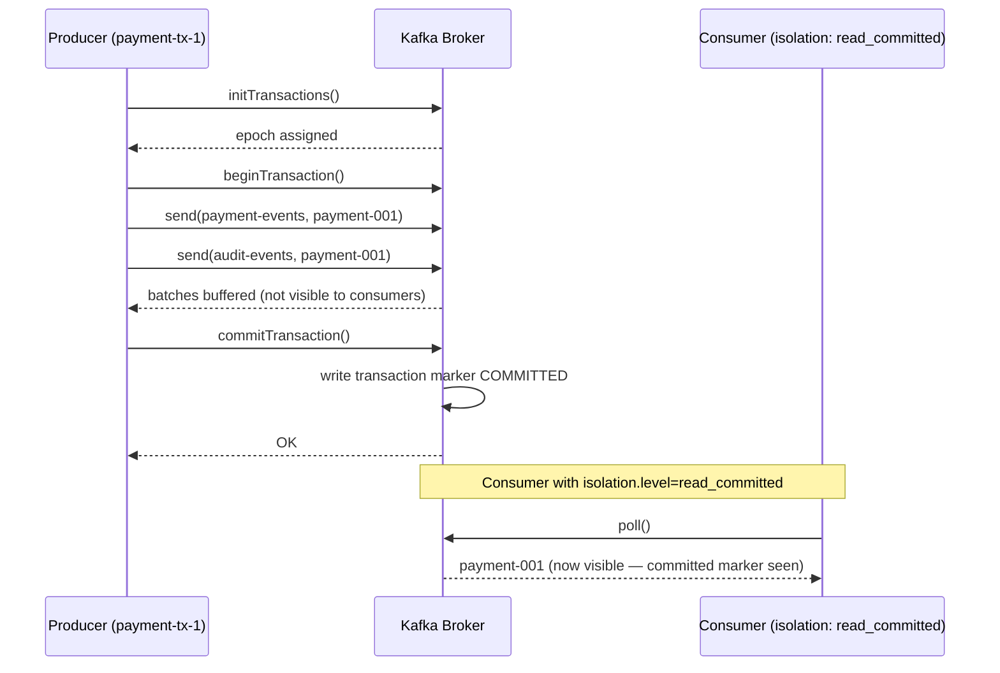
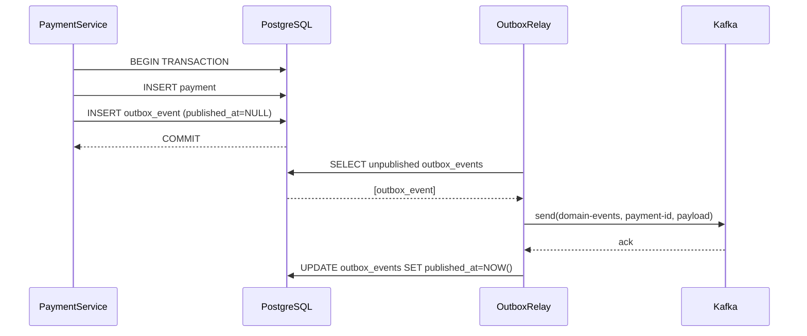

# Exactly-Once Semantics in Distributed Systems

> [!NOTE]
> Exactly-once is the strongest delivery guarantee: every message is processed precisely once, never zero times and never more than once. For financial systems it is the holy grail — no double payments, no lost transactions. It is also expensive to achieve correctly. This lesson examines where true exactly-once is achievable, where it is not, and what application-layer patterns get you close enough for financial correctness.

## The Three Delivery Guarantees

| Guarantee | Description | Risk | Use When |
|---|---|---|---|
| At-most-once | Fire and forget, no retry | Message loss | Metrics, telemetry |
| At-least-once | Retry until acknowledged | Duplicates | Most financial ops (with idempotency) |
| Exactly-once | Process precisely once | Expensive coordination | Regulated debit/credit operations |

**At-most-once** is achieved by never retrying. The sender discards the message if delivery fails.

**At-least-once** is achieved by retrying until an ACK arrives. Combined with idempotent consumers (Lesson 14), this is the practical gold standard for most fintech workloads.

**Exactly-once** requires coordination between the message broker and the downstream store. It is achievable within a single Kafka cluster (Kafka EOS), but cross-system exactly-once — across a Kafka broker AND a database in a single atomic operation — requires the transactional outbox pattern or 2PC.

---

## Why Exactly-Once Is Expensive

The cost of exactly-once comes from coordination:

1. **Atomic write spanning two systems** — writing to Kafka AND to a database atomically requires either 2PC (high latency, low availability) or the outbox pattern (eventual consistency, operational overhead).
2. **Deduplication storage** — the system must remember every message ID it has seen within the deduplication window, consuming memory or disk proportional to message volume.
3. **Ordering constraints** — idempotent producers in Kafka enforce strict ordering per partition, limiting parallelism.
4. **Throughput reduction** — Kafka's transactional API adds ~20% overhead versus non-transactional producers in benchmarks.

> [!WARNING]
> Exactly-once at the **infrastructure layer** (Kafka EOS) does not give you exactly-once at the **application layer** if your consumer handler is not idempotent. Infrastructure EOS ensures the message is in the topic exactly once — but if your consumer crashes after writing to the database but before committing the Kafka offset, you will reprocess. Application-layer idempotency is always required.

---

## Kafka EOS — Idempotent Producer

Prevents Kafka from writing the same message twice due to producer retries. The broker tracks the producer's sequence numbers and deduplicates within a session:

```java
Properties props = new Properties();
props.put(ProducerConfig.BOOTSTRAP_SERVERS_CONFIG,  "kafka:9092");
props.put(ProducerConfig.KEY_SERIALIZER_CLASS_CONFIG,   StringSerializer.class);
props.put(ProducerConfig.VALUE_SERIALIZER_CLASS_CONFIG, StringSerializer.class);

// Enable idempotent producer — prevents duplicate messages from producer retries
props.put(ProducerConfig.ENABLE_IDEMPOTENCE_CONFIG,     true);

// Idempotence requires acks=all and retries > 0
props.put(ProducerConfig.ACKS_CONFIG,    "all");
props.put(ProducerConfig.RETRIES_CONFIG, Integer.MAX_VALUE);

// MAX_IN_FLIGHT_REQUESTS_PER_CONNECTION must be <= 5 for idempotence
props.put(ProducerConfig.MAX_IN_FLIGHT_REQUESTS_PER_CONNECTION, 5);
```

The broker assigns each producer a **producer ID (PID)** and tracks the highest sequence number received per partition. If the same sequence number arrives again (from a retry), the broker silently drops the duplicate.

**Limitation**: Deduplication is per producer session. When the producer restarts, a new PID is assigned and deduplication history is lost. Cross-restart guarantees require the transactional API.

---

## Kafka EOS — Transactional Producer

Wraps multiple topic/partition writes in a single atomic transaction. All writes either commit or abort:

```java
props.put(ProducerConfig.TRANSACTIONAL_ID_CONFIG, "payment-producer-1");
// transactional.id must be unique per producer instance and stable across restarts

KafkaProducer<String, String> producer = new KafkaProducer<>(props);
producer.initTransactions();

try {
    producer.beginTransaction();

    producer.send(new ProducerRecord<>("payment-events", paymentId, paymentJson));
    producer.send(new ProducerRecord<>("audit-events",   paymentId, auditJson));

    producer.commitTransaction();   // both records visible atomically
} catch (ProducerFencedException e) {
    // Another instance with same transactional.id has taken over — this instance is dead
    producer.close();
    throw e;
} catch (KafkaException e) {
    producer.abortTransaction();    // neither record visible
    throw e;
}
```

The `transactional.id` enables cross-restart deduplication. If a producer with `payment-producer-1` crashes mid-transaction, when it restarts with the same `transactional.id` the broker will:
1. Fence the old producer epoch (previous instance cannot write).
2. Abort the in-flight transaction.
3. Assign a new epoch to the new instance.

---

## Spring Kafka Transactional Integration

Spring Kafka's `KafkaTransactionManager` integrates Kafka transactions with Spring `@Transactional`:

```java
@Configuration
public class KafkaTransactionConfig {

    @Bean
    public ProducerFactory<String, String> transactionalProducerFactory(
            KafkaProperties props) {
        Map<String, Object> config = props.buildProducerProperties(null);
        config.put(ProducerConfig.TRANSACTIONAL_ID_CONFIG,  "payment-tx-");
        config.put(ProducerConfig.ENABLE_IDEMPOTENCE_CONFIG, true);
        DefaultKafkaProducerFactory<String, String> factory =
            new DefaultKafkaProducerFactory<>(config);
        factory.setTransactionIdPrefix("payment-tx-");
        return factory;
    }

    @Bean
    public KafkaTransactionManager<String, String> kafkaTransactionManager(
            ProducerFactory<String, String> factory) {
        return new KafkaTransactionManager<>(factory);
    }

    @Bean
    public KafkaTemplate<String, String> kafkaTemplate(
            ProducerFactory<String, String> factory) {
        return new KafkaTemplate<>(factory);
    }
}
```

```java
@Service
@RequiredArgsConstructor
public class PaymentEventPublisher {

    private final KafkaTemplate<String, String> kafkaTemplate;

    // Uses KafkaTransactionManager — the Kafka transaction wraps this method
    @Transactional("kafkaTransactionManager")
    public void publishPaymentEvents(List<PaymentEvent> events) {
        for (PaymentEvent event : events) {
            kafkaTemplate.send("payment-events", event.getPaymentId(), toJson(event));
        }
        // On method exit: commitTransaction() called automatically
        // On exception:   abortTransaction() called automatically
    }
}
```

---

## The Core Gap: `@Transactional` + Kafka Producer

This is the fundamental challenge. Spring's `@Transactional` and `KafkaTransactionManager` control different transaction managers. Using `@Primary` on one of them means the other is not enrolled:

```java
// THIS DOES NOT GIVE TRUE ATOMIC DB + KAFKA:
@Transactional  // This is the DB transaction manager
public void processPayment(Payment payment) {
    paymentRepo.save(payment);               // DB write
    kafkaTemplate.send("events", toJson(payment));  // Kafka write — different transaction!
    // DB commits, then Kafka commits — there is a window between them
}
```

```
Timeline:
  T1: DB transaction commits — payment saved  ✓
  T2: Kafka producer crashes                  ✗
  Result: Payment exists in DB, event never published → inconsistency
```

The window between the DB commit and the Kafka commit is where failures produce inconsistency. The correct solution is the **Transactional Outbox**.

---

## Transactional Outbox Pattern

Write the event to an `outbox` table in the **same DB transaction** as the business data. A relay process reads from the outbox and publishes to Kafka:

```sql
CREATE TABLE outbox_events (
    id           UUID         NOT NULL DEFAULT gen_random_uuid(),
    aggregate_id VARCHAR(128) NOT NULL,
    event_type   VARCHAR(128) NOT NULL,
    payload      JSONB        NOT NULL,
    created_at   TIMESTAMPTZ  NOT NULL DEFAULT NOW(),
    published_at TIMESTAMPTZ,          -- NULL = unpublished
    attempts     SMALLINT     NOT NULL DEFAULT 0,
    last_error   TEXT,
    CONSTRAINT pk_outbox_events PRIMARY KEY (id)
);

CREATE INDEX idx_outbox_unpublished
    ON outbox_events (created_at ASC)
    WHERE published_at IS NULL;
```

```java
@Service
@RequiredArgsConstructor
public class PaymentService {

    private final PaymentRepository paymentRepo;
    private final OutboxRepository  outboxRepo;

    @Transactional  // ONE DB transaction — payment row + outbox row committed atomically
    public Payment processPayment(PaymentRequest request) {
        Payment payment = paymentRepo.save(Payment.from(request));

        // Write to outbox in same transaction — atomically guaranteed
        outboxRepo.save(OutboxEvent.builder()
            .aggregateId(payment.getId())
            .eventType("PaymentProcessed")
            .payload(toJson(new PaymentProcessedEvent(payment)))
            .build());

        return payment;
    }
}
```

```java
@Component
@RequiredArgsConstructor
public class OutboxRelay {

    private final OutboxRepository  outboxRepo;
    private final KafkaTemplate<String, String> kafkaTemplate;
    private static final int MAX_ATTEMPTS = 5;

    @Scheduled(fixedDelay = 100)  // poll every 100ms
    @Transactional
    public void relay() {
        List<OutboxEvent> pending = outboxRepo.findUnpublished(50);  // batch of 50

        for (OutboxEvent event : pending) {
            try {
                kafkaTemplate.send("domain-events", event.getAggregateId(),
                                   event.getPayload()).get(5, TimeUnit.SECONDS);
                event.setPublishedAt(Instant.now());
            } catch (Exception ex) {
                event.incrementAttempts(ex.getMessage());
                if (event.getAttempts() >= MAX_ATTEMPTS) {
                    // Move to dead-letter outbox — alert operations
                    log.error("Outbox relay failed after {} attempts for event {}",
                        MAX_ATTEMPTS, event.getId());
                }
            }
        }

        outboxRepo.saveAll(pending);
    }
}
```

The outbox relay delivers at-least-once to Kafka. Consumer-side idempotency (Lesson 14) handles the occasional duplicate. The combination provides **effective exactly-once** for business outcomes.

---

## CDC-Based Outbox with Debezium

Polling the outbox table adds latency and DB load. Debezium's Change Data Capture reads the PostgreSQL WAL (Write-Ahead Log) instead:

```json
{
  "name": "outbox-connector",
  "config": {
    "connector.class": "io.debezium.connector.postgresql.PostgresConnector",
    "database.hostname": "postgres",
    "database.port": "5432",
    "database.user": "debezium",
    "database.dbname": "payments",
    "table.include.list": "public.outbox_events",
    "transforms": "outbox",
    "transforms.outbox.type":
      "io.debezium.transforms.outbox.EventRouter",
    "transforms.outbox.table.field.event.id":      "id",
    "transforms.outbox.table.field.event.key":     "aggregate_id",
    "transforms.outbox.table.field.event.payload": "payload",
    "transforms.outbox.table.field.event.type":    "event_type",
    "transforms.outbox.route.by.field":            "event_type",
    "transforms.outbox.route.topic.replacement":   "payment.${routedByValue}.events"
  }
}
```

Debezium reads WAL changes and publishes to Kafka without polling. The outbox row is captured exactly once from the WAL, providing very low latency (sub-second) and no polling DB overhead.

---

## Mermaid Diagram — Kafka EOS Transaction



---

## Mermaid Diagram — Transactional Outbox



---

## Idempotent Consumer with Deduplication Table

The relay is at-least-once. Consumers must deduplicate:

```java
@Component
@RequiredArgsConstructor
public class PaymentProcessedConsumer {

    private final ProcessedMessageRepository dedupeRepo;
    private final AccountService             accountService;

    @KafkaListener(topics = "domain-events",
                   groupId = "payment-processor",
                   containerFactory = "kafkaListenerContainerFactory")
    @Transactional
    public void consume(ConsumerRecord<String, String> record) {
        String messageId = record.headers()
            .lastHeader("message-id")
            .map(h -> new String(h.value()))
            .orElse(record.key() + ":" + record.offset());

        // Idempotency check — in same DB transaction as the business logic
        if (dedupeRepo.existsByMessageId(messageId)) {
            log.debug("Duplicate message {} — skipping", messageId);
            return;
        }
        dedupeRepo.markProcessed(messageId);

        PaymentProcessedEvent event = fromJson(record.value());
        accountService.applyPayment(event);
        // DB commit includes both the deduplication record and the account update
    }
}
```

```sql
CREATE TABLE processed_messages (
    message_id   VARCHAR(256) NOT NULL,
    processed_at TIMESTAMPTZ  NOT NULL DEFAULT NOW(),
    CONSTRAINT pk_processed_messages PRIMARY KEY (message_id)
) PARTITION BY RANGE (processed_at);

-- Weekly partition rotation — drop old partitions instead of DELETE
CREATE TABLE processed_messages_2024_w01
    PARTITION OF processed_messages
    FOR VALUES FROM ('2024-01-01') TO ('2024-01-08');
```

---

## Deduplication Window and Storage Cost

For Kafka EOS, the broker retains producer state within the **producer.id epoch**. When the producer restarts, a new epoch is assigned and old deduplication state is gone — meaning cross-restart deduplication requires the transactional API, not just idempotence.

For application-layer deduplication tables:

| Throughput | Window | Storage Estimate |
|---|---|---|
| 1,000 msg/s | 24 hours | ~86M rows ≈ 10GB |
| 10,000 msg/s | 24 hours | ~864M rows ≈ 100GB |
| 1,000 msg/s | 7 days | ~600M rows ≈ 70GB |

Partitioning by `processed_at` date enables efficient range deletion by dropping old partitions with `DROP TABLE processed_messages_2024_w01` — zero I/O compared to a DELETE of 86M rows.

---

## Outbox Monitoring

The outbox queue depth is a leading indicator of reliability problems:

```sql
-- Outbox lag: oldest unpublished event age
SELECT
    COUNT(*)                          AS unpublished_count,
    MIN(created_at)                   AS oldest_unpublished_at,
    EXTRACT(EPOCH FROM (NOW() - MIN(created_at))) AS lag_seconds
FROM outbox_events
WHERE published_at IS NULL;

-- Dead-letter outbox: events that exhausted retries
SELECT *
FROM outbox_events
WHERE published_at IS NULL
  AND attempts >= 5
ORDER BY created_at;
```

Alert when:
- `lag_seconds > 60` — relay is slow or stopped
- `unpublished_count > 500` — relay has fallen behind
- Any rows with `attempts >= 5` — systematic publishing failure

---

## Practical Advice — Application-Layer EOS Is Usually Sufficient

For most fintech workloads, the combination of:

1. **Transactional outbox** (exactly-once from DB to Kafka)
2. **Idempotent consumers** (deduplicate on consumer side)
3. **Business-level idempotency keys** (Lesson 14)

...provides **exactly-once business outcomes** without the complexity of Kafka's transactional API. Use Kafka EOS when you need atomic fan-out across multiple Kafka topics without an intermediate database.

---

## Regulatory Exactly-Once Requirements

SEPA credit transfers, SWIFT MT103s, and Open Banking payment orders have regulatory requirements for exactly-once processing. Regulators care about business outcomes, not infrastructure guarantees:

- A SEPA payment debited twice violates the Payment Services Directive.
- A SWIFT message sent twice causes correspondent bank confusion and potential duplicate settlement.
- The compliance defence is demonstrating that your deduplication mechanism has no gaps — not that you used Kafka EOS.

Document your deduplication strategy, its TTL, and its failure modes in your firm's operational risk register. Regulators will ask.

---

## Decision Framework: Which Pattern?

```
Is your write target a single Kafka cluster only?
  → Yes: Kafka EOS (transactional producer) — no DB involved
  → No: Transactional Outbox

Do you need sub-100ms event delivery latency?
  → Yes: Debezium CDC outbox (no polling overhead)
  → No: Scheduled polling outbox relay

Can your consumer logic be made idempotent?
  → Yes: At-least-once + idempotent consumer = effective exactly-once
  → No: You must implement deduplication table

Do you need exactly-once across multiple independent services?
  → Yes: Saga with idempotency keys per step — true 2PC is too expensive
  → No: Per-service outbox is sufficient
```

---

## Checklist: Exactly-Once in Production

- [ ] Outbox table uses same transaction as business entity save
- [ ] Relay has retry logic with exponential backoff and dead-letter handling
- [ ] Outbox lag is monitored with alerts on > 60s lag
- [ ] Consumer deduplication table partitioned by time for efficient cleanup
- [ ] Deduplication TTL documented in operational risk register
- [ ] `enable.idempotence=true` on all Kafka producers as a baseline
- [ ] Consumer group `isolation.level=read_committed` when using transactional producers

<!-- KNOWLEDGE-CHECK
{
  "questions": [
    {
      "text": "A Spring service uses @Transactional (DataSourceTransactionManager) and calls kafkaTemplate.send() inside the method. Is this atomic?",
      "options": [
        "Yes — Spring's @Transactional wraps both the DB and Kafka automatically",
        "No — the DB and Kafka have separate transaction managers; the DB can commit before Kafka does, leaving a gap",
        "Yes — if enable.idempotence=true is set on the producer",
        "No — kafkaTemplate.send() is always fire-and-forget"
      ],
      "correct": 1,
      "explanation": "DataSourceTransactionManager only manages the JDBC connection. KafkaTemplate uses a separate Kafka transaction. Without ChainedTransactionManager or the outbox pattern, the DB can commit while the Kafka send fails, publishing an event with no corresponding DB record — or the reverse."
    },
    {
      "text": "What problem does the transactional outbox pattern solve that Kafka EOS alone cannot?",
      "options": [
        "It prevents duplicate messages in Kafka",
        "It ensures that the database write and the Kafka publish are atomic — either both happen or neither does",
        "It speeds up Kafka producer throughput",
        "It eliminates the need for idempotent consumers"
      ],
      "correct": 1,
      "explanation": "Kafka EOS ensures atomic writes across Kafka topics. It cannot atomically coordinate a Kafka write with a PostgreSQL transaction. The outbox pattern writes both the business data and the event to PostgreSQL in one transaction, then a relay publishes to Kafka. The relay is at-least-once, but that is handled by idempotent consumers."
    },
    {
      "text": "An idempotent Kafka producer (enable.idempotence=true) restarts with a new process. Can it deduplicate messages sent before the restart?",
      "options": [
        "Yes — the broker stores producer IDs permanently",
        "No — a new producer.id epoch is assigned on restart; deduplication state from the previous session is not carried over",
        "Yes — if the same transactional.id is reused",
        "No — idempotent producers do not deduplicate across any sessions"
      ],
      "correct": 1,
      "explanation": "The idempotent producer only deduplicates within a single producer session (same producer.id and epoch). On restart, a new epoch is assigned. The transactional API (transactional.id) does provide cross-restart guarantees for in-flight transactions, but not for messages from previous completed sessions."
    }
  ]
}
-->

<!-- PRACTICAL-CHALLENGE
{
  "title": "Exactly-Once Payment Processing Pipeline",
  "difficulty": "principal",
  "estimatedMinutes": 75,
  "tasks": [
    {
      "id": "1",
      "description": "Implement the full transactional outbox: (a) outbox_events schema with attempts tracking and dead-letter support, (b) PaymentService that atomically saves payment + outbox row, (c) OutboxRelay with exponential backoff (100ms, 200ms, 400ms, 800ms, 1600ms), (d) dead-letter handler that alerts when attempts >= 5."
    },
    {
      "id": "2",
      "description": "Compare the polling outbox relay vs Debezium CDC for this use case. Consider: delivery latency, database load, operational complexity, and what happens if Debezium's Kafka Connect worker crashes. When would you choose each approach?"
    },
    {
      "id": "3",
      "description": "Implement the idempotent PaymentProcessedConsumer that deduplicates using a partitioned processed_messages table. The deduplication check and business logic must be in the same DB transaction. Write a test that simulates a Kafka consumer restart after the DB write but before the offset commit — verify the second processing attempt is a no-op."
    },
    {
      "id": "4",
      "description": "At 500 payments/second, estimate the outbox table size after 30 days assuming the relay publishes within 200ms. Design the cleanup strategy: at what age should published outbox events be deleted? How would you implement zero-downtime cleanup without locking the table?"
    },
    {
      "id": "5",
      "description": "Design the monitoring dashboard for the outbox pipeline. Define: (a) the SQL query for outbox lag (oldest unpublished event age), (b) the alert thresholds for lag and dead-letter count, (c) how you would detect if the relay has silently stopped (not crashing, just not processing)."
    }
  ]
}
-->
