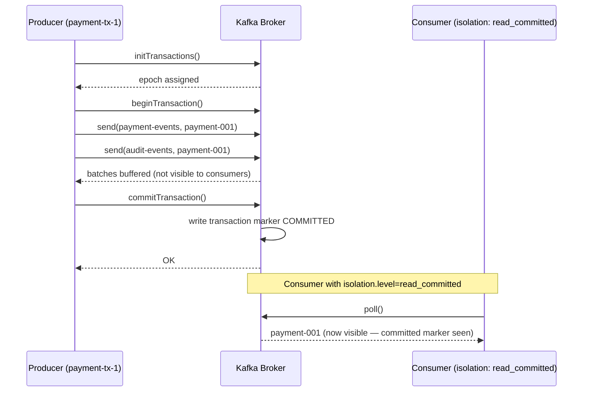
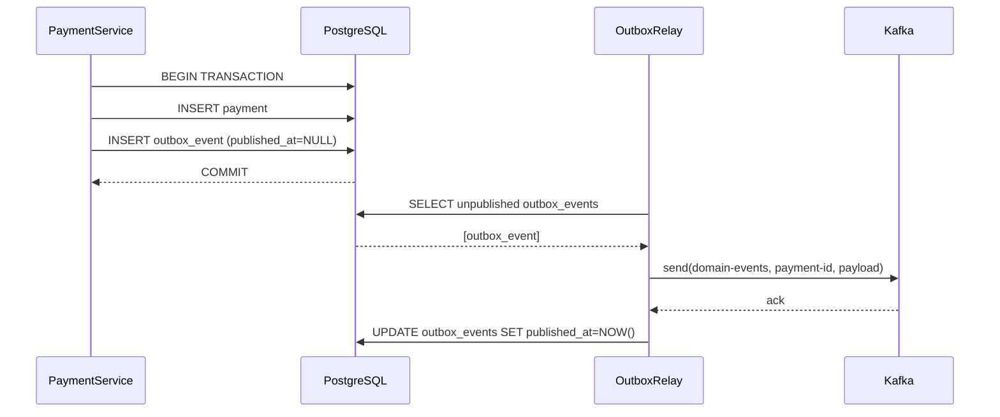

# المعالجة مرة واحدة فقط (Exactly-Once) في الأنظمة الموزعة

> [!NOTE]
> "مرة واحدة بالضبط" هو أقوى ضمان تسليم: تُعالج كل رسالة مرة واحدة تمامًا، لا صفر مرة ولا أكثر من مرة. وفي الأنظمة المالية هو الهدف المنشود — لا مدفوعات مزدوجة، ولا معاملات ضائعة. وهو أيضًا مكلف التحقيق بشكل صحيح. ويتناول هذا الدرس أين يمكن تحقيق "مرة واحدة بالضبط" الحقيقية، وأين لا يمكن، وما أنماط طبقة التطبيق التي تقربك منه بما يكفي للصحة المالية.

## ضمانات التسليم الثلاثة

| الضمان | الوصف | الخطر | استخدمه عندما |
|---|---|---|---|
| مرة واحدة على الأكثر | أرسل وانسَ، بلا إعادة محاولة | فقدان الرسائل | المقاييس، والقياسات عن بُعد |
| مرة واحدة على الأقل | أعد المحاولة حتى التأكيد | التكرار | معظم العمليات المالية (مع منع التكرار) |
| مرة واحدة بالضبط | معالجة مرة واحدة تمامًا | تنسيق مكلف | عمليات الخصم والإضافة المنظمة |

**مرة واحدة على الأكثر** تتحقق بعدم إعادة المحاولة أبدًا. فيتخلص المرسل من الرسالة إذا فشل التسليم.

**مرة واحدة على الأقل** تتحقق بإعادة المحاولة حتى يصل تأكيد. ومع مستهلكين آمنين من التكرار (الدرس 14)، هذا هو المعيار العملي الذهبي لمعظم أحمال التقنية المالية.

**مرة واحدة بالضبط** تتطلب تنسيقًا بين وسيط الرسائل والمخزن اللاحق. ويمكن تحقيقها داخل عنقود Kafka واحد (Kafka EOS)، أما "مرة واحدة بالضبط" عبر أنظمة مختلفة — عبر وسيط Kafka **و**قاعدة بيانات في عملية ذرية واحدة — فتتطلب نمط Transactional Outbox أو 2PC.

---

## لماذا "مرة واحدة بالضبط" مكلفة

تأتي الكلفة من التنسيق:

1. **كتابة ذرية تمتد عبر نظامين** — الكتابة في Kafka **و**في قاعدة بيانات ذريًا تتطلب إما 2PC (زمن عالٍ، وإتاحة منخفضة) أو نمط outbox (اتساق نهائي، وعبء تشغيلي).
2. **تخزين إزالة التكرار** — يجب أن يتذكر النظام كل معرّف رسالة رآه ضمن نافذة إزالة التكرار، فيستهلك ذاكرة أو قرصًا يتناسب مع حجم الرسائل.
3. **قيود الترتيب** — يجب الحفاظ على ترتيب كل قسم عبر إعادات المحاولة، وهذا يحدّ الطلبات الجارية لكل اتصال بـ 5.
4. **انخفاض الإنتاجية** — تضيف واجهة المعاملات في Kafka رحلات إضافية وعلامات التزام لكل معاملة؛ والكلفة ملحوظة للمعاملات الصغيرة وتتقلص كلما كبرت المعاملات.

> [!WARNING]
> "مرة واحدة بالضبط" في **طبقة البنية التحتية** (Kafka EOS) لا تعطيك "مرة واحدة بالضبط" في **طبقة التطبيق** إذا لم يكن معالج المستهلك آمنًا من التكرار. فـ EOS تضمن وجود الرسالة في الموضوع مرة واحدة بالضبط — لكن إذا تعطل المستهلك بعد الكتابة في قاعدة البيانات وقبل التزام إزاحة Kafka، فستعيد المعالجة. ومنع التكرار في طبقة التطبيق مطلوب دائمًا.

---

## Kafka EOS — المنتج الآمن من التكرار

يمنع Kafka من كتابة الرسالة نفسها مرتين بسبب إعادات محاولة المنتج. ويتتبع الوسيط الأرقام التسلسلية للمنتج ويزيل التكرار داخل الجلسة:

```java
Properties props = new Properties();
props.put(ProducerConfig.BOOTSTRAP_SERVERS_CONFIG,  "kafka:9092");
props.put(ProducerConfig.KEY_SERIALIZER_CLASS_CONFIG,   StringSerializer.class);
props.put(ProducerConfig.VALUE_SERIALIZER_CLASS_CONFIG, StringSerializer.class);

// Enable idempotent producer — prevents duplicate messages from producer retries
props.put(ProducerConfig.ENABLE_IDEMPOTENCE_CONFIG,     true);

// Idempotence requires acks=all and retries > 0
props.put(ProducerConfig.ACKS_CONFIG,    "all");
props.put(ProducerConfig.RETRIES_CONFIG, Integer.MAX_VALUE);

// MAX_IN_FLIGHT_REQUESTS_PER_CONNECTION must be <= 5 for idempotence
props.put(ProducerConfig.MAX_IN_FLIGHT_REQUESTS_PER_CONNECTION, 5);
```

يعيّن الوسيط لكل منتج **معرّف منتج (PID)** ويتتبع أعلى رقم تسلسلي استلمه لكل قسم. فإذا وصل الرقم التسلسلي نفسه مرة أخرى (من إعادة محاولة)، يسقط الوسيط المكرر بصمت.

**القيد**: إزالة التكرار لكل جلسة منتج. فعند إعادة تشغيل المنتج يُعيَّن PID جديد ويضيع تاريخ إزالة التكرار. والضمانات عبر إعادة التشغيل تتطلب واجهة المعاملات.

---

## Kafka EOS — المنتج المعاملاتي

يغلّف عدة كتابات في موضوعات وأقسام ضمن معاملة ذرية واحدة. فإما أن تلتزم كل الكتابات أو تُلغى:

```java
props.put(ProducerConfig.TRANSACTIONAL_ID_CONFIG, "payment-producer-1");
// transactional.id must be unique per producer instance and stable across restarts

KafkaProducer<String, String> producer = new KafkaProducer<>(props);
producer.initTransactions();

try {
    producer.beginTransaction();

    producer.send(new ProducerRecord<>("payment-events", paymentId, paymentJson));
    producer.send(new ProducerRecord<>("audit-events",   paymentId, auditJson));

    producer.commitTransaction();   // both records visible atomically
} catch (ProducerFencedException e) {
    // Another instance with same transactional.id has taken over — this instance is dead
    producer.close();
    throw e;
} catch (KafkaException e) {
    producer.abortTransaction();    // neither record visible
    throw e;
}
```

يمنح `transactional.id` استمرارية عبر إعادة التشغيل ("تسييج الزومبي"). فإذا تعطل منتج بالمعرّف `payment-producer-1` في منتصف معاملة، ثم أعيد تشغيله بالمعرّف نفسه، فإن الوسيط:
1. يسيّج حقبة المنتج القديمة (لا تستطيع النسخة السابقة الكتابة).
2. يلغي المعاملة الجارية.
3. يعيّن حقبة جديدة للنسخة الجديدة.

---

## تكامل معاملات Kafka مع Spring

يدمج `KafkaTransactionManager` في Spring Kafka معاملات Kafka مع `@Transactional` في Spring:

```java
@Configuration
public class KafkaTransactionConfig {

    @Bean
    public ProducerFactory<String, String> transactionalProducerFactory(
            KafkaProperties props) {
        Map<String, Object> config = props.buildProducerProperties(null);
        config.put(ProducerConfig.ENABLE_IDEMPOTENCE_CONFIG, true);
        // The prefix (set below) makes the factory create one transactional.id
        // per producer: payment-tx-0, payment-tx-1, ...
        DefaultKafkaProducerFactory<String, String> factory =
            new DefaultKafkaProducerFactory<>(config);
        factory.setTransactionIdPrefix("payment-tx-");
        return factory;
    }

    @Bean
    public KafkaTransactionManager<String, String> kafkaTransactionManager(
            ProducerFactory<String, String> factory) {
        return new KafkaTransactionManager<>(factory);
    }

    @Bean
    public KafkaTemplate<String, String> kafkaTemplate(
            ProducerFactory<String, String> factory) {
        return new KafkaTemplate<>(factory);
    }
}
```

```java
@Service
@RequiredArgsConstructor
public class PaymentEventPublisher {

    private final KafkaTemplate<String, String> kafkaTemplate;

    // Uses KafkaTransactionManager — the Kafka transaction wraps this method
    @Transactional("kafkaTransactionManager")
    public void publishPaymentEvents(List<PaymentEvent> events) {
        for (PaymentEvent event : events) {
            kafkaTemplate.send("payment-events", event.getPaymentId(), toJson(event));
        }
        // On method exit: commitTransaction() called automatically
        // On exception:   abortTransaction() called automatically
    }
}
```

عند الخروج من الطريقة يُستدعى `commitTransaction()` تلقائيًا، وعند الاستثناء يُستدعى `abortTransaction()`.

---

## الفجوة الأساسية: `@Transactional` + منتج Kafka

هذا هو التحدي الجوهري. فـ `@Transactional` في Spring و`KafkaTransactionManager` يتحكمان في مديري معاملات مختلفين. واستخدام `@Primary` على أحدهما يعني أن الآخر غير مشمول:

```java
// THIS DOES NOT GIVE TRUE ATOMIC DB + KAFKA:
@Transactional  // This is the DB transaction manager
public void processPayment(Payment payment) {
    paymentRepo.save(payment);               // DB write
    kafkaTemplate.send("events", toJson(payment));  // Kafka write — different transaction!
    // DB commits, then Kafka commits — there is a window between them
}
```

```
Timeline:
  T1: DB transaction commits — payment saved  ✓
  T2: Kafka producer crashes                  ✗
  Result: Payment exists in DB, event never published → inconsistency
```

تلتزم معاملة قاعدة البيانات وتُحفظ الدفعة، ثم يتعطل منتج Kafka، فتوجد الدفعة في قاعدة البيانات ولا يُنشر حدثها أبدًا. والنافذة بين التزام قاعدة البيانات والتزام Kafka هي حيث تُنتج الأعطال عدم الاتساق. والحل الصحيح هو **Transactional Outbox**.

---

## نمط Transactional Outbox

اكتب الحدث في جدول `outbox` ضمن **معاملة قاعدة البيانات نفسها** التي تكتب بيانات العمل. ثم تقرأ عملية ترحيل من جدول outbox وتنشر إلى Kafka:

```sql
CREATE TABLE outbox_events (
    id           UUID         NOT NULL DEFAULT gen_random_uuid(),
    aggregate_id VARCHAR(128) NOT NULL,
    event_type   VARCHAR(128) NOT NULL,
    payload      JSONB        NOT NULL,
    created_at   TIMESTAMPTZ  NOT NULL DEFAULT NOW(),
    published_at TIMESTAMPTZ,          -- NULL = unpublished
    attempts     SMALLINT     NOT NULL DEFAULT 0,
    last_error   TEXT,
    CONSTRAINT pk_outbox_events PRIMARY KEY (id)
);

CREATE INDEX idx_outbox_unpublished
    ON outbox_events (created_at ASC)
    WHERE published_at IS NULL;
```

```java
@Service
@RequiredArgsConstructor
public class PaymentService {

    private final PaymentRepository paymentRepo;
    private final OutboxRepository  outboxRepo;

    @Transactional  // ONE DB transaction — payment row + outbox row committed atomically
    public Payment processPayment(PaymentRequest request) {
        Payment payment = paymentRepo.save(Payment.from(request));

        // Write to outbox in same transaction — atomically guaranteed
        outboxRepo.save(OutboxEvent.builder()
            .aggregateId(payment.getId())
            .eventType("PaymentProcessed")
            .payload(toJson(new PaymentProcessedEvent(payment)))
            .build());

        return payment;
    }
}
```

```java
@Component
@RequiredArgsConstructor
public class OutboxRelay {

    private final OutboxRepository  outboxRepo;
    private final KafkaTemplate<String, String> kafkaTemplate;
    private static final int MAX_ATTEMPTS = 5;

    @Scheduled(fixedDelay = 100)  // poll every 100ms
    @Transactional
    public void relay() {
        // SELECT ... WHERE published_at IS NULL AND attempts < 5
        //   ORDER BY created_at LIMIT 50 FOR UPDATE SKIP LOCKED
        // SKIP LOCKED lets several relay instances run without publishing the
        // same rows; the row locks are held until this transaction commits.
        List<OutboxEvent> pending = outboxRepo.findUnpublishedForUpdate(50);

        for (OutboxEvent event : pending) {
            try {
                kafkaTemplate.send("domain-events", event.getAggregateId(),
                                   event.getPayload()).get(5, TimeUnit.SECONDS);
                event.setPublishedAt(Instant.now());
            } catch (Exception ex) {
                event.incrementAttempts(ex.getMessage());
                if (event.getAttempts() >= MAX_ATTEMPTS) {
                    // Move to dead-letter outbox — alert operations
                    log.error("Outbox relay failed after {} attempts for event {}",
                        MAX_ATTEMPTS, event.getId());
                }
            }
        }

        outboxRepo.saveAll(pending);
    }
}
```

تسمح `SKIP LOCKED` بتشغيل عدة نسخ من المرحّل دون نشر الصفوف نفسها؛ وتبقى أقفال الصفوف حتى التزام المعاملة. ويسلّم المرحّل إلى Kafka مرة واحدة على الأقل: فالتعطل بعد الإرسال وقبل الالتزام ينشر الصف مرة أخرى. ويتعامل منع التكرار في جهة المستهلك (الدرس 14) مع التكرار العرضي. ويوفر الجمع بينهما **"مرة واحدة بالضبط" فعليًا** لنتائج العمل. وتحسينان للإنتاج: انتظر بين المحاولات (سجّل `next_attempt_at`)، وإذا كان ترتيب كل تجميعة مهمًا، فأوقف نشر أحداثها اللاحقة ما دام حدث سابق يفشل.

---

## Outbox مبني على CDC مع Debezium

استطلاع جدول outbox يضيف زمنًا وحملًا على قاعدة البيانات. أما التقاط تغيير البيانات (CDC) في Debezium فيقرأ سجل الكتابة المسبقة (WAL) في PostgreSQL بدلًا من ذلك:

```json
{
  "name": "outbox-connector",
  "config": {
    "connector.class": "io.debezium.connector.postgresql.PostgresConnector",
    "database.hostname": "postgres",
    "database.port": "5432",
    "database.user": "debezium",
    "database.password": "${file:/secrets/debezium.properties:password}",
    "database.dbname": "payments",
    "topic.prefix": "payments",
    "plugin.name": "pgoutput",
    "table.include.list": "public.outbox_events",
    "transforms": "outbox",
    "transforms.outbox.type":
      "io.debezium.transforms.outbox.EventRouter",
    "transforms.outbox.table.field.event.id":      "id",
    "transforms.outbox.table.field.event.key":     "aggregate_id",
    "transforms.outbox.table.field.event.payload": "payload",
    "transforms.outbox.table.field.event.type":    "event_type",
    "transforms.outbox.route.by.field":            "event_type",
    "transforms.outbox.route.topic.replacement":   "payment.${routedByValue}.events"
  }
}
```

يقرأ Debezium تغييرات WAL وينشرها إلى Kafka دون استطلاع، فيعطي زمنًا منخفضًا جدًا (أقل من ثانية) بلا حمل استطلاع على قاعدة البيانات. لكن التسليم ما زال مرة واحدة على الأقل: فبعد إعادة تشغيل الموصل قد تُرسل الصفوف الحديثة مرة أخرى — لذلك يزيل المستهلكون التكرار حسب `id` حدث outbox، الذي يضعه EventRouter في ترويسة الرسالة. وتذكر حذف صفوف outbox المنشورة (أو الإدراج والحذف في المعاملة نفسها — فسجل WAL يحمل الإدراج مع ذلك).

---

## مخطط — معاملة Kafka EOS



---

## مخطط — Transactional Outbox



---

## مستهلك آمن من التكرار مع جدول إزالة التكرار

المرحّل يسلّم مرة واحدة على الأقل. ويجب على المستهلكين إزالة التكرار:

```java
@Component
@RequiredArgsConstructor
public class PaymentProcessedConsumer {

    private final ProcessedMessageRepository dedupeRepo;
    private final AccountService             accountService;

    @KafkaListener(topics = "domain-events",
                   groupId = "payment-processor",
                   containerFactory = "kafkaListenerContainerFactory")
    @Transactional
    public void consume(ConsumerRecord<String, String> record) {
        // Use the outbox event id. Do NOT fall back to key + offset: a message
        // published twice by the relay has two different offsets.
        Header idHeader = record.headers().lastHeader("id");   // may be null
        if (idHeader == null) {
            throw new InvalidMessageException("Missing outbox event id header");
        }
        String messageId = new String(idHeader.value(), StandardCharsets.UTF_8);

        // Claim the id first: INSERT ... ON CONFLICT DO NOTHING, in the same DB
        // transaction as the business logic. 0 rows inserted = duplicate.
        if (!dedupeRepo.insertIfAbsent(messageId, eventDate(record))) {
            log.debug("Duplicate message {} — skipping", messageId);
            return;
        }

        PaymentProcessedEvent event = fromJson(record.value());
        accountService.applyPayment(event);
        // DB commit includes both the deduplication record and the account update
    }
}
```

استخدم معرّف حدث outbox، ولا تعتمد على المفتاح + الإزاحة: فالرسالة التي نشرها المرحّل مرتين لها إزاحتان مختلفتان. واحجز المعرّف أولًا (`INSERT ... ON CONFLICT DO NOTHING`) في معاملة قاعدة البيانات نفسها مع منطق العمل؛ فإذا لم يُدرج أي صف فالرسالة مكررة.

```sql
CREATE TABLE processed_messages (
    message_id   VARCHAR(256) NOT NULL,
    event_date   DATE         NOT NULL,  -- date the EVENT was created (from the
                                         -- message), so a duplicate always lands
                                         -- in the same partition as the original
    processed_at TIMESTAMPTZ  NOT NULL DEFAULT NOW(),
    -- On a partitioned table the primary key must include the partition key
    CONSTRAINT pk_processed_messages PRIMARY KEY (message_id, event_date)
) PARTITION BY RANGE (event_date);

-- Weekly partition rotation — drop old partitions instead of DELETE
CREATE TABLE processed_messages_2024_w01
    PARTITION OF processed_messages
    FOR VALUES FROM ('2024-01-01') TO ('2024-01-08');
```

في الجدول المقسّم يجب أن يتضمن المفتاح الأساسي مفتاح التقسيم. لذلك يُقسّم الجدول حسب تاريخ إنشاء **الحدث** (المأخوذ من الرسالة)، فتقع النسخة المكررة دائمًا في القسم نفسه الذي فيه الأصل.

---

## نافذة إزالة التكرار وكلفة التخزين

في Kafka EOS يحتفظ الوسيط بحالة المنتج داخل **حقبة producer.id**. وعند إعادة تشغيل المنتج تُعيَّن حقبة جديدة وتضيع حالة إزالة التكرار القديمة — أي أن إزالة التكرار عبر إعادة التشغيل تتطلب واجهة المعاملات، لا مجرد الأمان من التكرار.

لجداول إزالة التكرار في طبقة التطبيق:

| الإنتاجية | النافذة | تقدير التخزين |
|---|---|---|
| 1,000 رسالة/ثانية | 24 ساعة | نحو 86 مليون صف ≈ 10GB |
| 10,000 رسالة/ثانية | 24 ساعة | نحو 864 مليون صف ≈ 100GB |
| 1,000 رسالة/ثانية | 7 أيام | نحو 600 مليون صف ≈ 70GB |

يتيح التقسيم حسب تاريخ الحدث حذفًا فعالًا للنطاقات بإسقاط الأقسام القديمة عبر `DROP TABLE processed_messages_2024_w01` — بلا تقريبًا أي إدخال/إخراج مقارنة بحذف 86 مليون صف بـ DELETE.

---

## مراقبة Outbox

عمق طابور outbox مؤشر مبكر على مشكلات الموثوقية:

```sql
-- Outbox lag: oldest unpublished event age
SELECT
    COUNT(*)                          AS unpublished_count,
    MIN(created_at)                   AS oldest_unpublished_at,
    EXTRACT(EPOCH FROM (NOW() - MIN(created_at))) AS lag_seconds
FROM outbox_events
WHERE published_at IS NULL;

-- Dead-letter outbox: events that exhausted retries
SELECT *
FROM outbox_events
WHERE published_at IS NULL
  AND attempts >= 5
ORDER BY created_at;
```

نبّه عندما:
- ‏`lag_seconds > 60` — المرحّل بطيء أو متوقف
- ‏`unpublished_count > 500` — المرحّل متأخر
- توجد أي صفوف بـ `attempts >= 5` — فشل نشر منهجي

---

## نصيحة عملية — "مرة واحدة بالضبط" في طبقة التطبيق تكفي عادة

لمعظم أحمال التقنية المالية، فإن الجمع بين:

1. **Transactional Outbox** (لا أحداث ضائعة: كل تغيير ملتزم يُنشر مرة واحدة على الأقل)
2. **مستهلكين آمنين من التكرار** (إزالة التكرار في جهة المستهلك)
3. **مفاتيح منع التكرار على مستوى العمل** (الدرس 14)

...يوفر **نتائج عمل "مرة واحدة بالضبط"** دون تعقيد واجهة المعاملات في Kafka. واستخدم Kafka EOS عندما تحتاج توزيعًا ذريًا عبر عدة موضوعات في Kafka دون قاعدة بيانات وسيطة.

---

## متطلبات "مرة واحدة بالضبط" التنظيمية

لا يذكر أي تنظيم ضمان تسليم مثل "مرة واحدة بالضبط". فالجهات التنظيمية تهتم بنتائج العمل في تحويلات SEPA الدائنة، ومدفوعات SWIFT، وأوامر الدفع في الخدمات المصرفية المفتوحة:

- الدفعة في SEPA المخصومة مرتين دفعة منفّذة بشكل خاطئ وفق PSD2: يجب على بنك الدافع تصحيحها بسرعة، وتُحسب على الشركة.
- رسالة SWIFT المرسلة مرتين تسبب ارتباكًا لدى البنك المراسل واحتمال تسوية مكررة.
- دفاع الامتثال هو إثبات أن آلية إزالة التكرار لديك بلا فجوات — لا أنك استخدمت Kafka EOS.

وثّق استراتيجية إزالة التكرار، ومدتها، وأنماط فشلها في سجل المخاطر التشغيلية لشركتك. فالجهات التنظيمية ستسأل.

---

## إطار القرار: أي نمط؟

```
Is your write target a single Kafka cluster only?
  → Yes: Kafka EOS (transactional producer) — no DB involved
  → No: Transactional Outbox

Do you need sub-100ms event delivery latency?
  → Yes: Debezium CDC outbox (no polling overhead)
  → No: Scheduled polling outbox relay

Can your consumer logic be made idempotent?
  → Yes: At-least-once + idempotent consumer = effective exactly-once
  → No: You must implement deduplication table

Do you need exactly-once across multiple independent services?
  → Yes: Saga with idempotency keys per step — true 2PC is too expensive
  → No: Per-service outbox is sufficient
```

- هل الكتابة في عنقود Kafka واحد فقط؟ نعم ← Kafka EOS؛ لا ← Transactional Outbox.
- هل تحتاج زمن تسليم أقل من 100ms؟ نعم ← Outbox عبر Debezium CDC؛ لا ← مرحّل بالاستطلاع.
- هل يمكن جعل منطق المستهلك آمنًا من التكرار؟ نعم ← مرة واحدة على الأقل + مستهلك آمن؛ لا ← جدول إزالة التكرار.
- هل تحتاجها عبر عدة خدمات مستقلة؟ نعم ← Saga بمفاتيح منع تكرار لكل خطوة؛ لا ← outbox لكل خدمة.

---

## قائمة التحقق: "مرة واحدة بالضبط" في الإنتاج

- [ ] جدول outbox يستخدم معاملة حفظ كيان العمل نفسها
- [ ] للمرحّل منطق إعادة محاولة بتراجع أسّي ومعالجة رسائل ميتة
- [ ] تأخر outbox مراقب مع تنبيهات عند تأخر يتجاوز 60 ثانية
- [ ] جدول إزالة التكرار لدى المستهلك مقسّم حسب الوقت لتنظيف فعال
- [ ] مدة إزالة التكرار موثقة في سجل المخاطر التشغيلية
- [ ] ‏`enable.idempotence=true` على كل منتجي Kafka كخط أساس
- [ ] ‏`isolation.level=read_committed` لمجموعات المستهلكين عند استخدام منتجين معاملاتيين

<!-- KNOWLEDGE-CHECK
{
  "questions": [
    {
      "text": "خدمة Spring تستخدم @Transactional ‏(DataSourceTransactionManager) وتستدعي kafkaTemplate.send() داخل الطريقة. هل هذا ذري؟",
      "options": [
        "نعم — يغلّف @Transactional في Spring قاعدة البيانات وKafka تلقائيًا",
        "لا — لقاعدة البيانات ولـ Kafka مديرا معاملات منفصلان؛ وقد تلتزم قاعدة البيانات قبل Kafka، فتبقى فجوة",
        "نعم — إذا ضُبط enable.idempotence=true على المنتج",
        "لا — kafkaTemplate.send() دائمًا أرسل وانسَ"
      ],
      "correct": 1,
      "explanation": "يدير DataSourceTransactionManager اتصال JDBC فقط. أما KafkaTemplate فيستخدم معاملة Kafka منفصلة (أو لا يستخدم أي معاملة). وحتى ChainedTransactionManager القديم يلتزم بالتتابع فقط (أفضل جهد)، فيترك التعطل بين الالتزامين فجوة. فقد تلتزم قاعدة البيانات بينما يفشل إرسال Kafka — دفعة بلا حدث — أو العكس. ونمط Transactional Outbox يسد هذه الفجوة."
    },
    {
      "text": "ما المشكلة التي يحلها نمط Transactional Outbox ولا يستطيع Kafka EOS وحده حلها؟",
      "options": [
        "يمنع الرسائل المكررة في Kafka",
        "يضمن أن كتابة قاعدة البيانات والنشر إلى Kafka ذريان — إما أن يحدثا معًا أو لا يحدث أي منهما",
        "يسرّع إنتاجية منتج Kafka",
        "يلغي الحاجة إلى مستهلكين آمنين من التكرار"
      ],
      "correct": 1,
      "explanation": "يضمن Kafka EOS كتابات ذرية عبر موضوعات Kafka. لكنه لا يستطيع تنسيق كتابة Kafka ذريًا مع معاملة PostgreSQL. ويكتب نمط outbox بيانات العمل والحدث في PostgreSQL في معاملة واحدة، ثم ينشر مرحّل إلى Kafka. والمرحّل يسلّم مرة واحدة على الأقل، ويتعامل المستهلكون الآمنون من التكرار مع ذلك."
    },
    {
      "text": "أُعيد تشغيل منتج Kafka آمن من التكرار (enable.idempotence=true) كعملية جديدة. هل يستطيع إزالة تكرار الرسائل المرسلة قبل إعادة التشغيل؟",
      "options": [
        "نعم — يخزن الوسيط معرّفات المنتجين بشكل دائم",
        "لا — تُعيَّن حقبة producer.id جديدة عند إعادة التشغيل؛ ولا تنتقل حالة إزالة التكرار من الجلسة السابقة",
        "نعم — إذا أُعيد استخدام transactional.id نفسه",
        "لا — المنتجون الآمنون من التكرار لا يزيلون التكرار عبر أي جلسة"
      ],
      "correct": 1,
      "explanation": "يزيل المنتج الآمن من التكرار التكرار داخل جلسة منتج واحدة فقط (producer.id والحقبة نفسهما). وعند إعادة التشغيل تُعيَّن حقبة جديدة. وتوفر واجهة المعاملات (transactional.id) ضمانات عبر إعادة التشغيل للمعاملات الجارية، لكن ليس للرسائل من جلسات سابقة مكتملة."
    }
  ]
}
-->

<!-- PRACTICAL-CHALLENGE
{
  "title": "مسار معالجة مدفوعات مرة واحدة بالضبط",
  "difficulty": "principal",
  "estimatedMinutes": 75,
  "tasks": [
    {
      "id": "1",
      "description": "نفّذ نمط Transactional Outbox الكامل: (أ) مخطط outbox_events مع تتبع المحاولات ودعم الرسائل الميتة، (ب) PaymentService تحفظ الدفعة وصف outbox ذريًا، (ج) OutboxRelay بتراجع أسّي (100ms، 200ms، 400ms، 800ms، 1600ms)، (د) معالج رسائل ميتة ينبّه عندما attempts >= 5."
    },
    {
      "id": "2",
      "description": "قارن مرحّل outbox بالاستطلاع مع Debezium CDC لهذه الحالة. وضع في الاعتبار: زمن التسليم، وحمل قاعدة البيانات، والتعقيد التشغيلي، وما يحدث إذا تعطل عامل Kafka Connect في Debezium. متى تختار كل أسلوب؟"
    },
    {
      "id": "3",
      "description": "نفّذ PaymentProcessedConsumer آمنًا من التكرار يزيل التكرار باستخدام جدول processed_messages مقسّم. ويجب أن يكون فحص إزالة التكرار ومنطق العمل في معاملة قاعدة البيانات نفسها. واكتب اختبارًا يحاكي إعادة تشغيل مستهلك Kafka بعد كتابة قاعدة البيانات وقبل التزام الإزاحة — وتحقق من أن محاولة المعالجة الثانية بلا أثر."
    },
    {
      "id": "4",
      "description": "بمعدل 500 دفعة في الثانية، قدّر حجم جدول outbox بعد 30 يومًا بافتراض أن المرحّل ينشر خلال 200ms. وصمّم استراتيجية التنظيف: في أي عمر يجب حذف أحداث outbox المنشورة؟ وكيف تنفّذ تنظيفًا بلا توقف ودون قفل الجدول؟"
    },
    {
      "id": "5",
      "description": "صمّم لوحة مراقبة لمسار outbox. وحدّد: (أ) استعلام SQL لتأخر outbox (عمر أقدم حدث غير منشور)، (ب) عتبات التنبيه للتأخر وعدد الرسائل الميتة، (ج) كيف تكتشف أن المرحّل توقف بصمت (لم يتعطل، لكنه لا يعالج)."
    }
  ]
}
-->
