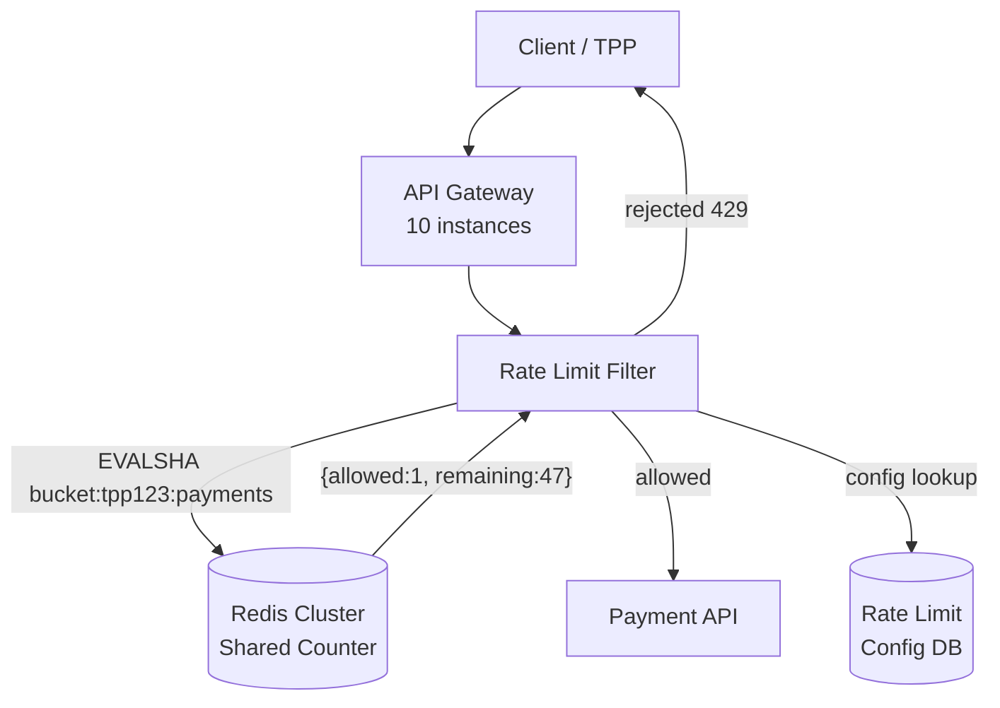

# بنيات تحديد المعدّل الموزعة

> [!NOTE]
> يتحكم تحديد المعدّل في سرعة استدعاء العميل لواجهة برمجية. في نظام بعملية واحدة يكفي عدّاد محلي. أما في نظام موزع فيه 20 نسخة من الواجهة، فكل عقدة ترى جزءًا فقط من الطلبات — فيستطيع العميل تجاوز حد كل عقدة بتوزيع طلباته بالتناوب على العقد. وتحديد المعدّل المركزي المنسّق يتطلب مخزن حالة مشتركًا.

## نمط الفشل الموزع

```
Client sends 1,000 req/s to a 10-node cluster.
Per-node limit: 200 req/s.
Per-node actual: 100 req/s — BELOW limit.
System-wide actual: 1,000 req/s — 5× ABOVE intended limit.
```

يرسل العميل 1,000 طلب في الثانية إلى عنقود من 10 عقد، فترى كل عقدة 100 طلب فقط — أقل من حدها البالغ 200 — بينما المعدّل الكلي خمسة أضعاف المقصود. والحل الصحيح الوحيد عدّاد مشترك تقرؤه كل العقد وتكتبه ذريًا.

---

## نافذة ثابتة بـ `INCR` + `EXPIRE` في Redis

الأسلوب الأبسط: مفتاح Redis لكل عميل لكل نافذة زمنية، يُزاد مع كل طلب:

```java
@Component
@RequiredArgsConstructor
public class FixedWindowRateLimiter {

    private final StringRedisTemplate redis;

    // INCR and EXPIRE in ONE atomic script: as two separate calls, a crash
    // between them leaves a counter with no TTL — and the client is blocked
    // forever once it reaches the limit
    private static final RedisScript<Long> INCR_WITH_TTL = RedisScript.of(
        "local c = redis.call('INCR', KEYS[1]) " +
        "if c == 1 then redis.call('EXPIRE', KEYS[1], ARGV[1]) end " +
        "return c", Long.class);

    /**
     * Returns true if the request is within the rate limit.
     * Uses a fixed 60-second window keyed on the current minute.
     */
    public boolean isAllowed(String clientId, int limitPerMinute) {
        String windowKey = "rl:" + clientId + ":" + (System.currentTimeMillis() / 60_000);

        // 70s TTL: a little longer than the window, to absorb clock skew
        Long count = redis.execute(INCR_WITH_TTL, List.of(windowKey), "70");

        return count != null && count <= limitPerMinute;
    }
}
```

يُنفّذ INCR وEXPIRE في نص ذري واحد: فكاستدعاءين منفصلين، قد يترك تعطلٌ بينهما عدّادًا بلا مدة صلاحية — فيُحجب العميل إلى الأبد بمجرد بلوغه الحد.

**العيب:** يستطيع العميل إرسال دفعة عند حدود نافذتين — 100 طلب في آخر ثانية من النافذة N و100 في أول ثانية من النافذة N+1، فيرسل 200 طلب خلال ثانيتين مع التزامه تقنيًا بحد 100 في الدقيقة.

---

## نص Lua لنافذة منزلقة ذرية

تعدّ النافذة المنزلقة الطلبات خلال آخر N ثانية بدقة. وهذا يتطلب تخزين طوابع الطلبات الفردية، وهو مكلف على نطاق واسع. والتقريب يستخدم دلوين:

```lua
-- sliding_window_rate_limit.lua
-- KEYS[1] = current window key,  KEYS[2] = previous window key
-- (same prefix, consecutive slot numbers; a {clientId} hash tag keeps both
--  keys in one Redis Cluster slot)
-- ARGV[1] = current timestamp (ms), ARGV[2] = window size (ms), ARGV[3] = limit
-- Returns: {allowed: 1|0, count: N, remaining: M}

local currentKey  = KEYS[1]
local previousKey = KEYS[2]
local now         = tonumber(ARGV[1])
local windowMs    = tonumber(ARGV[2])
local limit       = tonumber(ARGV[3])

-- How far through the current window are we (0.0 to 1.0)?
local windowStart    = math.floor(now / windowMs) * windowMs
local elapsedFraction = (now - windowStart) / windowMs

local prevCount  = tonumber(redis.call('GET', previousKey) or '0')
local currCount  = tonumber(redis.call('GET', currentKey)  or '0')

-- Weight previous window by remaining overlap
local weightedCount = math.floor(prevCount * (1 - elapsedFraction)) + currCount

if weightedCount >= limit then
    return {0, weightedCount, 0}
end

-- Increment current window
local newCount = redis.call('INCR', currentKey)
if newCount == 1 then
    redis.call('PEXPIRE', currentKey, windowMs * 2)
end

local remaining = limit - (weightedCount + 1)
return {1, weightedCount + 1, remaining}
```

يُوزن عدد النافذة السابقة بنسبة ما تبقى من تداخلها مع النافذة الحالية، ثم يُضاف عدد النافذة الحالية.

```java
@Component
@RequiredArgsConstructor
public class SlidingWindowRateLimiter {

    private final StringRedisTemplate redis;
    private final RedisScript<List<Long>> slidingWindowScript;

    public RateLimitResult check(String clientId, long windowMs, int limit) {
        long   now        = System.currentTimeMillis();
        long   windowSlot = now / windowMs;
        // The SAME key pattern for both: the "previous" key is simply the key
        // that was "current" one window ago. (Different prefixes would mean
        // the previous key is never written, silently turning this into a
        // fixed window.)
        String currKey    = "rl:{" + clientId + "}:" + windowSlot;
        String prevKey    = "rl:{" + clientId + "}:" + (windowSlot - 1);

        List<Long> result = redis.execute(
            slidingWindowScript,
            List.of(currKey, prevKey),
            String.valueOf(now), String.valueOf(windowMs), String.valueOf(limit)
        );

        boolean allowed   = result.get(0) == 1L;
        long    count     = result.get(1);
        long    remaining = result.get(2);

        return new RateLimitResult(allowed, count, remaining, windowMs / 1000);
    }
}
```

يجب أن يستخدم المفتاحان النمط نفسه: فالمفتاح "السابق" هو ببساطة المفتاح الذي كان "حاليًا" قبل نافذة واحدة. أما البادئات المختلفة فتعني أن المفتاح السابق لا يُكتب أبدًا، فيتحول الحد بصمت إلى نافذة ثابتة. ويُبقي وسم التجزئة `{clientId}` المفتاحين في خانة واحدة في Redis Cluster.

---

## إعادة ملء دلو الرموز في Redis

تسمح خوارزمية دلو الرموز (token bucket) بدفعات حتى سعة قصوى، ثم يُعاد ملء الدلو بمعدل ثابت. وهي مناسبة للواجهات التي تريد استيعاب الدفعات القصيرة مع فرض معدل مستدام:

```lua
-- token_bucket.lua
-- KEYS[1] = bucket key
-- ARGV[1] = current timestamp (seconds, with milliseconds as decimals),
-- ARGV[2] = refill rate (tokens/s)
-- ARGV[3] = bucket capacity, ARGV[4] = requested tokens (usually 1)
-- Returns: {allowed: 1|0, tokens_remaining: N, retry_after_ms: M}
-- (HMGET returns false for a missing field, so "or" supplies the default)

local key        = KEYS[1]
local now        = tonumber(ARGV[1])
local rate       = tonumber(ARGV[2])
local capacity   = tonumber(ARGV[3])
local requested  = tonumber(ARGV[4])

local bucket = redis.call('HMGET', key, 'tokens', 'last_refill')
local tokens     = tonumber(bucket[1] or capacity)
local lastRefill = tonumber(bucket[2] or now)

-- Refill tokens based on elapsed time
local elapsed   = math.max(0, now - lastRefill)
local refilled  = math.min(capacity, tokens + elapsed * rate)

if refilled < requested then
    local retryAfterMs = math.ceil((requested - refilled) / rate * 1000)
    return {0, math.floor(refilled), retryAfterMs}
end

local newTokens = refilled - requested
redis.call('HSET', key, 'tokens', newTokens, 'last_refill', now)
redis.call('EXPIRE', key, math.ceil(capacity / rate) + 1)

return {1, math.floor(newTokens), 0}
```

---

## مكوّن Spring ‏`DistributedRateLimiter`

```java
@Component
@RequiredArgsConstructor
public class DistributedRateLimiter {

    private final StringRedisTemplate        redis;
    private final RedisScript<List<Long>>    tokenBucketScript;
    private final RateLimitConfigRepository  configRepo;
    private final MeterRegistry              meterRegistry;

    public RateLimitDecision checkAndConsume(String clientId, String resource) {
        RateLimitConfig config = configRepo.getConfig(clientId, resource);

        List<Long> result = redis.execute(
            tokenBucketScript,
            List.of("bucket:" + clientId + ":" + resource),
            // Seconds with a fractional part: whole seconds would refill in
            // one-second steps and allow bursts at each step
            String.valueOf(System.currentTimeMillis() / 1000.0),
            String.valueOf(config.getRefillRatePerSecond()),
            String.valueOf(config.getBucketCapacity()),
            "1"
        );

        boolean allowed      = result.get(0) == 1L;
        long    remaining    = result.get(1);
        long    retryAfterMs = result.get(2);

        // Metrics
        meterRegistry.counter("rate_limit.requests",
            "client", clientId,
            "resource", resource,
            "decision", allowed ? "allowed" : "rejected"
        ).increment();

        return new RateLimitDecision(allowed, remaining, retryAfterMs);
    }
}
```

يُمرر الوقت بالثواني مع جزء عشري: فالثواني الكاملة تعيد الملء على خطوات من ثانية واحدة وتسمح بدفعات عند كل خطوة.

---

## تحديد المعدّل لكل مستأجر لمزوّدي الخدمات الخارجيين في الخدمات المصرفية المفتوحة

يجب تحديد معدّل مزوّدي الخدمات الخارجيين (TPPs) في الخدمات المصرفية المفتوحة حسب نطاق الموافقة، لا حسب عنوان IP فقط:

```java
@Component
@RequiredArgsConstructor
public class OpenBankingRateLimitFilter implements WebFilter {

    private final DistributedRateLimiter rateLimiter;
    private final TppConsentService      consentService;

    @Override
    public Mono<Void> filter(ServerWebExchange exchange, WebFilterChain chain) {
        // The TPP identity comes from the VALIDATED access token / client
        // certificate — never from a header the caller can set themselves
        return exchange.getPrincipal()
            .cast(JwtAuthenticationToken.class)
            .map(auth -> auth.getToken().getClaimAsString("client_id"))
            .flatMap(clientId -> {
                // Rate limit key: TPP ID + API resource (account-info, payment-initiation, etc.)
                String resource = classifyResource(exchange.getRequest().getPath().value());

                // checkAndConsume uses the blocking StringRedisTemplate: run it
                // off the event loop (or use ReactiveStringRedisTemplate)
                return Mono.fromCallable(() -> rateLimiter.checkAndConsume(clientId, resource))
                    .subscribeOn(Schedulers.boundedElastic());
            })
            .flatMap(decision -> {
                addRateLimitHeaders(exchange.getResponse(), decision);
                if (!decision.isAllowed()) {
                    exchange.getResponse().setStatusCode(HttpStatus.TOO_MANY_REQUESTS);
                    return exchange.getResponse().setComplete();
                }
                return chain.filter(exchange);
            })
            .switchIfEmpty(Mono.defer(() -> unauthorized(exchange)));
    }

    private void addRateLimitHeaders(ServerHttpResponse response,
                                     RateLimitDecision decision) {
        response.getHeaders().set("X-RateLimit-Limit",
            String.valueOf(decision.getLimit()));
        response.getHeaders().set("X-RateLimit-Remaining",
            String.valueOf(decision.getTokensRemaining()));
        if (!decision.isAllowed()) {
            response.getHeaders().set("Retry-After",
                String.valueOf(decision.getRetryAfterMs() / 1000 + 1));
        }
    }
}
```

تأتي هوية المزوّد من رمز الوصول أو شهادة العميل **المتحقق منهما** — لا أبدًا من ترويسة يستطيع المستدعي تعيينها بنفسه. وتستخدم `checkAndConsume` قالب Redis الحاجب، فتُشغّل خارج حلقة الأحداث (أو استخدم `ReactiveStringRedisTemplate`).

---

## ترويسات حد المعدّل

الترويسات المعيارية تخبر العملاء كيف يضبطون معدلهم ذاتيًا:

| الترويسة | المعنى | مثال |
|---|---|---|
| `X-RateLimit-Limit` | أقصى عدد طلبات في النافذة | `100` |
| `X-RateLimit-Remaining` | الطلبات المتبقية في النافذة الحالية | `47` |
| `X-RateLimit-Reset` | طابع Unix لإعادة ضبط النافذة | `1704067260` |
| `Retry-After` | ثوانٍ للانتظار قبل إعادة المحاولة (مع 429 فقط) | `12` |

تتيح ترويسة `Retry-After` في رد 429 للعملاء تنفيذ تراجع مهذب دون عواصف إعادة محاولة عشوائية. وأسماء `X-RateLimit-*` عرف واسع الانتشار، لا معيار؛ ويعمل IETF على توحيد ترويستي `RateLimit` و`RateLimit-Policy` لتحلّا محلها.

---

## مخطط — بنية تحديد المعدّل الموزع



تتشارك نسخ البوابة العشر عدّاد Redis نفسه. فيُحدَّد معدّل العميل بشكل متسق أيًا كانت العقدة التي يصل إليها.

---

## اكتشاف التحايل على حد المعدّل

يحاول بعض العملاء تجاوز الحدود المرتبطة بالمفتاح بتدوير المعرّفات:

```java
@Component
@RequiredArgsConstructor
public class RateLimitAbuseDetector {

    private final StringRedisTemplate redis;
    private final AlertingService     alerting;

    /**
     * Track unique IP addresses per TPP client over a 10-minute window.
     * More than 50 unique IPs suggests credential sharing or key rotation.
     */
    public void recordRequest(String tppClientId, String sourceIp) {
        String key = "abuse:ips:" + tppClientId + ":" +
                     (System.currentTimeMillis() / 600_000);  // 10-min bucket

        redis.opsForHyperLogLog().add(key, sourceIp);   // approximate distinct count
        redis.expire(key, Duration.ofMinutes(20));

        long estimate = redis.opsForHyperLogLog().size(key);
        if (estimate > 50) {
            alerting.raise(Alert.TPP_IP_DIVERSITY_ANOMALY, tppClientId,
                "Estimated " + estimate + " unique IPs in 10 minutes");
        }
    }
}
```

يُتتبع عدد عناوين IP الفريدة لكل مزوّد خلال نافذة 10 دقائق بـ HyperLogLog (عدّ تقريبي للمميزات). وأكثر من 50 عنوانًا يوحي بمشاركة بيانات الاعتماد أو تدوير المفاتيح.

---

## إدارة الحصص — الحدود اليومية مقابل حدود الدقيقة

تحتاج الواجهات المالية غالبًا إلى حد للدفعات (لكل دقيقة) وحصة (يومية) معًا:

```java
// Two separate calls are simple but not atomic: a request rejected by the
// daily quota has already used a per-minute token. A single Lua script that
// checks both and consumes only if both allow is better (see the challenge).
public RateLimitDecision checkBothLimits(String clientId, String resource) {
    // Per-minute burst check
    RateLimitDecision perMinute = checkAndConsume(clientId, resource + ":pm",
        config.getPerMinuteLimit(), Duration.ofMinutes(1));

    if (!perMinute.isAllowed()) {
        return perMinute.withScope("per-minute");
    }

    // Daily quota check
    RateLimitDecision daily = checkAndConsume(clientId, resource + ":daily",
        config.getDailyLimit(), Duration.ofDays(1));

    return daily.withScope("daily");
}
```

---

## دمج Resilience4j مع Redis

‏`RateLimiter` في Resilience4j داخل العملية فقط. وللفرض الموزع، ادمجه مع Redis:

```java
// Use Redis for distributed, per-client enforcement.
// Use Resilience4j in-process as a per-INSTANCE safety cap (all clients
// together) — it protects this instance and Redis when traffic spikes.
RateLimiter localGuard = RateLimiter.of("payment-api-local",
    RateLimiterConfig.custom()
        .limitRefreshPeriod(Duration.ofSeconds(1))
        .limitForPeriod(50)          // 50/s per instance (10 instances = 500/s total)
        .timeoutDuration(Duration.ZERO)
        .build());

public RateLimitDecision combinedCheck(String clientId) {
    // Fast local check — no network hop
    if (!localGuard.acquirePermission()) {
        return RateLimitDecision.rejected("local-limit");
    }
    // Authoritative global check via Redis
    return distributedRateLimiter.checkAndConsume(clientId, "payment-api");
}
```

يُستخدم Redis للفرض الموزع لكل عميل، ويُستخدم Resilience4j داخل العملية كسقف أمان لكل **نسخة** (لكل العملاء معًا) — فهو يحمي هذه النسخة وRedis عند ارتفاع الحركة.

---

## الخلاصات الأساسية

- تحديد المعدّل لكل عقدة غير كافٍ في نظام موزع. يجب أن تتشارك كل العقد الحالة.
- يوفر INCR+EXPIRE في Redis حدًا بنافذة ثابتة؛ نفّذهما في نص Lua واحد حتى لا يترك التعطل عدّادًا بلا مدة.
- نصوص Lua تُنفّذ ذريًا في Redis، فتلغي سباقات الفحص-ثم-الاستخدام في الفحص والإنقاص.
- خوارزمية دلو الرموز تتحمل الدفعات؛ والنافذة المنزلقة تتصدى لهجمات الحدود بين النوافذ.
- يجب أن يُربط تحديد معدّل كل مزوّد في الخدمات المصرفية المفتوحة بهوية العميل الموثّقة (من الرمز أو الشهادة المتحقق منهما)، لا بعنوان IP أو ترويسة يقدمها المستدعي.
- تحديد المعدّل داخل العملية في Resilience4j سقف أمان لكل نسخة يحمي Redis أثناء قفزات الحركة؛ أما القرار لكل عميل فيبقى في Redis.

<!-- KNOWLEDGE-CHECK
{
  "questions": [
    {
      "id": "q1",
      "text": "يرسل عميل 90 طلبًا في آخر 10 ثوانٍ من الدقيقة N و90 طلبًا في أول 10 ثوانٍ من الدقيقة N+1. ويسمح محدِّد بنافذة ثابتة بحد 100 طلب في الدقيقة بها كلها. ما معدل الطلبات الفعلي في تلك النافذة البالغة 20 ثانية؟",
      "options": [
        "100 طلب في الدقيقة — النافذتان ضمن الحد",
        "540 طلبًا في الدقيقة — 180 طلبًا في 20 ثانية، مُسقطة على دقيقة",
        "180 طلبًا في الدقيقة — 180 طلبًا في 60 ثانية",
        "90 طلبًا في الدقيقة — النافذة الحالية فقط هي التي تُحسب"
      ],
      "correct": 1,
      "explanation": "هجوم حدود النوافذ: 90 طلبًا في آخر 10 ثوانٍ من الدقيقة N و90 في أول 10 ثوانٍ من الدقيقة N+1 تعطي 180 طلبًا في 20 ثانية — أي ما يعادل 540 طلبًا في الدقيقة، أعلى بكثير من الحد المقصود البالغ 100. وتمنع خوارزمية النافذة المنزلقة ذلك بوزن النافذة السابقة."
    },
    {
      "id": "q2",
      "text": "لماذا يجب أن ينفّذ نص Lua لتحديد المعدّل في Redis الفحص والزيادة في الاستدعاء نفسه؟",
      "options": [
        "نصوص Lua أسرع من أوامر Redis المنفردة",
        "تنفيذ الفحص والزيادة كأمرين منفصلين يُنشئ سباق فحص-ثم-استخدام يقرأ فيه عميلان 'أقل من الحد' ثم يزيدان كلاهما",
        "لا يدعم Redis خطوط الأوامر المتعددة",
        "لنصوص Lua وصول إلى داخليات Redis غير متاح عبر الأوامر العادية"
      ],
      "correct": 1,
      "explanation": "إذا كان GET (الفحص) وINCR (الزيادة) أمرين منفصلين، فقد ينفّذ عميل آخر INCR بين GET وINCR الخاصين بك، فيتجاوز الاثنان الحد. أما Redis فينفّذ نص Lua ذريًا — لا يتداخل معه أي أمر آخر — فيُلغى السباق."
    },
    {
      "id": "q3",
      "text": "لدى مزوّد خدمات خارجي في الخدمات المصرفية المفتوحة حصة يومية من 10,000 استدعاء وحد 100 في الدقيقة. استخدم 9,990 استدعاءً يوميًا. ثم أرسل 100 طلب في دقيقة واحدة. كم طلبًا ينجح؟",
      "options": [
        "100 — حد الدقيقة يُطبق أولًا",
        "10 — الحصة اليومية هي القيد الحاكم (بقي 10 فقط)",
        "0 — عندما تكاد الحصة اليومية تنفد تُرفض كل الطلبات",
        "100 في الدقيقة الأولى، و0 بعدها"
      ],
      "correct": 1,
      "explanation": "يجب استيفاء الحدين معًا. يسمح حد الدقيقة بما يصل إلى 100. وبقي في الحصة اليومية 10 فقط. فتنجح الطلبات العشرة التي تستهلك ما تبقى من الحصة اليومية؛ وتُرفض الطلبات التسعون الأخرى بـ 429. فالحصة اليومية هي القيد الحاكم."
    }
  ]
}
-->

<!-- PRACTICAL-CHALLENGE
{
  "title": "تحديد معدّل مزوّدي الخدمات الخارجيين في الخدمات المصرفية المفتوحة عبر عنقود بوابات",
  "difficulty": "advanced",
  "estimatedMinutes": 75,
  "tasks": [
    {
      "id": "1",
      "description": "صمّم مخطط مفاتيح Redis لحدود النافذة المنزلقة والحصص اليومية لكل مزوّد ولكل مورد: أسماء المفاتيح، ووسوم التجزئة لـ Redis Cluster، ومدة صلاحية كل مفتاح."
    },
    {
      "id": "2",
      "description": "اكتب نص Lua واحدًا يفحص حد النافذة المنزلقة والحصة اليومية معًا ويستهلك من الاثنين فقط إذا سمح كلاهما. ويعيد: السماح، والمتبقي في الدقيقة، والمتبقي في اليوم، ومدة إعادة المحاولة."
    },
    {
      "id": "3",
      "description": "نفّذ WebFilter في Spring يأخذ معرّف المزوّد من الرمز المتحقق منه، ويفرض الحدين دون حجب حلقة الأحداث، ويضبط ترويسات حد المعدّل وRetry-After، ويسجّل مقياس Micrometer لكل قرار (مسموح/مرفوض، حسب النطاق)."
    },
    {
      "id": "4",
      "description": "يتعطل عنقود Redis. هل يجب أن تفشل البوابة مفتوحة (تسمح بكل الطلبات) أم مغلقة (ترفضها كلها)؟ برّر إجابتك لواجهة خدمات مصرفية مفتوحة خاضعة للتنظيم، وصمّم حلًا وسطًا: حد متحفظ داخل العملية لكل نسخة ما دام Redis معطلًا، مع تنبيه."
    }
  ]
}
-->
