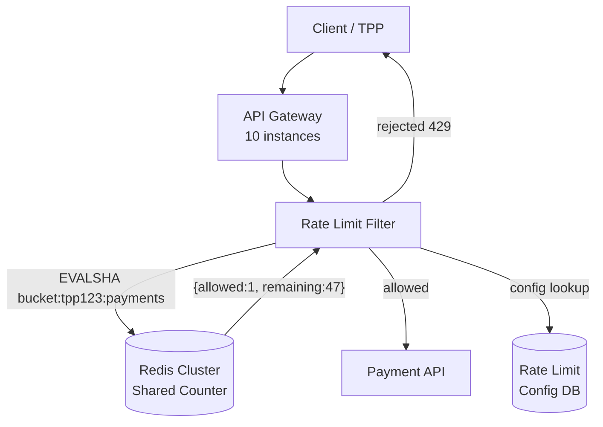

# Distributed Rate Limiting

> [!NOTE]
> Rate limiting controls the rate at which a client can call an API. In a single-process system a local counter suffices. In a distributed system with 20 API instances, each node sees only its fraction of requests — a client can bypass a per-node limit by round-robining across nodes. Centralised, coordinated rate limiting requires a shared state store.

## The Distributed Failure Mode

```
Client sends 1,000 req/s to a 10-node cluster.
Per-node limit: 200 req/s.
Per-node actual: 100 req/s — BELOW limit.
System-wide actual: 1,000 req/s — 5× ABOVE intended limit.
```

The only correct solution is a shared counter that all nodes read and write atomically.

---

## Redis `INCR` + `EXPIRE` Sliding Window

The simplest approach: a Redis key per client per time window, incremented on every request:

```java
@Component
@RequiredArgsConstructor
public class FixedWindowRateLimiter {

    private final StringRedisTemplate redis;

    /**
     * Returns true if the request is within the rate limit.
     * Uses a fixed 60-second window keyed on the current minute.
     */
    public boolean isAllowed(String clientId, int limitPerMinute) {
        String windowKey = "rl:" + clientId + ":" + (System.currentTimeMillis() / 60_000);

        Long count = redis.opsForValue().increment(windowKey);

        if (count == 1) {
            // First request in this window — set TTL so key expires automatically
            redis.expire(windowKey, Duration.ofSeconds(70));  // 70s to handle clock skew
        }

        return count <= limitPerMinute;
    }
}
```

**Drawback:** a client can burst at the boundary of two windows — 100 requests in the last second of window N and 100 in the first second of window N+1, sending 200 requests in a 2-second span while technically satisfying the 100/min limit.

---

## Lua Script for Atomic Sliding Window

A sliding window counts requests within the last N seconds exactly. This requires storing timestamps of individual requests, which is expensive at scale. An approximation uses two buckets:

```lua
-- sliding_window_rate_limit.lua
-- KEYS[1] = current window key,  KEYS[2] = previous window key
-- ARGV[1] = current timestamp (ms), ARGV[2] = window size (ms), ARGV[3] = limit
-- Returns: {allowed: 1|0, count: N, remaining: M}

local currentKey  = KEYS[1]
local previousKey = KEYS[2]
local now         = tonumber(ARGV[1])
local windowMs    = tonumber(ARGV[2])
local limit       = tonumber(ARGV[3])

-- How far through the current window are we (0.0 to 1.0)?
local windowStart    = math.floor(now / windowMs) * windowMs
local elapsedFraction = (now - windowStart) / windowMs

local prevCount  = tonumber(redis.call('GET', previousKey) or '0')
local currCount  = tonumber(redis.call('GET', currentKey)  or '0')

-- Weight previous window by remaining overlap
local weightedCount = math.floor(prevCount * (1 - elapsedFraction)) + currCount

if weightedCount >= limit then
    return {0, weightedCount, 0}
end

-- Increment current window
local newCount = redis.call('INCR', currentKey)
if newCount == 1 then
    redis.call('PEXPIRE', currentKey, windowMs * 2)
end

local remaining = limit - (weightedCount + 1)
return {1, weightedCount + 1, remaining}
```

```java
@Component
@RequiredArgsConstructor
public class SlidingWindowRateLimiter {

    private final StringRedisTemplate redis;
    private final RedisScript<List<Long>> slidingWindowScript;

    public RateLimitResult check(String clientId, long windowMs, int limit) {
        long   now        = System.currentTimeMillis();
        long   windowSlot = now / windowMs;
        String currKey    = "rl:curr:" + clientId + ":" + windowSlot;
        String prevKey    = "rl:prev:" + clientId + ":" + (windowSlot - 1);

        List<Long> result = redis.execute(
            slidingWindowScript,
            List.of(currKey, prevKey),
            String.valueOf(now), String.valueOf(windowMs), String.valueOf(limit)
        );

        boolean allowed   = result.get(0) == 1L;
        long    count     = result.get(1);
        long    remaining = result.get(2);

        return new RateLimitResult(allowed, count, remaining, windowMs / 1000);
    }
}
```

---

## Token Bucket Refill in Redis

The token bucket algorithm allows bursting up to a maximum capacity, then refills at a steady rate. It is well-suited to APIs that want to accommodate short bursts while enforcing a sustained rate:

```lua
-- token_bucket.lua
-- KEYS[1] = bucket key
-- ARGV[1] = current timestamp (seconds), ARGV[2] = refill rate (tokens/s)
-- ARGV[3] = bucket capacity, ARGV[4] = requested tokens (usually 1)
-- Returns: {allowed: 1|0, tokens_remaining: N, retry_after_ms: M}

local key        = KEYS[1]
local now        = tonumber(ARGV[1])
local rate       = tonumber(ARGV[2])
local capacity   = tonumber(ARGV[3])
local requested  = tonumber(ARGV[4])

local bucket = redis.call('HMGET', key, 'tokens', 'last_refill')
local tokens     = tonumber(bucket[1] or capacity)
local lastRefill = tonumber(bucket[2] or now)

-- Refill tokens based on elapsed time
local elapsed   = math.max(0, now - lastRefill)
local refilled  = math.min(capacity, tokens + elapsed * rate)

if refilled < requested then
    local retryAfterMs = math.ceil((requested - refilled) / rate * 1000)
    return {0, math.floor(refilled), retryAfterMs}
end

local newTokens = refilled - requested
redis.call('HMSET', key, 'tokens', newTokens, 'last_refill', now)
redis.call('EXPIRE', key, math.ceil(capacity / rate) + 1)

return {1, math.floor(newTokens), 0}
```

---

## `DistributedRateLimiter` Spring Component

```java
@Component
@RequiredArgsConstructor
public class DistributedRateLimiter {

    private final StringRedisTemplate        redis;
    private final RedisScript<List<Long>>    tokenBucketScript;
    private final RateLimitConfigRepository  configRepo;
    private final MeterRegistry              meterRegistry;

    public RateLimitDecision checkAndConsume(String clientId, String resource) {
        RateLimitConfig config = configRepo.getConfig(clientId, resource);

        List<Long> result = redis.execute(
            tokenBucketScript,
            List.of("bucket:" + clientId + ":" + resource),
            String.valueOf(Instant.now().getEpochSecond()),
            String.valueOf(config.getRefillRatePerSecond()),
            String.valueOf(config.getBucketCapacity()),
            "1"
        );

        boolean allowed      = result.get(0) == 1L;
        long    remaining    = result.get(1);
        long    retryAfterMs = result.get(2);

        // Metrics
        meterRegistry.counter("rate_limit.requests",
            "client", clientId,
            "resource", resource,
            "decision", allowed ? "allowed" : "rejected"
        ).increment();

        return new RateLimitDecision(allowed, remaining, retryAfterMs);
    }
}
```

---

## Per-Tenant Rate Limiting for Open Banking TPPs

Open Banking Third-Party Providers (TPPs) must be rate-limited per consent scope, not just per IP:

```java
@Component
@RequiredArgsConstructor
public class OpenBankingRateLimitFilter implements WebFilter {

    private final DistributedRateLimiter rateLimiter;
    private final TppConsentService      consentService;

    @Override
    public Mono<Void> filter(ServerWebExchange exchange, WebFilterChain chain) {
        String clientId = exchange.getRequest()
            .getHeaders().getFirst("X-TPP-Client-Id");

        if (clientId == null) {
            return unauthorized(exchange);
        }

        // Rate limit key: TPP ID + API resource (account-info, payment-initiation, etc.)
        String resource = classifyResource(exchange.getRequest().getPath().value());
        RateLimitDecision decision = rateLimiter.checkAndConsume(clientId, resource);

        addRateLimitHeaders(exchange.getResponse(), decision);

        if (!decision.isAllowed()) {
            exchange.getResponse().setStatusCode(HttpStatus.TOO_MANY_REQUESTS);
            return exchange.getResponse().setComplete();
        }

        return chain.filter(exchange);
    }

    private void addRateLimitHeaders(ServerHttpResponse response,
                                     RateLimitDecision decision) {
        response.getHeaders().set("X-RateLimit-Limit",     "100");
        response.getHeaders().set("X-RateLimit-Remaining",
            String.valueOf(decision.getTokensRemaining()));
        if (!decision.isAllowed()) {
            response.getHeaders().set("Retry-After",
                String.valueOf(decision.getRetryAfterMs() / 1000 + 1));
        }
    }
}
```

---

## Rate Limit Headers

Standard headers inform clients how to self-throttle:

| Header | Meaning | Example |
|---|---|---|
| `X-RateLimit-Limit` | Maximum requests in window | `100` |
| `X-RateLimit-Remaining` | Remaining requests in current window | `47` |
| `X-RateLimit-Reset` | Unix timestamp when window resets | `1704067260` |
| `Retry-After` | Seconds to wait before retrying (429 only) | `12` |

The `Retry-After` header on a 429 response enables clients to implement polite backoff without guess-and-check retry storms.

---

## Mermaid Diagram — Distributed Rate Limiting Architecture



All 10 gateway instances share the same Redis counter. A client hitting any gateway node is rate-limited consistently.

---

## Rate Limit Bypass Detection

Clients sometimes attempt to bypass per-key limits by rotating identifiers:

```java
@Component
@RequiredArgsConstructor
public class RateLimitAbuseDetector {

    private final StringRedisTemplate redis;
    private final AlertingService     alerting;

    /**
     * Track unique IP addresses per TPP client over a 10-minute window.
     * More than 50 unique IPs suggests credential sharing or key rotation.
     */
    public void recordRequest(String tppClientId, String sourceIp) {
        String key = "abuse:ips:" + tppClientId + ":" +
                     (System.currentTimeMillis() / 600_000);  // 10-min bucket

        Long uniqueIps = redis.opsForHyperLogLog()
            .add(key, sourceIp);
        redis.expire(key, Duration.ofMinutes(20));

        long estimate = redis.opsForHyperLogLog().size(key);
        if (estimate > 50) {
            alerting.raise(Alert.TPP_IP_DIVERSITY_ANOMALY, tppClientId,
                "Estimated " + estimate + " unique IPs in 10 minutes");
        }
    }
}
```

---

## Quota Management — Daily vs Per-Minute Limits

Financial APIs often need both a burst limit (per-minute) and a quota (daily):

```java
public RateLimitDecision checkBothLimits(String clientId, String resource) {
    // Per-minute burst check
    RateLimitDecision perMinute = checkAndConsume(clientId, resource + ":pm",
        config.getPerMinuteLimit(), Duration.ofMinutes(1));

    if (!perMinute.isAllowed()) {
        return perMinute.withScope("per-minute");
    }

    // Daily quota check
    RateLimitDecision daily = checkAndConsume(clientId, resource + ":daily",
        config.getDailyLimit(), Duration.ofDays(1));

    return daily.withScope("daily");
}
```

---

## Resilience4j + Redis Integration

Resilience4j's `RateLimiter` is in-process only. For distributed enforcement, combine it with Redis:

```java
// Use Redis for distributed enforcement
// Use Resilience4j in-process for fast local rejection before the Redis hop
RateLimiter localGuard = RateLimiter.of("payment-api-local",
    RateLimiterConfig.custom()
        .limitRefreshPeriod(Duration.ofSeconds(1))
        .limitForPeriod(50)          // 50/s per instance (10 instances = 500/s total)
        .timeoutDuration(Duration.ZERO)
        .build());

public RateLimitDecision combinedCheck(String clientId) {
    // Fast local check — no network hop
    if (!localGuard.acquirePermission()) {
        return RateLimitDecision.rejected("local-limit");
    }
    // Authoritative global check via Redis
    return distributedRateLimiter.checkAndConsume(clientId, "payment-api");
}
```

---

## Key Takeaways

- Per-node rate limiting is insufficient in a distributed system. All nodes must share state.
- Redis INCR+EXPIRE provides fixed-window limiting in a single round-trip.
- Lua scripts execute atomically in Redis, eliminating TOCTOU races in check-and-decrement.
- The token bucket algorithm handles burst tolerance; the sliding window handles boundary attacks.
- Per-TPP rate limiting in Open Banking must be keyed on the consent/client identity, not on IP.
- Resilience4j in-process limiting reduces Redis round-trips for clearly-over-limit clients.

<!-- KNOWLEDGE-CHECK
{
  "questions": [
    {
      "id": "q1",
      "text": "A client sends 90 requests in the last 10 seconds of minute N and 90 requests in the first 10 seconds of minute N+1. A fixed-window limiter with a 100 req/min limit allows all of them. What is the actual request rate in that 20-second window?",
      "options": [
        "100 req/min — both windows are within limit",
        "270 req/min — 180 requests in 20 seconds extrapolated to a minute",
        "180 req/min — 180 requests in 60 seconds",
        "90 req/min — only the current window counts"
      ],
      "correct": 1,
      "explanation": "The window boundary attack: 90 requests in the last 10s of minute N and 90 in the first 10s of minute N+1 gives 180 requests in 20 seconds — equivalent to 540 req/min, far above the intended 100/min limit. The sliding window algorithm prevents this by weighting the previous window."
    },
    {
      "id": "q2",
      "text": "Why must a Redis rate-limiting Lua script execute the check and increment in the same script call?",
      "options": [
        "Lua scripts are faster than individual Redis commands",
        "Executing check and increment as separate commands creates a TOCTOU race where two clients can both read 'below limit' and then both increment",
        "Redis does not support multi-command pipelines",
        "Lua scripts have access to Redis internals unavailable via normal commands"
      ],
      "correct": 1,
      "explanation": "If GET (check) and INCR (increment) are separate commands, another client can execute INCR between your GET and your INCR, allowing both to exceed the limit. Redis executes a Lua script atomically — no other command can interleave — eliminating the race condition."
    },
    {
      "id": "q3",
      "text": "An Open Banking TPP has a daily quota of 10,000 calls and a per-minute limit of 100. The TPP has used 9,990 daily calls. It sends 100 requests in one minute. How many succeed?",
      "options": [
        "100 — the per-minute limit applies first",
        "10 — the daily quota is the binding constraint (only 10 remain)",
        "0 — when the daily quota is nearly exhausted, all requests are rejected",
        "100 for the first minute, 0 thereafter"
      ],
      "correct": 1,
      "explanation": "Both limits must be satisfied. The per-minute limit allows up to 100. The daily quota has only 10 remaining. The 10 requests that consume the remaining daily quota succeed; the remaining 90 are rejected with 429. The daily quota is the binding constraint."
    }
  ]
}
-->

<!-- PRACTICAL-CHALLENGE
## Practical Challenge

**Scenario:** An Open Banking platform serves 500 TPPs. Each TPP has a custom rate limit configuration (different tiers: basic 50/min, standard 200/min, premium 1,000/min) and a daily quota. The platform runs 20 API gateway instances.

**Tasks:**

1. Design the Redis key schema for per-TPP, per-resource sliding window limits and daily quotas. Include TTL strategy and key naming conventions.

2. Write the Lua script for a combined sliding-window + daily-quota check that returns: allowed, per-minute remaining, daily remaining, retry-after.

3. Implement the Spring WebFilter that enforces both limits, sets all four rate-limit headers, and records a Micrometer metric for each decision (allowed/rejected/limited-by-quota/limited-by-rate).

4. The Redis cluster fails. What should the gateway do — fail open (allow all requests) or fail closed (reject all)? Justify your answer for a regulated Open Banking environment.

5. Design a test that verifies the sliding window boundary fix: a client sending 100 requests in the last 5 seconds of minute N and 100 in the first 5 seconds of minute N+1 is correctly limited.
-->
