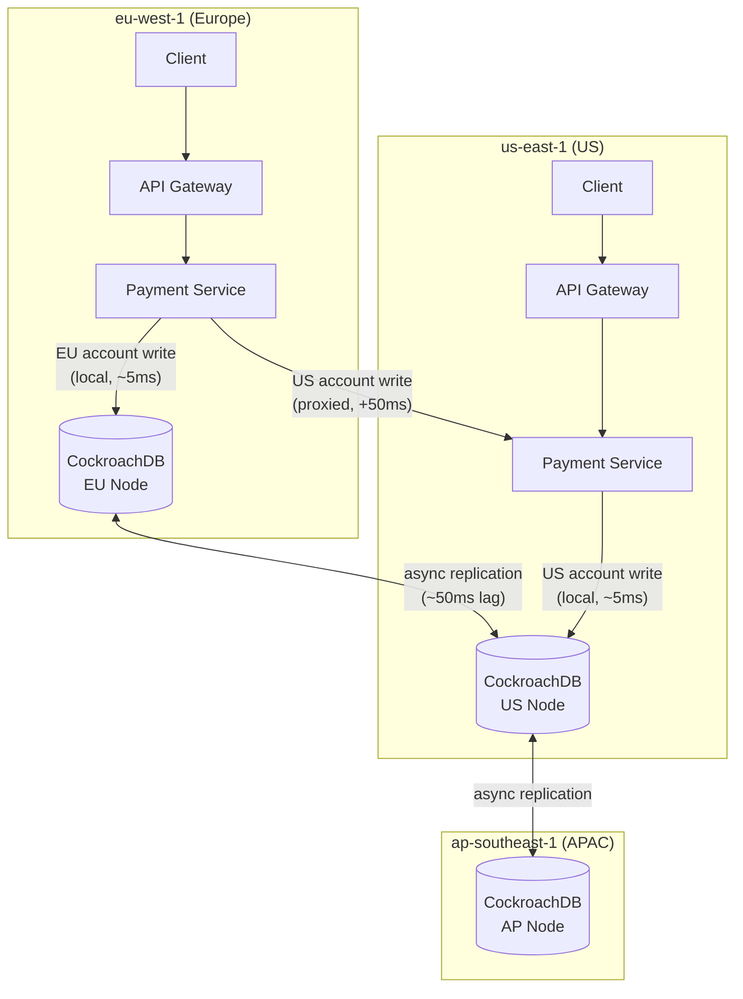
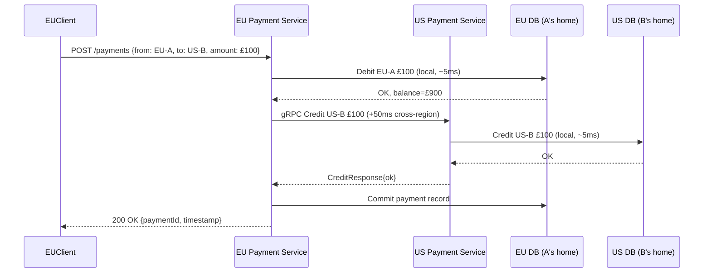

# Cross-Region Active-Active Architecture

> [!NOTE]
> Active-active means every region can accept writes and serve reads. No region is a hot standby waiting for a failover. This eliminates the recovery time objective (RTO) for a region failure — traffic shifts immediately — and can achieve a recovery point objective (RPO) of near zero. It is also the hardest distributed systems architecture to build correctly, particularly for financial systems where conflicting writes on the same account balance are financially dangerous.

## Active-Active vs Active-Passive

| Property | Active-Passive | Active-Active |
|---|---|---|
| Write availability on failover | Minutes (failover time) | Zero (other region is live) |
| RPO on failure | Seconds to minutes (replication lag) | Near-zero (synchronous) or seconds (async) |
| Write conflicts | None — single primary | Possible — multiple primaries |
| Complexity | Moderate | High |
| Latency for cross-region users | High (all writes go to primary) | Low (write to nearest region) |
| Cost | Lower (passive region is standby) | Higher (both regions fully provisioned) |

For most financial systems, **active-passive is the right starting point**. Active-active is justified when:
- Users in geographically distant regions need low-latency writes (sub-50ms write SLA)
- Regulatory requirements mandate zero RPO for financial data
- The firm has a true multi-jurisdictional regulatory presence requiring data isolation per region

---

## Why Active-Active Is Hard for Financial Systems

Consider two regions concurrently receiving different transactions for the same account:

```
Region EU-WEST-1:  Debit account ACC-001 by £500  (balance before: £1,000)
Region US-EAST-1:  Debit account ACC-001 by £800  (balance before: £1,000)
```

Both operations are individually valid (£1,000 ≥ £500 and £1,000 ≥ £800). After both are applied, the balance would be –£300 — an overdraft that neither region individually permitted.

This is the **write conflict problem**. Solving it requires either:
1. **Routing all writes for a given account to a single region** (geo-sharding/leader-based) — prevents conflicts entirely.
2. **Using CRDTs** for data types that support conflict-free merging — works for counters, not balances.
3. **Accepting conflicts and resolving post-hoc** (last-write-wins, compensation) — loses data or requires complex reconciliation.

For financial balances, option 1 is the only safe choice.

---

## Conflict-Free Replicated Data Types (CRDTs)

CRDTs are data structures designed to merge concurrent updates without conflicts. The G-Counter (grow-only counter) is the simplest:

```java
/**
 * G-Counter CRDT: each node has its own counter; the total is the sum.
 * Concurrent increments from different regions merge without conflict.
 * Cannot decrement — use for event counts, not financial balances.
 */
public class GCounter {

    private final Map<String, Long> nodeCounts;

    public GCounter() {
        this.nodeCounts = new ConcurrentHashMap<>();
    }

    public GCounter(Map<String, Long> state) {
        this.nodeCounts = new ConcurrentHashMap<>(state);
    }

    // Each region increments its own slot — no conflict possible
    public void increment(String regionId, long amount) {
        nodeCounts.merge(regionId, amount, Long::sum);
    }

    // Global total is the sum of all region counters
    public long value() {
        return nodeCounts.values().stream().mapToLong(Long::longValue).sum();
    }

    // Merge: take the maximum per region (idempotent and commutative)
    public GCounter merge(GCounter other) {
        GCounter merged = new GCounter();
        Set<String> allRegions = new HashSet<>();
        allRegions.addAll(this.nodeCounts.keySet());
        allRegions.addAll(other.nodeCounts.keySet());

        for (String region : allRegions) {
            long thisVal  = this.nodeCounts.getOrDefault(region, 0L);
            long otherVal = other.nodeCounts.getOrDefault(region, 0L);
            merged.nodeCounts.put(region, Math.max(thisVal, otherVal));
        }
        return merged;
    }

    // Commutativity: merge(a, b) == merge(b, a)
    // Associativity: merge(merge(a, b), c) == merge(a, merge(b, c))
    // Idempotency:   merge(a, a) == a
}
```

**CRDTs are suitable for:** transaction counts, daily event tallies, feature flags, rate-limit counters, aggregate metrics.

**CRDTs are NOT suitable for:** financial balances (which can decrease), regulatory ledgers (which require strict ordering), payment authorisation (which requires consistency checks).

---

## CockroachDB for Distributed SQL

Purpose-built distributed SQL databases manage replication, conflict detection, and global ordering internally:

```sql
-- CockroachDB: create a multi-region table
CREATE TABLE payments (
    id          UUID         PRIMARY KEY DEFAULT gen_random_uuid(),
    account_id  VARCHAR(128) NOT NULL,
    amount      DECIMAL(19,4) NOT NULL,
    region      VARCHAR(32)  NOT NULL,
    created_at  TIMESTAMPTZ  NOT NULL DEFAULT now()
) LOCALITY GLOBAL;  -- replicated to all regions

-- Regional table: row is pinned to a region based on a column value
CREATE TABLE accounts (
    id      VARCHAR(128) PRIMARY KEY,
    home_region  crdb_internal_region NOT NULL AS (
        CASE
            WHEN id LIKE 'EU%' THEN 'eu-west-1'
            WHEN id LIKE 'US%' THEN 'us-east-1'
            ELSE 'ap-southeast-1'
        END
    ) STORED,
    balance DECIMAL(19,4) NOT NULL,
    version BIGINT        NOT NULL DEFAULT 0
) LOCALITY REGIONAL BY ROW;
-- Writes for EU accounts are low-latency in EU; US accounts in US
```

```java
// CockroachDB provides serialisable isolation across regions
// No application-level conflict detection needed for regional tables
@Transactional(isolation = Isolation.SERIALIZABLE)
public void debit(String accountId, BigDecimal amount) {
    Account account = accountRepo.findByIdForUpdate(accountId)
        .orElseThrow(() -> new AccountNotFoundException(accountId));

    if (account.getBalance().compareTo(amount) < 0) {
        throw new InsufficientFundsException(accountId);
    }

    account.setBalance(account.getBalance().subtract(amount));
    account.setVersion(account.getVersion() + 1);
    accountRepo.save(account);
    // CockroachDB serialises concurrent cross-region writes on this row
}
```

---

## Global vs Regional Tables

| Table Type | Routing | Latency | Conflict Risk | Use For |
|---|---|---|---|---|
| Global | All writes replicated everywhere | Higher (consensus across regions) | Low — single global order | Reference data (currencies, limits) |
| Regional | Row pinned to home region | Low (local write) | None for single-region data | Account balances, customer PII |
| Regional by Row | Row pinned by partition key | Low | None for well-partitioned data | High-volume transaction tables |

**Design rule**: Financial account mutations should be **regional**. A customer's account is "owned" by the region where they onboarded or where their primary banking relationship is. Writes stay in that region. Reads can be served globally from replicas.

---

## Leader-Based Write Serialisation for Account Mutations

For financial operations that cannot tolerate conflict (account debits, reserve operations), route all writes to the **home region** of the account:

```java
@Component
@RequiredArgsConstructor
public class RegionAwarePaymentRouter {

    private final RegionResolver    regionResolver;
    private final GrpcClientFactory grpcFactory;
    private final LocalPaymentService localPaymentService;

    public PaymentResult routeDebit(String accountId, BigDecimal amount,
                                    String idempotencyKey) {
        String homeRegion    = regionResolver.homeRegionOf(accountId);
        String currentRegion = System.getenv("AWS_REGION");

        if (homeRegion.equals(currentRegion)) {
            // We are the home region — process locally
            return localPaymentService.debit(accountId, amount, idempotencyKey);
        } else {
            // Proxy to home region — adds ~15–80ms cross-region latency
            PaymentServiceGrpc.PaymentServiceBlockingStub stub =
                grpcFactory.blockingStub(homeRegion);

            DebitResponse response = stub
                .withDeadlineAfter(5, TimeUnit.SECONDS)
                .debit(DebitRequest.newBuilder()
                    .setAccountId(accountId)
                    .setAmount(amount.toString())
                    .setIdempotencyKey(idempotencyKey)
                    .build());

            return PaymentResult.from(response);
        }
    }
}
```

```java
/**
 * RegionResolver determines the canonical home region for an account.
 * Uses account prefix convention, but could use a lookup table for
 * accounts that have been migrated between regions.
 */
@Component
public class RegionResolver {

    // Cached mapping — refreshed periodically via config service
    private final Map<String, String> accountPrefixToRegion = Map.of(
        "EU", "eu-west-1",
        "UK", "eu-west-2",
        "US", "us-east-1",
        "AP", "ap-southeast-1"
    );

    public String homeRegionOf(String accountId) {
        String prefix = accountId.substring(0, Math.min(2, accountId.length()));
        return accountPrefixToRegion.getOrDefault(prefix, "eu-west-1");
    }
}
```

This approach trades cross-region latency (15–80ms depending on region pair) for correctness. For a payment authorisation that must not overdraft, this trade-off is correct.

---

## Read Architecture: Local Reads, Routed Writes

Serving reads locally eliminates cross-region latency for the majority of operations:

```java
@Service
@RequiredArgsConstructor
public class AccountQueryService {

    private final AccountReadRepository localReadRepo;
    private final RegionAwarePaymentRouter writeRouter;

    // Reads always served from local replica — sub-5ms, any region
    public AccountBalance getBalance(String accountId) {
        return localReadRepo.findBalance(accountId)
            .orElseThrow(() -> new AccountNotFoundException(accountId));
    }

    // Balance may be slightly stale (replication lag: ~50–200ms async)
    // For payment authorisation, route to home region instead
    public AccountBalance getBalanceConsistent(String accountId) {
        String homeRegion    = regionResolver.homeRegionOf(accountId);
        String currentRegion = System.getenv("AWS_REGION");

        if (homeRegion.equals(currentRegion)) {
            return localReadRepo.findBalance(accountId)
                .orElseThrow(() -> new AccountNotFoundException(accountId));
        } else {
            // Read from home region for authoritative balance
            return writeRouter.queryBalance(accountId);
        }
    }
}
```

---

## Mermaid Multi-Region Architecture Diagram



---

## Latency Budget with Cross-Region Routing

| Operation | Same-Region | Cross-Region (EU↔US) | Cross-Region (EU↔APAC) |
|---|---|---|---|
| Account read (local replica) | 2ms | 2ms | 2ms |
| Account debit (home region, local) | 5ms | — | — |
| Account debit (proxied to home region) | — | 55ms | 190ms |
| Payment authorisation (routed) | 20ms | 70ms | 210ms |
| Balance projection update | <1ms | 50–200ms (async) | 100–300ms |

Design your SLAs around the home-region routing latency for the user segment. European users with European accounts have sub-20ms authorisations. US users with European accounts (cross-border customers) must accept 70ms. Surface this in your product SLA: "Payment authorisation: p99 < 100ms within jurisdiction, < 300ms cross-jurisdiction."

---

## Data Residency Constraints

EU GDPR and financial regulation require that certain personal and financial data remain within EU borders:

```java
@Component
public class DataResidencyValidator {

    private static final Map<String, String> REQUIRED_REGION = Map.of(
        "EU", "eu-west-1",
        "UK", "eu-west-2",
        "US", "us-east-1"
    );

    public void validatePlacementBeforeWrite(String customerId, String targetRegion) {
        String customerJurisdiction = jurisdictionOf(customerId);
        String requiredRegion       = REQUIRED_REGION.get(customerJurisdiction);

        if (requiredRegion != null && !targetRegion.equals(requiredRegion)) {
            throw new DataResidencyViolationException(
                "Customer %s (jurisdiction %s) data must remain in %s, not %s"
                    .formatted(customerId, customerJurisdiction,
                               requiredRegion, targetRegion));
        }
    }

    private String jurisdictionOf(String customerId) {
        // Determined at account creation from KYC address
        return customerProfileService.getJurisdiction(customerId);
    }
}
```

This check must run **before** any cross-region routing decision to prevent inadvertent data placement violations. PII that leaves the EU jurisdiction triggers mandatory breach reporting under GDPR Article 33.

---

## Disaster Recovery with Active-Active (Zero RPO)

In an active-active architecture, a region failure does not cause data loss if replication is synchronous:

```
Region EU-WEST-1 fails at T=0.
All in-flight transactions were either:
  - Committed (replicated to US-EAST-1 before failure) → Zero data loss
  - In-progress (not yet committed) → Rolled back by CockroachDB when EU node is unreachable
  - Proxied from US to EU (cross-region writes for EU accounts) → Fail with 503; caller retries

Result:
  - US-to-US payments: continue processing normally (no dependency on EU)
  - EU-to-EU payments: fail until EU region recovers (home region unavailable)
  - EU-to-US or US-to-EU payments: partially degraded (debit fails; credit would succeed)
```

The practical RPO is the replication lag for async replicas (~50–200ms for CockroachDB across EU–US). Use `FOLLOWER READS AS OF SYSTEM TIME '-10s'` to query a consistent snapshot from non-home regions.

---

## Cross-Region Payment Flow — Sequence

For a payment from EU customer A to US customer B:



If the US credit fails after the EU debit succeeds, a **compensation event** is emitted to refund EU-A. This is managed by a saga (Lesson 15).

---

## Region Failover Runbook

When a region becomes unreachable:

1. **DNS/load balancer**: Remove failing region from health checks within 30 seconds (Route 53 health checks or Global Accelerator endpoint weights).
2. **Write routing**: The `RegionAwarePaymentRouter` will receive gRPC `UNAVAILABLE` on cross-region calls. Caller retries must have a timeout (5 seconds) and circuit breaker.
3. **Account migrations**: For EU-account holders stranded in US during EU outage, temporarily allow US writes with a "region override" flag — creates a reconciliation liability when EU returns.
4. **Recovery**: On EU region recovery, reconcile any writes made outside the account's home region during the outage.

---

## Production Pitfalls

### 1. Assuming Local Reads Are Consistent

```java
// DANGEROUS: local replica may be 200ms behind home region
BigDecimal balance = localReadRepo.findBalance(accountId);
if (balance.compareTo(amount) >= 0) {
    // Balance check passed on stale replica — overdraft possible!
    writeRouter.debit(accountId, amount);
}

// CORRECT: authorisation must read from home region
BigDecimal authoritativeBalance = getBalanceConsistent(accountId);
```

### 2. No Circuit Breaker on Cross-Region gRPC Calls

A slow or failing home region will cascade into the calling region if calls are allowed to pile up. Use Resilience4j:

```java
@CircuitBreaker(name = "cross-region-debit", fallbackMethod = "debitFallback")
@TimeLimiter(name = "cross-region-debit")
public CompletableFuture<PaymentResult> routeDebitAsync(String accountId, ...) {
    return CompletableFuture.supplyAsync(() ->
        writeRouter.routeDebit(accountId, amount, idempotencyKey));
}

public CompletableFuture<PaymentResult> debitFallback(String accountId, Throwable ex) {
    // Return 503 Service Unavailable — do not attempt local write for EU account
    return CompletableFuture.failedFuture(
        new HomeRegionUnavailableException(accountId, ex));
}
```

### 3. Data Residency Not Validated Before Replication

CockroachDB will replicate all rows to all regions by default. Without `LOCALITY REGIONAL BY ROW` and data residency pre-validation, EU customer PII can land in US nodes.

---

## Checklist: Active-Active Architecture

- [ ] Financial account writes routed to account's home region — never merged across regions
- [ ] Data residency validation runs before any write or cross-region forward
- [ ] Circuit breakers on all cross-region gRPC calls with timeout < 5s
- [ ] Local reads clearly distinguished from consistent reads in service API
- [ ] Cross-region payment uses saga with compensation for partial failure
- [ ] CockroachDB regional tables use `LOCALITY REGIONAL BY ROW` for account data
- [ ] Failover runbook tested with chaos engineering — specifically EU-region-unavailable scenario
- [ ] Replication lag monitored: alert when lag > 5s

<!-- KNOWLEDGE-CHECK
{
  "questions": [
    {
      "text": "An account with £1,000 balance receives concurrent debit requests of £800 in EU region and £700 in US region. Both pass a local balance check. After both are applied, the balance is –£500. What architectural pattern prevents this?",
      "options": [
        "CRDTs — merge the two debits without conflict",
        "Home-region routing — all writes for the account serialise through one region, so only one debit can hold the lock at a time",
        "Last-write-wins — the later timestamp debit overrides the earlier",
        "Optimistic concurrency — both fail and are retried sequentially"
      ],
      "correct": 1,
      "explanation": "CRDTs cannot prevent overdraft — they only handle additive operations. Last-write-wins loses data. Optimistic concurrency helps but still has a race window in active-active. Home-region routing ensures all writes for an account serialise through one region, maintaining a consistent balance check with no overdraft window."
    },
    {
      "text": "A G-Counter CRDT has EU region = 100, US region = 150, AP region = 50. What is the global value?",
      "options": [
        "150 — take the maximum across regions",
        "300 — sum all region values",
        "100 — use the EU value as leader",
        "Undefined — G-Counters cannot span regions"
      ],
      "correct": 1,
      "explanation": "A G-Counter's value is the sum of all region slots. Each region only increments its own slot, so there are no conflicts. The global total is 100 + 150 + 50 = 300."
    },
    {
      "text": "An EU customer's data must remain in eu-west-1 per GDPR. The payment service runs in both eu-west-1 and us-east-1. A US region API gateway receives a request to modify this customer's account. What should happen?",
      "options": [
        "Reject the request — only EU region can modify EU customer accounts",
        "Process it locally in US region to minimise latency",
        "Route the request to eu-west-1, accepting ~50ms cross-region latency to satisfy data residency",
        "Copy the data to US region temporarily and delete after processing"
      ],
      "correct": 2,
      "explanation": "Data residency rules require the data to stay in eu-west-1. The correct approach is to proxy the write to eu-west-1, accepting the cross-region latency penalty. Processing it locally in US region or temporarily copying data would violate GDPR data localisation requirements."
    }
  ]
}
-->

<!-- PRACTICAL-CHALLENGE
{
  "title": "Cross-Region Payment Architecture for a Neobank",
  "difficulty": "principal",
  "estimatedMinutes": 90,
  "tasks": [
    {
      "id": "1",
      "description": "A neobank serves EU and US customers. EU customers must have data in eu-west-1 (GDPR), US in us-east-1. Cross-border payments happen ~20% of the time. Design the region routing logic: for a payment from EU customer A to US customer B, which region processes the debit and which processes the credit? Draw the full sequence of service calls, including the cross-region gRPC call and the saga compensation path if the US credit fails after the EU debit succeeds."
    },
    {
      "id": "2",
      "description": "Implement RegionAwareAccountRepository that: (a) reads account balance from the local replica (sub-5ms), (b) performs authoritative balance reads from the home region for payment authorisation, (c) routes writes to the home region via gRPC with a 3-second timeout and circuit breaker. Include the data residency validation before any write."
    },
    {
      "id": "3",
      "description": "The EU region becomes unreachable for 10 minutes. Describe what happens to: (a) EU-to-EU payments, (b) US-to-US payments, (c) US-to-EU payments, (d) EU-to-US payments that were in-flight when the region failed. What reconciliation is needed when EU recovers?"
    },
    {
      "id": "4",
      "description": "Implement a G-Counter CRDT for tracking daily payment counts per customer per region. The counter must be: commutative (merge order does not matter), associative, idempotent. Write property-based tests (using jqwik or similar) verifying these three properties with randomly generated counter states."
    },
    {
      "id": "5",
      "description": "Design the monitoring strategy for the active-active architecture. Define: (a) how you detect replication lag > 5s between regions, (b) how you detect a silent proxy failure where EU requests to US home region are timing out but the circuit breaker has not yet opened, (c) the runbook for the on-call engineer when EU-region-unavailable alert fires."
    }
  ]
}
-->
