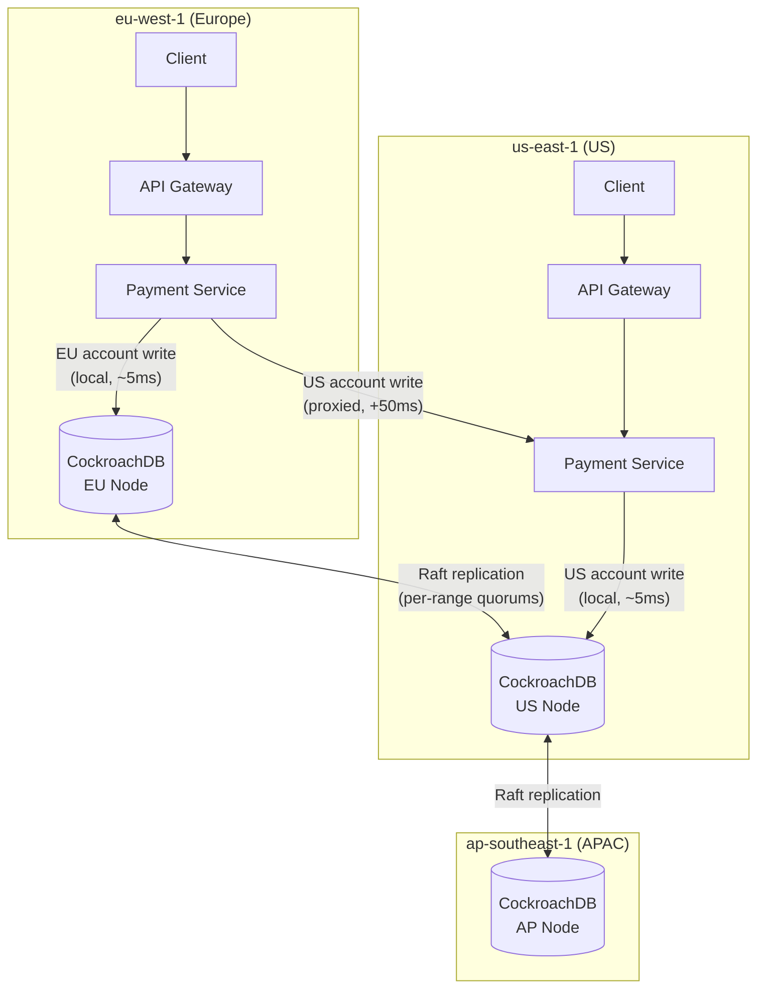
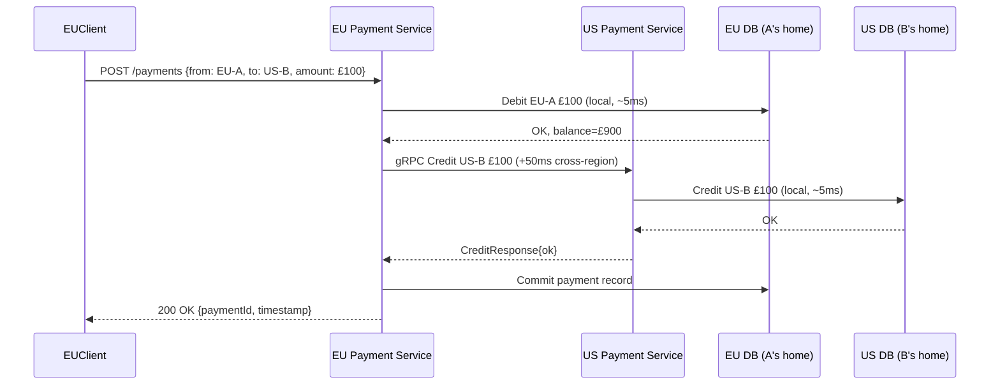

# البنية النشطة-النشطة عبر المناطق

> [!NOTE]
> البنية النشطة-النشطة تعني أن كل منطقة تستطيع قبول الكتابات وخدمة القراءات. فلا توجد منطقة احتياطية جاهزة تنتظر التحويل. وعندما تتعطل منطقة تنتقل الحركة إلى المناطق الأخرى خلال ثوانٍ، ومع النسخ المتزامن (بالنصاب) يمكن أن يكون هدف نقطة الاسترداد (RPO) صفرًا. لكن إتاحة كل جزء من البيانات ما زالت تعتمد على مكان نسخه — فالحساب الذي توجد كل نسخه في المنطقة المعطلة يبقى غير متاح حتى تعود. وهي أيضًا أصعب بنيات الأنظمة الموزعة بناءً بشكل صحيح، خاصة في الأنظمة المالية حيث الكتابات المتعارضة على رصيد الحساب نفسه خطيرة ماليًا.

## نشطة-نشطة مقابل نشطة-احتياطية

| الخاصية | نشطة-احتياطية | نشطة-نشطة |
|---|---|---|
| إتاحة الكتابة عند التحويل | دقائق (زمن التحويل) | ثوانٍ للبيانات التي يبقى نصاب نسخها؛ ولا شيء للبيانات المحصورة في المنطقة المعطلة |
| RPO عند الفشل | ثوانٍ إلى دقائق (تأخر النسخ) | صفر (بالنصاب/متزامن) أو ثوانٍ (غير متزامن) |
| تعارض الكتابات | لا يوجد — أساسية واحدة | ممكن — عدة أساسيات |
| التعقيد | متوسط | عالٍ |
| الزمن للمستخدمين في مناطق أخرى | عالٍ (كل الكتابات تذهب إلى الأساسية) | منخفض (الكتابة في أقرب منطقة) |
| الكلفة | أقل (المنطقة الاحتياطية في وضع الانتظار) | أعلى (كلتا المنطقتين مجهزة بالكامل) |

لمعظم الأنظمة المالية، **البنية النشطة-الاحتياطية هي نقطة البداية الصحيحة**. وتكون النشطة-النشطة مبررة عندما:
- يحتاج مستخدمون في مناطق جغرافية بعيدة إلى كتابات منخفضة الزمن (اتفاقية كتابة أقل من 50ms)
- يحتاج العمل إلى RPO صفري وتعافٍ سريع للخدمات الحرجة ويقبل الكلفة (قواعد المرونة التشغيلية مثل DORA وFCA PS21/3 تدفع في هذا الاتجاه، لكنها لا تفرض البنية النشطة-النشطة)
- للشركة حضور تنظيمي حقيقي متعدد الولايات القضائية يتطلب عزل البيانات لكل منطقة

---

## لماذا تصعب البنية النشطة-النشطة في الأنظمة المالية

لنفترض أن منطقتين تتلقيان في الوقت نفسه معاملتين مختلفتين للحساب نفسه:

```
Region EU-WEST-1:  Debit account ACC-001 by £500  (balance before: £1,000)
Region US-EAST-1:  Debit account ACC-001 by £800  (balance before: £1,000)
```

كلتا العمليتين صالحة منفردة (1,000 ≥ 500 و1,000 ≥ 800). وبعد تطبيقهما يصبح الرصيد –300 جنيه — سحب على المكشوف لم تسمح به أي منطقة منفردة.

هذه هي **مشكلة تعارض الكتابات**. وحلها يتطلب أحد ما يلي:
1. **توجيه كل كتابات الحساب الواحد إلى منطقة واحدة** (التقسيم الجغرافي/القائم على القائد) — يمنع التعارضات كليًا.
2. **استخدام CRDTs** لأنواع البيانات التي تدعم الدمج بلا تعارض — تصلح للعدّادات، لا للأرصدة.
3. **قبول التعارضات وحلها لاحقًا** (آخر كتابة تفوز، أو التعويض) — يفقد بيانات أو يتطلب مطابقة معقدة.

للأرصدة المالية، الخيار 1 هو الخيار الآمن الوحيد — إما مبنيًا يدويًا (كما أدناه)، أو مقدمًا من قاعدة بيانات إجماع تُبقي قائد كل صف (leaseholder) في منطقته الأصلية.

---

## أنواع البيانات المنسوخة الخالية من التعارض (CRDTs)

‏CRDTs بنى بيانات مصممة لدمج التحديثات المتزامنة بلا تعارض. والعدّاد المتزايد فقط (G-Counter) أبسطها:

```java
/**
 * G-Counter CRDT: each node has its own counter; the total is the sum.
 * Concurrent increments from different regions merge without conflict.
 * Cannot decrement — use for event counts, not financial balances.
 */
public class GCounter {

    private final Map<String, Long> nodeCounts;

    public GCounter() {
        this.nodeCounts = new ConcurrentHashMap<>();
    }

    public GCounter(Map<String, Long> state) {
        this.nodeCounts = new ConcurrentHashMap<>(state);
    }

    // Each region increments its own slot — no conflict possible
    public void increment(String regionId, long amount) {
        nodeCounts.merge(regionId, amount, Long::sum);
    }

    // Global total is the sum of all region counters
    public long value() {
        return nodeCounts.values().stream().mapToLong(Long::longValue).sum();
    }

    // Merge: take the maximum per region (idempotent and commutative)
    public GCounter merge(GCounter other) {
        GCounter merged = new GCounter();
        Set<String> allRegions = new HashSet<>();
        allRegions.addAll(this.nodeCounts.keySet());
        allRegions.addAll(other.nodeCounts.keySet());

        for (String region : allRegions) {
            long thisVal  = this.nodeCounts.getOrDefault(region, 0L);
            long otherVal = other.nodeCounts.getOrDefault(region, 0L);
            merged.nodeCounts.put(region, Math.max(thisVal, otherVal));
        }
        return merged;
    }

    // Commutativity: merge(a, b) == merge(b, a)
    // Associativity: merge(merge(a, b), c) == merge(a, merge(b, c))
    // Idempotency:   merge(a, a) == a
}
```

لكل منطقة خانتها الخاصة تزيدها وحدها، فلا تعارض ممكن. والقيمة العامة مجموع الخانات. والدمج يأخذ الحد الأقصى لكل منطقة، فهو تبادلي وتجميعي وآمن من التكرار.

**تناسب CRDTs:** عدد المعاملات، وإحصاءات الأحداث اليومية، ومفاتيح الميزات، وعدّادات تحديد المعدّل، والمقاييس الإجمالية.

**لا تناسب CRDTs:** الأرصدة المالية (التي يمكن أن تنخفض)، ودفاتر الأستاذ التنظيمية (التي تتطلب ترتيبًا صارمًا)، وتفويض الدفع (الذي يتطلب فحوص اتساق).

---

## CockroachDB لقواعد SQL الموزعة

تدير قواعد SQL الموزعة المصممة لهذا الغرض النسخ، واكتشاف التعارض، والترتيب العام داخليًا:

```sql
-- CockroachDB: make the database multi-region first
ALTER DATABASE payments PRIMARY REGION "eu-west-1";
ALTER DATABASE payments ADD REGION "us-east-1";
ALTER DATABASE payments ADD REGION "ap-southeast-1";

-- Payments are write-heavy: keep each row in its home region.
-- (LOCALITY GLOBAL is for read-mostly reference data — every write to a
--  GLOBAL table waits for cross-region consensus.)
CREATE TABLE payments (
    id          UUID          PRIMARY KEY DEFAULT gen_random_uuid(),
    account_id  VARCHAR(128)  NOT NULL,
    amount      DECIMAL(19,4) NOT NULL,
    created_at  TIMESTAMPTZ   NOT NULL DEFAULT now()
) LOCALITY REGIONAL BY ROW;   -- adds a hidden crdb_region column, set to the
                              -- gateway's region on insert

-- Regional by row with an explicit, computed home region
CREATE TABLE accounts (
    id           VARCHAR(128) PRIMARY KEY,
    home_region  crdb_internal_region NOT NULL AS (
        CASE
            WHEN id LIKE 'EU%' THEN 'eu-west-1'
            WHEN id LIKE 'US%' THEN 'us-east-1'
            ELSE 'ap-southeast-1'
        END::crdb_internal_region
    ) STORED,
    balance      DECIMAL(19,4) NOT NULL,
    version      BIGINT        NOT NULL DEFAULT 0
) LOCALITY REGIONAL BY ROW AS home_region;
-- Writes for EU accounts are low-latency in EU; US accounts in US
```

المدفوعات كثيفة الكتابة، فيبقى كل صف في منطقته الأصلية. أما `LOCALITY GLOBAL` فهو للبيانات المرجعية كثيرة القراءة — فكل كتابة في جدول GLOBAL تنتظر إجماعًا عبر المناطق.

```java
// CockroachDB always runs SERIALIZABLE. Conflicting transactions fail with
// SQLSTATE 40001 and must be retried (e.g. with Spring Retry), so the method
// must be safe to run again.
@Transactional(isolation = Isolation.SERIALIZABLE)
public void debit(String accountId, BigDecimal amount) {
    Account account = accountRepo.findByIdForUpdate(accountId)
        .orElseThrow(() -> new AccountNotFoundException(accountId));

    if (account.getBalance().compareTo(amount) < 0) {
        throw new InsufficientFundsException(accountId);
    }

    account.setBalance(account.getBalance().subtract(amount));
    account.setVersion(account.getVersion() + 1);
    accountRepo.save(account);
    // The row's leaseholder (in its home region) serialises concurrent writes
}
```

تعمل CockroachDB دائمًا بعزل SERIALIZABLE. والمعاملات المتعارضة تفشل بالرمز 40001 ويجب إعادة محاولتها، فيجب أن تكون الطريقة آمنة لإعادة التشغيل. ويسلسل قائد الصف (في منطقته الأصلية) الكتابات المتزامنة.

---

## الجداول العامة مقابل الإقليمية

| نوع الجدول | التوجيه | الزمن | خطر التعارض | الاستخدام |
|---|---|---|---|---|
| عام (Global) | كل الكتابات تُنسخ في كل مكان | أعلى (إجماع عبر المناطق) | منخفض — ترتيب عام واحد | البيانات المرجعية (العملات، والحدود) |
| إقليمي (Regional) | الصف مثبت في منطقته الأصلية | منخفض (كتابة محلية) | لا يوجد لبيانات منطقة واحدة | أرصدة الحسابات، والبيانات الشخصية للعملاء |
| إقليمي حسب الصف | الصف مثبت حسب مفتاح التقسيم | منخفض | لا يوجد للبيانات المقسمة جيدًا | جداول المعاملات كثيرة الحجم |

**قاعدة التصميم**: يجب أن تكون تعديلات الحسابات المالية **إقليمية**. فحساب العميل "مملوك" للمنطقة التي فُتح فيها أو التي فيها علاقته المصرفية الأساسية. وتبقى الكتابات في تلك المنطقة. ويمكن خدمة القراءات عالميًا من النسخ.

---

## تسلسل الكتابات بالقائد لتعديلات الحسابات

للعمليات المالية التي لا تتحمل التعارض (خصم الحسابات، وعمليات الحجز)، وجّه كل الكتابات إلى **المنطقة الأصلية** للحساب:

```java
@Component
@RequiredArgsConstructor
public class RegionAwarePaymentRouter {

    private final RegionResolver    regionResolver;
    private final GrpcClientFactory grpcFactory;
    private final LocalPaymentService localPaymentService;

    public PaymentResult routeDebit(String accountId, BigDecimal amount,
                                    String idempotencyKey) {
        String homeRegion    = regionResolver.homeRegionOf(accountId);
        String currentRegion = System.getenv("AWS_REGION");

        if (homeRegion.equals(currentRegion)) {
            // We are the home region — process locally
            return localPaymentService.debit(accountId, amount, idempotencyKey);
        } else {
            // Proxy to home region — adds ~15–80ms cross-region latency
            PaymentServiceGrpc.PaymentServiceBlockingStub stub =
                grpcFactory.blockingStub(homeRegion);

            DebitResponse response = stub
                .withDeadlineAfter(5, TimeUnit.SECONDS)
                .debit(DebitRequest.newBuilder()
                    .setAccountId(accountId)
                    .setAmount(amount.toString())
                    .setIdempotencyKey(idempotencyKey)
                    .build());

            return PaymentResult.from(response);
        }
    }
}
```

```java
/**
 * RegionResolver determines the canonical home region for an account.
 * Uses account prefix convention, but could use a lookup table for
 * accounts that have been migrated between regions.
 */
@Component
public class RegionResolver {

    // Cached mapping — refreshed periodically via config service
    private final Map<String, String> accountPrefixToRegion = Map.of(
        "EU", "eu-west-1",
        "UK", "eu-west-2",
        "US", "us-east-1",
        "AP", "ap-southeast-1"
    );

    public String homeRegionOf(String accountId) {
        String prefix = accountId.substring(0, Math.min(2, accountId.length()));
        return accountPrefixToRegion.getOrDefault(prefix, "eu-west-1");
    }
}
```

هذا الأسلوب يقايض زمن ما بين المناطق (15–80ms حسب زوج المناطق) بالصحة. ولتفويض دفع يجب ألا يسبب سحبًا على المكشوف، فهذه المقايضة صحيحة.

---

## بنية القراءة: قراءات محلية وكتابات موجّهة

خدمة القراءات محليًا تلغي زمن ما بين المناطق لمعظم العمليات:

```java
@Service
@RequiredArgsConstructor
public class AccountQueryService {

    private final AccountReadRepository localReadRepo;
    private final RegionAwarePaymentRouter writeRouter;
    private final RegionResolver regionResolver;

    // Reads always served from local replica — sub-5ms, any region
    public AccountBalance getBalance(String accountId) {
        return localReadRepo.findBalance(accountId)
            .orElseThrow(() -> new AccountNotFoundException(accountId));
    }

    // Above: for rows homed elsewhere this is a stale read — a CockroachDB
    // follower read (a few seconds old by default) or an async replica.
    // For payment authorisation, read from the home region instead:
    public AccountBalance getBalanceConsistent(String accountId) {
        String homeRegion    = regionResolver.homeRegionOf(accountId);
        String currentRegion = System.getenv("AWS_REGION");

        if (homeRegion.equals(currentRegion)) {
            return localReadRepo.findBalance(accountId)
                .orElseThrow(() -> new AccountNotFoundException(accountId));
        } else {
            // Read from home region for authoritative balance
            return writeRouter.queryBalance(accountId);
        }
    }
}
```

للصفوف التي موطنها منطقة أخرى، تكون القراءة المحلية قديمة — قراءة تابع في CockroachDB (عمرها بضع ثوانٍ افتراضيًا) أو نسخة غير متزامنة. ولتفويض الدفع اقرأ من المنطقة الأصلية بدلًا من ذلك.

---

## مخطط البنية متعددة المناطق



---

## ميزانية الزمن مع التوجيه عبر المناطق

| العملية | المنطقة نفسها | بين المناطق (أوروبا↔أمريكا) | بين المناطق (أوروبا↔آسيا والمحيط الهادئ) |
|---|---|---|---|
| قراءة الحساب (نسخة محلية) | 2ms | 2ms | 2ms |
| خصم الحساب (المنطقة الأصلية، محلي) | 5ms | — | — |
| خصم الحساب (موجّه إلى المنطقة الأصلية) | — | 55ms | 190ms |
| تفويض الدفع (موجّه) | 20ms | 70ms | 210ms |
| تحديث إسقاط الرصيد | أقل من 1ms | 50–200ms (غير متزامن) | 100–300ms |

صمّم اتفاقيات الخدمة حول زمن التوجيه إلى المنطقة الأصلية لكل شريحة مستخدمين. فالمستخدمون الأوروبيون بحسابات أوروبية يحصلون على تفويض أقل من 20ms. أما المستخدمون في أمريكا بحسابات أوروبية (عملاء عابرون للحدود) فيجب أن يقبلوا 70ms. واذكر ذلك في اتفاقية المنتج: "تفويض الدفع: p99 أقل من 100ms داخل الولاية القضائية، وأقل من 300ms بين الولايات".

---

## قيود إقامة البيانات

لا يفرض GDPR وحده بقاء البيانات داخل الاتحاد الأوروبي — بل يقيّد نقلها خارج المنطقة الاقتصادية الأوروبية ما لم تتوفر ضمانات (قرار كفاية، أو بنود تعاقدية معيارية). لكن شركات كثيرة تتبنى سياسة لإقامة البيانات، وبعض الجهات التنظيمية أو العقود أو القواعد الوطنية تفرض التخزين المحلي فعلًا. افرض ما تقوله سياستك في الشيفرة:

```java
@Component
public class DataResidencyValidator {

    private static final Map<String, String> REQUIRED_REGION = Map.of(
        "EU", "eu-west-1",
        "UK", "eu-west-2",
        "US", "us-east-1"
    );

    public void validatePlacementBeforeWrite(String customerId, String targetRegion) {
        String customerJurisdiction = jurisdictionOf(customerId);
        String requiredRegion       = REQUIRED_REGION.get(customerJurisdiction);

        if (requiredRegion != null && !targetRegion.equals(requiredRegion)) {
            throw new DataResidencyViolationException(
                "Customer %s (jurisdiction %s) data must remain in %s, not %s"
                    .formatted(customerId, customerJurisdiction,
                               requiredRegion, targetRegion));
        }
    }

    private String jurisdictionOf(String customerId) {
        // Determined at account creation from KYC address
        return customerProfileService.getJurisdiction(customerId);
    }
}
```

يجب أن يعمل هذا الفحص **قبل** أي قرار توجيه بين المناطق لمنع مخالفات وضع البيانات غير المقصودة. والنقل دون أساس قانوني صالح يخالف قواعد النقل في GDPR ‏(الفصل الخامس، المواد 44–49) وقد يؤدي إلى غرامات كبيرة. ولاحظ أن تمرير الطلب عبر منطقة أخرى ينقل البيانات الشخصية في الطلب عبر تلك المنطقة أيضًا — فوجّه العملاء إلى نقطة منطقتهم الأصلية عند الحافة قدر الإمكان (DNS جغرافي أو بوابة واعية بالمناطق).

---

## التعافي من الكوارث مع البنية النشطة-النشطة (RPO صفري)

في البنية النشطة-النشطة، لا يسبب تعطل منطقة فقدانًا للبيانات إذا كان النسخ متزامنًا (قائمًا على النصاب):

```
Region EU-WEST-1 fails at T=0.
All in-flight transactions were either:
  - Committed (replicated to US-EAST-1 before failure) → Zero data loss
  - In-progress (not yet committed) → Rolled back by CockroachDB when EU node is unreachable
  - Proxied from US to EU (cross-region writes for EU accounts) → Fail with 503; caller retries

Result:
  - US-to-US payments: continue processing normally (no dependency on EU)
  - EU-to-EU payments: fail until EU region recovers (home region unavailable)
  - EU-to-US or US-to-EU payments: partially degraded (debit fails; credit would succeed)
```

المعاملات الملتزمة لم تُفقد، والجارية تُتراجع، والطلبات الموجّهة إلى المنطقة المعطلة تفشل بـ 503 ويعيد المستدعي المحاولة. وتستمر المدفوعات الأمريكية الداخلية، وتفشل الأوروبية الداخلية حتى تعود المنطقة.

مع هدف البقاء الافتراضي في CockroachDB ‏(`SURVIVE ZONE FAILURE`)، تكون كل النسخ المصوّتة لصفوف أوروبا في أوروبا: فيكون RPO صفرًا، لكن صفوف أوروبا غير متاحة ما دامت أوروبا معطلة — وهي النتيجة أعلاه بالضبط. أما مع `SURVIVE REGION FAILURE` ‏(3 مناطق على الأقل) فتبقى صفوف أوروبا قابلة للكتابة أثناء انقطاعها، مقابل زمن عبر المناطق في كل كتابة. ولقراءة لقطة متسقة أقدم قليلًا من أي منطقة، استخدم `SELECT ... AS OF SYSTEM TIME follower_read_timestamp()`.

---

## تدفق الدفع بين المناطق — التسلسل

لدفعة من العميل الأوروبي A إلى العميل الأمريكي B:



إذا فشلت الإضافة في أمريكا بعد نجاح الخصم في أوروبا، يُرسل **حدث تعويض** لإعادة المبلغ إلى A. وتدير ذلك Saga ‏(الدرس 15). ويحمل استدعاء الإضافة عبر المناطق مفتاح منع التكرار للدفعة، فعندما تنتهي مهلة الاستدعاء تستطيع Saga إعادة محاولته بأمان — فالنتيجة مجهولة، فيجب ألا تعوّض حتى تعرف أن الإضافة لم تحدث.

---

## دليل تشغيل تحويل المنطقة

عندما يتعذر الوصول إلى منطقة:

1. **DNS وموازن الحمل**: أزل المنطقة المعطلة من فحوص الصحة خلال 30 ثانية (فحوص صحة Route 53 أو أوزان نقاط Global Accelerator).
2. **توجيه الكتابات**: سيتلقى `RegionAwarePaymentRouter` الحالة `UNAVAILABLE` من gRPC في الاستدعاءات بين المناطق. ويجب أن تكون لإعادات محاولة المستدعي مهلة (5 ثوانٍ) وقاطع دائرة.
3. **المعالجة البديلة (stand-in)**: لا تسمح لمنطقة أخرى بخصم الحسابات الأوروبية بحرية — فهي لا ترى الرصيد الحقيقي، وقد تسمح بالإنفاق المزدوج. واسمح على الأكثر بعمليات محدودة معتمدة مسبقًا (مثل تفويضات البطاقات حتى حد بديل صغير، تُسجّل لترحيلها لاحقًا)، واقبل عمل المطابقة عند عودة أوروبا.
4. **التعافي**: عند تعافي منطقة أوروبا، طابق أي عمليات جرت خارج المنطقة الأصلية للحساب أثناء الانقطاع.

---

## أخطاء الإنتاج الشائعة

### 1. افتراض أن القراءات المحلية متسقة

```java
// DANGEROUS: local replica may be 200ms behind home region
BigDecimal balance = localReadRepo.findBalance(accountId);
if (balance.compareTo(amount) >= 0) {
    // Balance check passed on stale replica — overdraft possible!
    writeRouter.debit(accountId, amount);
}

// CORRECT: authorisation must read from home region
BigDecimal authoritativeBalance = getBalanceConsistent(accountId);
```

### 2. غياب قاطع الدائرة في استدعاءات gRPC بين المناطق

المنطقة الأصلية البطيئة أو المعطلة ستمتد أعطالها إلى المنطقة المستدعية إذا سُمح للاستدعاءات بالتراكم. استخدم Resilience4j:

```java
@CircuitBreaker(name = "cross-region-debit", fallbackMethod = "debitFallback")
@TimeLimiter(name = "cross-region-debit")
public CompletableFuture<PaymentResult> routeDebitAsync(String accountId,
        BigDecimal amount, String idempotencyKey) {
    // A dedicated executor: blocking gRPC calls must not run on the common pool
    return CompletableFuture.supplyAsync(() ->
        writeRouter.routeDebit(accountId, amount, idempotencyKey), crossRegionExecutor);
}

// The fallback has the same parameters as the method, plus the Throwable
public CompletableFuture<PaymentResult> debitFallback(String accountId,
        BigDecimal amount, String idempotencyKey, Throwable ex) {
    // Return 503 Service Unavailable — do not attempt local write for EU account
    return CompletableFuture.failedFuture(
        new HomeRegionUnavailableException(accountId, ex));
}
```

لطريقة البديل (fallback) المعاملات نفسها التي للطريقة الأصلية، إضافة إلى Throwable. وتُشغّل استدعاءات gRPC الحاجبة على منفّذ مخصص لا على المجمع المشترك. ولا تحاول أبدًا كتابة محلية لحساب أوروبي.

### 3. عدم التحقق من إقامة البيانات قبل النسخ

في قاعدة CockroachDB متعددة المناطق، تحصل الجداول الإقليمية افتراضيًا على نسخ غير مصوّتة في كل المناطق الأخرى (لتسريع قراءات التابعين) — فتُخزن صفوف أوروبا على عقد أمريكية. وللإقامة الصارمة استخدم `ALTER DATABASE ... PLACEMENT RESTRICTED` أو المناطق الفائقة (super regions)، مع `LOCALITY REGIONAL BY ROW` والتحقق المسبق قبل الكتابة.

---

## قائمة التحقق: البنية النشطة-النشطة

- [ ] كتابات الحسابات المالية موجّهة إلى المنطقة الأصلية للحساب — ولا تُدمج أبدًا بين المناطق
- [ ] التحقق من إقامة البيانات يعمل قبل أي كتابة أو تمرير بين المناطق
- [ ] قواطع دائرة على كل استدعاءات gRPC بين المناطق بمهلة أقل من 5 ثوانٍ
- [ ] القراءات المحلية مميزة بوضوح عن القراءات المتسقة في واجهة الخدمة
- [ ] الدفع بين المناطق يستخدم Saga بتعويض للفشل الجزئي
- [ ] جداول CockroachDB الإقليمية تستخدم `LOCALITY REGIONAL BY ROW` لبيانات الحسابات، مع `PLACEMENT RESTRICTED` (أو المناطق الفائقة) حيث تتطلب الإقامة ذلك
- [ ] دليل تشغيل التحويل مختبر بهندسة الفوضى — خاصة سيناريو عدم إتاحة منطقة أوروبا
- [ ] تأخر النسخ مراقب: تنبيه عندما يتجاوز التأخر 5 ثوانٍ

<!-- KNOWLEDGE-CHECK
{
  "questions": [
    {
      "text": "حساب رصيده 1,000 جنيه يتلقى طلبي خصم متزامنين: 800 جنيه في منطقة أوروبا و700 جنيه في منطقة أمريكا. ينجح كلاهما في فحص الرصيد المحلي. وبعد تطبيقهما يصبح الرصيد –500 جنيه. أي نمط معماري يمنع ذلك؟",
      "options": [
        "CRDTs — ادمج الخصمين بلا تعارض",
        "التوجيه إلى المنطقة الأصلية — كل كتابات الحساب تتسلسل عبر منطقة واحدة، فلا يستطيع إلا خصم واحد أخذ القفل في كل مرة",
        "آخر كتابة تفوز — الخصم ذو الطابع الأحدث يتجاوز الأقدم",
        "التزامن المتفائل — يفشل الاثنان ويُعاد محاولتهما بالتتابع"
      ],
      "correct": 1,
      "explanation": "لا تستطيع CRDTs منع السحب على المكشوف — فهي تتعامل مع العمليات الجمعية فقط. وقاعدة آخر كتابة تفوز تفقد البيانات. والتزامن المتفائل يساعد لكن تبقى نافذة سباق في البنية النشطة-النشطة. أما التوجيه إلى المنطقة الأصلية فيضمن أن كل كتابات الحساب تتسلسل عبر منطقة واحدة، فيبقى فحص الرصيد متسقًا بلا نافذة سحب على المكشوف."
    },
    {
      "text": "عدّاد G-Counter من نوع CRDT فيه: أوروبا = 100، وأمريكا = 150، وآسيا والمحيط الهادئ = 50. ما القيمة العامة؟",
      "options": [
        "150 — خذ الحد الأقصى عبر المناطق",
        "300 — اجمع قيم كل المناطق",
        "100 — استخدم قيمة أوروبا كقائد",
        "غير معرّفة — لا يمكن أن يمتد G-Counter عبر المناطق"
      ],
      "correct": 1,
      "explanation": "قيمة G-Counter هي مجموع خانات كل المناطق. فكل منطقة تزيد خانتها فقط، فلا تعارضات. والمجموع العام 100 + 150 + 50 = 300."
    },
    {
      "text": "يجب أن تبقى بيانات عميل أوروبي في eu-west-1 وفق سياسة إقامة البيانات في الشركة. وتعمل خدمة الدفع في eu-west-1 وus-east-1. وتتلقى بوابة الواجهة في منطقة أمريكا طلبًا لتعديل حساب هذا العميل. ماذا يجب أن يحدث؟",
      "options": [
        "ارفض الطلب — منطقة أوروبا وحدها تعدّل حسابات العملاء الأوروبيين",
        "عالجه محليًا في منطقة أمريكا لتقليل الزمن",
        "وجّه الطلب إلى eu-west-1، مع قبول نحو 50ms من زمن ما بين المناطق لتحقيق إقامة البيانات",
        "انسخ البيانات إلى منطقة أمريكا مؤقتًا واحذفها بعد المعالجة"
      ],
      "correct": 2,
      "explanation": "تتطلب سياسة الإقامة بقاء البيانات في eu-west-1. والأسلوب الصحيح تمرير الكتابة إلى eu-west-1، مع قبول كلفة زمن ما بين المناطق (والأفضل توجيه هؤلاء العملاء إلى نقطة أوروبا عند الحافة). أما المعالجة محليًا في منطقة أمريكا أو نسخ البيانات مؤقتًا فيخالفان السياسة — ودون آلية نقل صالحة، يخالفان قواعد النقل الدولي في GDPR."
    }
  ]
}
-->

<!-- PRACTICAL-CHALLENGE
{
  "title": "بنية مدفوعات عبر المناطق لبنك رقمي",
  "difficulty": "principal",
  "estimatedMinutes": 90,
  "tasks": [
    {
      "id": "1",
      "description": "يخدم بنك رقمي عملاء في أوروبا وأمريكا. يجب أن تكون بيانات العملاء الأوروبيين في eu-west-1، والأمريكيين في us-east-1. وتحدث المدفوعات العابرة للحدود في نحو 20% من الحالات. صمّم منطق توجيه المناطق: لدفعة من العميل الأوروبي A إلى العميل الأمريكي B، أي منطقة تعالج الخصم وأيها تعالج الإضافة؟ وارسم التسلسل الكامل لاستدعاءات الخدمات، بما فيها استدعاء gRPC بين المناطق ومسار تعويض Saga إذا فشلت الإضافة الأمريكية بعد نجاح الخصم الأوروبي."
    },
    {
      "id": "2",
      "description": "نفّذ RegionAwareAccountRepository التي: (أ) تقرأ رصيد الحساب من النسخة المحلية (أقل من 5ms)، (ب) تجري قراءات رصيد موثوقة من المنطقة الأصلية لتفويض الدفع، (ج) توجّه الكتابات إلى المنطقة الأصلية عبر gRPC بمهلة 3 ثوانٍ وقاطع دائرة. وضمّن التحقق من إقامة البيانات قبل أي كتابة."
    },
    {
      "id": "3",
      "description": "تصبح منطقة أوروبا غير قابلة للوصول لمدة 10 دقائق. صف ما يحدث لـ: (أ) المدفوعات من أوروبا إلى أوروبا، (ب) المدفوعات من أمريكا إلى أمريكا، (ج) المدفوعات من أمريكا إلى أوروبا، (د) المدفوعات من أوروبا إلى أمريكا التي كانت جارية لحظة تعطل المنطقة. وما المطابقة اللازمة عند تعافي أوروبا؟"
    },
    {
      "id": "4",
      "description": "نفّذ G-Counter من نوع CRDT لتتبع عدد المدفوعات اليومية لكل عميل في كل منطقة. ويجب أن يكون العدّاد: تبادليًا (ترتيب الدمج لا يهم)، وتجميعيًا، وآمنًا من التكرار. واكتب اختبارات قائمة على الخصائص (باستخدام jqwik أو ما يشابهها) تتحقق من هذه الخصائص الثلاث بحالات عدّاد مولّدة عشوائيًا."
    },
    {
      "id": "5",
      "description": "صمّم استراتيجية المراقبة للبنية النشطة-النشطة. وحدّد: (أ) كيف تكتشف تأخر نسخ يتجاوز 5 ثوانٍ بين المناطق، (ب) كيف تكتشف فشل تمرير صامتًا حيث تنتهي مهلة طلبات أوروبا إلى المنطقة الأصلية الأمريكية لكن قاطع الدائرة لم ينفتح بعد، (ج) دليل التشغيل لمهندس المناوبة عند انطلاق تنبيه عدم إتاحة منطقة أوروبا."
    }
  ]
}
-->
