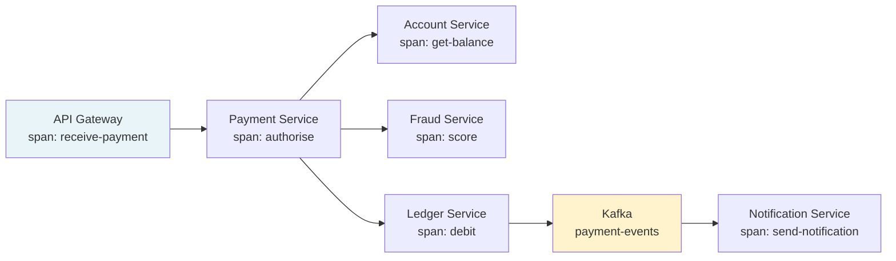

# التتبع الموزع — السببية والربط

> [!NOTE]
> عندما تستغرق دفعة 3 ثوانٍ وتمر بسبع خدمات مصغّرة، فإن البحث في السجلات عن معرّف ارتباط يعطيك قائمة أحداث لكنه لا يعطيك السببية، ولا التوقيت، ولا شجرة الاستدعاءات الدقيقة. أما التتبع الموزع فيلتقط مخطط التنفيذ الكامل — أي خدمة استدعت أيها، وبأي ترتيب، وبأي زمن — ككائن واحد قابل للاستعلام يُسمى **أثرًا (trace)**.

## الآثار والامتدادات وعلاقات الأب والابن

**الأثر** هو السجل الكامل لطلب أثناء انتقاله عبر نظام موزع.

**الامتداد (span)** وحدة عمل مسمّاة ومؤقتة داخل الأثر. وتشكّل الامتدادات شجرة:

```
Trace: payment-authorisation (traceId: abc123)
│
├── Span: api-gateway.receive          [0ms →  2ms]
│
├── Span: payment-service.authorise    [2ms → 85ms]
│   ├── Span: account-service.getBalance  [5ms →  18ms]
│   ├── Span: fraud-service.score         [5ms →  65ms]
│   └── Span: fx-service.getRate          [5ms →  22ms]
│
└── Span: ledger-service.debit         [86ms → 120ms]
    └── Span: postgres.execute         [88ms → 115ms]
```

خدمة الاحتيال (60ms) هي المسار الحرج. ودون التتبع ستري "الزمن الكلي 120ms" بلا تفصيل.

---

## ترويسات انتشار W3C TraceContext

توحّد مواصفة W3C TraceContext طريقة نقل سياق الأثر عبر استدعاءات HTTP:

```
traceparent: 00-4bf92f3577b34da6a3ce929d0e0e4736-00f067aa0ba902b7-01
             version  trace-id (32 hex)                parent-id (16 hex)  flags (01 = sampled)
```

تتكون الترويسة من: الإصدار، ومعرّف الأثر (32 خانة ست عشرية)، ومعرّف الامتداد الأب (16 خانة)، والأعلام (01 = مُختار في العينة).

```java
// Spring Boot auto-configures W3C propagation with Micrometer Tracing.
// HTTP calls via RestTemplate/RestClient/WebClient built from Spring's
// builders are propagated automatically, and so is Kafka when observation
// is enabled (KafkaTemplate.setObservationEnabled(true) and the listener
// container's observationEnabled). Manual propagation, e.g. for a custom
// transport, uses the Micrometer Propagator:
@Component
@RequiredArgsConstructor
public class TracePropagator {

    private final Tracer     tracer;       // io.micrometer.tracing.Tracer
    private final Propagator propagator;   // io.micrometer.tracing.propagation.Propagator

    // Inject the current trace context into outgoing message headers
    public void injectIntoKafkaHeaders(Headers kafkaHeaders) {
        TraceContext current = tracer.currentTraceContext().context();
        if (current == null) return;   // no active trace
        propagator.inject(current, kafkaHeaders,
            (carrier, key, value) ->
                carrier.add(key, value.getBytes(StandardCharsets.UTF_8)));
    }

    // Extract trace context from incoming headers: returns a span builder
    // whose parent is the producer's span
    public Span.Builder extractFromKafkaHeaders(Headers kafkaHeaders) {
        return propagator.extract(kafkaHeaders, (carrier, key) -> {
            Header h = carrier.lastHeader(key);
            return h == null ? null : new String(h.value(), StandardCharsets.UTF_8);
        });
    }
}
```

يضبط Spring Boot الانتشار بصيغة W3C تلقائيًا مع Micrometer Tracing. فاستدعاءات HTTP عبر RestTemplate وRestClient وWebClient المبنية من منشئات Spring تُنقل تلقائيًا، وكذلك Kafka عند تفعيل المراقبة (observation). أما الانتشار اليدوي، مثل ناقل مخصص، فيستخدم Propagator في Micrometer.

---

## Micrometer Tracing مع OpenTelemetry SDK

يستخدم Spring Boot 3 الحزمة Micrometer Tracing كواجهة للتتبع، مع OpenTelemetry كخلفية:

```xml
<!-- pom.xml -->
<dependency>
    <groupId>io.micrometer</groupId>
    <artifactId>micrometer-tracing-bridge-otel</artifactId>
</dependency>
<dependency>
    <groupId>io.opentelemetry</groupId>
    <artifactId>opentelemetry-exporter-otlp</artifactId>
</dependency>
```

```yaml
# application.yml
management:
  tracing:
    sampling:
      probability: 1.0   # 100% in dev. In production either sample 1-10% here
                         # (head-based), OR keep 1.0 and let the collector's
                         # tail sampling decide — not both
  otlp:
    tracing:
      endpoint: http://jaeger-collector:4318/v1/traces
```

في الإنتاج، إما أن تأخذ عينة 1-10% في التطبيق (العينة من الرأس)، أو تُبقي 1.0 وتترك عينة الذيل في المجمّع تقرر — لا الاثنين معًا.

---

## التعليق التوضيحي `@WithSpan` في Spring

ينشئ التعليق `@WithSpan` (من `opentelemetry-instrumentation-annotations`) امتدادًا لطريقة تلقائيًا — عند استخدام وكيل OpenTelemetry لـ Java أو حزمة OpenTelemetry لـ Spring Boot. أما مع إعداد Micrometer Tracing أعلاه، فالمكافئ هو `@Observed` أو `@NewSpan` (مع تفعيل جانب AOP)؛ فـ Spring وحده يتجاهل `@WithSpan`.

```java
@Service
@RequiredArgsConstructor
public class FraudScoringService {

    private final FraudApiClient fraudApiClient;
    private final MeterRegistry  meterRegistry;

    @WithSpan("fraud-service.score")
    public FraudScore score(Payment payment) {
        // This method's execution is captured as a span in the parent trace
        // Span attributes are set via @SpanAttribute or manually:
        Span.current()
            .setAttribute("payment.id",       payment.getId())
            .setAttribute("payment.amount",    payment.getAmount().doubleValue())
            .setAttribute("payment.currency",  payment.getCurrency());

        FraudScore score = fraudApiClient.evaluate(payment);

        Span.current().setAttribute("fraud.score",    score.getValue());
        Span.current().setAttribute("fraud.decision", score.getDecision().name());

        return score;
    }
}
```

```java
// Manual span creation for finer control
@Service
@RequiredArgsConstructor
public class PaymentOrchestrator {

    private final Tracer tracer;

    public PaymentResult orchestrate(PaymentRequest request) {
        Span span = tracer.nextSpan()
            .name("payment-orchestration")
            .tag("payment.type", request.getType().name())
            .start();

        try (Tracer.SpanInScope scope = tracer.withSpan(span)) {
            // All child spans created here will have this span as parent
            return doOrchestrate(request);
        } catch (Exception e) {
            span.error(e);
            throw e;
        } finally {
            span.end();
        }
    }
}
```

كل الامتدادات الفرعية المنشأة داخل النطاق يكون هذا الامتداد أباها.

---

## نقل الأمتعة (Baggage) — tenantId وcorrelationId

تحمل الأمتعة أزواج مفتاح-قيمة بجانب سياق الأثر. وعلى خلاف سمات الامتداد (المحلية لامتداد واحد)، تنتقل الأمتعة إلى كل الخدمات اللاحقة:

```java
@Component
@RequiredArgsConstructor
public class TenantBaggageFilter implements Filter {

    private final Tracer tracer;   // Micrometer Tracer (also a BaggageManager)

    @Override
    public void doFilter(ServletRequest req, ServletResponse res, FilterChain chain)
            throws IOException, ServletException {
        HttpServletRequest httpReq = (HttpServletRequest) req;

        // In production take the tenant from the authenticated principal,
        // not from a header the caller controls
        String tenantId       = resolveTenant(httpReq);
        String correlationId  = Optional.ofNullable(httpReq.getHeader("X-Correlation-Id"))
                                    .orElseGet(() -> UUID.randomUUID().toString());

        // Propagated downstream only for fields listed in
        // management.tracing.baggage.remote-fields (see below)
        try (BaggageInScope t = tracer.createBaggageInScope("tenantId", tenantId);
             BaggageInScope c = tracer.createBaggageInScope("correlationId", correlationId)) {
            chain.doFilter(req, res);
        }
    }
}
```

في الإنتاج خذ المستأجر من الهوية الموثّقة، لا من ترويسة يتحكم فيها المستدعي. ولا تنتقل إلى الخدمات اللاحقة إلا الحقول المذكورة في `management.tracing.baggage.remote-fields`.

```java
// application.yml — which baggage fields cross service boundaries,
// and which are copied into the logging MDC:
//   management.tracing.baggage.remote-fields: tenantId, correlationId
//   management.tracing.baggage.correlation.fields: tenantId, correlationId

// In any downstream service, read baggage without having it passed explicitly:
String tenantId = tracer.getBaggage("tenantId").get();
log.info("Processing for tenant={}", tenantId);
```

> [!WARNING]
> للأمتعة كلفة: كل بايت منها يُضمّن في كل ترويسة HTTP وكل ترويسة سجل Kafka عبر الأثر. أبقِ الأمتعة صغيرة — معرّفات فقط، ولا بيانات شخصية أبدًا — وأزلها من الاستدعاءات التي تغادر مؤسستك (إلى شبكات البطاقات، أو الشركاء، أو واجهات الأطراف الثالثة).

---

## ربط معرّف الأثر عبر رسائل Kafka

عند نشر حدث دفع إلى Kafka، يجب أن ينتقل سياق الأثر مع الرسالة حتى ترتبط معالجة المستهلك بالطلب الأصلي:

```java
@Component
@RequiredArgsConstructor
public class TracedPaymentProducer {

    private final KafkaTemplate<String, String> kafkaTemplate;
    private final TracePropagator               propagator;
    private final Tracer                        tracer;

    // Shown by hand for clarity; with Kafka observation enabled, Spring Kafka
    // creates this span and injects the headers itself
    @WithSpan("kafka.publish.payment-events")
    public void publish(PaymentEvent event) {
        ProducerRecord<String, String> record =
            new ProducerRecord<>("payment-events", event.getPaymentId(), toJson(event));

        // Inject W3C traceparent into Kafka record headers
        propagator.injectIntoKafkaHeaders(record.headers());

        Span.current().setAttribute("messaging.destination", "payment-events");
        Span.current().setAttribute("messaging.message_id",   event.getPaymentId());

        kafkaTemplate.send(record);
    }
}
```

تُعرض هنا يدويًا للتوضيح؛ ومع تفعيل المراقبة في Kafka، تنشئ Spring Kafka هذا الامتداد وتحقن الترويسات بنفسها.

```java
@KafkaListener(topics = "payment-events", groupId = "ledger-processor")
public void consume(ConsumerRecord<String, PaymentEvent> record) {
    // Restore trace context from Kafka headers — links this span to the producer span
    Span span = propagator.extractFromKafkaHeaders(record.headers())
        .name("kafka.consume.payment-events")
        .tag("messaging.message_id", record.key())
        .start();

    try (Tracer.SpanInScope scope = tracer.withSpan(span)) {
        ledgerService.applyPayment(record.value());
    } catch (Exception e) {
        span.error(e);
        throw e;
    } finally {
        span.end();
    }
}
```

---

## مخطط الأثر — تدفق دفع عبر الخدمات



---

## استراتيجيات أخذ العينات

تخزين كل أثر عند الإنتاجية العالية مكلف. وأخذ العينات يقلل التخزين مع الحفاظ على القدرة على المراقبة:

| الاستراتيجية | الوصف | استخدمها عندما |
|---|---|---|
| من الرأس (احتمالية) | يُتخذ القرار عند بدء الأثر؛ مثل 1% من الآثار | حجم عالٍ وأحمال متجانسة |
| من الذيل | يُتخذ القرار بعد اكتمال الأثر؛ احتفظ بالآثار البطيئة أو الخاطئة | عندما تهم الأخطاء والقيم الشاذة في الزمن أكثر |
| دائمًا | عينة 100% | التطوير، والأحجام المنخفضة |
| محدودة المعدّل | عدد ثابت من الآثار في الثانية بغض النظر عن الحمل | الحماية من الدفعات |

```yaml
# Tail-based sampling with OpenTelemetry Collector.
# Every span of a trace must reach the SAME collector instance — put a
# load-balancing exporter (routing by trace ID) in front of these collectors.
processors:
  tail_sampling:
    decision_wait: 10s
    policies:
      - name: errors-policy
        type: status_code
        status_code: {status_codes: [ERROR]}
      - name: slow-traces-policy
        type: latency
        latency: {threshold_ms: 1000}
      - name: payment-traces-policy
        type: string_attribute
        string_attribute:
          key: payment.type
          values: [SWIFT, SEPA_INSTANT]
      - name: default-policy
        type: probabilistic
        probabilistic: {sampling_percentage: 1}
```

يجب أن تصل كل امتدادات الأثر الواحد إلى نسخة المجمّع **نفسها** — فضع أمام هذه المجمّعات مصدّرًا موزعًا للحمل يوجّه حسب معرّف الأثر.

---

## واجهة Jaeger — تحليل الآثار للعمليات المالية

استعلامات عملية في Jaeger للتحقيقات المالية:

```
# Find all traces for a specific payment
Tags: payment.id=PAY-20240115-001

# Find slow payment authorisations
Operation: payment-service.authorise
Min Duration: 500ms

# Find traces where fraud service was the bottleneck
Tags: fraud.decision=REVIEW  AND  service: fraud-service
Min Duration: 200ms

# Investigation for one customer — only if customer.id is recorded as a tag
# (mind cardinality and PII rules; a pseudonymous ID is safer)
Tags: customer.id=CUST-99887766
```

يعرض الأثر شجرة الاستدعاءات كاملة مع التوقيت — وهذا لا يقدّر بثمن عند التحقيق في حادث أو دفعة متنازع عليها. لكن الآثار تُؤخذ بالعينة وتُحفظ عادة أيامًا، فلا تكون أبدًا بديلًا عن سجل التدقيق: فسجلات التدقيق مكانها تخزين دائم وكامل.

---

## الكاردينالية وكلفة التخزين

سمات الامتدادات عالية الكاردينالية تضخّم فهارس Jaeger:

```java
// BAD — unbounded cardinality: payment IDs are unique per trace
span.setAttribute("payment.id", paymentId);  // OK in span attributes
// ...but as a Jaeger search tag, this creates a new index entry per payment

// GOOD — low cardinality attributes for search tags
span.setAttribute("payment.type",     payment.getType().name());   // 5 values
span.setAttribute("payment.currency", payment.getCurrency());      // ~150 values
span.setAttribute("payment.outcome",  "AUTHORISED");               // 4 values

// Keep high-cardinality IDs in the span for trace viewing
// but do not use them as search/filter dimensions
```

احتفظ بالمعرّفات عالية الكاردينالية في الامتداد لعرض الأثر، لكن لا تستخدمها أبعادًا للبحث أو التصفية.

**تقدير التخزين عند 1,000 أثر في الثانية، و10 امتدادات لكل أثر، و1KB لكل امتداد، واحتفاظ 24 ساعة:**
‏1,000 × 10 × 1KB × 86,400 ثانية = نحو 864GB يوميًا. واستخدم أخذ العينات من الذيل لتقليل ذلك 100 مرة.

---

## الخلاصات الأساسية

- الأثر مخطط موجّه غير دوري من الامتدادات يمثل طلبًا واحدًا عبر عدة خدمات.
- ترويسات W3C TraceContext هي صيغة الانتشار المعيارية؛ ويتولى Micrometer Tracing الحقن والاستخراج تلقائيًا لـ HTTP.
- تنقل الأمتعة سياق مفتاح-قيمة (tenantId، وcorrelationId) إلى كل الخدمات اللاحقة دون تمرير معاملات صريحة.
- يجب أن تحمل رسائل Kafka سياق الأثر في ترويسات السجل لربط امتدادات المنتج والمستهلك.
- يحافظ أخذ العينات من الذيل على الآثار المهمة (الأخطاء، والاستدعاءات البطيئة) ويتخلص من البقية.
- للتدقيق المالي، تكمّل معرّفات الأثر معرّفات الارتباط في السجلات — سجّل الاثنين دائمًا.

<!-- KNOWLEDGE-CHECK
{
  "questions": [
    {
      "id": "q1",
      "text": "تستغرق دفعة 500ms. تُظهر السجلات 10 استدعاءات خدمة لكنها لا تُظهر أيها جرى بالتوازي وأيها بالتتابع. ما الذي يضيفه التتبع الموزع ولا تستطيع السجلات تقديمه؟",
      "options": [
        "رسائل خطأ أكثر تفصيلًا",
        "خطًا زمنيًا مرئيًا يُظهر علاقات الأب والابن بين الامتدادات، والتوازي، والمدة الدقيقة لكل استدعاء خدمة ضمن الطلب الكلي",
        "تنبيهات لحظية على العمليات البطيئة",
        "تجميع السجلات عبر الخدمات"
      ],
      "correct": 1,
      "explanation": "تعطيك السجلات قائمة أحداث بطوابع زمنية، لكن لا تعطيك الشجرة السببية. أما التتبع الموزع فيلتقط علاقات الأب والابن بين الامتدادات، ويُظهر الاستدعاءات المتوازية، ويحدد المسار الحرج، ويقيس المساهمة الدقيقة لكل خدمة في الزمن الكلي. وهذا مستحيل إعادة بنائه من السجلات وحدها."
    },
    {
      "id": "q2",
      "text": "ضُبطت الأمتعة لتتضمن الاسم الكامل للعميل لحالة استخدام في الدعم. ما المشكلة في ذلك؟",
      "options": [
        "لا تستطيع الأمتعة احتواء قيم نصية",
        "اسم العميل بيانات شخصية وسيُنقل في ترويسات HTTP وترويسات سجلات Kafka إلى كل خدمة لاحقة، مخالفًا مبدأ تقليل البيانات",
        "لا تنتقل الأمتعة عبر Kafka",
        "حجم الأمتعة محدود بـ 64 بايت"
      ],
      "correct": 1,
      "explanation": "تنتقل الأمتعة إلى كل الخدمات اللاحقة في ترويسات الطلبات والرسائل. وتضمين بيانات شخصية (الاسم الكامل، ورقم الحساب، وتاريخ الميلاد) يعني نقلها إلى كل خدمة في شجرة الاستدعاءات، بما فيها بنية الرصد لدى أطراف ثالثة. استخدم المعرّفات فقط في الأمتعة، واستعلم عن التفاصيل داخل كل خدمة تحتاجها."
    },
    {
      "id": "q3",
      "text": "تُستخدم عينة من الرأس بنسبة 1%. يقع حادث إنتاج يؤثر في 2% من المدفوعات. أي آثار الحادث متوفرة لديك؟",
      "options": [
        "‏2% من المدفوعات × 1% عينة = 0.02% من كل الآثار",
        "كل آثار الـ 2% من المدفوعات المتأثرة",
        "لا آثار — لا تستطيع العينة من الرأس الاحتفاظ بأثر رجعي بآثار الحوادث",
        "يعتمد ذلك على ما إذا وُسمت آثار الخطأ كأخطاء قبل أخذ العينة"
      ],
      "correct": 0,
      "explanation": "تتخذ العينة من الرأس قرار الإبقاء أو الإسقاط عند بدء الأثر، قبل معرفة النتيجة. لذلك لا يُتتبع إلا نحو 1% من المدفوعات المتأثرة — أي 2% × 1% = 0.02% من كل الآثار — وتضيع 99% من آثار الحادث. وتحل العينة من الذيل ذلك بتأجيل القرار حتى اكتمال الأثر، فتُحفظ آثار الأخطاء والبطء أيًا كانت النسبة الأساسية."
    }
  ]
}
-->

<!-- PRACTICAL-CHALLENGE
{
  "title": "تتبع من طرف إلى طرف لمسار مدفوعات",
  "difficulty": "advanced",
  "estimatedMinutes": 75,
  "tasks": [
    {
      "id": "1",
      "description": "اضبط تصدير OpenTelemetry ‏(OTLP) من payment-service وfraud-service إلى Jaeger عبر OpenTelemetry Collector، مع عينة من الذيل تحتفظ بكل الآثار الأبطأ من 500ms، وكل آثار الأخطاء، وكل آثار SWIFT وSEPA Instant، و1% من البقية."
    },
    {
      "id": "2",
      "description": "أضف الرصد إلى مسار تنسيق الدفع بأسماء امتدادات ذات معنى وسمات منخفضة الكاردينالية (@Observed/@NewSpan مع Micrometer، أو @WithSpan مع وكيل OpenTelemetry)، وأضف أحداث امتداد للتحقق، وفحص الاحتيال، والترحيل إلى دفتر الأستاذ."
    },
    {
      "id": "3",
      "description": "انقل سياق الأثر عبر Kafka بحيث تظهر امتدادات notification-service كأبناء لامتداد payment-service في الأثر نفسه — أولًا عبر المراقبة في Spring Kafka، ثم يدويًا عبر Propagator في Micrometer."
    },
    {
      "id": "4",
      "description": "اكتب استعلام Jaeger الذي يجد أبطأ 10 تفويضات دفع في الساعة الأخيرة، وقرر أي سمات الامتدادات تُسجَّل كوسوم قابلة للبحث دون التسبب في مشكلات كاردينالية أو بيانات شخصية."
    }
  ]
}
-->
