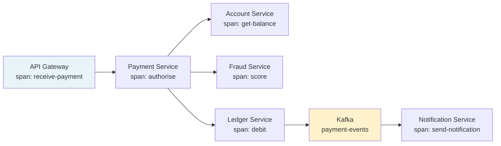

# Distributed Tracing

> [!NOTE]
> When a payment takes 3 seconds and involves 7 microservices, `grep`-ing logs for a correlation ID gives you a list of events but not causality, timing, or the precise call tree. Distributed tracing captures the full execution graph — which service called which, in what order, with what latency — as a single queryable object called a **trace**.

## Traces, Spans, and Parent-Child Relationships

A **trace** is the complete record of a request as it propagates through a distributed system.

A **span** is a named, timed unit of work within a trace. Spans form a tree:

```
Trace: payment-authorisation (traceId: abc123)
│
├── Span: api-gateway.receive          [0ms →  2ms]
│
├── Span: payment-service.authorise    [2ms → 85ms]
│   ├── Span: account-service.getBalance  [5ms →  18ms]
│   ├── Span: fraud-service.score         [5ms →  65ms]
│   └── Span: fx-service.getRate          [5ms →  22ms]
│
└── Span: ledger-service.debit         [86ms → 120ms]
    └── Span: postgres.execute         [88ms → 115ms]
```

The fraud service (60ms) is the critical path. Without tracing, you would see "total latency 120ms" with no breakdown.

---

## W3C TraceContext Propagation Headers

The W3C TraceContext specification standardises how trace context is propagated across HTTP calls:

```
traceparent: 00-4bf92f3577b34da6a3ce929d0e0e4736-00f067aa0ba902b7-01
              ^^ version ^^ traceId (32 hex)         ^^ spanId (16 hex) ^^ flags
```

```java
// Spring Boot auto-configures W3C propagation with Micrometer Tracing
// No manual header extraction needed for HTTP calls via WebClient or RestTemplate

// For manual propagation (e.g., gRPC, messaging):
@Component
@RequiredArgsConstructor
public class TracePropagator {

    private final Tracer     tracer;
    private final Propagator propagator;

    // Inject trace context into outgoing message headers
    public void injectIntoKafkaHeaders(Headers kafkaHeaders) {
        propagator.inject(
            Context.current(),
            kafkaHeaders,
            (carrier, key, value) ->
                carrier.add(key, value.getBytes(StandardCharsets.UTF_8))
        );
    }

    // Extract trace context from incoming message headers
    public Context extractFromKafkaHeaders(Headers kafkaHeaders) {
        return propagator.extract(
            Context.current(),
            kafkaHeaders,
            (carrier, key) -> {
                Header h = carrier.lastHeader(key);
                return h == null ? null : new String(h.value(), StandardCharsets.UTF_8);
            }
        );
    }
}
```

---

## Micrometer Tracing + OpenTelemetry SDK

Spring Boot 3 uses Micrometer Tracing as the tracing facade, with OpenTelemetry as the backend:

```xml
<!-- pom.xml -->
<dependency>
    <groupId>io.micrometer</groupId>
    <artifactId>micrometer-tracing-bridge-otel</artifactId>
</dependency>
<dependency>
    <groupId>io.opentelemetry</groupId>
    <artifactId>opentelemetry-exporter-otlp</artifactId>
</dependency>
```

```yaml
# application.yml
management:
  tracing:
    sampling:
      probability: 1.0   # 100% in dev; use 0.01-0.1 in production
  otlp:
    tracing:
      endpoint: http://jaeger-collector:4318/v1/traces
```

---

## `@WithSpan` Annotation in Spring

The `@WithSpan` annotation (from `opentelemetry-instrumentation-annotations`) creates a span for a method automatically:

```java
@Service
@RequiredArgsConstructor
public class FraudScoringService {

    private final FraudApiClient fraudApiClient;
    private final MeterRegistry  meterRegistry;

    @WithSpan("fraud-service.score")
    public FraudScore score(Payment payment) {
        // This method's execution is captured as a span in the parent trace
        // Span attributes are set via @SpanAttribute or manually:
        Span.current()
            .setAttribute("payment.id",       payment.getId())
            .setAttribute("payment.amount",    payment.getAmount().doubleValue())
            .setAttribute("payment.currency",  payment.getCurrency());

        FraudScore score = fraudApiClient.evaluate(payment);

        Span.current().setAttribute("fraud.score",    score.getValue());
        Span.current().setAttribute("fraud.decision", score.getDecision().name());

        return score;
    }
}
```

```java
// Manual span creation for finer control
@Service
@RequiredArgsConstructor
public class PaymentOrchestrator {

    private final Tracer tracer;

    public PaymentResult orchestrate(PaymentRequest request) {
        Span span = tracer.nextSpan()
            .name("payment-orchestration")
            .tag("payment.type", request.getType().name())
            .start();

        try (Tracer.SpanInScope scope = tracer.withSpan(span)) {
            // All child spans created here will have this span as parent
            return doOrchestrate(request);
        } catch (Exception e) {
            span.error(e);
            throw e;
        } finally {
            span.end();
        }
    }
}
```

---

## Baggage Propagation — tenantId and correlationId

Baggage carries key-value pairs alongside the trace context. Unlike span attributes (local to one span), baggage propagates to all downstream services:

```java
@Component
@RequiredArgsConstructor
public class TenantBaggageFilter implements Filter {

    private final BaggageManager baggageManager;

    @Override
    public void doFilter(ServletRequest req, ServletResponse res, FilterChain chain)
            throws IOException, ServletException {
        HttpServletRequest httpReq = (HttpServletRequest) req;

        String tenantId       = httpReq.getHeader("X-Tenant-Id");
        String correlationId  = httpReq.getHeader("X-Correlation-Id");

        // Baggage propagates through all downstream service calls automatically
        try (BaggageInScope t = baggageManager.createBaggageEntry("tenantId", tenantId);
             BaggageInScope c = baggageManager.createBaggageEntry("correlationId",
                                     correlationId != null
                                         ? correlationId
                                         : UUID.randomUUID().toString())) {
            chain.doFilter(req, res);
        }
    }
}
```

```java
// In any downstream service, read baggage without having it passed explicitly:
String tenantId = Baggage.current().getEntryValue("tenantId");
log.info("Processing for tenant={}", tenantId);
```

> [!WARNING]
> Baggage has overhead: every byte of baggage is included in every HTTP header and Kafka record header throughout the trace. Keep baggage small — IDs only, never PII.

---

## TraceId Correlation Across Kafka Messages

When a payment event is published to Kafka, the trace context must travel with the message so the consumer's processing is linked to the original request:

```java
@Component
@RequiredArgsConstructor
public class TracedPaymentProducer {

    private final KafkaTemplate<String, String> kafkaTemplate;
    private final TracePropagator               propagator;
    private final Tracer                        tracer;

    @WithSpan("kafka.publish.payment-events")
    public void publish(PaymentEvent event) {
        ProducerRecord<String, String> record =
            new ProducerRecord<>("payment-events", event.getPaymentId(), toJson(event));

        // Inject W3C traceparent into Kafka record headers
        propagator.injectIntoKafkaHeaders(record.headers());

        Span.current().setAttribute("messaging.destination", "payment-events");
        Span.current().setAttribute("messaging.message_id",   event.getPaymentId());

        kafkaTemplate.send(record);
    }
}
```

```java
@KafkaListener(topics = "payment-events", groupId = "ledger-processor")
public void consume(ConsumerRecord<String, PaymentEvent> record) {
    // Restore trace context from Kafka headers — links this span to the producer span
    Context parentContext = propagator.extractFromKafkaHeaders(record.headers());

    Span span = tracer.nextSpan(parentContext)
        .name("kafka.consume.payment-events")
        .tag("messaging.message_id", record.key())
        .start();

    try (Tracer.SpanInScope scope = tracer.withSpan(span)) {
        ledgerService.applyPayment(record.value());
    } catch (Exception e) {
        span.error(e);
        throw e;
    } finally {
        span.end();
    }
}
```

---

## Mermaid Trace Diagram — Cross-Service Payment Flow



---

## Sampling Strategies

Storing every trace at high throughput is expensive. Sampling reduces storage while preserving observability:

| Strategy | Description | Use When |
|---|---|---|
| Head-based (probabilistic) | Decision made at trace start; e.g., 1% of traces | High volume, uniform workloads |
| Tail-based | Decision made after trace completes; keep slow/errored traces | When errors and latency outliers matter most |
| Always-on | 100% sampling | Development, low-volume |
| Rate-limited | Fixed traces/second regardless of load | Burst protection |

```yaml
# Tail-based sampling with OpenTelemetry Collector
processors:
  tail_sampling:
    decision_wait: 10s
    policies:
      - name: errors-policy
        type: status_code
        status_code: {status_codes: [ERROR]}
      - name: slow-traces-policy
        type: latency
        latency: {threshold_ms: 1000}
      - name: payment-traces-policy
        type: string_attribute
        string_attribute:
          key: payment.type
          values: [SWIFT, SEPA_INSTANT]
      - name: default-policy
        type: probabilistic
        probabilistic: {sampling_percentage: 1}
```

---

## Jaeger UI — Trace Analysis for Financial Operations

Practical queries in Jaeger for financial investigations:

```
# Find all traces for a specific payment
Tags: payment.id=PAY-20240115-001

# Find slow payment authorisations
Operation: payment-service.authorise
Min Duration: 500ms

# Find traces where fraud service was the bottleneck
Tags: fraud.decision=REVIEW  AND  service: fraud-service
Min Duration: 200ms

# Audit trail for a specific customer
Tags: customer.id=CUST-99887766
```

The trace view shows the full call tree with timing. For financial audit purposes, this gives you an immutable record of exactly what happened, in what order, and how long each step took — complementing application logs.

---

## Cardinality and Storage Costs

High-cardinality span attributes cause Jaeger index bloat:

```java
// BAD — unbounded cardinality: payment IDs are unique per trace
span.setAttribute("payment.id", paymentId);  // OK in span attributes
// ...but as a Jaeger search tag, this creates a new index entry per payment

// GOOD — low cardinality attributes for search tags
span.setAttribute("payment.type",     payment.getType().name());   // 5 values
span.setAttribute("payment.currency", payment.getCurrency());      // ~150 values
span.setAttribute("payment.outcome",  "AUTHORISED");               // 4 values

// Keep high-cardinality IDs in the span for trace viewing
// but do not use them as search/filter dimensions
```

**Storage estimate at 1,000 traces/second, 10 spans/trace, 1KB/span, 24-hour retention:**
1,000 × 10 × 1KB × 86,400s = ~864GB/day. Use tail-based sampling to reduce this by 100×.

---

## Key Takeaways

- A trace is the directed acyclic graph of spans representing one request across multiple services.
- W3C TraceContext headers are the standard propagation format; Micrometer Tracing handles injection/extraction automatically for HTTP.
- Baggage propagates key-value context (tenantId, correlationId) to all downstream services without explicit parameter passing.
- Kafka messages must carry trace context in record headers to link producer and consumer spans.
- Tail-based sampling preserves traces that matter (errors, slow calls) while discarding the rest.
- For financial audit, trace IDs complement correlation IDs in logs — always log both.

<!-- KNOWLEDGE-CHECK
{
  "questions": [
    {
      "id": "q1",
      "text": "A payment takes 500ms. Logs show 10 service calls but do not show which calls ran in parallel and which were sequential. What does distributed tracing add that logs cannot provide?",
      "options": [
        "More detailed error messages",
        "A visual timeline showing parent-child span relationships, parallelism, and the precise duration of each service call within the total request",
        "Real-time alerting on slow operations",
        "Log aggregation across services"
      ],
      "correct": 1,
      "explanation": "Logs give you a list of timestamped events, but not the causal tree. Distributed tracing captures the parent-child relationships between spans, shows which calls ran in parallel, identifies the critical path, and measures the exact contribution of each service to total latency. This is impossible to reconstruct from logs alone."
    },
    {
      "id": "q2",
      "text": "Baggage is set to include the customer's full name for a support use case. What is the problem with this?",
      "options": [
        "Baggage cannot contain string values",
        "The customer's name is PII and will be transmitted in HTTP headers and Kafka record headers to every downstream service, violating data minimisation principles",
        "Baggage is not propagated through Kafka",
        "Baggage size is limited to 64 bytes"
      ],
      "correct": 1,
      "explanation": "Baggage propagates to all downstream services in request headers and message headers. Including PII (full name, account number, date of birth) means that PII is transmitted to every service in the call tree, including third-party instrumentation infrastructure. Use IDs only in baggage and look up details within each service that needs them."
    },
    {
      "id": "q3",
      "text": "Head-based 1% sampling is in use. A production incident occurs affecting 2% of payments. How many traces are retained?",
      "options": [
        "2% of payments × 1% sampling = 0.02% of all traces",
        "All traces for the 2% of affected payments",
        "No traces — head-based sampling cannot retroactively retain traces for incidents",
        "It depends on whether the error traces are tagged as errors before sampling"
      ],
      "correct": 2,
      "explanation": "Head-based sampling makes the keep/drop decision at the start of the trace, before the outcome is known. If 1% of all traces are kept, only ~1% of the incident traces are retained — the other 99% are gone. Tail-based sampling solves this by deferring the decision until after the trace completes, allowing error and slow traces to be kept regardless of the base rate."
    }
  ]
}
-->

<!-- PRACTICAL-CHALLENGE
## Practical Challenge

**Scenario:** A payment platform processes 2,000 payments/second across 8 microservices. P99 latency is 800ms but SLA requires 500ms. The team suspects the fraud service or the FX rate service is the bottleneck, but logs show timestamps, not call trees.

**Tasks:**

1. Configure OpenTelemetry + Jaeger for the payment-service and fraud-service. Include: OTLP exporter config, sampling strategy (tail-based: keep all >500ms and all errors; 0.5% otherwise), and span attributes for payment operations.

2. Implement `@WithSpan` instrumentation for the payment orchestration pipeline with meaningful span names and attributes. Add timing events for: validation complete, fraud check complete, FX lookup complete, debit complete.

3. Implement Kafka trace propagation so that the notification service spans appear as children of the payment service span in the same trace.

4. Set up a Jaeger query to find the top 10 slowest payment authorisations in the last hour. What span attributes would you index to make this query efficient?

5. Calculate the storage cost for 90-day trace retention at 2,000 payments/second, 8 spans/payment, 1.5KB/span with tail-based sampling retaining 2% of traces. Would you change the sampling strategy?
-->
