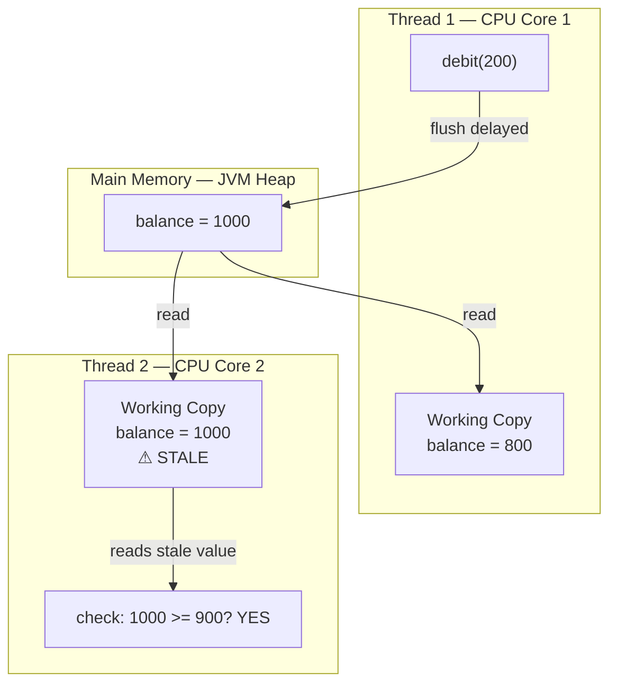
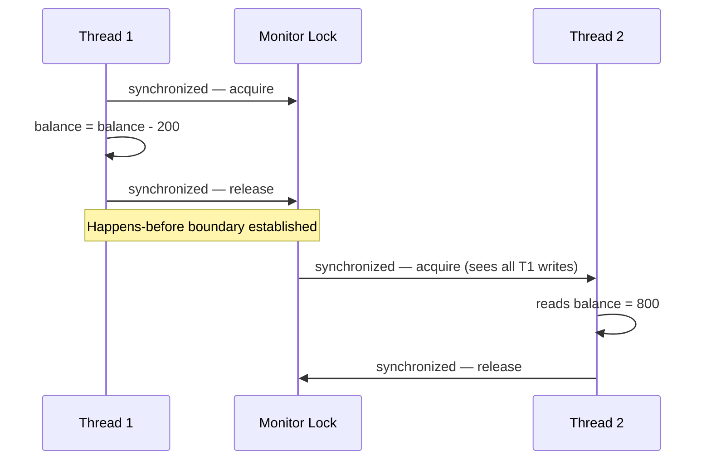

# نموذج ذاكرة Java — الأساسيات

## نظرة عامة

نموذج ذاكرة Java ‏(JMM) هو المواصفة التي تحدد كيف تتعامل آلة Java الافتراضية مع نظام ذاكرة الحاسوب. وهو يجيب عن سؤال أساسي يجب أن يفهمه كل مبرمج Java يكتب شيفرة متزامنة:

> *إذا كتب الخيط 1 قيمة في متغير، فهل يضمن أن يرى الخيط 2 تلك القيمة الجديدة؟*

والإجابة — دون مزامنة — هي **لا**. وفهم السبب يقود مباشرة إلى فهم كل فئة من سباقات البيانات، والتحديثات المفقودة، وأعطال الاتساق المالي التي تقع في الأنظمة المالية الإنتاجية.

يضع هذا الدرس الأساس الذي يبني عليه كل موضوع تزامن لاحق.

## أهداف التعلم

في نهاية هذا الدرس ستستطيع:

- شرح ما يعرّفه JMM ولماذا وُجد
- وصف الفرق بين الذاكرة الرئيسية وذاكرة عمل الخيط
- تحديد مشكلة الرؤية (visibility) وشرح سببها الجذري
- تعريف علاقة "يحدث قبل" (happens-before) وسرد مصادرها
- تطبيق `volatile` بشكل صحيح لحل مشكلات الرؤية
- شرح لماذا لا يكفي `volatile` للعمليات المركّبة
- وصف كيف ينطبق JMM على الخيوط الافتراضية في Java 21

## سياق العمل

يتلقى نظام معالجة مدفوعات 8,000 طلب سحب في الثانية. ويعالج كل طلب خيط منفصل. ورصيد الحساب حقل مشترك قابل للتغيير.

يخصم الخيط 1 مبلغ 200 جنيه من حساب رصيده 1,000 جنيه. ويقرأ الخيط 2 الرصيد بعد 10 ميكروثوانٍ ليقرر هل يُسمح بسحب 900 جنيه.

**دون وعي صحيح بـ JMM:** قد يقرأ الخيط 2 القيمة القديمة 1,000 جنيه — فالخصم الذي أجراه الخيط 1 غير مرئي له ببساطة. فيوافق الخيط 2 على سحب 900 جنيه. ويصبح الحساب مكشوفًا بـ 100 جنيه. ولم يُرمَ أي استثناء. ولم يُخرق أي قفل. وتصرف النظام تمامًا كما بُرمج — بشكل خاطئ.

(بدقة، يجمع هذا المثال مشكلتين: القراءة القديمة مشكلة رؤية، وتسلسل القراءة-الفحص-الكتابة غير المحمي حالة تسابق. وكلتاهما تنشأ من غياب المزامنة.) وأخطاء من هذا النوع مصدر كلاسيكي للسحب على المكشوف وفروق المطابقة. فـ JMM ليس فضولًا أكاديميًا — بل خط الدفاع الأول لصحة البيانات المالية.

## نموذج ذاكرة Java

يُعرّف JMM في مواصفة لغة Java، الفصل 17. وقد أعيدت صياغته جذريًا في Java 5 ‏(JSR-133) لتقديم ضمانات أقوى ومعالجة مشكلات القفل المزدوج الفحص و`volatile` التي عانت منها Java 1.4.

لا يصف JMM عتاد الذاكرة الفعلي مباشرة. بل يصف نموذجًا مجردًا لتفاعل الخيوط مع الذاكرة، مستقلًا عن بنية المعالج (x86، وARM، وSPARC). وهذا التجريد يسمح لآلة JVM باستغلال تحسينات العتاد — ذاكرات المعالج المؤقتة، ومخازن الكتابة، وإعادة ترتيب التعليمات — مع تقديم مجموعة ضمانات يستطيع المبرمجون التفكير بها.

ثلاث خصائص أساسية تحكم التعامل مع الذاكرة:

| الخاصية | السؤال الذي تجيب عنه |
|---|---|
| **الرؤية** | هل يستطيع الخيط 2 رؤية كتابة أجراها الخيط 1؟ |
| **الذرية** | هل تكتمل العملية دون مقاطعة؟ |
| **الترتيب** | هل تُنفّذ العمليات بالترتيب الذي تظهر به في الشيفرة المصدرية؟ |

يهتم JMM أساسًا بـ **الرؤية** و**الترتيب**. ويعالجهما `synchronized` و`volatile`. أما الذرية فتحتاج آليات منفصلة: `synchronized`، أو `AtomicLong`، أو القفل على مستوى قاعدة البيانات.

## الذاكرة الرئيسية وذاكرة العمل

يعرّف JMM منطقتين مجردتين للذاكرة:

**الذاكرة الرئيسية** — المخزن الموثوق لكل المتغيرات المشتركة. وتقابل تقريبًا كومة JVM ‏(heap).

**ذاكرة العمل** — نسخة خاصة بالخيط من المتغيرات التي يعمل عليها حاليًا. وتقابل تقريبًا مسجلات المعالج وذاكرتي L1/L2.

لا يقرأ الخيط من الذاكرة الرئيسية مباشرة في كل وصول. فقد يقرأ من ذاكرة عمله — نسخة حُمّلت في وقت سابق وقد تكون قديمة.

> [!NOTE]
> "الذاكرة الرئيسية / ذاكرة العمل" نموذج تعليمي (كانت هذه صياغة المواصفة قبل Java 5). أما JMM اليوم فيُعرّف كليًا بقواعد "يحدث قبل" أدناه. وفي العتاد الحقيقي تبقى ذاكرات المعالج المؤقتة متسقة؛ والقيم القديمة تأتي أساسًا من احتفاظ JIT بالقيمة في مسجّل، ومن مخازن الكتابة، ومن إعادة الترتيب بواسطة المترجم والمعالج. والنتيجة العملية واحدة: دون مزامنة لا يوجد ضمان للرؤية.



يكتب الخيط 1 القيمة `balance = 800` في ذاكرة عمله. ولا يُضمن أن يكون تفريغها إلى الذاكرة الرئيسية فوريًا. ويقرأ الخيط 2 قيمة `balance` من ذاكرة عمله، التي ما زالت تحمل القيمة `1000`. فيتخذ الخيط 2 قرار عمل بناءً على قيمة قديمة. والنتيجة خطأ مالي.

## مشكلة الرؤية

مشكلة الرؤية الكلاسيكية حلقة إيقاف معتمدة على علَم:

```java
// BROKEN — no visibility guarantee
public class PaymentProcessor {

    private boolean running = true;  // ← not volatile

    // Thread 1: shutdown request
    public void shutdown() {
        running = false;
    }

    // Thread 2: processing loop
    public void processPayments() {
        while (running) {         // ← may NEVER see running = false
            processNextBatch();
        }
        // Thread 2 may loop forever
    }
}
```

في هذه الشيفرة **خطأ رؤية**. فلا يضمن JMM أن يرى الخيط 2 أبدًا الكتابة `running = false` التي أجراها الخيط 1. ويُسمح لآلة JVM بالاحتفاظ بقيمة `running` في مسجّل وعدم إعادة قراءتها من الذاكرة الرئيسية أبدًا.

> [!DANGER]
> ليست هذه حالة هامشية نظرية. فبمجرد أن يترجم JIT الحلقة، يُسمح له بقراءة `running` مرة واحدة والاحتفاظ بها في مسجّل — وHotSpot يفعل ذلك فعلًا في الحلقات البسيطة. فقد يدور الخيط 2 إلى الأبد بعد استدعاء `shutdown()`. ويعتمد حدوث ذلك على ما يفعله جسم الحلقة، ولهذا بالضبط قد يجتاز الخطأ كل الاختبارات ثم يظهر في الإنتاج. وفي نظام دفع يعني هذا أن المعالج لا يمكن إيقافه بلطف إلا بقتل قسري.

## علاقة "يحدث قبل" (Happens-Before)

يحل JMM مشكلة الرؤية بعلاقة **"يحدث قبل"** (HB). فإذا كان الإجراء A *يحدث قبل* الإجراء B، فإن:

1. كل آثار A **مرئية** لـ B
2. يبدو A كأنه نُفّذ **قبل** B من منظور B

ويعرّف JMM مصادر محددة لعلاقة "يحدث قبل":



> [!NOTE]
> **مصادر علاقة "يحدث قبل" في JMM:**
> - ترتيب البرنامج: كل إجراء في خيط يحدث قبل كل إجراء لاحق في الخيط نفسه
> - تحرير قفل `synchronized` يحدث قبل كل أخذ لاحق للقفل **نفسه**
> - كتابة `volatile` تحدث قبل كل قراءة لاحقة للمتغير **نفسه**
> - بدء الخيط: `Thread.start()` يحدث قبل كل إجراءات الخيط الجديد
> - انتظار الخيط: كل إجراءات الخيط تحدث قبل عودة `Thread.join()`
> - المقاطعة: استدعاء `interrupt()` يحدث قبل أن يكتشفها الخيط المقاطَع
> - ضمان مرتبط: حقول `final` في كائن مبني بشكل صحيح مرئية لأي خيط يحصل على مرجع إليه (دلالات الحقول النهائية) — أما الحقول غير النهائية فتحتاج نشرًا آمنًا

وعلاقة "يحدث قبل" **متعدية**: إذا كان A يحدث قبل B وB يحدث قبل C، فإن A يحدث قبل C.

## volatile — استعادة الرؤية

تُنشئ الكلمة المفتاحية `volatile` علاقة "يحدث قبل" بين الكتابة وكل القراءات اللاحقة للمتغير **نفسه**. كما تمنع مترجم JIT من الاحتفاظ بالمتغير في مسجّل.

```java17
// Java 17 — volatile for shutdown flag visibility
public class PaymentProcessor {

    // volatile guarantees: every read sees the latest write to this field
    // (in the teaching model: writes reach main memory, reads load from it,
    // and the JIT cannot keep the value in a register)
    private volatile boolean running = true;

    public void shutdown() {
        running = false;  // happens-before all subsequent reads of 'running'
    }

    public void processPayments() {
        while (running) {   // always reads from main memory
            processNextBatch();
        }
        // Now correctly terminates when shutdown() is called
    }

    private void processNextBatch() {
        // ... process payment batch
    }
}
```

```java21
// Java 21 — volatile with Virtual Threads
// volatile semantics are IDENTICAL for virtual threads.
// Java 21-23 consideration: blocking inside a synchronized block PINS a
// virtual thread to its carrier platform thread, hurting scalability, so
// prefer ReentrantLock there. JDK 24 (JEP 491) removed this limitation.

public class PaymentProcessor {

    private volatile boolean running = true;

    public void shutdown() {
        running = false;
    }

    // Java 21: run on a virtual thread for I/O-bound processing
    public Thread startVirtual() {
        return Thread.ofVirtual()
            .name("payment-processor")
            .start(this::processPayments);
    }

    private void processPayments() {
        while (running) {
            processNextBatch();
        }
    }

    private void processNextBatch() {
        // ... process payment batch
    }
}
```

دلالات `volatile` **متطابقة** في الخيوط الافتراضية. وفي Java 21–23 يثبّت الحجب داخل كتلة `synchronized` الخيط الافتراضي على خيط الحمل الأساسي (pinning) فيضر بقابلية التوسع، لذلك يُفضّل هناك `ReentrantLock`. وقد أزال JDK 24 ‏(JEP 491) هذا القيد.

## volatile لا يكفي للعمليات المركّبة

> [!WARNING]
> **مفهوم خاطئ حاسم:** يضمن `volatile` رؤية كتابة واحدة. لكنه **لا** يجعل العمليات المركّبة (قراءة-تعديل-كتابة) ذرية.
>
> العبارة `balance = balance - amount` هي **ثلاث** عمليات: (1) قراءة `balance`، (2) حساب `balance - amount`، (3) كتابة النتيجة. ولا يجعل `volatile` هذا التسلسل ذريًا. فقد يتداخل خيطان في هذه الخطوات وينتجان تحديثًا مفقودًا.

```java
// STILL BROKEN — volatile does not fix compound operations
public class Account {

    private volatile long balance = 1000;  // volatile does NOT help here

    public void debit(long amount) {
        // Thread 1 reads: 1000
        // Thread 2 reads: 1000 (before Thread 1 writes)
        // Thread 1 computes: 1000 - 200 = 800, writes 800
        // Thread 2 computes: 1000 - 300 = 700, writes 700
        // Final balance: 700 — Thread 1's debit was LOST
        balance = balance - amount;  // ← NOT atomic
    }
}
```

يقرأ الخيطان 1000، ثم يكتب الأول 800 والثاني 700، فيضيع خصم الخيط الأول.

الحلول الصحيحة للعمليات المركّبة الذرية:

```java
// Option 1: synchronized (simple, correct, contention under high load)
public synchronized void debit(long amount) {
    if (balance < amount) throw new InsufficientFundsException();
    balance = balance - amount;
}

// Option 2: AtomicLong with CAS loop (lock-free, correct)
import java.util.concurrent.atomic.AtomicLong;

public class Account {
    private final AtomicLong balance = new AtomicLong(1000);

    public void debit(long amount) {
        balance.updateAndGet(current -> {
            if (current < amount) throw new InsufficientFundsException();
            return current - amount;
        });
    }
}

// Option 3: Database-level locking (the correct answer for persistent balances)
// SELECT balance FROM accounts WHERE id = ? FOR UPDATE
// UPDATE accounts SET balance = balance - ? WHERE id = ? AND balance >= ?
//   -> check the updated row count: 0 rows means insufficient funds
```

الخيار 1: `synchronized` (بسيط وصحيح، مع تنافس تحت الحمل العالي). الخيار 2: `AtomicLong` بحلقة CAS (خالٍ من الأقفال وصحيح). الخيار 3: القفل على مستوى قاعدة البيانات — الإجابة الصحيحة للأرصدة الدائمة؛ وتحقق من عدد الصفوف المحدّثة: صفر يعني رصيدًا غير كافٍ.

## ملخص JMM

| الآلية | الرؤية | الذرية | الترتيب |
|---|---|---|---|
| بلا مزامنة | ✗ غير مضمونة | ✗ | ✗ |
| `volatile` | ✓ للمتغير المتطاير | ✗ العمليات المركّبة غير ذرية | ✓ جزئيًا |
| `synchronized` | ✓ كل المتغيرات داخل الكتلة | ✓ داخل الكتلة | ✓ |
| `AtomicLong` / CAS | ✓ | ✓ لمتغير واحد | ✓ |
| ‏`FOR UPDATE` في قاعدة البيانات | ✓ عبر نسخ JVM | ✓ داخل المعاملة | ✓ |

## أخطاء شائعة

> [!DANGER]
> **الخطأ 1: افتراض أن كتابة العلَم مرئية فورًا دون volatile.**
> العلَم المنطقي غير المتطاير المستخدم كشرط توقف بين الخيوط حالة تسابق. وقد يبدو أنه يعمل في الاختبار (نواة واحدة، أو وضع التصحيح، أو حمل منخفض) ويفشل في الإنتاج (عدة أنوية، وترجمة JIT، وحمل عالٍ).

> [!DANGER]
> **الخطأ 2: إعلان حقل volatile وافتراض أن كل العمليات عليه ذرية.**
> ‏`volatile long balance` لا يجعل `balance++` أو `balance = balance - amount` ذريًا. فهذه تتطلب `AtomicLong`، أو `synchronized`، أو قفلًا على مستوى قاعدة البيانات.

> [!DANGER]
> **الخطأ 3: الإفراط في الاعتماد على volatile للأرصدة المالية.**
> يجب ألا تُدار الأرصدة المالية كحقول volatile في الذاكرة. فالرصيد الموثوق يعيش في قاعدة البيانات. ويجب معاملة تمثيلات الرصيد في الذاكرة كعروض للقراءة فقط، تُحدّث تحت عزل معاملاتي صحيح.

## منظور المهندس الرئيسي

يدرك مهندس Staff أو Principal أن JMM موجود لأن العتاد الحديث ليس متسقًا تسلسليًا. فالمعالجات تعيد ترتيب التعليمات، ومخازن الكتابة تؤخر التفريغ، والمترجمات تحذف عمليات تحميل وتخزين للتحسين. ويعطي JMM المبرمجين عقدًا يعمل أيًا كان العتاد، مقابل مزامنة صريحة.

وفي الأنظمة المالية تكون الإجابة الصحيحة في الغالب: **ادفع الصحة إلى قاعدة البيانات**. استخدم `SELECT ... FOR UPDATE` أو القفل المتفائل بأعمدة الإصدار. أما المزامنة في الذاكرة (volatile، وsynchronized، وAtomicLong) فقيمتها في الحالة غير الدائمة: أعلام الإيقاف، وعدّادات الطلبات الجارية، ومحددات المعدّل. وللأرصدة، وقيود دفتر الأستاذ، وسجلات الدفع — قاعدة البيانات هي نظام السجل، لا ذاكرة كومة JVM.

## الخلاصات الأساسية

- يوجد JMM لأن المعالجات ومترجمات JIT تعيد ترتيب العمليات وتخزنها مؤقتًا للأداء
- قد تكون ذاكرة عمل الخيط قديمة — ولا ضمان للرؤية دون مزامنة
- علاقة "يحدث قبل" هي الضمان الأساسي: إذا كان A يحدث قبل B، فكل آثار A مرئية لـ B
- ‏`volatile` يُنشئ علاقة "يحدث قبل" لمتغير واحد ويمنع الاحتفاظ به في مسجّل
- ‏`volatile` **لا** يجعل العمليات المركّبة ذرية
- الأرصدة المالية تتطلب قفلًا على مستوى قاعدة البيانات، لا حقولًا volatile في الذاكرة
- الخيوط الافتراضية (Java 21) تخضع لقواعد JMM نفسها؛ وفي Java 21–23 تجنب الحجب داخل `synchronized` في مهام الخيوط الافتراضية لمنع تثبيت خيط الحمل (أُصلح في JDK 24 عبر JEP 491)

## المراجع

- *Java Concurrency in Practice* — Goetz وPeierls وBloch وآخرون — الفصل 3: مشاركة الكائنات
- JSR-133: Java Memory Model and Thread Specification — https://jcp.org/en/jsr/detail?id=133
- JEP 444: Virtual Threads — https://openjdk.org/jeps/444
- مواصفة لغة Java §17.4 — نموذج الذاكرة
- *Effective Java* الطبعة الثالثة — البند 78: زامن الوصول إلى البيانات المشتركة القابلة للتغيير

---

<!-- KNOWLEDGE-CHECK
[
  {
    "q": "حقل مُعلن كـ 'private boolean running = true'. يضبط الخيط 1 القيمة running = false. أي عبارة صحيحة؟",
    "options": [
      "يضمن أن يرى الخيط 2 القيمة running = false فورًا",
      "قد لا يرى الخيط 2 القيمة running = false أبدًا بسبب قواعد الرؤية في JMM",
      "سيسبب هذا NullPointerException وقت التشغيل",
      "ستزامن JVM هذا تلقائيًا لأنه boolean"
    ],
    "answer": 1,
    "explanation": "دون volatile أو synchronized، لا توجد علاقة 'يحدث قبل' بين كتابة الخيط 1 وقراءة الخيط 2. ويسمح JMM للخيط 2 بالاحتفاظ بالقيمة في مسجّل وعدم إعادة تحميلها أبدًا. وهذا خطأ رؤية كلاسيكي يظهر على العتاد متعدد الأنوية مع ترجمة JIT."
  },
  {
    "q": "أي العمليات يضمنها 'volatile' لحقل 'volatile long balance'؟",
    "options": [
      "رؤية الكتابات وذرية balance = balance - amount",
      "الرؤية فقط: كل الخيوط ترى آخر كتابة فورًا",
      "الاستبعاد المتبادل: خيط واحد فقط يستطيع قراءة balance أو كتابتها في كل مرة",
      "دلالات معاملة كاملة تكافئ synchronized"
    ],
    "answer": 1,
    "explanation": "يضمن volatile الرؤية (آخر كتابة مرئية لكل القراءات اللاحقة) ويمنع إعادة ترتيب التعليمات حول المتغير. لكنه لا يضمن ذرية العمليات المركّبة. فالعبارة 'balance = balance - amount' تسلسل قراءة-تعديل-كتابة يتطلب synchronized، أو AtomicLong، أو قفل قاعدة بيانات ليكون آمنًا تحت الوصول المتزامن."
  },
  {
    "q": "في نموذج 'يحدث قبل' في Java، أي مما يلي يُنشئ علاقة 'يحدث قبل'؟",
    "options": [
      "خيطان يصلان إلى الحقل غير المتطاير نفسه",
      "كتابة volatile تليها قراءة volatile للمتغير نفسه",
      "Thread.sleep(100) بين عمليتين",
      "استخدام مرجع الكائن نفسه في خيطين"
    ],
    "answer": 1,
    "explanation": "كتابة volatile في المتغير X تحدث قبل أي قراءة volatile لاحقة للمتغير X. وهذا يضمن أن يرى الخيط القارئ القيمة المكتوبة. أما Thread.sleep() فلا يُنشئ علاقة 'يحدث قبل'. ومشاركة مرجع كائن أو الوصول إلى حقل غير متطاير دون مزامنة لا يقدمان أي ضمان رؤية."
  },
  {
    "q": "في Java 21، كيف تتفاعل الخيوط الافتراضية مع نموذج ذاكرة Java؟",
    "options": [
      "للخيوط الافتراضية نموذج ذاكرة منفصل ومبسط برؤية تلقائية",
      "تخضع الخيوط الافتراضية لقواعد JMM نفسها؛ وفي Java 21-23 تجنب الحجب داخل synchronized في الخيوط الافتراضية لمنع تثبيت خيط الحمل",
      "تلغي الخيوط الافتراضية الحاجة إلى volatile لأنها تعمل على خيط منصة واحد",
      "تستخدم الخيوط الافتراضية التزامن المنظّم الذي يعالج كل مسائل الرؤية تلقائيًا"
    ],
    "answer": 1,
    "explanation": "تخضع الخيوط الافتراضية لقواعد JMM نفسها تمامًا التي تخضع لها خيوط المنصة. والاعتبار في Java 21-23 أن الحجب داخل كتلة synchronized يثبّت الخيط الافتراضي على خيط الحمل الأساسي، وهذا قد يلغي فوائد قابلية التوسع؛ فيُفضّل هناك ReentrantLock. وقد أزال JDK 24 ‏(JEP 491) هذا القيد. ويبقى volatile ضروريًا وصحيحًا مع الخيوط الافتراضية."
  }
]
-->

<!-- PRACTICAL-CHALLENGE
{
  "title": "إظهار أخطاء الرؤية في JMM وإصلاحها",
  "description": "نفّذ سيناريوهات الرؤية من هذا الدرس بشيفرة Java حقيقية. واستخدم JMH أو اختبارات إجهاد بسيطة لإظهار حالات التسابق، ثم طبّق الإصلاحات الصحيحة.",
  "tasks": [
    "اكتب صنف PaymentProcessor بعلَم running منطقي غير متطاير وحلقة processPayments(). شغّله على خيط خلفي واستدعِ shutdown() بعد 100ms. ولاحظ هل ينتهي الخيط بشكل موثوق.",
    "أضف volatile إلى الحقل running وأعد التشغيل. وتحقق من أن الخيط ينتهي الآن بشكل موثوق.",
    "اكتب صنف Account برصيد long غير متطاير. وشغّل 10 خيوط ينفّذ كل منها 100 عملية debit(1) (1000 خصم إجمالًا من رصيد 1000). وتأكد أن الرصيد النهائي 0. وشغّل ذلك 100 مرة وعُدّ مرات الفشل.",
    "أصلح صنف Account باستخدام AtomicLong.updateAndGet() وتحقق من الصحة باختبار الإجهاد نفسه.",
    "اكتب شرحًا موجزًا لسبب عدم إصلاح volatile لحالة Account بينما يصلح حالة PaymentProcessor. وحدّد الفرق الأساسي."
  ]
}
-->
