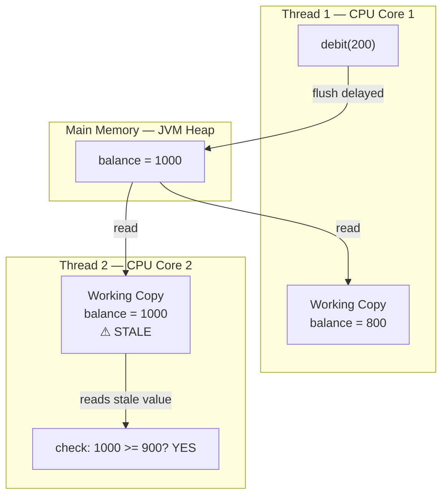
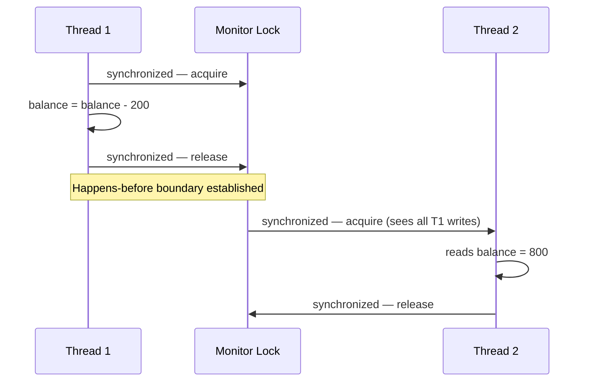

## Overview

The Java Memory Model (JMM) is the specification that defines how the Java Virtual Machine interacts with the computer's memory system. It answers a fundamental question every concurrent Java programmer must understand:

> *If Thread 1 writes a value to a variable, is Thread 2 guaranteed to see that new value?*

The answer — without synchronization — is **no**. Understanding why leads directly to understanding every class of data race, lost update, and financial consistency failure that occurs in production financial systems.

This lesson establishes the foundation that every subsequent concurrency topic builds upon.

## Learning Objectives

By the end of this lesson you will be able to:

- Explain what the JMM defines and why it exists
- Describe the difference between main memory and thread working memory
- Identify the visibility problem and explain its root cause
- Define the happens-before relationship and list its sources
- Correctly apply `volatile` to solve visibility problems
- Explain why `volatile` is insufficient for compound operations
- Describe how the JMM applies to virtual threads in Java 21

## Business Context

A payment processing system receives 8,000 withdrawal requests per second. Each request is handled by a separate thread. The account balance is a shared mutable field.

Thread 1 debits £200 from an account with balance £1,000. Thread 2 reads the balance 10 microseconds later to determine if a £900 withdrawal is permitted.

**Without correct JMM awareness:** Thread 2 may read the stale value £1,000 — the debit by Thread 1 is simply invisible to it. Thread 2 approves the £900 withdrawal. The account is now overdrawn by £100. No exception was thrown. No lock was violated. The system behaved exactly as coded — incorrectly.

This is not a hypothetical. Lost updates in banking systems caused by JMM ignorance have resulted in real overdrafts, compliance failures, and regulatory fines. The JMM is not an academic curiosity. It is the first line of financial data correctness.

## The Java Memory Model

The JMM is defined in the Java Language Specification, Chapter 17. It was substantially revised in Java 5 (JSR-133) to provide stronger guarantees and to address the double-checked locking and `volatile` issues that plagued Java 1.4.

The JMM does **not** describe physical memory hardware directly. It describes an abstract model of how threads interact with memory, independent of the CPU architecture (x86, ARM, SPARC). This abstraction allows the JVM to exploit hardware optimizations — CPU caches, write buffers, instruction reordering — while still providing programmers with a set of guarantees they can reason about.

Three core properties govern memory interactions:

| Property | Question answered |
|---|---|
| **Visibility** | Can Thread 2 see a write made by Thread 1? |
| **Atomicity** | Does an operation complete without interruption? |
| **Ordering** | Do operations execute in the order they appear in source code? |

The JMM is primarily concerned with **visibility** and **ordering**. `synchronized` and `volatile` address these. Atomicity requires separate mechanisms: `synchronized`, `AtomicLong`, or database-level locking.

## Main Memory and Working Memory

The JMM defines two abstract memory regions:

**Main Memory** — the authoritative store for all shared variables. Corresponds roughly to the JVM heap.

**Working Memory** — a thread-private cache of variables the thread is currently working with. Corresponds roughly to CPU registers and L1/L2 caches.

A thread does **not** read directly from main memory on every access. It may read from its working memory — a copy that was loaded at some earlier point and may be stale.



Thread 1 writes `balance = 800` to its working memory. The flush to main memory is not guaranteed to be immediate. Thread 2 reads `balance` from its own working memory, which still holds the value `1000`. Thread 2 makes a business decision based on a stale value. The result is a financial error.

## The Visibility Problem

The classic visibility problem is a flag-based shutdown loop:

```java
// BROKEN — no visibility guarantee
public class PaymentProcessor {

    private boolean running = true;  // ← not volatile

    // Thread 1: shutdown request
    public void shutdown() {
        running = false;
    }

    // Thread 2: processing loop
    public void processPayments() {
        while (running) {         // ← may NEVER see running = false
            processNextBatch();
        }
        // Thread 2 may loop forever
    }
}
```

This code has a **visibility bug**. The JMM provides no guarantee that Thread 2 will ever observe the write `running = false` made by Thread 1. The JVM is permitted to cache `running` in a register and never re-read it from main memory.

> [!DANGER]
> This is not a theoretical edge case. On modern JVMs running with JIT compilation and on multi-core architectures (all production hardware), this bug will manifest. Thread 2 will loop indefinitely after `shutdown()` is called. In a payment system, this means the processor cannot be gracefully stopped without a forced kill.

## The Happens-Before Relationship

The JMM resolves visibility through the **happens-before** (HB) relationship. If action A *happens-before* action B, then:

1. All effects of A are **visible** to B
2. A appears to execute **before** B from B's perspective

The JMM defines specific happens-before sources:



> [!NOTE]
> **Happens-before sources in the JMM:**
> - A `synchronized` lock release happens-before every subsequent acquisition of the **same** lock
> - A `volatile` write happens-before every subsequent read of the **same** variable
> - Thread start: `Thread.start()` happens-before all actions in the new thread
> - Thread join: all actions in a thread happen-before `Thread.join()` returns
> - Object construction: the constructor completing happens-before the first use of the object (for safely published objects)

The happens-before relationship is **transitive**: if A HB B and B HB C, then A HB C.

## volatile — Restoring Visibility

The `volatile` keyword establishes a happens-before relationship between a write and all subsequent reads of the **same variable**. It also prevents the JIT compiler from caching the variable in a register.

```java17
// Java 17 — volatile for shutdown flag visibility
public class PaymentProcessor {

    // volatile guarantees: writes are flushed to main memory,
    // reads always load from main memory, no register caching
    private volatile boolean running = true;

    public void shutdown() {
        running = false;  // happens-before all subsequent reads of 'running'
    }

    public void processPayments() {
        while (running) {   // always reads from main memory
            processNextBatch();
        }
        // Now correctly terminates when shutdown() is called
    }

    private void processNextBatch() {
        // ... process payment batch
    }
}
```

```java21
// Java 21 — volatile with Virtual Threads
// volatile semantics are IDENTICAL for virtual threads.
// Key Java 21 consideration: synchronized blocks can PIN a virtual
// thread to its carrier platform thread, hurting scalability.
// Prefer ReentrantLock over synchronized inside virtual thread tasks.

public class PaymentProcessor {

    private volatile boolean running = true;

    public void shutdown() {
        running = false;
    }

    // Java 21: run on a virtual thread for I/O-bound processing
    public Thread startVirtual() {
        return Thread.ofVirtual()
            .name("payment-processor")
            .start(this::processPayments);
    }

    private void processPayments() {
        while (running) {
            processNextBatch();
        }
    }

    private void processNextBatch() {
        // ... process payment batch
    }
}
```

## volatile Is Not Enough for Compound Operations

> [!WARNING]
> **Critical misconception:** `volatile` guarantees visibility of a single write. It does **not** make compound operations (read-modify-write) atomic.
>
> `balance = balance - amount` is **three** operations: (1) read `balance`, (2) compute `balance - amount`, (3) write result. `volatile` does not make this sequence atomic. Two threads can interleave these steps and produce a lost update.

```java
// STILL BROKEN — volatile does not fix compound operations
public class Account {

    private volatile long balance = 1000;  // volatile does NOT help here

    public void debit(long amount) {
        // Thread 1 reads: 1000
        // Thread 2 reads: 1000 (before Thread 1 writes)
        // Thread 1 computes: 1000 - 200 = 800, writes 800
        // Thread 2 computes: 1000 - 300 = 700, writes 700
        // Final balance: 700 — Thread 1's debit was LOST
        balance = balance - amount;  // ← NOT atomic
    }
}
```

Correct solutions for atomic compound operations:

```java
// Option 1: synchronized (simple, correct, contention under high load)
public synchronized void debit(long amount) {
    if (balance < amount) throw new InsufficientFundsException();
    balance = balance - amount;
}

// Option 2: AtomicLong with CAS loop (lock-free, correct)
import java.util.concurrent.atomic.AtomicLong;

public class Account {
    private final AtomicLong balance = new AtomicLong(1000);

    public void debit(long amount) {
        balance.updateAndGet(current -> {
            if (current < amount) throw new InsufficientFundsException();
            return current - amount;
        });
    }
}

// Option 3: Database-level locking (the correct answer for persistent balances)
// SELECT balance FROM accounts WHERE id = ? FOR UPDATE
// UPDATE accounts SET balance = balance - ? WHERE id = ? AND balance >= ?
```

## JMM Summary

| Mechanism | Visibility | Atomicity | Ordering |
|---|---|---|---|
| No synchronization | ✗ Not guaranteed | ✗ | ✗ |
| `volatile` | ✓ For the volatile variable | ✗ Compound ops not atomic | ✓ Partial |
| `synchronized` | ✓ All variables within block | ✓ Within block | ✓ |
| `AtomicLong` / CAS | ✓ | ✓ For single variable | ✓ |
| Database `FOR UPDATE` | ✓ Across JVM instances | ✓ Within transaction | ✓ |

## Common Mistakes

> [!DANGER]
> **Mistake 1: Assuming a flag write is immediately visible without volatile.**
> A non-volatile boolean flag used as a stop condition between threads is a race condition. It may appear to work in testing (single-core, debug mode, low load) and fail in production (multi-core, JIT compiled, high load).

> [!DANGER]
> **Mistake 2: Declaring a field volatile and assuming all operations on it are atomic.**
> `volatile long balance` does not make `balance++` or `balance = balance - amount` atomic. These require `AtomicLong`, `synchronized`, or a database-level lock.

> [!DANGER]
> **Mistake 3: Over-relying on volatile for financial balances.**
> Financial balances should not be managed as in-memory volatile fields. The authoritative balance lives in the database. In-memory balance representations must be treated as read-only views, refreshed under proper transactional isolation.

## Principal Engineer Perspective

A Staff or Principal engineer recognizes that the JMM exists because modern hardware is not sequentially consistent. CPUs reorder instructions, write buffers delay flushes, and compilers optimize away loads and stores. The JMM gives programmers a contract that works regardless of the underlying hardware, at the cost of explicit synchronization.

For financial systems, the right answer is almost always: **push correctness into the database**. Use `SELECT ... FOR UPDATE` or optimistic locking with version columns. In-memory synchronization (volatile, synchronized, AtomicLong) is valuable for non-persistent state: shutdown flags, in-flight request counters, rate limiters. For account balances, ledger entries, and payment records — the database is the system of record, not JVM heap memory.

## Key Takeaways

- The JMM exists because CPUs and JIT compilers reorder and cache operations for performance
- Thread working memory may be stale — there is no guaranteed visibility without synchronization
- Happens-before is the core guarantee: if A HB B, all effects of A are visible to B
- `volatile` establishes happens-before on a single variable and prevents register caching
- `volatile` does **not** make compound operations atomic
- Financial balances require database-level locking, not in-memory volatile fields
- Virtual threads (Java 21) obey identical JMM rules; avoid `synchronized` inside virtual thread tasks to prevent carrier thread pinning

## References

- *Java Concurrency in Practice* — Goetz, Peierls, Bloch et al. — Chapter 3: Sharing Objects
- JSR-133: Java Memory Model and Thread Specification — https://jcp.org/en/jsr/detail?id=133
- JEP 444: Virtual Threads — https://openjdk.org/jeps/444
- Java Language Specification §17.4 — Memory Model
- *Effective Java* 3rd ed. — Item 78: Synchronize access to shared mutable data

---

<!-- KNOWLEDGE-CHECK
[
  {
    "q": "A field is declared as 'private boolean running = true'. Thread 1 sets running = false. Which statement is correct?",
    "options": [
      "Thread 2 is guaranteed to see running = false immediately",
      "Thread 2 may never see running = false due to the JMM visibility rules",
      "This will cause a NullPointerException at runtime",
      "The JVM will automatically synchronize this because it is a boolean"
    ],
    "answer": 1,
    "explanation": "Without volatile or synchronized, there is no happens-before relationship between Thread 1's write and Thread 2's read. The JMM permits Thread 2 to cache the value in a register and never reload it from main memory. This is a classic visibility bug that manifests on multi-core hardware with JIT compilation."
  },
  {
    "q": "Which operations does 'volatile' guarantee for a 'volatile long balance' field?",
    "options": [
      "Visibility of writes AND atomicity of balance = balance - amount",
      "Only visibility: all threads see the latest write immediately",
      "Mutual exclusion: only one thread can read or write balance at a time",
      "Full transaction semantics equivalent to synchronized"
    ],
    "answer": 1,
    "explanation": "volatile guarantees visibility (the latest write is visible to all subsequent reads) and prevents instruction reordering around the variable. It does NOT guarantee atomicity of compound operations. 'balance = balance - amount' is a read-modify-write sequence that requires synchronized, AtomicLong, or a database lock to be safe under concurrent access."
  },
  {
    "q": "In Java's happens-before model, which of these establishes a happens-before relationship?",
    "options": [
      "Two threads accessing the same non-volatile field",
      "A volatile write followed by a volatile read of the same variable",
      "Thread.sleep(100) between two operations",
      "Using the same object reference in two threads"
    ],
    "answer": 1,
    "explanation": "A volatile write to variable X happens-before any subsequent volatile read of variable X. This guarantees that the reading thread sees the written value. Thread.sleep() does not establish happens-before. Sharing an object reference or accessing a non-volatile field without synchronization provides no visibility guarantee."
  },
  {
    "q": "In Java 21, how do virtual threads interact with the Java Memory Model?",
    "options": [
      "Virtual threads have a separate, simplified memory model with automatic visibility",
      "Virtual threads obey identical JMM rules; avoid synchronized inside virtual threads to prevent carrier thread pinning",
      "Virtual threads eliminate the need for volatile because they run on a single platform thread",
      "Virtual threads use structured concurrency which automatically handles all visibility"
    ],
    "answer": 1,
    "explanation": "Virtual threads obey exactly the same JMM rules as platform threads. The key Java 21 consideration is that synchronized blocks can PIN a virtual thread to its carrier platform thread, potentially negating the scalability benefits of virtual threads. For lock-based mutual exclusion inside virtual thread tasks, prefer ReentrantLock over synchronized. volatile remains necessary and correct with virtual threads."
  }
]
-->

<!-- PRACTICAL-CHALLENGE
{
  "title": "Demonstrate and Fix JMM Visibility Bugs",
  "description": "Implement the visibility scenarios from this lesson using real Java code. Use JMH or simple stress tests to demonstrate the race conditions, then apply the correct fixes.",
  "tasks": [
    "Write a PaymentProcessor class with a non-volatile boolean running flag and a processPayments() loop. Launch it on a background thread and call shutdown() after 100ms. Observe whether the thread terminates reliably.",
    "Add volatile to the running field and re-run. Verify the thread now terminates reliably.",
    "Write an Account class with a non-volatile long balance. Launch 10 threads each performing 100 debit(1) operations (1000 total debits from balance 1000). Assert the final balance is 0. Run 100 times and count failures.",
    "Fix the Account class using AtomicLong.updateAndGet() and verify correctness with the same stress test.",
    "Write a brief explanation of why volatile does not fix the Account case but does fix the PaymentProcessor case. Identify the key difference."
  ]
}
-->
