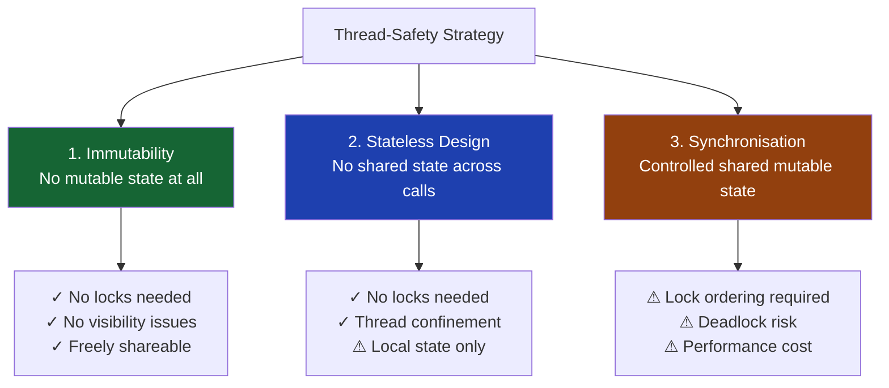

# أمان الخيوط — مبادئ التصميم والكائنات غير القابلة للتغيير

## نظرة عامة

أمان الخيوط خاصية في الشيفرة: يكون الصنف أو الطريقة **آمنًا للخيوط** إذا تصرف بشكل صحيح عند الوصول إليه من عدة خيوط في الوقت نفسه، دون أن يحتاج المستدعي إلى أي مزامنة إضافية.

وأفضل شيفرة آمنة للخيوط لا تحتاج إلى أي مزامنة — فهي تحقق الأمان بالتصميم، لا بالأقفال. وفهم تسلسل استراتيجيات أمان الخيوط يتيح لك اختيار الأسلوب الصحيح لكل موقف وتجنب اللجوء إلى المزامنة عندما توجد حلول أبسط.

يغطي هذا الدرس الاستراتيجيات الأساسية الثلاث — عدم القابلية للتغيير، والتصميم عديم الحالة، وحصر الخيط — ويُظهر كيف تسهّل ميزات Java 17 و21 تنفيذ كل منها بشكل صحيح.

## أهداف التعلم

في نهاية هذا الدرس ستستطيع:

- تحديد استراتيجيات أمان الخيوط الأساسية الثلاث وتطبيقها
- تصميم كائنات قيمة غير قابلة للتغيير بشكل صحيح باستخدام حقول `final` وسجلات Java ‏(records)
- التمييز بين الخدمات عديمة الحالة والخدمات ذات الحالة وشرح لماذا تكون عديمة الحالة أكثر أمانًا
- تطبيق حصر الخيط عبر المتغيرات المحلية، و`ThreadLocal`، وحصر المكدس
- شرح لماذا توفر حقول `final` ضمانات النشر الآمن
- التعرف على أخطاء أمان الخيوط الشائعة في شيفرة الخدمات المالية وإزالتها
- اختيار الاستراتيجية المناسبة لسيناريو تزامن معين

## سياق العمل

تعالج منصة مدفوعات 12,000 طلب في الثانية عبر 200 خيط افتراضي. ويضم فريق الهندسة ثلاثة مهندسين مبتدئين يُدخلون باستمرار أخطاء دقيقة في أمان الخيوط:

- ‏`CurrencyConverter` بذاكرة مؤقتة قابلة للتغيير لأسعار الصرف تُحدّث جزئيًا عندما يكتب خيطان في الوقت نفسه، فتنتج أسعارًا مشوهة
- ‏`FeeCalculator` يخزن نتائج وسيطة في حقل نسخة، فيفسد خيطان يعالجان معاملتين مختلفتين حسابات بعضهما
- ‏`PaymentValidator` يستخدم `SimpleDateFormat` مشتركًا فيرمي `NumberFormatException` تحت الحمل لأن `SimpleDateFormat` غير آمن للخيوط

وكل حادث يتطلب تراجعًا في الإنتاج. ويحتاج الفريق إلى إطار مبدئي لجعل الشيفرة آمنة للخيوط بالتصميم، لا بالمصادفة.

## استراتيجيات أمان الخيوط

هناك ثلاث استراتيجيات لجعل الشيفرة آمنة للخيوط، بترتيب الأفضلية:



1. **عدم القابلية للتغيير**: لا حالة قابلة للتغيير إطلاقًا — بلا أقفال، وبلا مشكلات رؤية، ومشاركة حرة.
2. **التصميم عديم الحالة**: لا حالة مشتركة عبر الاستدعاءات — بلا أقفال، وحصر في الخيط.
3. **المزامنة**: حالة مشتركة قابلة للتغيير مضبوطة — تتطلب ترتيب الأقفال، مع خطر الجمود وكلفة أداء.

**فضّل دائمًا الاستراتيجيات الأعلى في التسلسل.** فالمزامنة ليست أول أداة تلجأ إليها — بل الملاذ الأخير عندما لا يكفي عدم القابلية للتغيير والتصميم عديم الحالة فعلًا.

## الاستراتيجية 1: عدم القابلية للتغيير

**الكائن غير القابل للتغيير** هو كائن لا يمكن تغيير حالته بعد البناء. ولأنه بلا حالة قابلة للتغيير، يكون آمنًا للخيوط تلقائيًا — فلا يستطيع أي خيط رؤية حالة غير متسقة، لأن الحالة لا تتغير أبدًا.

### قواعد عدم القابلية الحقيقية للتغيير

لكي يكون الصنف غير قابل للتغيير حقًا، يجب أن يتحقق كل ما يلي:

1. كل الحقول `final`
2. كل الحقول تشير إلى كائنات غير قابلة للتغيير (أو أنواع أولية)
3. الصنف نهائي فعليًا (مُعلن `final` أو `sealed`)
4. الكائن مبني بشكل صحيح (لا يفلت مرجع `this` أثناء البناء)
5. لا توجد طرق تعديل

> [!WARNING]
> ‏`final` على حقل يمنع إعادة تعيين المرجع، لكنه **لا** يجعل الكائن المشار إليه غير قابل للتغيير. فيمكن إضافة عناصر إلى `final List<String>`. وعدم القابلية الحقيقية للتغيير تتطلب أن تكون الكائنات المشار إليها نفسها غير قابلة للتغيير.

### كائن القيمة Money غير القابل للتغيير

يمثل كائن القيمة `Money` مبلغًا نقديًا بعملة محددة. ويُمرر عبر مسار معالجة المدفوعات كله، ويجب أن يكون آمنًا للمشاركة بين الخيوط.

```java17
// Java 17 — Immutable Money with final fields
public final class Money {

    private final long amountMinorUnits;  // pence, cents — avoids floating point
    private final Currency currency;

    public Money(long amountMinorUnits, Currency currency) {
        if (currency == null) throw new IllegalArgumentException("currency must not be null");
        if (amountMinorUnits < 0) throw new IllegalArgumentException("amount must be non-negative");
        this.amountMinorUnits = amountMinorUnits;
        this.currency = currency;
    }

    // No setters — immutable

    public Money add(Money other) {
        if (!this.currency.equals(other.currency)) {
            throw new CurrencyMismatchException(this.currency, other.currency);
        }
        // Returns a NEW Money — does not mutate this
        return new Money(this.amountMinorUnits + other.amountMinorUnits, this.currency);
    }

    public Money subtract(Money other) {
        if (!this.currency.equals(other.currency)) {
            throw new CurrencyMismatchException(this.currency, other.currency);
        }
        long result = this.amountMinorUnits - other.amountMinorUnits;
        if (result < 0) {
            throw new InsufficientFundsException(this, other);
        }
        return new Money(result, this.currency);
    }

    public boolean isGreaterThanOrEqualTo(Money other) {
        if (!this.currency.equals(other.currency)) {
            throw new CurrencyMismatchException(this.currency, other.currency);
        }
        return this.amountMinorUnits >= other.amountMinorUnits;
    }

    public long getAmountMinorUnits() { return amountMinorUnits; }
    public Currency getCurrency()     { return currency; }

    @Override
    public boolean equals(Object o) {
        if (this == o) return true;
        if (!(o instanceof Money m)) return false;
        return amountMinorUnits == m.amountMinorUnits && currency.equals(m.currency);
    }

    @Override
    public int hashCode() {
        return Objects.hash(amountMinorUnits, currency);
    }

    @Override
    public String toString() {
        // Use the currency's own number of decimals (GBP 2, JPY 0, BHD 3)
        // and BigDecimal — never a double — even for display
        return currency.getCurrencyCode() + " "
            + BigDecimal.valueOf(amountMinorUnits, currency.getDefaultFractionDigits());
    }
}
```

```java21
// Java 21 — Immutable Money as a Record
// Records are implicitly final, provide canonical constructor, equals, hashCode, toString
public record Money(long amountMinorUnits, Currency currency) {

    // Compact constructor for validation
    public Money {
        if (currency == null) throw new IllegalArgumentException("currency must not be null");
        if (amountMinorUnits < 0) throw new IllegalArgumentException("amount must be non-negative");
    }

    public Money add(Money other) {
        requireSameCurrency(other);
        return new Money(this.amountMinorUnits + other.amountMinorUnits, this.currency);
    }

    public Money subtract(Money other) {
        requireSameCurrency(other);
        long result = this.amountMinorUnits - other.amountMinorUnits;
        if (result < 0) throw new InsufficientFundsException(this, other);
        return new Money(result, this.currency);
    }

    public boolean isGreaterThanOrEqualTo(Money other) {
        requireSameCurrency(other);
        return this.amountMinorUnits >= other.amountMinorUnits;
    }

    private void requireSameCurrency(Money other) {
        if (!this.currency.equals(other.currency)) {
            throw new CurrencyMismatchException(this.currency, other.currency);
        }
    }

    @Override
    public String toString() {
        // Use the currency's own number of decimals (GBP 2, JPY 0, BHD 3)
        // and BigDecimal — never a double — even for display
        return currency.getCurrencyCode() + " "
            + BigDecimal.valueOf(amountMinorUnits, currency.getDefaultFractionDigits());
    }
}
```

يعرض `toString` المبلغ بعدد المنازل العشرية الخاص بالعملة (الجنيه 2، والين 0، والدينار البحريني 3) وبـ `BigDecimal` — لا بعدد عشري `double` — حتى للعرض.

> [!NOTE]
> سجلات Java 21 هي الطريقة المفضلة لإنشاء كائنات قيمة غير قابلة للتغيير. فهي تلغي الشيفرة المتكررة مع فرض كل قواعد عدم القابلية للتغيير: الحقول `private final` ضمنيًا، ولا تُولّد طرق تعيين، والصنف `final` ضمنيًا. ويعمل المُنشئ المضغوط قبل تعيين الحقول، فيصبح التحقق طبيعيًا.

### النشر الآمن عبر الحقول النهائية

يقدم JMM ضمانًا خاصًا لحقول `final`: بعد اكتمال المُنشئ، **يُضمن لأي خيط يرى مرجع الكائن أن يرى القيم المهيأة بشكل صحيح لكل حقول `final`** — دون مزامنة.

وهذا ضمان **النشر الآمن**. ويعني أن الكائن غير القابل للتغيير يمكن نشره (جعله مرئيًا لخيوط أخرى) بأي آلية — حتى عبر سباق بيانات على المرجع نفسه — ويبقى مضمونًا للمستقبل أن يرى قيم الحقول الصحيحة.

```java17
// Safe to share across threads without synchronisation
// because all fields are final (or the class is a record)
public final class PaymentReference {
    private final String id;
    private final Money amount;
    private final Instant createdAt;

    public PaymentReference(String id, Money amount, Instant createdAt) {
        this.id = id;
        this.amount = amount;
        this.createdAt = createdAt;
    }
    // getters only, no setters
}

// Shared across threads — safe because PaymentReference is immutable
// No volatile, no synchronized, no lock required
public class PaymentCache {
    private PaymentReference lastPayment; // Not volatile — but see note below

    // Publishing via a data race is safe for READS of immutable objects
    // because the final field guarantee covers the full object graph
    // (assuming Money and Instant are also immutable, which they are)
}
```

> [!IMPORTANT]
> يضمن النشر الآمن عبر حقول `final` رؤية **الحقول** بشكل صحيح. لكنه **لا** يضمن أن يكون **المرجع** إلى الكائن مرئيًا لخيوط أخرى دون مزامنة. ولكي يُنشر المرجع نفسه بأمان، تحتاج `volatile`، أو `AtomicReference`، أو قفلًا، أو وضعه في مجموعة متزامنة.

## الاستراتيجية 2: التصميم عديم الحالة

الكائن **عديم الحالة** ليس له حقول نسخة تُعدّل أثناء معالجة الطلب. فكل استدعاء طريقة يتلقى كل ما يحتاجه كمعاملات ويعيد نتيجة دون تخزين حالة وسيطة.

والكائنات عديمة الحالة آمنة للخيوط تلقائيًا لأنه لا توجد حالة مشتركة قابلة للتغيير يمكن إفسادها.

### فخ الحالة القابلة للتغيير

```java17
// DANGEROUS — not thread-safe
// Thread 1 and Thread 2 both call calculateFee() simultaneously
// They share the same FeeCalculator instance
public class FeeCalculator {

    // Instance field — shared across all threads using this object
    private BigDecimal baseAmount;    // ← SHARED MUTABLE STATE
    private BigDecimal feeRate;       // ← SHARED MUTABLE STATE

    public BigDecimal calculateFee(BigDecimal amount, String productType) {
        this.baseAmount = amount;              // Thread 1 sets to 1000.00
        this.feeRate = lookupRate(productType); // Thread 1 sets to 0.015

        // Thread 2 sets this.baseAmount to 500.00 HERE

        // Thread 1 reads this.baseAmount — could be 500.00 (Thread 2's value!)
        BigDecimal fee = this.baseAmount.multiply(this.feeRate);
        return fee; // Wrong answer — corrupted by Thread 2
    }
}
```

يضبط الخيط 1 حقول النسخة، ثم يكتب الخيط 2 فوقها، فيقرأ الخيط 1 قيمة الخيط 2 ويحسب رسومًا خاطئة.

### الخدمة عديمة الحالة — الإصلاح

```java17
// SAFE — stateless service
// No instance fields that change during request processing
@Service
public class FeeCalculatorService {

    // Static final configuration — immutable, safe to share
    private static final Map<String, BigDecimal> FEE_RATES = Map.of(
        "STANDARD", new BigDecimal("0.015"),
        "EXPRESS",  new BigDecimal("0.025"),
        "PREMIUM",  new BigDecimal("0.010")
    );

    // All inputs are method parameters — stack-confined (thread-local by nature)
    public BigDecimal calculateFee(BigDecimal amount, String productType) {
        // Local variables — confined to this thread's stack frame
        BigDecimal rate = FEE_RATES.getOrDefault(productType, new BigDecimal("0.020"));
        BigDecimal fee  = amount.multiply(rate);                    // local
        BigDecimal vat  = fee.multiply(new BigDecimal("0.20"));     // local
        return fee.add(vat);
        // All locals are discarded when this method returns
        // Nothing is shared — nothing can be corrupted
    }
}
```

> [!NOTE]
> أنواع Spring ‏`@Service` و`@Component` مفردة (singleton) افتراضيًا — نسخة واحدة تتشاركها كل الخيوط. وهذا يجعل التصميم عديم الحالة ليس مجرد تفضيل، بل متطلبًا لخدمات Spring التي تعالج طلبات متزامنة.

### حصر الخيط

أحيانًا تحتاج إلى حالة قابلة للتغيير لكنك تستطيع ضمان ألا يصل إليها إلا خيط واحد في كل مرة. فـ **حصر الخيط** يقصر الوصول إلى الكائن على خيط واحد، فيصبح آمنًا ببساطة.

**حصر المكدس** (الشكل الأكثر شيوعًا) يعني إبقاء الحالة في متغيرات محلية لا تفلت من الطريقة أبدًا:

```java17
public class PaymentProcessor {

    public PaymentResult process(PaymentRequest request) {
        // Builder is stack-confined — created here, never shared
        // Safe to mutate freely — only this thread can reach it
        PaymentResult.Builder builder = new PaymentResult.Builder();

        try {
            Money fee = feeService.calculateFee(request.getAmount(), request.getType());
            builder.withFee(fee);

            String authCode = authService.authorise(request);
            builder.withAuthCode(authCode);

            ledgerService.post(request, fee);
            builder.withStatus(PaymentStatus.SETTLED);

        } catch (InsufficientFundsException e) {
            builder.withStatus(PaymentStatus.DECLINED)
                   .withDeclineReason("INSUFFICIENT_FUNDS");
        }

        return builder.build(); // Builder never escapes — safe
    }
}
```

**حصر `ThreadLocal`** يوفر نسخة منفصلة من القيمة لكل خيط. استخدمه للكائنات المكلفة الإنشاء وغير الآمنة للخيوط:

```java17
// SimpleDateFormat is not thread-safe — ThreadLocal gives each thread its own copy
// This pattern is common in legacy codebases; prefer DateTimeFormatter in new code
public class LegacyDateParser {

    private static final ThreadLocal<SimpleDateFormat> DATE_FORMAT =
        ThreadLocal.withInitial(() -> new SimpleDateFormat("yyyy-MM-dd"));

    public Date parse(String dateStr) throws ParseException {
        // Each thread gets its own SimpleDateFormat — no sharing
        return DATE_FORMAT.get().parse(dateStr);
    }
}

// Modern Java 17+ — DateTimeFormatter is immutable, no ThreadLocal needed
public class ModernDateParser {

    // Immutable and thread-safe — can be a shared static constant
    private static final DateTimeFormatter FORMATTER =
        DateTimeFormatter.ofPattern("yyyy-MM-dd");

    public LocalDate parse(String dateStr) {
        return LocalDate.parse(dateStr, FORMATTER);
    }
}
```

> [!WARNING]
> تبقى قيم `ThreadLocal` بعد إعادة استخدام الخيط. ففي مجمّعات خيوط المنصة (عمال Tomcat، وخدمات التنفيذ) قد يعالج الخيط الذي عالج طلبًا طلبًا آخر. لذلك استدعِ دائمًا `remove()` عند الانتهاء، باستخدام `try-finally` لضمان التنظيف. والفشل في ذلك يسبب تسرب البيانات بين الطلبات — مشكلة أمنية خطيرة في أنظمة الدفع متعددة المستأجرين.
>
> الخيوط الافتراضية مختلفة: فهي لا تُجمّع، فيحصل كل مهمة على خيط جديد. و`ThreadLocal` المستخدم كذاكرة مؤقتة لكل خيط (مثل `SimpleDateFormat` أعلاه) لا يعطي حينها أي إعادة استخدام — ومع ملايين الخيوط الافتراضية قد يكلف ذاكرة كبيرة. فضّل البدائل غير القابلة للتغيير (`DateTimeFormatter`)، و`ScopedValue` لسياق كل طلب.

## أخطاء أمان الخيوط الشائعة في الشيفرة المالية

### الخطأ 1: مشاركة مجمّعات قابلة للتغيير

```java17
// WRONG — shared mutable accumulator
public class DailyRevenueCalculator {
    private BigDecimal totalRevenue = BigDecimal.ZERO; // ← mutable shared state

    public void addTransaction(BigDecimal amount) {
        // Not atomic — read-modify-write without lock
        totalRevenue = totalRevenue.add(amount); // Thread-unsafe
    }
}

// CORRECT — use AtomicReference for concurrent accumulation
// (under heavy contention, a LongAdder of minor units scales better)
public class DailyRevenueCalculator {
    private final AtomicReference<BigDecimal> totalRevenue =
        new AtomicReference<>(BigDecimal.ZERO);

    public void addTransaction(BigDecimal amount) {
        // CAS loop — atomic update
        totalRevenue.updateAndGet(current -> current.add(amount));
    }

    public BigDecimal getTotal() { return totalRevenue.get(); }
}
```

‏`AtomicReference` مع `updateAndGet` يعطي تحديثًا ذريًا بحلقة CAS؛ وتحت التنافس الشديد يتوسع `LongAdder` للوحدات الصغرى بشكل أفضل.

### الخطأ 2: حالة ساكنة قابلة للتغيير

```java17
// CATASTROPHIC — mutable static shared by every thread in the JVM
public class ExchangeRateService {
    private static BigDecimal USD_TO_GBP = new BigDecimal("0.79"); // ← STATIC MUTABLE

    public static void updateRate(BigDecimal newRate) {
        USD_TO_GBP = newRate; // No visibility guarantee whatsoever
    }

    public static BigDecimal convert(BigDecimal usd) {
        return usd.multiply(USD_TO_GBP); // May keep using an old rate indefinitely:
                                         // no visibility guarantee without volatile
    }
}

// CORRECT — immutable snapshot with volatile reference
public class ExchangeRateService {
    private record RateSnapshot(BigDecimal usdToGbp, Instant capturedAt) {}

    // volatile ensures visibility when the reference is replaced
    private volatile RateSnapshot current =
        new RateSnapshot(new BigDecimal("0.79"), Instant.now());

    public void updateRate(BigDecimal newRate) {
        // Atomic reference replacement — old snapshot still safe to read
        current = new RateSnapshot(newRate, Instant.now());
    }

    public BigDecimal convert(BigDecimal usd) {
        // Reads one consistent snapshot — thread-safe
        return usd.multiply(current.usdToGbp());
    }
}
```

دون `volatile` قد يستمر القارئ في استخدام سعر قديم إلى أجل غير مسمى. والحل لقطة غير قابلة للتغيير يُستبدل مرجعها `volatile` ذريًا، فيقرأ كل استدعاء لقطة واحدة متسقة.

### الخطأ 3: إفلات `this` أثناء البناء

```java17
// DANGEROUS — this escapes during construction
public class PaymentEventListener {
    private final String listenerId;

    public PaymentEventListener(String id, EventBus bus) {
        this.listenerId = id;
        bus.register(this); // ← 'this' escapes BEFORE constructor completes!
        // listenerId was assigned on the line above, but the final-field
        // guarantee only applies once the constructor FINISHES: another thread
        // that receives 'this' now has no guarantee of seeing it — and any
        // field assigned after this line is certainly not set yet
    }
}

// CORRECT — static factory method publishes after full construction
public class PaymentEventListener {
    private final String listenerId;

    private PaymentEventListener(String id) {
        this.listenerId = id;
        // Constructor completes fully — all finals are assigned
    }

    // Safe publication: fully constructed before registration
    public static PaymentEventListener create(String id, EventBus bus) {
        PaymentEventListener listener = new PaymentEventListener(id);
        bus.register(listener); // Published only after construction is complete
        return listener;
    }
}
```

حتى لو عُيّن الحقل قبل التسجيل، فضمان الحقول النهائية لا ينطبق إلا عند **انتهاء** المُنشئ: فالخيط الآخر الذي يتلقى `this` الآن لا يضمن له رؤيته — وأي حقل يُعيّن بعد ذلك السطر لم يُعيّن بعد قطعًا. والحل طريقة مصنع ساكنة تنشر الكائن بعد اكتمال بنائه.

## تحسينات Java 21

### السجلات ككائنات قيمة غير قابلة للتغيير معيارية

سجلات Java 21 (ميزة معيارية منذ Java 16، وعُزّزت بمطابقة الأنماط في 21) تجعل كائنات القيمة غير القابلة للتغيير الخيار الطبيعي الافتراضي:

```java21
// Payment event — immutable record, automatically thread-safe
public record PaymentEvent(
    String paymentId,
    Money amount,
    String sourceAccountId,
    String destinationAccountId,
    PaymentStatus status,
    Instant occurredAt
) {
    // Compact constructor validates and normalises
    public PaymentEvent {
        Objects.requireNonNull(paymentId, "paymentId");
        Objects.requireNonNull(amount, "amount");
        Objects.requireNonNull(occurredAt, "occurredAt");
    }

    // Derived computed value — consistent with immutable semantics
    public boolean isSettled() {
        return status == PaymentStatus.SETTLED;
    }
}

// Pattern matching on records — Java 21
public String describeEvent(PaymentEvent event) {
    return switch (event.status()) {
        case SETTLED  -> "Settled %s".formatted(event.amount());
        case DECLINED -> "Declined: insufficient funds";
        case PENDING  -> "Pending authorisation";
    };
}
```

### الخيوط الافتراضية وأمان الخيوط

لا تغيّر الخيوط الافتراضية قواعد أمان الخيوط — فإذا لم تكن الشيفرة آمنة مع خيوط المنصة، فلن تكون آمنة مع الخيوط الافتراضية. لكن الخيوط الافتراضية تغيّر ملف الكلفة:

```java21
// Virtual threads — cheap enough to create one per payment
// But the PaymentProcessor must still be thread-safe
// (StructuredTaskScope is a preview API in Java 21: compile and run with
//  --enable-preview. Its API was redesigned in later JDKs.)
public class VirtualThreadPaymentDispatcher {

    private final PaymentProcessor processor; // Must be stateless or thread-safe

    public void dispatch(List<PaymentRequest> requests) {
        try (var scope = new StructuredTaskScope.ShutdownOnFailure()) {
            // In Java 21, fork() returns a Subtask (not a Future)
            List<StructuredTaskScope.Subtask<PaymentResult>> subtasks = requests.stream()
                .map(req -> scope.fork(() -> processor.process(req)))
                .toList();

            scope.join().throwIfFailed();

            subtasks.stream()
                    .map(StructuredTaskScope.Subtask::get)
                    .forEach(this::recordResult);
        } catch (Exception e) {
            throw new PaymentDispatchException("Batch processing failed", e);
        }
    }
}
```

‏`StructuredTaskScope` واجهة معاينة (preview) في Java 21: تُترجم وتُشغّل مع `--enable-preview`، وقد أعيد تصميمها في إصدارات JDK اللاحقة. وفي Java 21 تعيد `fork()` كائن `Subtask` لا `Future`.

## دليل اختيار الاستراتيجية

| السيناريو | الاستراتيجية المفضلة | السبب |
|---|---|---|
| المبالغ النقدية، والعملة | سجل غير قابل للتغيير | دلالات القيمة؛ مشاركة حرة |
| حساب الرسوم | طريقة عديمة الحالة | كل المدخلات عبر المعاملات |
| تنسيق التاريخ | ‏`DateTimeFormatter` غير قابل للتغيير | آمن للخيوط بالتصميم منذ Java 8 |
| لقطة سعر الصرف | غير قابل للتغيير + مرجع `volatile` | قراءات متسقة، واستبدال رخيص |
| سياق كل طلب (معرّف التتبع) | حصر المكدس أو `ScopedValue` | العمر يطابق الطلب |
| اعتمادية قديمة غير آمنة للخيوط | ‏`ThreadLocal` مع `remove()` | عزل لكل خيط؛ نظّف دائمًا |
| عدّاد / مجمّع مشترك | ‏`AtomicLong` / `LongAdder` | خالٍ من الأقفال؛ مبني لهذا الاستخدام |
| رصيد الحساب البنكي | مزامنة / `SELECT FOR UPDATE` | يلزم اتساق خارجي |


<!-- KNOWLEDGE-CHECK [
  {
    "id": "kc-ts-01",
    "question": "خدمة Spring مفردة @Service فيها حقل نسخة `BigDecimal lastFee` يُضبط في بداية `calculateFee()` ويُقرأ في نهايتها. وتحت الحمل المتزامن تكون الرسوم المحسوبة خاطئة أحيانًا. ما السبب الجذري؟",
    "options": [
      "الخدمة غير معلّمة بـ @Transactional",
      "حقل النسخة حالة مشتركة قابلة للتغيير — تكتب الخيوط فوق قيم بعضها",
      "BigDecimal غير آمن للخيوط",
      "أنواع Spring غير آمنة للوصول المتزامن"
    ],
    "correct": 1,
    "explanation": "تتشارك أنواع Spring المفردة نسخة واحدة بين كل الخيوط. وحقل النسخة `lastFee` حالة مشتركة. يضبطه الخيط 1، ثم يضبطه الخيط 2 قبل أن يقرأه الخيط 1. والحل استخدام متغيرات محلية (حصر المكدس) — فلا حاجة إلى حقول نسخة في حاسبة رسوم نقية."
  },
  {
    "id": "kc-ts-02",
    "question": "أي عبارة عن سجلات Java صحيحة فيما يخص أمان الخيوط؟",
    "options": [
      "السجلات آمنة للخيوط فقط إذا كانت كل أنواع مكوناتها أولية",
      "السجلات غير قابلة للتغيير وآمنة للخيوط بشرط أن تكون كل أنواع مكوناتها غير قابلة للتغيير أيضًا",
      "تتطلب السجلات وصولًا متزامنًا لأنها تستخدم مُنشئًا معياريًا",
      "السجلات آمنة للخيوط فقط عند استخدامها مع الخيوط الافتراضية"
    ],
    "correct": 1,
    "explanation": "تفرض السجلات عدم القابلية للتغيير على مستوى الصنف (كل الحقول private final ضمنيًا)، لكن أمان الخيوط يمتد عبر مخطط الكائنات كله. فإذا كان أحد مكونات السجل نوعًا قابلًا للتغيير (مثل ArrayList)، فالسجل ليس غير قابل للتغيير حقًا. ويجب أن تكون كل أنواع المكونات غير قابلة للتغيير ليكون السجل نفسه آمنًا للخيوط."
  },
  {
    "id": "kc-ts-03",
    "question": "يُستخدم `ThreadLocal<SimpleDateFormat>` في خدمة دفع تعمل على مجمّع خيوط منصة (خيوط عمال Tomcat). ما الخطوة المطلوبة بعد كل طلب؟",
    "options": [
      "استدعاء ThreadLocal.initialValue() قبل كل طلب",
      "استدعاء ThreadLocal.remove() بعد كل طلب لمنع تسرب القيم بين الطلبات",
      "إعلان ThreadLocal كـ volatile",
      "لا شيء — تُعاد ضبط قيم ThreadLocal تلقائيًا بين المهام"
    ],
    "correct": 1,
    "explanation": "يُعاد استخدام خيوط مجمّع المنصة عبر الطلبات. فقيمة ThreadLocal التي ضُبطت أثناء الطلب A تبقى متاحة أثناء الطلب B على الخيط نفسه، وقد يسرّب هذا البيانات بين الطلبات — مشكلة أمنية في الأنظمة متعددة المستأجرين. استدعِ remove() دائمًا في كتلة finally. (أما الخيوط الافتراضية فلا تُجمّع — فكل مهمة تحصل على خيط جديد — فتختلف المشكلة: ذاكرة ThreadLocal المؤقتة لا تعطي إعادة استخدام وقد تكلف ذاكرة كبيرة.)"
  },
  {
    "id": "kc-ts-04",
    "question": "يُنشأ كائن `PaymentReference` غير قابل للتغيير في الخيط 1 ويُخزن مرجعه في حقل عادي (غير volatile). ويقرأ الخيط 2 المرجع. هل هذا آمن؟",
    "options": [
      "نعم — حقول final في PaymentReference تضمن أن يرى الخيط 2 قيم الحقول الصحيحة بمجرد قراءة المرجع",
      "جزئيًا — إذا رأى الخيط 2 المرجع فالحقول النهائية صحيحة، لكن دون volatile أو قفل قد يستمر الخيط 2 في رؤية null أو مرجع أقدم",
      "نعم — لكن فقط إذا تشارك الخيطان ذاكرة المعالج المؤقتة نفسها",
      "لا — الحقول النهائية تضمن الرؤية داخل الخيط نفسه فقط"
    ],
    "correct": 1,
    "explanation": "هناك مسألتان منفصلتان. يضمن ضمان الحقول النهائية في JMM أنه إذا رأى الخيط 2 مرجعًا غير null، فستكون للحقول النهائية قيمها الصحيحة. لكن دون علاقة 'يحدث قبل' على المرجع نفسه (volatile، أو synchronized، إلخ)، قد يرى الخيط 2 مرجعًا null أو قديمًا. والنشر الآمن يتطلب الأمرين: علاقة 'يحدث قبل' على المرجع وضمان الحقول النهائية للمحتوى."
  }
] -->


<!-- PRACTICAL-CHALLENGE {
  "id": "pc-thread-safety",
  "title": "مراجعة أمان الخيوط: إعادة هيكلة خدمة دفع",
  "description": "راجع مكونات خدمة الدفع التالية وطبّق استراتيجية أمان الخيوط الصحيحة على كل منها.",
  "tasks": [
    {
      "id": "pc-ts-01",
      "description": "حوّل الصنف القابل للتغيير `FxRate` (بطرق تعيين لسعري الشراء والبيع) إلى سجل Java 21 غير قابل للتغيير `FxRate(Currency base, Currency quote, BigDecimal bid, BigDecimal ask, Instant capturedAt)` مع التحقق في المُنشئ المضغوط."
    },
    {
      "id": "pc-ts-02",
      "description": "حدّد مشكلة أمان الخيوط وأصلحها في `PaymentAuditService` التي تخزن `private String currentUserId` كحقل نسخة يُضبط في بداية كل استدعاء لطريقة التدقيق."
    },
    {
      "id": "pc-ts-03",
      "description": "ينشئ `ReportGenerator` كائن `StringBuilder` على مستوى الصنف (`private StringBuilder buffer = new StringBuilder()`) ويضيف إليه أثناء إنشاء التقرير. أعد هيكلته إلى تصميم محصور في المكدس."
    },
    {
      "id": "pc-ts-04",
      "description": "محلل XML قديم مخزن في `ThreadLocal` لا يُزال أبدًا بعد الاستخدام. أضف التنظيف الصحيح باستخدام try-finally لمنع تسرب بيانات الطلبات."
    },
    {
      "id": "pc-ts-05",
      "description": "اشرح في جملة واحدة لماذا تكون `InterestCalculatorService` عديمة الحالة، ولها فقط اعتماديات `final` محقونة (بلا تعديل للنسخة)، آمنة للخيوط افتراضيًا، حتى كنوع Spring مفرد."
    }
  ]
} -->
