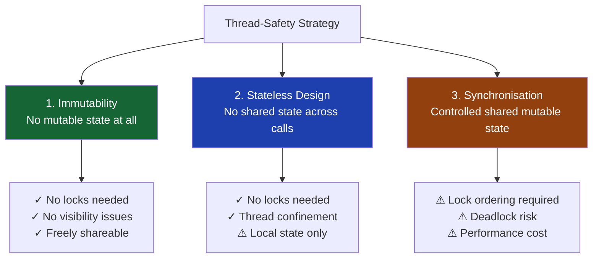

## Overview

Thread safety is a property of code: a class or method is **thread-safe** if it behaves correctly when accessed from multiple threads simultaneously, without requiring any additional synchronisation from the caller.

The best thread-safe code requires no synchronisation at all — it achieves safety through design, not locks. Understanding the hierarchy of thread-safety strategies lets you choose the right approach for every situation and avoid reaching for synchronisation when simpler solutions exist.

This lesson covers the three fundamental strategies — immutability, stateless design, and thread confinement — and shows how Java 17 and 21 features make each strategy easier to implement correctly.

## Learning Objectives

By the end of this lesson you will be able to:

- Identify and apply the three primary thread-safety strategies
- Design immutable value objects correctly using `final` fields and Java records
- Distinguish stateless services from stateful ones and explain why stateless is safer
- Apply thread confinement via local variables, `ThreadLocal`, and stack confinement
- Explain why `final` fields provide safe publication guarantees
- Recognise and eliminate common thread-safety mistakes in financial service code
- Choose the appropriate strategy for a given concurrency scenario

## Business Context

A payment processing platform handles 12,000 requests per second across 200 virtual threads. The engineering team is onboarding three junior engineers who keep introducing subtle thread-safety bugs:

- A `CurrencyConverter` with a mutable exchange-rate cache gets partially updated when two threads write simultaneously, producing garbled rates
- A `FeeCalculator` stores intermediate results in an instance field, causing two threads processing different transactions to corrupt each other's calculations
- A `PaymentValidator` using a shared `SimpleDateFormat` throws `NumberFormatException` under load because `SimpleDateFormat` is not thread-safe

Each incident requires a production rollback. The team needs a principled framework for making code thread-safe by design, not by accident.

## Thread-Safety Strategies

There are three strategies for making code thread-safe, in order of preference:



**Always prefer the strategies higher in the hierarchy.** Synchronisation is not the first tool to reach for — it is the last resort when immutability and stateless design are genuinely insufficient.

## Strategy 1: Immutability

An **immutable object** is one whose state cannot change after construction. Because immutable objects have no mutable state, they are automatically thread-safe — no thread can observe an inconsistent state, because the state never changes.

### Rules for True Immutability

For a class to be truly immutable, all of the following must hold:

1. All fields are `final`
2. All fields reference immutable objects (or primitives)
3. The class is effectively `final` (declared `final` or sealed)
4. The object is properly constructed (no `this` reference escapes during construction)
5. No mutator methods are provided

> [!WARNING]
> `final` on a field prevents reassignment of the reference, but does **not** make the referenced object immutable. A `final List<String>` can still have elements added to it. True immutability requires the referenced objects themselves to be immutable.

### Immutable Money Value Object

A `Money` value object represents a monetary amount in a specific currency. It is passed throughout the payment processing pipeline and must be safe to share across threads.

```java17
// Java 17 — Immutable Money with final fields
public final class Money {

    private final long amountMinorUnits;  // pence, cents — avoids floating point
    private final Currency currency;

    public Money(long amountMinorUnits, Currency currency) {
        if (currency == null) throw new IllegalArgumentException("currency must not be null");
        if (amountMinorUnits < 0) throw new IllegalArgumentException("amount must be non-negative");
        this.amountMinorUnits = amountMinorUnits;
        this.currency = currency;
    }

    // No setters — immutable

    public Money add(Money other) {
        if (!this.currency.equals(other.currency)) {
            throw new CurrencyMismatchException(this.currency, other.currency);
        }
        // Returns a NEW Money — does not mutate this
        return new Money(this.amountMinorUnits + other.amountMinorUnits, this.currency);
    }

    public Money subtract(Money other) {
        if (!this.currency.equals(other.currency)) {
            throw new CurrencyMismatchException(this.currency, other.currency);
        }
        long result = this.amountMinorUnits - other.amountMinorUnits;
        if (result < 0) {
            throw new InsufficientFundsException(this, other);
        }
        return new Money(result, this.currency);
    }

    public boolean isGreaterThanOrEqualTo(Money other) {
        if (!this.currency.equals(other.currency)) {
            throw new CurrencyMismatchException(this.currency, other.currency);
        }
        return this.amountMinorUnits >= other.amountMinorUnits;
    }

    public long getAmountMinorUnits() { return amountMinorUnits; }
    public Currency getCurrency()     { return currency; }

    @Override
    public boolean equals(Object o) {
        if (this == o) return true;
        if (!(o instanceof Money m)) return false;
        return amountMinorUnits == m.amountMinorUnits && currency.equals(m.currency);
    }

    @Override
    public int hashCode() {
        return Objects.hash(amountMinorUnits, currency);
    }

    @Override
    public String toString() {
        return currency.getSymbol() + String.format("%.2f", amountMinorUnits / 100.0);
    }
}
```

```java21
// Java 21 — Immutable Money as a Record
// Records are implicitly final, provide canonical constructor, equals, hashCode, toString
public record Money(long amountMinorUnits, Currency currency) {

    // Compact constructor for validation
    public Money {
        if (currency == null) throw new IllegalArgumentException("currency must not be null");
        if (amountMinorUnits < 0) throw new IllegalArgumentException("amount must be non-negative");
    }

    public Money add(Money other) {
        requireSameCurrency(other);
        return new Money(this.amountMinorUnits + other.amountMinorUnits, this.currency);
    }

    public Money subtract(Money other) {
        requireSameCurrency(other);
        long result = this.amountMinorUnits - other.amountMinorUnits;
        if (result < 0) throw new InsufficientFundsException(this, other);
        return new Money(result, this.currency);
    }

    public boolean isGreaterThanOrEqualTo(Money other) {
        requireSameCurrency(other);
        return this.amountMinorUnits >= other.amountMinorUnits;
    }

    private void requireSameCurrency(Money other) {
        if (!this.currency.equals(other.currency)) {
            throw new CurrencyMismatchException(this.currency, other.currency);
        }
    }

    @Override
    public String toString() {
        return currency.getSymbol() + String.format("%.2f", amountMinorUnits / 100.0);
    }
}
```

> [!NOTE]
> Java 21 records are the preferred way to create immutable value objects. They eliminate boilerplate while enforcing all immutability rules: fields are implicitly `private final`, no setters are generated, and the class is implicitly `final`. The compact constructor runs before field assignment, making validation natural.

### Safe Publication via Final Fields

The JMM provides a special guarantee for `final` fields: once a constructor completes, **any thread that sees the reference to the object is guaranteed to see the correctly initialised values of all `final` fields** — without synchronisation.

This is the **safe publication** guarantee. It means an immutable object can be published (made visible to other threads) by any mechanism — including a data race on the reference itself — and the receiver is still guaranteed to see correct field values.

```java17
// Safe to share across threads without synchronisation
// because all fields are final (or the class is a record)
public final class PaymentReference {
    private final String id;
    private final Money amount;
    private final Instant createdAt;

    public PaymentReference(String id, Money amount, Instant createdAt) {
        this.id = id;
        this.amount = amount;
        this.createdAt = createdAt;
    }
    // getters only, no setters
}

// Shared across threads — safe because PaymentReference is immutable
// No volatile, no synchronized, no lock required
public class PaymentCache {
    private PaymentReference lastPayment; // Not volatile — but see note below

    // Publishing via a data race is safe for READS of immutable objects
    // because the final field guarantee covers the full object graph
    // (assuming Money and Instant are also immutable, which they are)
}
```

> [!IMPORTANT]
> Safe publication via `final` fields guarantees that the **fields** are visible correctly. It does **not** guarantee that the **reference** to the object is visible to other threads without synchronisation. For the reference itself to be safely published, you need `volatile`, an `AtomicReference`, a lock, or placement in a concurrent collection.

## Strategy 2: Stateless Design

A **stateless** object has no instance fields that are modified during request processing. Each method call receives everything it needs as parameters and returns a result without storing intermediate state.

Stateless objects are automatically thread-safe because there is no shared mutable state to corrupt.

### The Mutable-State Trap

```java17
// DANGEROUS — not thread-safe
// Thread 1 and Thread 2 both call calculateFee() simultaneously
// They share the same FeeCalculator instance
public class FeeCalculator {

    // Instance field — shared across all threads using this object
    private BigDecimal baseAmount;    // ← SHARED MUTABLE STATE
    private BigDecimal feeRate;       // ← SHARED MUTABLE STATE

    public BigDecimal calculateFee(BigDecimal amount, String productType) {
        this.baseAmount = amount;              // Thread 1 sets to 1000.00
        this.feeRate = lookupRate(productType); // Thread 1 sets to 0.015

        // Thread 2 sets this.baseAmount to 500.00 HERE

        // Thread 1 reads this.baseAmount — could be 500.00 (Thread 2's value!)
        BigDecimal fee = this.baseAmount.multiply(this.feeRate);
        return fee; // Wrong answer — corrupted by Thread 2
    }
}
```

### Stateless Service — The Fix

```java17
// SAFE — stateless service
// No instance fields that change during request processing
@Service
public class FeeCalculatorService {

    // Static final configuration — immutable, safe to share
    private static final Map<String, BigDecimal> FEE_RATES = Map.of(
        "STANDARD", new BigDecimal("0.015"),
        "EXPRESS",  new BigDecimal("0.025"),
        "PREMIUM",  new BigDecimal("0.010")
    );

    // All inputs are method parameters — stack-confined (thread-local by nature)
    public BigDecimal calculateFee(BigDecimal amount, String productType) {
        // Local variables — confined to this thread's stack frame
        BigDecimal rate = FEE_RATES.getOrDefault(productType, new BigDecimal("0.020"));
        BigDecimal fee  = amount.multiply(rate);                    // local
        BigDecimal vat  = fee.multiply(new BigDecimal("0.20"));     // local
        return fee.add(vat);
        // All locals are discarded when this method returns
        // Nothing is shared — nothing can be corrupted
    }
}
```

> [!NOTE]
> Spring `@Service` and `@Component` beans are singletons by default — one instance shared by all threads. This makes stateless design not just a preference but a requirement for Spring services processing concurrent requests.

### Thread Confinement

Sometimes you need mutable state but can ensure it is only accessed by one thread at a time. **Thread confinement** restricts an object's access to a single thread, making it trivially safe.

**Stack confinement** (the most common form) means keeping state in local variables that never escape the method:

```java17
public class PaymentProcessor {

    public PaymentResult process(PaymentRequest request) {
        // Builder is stack-confined — created here, never shared
        // Safe to mutate freely — only this thread can reach it
        PaymentResult.Builder builder = new PaymentResult.Builder();

        try {
            Money fee = feeService.calculateFee(request.getAmount(), request.getType());
            builder.withFee(fee);

            String authCode = authService.authorise(request);
            builder.withAuthCode(authCode);

            ledgerService.post(request, fee);
            builder.withStatus(PaymentStatus.SETTLED);

        } catch (InsufficientFundsException e) {
            builder.withStatus(PaymentStatus.DECLINED)
                   .withDeclineReason("INSUFFICIENT_FUNDS");
        }

        return builder.build(); // Builder never escapes — safe
    }
}
```

**`ThreadLocal` confinement** provides a separate copy of a value for each thread. Use it for objects that are expensive to create but not thread-safe:

```java17
// SimpleDateFormat is not thread-safe — ThreadLocal gives each thread its own copy
// This pattern is common in legacy codebases; prefer DateTimeFormatter in new code
public class LegacyDateParser {

    private static final ThreadLocal<SimpleDateFormat> DATE_FORMAT =
        ThreadLocal.withInitial(() -> new SimpleDateFormat("yyyy-MM-dd"));

    public Date parse(String dateStr) throws ParseException {
        // Each thread gets its own SimpleDateFormat — no sharing
        return DATE_FORMAT.get().parse(dateStr);
    }
}

// Modern Java 17+ — DateTimeFormatter is immutable, no ThreadLocal needed
public class ModernDateParser {

    // Immutable and thread-safe — can be a shared static constant
    private static final DateTimeFormatter FORMATTER =
        DateTimeFormatter.ofPattern("yyyy-MM-dd");

    public LocalDate parse(String dateStr) {
        return LocalDate.parse(dateStr, FORMATTER);
    }
}
```

> [!WARNING]
> `ThreadLocal` values survive thread reuse. In thread-pool environments (including virtual thread pools), a thread that handled one request may handle another. Always `remove()` the value when done, or use `try-finally` to guarantee cleanup. Failure to do so causes data to bleed between requests — a serious security issue in multi-tenant payment systems.

## Common Thread-Safety Mistakes in Financial Code

### Mistake 1: Sharing Mutable Accumulators

```java17
// WRONG — shared mutable accumulator
public class DailyRevenueCalculator {
    private BigDecimal totalRevenue = BigDecimal.ZERO; // ← mutable shared state

    public void addTransaction(BigDecimal amount) {
        // Not atomic — read-modify-write without lock
        totalRevenue = totalRevenue.add(amount); // Thread-unsafe
    }
}

// CORRECT — use AtomicReference for concurrent accumulation
public class DailyRevenueCalculator {
    private final AtomicReference<BigDecimal> totalRevenue =
        new AtomicReference<>(BigDecimal.ZERO);

    public void addTransaction(BigDecimal amount) {
        // CAS loop — atomic update
        totalRevenue.updateAndGet(current -> current.add(amount));
    }

    public BigDecimal getTotal() { return totalRevenue.get(); }
}
```

### Mistake 2: Mutable Static State

```java17
// CATASTROPHIC — mutable static shared by every thread in the JVM
public class ExchangeRateService {
    private static BigDecimal USD_TO_GBP = new BigDecimal("0.79"); // ← STATIC MUTABLE

    public static void updateRate(BigDecimal newRate) {
        USD_TO_GBP = newRate; // No visibility guarantee whatsoever
    }

    public static BigDecimal convert(BigDecimal usd) {
        return usd.multiply(USD_TO_GBP); // May read a partially written value
    }
}

// CORRECT — immutable snapshot with volatile reference
public class ExchangeRateService {
    private record RateSnapshot(BigDecimal usdToGbp, Instant capturedAt) {}

    // volatile ensures visibility when the reference is replaced
    private volatile RateSnapshot current =
        new RateSnapshot(new BigDecimal("0.79"), Instant.now());

    public void updateRate(BigDecimal newRate) {
        // Atomic reference replacement — old snapshot still safe to read
        current = new RateSnapshot(newRate, Instant.now());
    }

    public BigDecimal convert(BigDecimal usd) {
        // Reads one consistent snapshot — thread-safe
        return usd.multiply(current.usdToGbp());
    }
}
```

### Mistake 3: Escaping `this` During Construction

```java17
// DANGEROUS — this escapes during construction
public class PaymentEventListener {
    private final String listenerId;

    public PaymentEventListener(String id, EventBus bus) {
        this.listenerId = id;
        bus.register(this); // ← 'this' escapes BEFORE constructor completes!
        // Another thread may call an event callback before listenerId is assigned
        // Despite listenerId being final — the assignment hasn't happened yet
    }
}

// CORRECT — static factory method publishes after full construction
public class PaymentEventListener {
    private final String listenerId;

    private PaymentEventListener(String id) {
        this.listenerId = id;
        // Constructor completes fully — all finals are assigned
    }

    // Safe publication: fully constructed before registration
    public static PaymentEventListener create(String id, EventBus bus) {
        PaymentEventListener listener = new PaymentEventListener(id);
        bus.register(listener); // Published only after construction is complete
        return listener;
    }
}
```

## Java 21 Enhancements

### Records as Canonical Immutable Value Objects

Java 21 records (introduced as a standard feature in Java 16, enhanced with pattern matching in 21) make immutable value objects the natural default:

```java21
// Payment event — immutable record, automatically thread-safe
public record PaymentEvent(
    String paymentId,
    Money amount,
    String sourceAccountId,
    String destinationAccountId,
    PaymentStatus status,
    Instant occurredAt
) {
    // Compact constructor validates and normalises
    public PaymentEvent {
        Objects.requireNonNull(paymentId, "paymentId");
        Objects.requireNonNull(amount, "amount");
        Objects.requireNonNull(occurredAt, "occurredAt");
    }

    // Derived computed field — consistent with immutable semantics
    public boolean isCredit() {
        return status == PaymentStatus.SETTLED;
    }
}

// Pattern matching on records — Java 21
public String describeEvent(PaymentEvent event) {
    return switch (event.status()) {
        case SETTLED  -> "Settled %s".formatted(event.amount());
        case DECLINED -> "Declined: insufficient funds";
        case PENDING  -> "Pending authorisation";
    };
}
```

### Virtual Threads and Thread-Safety

Virtual threads do not change thread-safety rules — if code is not thread-safe with platform threads, it is not thread-safe with virtual threads. However, virtual threads change the cost profile:

```java21
// Virtual threads — cheap enough to create one per payment
// But the PaymentProcessor must still be thread-safe
public class VirtualThreadPaymentDispatcher {

    private final PaymentProcessor processor; // Must be stateless or thread-safe

    public void dispatch(List<PaymentRequest> requests) {
        try (var scope = new StructuredTaskScope.ShutdownOnFailure()) {
            List<Future<PaymentResult>> futures = requests.stream()
                .map(req -> scope.fork(() -> processor.process(req)))
                .toList();

            scope.join().throwIfFailed();

            futures.stream()
                   .map(Future::resultNow)
                   .forEach(this::recordResult);
        } catch (Exception e) {
            throw new PaymentDispatchException("Batch processing failed", e);
        }
    }
}
```

## Strategy Selection Guide

| Scenario | Preferred Strategy | Reason |
|---|---|---|
| Money amounts, currency | Immutable record | Value semantics; freely shared |
| Fee calculation | Stateless method | All inputs via parameters |
| Date formatting | Immutable `DateTimeFormatter` | Thread-safe by design in Java 8+ |
| Exchange rate snapshot | Immutable + `volatile` reference | Consistent reads, cheap swap |
| Per-request context (trace ID) | Stack confinement or `ScopedValue` | Lifetime matches request |
| Legacy non-thread-safe dependency | `ThreadLocal` with `remove()` | Isolate per thread; always clean up |
| Shared counter / accumulator | `AtomicLong` / `LongAdder` | Lock-free; built for this use case |
| Bank account balance | Synchronised / `SELECT FOR UPDATE` | External consistency required |

---

<!-- KNOWLEDGE-CHECK [
  {
    "id": "kc-ts-01",
    "question": "A Spring @Service singleton bean has an instance field `BigDecimal lastFee` that is set at the start of `calculateFee()` and read at the end. Under concurrent load, the calculated fee is sometimes wrong. What is the root cause?",
    "options": [
      "The service is not annotated with @Transactional",
      "The instance field is shared mutable state — threads overwrite each other's values",
      "BigDecimal is not thread-safe",
      "Spring beans are not safe for concurrent access"
    ],
    "correct": 1,
    "explanation": "Spring singleton beans share one instance across all threads. The instance field `lastFee` is shared state. Thread 1 sets it, Thread 2 sets it before Thread 1 reads it. The fix is to use local variables (stack confinement) — no instance fields needed in a pure fee calculator."
  },
  {
    "id": "kc-ts-02",
    "question": "Which statement about Java records is correct with respect to thread safety?",
    "options": [
      "Records are thread-safe only if all component types are primitives",
      "Records are immutable and thread-safe provided all component types are also immutable",
      "Records require synchronized access because they use a canonical constructor",
      "Records are thread-safe only when used with virtual threads"
    ],
    "correct": 1,
    "explanation": "Records enforce immutability at the class level (all fields are implicitly private final), but thread safety extends through the full object graph. If a record component is a mutable type (e.g., ArrayList), the record is not truly immutable. All component types must be immutable for the record itself to be thread-safe."
  },
  {
    "id": "kc-ts-03",
    "question": "A `ThreadLocal<SimpleDateFormat>` is used in a payment service deployed on a virtual thread pool. What additional step is required that platform thread pools also require?",
    "options": [
      "Call ThreadLocal.initialValue() before each request",
      "Call ThreadLocal.remove() after each request to prevent values bleeding between requests",
      "Declare the ThreadLocal as volatile",
      "Nothing — virtual threads automatically reset ThreadLocal values between tasks"
    ],
    "correct": 1,
    "explanation": "Thread-pool threads (platform or virtual) are reused across requests. A ThreadLocal value set during request A remains accessible during request B on the same thread. This can cause data to leak between requests — a security issue in multi-tenant systems. Always call remove() in a finally block."
  },
  {
    "id": "kc-ts-04",
    "question": "An immutable `PaymentReference` object is created in Thread 1 and the reference is stored in a plain (non-volatile) field. Thread 2 reads the reference. Is this safe?",
    "options": [
      "Yes — final fields in PaymentReference guarantee Thread 2 sees correct field values once it reads the reference",
      "No — Thread 2 may see a partially constructed object even if the reference is non-null",
      "Yes — but only if Thread 1 and Thread 2 share a CPU cache",
      "No — final fields only guarantee visibility within the same thread"
    ],
    "correct": 1,
    "explanation": "There are two separate concerns. The JMM final-field guarantee ensures that IF Thread 2 sees a non-null reference, the final fields will have their correct values. However, without a happens-before relationship on the reference itself (volatile, synchronized, etc.), Thread 2 may still see a null or stale reference. Safe publication requires both: a happens-before on the reference AND the final-field guarantee for the contents."
  }
] -->

---

<!-- PRACTICAL-CHALLENGE {
  "id": "pc-thread-safety",
  "title": "Thread-Safety Audit: Payment Service Refactoring",
  "description": "Review the following payment service components and apply the correct thread-safety strategy to each.",
  "tasks": [
    {
      "id": "pc-ts-01",
      "description": "Convert the mutable `FxRate` class (with setter methods for bid and ask prices) to an immutable Java 21 record `FxRate(Currency base, Currency quote, BigDecimal bid, BigDecimal ask, Instant capturedAt)` with validation in the compact constructor."
    },
    {
      "id": "pc-ts-02",
      "description": "Identify and fix the thread-safety problem in a `PaymentAuditService` that stores `private String currentUserId` as an instance field, set at the start of each audit method call."
    },
    {
      "id": "pc-ts-03",
      "description": "A `ReportGenerator` creates a `StringBuilder` at the class level (`private StringBuilder buffer = new StringBuilder()`) and appends to it during report generation. Refactor to stack-confined design."
    },
    {
      "id": "pc-ts-04",
      "description": "A legacy XML parser stored in a `ThreadLocal` is never removed after use. Add correct cleanup using try-finally to prevent request data bleeding."
    },
    {
      "id": "pc-ts-05",
      "description": "Explain in one sentence why a stateless `InterestCalculatorService` with only `final` injected dependencies (no instance mutation) is thread-safe by default, even as a Spring singleton."
    }
  ]
} -->
