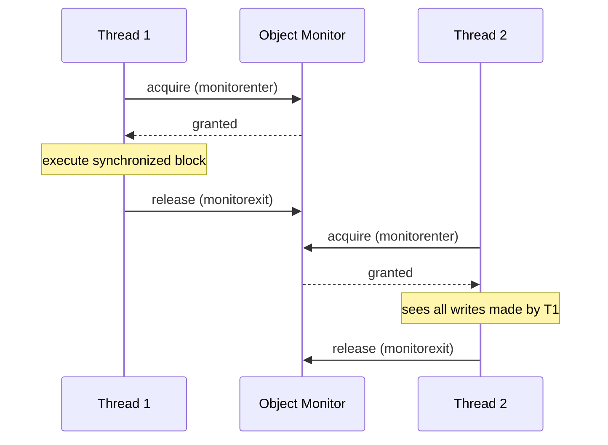
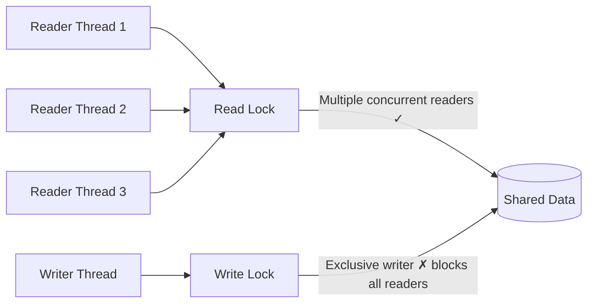
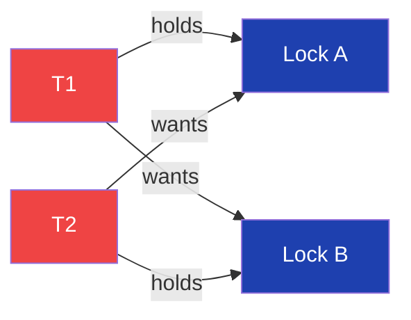
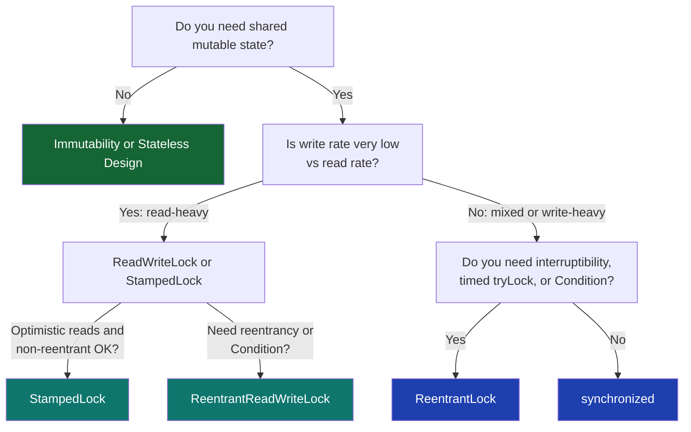

# المزامنة — synchronized وReentrantLock وStampedLock

## نظرة عامة

عندما لا يكفي عدم القابلية للتغيير والتصميم عديم الحالة — عندما تكون الحالة المشتركة القابلة للتغيير مطلوبة فعلًا — تكون المزامنة هي الأداة. وتوفر Java عدة آليات: الكلمة المدمجة `synchronized`، و`ReentrantLock` الصريح، و`ReadWriteLock` المحسّن للقراءة والكتابة، و`StampedLock` عالي الأداء.

وتقدم كل آلية مفاضلات مختلفة في القابلية للقراءة، والمرونة، والأداء، والأمان. واختيار الآلية الخاطئة لمشكلة ما يؤدي إما إلى أعطال في الصحة أو إلى خسائر غير ضرورية في الإنتاجية. وفي نظام معالجة مدفوعات يتعامل مع آلاف المعاملات في الثانية، قد يكون الفرق بين كتلة `synchronized` والقراءة المتفائلة في `StampedLock` هو الفرق بين نظام يتوسع وآخر لا يتوسع.

يغطي هذا الدرس كل عناصر المزامنة في أدوات التزامن في Java مع تطبيق مباشر على أنماط الأنظمة المالية.

## أهداف التعلم

في نهاية هذا الدرس ستستطيع:

- شرح كيف تعمل الأقفال الضمنية وما يضمنه `synchronized`
- تحديد متى تستبدل `synchronized` بـ `ReentrantLock`
- تطبيق `ReadWriteLock` على الحالة المشتركة كثيرة القراءة (أسعار الصرف، والإعدادات)
- استخدام `StampedLock` لأقصى إنتاجية قراءة بالقراءات المتفائلة
- تنفيذ متغيرات `Condition` بديلًا عن `wait`/`notify`
- تطبيق انضباط ترتيب الأقفال لمنع الجمود
- اختيار عنصر المزامنة الصحيح لسيناريو تزامن مالي معين

## سياق العمل

تحتفظ خدمة أسعار صرف بخريطة مشتركة `Map<CurrencyPair, ExchangeRate>` يحدّثها خيط تغذية كل 50 مللي ثانية. ويقرأ 400 خيط لمعالجة المدفوعات الأسعار حتى 10,000 مرة في الثانية.

ومع `synchronized` يحجب القراء الأربعمئة بعضهم والكاتب أثناء كل قراءة — فينتج زمن غير مقبول. ويُحتجز قفل التحديث 2ms (أثناء إعادة بناء الخريطة)، فيصطف 400 خيط خلف تحديث واحد. ويقفز زمن القراءة عند المئين 99 إلى 2.4 ثانية في الذروة.

وفهم `ReadWriteLock` و`StampedLock` يحل ذلك. فعنصر المزامنة الصحيح يخفض زمن القراءة عند المئين 99 إلى أقل من مللي ثانية.

## الأقفال الضمنية وsynchronized

لكل كائن Java **قفل ضمني** (ويُسمى أيضًا قفل المراقب). وتأخذ الكلمة `synchronized` هذا القفل قبل دخول الكتلة وتحرره عند الخروج — بما في ذلك الخروج بسبب استثناء.

### ما يضمنه synchronized

يقدم `synchronized` ضمانين من نموذج ذاكرة Java:

1. **الاستبعاد المتبادل** — خيط واحد فقط يملك القفل في كل لحظة
2. **الرؤية** — عندما يحرر خيط القفل، تصبح كل الكتابات التي أجراها أثناء امتلاكه مرئية لأي خيط يأخذ القفل نفسه لاحقًا



### synchronized على الطرق مقابل الكتل

```java17
// Method-level: locks on 'this' for instance methods, on Class for static methods
public synchronized void debit(Money amount) {
    this.balance = this.balance.subtract(amount);
}

// Block-level: finer granularity, explicit lock object
private final Object balanceLock = new Object();

public void debit(Money amount) {
    synchronized (balanceLock) {
        this.balance = this.balance.subtract(amount);
    }
    // Other non-critical operations outside the lock
    auditLog.record("debit", amount); // No need to hold lock here
}
```

> [!WARNING]
> **تجنب المزامنة على `this` في الأصناف العامة.** فقد تأخذ شيفرة خارجية القفل نفسه، فتسبب حجبًا غير متوقع أو جمودًا. استخدم `final Object` خاصًا كقفل لتغليف المزامنة.

### synchronized والخيوط الافتراضية (Java 21)

في Java 21–23 **تثبّت** كتل `synchronized` الخيوط الافتراضية على خيط الحمل طوال مدة الكتلة. فإذا أجرى الخيط الافتراضي عملية حاجبة (إدخال/إخراج، أو `sleep`، أو أخذ قفل آخر) وهو مثبّت، يُحجب خيط الحمل كله، فتضيع فائدة الخيوط الافتراضية. وقد أزال JDK 24 ‏(JEP 491) هذا القيد عن `synchronized`؛ ولا يبقى التثبيت إلا في حالات أندر مثل الإطارات الأصلية (native).

```java21
// PROBLEM: synchronized pins virtual thread to carrier thread
// If a database call inside the block blocks, the carrier thread blocks too
public synchronized AccountBalance getBalance(String accountId) {
    return database.fetchBalance(accountId); // This I/O pins the carrier thread!
}

// SOLUTION: Replace synchronized with ReentrantLock for virtual-thread-safe locking
private final ReentrantLock lock = new ReentrantLock();

public AccountBalance getBalance(String accountId) {
    lock.lock();
    try {
        return database.fetchBalance(accountId); // Virtual thread parks, not pins
    } finally {
        lock.unlock();
    }
}
```

> [!IMPORTANT]
> عند الترحيل إلى الخيوط الافتراضية على Java 21–23، راجع كل كتل `synchronized`. فأي كتلة `synchronized` قد تُحجب (إدخال/إخراج، أو sleep، أو قفل آخر) يجب تحويلها إلى `ReentrantLock` لتجنب تثبيت خيط الحمل — أو رقِّ إلى JDK 24 فما بعده حيث لم يعد ذلك لازمًا. وشغّل مع `-Djdk.tracePinnedThreads=full` ‏(JDK 21–23) أو راقب حدث JFR ‏`jdk.VirtualThreadPinned` لاكتشاف التثبيت.

## ReentrantLock

‏`ReentrantLock` من `java.util.concurrent.locks` هو واجهة القفل الصريح. ويقدم كل ما يقدمه `synchronized` إضافة إلى تحكم أكبر:

- **أخذ القفل القابل للمقاطعة** — `lockInterruptibly()`
- **أخذ القفل بمهلة** — `tryLock(timeout, unit)`
- **محاولة غير حاجبة** — `tryLock()`
- **سياسة الإنصاف** — ترتيب FIFO اختياري
- **عدة متغيرات شرط** — `newCondition()`
- **صديق للخيوط الافتراضية** — لا يثبّت خيوط الحمل

### النمط الأساسي لـ ReentrantLock

```java17
import java.util.concurrent.locks.ReentrantLock;

public class BankAccount {

    private final ReentrantLock lock = new ReentrantLock();
    private Money balance;
    private final String accountId;

    public BankAccount(String accountId, Money initialBalance) {
        this.accountId = accountId;
        this.balance   = initialBalance;
    }

    public void debit(Money amount) {
        lock.lock();
        try {
            if (balance.isLessThan(amount)) {
                throw new InsufficientFundsException(accountId, balance, amount);
            }
            balance = balance.subtract(amount);
        } finally {
            lock.unlock(); // ALWAYS in finally — exception must not leave the lock held
        }
    }

    public Money getBalance() {
        lock.lock();
        try {
            return balance;
        } finally {
            lock.unlock();
        }
    }
}
```

> [!IMPORTANT]
> **حرّر `ReentrantLock` دائمًا في كتلة `finally`.** فعلى خلاف `synchronized`، لا تحرر JVM الأقفال الصريحة تلقائيًا عند الاستثناء. فإذا نسيت `try/finally` ووقع استثناء، لا يُحرر القفل أبدًا — ويُحجب كل خيط لاحق إلى الأبد.

### أخذ القفل بمهلة والقابل للمقاطعة

```java17
// Timed acquisition — avoids indefinite blocking
public boolean transferWithTimeout(BankAccount from, BankAccount to, Money amount,
                                    long timeoutMs) throws InterruptedException {
    // Attempt to acquire lock within timeout — prevents deadlock scenarios
    if (from.lock.tryLock(timeoutMs, TimeUnit.MILLISECONDS)) {
        try {
            if (to.lock.tryLock(timeoutMs, TimeUnit.MILLISECONDS)) {
                try {
                    from.balance = from.balance.subtract(amount);
                    to.balance   = to.balance.add(amount);
                    return true;
                } finally {
                    to.lock.unlock();
                }
            }
        } finally {
            from.lock.unlock();
        }
    }
    return false; // Could not acquire both locks within timeout
}
```

### إعادة الدخول (Reentrancy)

كل من `synchronized` و`ReentrantLock` **قابل لإعادة الدخول**: فالخيط الذي يملك القفل بالفعل يستطيع أخذه مرة أخرى دون أن يجمّد نفسه.

```java17
public class AuditedAccount {
    private final ReentrantLock lock = new ReentrantLock();
    private Money balance;

    public void debit(Money amount) {
        lock.lock(); // acquires lock (hold count: 1)
        try {
            balance = balance.subtract(amount);
            audit(); // calls method that also acquires same lock
        } finally {
            lock.unlock(); // hold count: 0 → released
        }
    }

    private void audit() {
        lock.lock(); // same lock — hold count: 2 (reentrant, does NOT block)
        try {
            // log audit entry using balance
        } finally {
            lock.unlock(); // hold count: 1
        }
    }
}
```

## ReadWriteLock

يفصل `ReadWriteLock` خيوط القراءة عن خيوط الكتابة. فيستطيع عدة قراء امتلاك قفل القراءة في الوقت نفسه؛ ولا يملك قفل الكتابة إلا كاتب واحد، ويحجب الكتّاب كل القراء.

وهذا مثالي للبيانات التي تُقرأ أكثر بكثير مما تُكتب — أسعار الصرف، والإعدادات، والبيانات المرجعية، وجداول التوجيه.



### ذاكرة أسعار الصرف مع ReadWriteLock

```java17
import java.util.concurrent.locks.ReadWriteLock;
import java.util.concurrent.locks.ReentrantReadWriteLock;

public class ExchangeRateCache {

    private final ReadWriteLock rwLock     = new ReentrantReadWriteLock();
    private final Lock          readLock   = rwLock.readLock();
    private final Lock          writeLock  = rwLock.writeLock();

    // A MUTABLE map, updated in place — this is what needs the lock
    private final Map<CurrencyPair, ExchangeRate> rates = new HashMap<>();

    // Called by 400 payment threads — concurrent reads allowed
    public ExchangeRate getRate(CurrencyPair pair) {
        readLock.lock();
        try {
            ExchangeRate rate = rates.get(pair);
            if (rate == null) throw new UnknownCurrencyPairException(pair);
            return rate;
        } finally {
            readLock.unlock();
        }
    }

    // Called by feed handler thread every 50ms — exclusive write
    public void updateRates(Map<CurrencyPair, ExchangeRate> newRates) {
        writeLock.lock();
        try {
            rates.putAll(newRates); // readers are blocked, so none sees a half-update
        } finally {
            writeLock.unlock();
        }
    }
}
```

```java21
// Java 21 — same pattern, but note: ReadWriteLock also does NOT pin virtual threads
// Virtual threads park on lock acquisition rather than blocking carrier threads
// The pattern is identical; virtual-thread safety is a free benefit
public class ExchangeRateCache {

    private final ReentrantReadWriteLock rwLock   = new ReentrantReadWriteLock();
    private final Lock                   readLock  = rwLock.readLock();
    private final Lock                   writeLock = rwLock.writeLock();
    private final Map<CurrencyPair, ExchangeRate> rates = new HashMap<>();

    public ExchangeRate getRate(CurrencyPair pair) {
        readLock.lock();
        try {
            return Optional.ofNullable(rates.get(pair))
                .orElseThrow(() -> new UnknownCurrencyPairException(pair));
        } finally {
            readLock.unlock();
        }
    }

    public void updateRates(Map<CurrencyPair, ExchangeRate> newRates) {
        writeLock.lock();
        try {
            rates.putAll(newRates);
        } finally {
            writeLock.unlock();
        }
    }
}
```

الخريطة هنا **قابلة للتغيير** وتُحدّث في مكانها — وهذا ما يحتاج القفل. فالقراء محجوبون أثناء الكتابة، فلا يرى أحد تحديثًا نصفيًا.

> [!TIP]
> إذا استُبدلت الخريطة كلها في كل تحديث، فلا تحتاج قفلًا أصلًا: احتفظ بلقطة غير قابلة للتغيير خلف مرجع `volatile` ‏(`rates = Map.copyOf(newRates)`) — فتصبح القراءة قراءة volatile واحدة. ويستحق قفل القراءة-الكتابة مكانه عندما تُعدّل البنية المشتركة في مكانها.

### مخاطر ReadWriteLock

| الخطر | الوصف | الحل |
|---|---|---|
| تجويع الكاتب | يأخذ القراء القفل باستمرار؛ فلا يصل الكاتب أبدًا | استخدم `ReentrantReadWriteLock(true)` للوضع المنصف |
| تخفيض القفل | مدعوم، ومفيد لمواصلة قراءة ما كتبته للتو | امتلك قفل الكتابة، وخذ قفل القراءة، ثم حرر قفل الكتابة |
| ترقية القفل | لا يمكن الترقية من قفل قراءة إلى قفل كتابة — سيحدث جمود | حرر القراءة، ثم خذ الكتابة منفصلًا |
| الأداء مع تنافس الكتابة | تحت حمل كتابة كثيف، يُحجب القراء بقدر ما يُحجبون مع `synchronized` | انتقل إلى `StampedLock` أو نمط النسخ عند الكتابة |

## StampedLock

‏`StampedLock` أعلى الأقفال أداءً في `java.util.concurrent.locks`. ويقدم وضع **القراءة المتفائلة** الذي يسمح بالقراءة دون أخذ أي قفل إطلاقًا — بشرط ألا تُكتب البيانات أثناء القراءة.

والثمن: `StampedLock` غير قابل لإعادة الدخول، ولا يدعم متغيرات `Condition`، ويتطلب استخدامًا دقيقًا لـ **الختم** (stamp، رمز إصدار).

### نمط القراءة المتفائلة

```java17
import java.util.concurrent.locks.StampedLock;

public class FxRateStore {

    private final StampedLock lock = new StampedLock();

    // Mutable state — protected by StampedLock
    private double bidRate;
    private double askRate;
    private long   timestamp;

    // Optimistic read — no lock acquisition, maximum throughput
    public FxSnapshot readOptimistic() {
        long stamp = lock.tryOptimisticRead(); // Returns a stamp, never blocks

        // READ VALUES — may be inconsistent if a write occurs concurrently
        double bid = bidRate;
        double ask = askRate;
        long   ts  = timestamp;

        // VALIDATE — did a write occur while we were reading?
        if (!lock.validate(stamp)) {
            // A write occurred — fall back to a full read lock
            stamp = lock.readLock();
            try {
                bid = bidRate;
                ask = askRate;
                ts  = timestamp;
            } finally {
                lock.unlockRead(stamp);
            }
        }

        return new FxSnapshot(bid, ask, ts);
    }

    // Write lock — called rarely (every 50ms by feed handler)
    public void updateRate(double bid, double ask) {
        long stamp = lock.writeLock();
        try {
            this.bidRate   = bid;
            this.askRate   = ask;
            this.timestamp = System.currentTimeMillis();
        } finally {
            lock.unlockWrite(stamp);
        }
    }
}
```

تعيد `tryOptimisticRead()` ختمًا ولا تحجب أبدًا. ثم تُقرأ القيم — وقد تكون غير متسقة إذا وقعت كتابة متزامنة — ثم يتحقق `validate()`: إن وقعت كتابة، يُرجع إلى قفل قراءة كامل وتُعاد القراءة.

```java21
// Java 21 — StampedLock pattern is identical
// StampedLock parks waiting threads with LockSupport.park, so a waiting
// virtual thread unmounts from its carrier like with other j.u.c locks.
// Its real caveats are unchanged: it is NOT reentrant and has no Conditions.
// (volatile on the fields is optional: validate() includes the needed fence)
public class FxRateStore {

    private final StampedLock lock = new StampedLock();
    private volatile double bidRate;
    private volatile double askRate;
    private volatile long   timestamp;

    public FxSnapshot readOptimistic() {
        long stamp = lock.tryOptimisticRead();
        double bid = bidRate;
        double ask = askRate;
        long   ts  = timestamp;

        if (!lock.validate(stamp)) {
            stamp = lock.readLock();
            try {
                bid = bidRate;
                ask = askRate;
                ts  = timestamp;
            } finally {
                lock.unlockRead(stamp);
            }
        }
        return new FxSnapshot(bid, ask, ts);
    }

    public void updateRate(double bid, double ask) {
        long stamp = lock.writeLock();
        try {
            this.bidRate   = bid;
            this.askRate   = ask;
            this.timestamp = System.currentTimeMillis();
        } finally {
            lock.unlockWrite(stamp);
        }
    }
}
```

ينتظر الخيوط في `StampedLock` عبر `LockSupport.park`، فيفك الخيط الافتراضي المنتظر ارتباطه بخيط الحمل كما مع أقفال `java.util.concurrent` الأخرى. وتبقى تحفظاته الحقيقية: غير قابل لإعادة الدخول وبلا `Condition`. و`volatile` على الحقول اختياري: فـ `validate()` يتضمن الحاجز اللازم.

> [!WARNING]
> **‏`StampedLock` غير قابل لإعادة الدخول.** فمحاولة أخذ قفل الكتابة في `StampedLock` من خيط يملكه بالفعل تجمّده فورًا. تأكد دائمًا أن القفل غير مملوك قبل أخذه. وهذا أشيع أخطاء `StampedLock`.

> [!NOTE]
> **‏`StampedLock` والخيوط الافتراضية:** تنتظر الخيوط عبر `LockSupport`، فيفك الخيط الافتراضي المنتظر لـ `StampedLock` ارتباطه بخيط الحمل — ولا يُثبّت. اختر بين `StampedLock` و`ReentrantReadWriteLock` حسب إعادة الدخول، ودعم `Condition`، وإنتاجية القراءة المقيسة، لا حسب الخيوط الافتراضية.

### أداء StampedLock مقابل ReadWriteLock

| السيناريو | `ReadWriteLock` | `StampedLock` |
|---|---|---|
| قراءة كثيفة وكتابات نادرة | ✓ جيد | ✓✓ ممتاز (متفائل) |
| قراءة وكتابة مختلطتان | ✓ جيد | ✓ جيد |
| كتابة كثيفة | ✓ مقبول | ✓ مماثل |
| القفل القابل لإعادة الدخول | ✓ مدعوم | ✗ جمود |
| متغيرات `Condition` | ✓ مدعومة | ✗ غير مدعومة |
| الخيوط الافتراضية | ✓ الخيوط المنتظرة تُفك | ✓ الخيوط المنتظرة تُفك |

## متغيرات الشرط (Condition)

يستبدل `Condition` الطريقتين `Object.wait()` / `Object.notify()` ببديل آمن الأنواع وقابل للمقاطعة. ويرتبط كل `Condition` بـ `Lock` محدد ويوفر `await()` و`signal()` و`signalAll()`.

### طابور مدفوعات بمتغيرات الشرط

```java17
import java.util.concurrent.locks.Condition;
import java.util.concurrent.locks.ReentrantLock;

public class PaymentQueue {

    private final ReentrantLock lock        = new ReentrantLock();
    private final Condition     notEmpty    = lock.newCondition();
    private final Condition     notFull     = lock.newCondition();
    private final int           capacity;
    private final Queue<Payment> queue      = new ArrayDeque<>();

    public PaymentQueue(int capacity) {
        this.capacity = capacity;
    }

    // Producer: payment intake service
    public void submit(Payment payment) throws InterruptedException {
        lock.lock();
        try {
            while (queue.size() == capacity) {
                notFull.await(); // Wait until space is available
            }
            queue.add(payment);
            notEmpty.signal(); // Wake one waiting consumer
        } finally {
            lock.unlock();
        }
    }

    // Consumer: payment processor thread
    public Payment take() throws InterruptedException {
        lock.lock();
        try {
            while (queue.isEmpty()) {
                notEmpty.await(); // Wait until a payment is available
            }
            Payment payment = queue.poll();
            notFull.signal(); // Wake one waiting producer
            return payment;
        } finally {
            lock.unlock();
        }
    }
}
```

```java21
// Java 21 — Condition variables work correctly with virtual threads
// Virtual threads await()-ing on a Condition park rather than blocking a carrier thread
// The pattern is identical to Java 17; virtual thread safety is automatic
public class PaymentQueue {

    private final ReentrantLock lock     = new ReentrantLock();
    private final Condition notEmpty     = lock.newCondition();
    private final Condition notFull      = lock.newCondition();
    private final int       capacity;
    private final Deque<Payment> queue   = new ArrayDeque<>();

    public PaymentQueue(int capacity) { this.capacity = capacity; }

    public void submit(Payment payment) throws InterruptedException {
        lock.lock();
        try {
            while (queue.size() == capacity) notFull.await();
            queue.addLast(payment);
            notEmpty.signal();
        } finally {
            lock.unlock();
        }
    }

    public Payment take() throws InterruptedException {
        lock.lock();
        try {
            while (queue.isEmpty()) notEmpty.await();
            Payment p = queue.removeFirst();
            notFull.signal();
            return p;
        } finally {
            lock.unlock();
        }
    }
}
```

تعمل متغيرات الشرط بشكل صحيح مع الخيوط الافتراضية: فالخيط الافتراضي المنتظر في `await()` يتوقف دون حجب خيط حمل.

> [!NOTE]
> **استخدم دائمًا حلقة `while`، لا `if`، حول `await()`.** فقد تحدث يقظات زائفة — يستيقظ فيها خيط دون إشارة. وتعيد حلقة `while` فحص الشرط بعد كل يقظة، فتضمن الصحة بغض النظر عن اليقظات الزائفة.

## ترتيب الأقفال — منع الجمود

أشيع سبب للجمود بين عدة أقفال هو عدم اتساق ترتيب أخذها. فخيطان يملك كل منهما قفلًا وينتظر الآخر يُحجبان بشكل دائم.



### جمود التحويل البنكي

```java17
// DEADLOCK: Thread 1 transfers from Account A to B; Thread 2 transfers B to A concurrently
// Thread 1: locks A, waits for B
// Thread 2: locks B, waits for A
// → Both wait forever

public class DeadlockingTransfer {
    public void transfer(BankAccount from, BankAccount to, Money amount) {
        synchronized (from) {           // Thread 1 locks A; Thread 2 locks B
            synchronized (to) {         // Thread 1 waits for B; Thread 2 waits for A
                from.debit(amount);     // DEADLOCK — never reached
                to.credit(amount);
            }
        }
    }
}
```

يأخذ الخيط 1 قفل الحساب A وينتظر B، ويأخذ الخيط 2 قفل B وينتظر A — فينتظران إلى الأبد.

### الحل 1: ترتيب عام ثابت للأقفال

```java17
// SAFE: Always acquire locks in a consistent global order (by account ID)
public class SafeTransfer {

    public void transfer(BankAccount from, BankAccount to, Money amount) {
        // Determine lock order by a stable, global key (account ID)
        BankAccount first  = from.getId().compareTo(to.getId()) < 0 ? from : to;
        BankAccount second = first == from ? to : from;

        synchronized (first) {
            synchronized (second) {
                from.debit(amount);
                to.credit(amount);
            }
        }
    }
}
```

### الحل 2: أخذ الأقفال بمهلة مع إعادة المحاولة

```java17
// SAFE: tryLock with timeout — if both locks cannot be acquired, back off and retry
public class TransferService {

    private static final long LOCK_TIMEOUT_MS = 100;

    public boolean transfer(ReentrantLockAccount from, ReentrantLockAccount to,
                             Money amount) throws InterruptedException {

        while (true) {
            if (from.getLock().tryLock(LOCK_TIMEOUT_MS, TimeUnit.MILLISECONDS)) {
                try {
                    if (to.getLock().tryLock(LOCK_TIMEOUT_MS, TimeUnit.MILLISECONDS)) {
                        try {
                            from.debit(amount);
                            to.credit(amount);
                            return true;
                        } finally {
                            to.getLock().unlock();
                        }
                    }
                } finally {
                    from.getLock().unlock();
                }
            }
            // Could not acquire both locks — back off for a RANDOM time and retry
            // (a fixed delay can make two threads retry in lockstep: livelock).
            // In production, cap the number of attempts and then fail.
            Thread.sleep(ThreadLocalRandom.current().nextLong(1, 10));
        }
    }
}
```

انتظر مدة **عشوائية** قبل إعادة المحاولة: فالتأخير الثابت قد يجعل خيطين يعيدان المحاولة بتزامن متطابق (جمود حي). وفي الإنتاج، حدّ عدد المحاولات ثم افشل.

### الحل 3: قفل تحويل عام واحد (بسيط لكنه خشن)

```java17
// When simplicity is more important than throughput
// A single lock serialises all transfers — no deadlock possible
// Use only when transfer rate is low enough to tolerate serialisation
public class SerialTransferService {
    private final Object transferLock = new Object();

    public void transfer(BankAccount from, BankAccount to, Money amount) {
        synchronized (transferLock) {
            from.debit(amount);
            to.credit(amount);
        }
    }
}
```

## اختيار العنصر الصحيح



| المتطلب | استخدم |
|---|---|
| استبعاد متبادل بسيط، شيفرة قديمة | `synchronized` |
| تحتاج `tryLock`، أو أخذًا بمهلة، أو أخذًا قابلًا للمقاطعة | `ReentrantLock` |
| حالة مشتركة كثيرة القراءة (الإعدادات، والأسعار) | `ReentrantReadWriteLock` |
| أقصى إنتاجية قراءة، وعدم إعادة الدخول مقبول | `StampedLock` |
| تنسيق المنتج والمستهلك | `ReentrantLock` + `Condition` |
| أحمال الخيوط الافتراضية على Java 21–23 | تجنب الحجب داخل `synchronized`، وفضّل `ReentrantLock` |


<!-- KNOWLEDGE-CHECK [
  {
    "id": "kc-sync-01",
    "question": "على Java 21، يملك خيط افتراضي قفل `synchronized` ويجري استدعاء قاعدة بيانات حاجبًا داخل الكتلة. ماذا يحدث لخيط الحمل؟",
    "options": [
      "يتوقف خيط الحمل ويصبح متاحًا لخيوط افتراضية أخرى",
      "يُثبَّت خيط الحمل ولا يستطيع تشغيل خيوط افتراضية أخرى حتى يعود استدعاء قاعدة البيانات",
      "ترقّي JVM قفل synchronized تلقائيًا إلى ReentrantLock",
      "ينتهي الخيط الافتراضي ويعيد محاولة العملية"
    ],
    "correct": 1,
    "explanation": "في Java 21–23 تثبّت كتل synchronized الخيوط الافتراضية على خيط الحمل. وعندما يُحجب الخيط الافتراضي المثبّت على إدخال/إخراج، يُحجب خيط الحمل أيضًا — فتضيع فائدة الخيوط الافتراضية. والحل هناك استبدال synchronized بـ ReentrantLock، الذي يسمح للخيط الافتراضي بالتوقف وتحرير خيط الحمل. وقد أزال JDK 24 ‏(JEP 491) هذا القيد عن synchronized."
  },
  {
    "id": "kc-sync-02",
    "question": "يُستخدم `ReentrantReadWriteLock` لذاكرة أسعار صرف يقرؤها 400 خيط وتُحدّث كل 50ms. وتحت الحمل المستمر لا يحصل خيط التحديث على فرصة للعمل لأن القراء يملكون القفل باستمرار. ما اسم هذه المشكلة وكيف تصلحها؟",
    "options": [
      "الجمود — أصلحه باستخدام tryLock() في الكاتب",
      "تجويع الكاتب — أصلحه بإنشاء ReentrantReadWriteLock مع fair=true",
      "التنافس على القفل — أصلحه بزيادة فترة التحديث",
      "إبطال الذاكرة المؤقتة — أصلحه باستخدام حقل volatile بدلًا من ذلك"
    ],
    "correct": 1,
    "explanation": "يحدث تجويع الكاتب عندما يأخذ قراء جدد قفل القراءة باستمرار قبل أن يستطيع الكاتب أخذ قفل الكتابة. وينشئ new ReentrantReadWriteLock(true) قفلًا منصفًا يصطف فيه الكتّاب بترتيب FIFO، فيمنع التجويع. وللوضع المنصف إنتاجية أقل من غير المنصف، فاستخدمه فقط عندما يكون التجويع مشكلة حقيقية."
  },
  {
    "id": "kc-sync-03",
    "question": "يحوّل الخيط 1 من الحساب A إلى الحساب B. ويحوّل الخيط 2 في الوقت نفسه من الحساب B إلى الحساب A. ويستخدم الاثنان `synchronized(from) { synchronized(to) { ... } }`. ماذا يحدث؟",
    "options": [
      "يكتمل التحويلان بشكل صحيح لأن synchronized قابل لإعادة الدخول",
      "ينتظر الخيط 2 حتى يكتمل الخيط 1، ثم ينفّذ",
      "يحدث جمود — يملك الخيط 1 القفل A وينتظر B؛ ويملك الخيط 2 القفل B وينتظر A",
      "يُرمى IllegalMonitorStateException"
    ],
    "correct": 2,
    "explanation": "يأخذ الخيط 1 القفل A وينتظر القفل B. ويأخذ الخيط 2 القفل B وينتظر القفل A. فلا يستطيع أي منهما التقدم — جمود كلاسيكي. والحل ترتيب ثابت للأقفال: خذ دائمًا A قبل B بمقارنة معرّفات الحسابات. وهذا يضمن أن الخيطين يأخذان الأقفال بالترتيب نفسه."
  },
  {
    "id": "kc-sync-04",
    "question": "تقرأ قراءة متفائلة في `StampedLock` القيمتين `bidRate` و`askRate`. ويعيد استدعاء validate() القيمة `false`. ماذا يجب أن يحدث بعد ذلك؟",
    "options": [
      "أعد القيم المقروءة — فهي صحيحة على الأرجح",
      "ارمِ ConcurrentModificationException",
      "خذ قفل قراءة كاملًا وأعد قراءة القيم",
      "خذ قفل كتابة وأعد قراءة القيم"
    ],
    "correct": 2,
    "explanation": "عودة validate() بـ false تعني أن كتابة وقعت أثناء القراءة المتفائلة — فقد تكون القيم غير متسقة (مثلًا bidRate من قبل الكتابة وaskRate من بعدها). والاستجابة الصحيحة الرجوع إلى قفل قراءة كامل (lock.readLock())، وإعادة قراءة كل القيم تحت القفل، ثم التحرير. ولا تستخدم أبدًا قيمًا من قراءة متفائلة فاشلة."
  }
] -->


<!-- PRACTICAL-CHALLENGE {
  "id": "pc-synchronization",
  "title": "ترقية المزامنة: خدمة أسعار الصرف",
  "description": "رقِّ خدمة أسعار صرف ساذجة تستخدم synchronized لتستخدم عنصر المزامنة الأمثل لكل نمط وصول.",
  "tasks": [
    {
      "id": "pc-sync-01",
      "description": "تُستدعى الطريقة `FxRateService.getRate()` المعلّمة بـ synchronized عشرة آلاف مرة في الثانية، وتحتجز القفل 0.1ms لكل استدعاء. حدّد أقصى إنتاجية ممكنة مع synchronized (قفل واحد) مقابل ReadWriteLock (قراء متزامنون بلا حد) بافتراض أن القراءات لا تتعارض أبدًا."
    },
    {
      "id": "pc-sync-02",
      "description": "نفّذ `FxRateCache` باستخدام `ReentrantReadWriteLock` بقفل قراءة لـ `getRate()` وقفل كتابة لـ `updateRates()`. وتأكد أن تجويع الكاتب لا يمكن أن يحدث تحت حمل قراءة مستمر."
    },
    {
      "id": "pc-sync-03",
      "description": "حوّل `FxRateCache` من المهمة 2 لتستخدم `StampedLock` بقراءات متفائلة. وأضف نمط التحقق والرجوع، وتعليقًا يشرح الخطر الرئيسي في StampedLock: أنه غير قابل لإعادة الدخول، فإعادة أخذه على الخيط نفسه تسبب جمودًا."
    },
    {
      "id": "pc-sync-04",
      "description": "نفّذ `PaymentTransferService.transfer(from, to, amount)` يأخذ نسختي `ReentrantLock` بترتيب خالٍ من الجمود باستخدام مقارنة معرّفات الحسابات. وأضف اختبارًا يشغّل 1000 تحويل متزامن بين الحسابين A→B وB→A في الوقت نفسه ويتحقق من عدم حدوث جمود."
    },
    {
      "id": "pc-sync-05",
      "description": "يستخدم `BatchPaymentProcessor` كتل `synchronized` داخل حلقات، ويُرحّل إلى الخيوط الافتراضية في Java 21. حدّد أي كتل synchronized تحتوي استدعاءات إدخال/إخراج حاجبة واستبدلها بـ `ReentrantLock` (أو اشرح لماذا تلغي الترقية إلى JDK 24 فما بعده هذه الحاجة)."
    }
  ]
} -->
