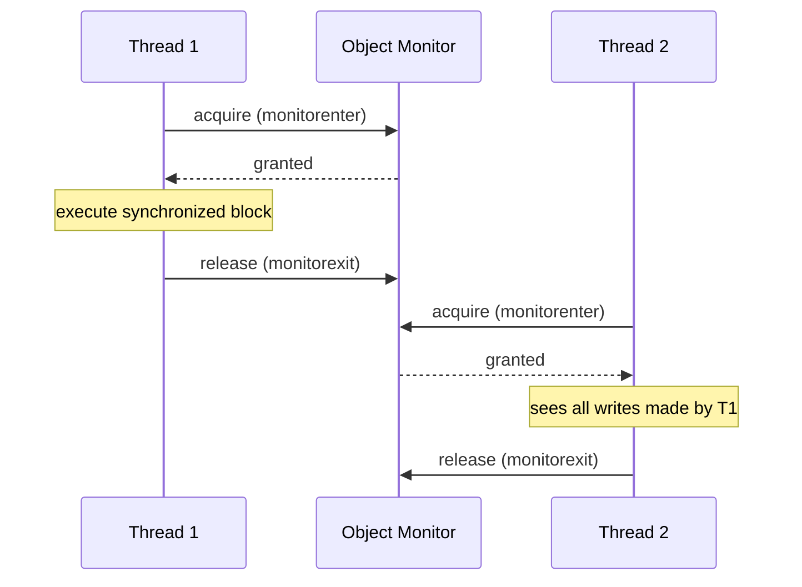
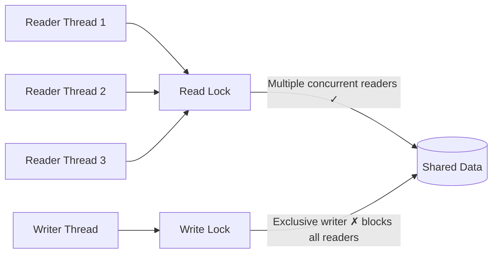
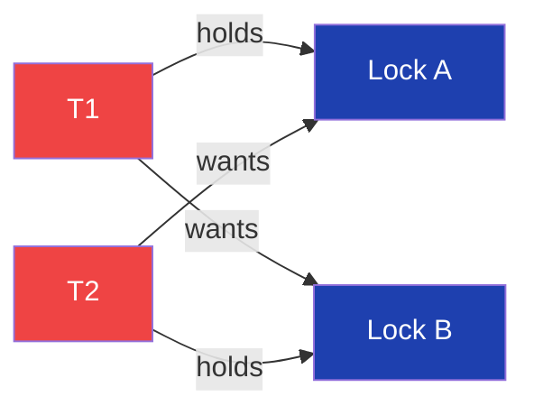
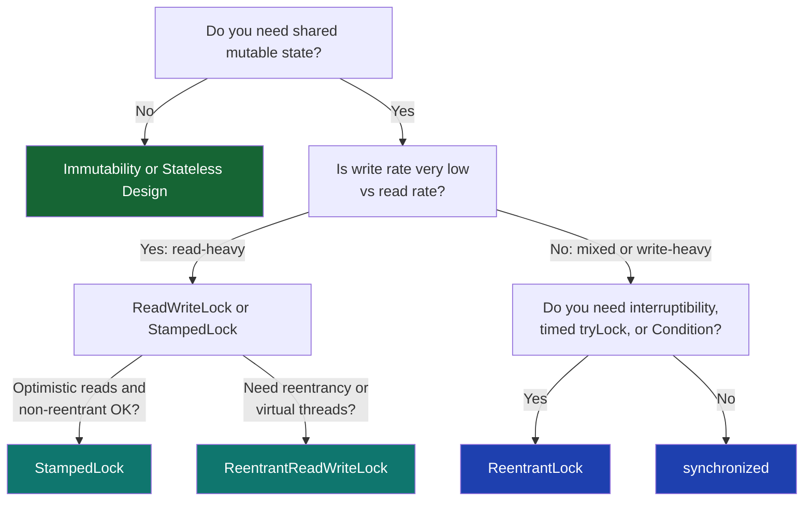

## Overview

When immutability and stateless design are insufficient — when shared mutable state is genuinely required — synchronisation is the tool. Java provides multiple mechanisms: the built-in `synchronized` keyword, the explicit `ReentrantLock`, the read-write optimised `ReadWriteLock`, and the high-performance `StampedLock`.

Each mechanism offers different trade-offs in readability, flexibility, performance, and safety. Choosing the wrong one for a given problem results in either correctness failures or unnecessary throughput penalties. In a payment processing system handling thousands of transactions per second, the difference between a `synchronized` block and a `StampedLock` optimistic read can be the difference between a system that scales and one that doesn't.

This lesson covers every synchronisation primitive in the Java concurrency toolkit with direct application to financial system patterns.

## Learning Objectives

By the end of this lesson you will be able to:

- Explain how intrinsic locks work and what `synchronized` guarantees
- Identify when to replace `synchronized` with `ReentrantLock`
- Apply `ReadWriteLock` to read-heavy shared state (exchange rates, configuration)
- Use `StampedLock` for maximum read throughput with optimistic reads
- Implement `Condition` variables as a replacement for `wait`/`notify`
- Apply lock-ordering discipline to prevent deadlocks
- Choose the correct synchronisation primitive for a given financial concurrency scenario

## Business Context

A foreign exchange rate service maintains a shared `Map<CurrencyPair, ExchangeRate>` updated every 50 milliseconds by a feed handler thread. 400 payment processing threads read the rates up to 10,000 times per second.

With `synchronized`, all 400 reader threads block each other and the writer during each read — producing unacceptable latency. The rate update lock is held for 2 ms (while the map is rebuilt), causing 400 threads to queue behind a single update. The 99th-percentile read latency spikes to 2.4 seconds under peak load.

Understanding `ReadWriteLock` and `StampedLock` resolves this. The right synchronisation primitive reduces the 99th-percentile latency to under 1 millisecond.

## Intrinsic Locks and synchronized

Every Java object has an **intrinsic lock** (also called a monitor lock). The `synchronized` keyword acquires this lock before entering a block and releases it on exit — including exceptional exits.

### What synchronized Guarantees

`synchronized` provides two guarantees from the Java Memory Model:

1. **Mutual exclusion** — only one thread holds the lock at a time
2. **Visibility** — when a thread releases a lock, all writes made while holding it become visible to any thread that subsequently acquires the same lock



### synchronized on Methods vs Blocks

```java17
// Method-level: locks on 'this' for instance methods, on Class for static methods
public synchronized void debit(Money amount) {
    this.balance = this.balance.subtract(amount);
}

// Block-level: finer granularity, explicit lock object
private final Object balanceLock = new Object();

public void debit(Money amount) {
    synchronized (balanceLock) {
        this.balance = this.balance.subtract(amount);
    }
    // Other non-critical operations outside the lock
    auditLog.record("debit", amount); // No need to hold lock here
}
```

> [!WARNING]
> **Avoid synchronizing on `this` in public classes.** External code can acquire the same lock, causing unexpected blocking or deadlock. Use a private `final Object` as the lock object to encapsulate locking.

### synchronized and Virtual Threads (Java 21)

`synchronized` blocks **pin** virtual threads to their carrier thread for the duration of the block. If the virtual thread performs a blocking operation (I/O, `sleep`, another lock acquisition) while pinned, it blocks the entire carrier thread, negating the benefit of virtual threads.

```java21
// PROBLEM: synchronized pins virtual thread to carrier thread
// If a database call inside the block blocks, the carrier thread blocks too
public synchronized AccountBalance getBalance(String accountId) {
    return database.fetchBalance(accountId); // This I/O pins the carrier thread!
}

// SOLUTION: Replace synchronized with ReentrantLock for virtual-thread-safe locking
private final ReentrantLock lock = new ReentrantLock();

public AccountBalance getBalance(String accountId) {
    lock.lock();
    try {
        return database.fetchBalance(accountId); // Virtual thread parks, not pins
    } finally {
        lock.unlock();
    }
}
```

> [!IMPORTANT]
> When migrating to virtual threads in Java 21, audit all `synchronized` blocks. Any `synchronized` block that may block (I/O, sleep, another lock) must be converted to `ReentrantLock` to avoid carrier thread pinning.

## ReentrantLock

`ReentrantLock` from `java.util.concurrent.locks` is the explicit locking API. It provides everything `synchronized` offers plus additional control:

- **Interruptible lock acquisition** — `lockInterruptibly()`
- **Timed lock acquisition** — `tryLock(timeout, unit)`
- **Non-blocking try** — `tryLock()`
- **Fairness policy** — optional FIFO ordering
- **Multiple condition variables** — `newCondition()`
- **Virtual-thread friendly** — does not pin carrier threads

### Basic ReentrantLock Pattern

```java17
import java.util.concurrent.locks.ReentrantLock;

public class BankAccount {

    private final ReentrantLock lock = new ReentrantLock();
    private Money balance;
    private final String accountId;

    public BankAccount(String accountId, Money initialBalance) {
        this.accountId = accountId;
        this.balance   = initialBalance;
    }

    public void debit(Money amount) {
        lock.lock();
        try {
            if (balance.isLessThan(amount)) {
                throw new InsufficientFundsException(accountId, balance, amount);
            }
            balance = balance.subtract(amount);
        } finally {
            lock.unlock(); // ALWAYS in finally — exception must not leave the lock held
        }
    }

    public Money getBalance() {
        lock.lock();
        try {
            return balance;
        } finally {
            lock.unlock();
        }
    }
}
```

> [!IMPORTANT]
> **Always release `ReentrantLock` in a `finally` block.** Unlike `synchronized`, the JVM does not automatically release explicit locks on exception. If you forget the `try/finally` and an exception occurs, the lock is never released — every subsequent thread blocks forever.

### Timed and Interruptible Lock Acquisition

```java17
// Timed acquisition — avoids indefinite blocking
public boolean transferWithTimeout(BankAccount from, BankAccount to, Money amount,
                                    long timeoutMs) throws InterruptedException {
    // Attempt to acquire lock within timeout — prevents deadlock scenarios
    if (from.lock.tryLock(timeoutMs, TimeUnit.MILLISECONDS)) {
        try {
            if (to.lock.tryLock(timeoutMs, TimeUnit.MILLISECONDS)) {
                try {
                    from.balance = from.balance.subtract(amount);
                    to.balance   = to.balance.add(amount);
                    return true;
                } finally {
                    to.lock.unlock();
                }
            }
        } finally {
            from.lock.unlock();
        }
    }
    return false; // Could not acquire both locks within timeout
}
```

### Reentrancy

Both `synchronized` and `ReentrantLock` are **reentrant**: a thread that already holds the lock can acquire it again without deadlocking itself.

```java17
public class AuditedAccount {
    private final ReentrantLock lock = new ReentrantLock();
    private Money balance;

    public void debit(Money amount) {
        lock.lock(); // acquires lock (hold count: 1)
        try {
            balance = balance.subtract(amount);
            audit(); // calls method that also acquires same lock
        } finally {
            lock.unlock(); // hold count: 0 → released
        }
    }

    private void audit() {
        lock.lock(); // same lock — hold count: 2 (reentrant, does NOT block)
        try {
            // log audit entry using balance
        } finally {
            lock.unlock(); // hold count: 1
        }
    }
}
```

## ReadWriteLock

`ReadWriteLock` separates reader threads from writer threads. Multiple readers can hold the read lock simultaneously; only one writer can hold the write lock, and writers block all readers.

This is ideal for data that is read far more often than it is written — exchange rates, configuration, reference data, routing tables.



### Exchange Rate Cache with ReadWriteLock

```java17
import java.util.concurrent.locks.ReadWriteLock;
import java.util.concurrent.locks.ReentrantReadWriteLock;

public class ExchangeRateCache {

    private final ReadWriteLock rwLock     = new ReentrantReadWriteLock();
    private final Lock          readLock   = rwLock.readLock();
    private final Lock          writeLock  = rwLock.writeLock();

    // Immutable snapshot — replaced atomically on each update
    private volatile Map<CurrencyPair, ExchangeRate> rates = Map.of();

    // Called by 400 payment threads — concurrent reads allowed
    public ExchangeRate getRate(CurrencyPair pair) {
        readLock.lock();
        try {
            ExchangeRate rate = rates.get(pair);
            if (rate == null) throw new UnknownCurrencyPairException(pair);
            return rate;
        } finally {
            readLock.unlock();
        }
    }

    // Called by feed handler thread every 50ms — exclusive write
    public void updateRates(Map<CurrencyPair, ExchangeRate> newRates) {
        writeLock.lock();
        try {
            rates = Map.copyOf(newRates); // Replace the entire map atomically
        } finally {
            writeLock.unlock();
        }
    }
}
```

```java21
// Java 21 — same pattern, but note: ReadWriteLock also does NOT pin virtual threads
// Virtual threads park on lock acquisition rather than blocking carrier threads
// The pattern is identical; virtual-thread safety is a free benefit
public class ExchangeRateCache {

    private final ReentrantReadWriteLock rwLock   = new ReentrantReadWriteLock();
    private final Lock                   readLock  = rwLock.readLock();
    private final Lock                   writeLock = rwLock.writeLock();
    private volatile Map<CurrencyPair, ExchangeRate> rates = Map.of();

    public ExchangeRate getRate(CurrencyPair pair) {
        readLock.lock();
        try {
            return Optional.ofNullable(rates.get(pair))
                .orElseThrow(() -> new UnknownCurrencyPairException(pair));
        } finally {
            readLock.unlock();
        }
    }

    public void updateRates(Map<CurrencyPair, ExchangeRate> newRates) {
        writeLock.lock();
        try {
            rates = Map.copyOf(newRates);
        } finally {
            writeLock.unlock();
        }
    }
}
```

### ReadWriteLock Pitfalls

| Pitfall | Description | Fix |
|---|---|---|
| Write starvation | Readers continuously acquire lock; writer never gets access | Use `ReentrantReadWriteLock(true)` for fair mode |
| Lock downgrade | Acquiring write lock then read lock without releasing write lock is not supported | Downgrade: hold write, acquire read, release write |
| Lock upgrade | Cannot upgrade from read to write lock — will deadlock | Release read, acquire write separately |
| Performance with write contention | Under heavy write load, readers block as often as with `synchronized` | Switch to `StampedLock` or CopyOnWrite pattern |

## StampedLock

`StampedLock` is the highest-performance lock in `java.util.concurrent.locks`. It introduces an **optimistic read** mode that allows reads without acquiring any lock at all — provided the data was not written during the read.

The trade-off: `StampedLock` is non-reentrant, does not support `Condition` variables, and requires careful use of its **stamp** (a version token).

### Optimistic Read Pattern

```java17
import java.util.concurrent.locks.StampedLock;

public class FxRateStore {

    private final StampedLock lock = new StampedLock();

    // Mutable state — protected by StampedLock
    private double bidRate;
    private double askRate;
    private long   timestamp;

    // Optimistic read — no lock acquisition, maximum throughput
    public FxSnapshot readOptimistic() {
        long stamp = lock.tryOptimisticRead(); // Returns a stamp, never blocks

        // READ VALUES — may be inconsistent if a write occurs concurrently
        double bid = bidRate;
        double ask = askRate;
        long   ts  = timestamp;

        // VALIDATE — did a write occur while we were reading?
        if (!lock.validate(stamp)) {
            // A write occurred — fall back to a full read lock
            stamp = lock.readLock();
            try {
                bid = bidRate;
                ask = askRate;
                ts  = timestamp;
            } finally {
                lock.unlockRead(stamp);
            }
        }

        return new FxSnapshot(bid, ask, ts);
    }

    // Write lock — called rarely (every 50ms by feed handler)
    public void updateRate(double bid, double ask) {
        long stamp = lock.writeLock();
        try {
            this.bidRate   = bid;
            this.askRate   = ask;
            this.timestamp = System.currentTimeMillis();
        } finally {
            lock.unlockWrite(stamp);
        }
    }
}
```

```java21
// Java 21 — StampedLock pattern is identical
// StampedLock IS NOT virtual-thread friendly — it uses internal park/unpark
// that can pin virtual threads in some JVM implementations
// For virtual thread workloads, prefer ReentrantReadWriteLock over StampedLock
// (This is a critical Java 21 migration consideration)
public class FxRateStore {

    private final StampedLock lock = new StampedLock();
    private volatile double bidRate;
    private volatile double askRate;
    private volatile long   timestamp;

    public FxSnapshot readOptimistic() {
        long stamp = lock.tryOptimisticRead();
        double bid = bidRate;
        double ask = askRate;
        long   ts  = timestamp;

        if (!lock.validate(stamp)) {
            stamp = lock.readLock();
            try {
                bid = bidRate;
                ask = askRate;
                ts  = timestamp;
            } finally {
                lock.unlockRead(stamp);
            }
        }
        return new FxSnapshot(bid, ask, ts);
    }

    public void updateRate(double bid, double ask) {
        long stamp = lock.writeLock();
        try {
            this.bidRate   = bid;
            this.askRate   = ask;
            this.timestamp = System.currentTimeMillis();
        } finally {
            lock.unlockWrite(stamp);
        }
    }
}
```

> [!WARNING]
> **`StampedLock` is not reentrant.** Attempting to acquire a `StampedLock` from a thread that already holds it deadlocks immediately. Always ensure the lock is not held before acquiring it. This is the most common `StampedLock` mistake.

> [!WARNING]
> **`StampedLock` and virtual threads (Java 21):** `StampedLock` may pin virtual threads depending on the JVM implementation. Prefer `ReentrantReadWriteLock` for read-heavy workloads on virtual-thread-based servers (Tomcat with virtual threads, Spring Boot 3.2+).

### StampedLock vs ReadWriteLock Performance

| Scenario | `ReadWriteLock` | `StampedLock` |
|---|---|---|
| Read-heavy, infrequent writes | ✓ Good | ✓✓ Excellent (optimistic) |
| Mixed read/write | ✓ Good | ✓ Good |
| Write-heavy | ✓ Acceptable | ✓ Similar |
| Reentrant locking | ✓ Supported | ✗ Deadlock |
| `Condition` variables | ✓ Supported | ✗ Not supported |
| Virtual thread safety | ✓ Safe | ⚠ Check JVM version |

## Condition Variables

`Condition` replaces `Object.wait()` / `Object.notify()` with a type-safe, interruptible alternative. A `Condition` is associated with a specific `Lock` and provides `await()`, `signal()`, and `signalAll()`.

### Payment Queue with Condition Variables

```java17
import java.util.concurrent.locks.Condition;
import java.util.concurrent.locks.ReentrantLock;

public class PaymentQueue {

    private final ReentrantLock lock        = new ReentrantLock();
    private final Condition     notEmpty    = lock.newCondition();
    private final Condition     notFull     = lock.newCondition();
    private final int           capacity;
    private final Queue<Payment> queue      = new ArrayDeque<>();

    public PaymentQueue(int capacity) {
        this.capacity = capacity;
    }

    // Producer: payment intake service
    public void submit(Payment payment) throws InterruptedException {
        lock.lock();
        try {
            while (queue.size() == capacity) {
                notFull.await(); // Wait until space is available
            }
            queue.add(payment);
            notEmpty.signal(); // Wake one waiting consumer
        } finally {
            lock.unlock();
        }
    }

    // Consumer: payment processor thread
    public Payment take() throws InterruptedException {
        lock.lock();
        try {
            while (queue.isEmpty()) {
                notEmpty.await(); // Wait until a payment is available
            }
            Payment payment = queue.poll();
            notFull.signal(); // Wake one waiting producer
            return payment;
        } finally {
            lock.unlock();
        }
    }
}
```

```java21
// Java 21 — Condition variables work correctly with virtual threads
// Virtual threads await()-ing on a Condition park rather than blocking a carrier thread
// The pattern is identical to Java 17; virtual thread safety is automatic
public class PaymentQueue {

    private final ReentrantLock lock     = new ReentrantLock();
    private final Condition notEmpty     = lock.newCondition();
    private final Condition notFull      = lock.newCondition();
    private final int       capacity;
    private final Deque<Payment> queue   = new ArrayDeque<>();

    public PaymentQueue(int capacity) { this.capacity = capacity; }

    public void submit(Payment payment) throws InterruptedException {
        lock.lock();
        try {
            while (queue.size() == capacity) notFull.await();
            queue.addLast(payment);
            notEmpty.signal();
        } finally {
            lock.unlock();
        }
    }

    public Payment take() throws InterruptedException {
        lock.lock();
        try {
            while (queue.isEmpty()) notEmpty.await();
            Payment p = queue.removeFirst();
            notFull.signal();
            return p;
        } finally {
            lock.unlock();
        }
    }
}
```

> [!NOTE]
> **Always use a `while` loop, not `if`, around `await()`.** Spurious wakeups — where a thread wakes without being signalled — can occur. The `while` loop re-checks the condition after every wakeup, ensuring correctness regardless of spurious wakeups.

## Lock Ordering — Preventing Deadlock

The most common cause of deadlocks between multiple locks is inconsistent lock acquisition order. Two threads each holding one lock and waiting for the other causes permanent blocking.



### The Bank Transfer Deadlock

```java17
// DEADLOCK: Thread 1 transfers from Account A to B; Thread 2 transfers B to A concurrently
// Thread 1: locks A, waits for B
// Thread 2: locks B, waits for A
// → Both wait forever

public class DeadlockingTransfer {
    public void transfer(BankAccount from, BankAccount to, Money amount) {
        synchronized (from) {           // Thread 1 locks A; Thread 2 locks B
            synchronized (to) {         // Thread 1 waits for B; Thread 2 waits for A
                from.debit(amount);     // DEADLOCK — never reached
                to.credit(amount);
            }
        }
    }
}
```

### Fix 1: Consistent Global Lock Ordering

```java17
// SAFE: Always acquire locks in a consistent global order (by account ID)
public class SafeTransfer {

    public void transfer(BankAccount from, BankAccount to, Money amount) {
        // Determine lock order by a stable, global key (account ID)
        BankAccount first  = from.getId().compareTo(to.getId()) < 0 ? from : to;
        BankAccount second = first == from ? to : from;

        synchronized (first) {
            synchronized (second) {
                from.debit(amount);
                to.credit(amount);
            }
        }
    }
}
```

### Fix 2: Timed Lock Acquisition with Retry

```java17
// SAFE: tryLock with timeout — if both locks cannot be acquired, back off and retry
public class TransferService {

    private static final long LOCK_TIMEOUT_MS = 100;

    public boolean transfer(ReentrantLockAccount from, ReentrantLockAccount to,
                             Money amount) throws InterruptedException {

        while (true) {
            if (from.getLock().tryLock(LOCK_TIMEOUT_MS, TimeUnit.MILLISECONDS)) {
                try {
                    if (to.getLock().tryLock(LOCK_TIMEOUT_MS, TimeUnit.MILLISECONDS)) {
                        try {
                            from.debit(amount);
                            to.credit(amount);
                            return true;
                        } finally {
                            to.getLock().unlock();
                        }
                    }
                } finally {
                    from.getLock().unlock();
                }
            }
            // Could not acquire both locks — back off briefly and retry
            Thread.sleep(ThreadLocalRandom.current().nextLong(1, 10));
        }
    }
}
```

### Fix 3: Single Global Transfer Lock (Simple but Coarse)

```java17
// When simplicity is more important than throughput
// A single lock serialises all transfers — no deadlock possible
// Use only when transfer rate is low enough to tolerate serialisation
public class SerialTransferService {
    private final Object transferLock = new Object();

    public void transfer(BankAccount from, BankAccount to, Money amount) {
        synchronized (transferLock) {
            from.debit(amount);
            to.credit(amount);
        }
    }
}
```

## Choosing the Right Primitive



| Requirement | Use |
|---|---|
| Simple mutual exclusion, legacy code | `synchronized` |
| Need `tryLock`, timed acquire, or interruptible acquire | `ReentrantLock` |
| Read-heavy shared state (config, rates) | `ReentrantReadWriteLock` |
| Maximum read throughput, non-reentrant OK | `StampedLock` (platform threads) |
| Read-heavy + virtual threads | `ReentrantReadWriteLock` |
| Producer-consumer coordination | `ReentrantLock` + `Condition` |
| Virtual thread workloads, any locking | Avoid `synchronized`, prefer `ReentrantLock` |

---

<!-- KNOWLEDGE-CHECK [
  {
    "id": "kc-sync-01",
    "question": "A virtual thread holds a `synchronized` lock and makes a blocking database call inside the synchronized block. What happens to the carrier thread?",
    "options": [
      "The carrier thread parks and becomes available for other virtual threads",
      "The carrier thread is pinned and cannot run other virtual threads until the database call returns",
      "The JVM automatically upgrades the synchronized lock to a ReentrantLock",
      "The virtual thread terminates and retries the operation"
    ],
    "correct": 1,
    "explanation": "synchronized blocks pin virtual threads to their carrier thread. When the pinned virtual thread blocks on I/O, the carrier thread blocks too — defeating the purpose of virtual threads. This is called carrier thread pinning. The fix is to replace synchronized with ReentrantLock, which causes virtual threads to park (yielding the carrier) rather than pinning it."
  },
  {
    "id": "kc-sync-02",
    "question": "A `ReentrantReadWriteLock` is used for an exchange rate cache read by 400 threads and updated every 50ms. Under sustained load, the update thread never gets to run because readers hold the lock continuously. What is this problem called and how do you fix it?",
    "options": [
      "Deadlock — fix by using tryLock() on the writer",
      "Write starvation — fix by constructing ReentrantReadWriteLock with fair=true",
      "Lock contention — fix by increasing the update interval",
      "Cache invalidation — fix by using a volatile field instead"
    ],
    "correct": 1,
    "explanation": "Write starvation occurs when new readers continuously acquire the read lock before the writer can acquire the write lock. new ReentrantReadWriteLock(true) creates a fair lock that queues writers in FIFO order, preventing starvation. Fair mode has lower throughput than non-fair mode, so only use it when starvation is a real problem."
  },
  {
    "id": "kc-sync-03",
    "question": "Thread 1 transfers from Account A to Account B. Thread 2 simultaneously transfers from Account B to Account A. Both use `synchronized(from) { synchronized(to) { ... } }`. What happens?",
    "options": [
      "Both transfers complete correctly because synchronized is reentrant",
      "Thread 2 waits for Thread 1 to complete, then executes",
      "A deadlock occurs — Thread 1 holds A and waits for B; Thread 2 holds B and waits for A",
      "An IllegalMonitorStateException is thrown"
    ],
    "correct": 2,
    "explanation": "Thread 1 acquires lock A and waits for lock B. Thread 2 acquires lock B and waits for lock A. Neither can proceed — classic deadlock. The fix is consistent lock ordering: always acquire A before B by comparing account IDs. This guarantees both threads acquire in the same order."
  },
  {
    "id": "kc-sync-04",
    "question": "An `StampedLock` optimistic read reads `bidRate` and `askRate`. The validate() call returns `false`. What must happen next?",
    "options": [
      "Return the values read — they are probably correct",
      "Throw a ConcurrentModificationException",
      "Acquire a full read lock and re-read the values",
      "Acquire a write lock and re-read the values"
    ],
    "correct": 2,
    "explanation": "validate() returning false means a write occurred during the optimistic read — the values may be inconsistent (e.g., bidRate from before the write, askRate from after). The correct response is to fall back to a full read lock (lock.readLock()), re-read all values under the lock, then release. Never use values from a failed optimistic read."
  }
] -->

---

<!-- PRACTICAL-CHALLENGE {
  "id": "pc-synchronization",
  "title": "Synchronisation Upgrade: FX Rate Service",
  "description": "Upgrade a naive synchronized FX rate service to use the optimal synchronisation primitive for each access pattern.",
  "tasks": [
    {
      "id": "pc-sync-01",
      "description": "A `synchronized` `FxRateService.getRate()` method is called 10,000 times/second. It holds the lock for 0.1ms per call. Identify the maximum achievable throughput with synchronized (single lock) versus ReadWriteLock (unlimited concurrent readers) assuming reads never conflict."
    },
    {
      "id": "pc-sync-02",
      "description": "Implement `FxRateCache` using `ReentrantReadWriteLock` with a read lock for `getRate()` and a write lock for `updateRates()`. Ensure write starvation cannot occur under sustained read load."
    },
    {
      "id": "pc-sync-03",
      "description": "Convert the `FxRateCache` from task 2 to use `StampedLock` with optimistic reads. Add the validate-and-fallback pattern. Add a comment explaining why StampedLock should NOT be used if the service migrates to virtual threads."
    },
    {
      "id": "pc-sync-04",
      "description": "Implement a `PaymentTransferService.transfer(from, to, amount)` that acquires two `ReentrantLock` instances in a deadlock-free order using account ID comparison. Add a test that runs 1000 concurrent transfers between accounts A→B and B→A simultaneously and verifies no deadlock occurs."
    },
    {
      "id": "pc-sync-05",
      "description": "A `BatchPaymentProcessor` uses `synchronized` blocks inside loops. The service is migrating to Java 21 virtual threads. Identify which synchronized blocks contain blocking I/O calls and replace them with `ReentrantLock`."
    }
  ]
} -->
