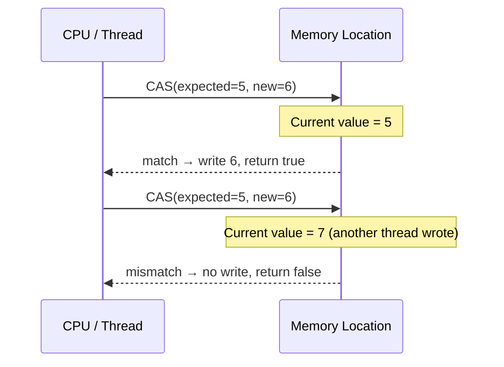
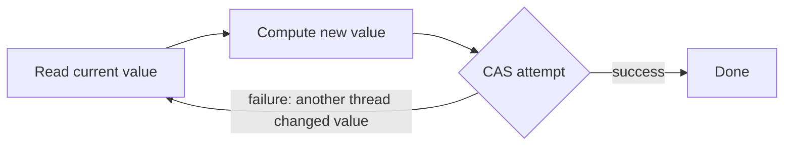
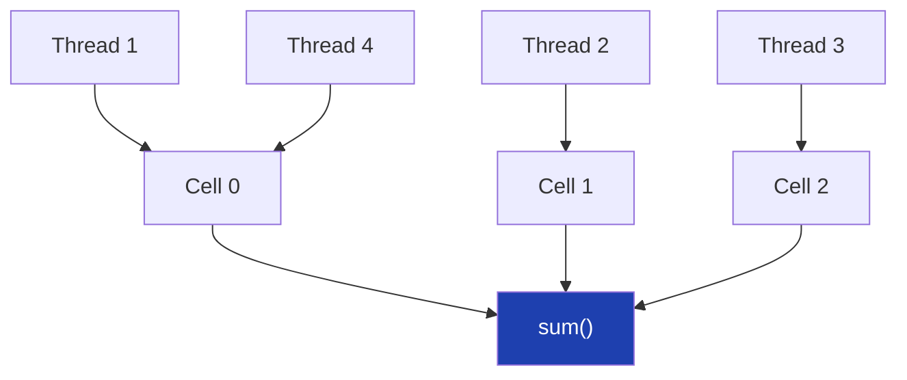

# العمليات الذرية — AtomicLong وCAS والخوارزميات الخالية من الأقفال

## نظرة عامة

الأقفال ليست الطريقة الوحيدة لتحقيق أمان الخيوط. فمنصة Java تكشف **العمليات الذرية** على مستوى المعالج — تعليمات تُنفّذ كوحدة غير قابلة للتجزئة — عبر الحزمة `java.util.concurrent.atomic`. وتتيح هذه العمليات **خوارزميات خالية من الأقفال**: شيفرة تحدّث الحالة المشتركة دون أخذ قفل، فتلغي خطر الجمود وكلفة التنافس التي تُدخلها الأقفال.

وفي نظام معالجة مدفوعات عالي الإنتاجية، الفرق بين عدّاد `synchronized` و`AtomicLong` هو الفرق بين زيادات متسلسلة وتحديثات غير حاجبة مسرّعة بالعتاد تتوسع خطيًا مع عدد أنوية المعالج.

يغطي هذا الدرس العناصر الذرية، وآلية المقارنة والتبديل (CAS) التي تشغّلها، وأنماط بناء خوارزميات صحيحة خالية من الأقفال.

## أهداف التعلم

في نهاية هذا الدرس ستستطيع:

- شرح كيف تعمل المقارنة والتبديل (CAS) على مستوى العتاد
- استخدام `AtomicInteger` و`AtomicLong` و`AtomicReference` بشكل صحيح
- تنفيذ عدّادات ومجمّعات خالية من الأقفال وآمنة من التكرار في الخدمات المالية
- الاختيار بين `AtomicLong` و`LongAdder` لسيناريوهات تنافس مختلفة
- تنفيذ حلقات تحديث CAS بشكل صحيح
- استخدام `AtomicReference` لتبديل لقطات حالة غير قابلة للتغيير ذريًا
- فهم `VarHandle` كأساس منخفض المستوى منذ Java 9

## سياق العمل

تتتبع بوابة دفع عدد المعاملات ومجاميعها عبر 400 خيط متزامن. ويستخدم التنفيذ الأولي عدّادًا `synchronized`:

```java17
private long transactionCount = 0;
private long totalAmountPence = 0;

public synchronized void recordTransaction(long amountPence) {
    transactionCount++;
    totalAmountPence += amountPence;
}
```

مع 400 خيط و20,000 معاملة في الثانية، يذهب 90% من وقت المعالج إلى التنافس على القفل. ويبلغ زمن الاستجابة عند المئين 99 قيمة 4.7ms — أعلى بكثير من اتفاقية 500 ميكروثانية. والحل: استبدال العدّاد المتزامن بعمليات ذرية، فيُلغى القفل كليًا.

## المقارنة والتبديل (CAS)

**المقارنة والتبديل** تعليمة معالج (`LOCK CMPXCHG` في x86؛ و`CAS` أو زوج تحميل-حصري/تخزين-حصري في ARM) تقوم ذريًا بما يلي:

1. تقرأ القيمة الحالية لموقع في الذاكرة
2. تقارنها بقيمة **متوقعة**
3. إذا تساوتا، تكتب قيمة **جديدة** وتعيد `true`
4. إذا لم تتساويا، تترك الذاكرة دون تغيير وتعيد `false`

ويُنفّذ تسلسل القراءة-المقارنة-الكتابة كله كتعليمة عتادية ذرية واحدة — فلا مقاطعة ممكنة بين الخطوات.



### CAS في Java

```java17
AtomicLong counter = new AtomicLong(5L);

// Returns true if current value was 5 — sets it to 6
boolean updated = counter.compareAndSet(5L, 6L); // true

// Returns false — current value is now 6, not 5
boolean missed  = counter.compareAndSet(5L, 7L); // false
```

## AtomicLong وAtomicInteger

يوفر `AtomicLong` عمليات ذرية على قيمة `long`:

| الطريقة | الوصف |
|---|---|
| `get()` | قراءة ذرية |
| `set(v)` | كتابة ذرية |
| `getAndIncrement()` | اقرأ، ثم زد بواحد |
| `incrementAndGet()` | زد بواحد، ثم اقرأ |
| `getAndAdd(delta)` | اقرأ، ثم أضف delta |
| `addAndGet(delta)` | أضف delta، ثم اقرأ |
| `compareAndSet(expect, update)` | ‏CAS — تعيد true إذا حدث التحديث |
| `compareAndExchange(expect, update)` | ‏CAS — تعيد القيمة الشاهدة |
| `getAndUpdate(f)` | طبّق الدالة f ذريًا |
| `updateAndGet(f)` | طبّق f، وأعد القيمة الجديدة |

### عدّاد المعاملات

```java17
import java.util.concurrent.atomic.AtomicLong;

public class TransactionMetrics {

    private final AtomicLong transactionCount  = new AtomicLong(0);
    private final AtomicLong totalAmountPence   = new AtomicLong(0);
    private final AtomicLong failureCount       = new AtomicLong(0);

    // Lock-free — no synchronization required
    public void recordSuccess(long amountPence) {
        transactionCount.incrementAndGet();
        totalAmountPence.addAndGet(amountPence);
    }

    public void recordFailure() {
        failureCount.incrementAndGet();
    }

    public TransactionSummary getSummary() {
        return new TransactionSummary(
            transactionCount.get(),
            totalAmountPence.get(),
            failureCount.get()
        );
    }
}
```

```java21
// Java 21 — identical API, same performance characteristics
// AtomicLong operations are as efficient on virtual threads as platform threads
// No pinning concern — CAS operations are non-blocking at the JVM level
public class TransactionMetrics {

    private final AtomicLong transactionCount = new AtomicLong();
    private final AtomicLong totalAmountPence  = new AtomicLong();
    private final AtomicLong failureCount      = new AtomicLong();

    public void recordSuccess(long amountPence) {
        transactionCount.incrementAndGet();
        totalAmountPence.addAndGet(amountPence);
    }

    public void recordFailure() {
        failureCount.incrementAndGet();
    }

    public record TransactionSummary(long count, long totalPence, long failures) {}

    public TransactionSummary getSummary() {
        return new TransactionSummary(
            transactionCount.get(),
            totalAmountPence.get(),
            failureCount.get()
        );
    }
}
```

عمليات `AtomicLong` بالكفاءة نفسها على الخيوط الافتراضية وخيوط المنصة، ولا مشكلة تثبيت — فعمليات CAS غير حاجبة.

## حلقات تحديث CAS

للعمليات الأعقد من الزيادة والإضافة، استخدم نمط **حلقة تحديث CAS**: اقرأ، واحسب القيمة الجديدة، وحاول CAS، وأعد المحاولة إذا فشلت.



### حلقة CAS للتحديث الشرطي

```java17
// Atomically set balance to new value ONLY if current value equals expected
// This pattern prevents lost updates without a lock

public class AtomicBalance {

    private final AtomicLong balancePence = new AtomicLong(0);

    // Atomic debit — fails if balance changed since we last read it
    public boolean debit(long amountPence) {
        while (true) {
            long current = balancePence.get();
            if (current < amountPence) {
                return false; // Insufficient funds
            }
            long updated = current - amountPence;
            // CAS: only update if balance hasn't changed since we read it
            if (balancePence.compareAndSet(current, updated)) {
                return true; // Success
            }
            // CAS failed — another thread changed balance — retry
        }
    }

    public void credit(long amountPence) {
        balancePence.addAndGet(amountPence); // Unconditional add is safe
    }

    public long getBalance() {
        return balancePence.get();
    }
}
```

```java21
// Java 21 — getAndUpdate / updateAndGet provide cleaner CAS loops
// for simple transformations (function must be side-effect-free and fast)
public class AtomicBalance {

    private final AtomicLong balancePence = new AtomicLong(0);

    public boolean debit(long amountPence) {
        // getAndUpdate runs the function in a CAS loop internally and returns
        // the PREVIOUS value — enough to tell whether the debit was applied
        // (the function may run several times, so it must have no side effects)
        long previous = balancePence.getAndUpdate(current -> {
            if (current < amountPence) return current; // No change — insufficient funds
            return current - amountPence;
        });
        return previous >= amountPence;
    }

    public void credit(long amountPence) {
        balancePence.addAndGet(amountPence);
    }
}
```

تُشغّل `getAndUpdate` الدالة في حلقة CAS داخلية وتعيد القيمة **السابقة** — وهذا يكفي لمعرفة هل طُبّق الخصم. وقد تُشغّل الدالة عدة مرات، فيجب أن تكون بلا آثار جانبية.

> [!WARNING]
> **قد تعيد حلقات CAS المحاولة مرات كثيرة تحت التنافس الشديد.** تضمن الشيفرة الخالية من الأقفال أن خيطًا *ما* يتقدم دائمًا، لكن خيطًا منفردًا قد يخسر باستمرار. فإذا تنافس 400 خيط على CAS في `AtomicLong` نفسه، فسيفشل كثير منها ويعيد المحاولة باستمرار — **عاصفة CAS**. وللعدّادات البحتة يتفوق `LongAdder` كثيرًا على `AtomicLong` بتوزيع التحديثات على عدة خلايا. (لا يمكن استخدام `LongAdder` لخصم شرطي؛ فهناك قلّل التنافس بتجزئة الحالة أو بتسلسل العمليات لكل حساب.)

## LongAdder — عدّادات التنافس العالي

صُمم `LongAdder` للحالات التي يزيد فيها خيوط كثيرة عدّادًا في الوقت نفسه. فبدل قيمة واحدة، يحتفظ بقيمة **أساس** إضافة إلى **مصفوفة خلايا** — فتحدّث الخيوط خلايا مختلفة، فيقل تنافس CAS.



```java17
import java.util.concurrent.atomic.LongAdder;

public class HighThroughputMetrics {

    // LongAdder for high-contention write-heavy counters
    private final LongAdder transactionCount = new LongAdder();
    private final LongAdder totalAmountPence  = new LongAdder();

    // Called by 400 threads simultaneously — LongAdder distributes contention
    public void record(long amountPence) {
        transactionCount.increment();     // No CAS storm
        totalAmountPence.add(amountPence);
    }

    // Called rarely (monitoring, dashboards) — sum() aggregates all cells
    public long getTransactionCount() {
        return transactionCount.sum(); // Not atomic with the increments above
    }

    public long getTotalAmountPence() {
        return totalAmountPence.sum();
    }
}
```

يُستدعى `sum()` نادرًا (للمراقبة ولوحات المعلومات) ويجمع كل الخلايا، وهو ليس ذريًا مع الزيادات الجارية.

### AtomicLong مقابل LongAdder

| الخاصية | `AtomicLong` | `LongAdder` |
|---|---|---|
| القراءة (`get()`) | ذرية ومتسقة | ‏`sum()` تقريبية أثناء الكتابات المتزامنة |
| الكتابة (الزيادة) | ‏CAS — سريعة تحت تنافس منخفض | موزعة — سريعة تحت تنافس عالٍ |
| الذاكرة | ‏`long` واحد (8 بايت) | أساس + مصفوفة خلايا (متغيرة) |
| `compareAndSet()` | ✓ مدعومة | ✗ غير متاحة |
| حلقات CAS | ✓ النمط المطلوب | ✗ غير لازمة |
| أفضل استخدام | العدّادات + منطق CAS | العدّادات كثيفة الكتابة فقط |

**القاعدة:** استخدم `AtomicLong` عندما تحتاج حلقات CAS أو القراءة والتحديث ذريًا. واستخدم `LongAdder` للعدّادات البحتة تحت تنافس كتابة عالٍ.

## AtomicReference — لقطات حالة ذرية

يوفر `AtomicReference<T>` عمليات CAS على مرجع كائن. والاستخدام الكلاسيكي: استبدال لقطة حالة غير قابلة للتغيير ذريًا.

### لقطة أسعار ذرية

```java17
import java.util.concurrent.atomic.AtomicReference;

public class AtomicRateStore {

    // Immutable snapshot — atomically replaced on each update
    private final AtomicReference<RateSnapshot> snapshot =
        new AtomicReference<>(RateSnapshot.empty());

    // Reader thread — zero-lock read of the latest snapshot
    public RateSnapshot getSnapshot() {
        return snapshot.get(); // Atomic read — single instruction
    }

    // Writer thread — replace entire snapshot atomically
    public void updateSnapshot(RateSnapshot newSnapshot) {
        snapshot.set(newSnapshot); // Atomic write — no lock
    }

    // Conditional update — only update if no one else updated since we read
    public boolean conditionalUpdate(RateSnapshot expected, RateSnapshot updated) {
        return snapshot.compareAndSet(expected, updated);
    }
}

// Immutable snapshot — freely shareable across threads
public record RateSnapshot(Map<CurrencyPair, ExchangeRate> rates, Instant capturedAt) {

    public static RateSnapshot empty() {
        return new RateSnapshot(Map.of(), Instant.EPOCH);
    }

    public RateSnapshot withRate(CurrencyPair pair, ExchangeRate rate) {
        var newRates = new HashMap<>(rates);
        newRates.put(pair, rate);
        return new RateSnapshot(Map.copyOf(newRates), Instant.now());
    }
}
```

```java21
// Java 21 — AtomicReference pattern is identical
// Records provide ideal immutable snapshots for AtomicReference
public class AtomicRateStore {

    private final AtomicReference<RateSnapshot> snapshot =
        new AtomicReference<>(RateSnapshot.empty());

    public RateSnapshot getSnapshot() { return snapshot.get(); }

    public void updateSnapshot(RateSnapshot next) { snapshot.set(next); }

    // CAS-based incremental update — append one rate without full replacement
    public void updateRate(CurrencyPair pair, ExchangeRate rate) {
        RateSnapshot current, updated;
        do {
            current = snapshot.get();
            updated = current.withRate(pair, rate);
        } while (!snapshot.compareAndSet(current, updated));
    }
}
```

السجلات لقطات مثالية غير قابلة للتغيير لـ `AtomicReference`. ويضيف التحديث التدريجي بـ CAS سعرًا واحدًا دون استبدال كامل، ويعيد المحاولة إذا غيّر خيط آخر اللقطة.

## VarHandle — الأساس منخفض المستوى

‏`VarHandle` ‏(منذ Java 9) هو الواجهة منخفضة المستوى التي تقوم عليها كل أصناف `java.util.concurrent.atomic`. ويوفر وصولًا مُنمّطًا إلى المتغيرات بدلالات ترتيب ذاكرة قابلة للضبط.

```java17
import java.lang.invoke.MethodHandles;
import java.lang.invoke.VarHandle;

// VarHandle lets you add atomic operations to your own fields
// without wrapping them in AtomicLong or similar
public class HighPerformanceCounter {

    private static final VarHandle COUNT;

    static {
        try {
            COUNT = MethodHandles.lookup()
                .findVarHandle(HighPerformanceCounter.class, "count", long.class);
        } catch (ReflectiveOperationException e) {
            throw new ExceptionInInitializerError(e);
        }
    }

    // volatile field: plain reads of it are volatile reads;
    // the VarHandle adds atomic operations such as getAndAdd and CAS
    private volatile long count;

    public long incrementAndGet() {
        return (long) COUNT.getAndAdd(this, 1L) + 1L;
    }

    public boolean compareAndSet(long expected, long update) {
        return COUNT.compareAndSet(this, expected, update);
    }
}
```

> [!NOTE]
> **في شيفرة التطبيقات، فضّل `AtomicLong` على `VarHandle`.** فـ `VarHandle` مقصود لمؤلفي الأطر والمكتبات الذين يحتاجون تحكمًا دقيقًا في ترتيب الذاكرة (plain، وopaque، وacquire/release، وvolatile). أما لمنطق العمل المعتاد، فـ `AtomicLong` أكثر أمانًا ووضوحًا وبالأداء نفسه.

## أنماط عملية في الأنظمة المالية

### رمز منع التكرار عبر AtomicReference

يعمل هذا النمط داخل **JVM واحدة** فقط. أما عبر عدة نسخ من الخدمة، فيجب أن يكون الحجز في تخزين مشترك — صف قاعدة بيانات بمفتاح فريد (المسار 02، الدرس 14). وتحتاج الخريطة في الذاكرة أيضًا إلى إخراج المدخلات القديمة، وإلا نمت إلى الأبد.

```java17
// Ensure a payment is processed exactly once using CAS
// Even if the submit() method is called multiple times concurrently
public class IdempotentPaymentGateway {

    // Maps idempotency key → result (null = not yet processed)
    private final ConcurrentHashMap<String, AtomicReference<PaymentResult>> processing
        = new ConcurrentHashMap<>();

    public PaymentResult submit(String idempotencyKey, Payment payment) {
        // getOrCreate an AtomicReference for this key
        AtomicReference<PaymentResult> ref = processing.computeIfAbsent(
            idempotencyKey, k -> new AtomicReference<>());

        // CAS: only process if result is null (first attempt wins)
        if (ref.compareAndSet(null, PaymentResult.PENDING)) {
            try {
                PaymentResult result = processPayment(payment);
                ref.set(result); // Publish final result
                return result;
            } catch (Exception e) {
                // Publishes the failure to waiting callers. Note: the failure is
                // now cached for this key — a transient error should rather
                // remove the entry so that a retry can try again
                ref.set(PaymentResult.failed(e));
                throw e;
            }
        }

        // Another thread is processing or has processed — wait for result
        // (spinning burns CPU if processing takes long: see the Java 21 version)
        PaymentResult result;
        while ((result = ref.get()) == PaymentResult.PENDING) {
            Thread.onSpinWait(); // Hint to CPU — brief spin before retry
        }
        return result;
    }

    private PaymentResult processPayment(Payment payment) {
        // ... actual payment processing ...
        return PaymentResult.success();
    }
}
```

يفوز أول استدعاء بـ CAS من null إلى PENDING فيعالج الدفعة، وينتظر الآخرون النتيجة. ولاحظ أن الفشل يُخزن الآن لهذا المفتاح — والأفضل عند الخطأ العابر إزالة المدخل حتى تستطيع إعادة المحاولة المحاولة مرة أخرى. والانتظار بالدوران يحرق المعالج إذا طالت المعالجة.

```java21
// Java 21 — Thread.onSpinWait() hint is available in both 17 and 21
// For long waits, park instead of spinning. Cleaner still: store a
// CompletableFuture<PaymentResult> per key and let waiters call join()
public class IdempotentPaymentGateway {

    private final ConcurrentHashMap<String, AtomicReference<PaymentResult>> processing
        = new ConcurrentHashMap<>();

    public PaymentResult submit(String idempotencyKey, Payment payment)
            throws InterruptedException {

        AtomicReference<PaymentResult> ref = processing.computeIfAbsent(
            idempotencyKey, k -> new AtomicReference<>());

        if (ref.compareAndSet(null, PaymentResult.PENDING)) {
            try {
                PaymentResult result = processPayment(payment);
                ref.set(result);
                return result;
            } catch (Exception e) {
                ref.set(PaymentResult.failed(e));
                throw e;
            }
        }

        // For virtual threads: park briefly instead of spinning to yield carrier
        PaymentResult result;
        while ((result = ref.get()) == PaymentResult.PENDING) {
            LockSupport.parkNanos(1_000_000L); // 1ms park — yields virtual thread
        }
        return result;
    }
}
```

للانتظار الطويل توقف (park) بدل الدوران. والأنظف: خزّن `CompletableFuture<PaymentResult>` لكل مفتاح ودع المنتظرين يستدعون `join()`.

### مولّد الأرقام التسلسلية

```java17
// High-throughput transaction sequence number generator
// Used to generate unique, monotonically increasing transaction IDs
// WARNING: an in-memory counter restarts at 0 when the JVM restarts —
// seed it from durable storage (or a database sequence) on start-up, or
// IDs will repeat
public class TransactionSequencer {

    private final AtomicLong sequence = new AtomicLong(0);
    private final String nodeId;

    public TransactionSequencer(String nodeId) {
        this.nodeId = nodeId;
    }

    // Returns nodeId-XXXXXXXXXXXXXXXX (zero-padded sequence number)
    public String next() {
        long seq = sequence.incrementAndGet();
        return nodeId + "-" + String.format("%016X", seq);
    }

    public long currentSequence() {
        return sequence.get();
    }
}
```

تحذير: العدّاد في الذاكرة يعود إلى 0 عند إعادة تشغيل JVM — فابدأه من تخزين دائم (أو تسلسل قاعدة بيانات) عند البدء، وإلا ستتكرر المعرّفات.


<!-- KNOWLEDGE-CHECK [
  {
    "id": "kc-atomic-01",
    "question": "يستدعي 400 خيط في الوقت نفسه `counter.incrementAndGet()` على `AtomicLong`. وبعد انتهاء كل الخيوط تكون قيمة العدّاد 400. لو كان `long` عاديًا بلا مزامنة، فماذا تتوقع أن ترى؟",
    "options": [
      "ما زالت 400 — تضمن JVM أن عمليات long ذرية",
      "قيمة أقل من 400 — تحديثات مفقودة بسبب قراءة-تعديل-كتابة غير ذرية",
      "‏0 — تُعاد القيمة إلى الصفر عند انتهاء الخيط",
      "NumberFormatException"
    ],
    "correct": 1,
    "explanation": "العملية `long++` العادية ليست ذرية — فهي تتفكك إلى قراءة، وزيادة، وكتابة. ومع 400 خيط متزامن، تقرأ عدة خيوط القيمة نفسها، وتزيدها، وتكتبها — فتكتب فوق تحديثات بعضها. والنتيجة عادة أقل بكثير من 400. أما AtomicLong.incrementAndGet() فيستخدم تعليمة CAS ذرية واحدة، فيضمن أن القيمة النهائية 400 بالضبط."
  },
  {
    "id": "kc-atomic-02",
    "question": "يُزاد عدّاد `AtomicLong` بواسطة 1000 خيط في الثانية. وتحت هذا الحمل تفشل استدعاءات `compareAndSet()` كثيرًا وتُعاد. ما اسم هذه المشكلة وماذا يجب أن تستخدم بدلًا من ذلك؟",
    "options": [
      "الجمود — استخدم synchronized بدلًا من ذلك",
      "عاصفة CAS — استخدم LongAdder للعدّادات عالية التنافس",
      "إبطال الذاكرة المؤقتة — استخدم long متطايرًا بدلًا من ذلك",
      "تسرب الذاكرة — زد حجم الكومة"
    ],
    "correct": 1,
    "explanation": "تحت تنافس كتابة عالٍ تفشل محاولات CAS كثيرة لأن خيوطًا أخرى تعدّل القيمة بين القراءة وCAS. فيحدث دوران — عاصفة CAS. ويحل LongAdder ذلك بالاحتفاظ بقيمة أساس ومصفوفة خلايا؛ فيحدّث كل خيط عادة خليته بتنافس ضئيل. ويجمع sum() الخلايا. ويتفوق LongAdder كثيرًا على AtomicLong عند معدلات الكتابة المتزامنة العالية."
  },
  {
    "id": "kc-atomic-03",
    "question": "يُستخدم `AtomicReference<RateSnapshot>` لتخزين لقطة أسعار صرف غير قابلة للتغيير. ويستدعي الكاتب `snapshot.set(newSnapshot)`. ما الضمانات التي يوفرها ذلك لخيوط القراءة؟",
    "options": [
      "سيرى القراء اللقطة الجديدة خلال مللي ثانية واحدة",
      "‏set() ذرية — فأي قارئ يرى المرجع الجديد يرى RateSnapshot كاملة ومهيأة بشكل صحيح",
      "يجب على القراء استدعاء compareAndSet() لقراءة القيمة بأمان",
      "تُجمع اللقطة القديمة كنفايات فورًا"
    ],
    "correct": 1,
    "explanation": "‏AtomicReference.set() كتابة volatile، فتُنشئ علاقة 'يحدث قبل'. فأي خيط يقرأ المرجع الجديد عبر get() يُضمن له رؤية الحالة الكاملة المهيأة بشكل صحيح للقطة RateSnapshot الجديدة. ولأن RateSnapshot سجل غير قابل للتغيير، فلا خطر من رؤية كائن محدّث جزئيًا."
  },
  {
    "id": "kc-atomic-04",
    "question": "تقرأ حلقة تحديث CAS لخصم رصيد الرصيدَ 1000p، وتحسب رصيدًا جديدًا 800p، ثم تستدعي `compareAndSet(1000, 800)`. فتعيد CAS القيمة false. ما الخطوة التالية الصحيحة؟",
    "options": [
      "ارمِ OptimisticLockException",
      "أعد false للدلالة على فشل الخصم",
      "أعد قراءة الرصيد الحالي وأعد حلقة CAS كاملة",
      "خذ ReentrantLock وأعد محاولة الخصم تحت القفل"
    ],
    "correct": 2,
    "explanation": "عودة CAS بـ false تعني أن خيطًا آخر غيّر الرصيد بين قراءتنا ومحاولة CAS. والاستجابة الصحيحة إعادة قراءة القيمة الحالية وإعادة المحاولة — وهذا نمط حلقة CAS الأساسي. وإعادة المحاولة قصيرة عادة عمليًا، لأن الخيط يعيد المحاولة فورًا ببيانات جديدة. ولا تنتقل إلى قفل (أو تقلل التنافس بطريقة أخرى) إلا إذا جعل التنافس الشديد جدًا حلقة CAS بطيئة بشكل غير مقبول."
  }
] -->


<!-- PRACTICAL-CHALLENGE {
  "id": "pc-atomic-operations",
  "title": "خدمة مقاييس خالية من الأقفال",
  "description": "نفّذ خدمة مقاييس معاملات عالية الإنتاجية باستخدام العمليات الذرية.",
  "tasks": [
    {
      "id": "pc-ao-01",
      "description": "نفّذ `TransactionMetrics` بحقول `AtomicLong` لـ: العدد الكلي للمعاملات، والمبلغ الكلي (بالبنس)، وعدد الإخفاقات، وأكبر مبلغ لمعاملة واحدة. يتطلب الحقل maxAmount حلقة تحديث CAS — نفّذ `recordTransaction(long amountPence)` التي تحدّث الحقول الأربعة ذريًا. ملاحظة: التحديثات الأربعة ليست ذرية مجتمعة — اشرح متى يهم ذلك ومتى لا يهم."
    },
    {
      "id": "pc-ao-02",
      "description": "قارن أداء `AtomicLong.incrementAndGet()` مع `LongAdder.increment()` تحت 1 و10 و50 و100 خيط متزامن باستخدام JMH. عند أي عدد خيوط يبدأ `LongAdder` بالتفوق على `AtomicLong`؟"
    },
    {
      "id": "pc-ao-03",
      "description": "نفّذ `AtomicRatePublisher` يحتفظ بـ `AtomicReference<Map<CurrencyPair, ExchangeRate>>` (باستخدام `Map.copyOf` غير قابلة للتغيير). ونفّذ `publish(Map newRates)` باستخدام `set()` و`getRate(CurrencyPair)` باستخدام `get()`. واشرح لماذا يكون هذا الأسلوب آمنًا دون أي قفل صريح."
    },
    {
      "id": "pc-ao-04",
      "description": "نفّذ `PaymentIdGenerator` يولّد معرّفات تسلسلية باستخدام `AtomicLong`. ويجب أن تتزايد المعرّفات بصرامة عبر كل الخيوط وألا تتكرر بعد إعادة التشغيل (ابدأ العدّاد من تخزين دائم). وأضف اختبارًا يولّد 1,000,000 معرّف من 100 خيط ويتحقق من عدم وجود تكرار أو فجوات."
    },
    {
      "id": "pc-ao-05",
      "description": "تُستدعى طريقة `synchronized` باسم `updateExchangeRate` عشرة آلاف مرة في الثانية وتحتجز القفل 50 ميكروثانية. احسب أقصى إنتاجية نظرية مع synchronized مقابل AtomicReference.set(). وما أثر التنافس على زمن الاستجابة في نسخة synchronized تحت 400 خيط؟"
    }
  ]
} -->
