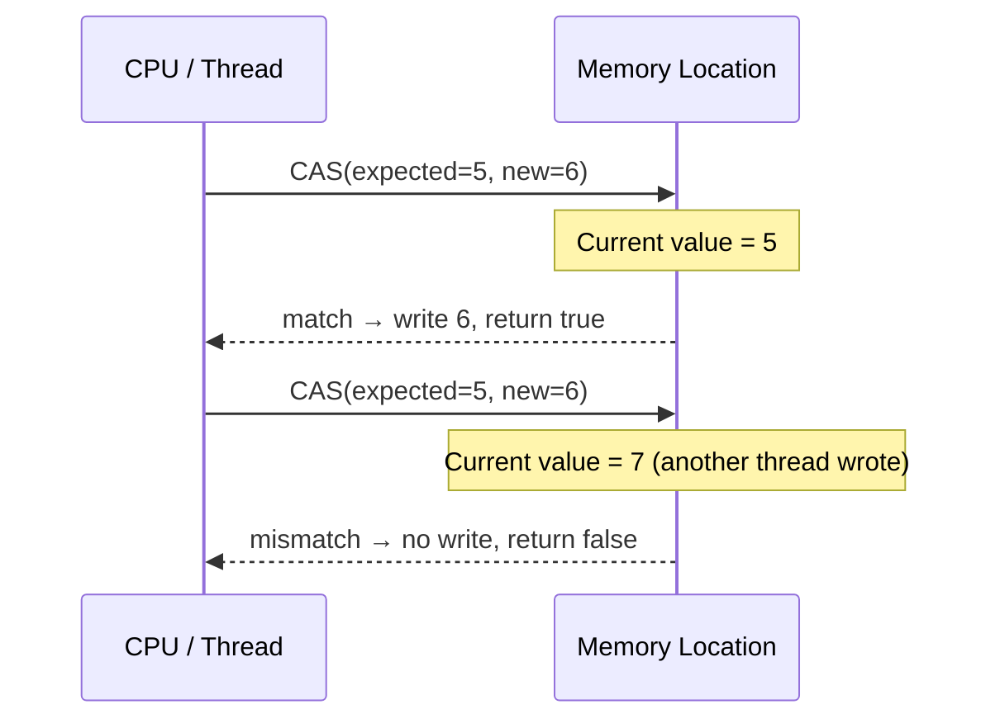
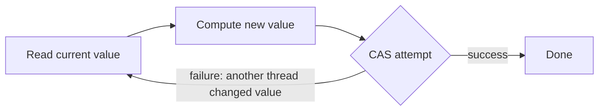

## Overview

Locks are not the only way to achieve thread safety. The Java platform exposes CPU-level **atomic operations** — instructions that execute as an indivisible unit — through the `java.util.concurrent.atomic` package. These operations enable **lock-free algorithms**: code that updates shared state without acquiring a lock, eliminating the deadlock risk and contention overhead that locks introduce.

In a high-throughput payment processing system, the difference between a `synchronized` counter and an `AtomicLong` is the difference between serialised increments and hardware-accelerated, non-blocking updates that scale linearly with the number of CPU cores.

This lesson covers the atomic primitives, the Compare-And-Swap (CAS) mechanism that powers them, and the patterns for building correct lock-free algorithms.

## Learning Objectives

By the end of this lesson you will be able to:

- Explain how Compare-And-Swap (CAS) works at the hardware level
- Use `AtomicInteger`, `AtomicLong`, and `AtomicReference` correctly
- Implement idempotent, lock-free counters and accumulators in financial services
- Choose between `AtomicLong` and `LongAdder` for different contention scenarios
- Implement CAS-based update loops correctly
- Use `AtomicReference` to atomically swap immutable state snapshots
- Understand `VarHandle` as the low-level foundation in Java 9+

## Business Context

A payment gateway tracks transaction counts and totals across 400 concurrent threads. The initial implementation uses a `synchronized` counter:

```java17
private long transactionCount = 0;
private long totalAmountPence = 0;

public synchronized void recordTransaction(long amountPence) {
    transactionCount++;
    totalAmountPence += amountPence;
}
```

Under 400 threads at 20,000 transactions/second, 90% of CPU time is spent in lock contention. The 99th-percentile latency is 4.7 ms — far above the 500 µs SLA. The fix: replace the synchronized counter with atomic operations, eliminating the lock entirely.

## Compare-And-Swap (CAS)

**Compare-And-Swap** is a CPU instruction (`CMPXCHG` on x86) that atomically:

1. Reads the current value of a memory location
2. Compares it to an **expected** value
3. If equal, writes a **new** value and returns `true`
4. If not equal, leaves the memory unchanged and returns `false`

The entire read-compare-write sequence executes as a single atomic hardware instruction — no interrupt can occur between steps.



### CAS in Java

```java17
AtomicLong counter = new AtomicLong(5L);

// Returns true if current value was 5 — sets it to 6
boolean updated = counter.compareAndSet(5L, 6L); // true

// Returns false — current value is now 6, not 5
boolean missed  = counter.compareAndSet(5L, 7L); // false
```

## AtomicLong and AtomicInteger

`AtomicLong` provides atomic operations on a `long` value:

| Method | Description |
|---|---|
| `get()` | Atomic read |
| `set(v)` | Atomic write |
| `getAndIncrement()` | Read, then increment by 1 |
| `incrementAndGet()` | Increment by 1, then read |
| `getAndAdd(delta)` | Read, then add delta |
| `addAndGet(delta)` | Add delta, then read |
| `compareAndSet(expect, update)` | CAS — returns true if updated |
| `compareAndExchange(expect, update)` | CAS — returns witness value |
| `getAndUpdate(f)` | Atomically apply function f |
| `updateAndGet(f)` | Apply f, return new value |

### Transaction Counter

```java17
import java.util.concurrent.atomic.AtomicLong;

public class TransactionMetrics {

    private final AtomicLong transactionCount  = new AtomicLong(0);
    private final AtomicLong totalAmountPence   = new AtomicLong(0);
    private final AtomicLong failureCount       = new AtomicLong(0);

    // Lock-free — no synchronization required
    public void recordSuccess(long amountPence) {
        transactionCount.incrementAndGet();
        totalAmountPence.addAndGet(amountPence);
    }

    public void recordFailure() {
        failureCount.incrementAndGet();
    }

    public TransactionSummary getSummary() {
        return new TransactionSummary(
            transactionCount.get(),
            totalAmountPence.get(),
            failureCount.get()
        );
    }
}
```

```java21
// Java 21 — identical API, same performance characteristics
// AtomicLong operations are as efficient on virtual threads as platform threads
// No pinning concern — CAS operations are non-blocking at the JVM level
public class TransactionMetrics {

    private final AtomicLong transactionCount = new AtomicLong();
    private final AtomicLong totalAmountPence  = new AtomicLong();
    private final AtomicLong failureCount      = new AtomicLong();

    public void recordSuccess(long amountPence) {
        transactionCount.incrementAndGet();
        totalAmountPence.addAndGet(amountPence);
    }

    public void recordFailure() {
        failureCount.incrementAndGet();
    }

    public record TransactionSummary(long count, long totalPence, long failures) {}

    public TransactionSummary getSummary() {
        return new TransactionSummary(
            transactionCount.get(),
            totalAmountPence.get(),
            failureCount.get()
        );
    }
}
```

## CAS Update Loops

For operations more complex than increment/add, use the **CAS update loop** pattern: read, compute new value, attempt CAS, retry if CAS fails.



### CAS Loop for Conditional Update

```java17
// Atomically set balance to new value ONLY if current value equals expected
// This pattern prevents lost updates without a lock

public class AtomicBalance {

    private final AtomicLong balancePence = new AtomicLong(0);

    // Atomic debit — fails if balance changed since we last read it
    public boolean debit(long amountPence) {
        while (true) {
            long current = balancePence.get();
            if (current < amountPence) {
                return false; // Insufficient funds
            }
            long updated = current - amountPence;
            // CAS: only update if balance hasn't changed since we read it
            if (balancePence.compareAndSet(current, updated)) {
                return true; // Success
            }
            // CAS failed — another thread changed balance — retry
        }
    }

    public void credit(long amountPence) {
        balancePence.addAndGet(amountPence); // Unconditional add is safe
    }

    public long getBalance() {
        return balancePence.get();
    }
}
```

```java21
// Java 21 — getAndUpdate / updateAndGet provide cleaner CAS loops
// for simple transformations (function must be side-effect-free and fast)
public class AtomicBalance {

    private final AtomicLong balancePence = new AtomicLong(0);

    public boolean debit(long amountPence) {
        // updateAndGet atomically applies the function in a CAS loop internally
        // However: this doesn't allow returning false on insufficient funds
        // For conditional updates, the explicit CAS loop is still required
        long previous = balancePence.getAndUpdate(current -> {
            if (current < amountPence) return current; // No change — insufficient funds
            return current - amountPence;
        });
        return previous >= amountPence;
    }

    public void credit(long amountPence) {
        balancePence.addAndGet(amountPence);
    }
}
```

> [!WARNING]
> **CAS loops can spin indefinitely under extreme contention.** If 400 threads are all competing to CAS the same `AtomicLong`, many will fail and retry continuously — this is called a **CAS storm**. Under high contention, `LongAdder` outperforms `AtomicLong` significantly by reducing contention across multiple cells.

## LongAdder — High-Contention Counters

`LongAdder` is designed for scenarios where many threads increment a counter simultaneously. Instead of one value, it maintains a **base** value plus a **cell array** — threads update different cells, reducing CAS contention.

```mermaid
graph TD
    T1[Thread 1] --> C1[Cell 0]
    T2[Thread 2] --> C2[Cell 1]
    T3[Thread 3] --> C3[Cell 2]
    T4[Thread 4] --> C1

    C1 --> Sum[sum()]
    C2 --> Sum
    C3 --> Sum
    
    style Sum fill:#1e40af,color:#fff
```

```java17
import java.util.concurrent.atomic.LongAdder;

public class HighThroughputMetrics {

    // LongAdder for high-contention write-heavy counters
    private final LongAdder transactionCount = new LongAdder();
    private final LongAdder totalAmountPence  = new LongAdder();

    // Called by 400 threads simultaneously — LongAdder distributes contention
    public void record(long amountPence) {
        transactionCount.increment();     // No CAS storm
        totalAmountPence.add(amountPence);
    }

    // Called rarely (monitoring, dashboards) — sum() aggregates all cells
    public long getTransactionCount() {
        return transactionCount.sum(); // Not atomic with the increments above
    }

    public long getTotalAmountPence() {
        return totalAmountPence.sum();
    }
}
```

### AtomicLong vs LongAdder

| Characteristic | `AtomicLong` | `LongAdder` |
|---|---|---|
| Reads (`get()`) | Atomic, consistent | `sum()` approximate under concurrent writes |
| Writes (increment) | CAS — fast under low contention | Striped — fast under high contention |
| Memory | 1 `long` (8 bytes) | Base + cell array (variable) |
| `compareAndSet()` | ✓ Supported | ✗ Not available |
| CAS loops | ✓ Required pattern | ✗ Not needed |
| Best use | Counters + CAS logic | Write-heavy counters only |

**Rule:** Use `AtomicLong` when you need CAS loops or need to read-and-update atomically. Use `LongAdder` for pure counters under high write contention.

## AtomicReference — Atomic State Snapshots

`AtomicReference<T>` provides CAS operations on an object reference. The classic use case: atomically replacing an immutable state snapshot.

### Atomic Rate Snapshot

```java17
import java.util.concurrent.atomic.AtomicReference;

public class AtomicRateStore {

    // Immutable snapshot — atomically replaced on each update
    private final AtomicReference<RateSnapshot> snapshot =
        new AtomicReference<>(RateSnapshot.empty());

    // Reader thread — zero-lock read of the latest snapshot
    public RateSnapshot getSnapshot() {
        return snapshot.get(); // Atomic read — single instruction
    }

    // Writer thread — replace entire snapshot atomically
    public void updateSnapshot(RateSnapshot newSnapshot) {
        snapshot.set(newSnapshot); // Atomic write — no lock
    }

    // Conditional update — only update if no one else updated since we read
    public boolean conditionalUpdate(RateSnapshot expected, RateSnapshot updated) {
        return snapshot.compareAndSet(expected, updated);
    }
}

// Immutable snapshot — freely shareable across threads
public record RateSnapshot(Map<CurrencyPair, ExchangeRate> rates, Instant capturedAt) {

    public static RateSnapshot empty() {
        return new RateSnapshot(Map.of(), Instant.EPOCH);
    }

    public RateSnapshot withRate(CurrencyPair pair, ExchangeRate rate) {
        var newRates = new HashMap<>(rates);
        newRates.put(pair, rate);
        return new RateSnapshot(Map.copyOf(newRates), Instant.now());
    }
}
```

```java21
// Java 21 — AtomicReference pattern is identical
// Records provide ideal immutable snapshots for AtomicReference
public class AtomicRateStore {

    private final AtomicReference<RateSnapshot> snapshot =
        new AtomicReference<>(RateSnapshot.empty());

    public RateSnapshot getSnapshot() { return snapshot.get(); }

    public void updateSnapshot(RateSnapshot next) { snapshot.set(next); }

    // CAS-based incremental update — append one rate without full replacement
    public void updateRate(CurrencyPair pair, ExchangeRate rate) {
        RateSnapshot current, updated;
        do {
            current = snapshot.get();
            updated = current.withRate(pair, rate);
        } while (!snapshot.compareAndSet(current, updated));
    }
}
```

## VarHandle — The Low-Level Foundation

`VarHandle` (Java 9+) is the low-level API underlying all `java.util.concurrent.atomic` classes. It provides typed variable access with configurable memory ordering semantics.

```java17
import java.lang.invoke.MethodHandles;
import java.lang.invoke.VarHandle;

// VarHandle lets you add atomic operations to your own fields
// without wrapping them in AtomicLong or similar
public class HighPerformanceCounter {

    private static final VarHandle COUNT;

    static {
        try {
            COUNT = MethodHandles.lookup()
                .findVarHandle(HighPerformanceCounter.class, "count", long.class);
        } catch (ReflectiveOperationException e) {
            throw new ExceptionInInitializerError(e);
        }
    }

    // Plain field — VarHandle provides the atomic access
    private volatile long count;

    public long incrementAndGet() {
        return (long) COUNT.getAndAdd(this, 1L) + 1L;
    }

    public boolean compareAndSet(long expected, long update) {
        return COUNT.compareAndSet(this, expected, update);
    }
}
```

> [!NOTE]
> **In application code, prefer `AtomicLong` over `VarHandle`.** `VarHandle` is intended for framework and library authors who need fine-grained memory ordering (plain, opaque, acquire/release, volatile). For typical business logic, `AtomicLong` is safer, more readable, and equally performant.

## Practical Patterns in Financial Systems

### Idempotency Token via AtomicReference

```java17
// Ensure a payment is processed exactly once using CAS
// Even if the submit() method is called multiple times concurrently
public class IdempotentPaymentGateway {

    // Maps idempotency key → result (null = not yet processed)
    private final ConcurrentHashMap<String, AtomicReference<PaymentResult>> processing
        = new ConcurrentHashMap<>();

    public PaymentResult submit(String idempotencyKey, Payment payment) {
        // getOrCreate an AtomicReference for this key
        AtomicReference<PaymentResult> ref = processing.computeIfAbsent(
            idempotencyKey, k -> new AtomicReference<>());

        // CAS: only process if result is null (first attempt wins)
        if (ref.compareAndSet(null, PaymentResult.PENDING)) {
            try {
                PaymentResult result = processPayment(payment);
                ref.set(result); // Publish final result
                return result;
            } catch (Exception e) {
                ref.set(PaymentResult.failed(e)); // Publish failure
                throw e;
            }
        }

        // Another thread is processing or has processed — wait for result
        PaymentResult result;
        while ((result = ref.get()) == PaymentResult.PENDING) {
            Thread.onSpinWait(); // Hint to CPU — brief spin before retry
        }
        return result;
    }

    private PaymentResult processPayment(Payment payment) {
        // ... actual payment processing ...
        return PaymentResult.success();
    }
}
```

```java21
// Java 21 — Thread.onSpinWait() hint is available in both 17 and 21
// For long-waiting scenarios, replace onSpinWait with LockSupport.parkNanos()
// or a CompletableFuture to avoid spinning virtual threads
public class IdempotentPaymentGateway {

    private final ConcurrentHashMap<String, AtomicReference<PaymentResult>> processing
        = new ConcurrentHashMap<>();

    public PaymentResult submit(String idempotencyKey, Payment payment)
            throws InterruptedException {

        AtomicReference<PaymentResult> ref = processing.computeIfAbsent(
            idempotencyKey, k -> new AtomicReference<>());

        if (ref.compareAndSet(null, PaymentResult.PENDING)) {
            try {
                PaymentResult result = processPayment(payment);
                ref.set(result);
                return result;
            } catch (Exception e) {
                ref.set(PaymentResult.failed(e));
                throw e;
            }
        }

        // For virtual threads: park briefly instead of spinning to yield carrier
        PaymentResult result;
        while ((result = ref.get()) == PaymentResult.PENDING) {
            LockSupport.parkNanos(1_000_000L); // 1ms park — yields virtual thread
        }
        return result;
    }
}
```

### Sequence Number Generator

```java17
// High-throughput transaction sequence number generator
// Used to generate unique, monotonically increasing transaction IDs
public class TransactionSequencer {

    private final AtomicLong sequence = new AtomicLong(0);
    private final String nodeId;

    public TransactionSequencer(String nodeId) {
        this.nodeId = nodeId;
    }

    // Returns nodeId-XXXXXXXXXXXXXXXX (zero-padded sequence number)
    public String next() {
        long seq = sequence.incrementAndGet();
        return nodeId + "-" + String.format("%016X", seq);
    }

    public long currentSequence() {
        return sequence.get();
    }
}
```

---

<!-- KNOWLEDGE-CHECK [
  {
    "id": "kc-atomic-01",
    "question": "400 threads simultaneously call `counter.incrementAndGet()` on an `AtomicLong`. After all threads complete, the counter value is 400. If this was a plain `long` with no synchronisation, what would you expect to see?",
    "options": [
      "Still 400 — the JVM guarantees long operations are atomic",
      "Some value less than 400 — lost updates due to non-atomic read-modify-write",
      "0 — the value resets on thread completion",
      "A NumberFormatException"
    ],
    "correct": 1,
    "explanation": "A plain `long++` is not atomic — it decomposes into read, increment, write. Under 400 concurrent threads, multiple threads read the same value, increment it, and write back — overwriting each other's updates. The result is typically far less than 400. AtomicLong.incrementAndGet() uses a single atomic CAS instruction, guaranteeing the final value is exactly 400."
  },
  {
    "id": "kc-atomic-02",
    "question": "An `AtomicLong` counter is incremented by 1000 threads per second. Under this load, `compareAndSet()` calls frequently fail and retry. What is this problem called and what should you use instead?",
    "options": [
      "Deadlock — use synchronized instead",
      "CAS storm — use LongAdder for high-contention counters",
      "Cache invalidation — use a volatile long instead",
      "Memory leak — increase heap size"
    ],
    "correct": 1,
    "explanation": "Under high write contention, many CAS attempts fail because other threads modify the value between read and CAS. This causes spinning — the CAS storm. LongAdder solves this by maintaining a base value plus an array of cells; each thread typically updates its own cell with minimal contention. The sum() aggregates cells. LongAdder dramatically outperforms AtomicLong under high concurrent write rates."
  },
  {
    "id": "kc-atomic-03",
    "question": "An `AtomicReference<RateSnapshot>` is used to store an immutable exchange rate snapshot. A writer calls `snapshot.set(newSnapshot)`. What guarantees does this provide to reader threads?",
    "options": [
      "Readers will see the new snapshot within 1 millisecond",
      "The set() is atomic — any reader that sees the new reference sees the full, correctly initialised RateSnapshot",
      "Readers must call compareAndSet() to safely read the value",
      "The old snapshot is immediately garbage collected"
    ],
    "correct": 1,
    "explanation": "AtomicReference.set() is a volatile write, which establishes a happens-before relationship. Any thread that reads the new reference via get() is guaranteed to see the full, correctly initialised state of the new RateSnapshot. Because RateSnapshot is an immutable record, there is no risk of observing a partially updated object."
  },
  {
    "id": "kc-atomic-04",
    "question": "A CAS update loop for a balance debit reads the balance as 1000p, computes a new balance of 800p, then calls `compareAndSet(1000, 800)`. The CAS returns false. What is the correct next step?",
    "options": [
      "Throw an OptimisticLockException",
      "Return false to indicate the debit failed",
      "Re-read the current balance and retry the entire CAS loop",
      "Acquire a ReentrantLock and retry the debit under the lock"
    ],
    "correct": 2,
    "explanation": "CAS returning false means another thread changed the balance between our read and CAS attempt. The correct response is to re-read the current value and retry — this is the fundamental CAS loop pattern. The retry loop is usually very short in practice because the failing thread backs off and tries again with fresh data. Only switch to a lock if extremely high contention makes the CAS loop unacceptably slow."
  }
] -->

---

<!-- PRACTICAL-CHALLENGE {
  "id": "pc-atomic-operations",
  "title": "Lock-Free Metrics Service",
  "description": "Implement a high-throughput transaction metrics service using atomic operations.",
  "tasks": [
    {
      "id": "pc-ao-01",
      "description": "Implement `TransactionMetrics` with `AtomicLong` fields for: total transaction count, total amount (pence), failure count, and maximum single transaction amount. The maxAmount field requires a CAS update loop — implement `recordTransaction(long amountPence)` that atomically updates all four fields. Note: the four updates are not collectively atomic — explain when this matters and when it doesn't."
    },
    {
      "id": "pc-ao-02",
      "description": "Benchmark `AtomicLong.incrementAndGet()` vs `LongAdder.increment()` under 1, 10, 50, and 100 concurrent threads using JMH. At what thread count does `LongAdder` begin to outperform `AtomicLong`?"
    },
    {
      "id": "pc-ao-03",
      "description": "Implement `AtomicRatePublisher` that holds an `AtomicReference<Map<CurrencyPair, ExchangeRate>>` (using an immutable `Map.copyOf`). Implement `publish(Map newRates)` using `set()` and `getRate(CurrencyPair)` using `get()`. Explain why this approach is safe without any explicit locking."
    },
    {
      "id": "pc-ao-04",
      "description": "Implement a `PaymentIdGenerator` that generates sequential IDs using `AtomicLong`. IDs must be strictly monotonically increasing across all threads. Add a test that generates 1,000,000 IDs from 100 threads and verifies no duplicates and no gaps."
    },
    {
      "id": "pc-ao-05",
      "description": "A `synchronized` method `updateExchangeRate` is called 10,000/second and holds the lock for 50µs. Calculate the theoretical maximum throughput with synchronized vs AtomicReference.set(). What is the latency impact of contention on the synchronized version under 400 threads?"
    }
  ]
} -->
