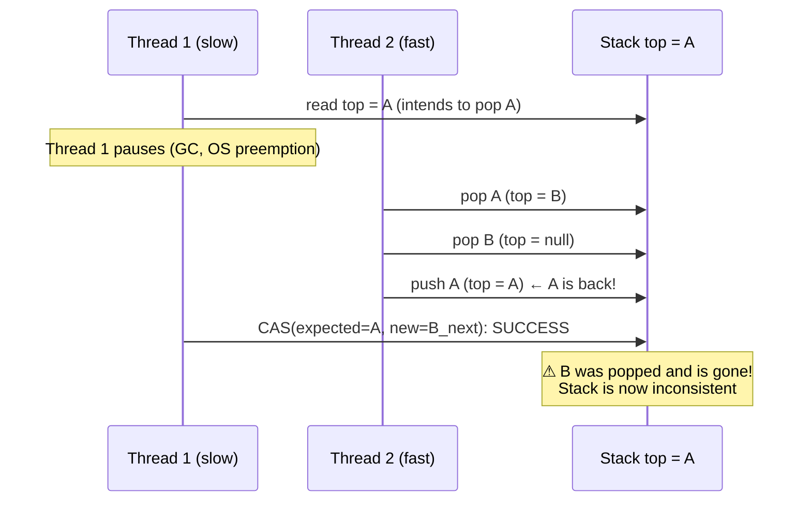
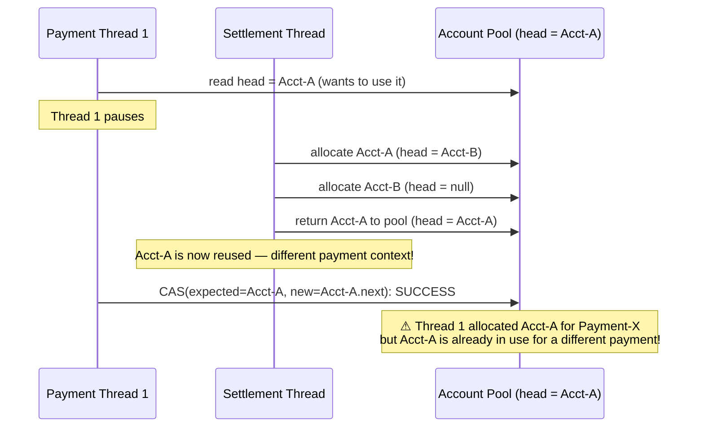

# مشكلة ABA وAtomicStampedReference

## نظرة عامة

لعملية CAS التي تعلمتها في الدرس السابق ثغرة صحة دقيقة: فهي تتحقق فقط من أن **القيمة** تطابق القيمة المتوقعة. ولا تستطيع اكتشاف أن القيمة تغيرت من A إلى B ثم عادت إلى A بين القراءة وCAS. وهذه **مشكلة ABA** — وفي الأنظمة المالية قد تُنتج تلفًا في البيانات يجتاز كل فحوص CAS بصمت.

ويحل `AtomicStampedReference` مشكلة ABA بربط القيمة **بختم** (عدّاد إصدار) يزيد مع كل تحديث. فيجب أن تطابق CAS القيمة والختم معًا، فيصبح التحول A→B→A قابلًا للاكتشاف.

هذا الدرس قصير لكنه حاسم. فمشكلة ABA هي فخ الصحة الأساسي في تصميم الخوارزميات الخالية من الأقفال.

## أهداف التعلم

في نهاية هذا الدرس ستستطيع:

- وصف مشكلة ABA بدقة وشرح لماذا لا تكتشفها CAS وحدها
- تحديد السيناريوهات في الأنظمة المالية التي قد تسبب فيها ABA تلفًا في البيانات
- تنفيذ مراجع ذرية مختومة بالإصدار باستخدام `AtomicStampedReference`
- استخدام `AtomicMarkableReference` لسيناريوهات العلَم أحادي البت
- تقرير متى تكون الحماية من ABA ضرورية ومتى لا تكون

## شرح مشكلة ABA

### جدول زمني خطوة بخطوة

لنأخذ مكدسًا خاليًا من الأقفال يستخدم `push` / `pop` مبنيين على CAS:



تنجح CAS في الخيط 1 لأن القمة `A` — كما هو متوقع تمامًا. لكن المكدس عُدّل مرتين بين قراءة الخيط 1 وCAS. والحالة التي افترضها الخيط 1 (A→B→الباقي) لم تعد تعكس الواقع. فإخراج `B` في العملية التي أرادها الخيط 1 خاطئ الآن — فـ `B` لم يعد في المكدس.

### لماذا لا تستطيع CAS اكتشاف ABA

تقارن CAS بـ **القيمة** (أو تساوي المراجع). ولا مفهوم لديها عن **عدد مرات** تغير القيمة. فإذا انتقل موقع في الذاكرة من A إلى B ثم إلى A، تنجح `compareAndSet(A, C)` — ترى CAS القيمة `A` فتحدّثها إلى `C`، غير مدركة لتغييرين وقعا في الأثناء.

> [!NOTE]
> في Java يزيل جمع النفايات الصورة الكلاسيكية لـ ABA في C/C++: فلا يمكن تحرير عقدة وإعادة استخدام ذاكرتها ما دام خيط آخر يملك مرجعًا إليها، والعقدة المخصصة حديثًا لا تساوي أبدًا (`==`) عقدة قديمة. لذلك تحتاج ABA في Java إلى عودة **الكائن نفسه** — كائن من مجمّع أو مُعاد تدويره، أو عقدة تُدفع مرة أخرى، كما في الجدول الزمني أعلاه.

## ABA في الأنظمة المالية

ليست مشكلة ABA حالة هامشية نظرية. فالأنظمة المالية معرضة لها كلما اعتمدت خوارزمية خالية من الأقفال على CAS لحماية حالة يمكن إعادة تدويرها أو استخدامها.

### سيناريو مجمّع الحسابات



وهذا يُنتج **تخصيصًا مزدوجًا**: دفعتان تتشاركان كائن الحساب نفسه. وفي نظام حقيقي يعني ذلك معاملتين ماليتين منفصلتين تمامًا تكتبان في سجل الحساب نفسه — انتهاك خطير لسلامة البيانات.

### منع الدفع المكرر

مدخل منع التكرار الذي يُحذف ثم يُنشأ لاحقًا للمفتاح نفسه يبدو متطابقًا لخيط قرأه من قبل: فلا تستطيع CAS على المدخل معرفة أنه حُذف وأعيد إنشاؤه في الأثناء. والقواعد العملية: لا تحذف مدخل منع تكرار ما دامت إعادات المحاولة ممكنة (اجعل انتهاءه بعد أطول نافذة إعادة محاولة بكثير)، وأضف إصدارًا إذا كانت المدخلات تُعاد تدويرها.

## AtomicStampedReference

يجمع `AtomicStampedReference<V>` بين مرجع وختم `int` (عدّاد إصدار). ويجب أن يتطابق الاثنان لتنجح CAS.

### الواجهة

```java17
// Create a stamped reference with initial value and initial stamp
AtomicStampedReference<ExchangeRate> ref =
    new AtomicStampedReference<>(currentRate, 0);

// Read value and stamp together (atomic)
int[]        stampHolder = new int[1];
ExchangeRate value       = ref.get(stampHolder);
int          stamp       = stampHolder[0];

// CAS: succeeds only if BOTH reference and stamp match
boolean updated = ref.compareAndSet(
    value,       // expected reference
    newRate,     // new reference
    stamp,       // expected stamp
    stamp + 1    // new stamp — always increment
);
```

### تحديث رصيد مختوم بالإصدار

```java17
import java.util.concurrent.atomic.AtomicStampedReference;

public class StampedBalance {

    // Balance in pence, with version counter to detect ABA
    private final AtomicStampedReference<Long> balance;

    public StampedBalance(long initialPence) {
        this.balance = new AtomicStampedReference<>(initialPence, 0);
    }

    public boolean debit(long amountPence) {
        int[]  stampHolder  = new int[1];
        while (true) {
            Long  current   = balance.get(stampHolder);
            int   stamp     = stampHolder[0];

            if (current < amountPence) {
                return false; // Insufficient funds
            }

            Long updated = current - amountPence;

            // CAS on both value AND stamp — ABA is now detectable
            // If balance went 1000 → 800 → 1000 between our read and CAS,
            // the stamp will have incremented twice — CAS fails and we retry.
            // (For a plain number this ABA is harmless — 1000 is 1000 — so this
            // is a teaching example; stamps matter when an object's identity
            // stands for more than its value, as in pools and linked nodes.)
            // Note: compareAndSet compares REFERENCES (==). We pass back the very
            // Long object we read — re-boxing a long would create a new object.
            if (balance.compareAndSet(current, updated, stamp, stamp + 1)) {
                return true;
            }
            // CAS failed — either value or stamp changed — retry
        }
    }

    public void credit(long amountPence) {
        int[] stampHolder = new int[1];
        while (true) {
            Long current = balance.get(stampHolder);
            int  stamp   = stampHolder[0];
            if (balance.compareAndSet(current, current + amountPence, stamp, stamp + 1)) {
                return;
            }
        }
    }

    public long getBalance() {
        return balance.getReference();
    }

    public int getVersion() {
        return balance.getStamp();
    }
}
```

إذا انتقل الرصيد من 1000 إلى 800 ثم إلى 1000 بين القراءة وCAS، فسيكون الختم قد زاد مرتين — فتفشل CAS ونعيد المحاولة. (بالنسبة لرقم بحت تكون ABA هذه غير ضارة — فالـ 1000 هي 1000 — فهذا مثال تعليمي؛ والأختام مهمة عندما تعني هوية الكائن أكثر من قيمته، كما في المجمّعات والعقد المترابطة.) ولاحظ أن `compareAndSet` تقارن **المراجع** (`==`)، لذلك نمرر كائن `Long` نفسه الذي قرأناه.

```java21
// Java 21 — AtomicStampedReference API is unchanged since Java 5
// The pattern is identical across all Java versions
// Note: for financial balances, database-level locking (a version column for
// optimistic locking, or SELECT ... FOR UPDATE) is preferred over lock-free
// in-memory approaches — it provides durability and consistency
//
// TRAP: keep the Long REFERENCE you read. Unboxing to long and passing it
// back re-boxes it into a NEW Long object (for values outside -128..127),
// so compareAndSet's == check would fail forever — an infinite loop.
public class StampedBalance {

    private final AtomicStampedReference<Long> balance;

    public StampedBalance(long initialPence) {
        this.balance = new AtomicStampedReference<>(initialPence, 0);
    }

    public boolean debit(long amountPence) {
        int[] stamp = new int[1];
        while (true) {
            Long current = balance.get(stamp);          // keep the reference
            if (current < amountPence) return false;
            if (balance.compareAndSet(current, current - amountPence, stamp[0], stamp[0] + 1)) {
                return true;
            }
        }
    }

    public void credit(long amountPence) {
        int[] stamp = new int[1];
        while (true) {
            Long current = balance.get(stamp);
            if (balance.compareAndSet(current, current + amountPence, stamp[0], stamp[0] + 1)) return;
        }
    }
}
```

**فخ:** احتفظ بمرجع `Long` الذي قرأته. ففك التغليف إلى `long` ثم تمريره مرة أخرى يعيد تغليفه في كائن `Long` **جديد** (للقيم خارج -128..127)، فيفشل فحص `==` في `compareAndSet` إلى الأبد — حلقة لا نهائية. وللأرصدة المالية يُفضّل القفل على مستوى قاعدة البيانات (عمود إصدار للقفل المتفائل، أو `SELECT ... FOR UPDATE`) على الأساليب الخالية من الأقفال في الذاكرة.

## AtomicMarkableReference

‏`AtomicMarkableReference<V>` صيغة أبسط تربط مرجعًا بعلامة `boolean` واحدة. وتُستخدم عادة لتعليم عقدة على أنها "محذوفة منطقيًا" في بنية مترابطة خالية من الأقفال.

```java17
import java.util.concurrent.atomic.AtomicMarkableReference;

// Mark a payment record as "voided" atomically
// without replacing the full record
public class VoidablePayment {

    private final AtomicMarkableReference<PaymentRecord> record;

    public VoidablePayment(PaymentRecord initial) {
        this.record = new AtomicMarkableReference<>(initial, false);
    }

    // Mark payment as voided — returns false if already voided
    public boolean void_() {
        boolean[] markHolder = new boolean[1];
        PaymentRecord current = record.get(markHolder);
        if (markHolder[0]) return false; // Already voided

        return record.compareAndSet(
            current, current,  // Reference unchanged
            false, true        // mark: false → true
        );
    }

    public boolean isVoided() {
        return record.isMarked();
    }

    public PaymentRecord getRecord() {
        boolean[] mark = new boolean[1];
        return record.get(mark);
    }
}
```

تعلّم الدفعة كملغاة ذريًا دون استبدال السجل كله، وتعيد false إذا كانت ملغاة بالفعل.

## متى تكون الحماية من ABA ضرورية

ليست كل شيفرة مبنية على CAS بحاجة إلى حماية من ABA. استخدم `AtomicStampedReference` فقط عندما:

| الحالة | خطر ABA | هل تستخدم الختم؟ |
|---|---|---|
| الكائنات في مجمّع أو يُعاد استخدامها | عالٍ — المرجع نفسه يعود | نعم |
| البنى المترابطة الخالية من الأقفال (المكدس، والطابور، والقائمة) | عالٍ — مؤشرات العقد قد تدور | نعم |
| عدّاد بسيط (`AtomicLong`) | لا يوجد — الرقم وحده هو المهم | لا |
| استبدال لقطة غير قابلة للتغيير | لا يوجد — كائنات جديدة بهويات جديدة | لا |
| مرجع لكائن مفرد (الإعدادات، وآخر سعر) | منخفض — عادة كاتب واحد | غالبًا لا |
| آلة حالة مالية متعددة الخطوات | متوسط — حسب الانتقالات | نعم |

## البديل: القفل المتفائل في قاعدة البيانات

في الأنظمة المالية تعيش معظم الحالة المتزامنة في قاعدة بيانات — لا في ذاكرة JVM. والمكافئ في قاعدة البيانات لـ `AtomicStampedReference` هو **القفل المتفائل بعمود إصدار**:

```java17
// JPA @Version — database-level ABA prevention
@Entity
public class AccountBalance {

    @Id
    private String accountId;

    private long balancePence;

    @Version  // Incremented automatically on each UPDATE — CAS equivalent
    private long version;
}

// Spring Data Repository — CAS at database level
// If another transaction changed the balance between our read and write,
// the WHERE clause (WHERE id=? AND version=?) fails → OptimisticLockException
// This is ABA prevention at the persistence layer
```

إذا غيّرت معاملة أخرى الرصيد بين قراءتنا وكتابتنا، يفشل شرط `WHERE id=? AND version=?` فيُرمى `OptimisticLockException` — وهذا منع ABA في طبقة التخزين.

> [!NOTE]
> في معظم أنظمة معالجة المدفوعات، **يُفضّل القفل المتفائل في قاعدة البيانات على `AtomicStampedReference` في الذاكرة** لأن:
> 1. الرصيد الموثوق يعيش في قاعدة البيانات — والبنى الخالية من الأقفال في الذاكرة ذاكرات مؤقتة في أحسن الأحوال
> 2. معاملات قاعدة البيانات تصمد بعد إعادة تشغيل JVM؛ أما الحالة في الذاكرة فلا
> 3. ‏`OptimisticLockException` مفهوم جيدًا وسهل المعالجة في تطبيقات Spring
>
> استخدم `AtomicStampedReference` للبنى الخالية من الأقفال في الذاكرة فعلًا حيث يكون الوصول إلى قاعدة البيانات بطيئًا جدًا أو غير ضروري. (ختمه من نوع `int` يلتف بعد نحو 4 مليارات تحديث — نادرًا ما يكون مشكلة عملية، لكن لهذا لا يُعد الختم إثباتًا كاملًا.)


<!-- KNOWLEDGE-CHECK [
  {
    "id": "kc-aba-01",
    "question": "يقرأ الخيط 1 قيمة `AtomicReference` فيجدها A. يغيرها الخيط 2 إلى B، ثم يعيدها إلى A. ثم ينفّذ الخيط 1 `compareAndSet(A, C)`. ماذا يحدث؟",
    "options": [
      "تفشل CAS لأن القيمة تغيرت مرتين",
      "تنجح CAS لأن القيمة الحالية A — والتغييرات الوسيطة غير مرئية",
      "يُرمى ConcurrentModificationException",
      "تنجح CAS فقط إذا كان الخيط 1 يملك قفل مراقب"
    ],
    "correct": 1,
    "explanation": "تقارن CAS بالقيمة (تساوي المراجع). ولا ذاكرة لديها عن عدد مرات تغير المرجع. فإذا كانت القيمة الحالية A والمتوقعة A، تنجح CAS — بغض النظر عن تاريخ A→B→A. وهذه مشكلة ABA. ويحلها AtomicStampedReference باشتراط تطابق المرجع والختم معًا؛ فالختم يزيد مع كل كتابة، فيصبح الانتقال A→B→A قابلًا للاكتشاف."
  },
  {
    "id": "kc-aba-02",
    "question": "متى لا يحتاج عدّاد `AtomicLong` بسيط إلى حماية من ABA؟",
    "options": [
      "عندما يُزاد العدّاد فقط، ولا يُنقص أبدًا",
      "أبدًا — كل عمليات AtomicLong معرضة لـ ABA",
      "عندما يصل إليه أقل من 10 خيوط في الوقت نفسه",
      "دائمًا — لدى AtomicLong حماية مدمجة من ABA"
    ],
    "correct": 0,
    "explanation": "تحدث ABA عندما تعود القيمة إلى حالة سبق رؤيتها بين القراءة وCAS. والعدّاد الذي يزيد فقط لا يعود أبدًا إلى قيمة سابقة، فلا يمكن أن تحدث ABA. (وحتى في العدّادات التي تزيد وتنقص، يكون A→B→A غير ضار: فبالنسبة لرقم بحت لا تهم إلا القيمة.) وABA مشكلة حقيقية حيث يمكن أن تتكرر الهوية نفسها (مرجع الكائن) — مجمّعات الكائنات والبنى المترابطة الخالية من الأقفال."
  },
  {
    "id": "kc-aba-03",
    "question": "يعيد استدعاء CAS على `AtomicStampedReference` القيمة `false`. أي مما يلي قد يكون السبب؟",
    "options": [
      "تغير المرجع لكن الختم لم يتغير",
      "تغير الختم لكن المرجع لم يتغير",
      "لم يتغير المرجع ولا الختم",
      "الخياران الأول والثاني — فتغير الختم وحده كافٍ لفشل CAS"
    ],
    "correct": 3,
    "explanation": "تفشل AtomicStampedReference.compareAndSet(expectedRef, newRef, expectedStamp, newStamp) إذا لم يطابق المرجع **أو** الختم القيم المتوقعة. وتغير الختم وحده (عاد المرجع إلى قيمته الأصلية عبر A→B→A) هو بالضبط سبب وجود الختم — لإفشال CAS في هذه الحالة. فأي اختلاف في أي من المكونين يسبب فشل CAS."
  },
  {
    "id": "kc-aba-04",
    "question": "في نظام دفع إنتاجي، يعيش رصيد حساب بنكي في قاعدة بيانات (PostgreSQL مع @Version) وفي ذاكرة مؤقتة `AtomicLong` معًا. أيهما يوفر حماية من ABA؟",
    "options": [
      "AtomicLong فقط — قراءات قاعدة البيانات ليست ذرية",
      "عمود @Version فقط — لا يوفر AtomicLong حماية من ABA",
      "الاثنان يوفران حماية من ABA بآليات مختلفة",
      "لا شيء — AtomicStampedReference وحده يوفر حماية من ABA"
    ],
    "correct": 1,
    "explanation": "عمود @Version وحده يوفر حماية من ABA: فهو يزيد مع كل UPDATE، فتفشل قراءة قديمة يتبعها UPDATE بـ OptimisticLockException، حتى لو عاد الرصيد إلى قيمته القديمة. أما CAS في AtomicLong فتقارن القيمة فقط — فهي تمنع التحديثات المفقودة لكنها لا تكتشف A→B→A (غير ضار لرقم، لكنه ليس حماية من ABA). وقاعدة البيانات مصدر الحقيقة؛ والذاكرة المؤقتة للقراءات السريعة فقط ومتسقة نهائيًا."
  }
] -->


<!-- PRACTICAL-CHALLENGE {
  "id": "pc-aba-problem",
  "title": "مكدس خالٍ من الأقفال وآمن من ABA",
  "description": "نفّذ مكدسًا خاليًا من الأقفال وآمنًا من ABA يصلح كمجمّع لخانات معالجة المدفوعات.",
  "tasks": [
    {
      "id": "pc-aba-01",
      "description": "نفّذ مكدسًا ساذجًا خاليًا من الأقفال باستخدام `AtomicReference<Node>` للقمة. وأظهر حالة اختبار يستطيع فيها خيطان إطلاق مشكلة ABA: يخرج الخيط 1 العقدة A، ويخرج الخيط 2 العقدتين A وB ثم يعيد دفع A، فتنجح CAS في الخيط 1 بشكل خاطئ."
    },
    {
      "id": "pc-aba-02",
      "description": "أصلح المكدس من المهمة 1 باستخدام `AtomicStampedReference<Node>` للقمة. وزد الختم مع كل دفع وإخراج ناجحين. وأظهر أن اختبار الخيطين 1 و2 نفسه من المهمة 1 يتصرف الآن بشكل صحيح."
    },
    {
      "id": "pc-aba-03",
      "description": "نفّذ `PaymentSlotPool.acquire()` و`release(slot)` باستخدام المكدس الآمن من ABA. تمثل كل خانة سياق معالجة دفع. واكتب اختبار إجهاد يأخذ ويحرر 10,000 خانة من 50 خيطًا ويتحقق من أن أي خانة لا تُخصص لخيطين في الوقت نفسه."
    },
    {
      "id": "pc-aba-04",
      "description": "أضف عمود JPA ‏`@Version` إلى كيان `PaymentInstruction`. واكتب طريقة خدمة `reservePaymentSlot()` تستخدم القفل المتفائل لحجز تعليمة دفع غير معالجة. وعالج `OptimisticLockException` بحلقة إعادة محاولة محدودة بثلاث محاولات."
    }
  ]
} -->
