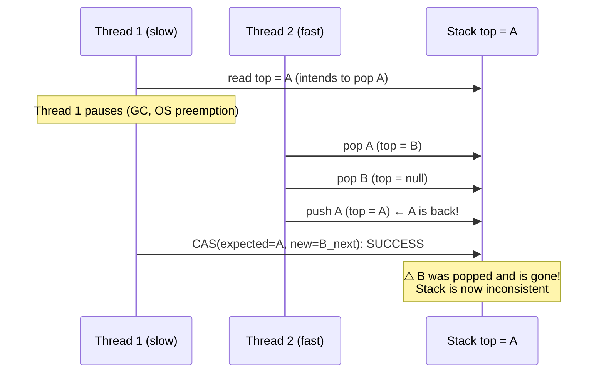
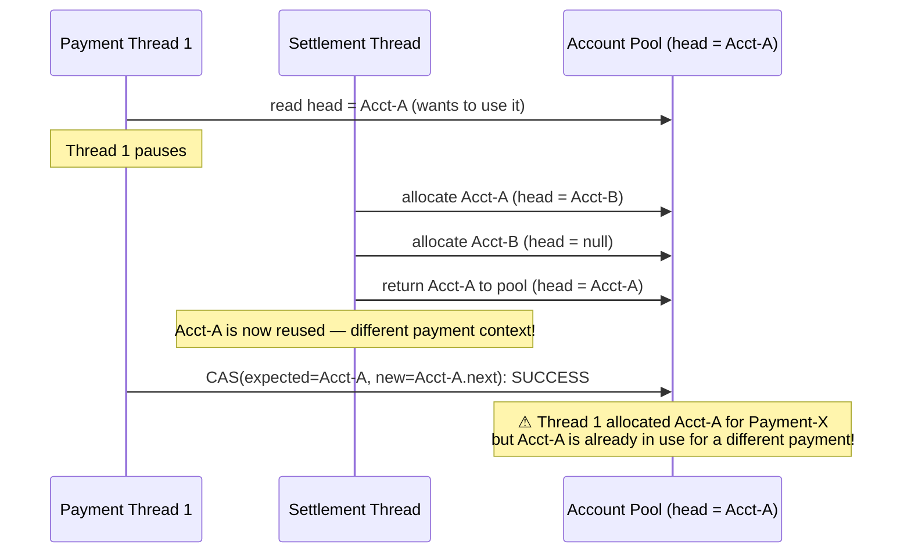

## Overview

The CAS operation you learned in the previous lesson has a subtle correctness flaw: it checks only that the **value** matches the expected value. It cannot detect whether the value changed from A to B and back to A between the read and the CAS. This is the **ABA problem** — and in financial systems, it can produce data corruption that passes all CAS validations silently.

`AtomicStampedReference` solves the ABA problem by coupling the value with a **stamp** (version counter) that is incremented on every update. CAS must match both value and stamp, making the A→B→A transformation detectable.

This lesson is short but critical. The ABA problem is the principal correctness trap in lock-free algorithm design.

## Learning Objectives

By the end of this lesson you will be able to:

- Describe the ABA problem precisely and explain why CAS alone does not detect it
- Identify scenarios in financial systems where ABA can cause data corruption
- Implement version-stamped atomic references using `AtomicStampedReference`
- Use `AtomicMarkableReference` for single-bit flag scenarios
- Decide when ABA protection is necessary versus unnecessary

## The ABA Problem Explained

### A Step-by-Step Timeline

Consider a lock-free stack that uses a CAS-based `push` / `pop`:



Thread 1's CAS succeeds because the top is `A` — just as expected. But the stack has been modified twice between Thread 1's read and CAS. The state Thread 1 assumed (A→B→rest) no longer reflects reality. The pop of `B` in Thread 1's intended operation is now incorrect — `B` no longer exists in the stack.

### Why CAS Cannot Detect ABA

CAS compares by **value** (or reference equality). It has no concept of **how many times** a value changed. If a memory location goes A → B → A, `compareAndSet(A, C)` succeeds — CAS sees `A` and updates to `C`, unaware that two intervening changes occurred.

## ABA in Financial Systems

The ABA problem is not a theoretical edge case. Financial systems are vulnerable whenever a lock-free algorithm relies on CAS to protect state that can be recycled or reused.

### Account Pool Scenario



This produces a **double-allocation**: two payments share the same account object. In a real system, this means two completely separate financial transactions writing to the same account record — a severe data integrity violation.

### Duplicate Payment Prevention

A payment idempotency store uses a lock-free map. If a payment ID is processed, removed, and then a new payment with the same ID arrives — without ABA protection, a stale CAS could re-process the original payment.

## AtomicStampedReference

`AtomicStampedReference<V>` combines a reference with an `int` stamp (version counter). Both must match for CAS to succeed.

### API

```java17
// Create a stamped reference with initial value and initial stamp
AtomicStampedReference<ExchangeRate> ref =
    new AtomicStampedReference<>(currentRate, 0);

// Read value and stamp together (atomic)
int[]        stampHolder = new int[1];
ExchangeRate value       = ref.get(stampHolder);
int          stamp       = stampHolder[0];

// CAS: succeeds only if BOTH reference and stamp match
boolean updated = ref.compareAndSet(
    value,       // expected reference
    newRate,     // new reference
    stamp,       // expected stamp
    stamp + 1    // new stamp — always increment
);
```

### Version-Stamped Balance Update

```java17
import java.util.concurrent.atomic.AtomicStampedReference;

public class StampedBalance {

    // Balance in pence, with version counter to detect ABA
    private final AtomicStampedReference<Long> balance;

    public StampedBalance(long initialPence) {
        this.balance = new AtomicStampedReference<>(initialPence, 0);
    }

    public boolean debit(long amountPence) {
        int[]  stampHolder  = new int[1];
        while (true) {
            Long  current   = balance.get(stampHolder);
            int   stamp     = stampHolder[0];

            if (current < amountPence) {
                return false; // Insufficient funds
            }

            Long updated = current - amountPence;

            // CAS on both value AND stamp — ABA is now detectable
            // If balance went 1000 → 800 → 1000 between our read and CAS,
            // the stamp will have incremented twice — CAS will fail correctly
            if (balance.compareAndSet(current, updated, stamp, stamp + 1)) {
                return true;
            }
            // CAS failed — either value or stamp changed — retry
        }
    }

    public void credit(long amountPence) {
        int[] stampHolder = new int[1];
        while (true) {
            Long current = balance.get(stampHolder);
            int  stamp   = stampHolder[0];
            if (balance.compareAndSet(current, current + amountPence, stamp, stamp + 1)) {
                return;
            }
        }
    }

    public long getBalance() {
        return balance.getReference();
    }

    public int getVersion() {
        return balance.getStamp();
    }
}
```

```java21
// Java 21 — AtomicStampedReference API is unchanged since Java 5
// No new alternatives were added in Java 17 or 21
// The pattern is identical across all Java versions
// Note: for most high-throughput financial counters, database-level
// optimistic locking (SELECT ... FOR UPDATE + version column) is preferred
// over lock-free in-memory approaches — provides durability and consistency
public class StampedBalance {

    private final AtomicStampedReference<Long> balance;

    public StampedBalance(long initialPence) {
        this.balance = new AtomicStampedReference<>(initialPence, 0);
    }

    public boolean debit(long amountPence) {
        int[] stamp = new int[1];
        while (true) {
            long current = balance.get(stamp);
            if (current < amountPence) return false;
            if (balance.compareAndSet(current, current - amountPence, stamp[0], stamp[0] + 1)) {
                return true;
            }
        }
    }

    public void credit(long amountPence) {
        int[] stamp = new int[1];
        while (true) {
            long current = balance.get(stamp);
            if (balance.compareAndSet(current, current + amountPence, stamp[0], stamp[0] + 1)) return;
        }
    }
}
```

## AtomicMarkableReference

`AtomicMarkableReference<V>` is a simpler variant that couples a reference with a single `boolean` mark. It is typically used to mark a node as "logically deleted" in a lock-free linked structure.

```java17
import java.util.concurrent.atomic.AtomicMarkableReference;

// Mark a payment record as "voided" atomically
// without replacing the full record
public class VoidablePayment {

    private final AtomicMarkableReference<PaymentRecord> record;

    public VoidablePayment(PaymentRecord initial) {
        this.record = new AtomicMarkableReference<>(initial, false);
    }

    // Mark payment as voided — returns false if already voided
    public boolean void_() {
        boolean[] markHolder = new boolean[1];
        PaymentRecord current = record.get(markHolder);
        if (markHolder[0]) return false; // Already voided

        return record.compareAndSet(
            current, current,  // Reference unchanged
            false, true        // mark: false → true
        );
    }

    public boolean isVoided() {
        return record.isMarked();
    }

    public PaymentRecord getRecord() {
        boolean[] mark = new boolean[1];
        return record.get(mark);
    }
}
```

## When ABA Protection Is Necessary

Not all CAS-based code needs ABA protection. Use `AtomicStampedReference` only when:

| Condition | ABA Risk | Use Stamped? |
|---|---|---|
| Objects are pooled/reused | High — same reference reappears | Yes |
| Lock-free linked structures (stack, queue, list) | High — node pointers can cycle | Yes |
| Simple counter (`AtomicLong`) | None — numeric equality only | No |
| Immutable snapshot replacement | None — new objects, new identity | No |
| Reference to singleton (config, latest rate) | Low — usually single writer | Usually No |
| Multi-step financial state machine | Medium — depends on transitions | Yes |

## Alternative: Database Optimistic Locking

In financial systems, most concurrent state lives in a database — not in JVM memory. The database equivalent of `AtomicStampedReference` is **optimistic locking with a version column**:

```java17
// JPA @Version — database-level ABA prevention
@Entity
public class AccountBalance {

    @Id
    private String accountId;

    private long balancePence;

    @Version  // Incremented automatically on each UPDATE — CAS equivalent
    private long version;
}

// Spring Data Repository — CAS at database level
// If another transaction changed the balance between our read and write,
// the WHERE clause (WHERE id=? AND version=?) fails → OptimisticLockException
// This is ABA prevention at the persistence layer
```

> [!NOTE]
> In most payment processing systems, **database optimistic locking is preferred over in-memory `AtomicStampedReference`** because:
> 1. The authoritative balance lives in the database — in-memory lock-free structures are caches at best
> 2. Database transactions survive JVM restarts; in-memory state does not
> 3. `OptimisticLockException` is well-understood and easily handled in Spring applications
>
> Use `AtomicStampedReference` for truly in-memory lock-free data structures where database access is too slow or unnecessary.

---

<!-- KNOWLEDGE-CHECK [
  {
    "id": "kc-aba-01",
    "question": "Thread 1 reads an `AtomicReference` as value A. Thread 2 changes it to B, then back to A. Thread 1 then executes `compareAndSet(A, C)`. What happens?",
    "options": [
      "The CAS fails because the value changed twice",
      "The CAS succeeds because the current value is A — the intermediate changes are invisible",
      "A ConcurrentModificationException is thrown",
      "The CAS succeeds only if Thread 1 holds a monitor lock"
    ],
    "correct": 1,
    "explanation": "CAS compares by value (reference equality). It has no memory of how many times the reference changed. If the current value is A and the expected value is A, CAS succeeds — regardless of the A→B→A history. This is the ABA problem. AtomicStampedReference solves it by requiring both reference and stamp to match; the stamp increments on every write, making the A→B→A transition detectable."
  },
  {
    "id": "kc-aba-02",
    "question": "When does a simple `AtomicLong` counter NOT need ABA protection?",
    "options": [
      "When the counter is only incremented, never decremented",
      "Never — all AtomicLong operations are vulnerable to ABA",
      "When fewer than 10 threads access it concurrently",
      "Always — AtomicLong has built-in ABA protection"
    ],
    "correct": 0,
    "explanation": "ABA occurs when a value can return to a previously seen state between a read and CAS. For a monotonically increasing counter (increment only), the value never returns to a previous value, so ABA cannot occur. AtomicLong counters that only increment are ABA-safe. ABA becomes a concern for structures where the same identity (object reference or value) can recur — particularly object pools and lock-free linked structures."
  },
  {
    "id": "kc-aba-03",
    "question": "An `AtomicStampedReference` CAS call returns `false`. Which of the following could have caused this?",
    "options": [
      "The reference changed but the stamp did not",
      "The stamp changed but the reference did not",
      "Both the reference and stamp were unchanged",
      "Both A and B — a stamp change alone is sufficient to fail CAS"
    ],
    "correct": 3,
    "explanation": "AtomicStampedReference.compareAndSet(expectedRef, newRef, expectedStamp, newStamp) fails if EITHER the reference OR the stamp doesn't match the expected values. A stamp change alone (reference returned to original value via A→B→A) is exactly why the stamp exists — to cause CAS to fail in that scenario. Any discrepancy in either component causes CAS failure."
  },
  {
    "id": "kc-aba-04",
    "question": "In a production payment system, a bank account balance lives in both a database (PostgreSQL with @Version) and an in-memory `AtomicLong` cache. Which provides ABA protection?",
    "options": [
      "Only the AtomicLong — database reads are not atomic",
      "Only the @Version column — AtomicLong has no ABA protection",
      "Both provide ABA protection through different mechanisms",
      "Neither — only AtomicStampedReference provides ABA protection"
    ],
    "correct": 2,
    "explanation": "Both provide ABA protection. The @Version column is the database equivalent of AtomicStampedReference — it increments on every UPDATE, so a stale read plus UPDATE fails with OptimisticLockException. AtomicLong with CAS also prevents lost updates (though not full ABA for object pointers). The database @Version is preferred for durability; the in-memory cache is used for fast read access only and should be treated as eventually consistent."
  }
] -->

---

<!-- PRACTICAL-CHALLENGE {
  "id": "pc-aba-problem",
  "title": "ABA-Safe Lock-Free Stack",
  "description": "Implement an ABA-safe lock-free stack suitable for use as a payment processing slot pool.",
  "tasks": [
    {
      "id": "pc-aba-01",
      "description": "Implement a naive lock-free stack using `AtomicReference<Node>` for the top. Show a test case where two threads can trigger the ABA problem: Thread 1 pops A, Thread 2 pops A and B and re-pushes A, Thread 1's CAS succeeds incorrectly."
    },
    {
      "id": "pc-aba-02",
      "description": "Fix the lock-free stack from task 1 using `AtomicStampedReference<Node>` for the top. Ensure pop() increments the stamp on every successful operation. Show that the same Thread 1/Thread 2 test from task 1 now behaves correctly."
    },
    {
      "id": "pc-aba-03",
      "description": "Implement `PaymentSlotPool.acquire()` and `release(slot)` using the ABA-safe stack. Each slot represents a payment processing context. Write a stress test that acquires and releases 10,000 slots from 50 threads and verifies no slot is allocated to two threads simultaneously."
    },
    {
      "id": "pc-aba-04",
      "description": "Add a JPA `@Version` column to a `PaymentInstruction` entity. Write a service method `reservePaymentSlot()` that uses optimistic locking to claim an unprocessed payment instruction. Handle `OptimisticLockException` with a retry loop bounded to 3 attempts."
    }
  ]
} -->
