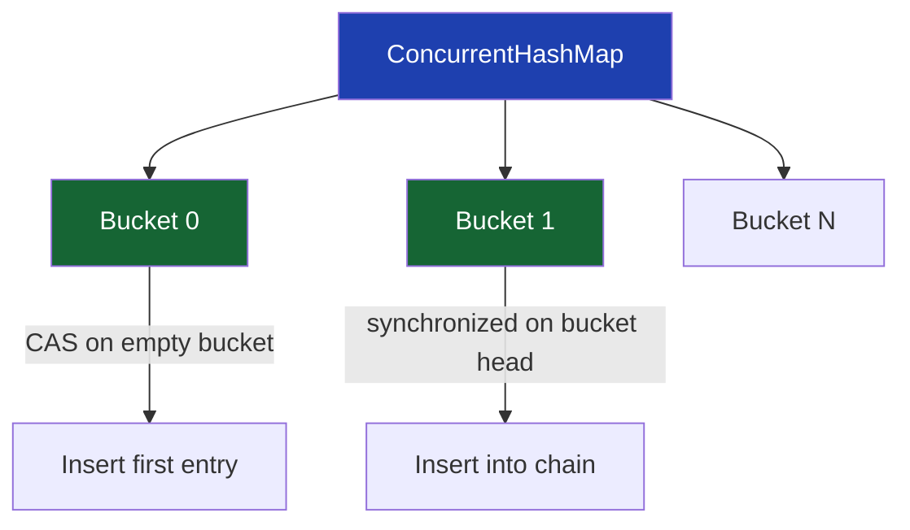
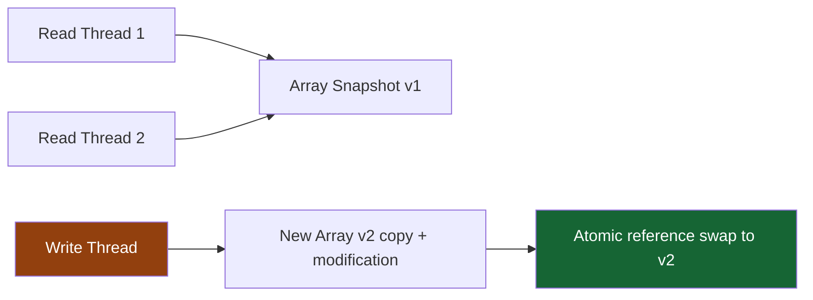
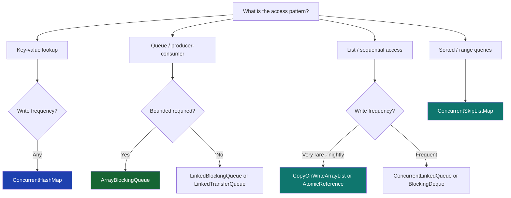

# المجموعات المتزامنة — ConcurrentHashMap وBlockingQueue وCopyOnWrite

## نظرة عامة

تأتي الحزمة `java.util.concurrent` بمجموعة من **المجموعات المتزامنة** — بنى بيانات آمنة للخيوط تلغي الحاجة إلى تغليف `HashMap` أو `ArrayList` في `Collections.synchronizedXxx()`. وهذه المجموعات ليست مجرد أغلفة بقفل؛ بل تستخدم استراتيجيات داخلية على مستوى الأجزاء أو مبنية على CAS لتسمح بتزامن كبير.

واختيار المجموعة الخاطئة تحت الحمل المتزامن مصدر شائع لأعطال الصحة واختناقات الأداء معًا. ويغطي هذا الدرس كل مجموعة متزامنة رئيسية، واستراتيجيات التزامن الداخلية فيها، وتطبيقاتها المباشرة في الأنظمة المصرفية وأنظمة الدفع.

## أهداف التعلم

في نهاية هذا الدرس ستستطيع:

- شرح كيف يحقق `ConcurrentHashMap` أمان الخيوط دون قفل عام
- استخدام `compute` و`merge` و`computeIfAbsent` للعمليات المركّبة الذرية
- الاختيار بين `ArrayBlockingQueue` و`LinkedBlockingQueue` و`SynchronousQueue`
- تطبيق `CopyOnWriteArrayList` بشكل صحيح وشرح مفاضلة أدائه
- استخدام `ConcurrentSkipListMap` للوصول المتزامن المرتب
- التعرف على الاستخدامات الخاطئة الشائعة للمجموعات المتزامنة التي تكسر الذرية
- اختيار المجموعة المتزامنة الصحيحة لكل نمط وصول في الأنظمة المالية

## سياق العمل

تحتفظ خدمة توجيه مدفوعات بثلاث بنى بيانات مشتركة:

1. **خريطة الجلسات النشطة** — 50,000 مدخل، و2,000 قراءة متزامنة في الثانية، و50 كتابة في الثانية
2. **طابور المدفوعات** — 400 خيط منتج يغذّي 20 خيطًا مستهلكًا
3. **قائمة جدول الرسوم** — تقرؤها كل خيوط الدفع، ويحدّثها خيط إداري واحد ليلًا

واستخدام `HashMap` و`LinkedList` و`ArrayList` مع كتل `synchronized` يجعل 40% من وقت المعالج يذهب إلى التنافس على الأقفال. والاختيار الخاطئ للمجموعة لكل بنية يضخّم المشكلة. والاختيارات الصحيحة تلغي التنافس كليًا.

## ConcurrentHashMap

‏`ConcurrentHashMap` أهم مجموعة متزامنة في Java. فهي تحل محل `HashMap` في السياقات متعددة الخيوط وتتفوق كثيرًا على `Collections.synchronizedMap(new HashMap<>())` باستخدام CAS ومزامنة على مستوى كل دلو (عقدة) بدل قفل عام واحد.

### استراتيجية التزامن الداخلية



- الإدراج في دلو فارغ: **CAS** — بلا قفل
- الدلو غير الفارغ (سلسلة/شجرة): **synchronized على رأس الدلو** — فلا يُقفل إلا ذلك الدلو
- الخيوط التي تكتب في دلاء مختلفة تتقدم **بالتوازي**
- الحجم: يجمع `size()` عدّادات موزعة — تقريبي أثناء التعديل المتزامن
- تغيير الحجم تعاوني: الخيوط التي تكتب أثناء تغيير الحجم تساعد في نقل الدلاء

### العمليات الأساسية

```java17
import java.util.concurrent.ConcurrentHashMap;

public class SessionStore {

    private final ConcurrentHashMap<String, UserSession> sessions
        = new ConcurrentHashMap<>();

    // Thread-safe get / put / remove — no additional synchronization needed
    public UserSession get(String sessionId) {
        return sessions.get(sessionId);
    }

    public void put(String sessionId, UserSession session) {
        sessions.put(sessionId, session);
    }

    public void remove(String sessionId) {
        sessions.remove(sessionId);
    }

    // Conditional remove — only removes if value matches (atomic check-and-remove)
    public boolean invalidate(String sessionId, UserSession expected) {
        return sessions.remove(sessionId, expected);
    }
}
```

### العمليات المركّبة الذرية

أهم ميزة في `ConcurrentHashMap` هي مجموعة **العمليات المركّبة الذرية**. فالنمط الساذج `get-ثم-put` يكسر الذرية — استخدم هذه بدلًا منه:

```java17
// WRONG: check-then-act — a race condition between get() and put()
public void recordFailure_WRONG(String accountId) {
    Integer count = failureCounts.get(accountId);
    // Another thread may insert between get() and put()!
    failureCounts.put(accountId, count == null ? 1 : count + 1);
}

// CORRECT: computeIfAbsent — atomic get-or-create
private final ConcurrentHashMap<String, List<Payment>> pendingByAccount
    = new ConcurrentHashMap<>();

public void addPending(String accountId, Payment payment) {
    pendingByAccount
        .computeIfAbsent(accountId, k -> new CopyOnWriteArrayList<>())
        .add(payment);
}

// CORRECT: compute — atomic read-modify-write
private final ConcurrentHashMap<String, Integer> failureCounts
    = new ConcurrentHashMap<>();

public void recordFailure(String accountId) {
    failureCounts.compute(accountId, (k, v) -> v == null ? 1 : v + 1);
}

// CORRECT: merge — atomic update-or-create with BiFunction
private final ConcurrentHashMap<String, Long> totalByAccount
    = new ConcurrentHashMap<>();

public void recordAmount(String accountId, long amountPence) {
    totalByAccount.merge(accountId, amountPence, Long::sum);
}
```

```java21
// Java 21 — same API; no new ConcurrentHashMap methods in Java 17-21
// Virtual threads accessing ConcurrentHashMap: safe — CHM operations are
// non-blocking for most cases (CAS on empty buckets) and briefly synchronized
// only for non-empty buckets — no pinning concern for most workloads
public class PaymentAggregator {

    private final ConcurrentHashMap<String, Long> totalByAccount
        = new ConcurrentHashMap<>();
    private final ConcurrentHashMap<String, Integer> countByAccount
        = new ConcurrentHashMap<>();

    public void record(String accountId, long amountPence) {
        totalByAccount.merge(accountId, amountPence, Long::sum);
        countByAccount.merge(accountId, 1, Integer::sum);
    }

    public record AccountSummary(long totalPence, int count) {}

    public AccountSummary getSummary(String accountId) {
        return new AccountSummary(
            totalByAccount.getOrDefault(accountId, 0L),
            countByAccount.getOrDefault(accountId, 0)
        );
    }
}
```

> [!WARNING]
> **تقفل `compute` و`merge` و`computeIfAbsent` الدلو أثناء تشغيل الدالة.** ويجب أن تكون الدالة:
> - **سريعة** — بلا إدخال/إخراج ولا استدعاءات حاجبة: فالكتّاب الآخرون في ذلك الدلو ينتظرونها
> - **بلا آثار جانبية على الخريطة** — تعمل مرة واحدة لكل استدعاء وهي تملك القفل (على خلاف `AtomicLong.updateAndGet`، لا تُعاد)، لكن يجب ألا تعدّل الخريطة نفسها
> - **غير متكررة** — تحديث الخريطة نفسها (حتى مفتاح آخر) داخل الدالة ممنوع: فهو يرمي `IllegalStateException("Recursive update")` أو قد يعلّق الخيط
>
> لا تستدعِ أبدًا قاعدة بيانات أو خدمة خارجية داخل دالة compute في `ConcurrentHashMap`.

### التكرار والاتساق الضعيف

مكررات `ConcurrentHashMap` **متسقة بشكل ضعيف**: تعكس الحالة عند إنشاء المكرر أو بعده، لكنها لا ترمي `ConcurrentModificationException`. وقد تظهر التعديلات أثناء التكرار أو لا تظهر.

```java17
// Safe to iterate while other threads modify — no CME
// But new entries added during iteration may not appear
sessions.forEach((id, session) -> {
    if (session.isExpired()) {
        sessions.remove(id); // Safe — will not corrupt iteration
    }
});

// Parallel iteration (Java 8+) — uses ForkJoinPool.commonPool()
sessions.forEachValue(1000L, session -> metricsService.record(session));
```

## BlockingQueue

توفر تنفيذات `BlockingQueue` عمليات **حاجبة**: `put()` (ينتظر إذا كان الطابور ممتلئًا) و`take()` (ينتظر إذا كان فارغًا). وهي الآلية المعيارية لأنماط المنتج-المستهلك في Java دون متغيرات `Condition` صريحة.

### الصيغ والمفاضلات

| التنفيذ | محدود؟ | الترتيب | حالة الاستخدام |
|---|---|---|---|
| `ArrayBlockingQueue` | نعم (ثابت) | FIFO | طوابير دفع ثابتة الحجم، وضغط عكسي |
| `LinkedBlockingQueue` | اختياري | FIFO | طوابير عالية الإنتاجية، مع خطر عدم التحديد |
| `PriorityBlockingQueue` | لا | الأولوية | معالجة المدفوعات حسب الأولوية |
| `SynchronousQueue` | لا ينطبق (سعة 0) | تسليم مباشر | نقل العمل في مجمّع الخيوط |
| `DelayQueue` | لا | انتهاء التأخير | إعادة محاولة الدفع المجدولة |
| `LinkedTransferQueue` | لا | FIFO + تسليم | إنتاجية عالية مع ضغط عكسي اختياري |

### طابور معالجة المدفوعات

```java17
import java.util.concurrent.ArrayBlockingQueue;
import java.util.concurrent.BlockingQueue;

public class PaymentProcessingPipeline {

    // Bounded — back-pressure when processors are overwhelmed
    // 10,000 capacity: if processors fall behind, intake blocks until space frees
    private final BlockingQueue<Payment> queue =
        new ArrayBlockingQueue<>(10_000);

    // Producer: payment intake service (400 threads)
    public void submit(Payment payment) throws InterruptedException {
        queue.put(payment); // Blocks if queue is full — applies back-pressure
    }

    // Non-blocking offer with timeout — for time-sensitive intake
    public boolean trySubmit(Payment payment, long timeoutMs)
            throws InterruptedException {
        return queue.offer(payment, timeoutMs, TimeUnit.MILLISECONDS);
    }

    // Consumer: payment processor thread
    public void processLoop() throws InterruptedException {
        while (!Thread.currentThread().isInterrupted()) {
            Payment payment = queue.take(); // Blocks until a payment is available
            process(payment);
        }
    }

    private void process(Payment payment) { /* ... */ }
}
```

```java21
// Java 21 — virtual threads work excellently with BlockingQueue
// Virtual threads blocking on take() park rather than pinning a carrier thread
// This is the recommended pattern for virtual-thread-based consumers
public class PaymentProcessingPipeline {

    private final BlockingQueue<Payment> queue = new ArrayBlockingQueue<>(10_000);

    // Long-lived executor: NOT try-with-resources here — close() waits for
    // all tasks to finish, and these consumers never finish on their own,
    // so startConsumers() would block forever
    private final ExecutorService consumers = Executors.newVirtualThreadPerTaskExecutor();

    // Start N virtual thread consumers
    public void startConsumers(int count) {
        for (int i = 0; i < count; i++) {
            consumers.submit(() -> {
                try {
                    while (!Thread.currentThread().isInterrupted()) {
                        Payment p = queue.take(); // Parks virtual thread — no carrier pinning
                        process(p);
                    }
                } catch (InterruptedException e) {
                    Thread.currentThread().interrupt();
                }
            });
        }
    }

    public void stop() {
        consumers.shutdownNow();   // interrupts the consumers blocked in take()
    }

    public void submit(Payment payment) throws InterruptedException {
        queue.put(payment);
    }

    private void process(Payment payment) { /* ... */ }
}
```

الخيوط الافتراضية المنتظرة في `take()` تتوقف دون تثبيت خيط حمل — وهذا النمط الموصى به للمستهلكين المبنيين على الخيوط الافتراضية. ولاحظ أن المنفّذ هنا طويل العمر وليس داخل `try-with-resources`: فـ `close()` ينتظر انتهاء كل المهام، وهؤلاء المستهلكون لا ينتهون من تلقاء أنفسهم، فكانت `startConsumers()` ستُحجب إلى الأبد.

> [!IMPORTANT]
> **فضّل `ArrayBlockingQueue` على `LinkedBlockingQueue` لطوابير الدفع.** فـ `LinkedBlockingQueue` غير محدود افتراضيًا — والمستهلك البطيء يؤدي إلى نمو غير محدود في الذاكرة ثم `OutOfMemoryError`. أما `ArrayBlockingQueue` فيفرض سعة ثابتة، فيوفر ضغطًا عكسيًا عند الاستقبال. وحدّد السعة دائمًا حسب أقصى تراكم مقبول، لا نموًا غير محدود.

### SynchronousQueue — تسليم بسعة صفرية

سعة `SynchronousQueue` صفر. فيُحجب `put()` حتى يستدعي خيط آخر `take()` — تسليم مباشر من خيط إلى خيط. وهو الطابور المستخدم داخليًا في `Executors.newCachedThreadPool()`.

```java17
// SynchronousQueue: used for direct handoff to thread pool workers
// No buffering. ThreadPoolExecutor uses offer(), not put(): if no idle worker
// takes the task, a new thread is started (up to max), and beyond max the
// task is REJECTED (here: AbortPolicy throws RejectedExecutionException)
BlockingQueue<Runnable> workQueue = new SynchronousQueue<>();
ThreadPoolExecutor pool = new ThreadPoolExecutor(
    0, 200,                        // 0 core threads, 200 max
    60L, TimeUnit.SECONDS,
    workQueue,                      // Direct handoff — creates new thread if needed
    new ThreadPoolExecutor.AbortPolicy()
);
```

يستخدم `ThreadPoolExecutor` الطريقة `offer()` لا `put()`: فإذا لم يأخذ عامل خامل المهمة، يُشغّل خيط جديد (حتى الحد الأقصى)، وبعد الحد الأقصى **تُرفض** المهمة.

## CopyOnWriteArrayList

‏`CopyOnWriteArrayList` قائمة `List` آمنة للخيوط، تُنشئ فيها كل عملية تعديل (`add`، و`set`، و`remove`) **نسخة كاملة جديدة** من المصفوفة الداعمة. ولا تُحجب القراءات أبدًا — فهي ترى دائمًا لقطة متسقة.



### جدول الرسوم — قراءة كثيرة وكتابة نادرة

```java17
import java.util.concurrent.CopyOnWriteArrayList;

public class FeeScheduleRegistry {

    // Read by thousands of payment threads; updated at most once per night
    private final CopyOnWriteArrayList<FeeRule> rules = new CopyOnWriteArrayList<>();

    // Reads are lock-free — iterates the current snapshot
    public Optional<FeeRule> findRule(PaymentType type, Money amount) {
        for (FeeRule rule : rules) { // Snapshot iteration — never throws CME
            if (rule.matches(type, amount)) return Optional.of(rule);
        }
        return Optional.empty();
    }

    // Writes are expensive (full array copy) but rare
    public void addRule(FeeRule rule) {
        rules.add(rule); // O(n) copy — acceptable for nightly updates
    }

    public void replaceAll(List<FeeRule> newRules) {
        // Atomic swap of entire list via clear + addAll — not atomic as a pair
        // Better: replace the CopyOnWriteArrayList reference itself via AtomicReference
        // for atomic bulk replacement
    }
}
```

```java21
// Java 21 — CopyOnWriteArrayList works identically
// For bulk atomic replacement (nightly fee schedule update),
// use AtomicReference<List<FeeRule>> with an immutable List.copyOf
// rather than CopyOnWriteArrayList for bulk swap scenarios
public class FeeScheduleRegistry {

    // Immutable list inside AtomicReference — single atomic swap for bulk update
    private final AtomicReference<List<FeeRule>> rules =
        new AtomicReference<>(List.of());

    public Optional<FeeRule> findRule(PaymentType type, Money amount) {
        return rules.get().stream()
            .filter(r -> r.matches(type, amount))
            .findFirst();
    }

    // Atomic bulk replace — all readers immediately see full new schedule
    public void replaceSchedule(List<FeeRule> newRules) {
        rules.set(List.copyOf(newRules));
    }
}
```

للاستبدال الجماعي الذري (تحديث جدول الرسوم ليلًا)، استخدم `AtomicReference<List<FeeRule>>` مع قائمة غير قابلة للتغيير `List.copyOf` — فيرى كل القراء الجدول الجديد كاملًا فورًا.

> [!WARNING]
> **‏`CopyOnWriteArrayList` غير مناسب لسيناريوهات معدل الكتابة العالي.** فكل كتابة تنسخ المصفوفة كلها — زمن وذاكرة O(n). استخدمه فقط عندما تفوق القراءات الكتابات بكثير. وإذا احتجت وصولًا متزامنًا إلى قائمة بمعدل كتابة عالٍ، فاستخدم `ConcurrentLinkedQueue` أو `LinkedBlockingDeque`.

## ConcurrentSkipListMap

‏`ConcurrentSkipListMap` خريطة متزامنة مرتبة — المكافئ الآمن للخيوط لـ `TreeMap`. وعلى خلاف `ConcurrentHashMap`، تحافظ على المفاتيح بترتيبها الطبيعي وتدعم عمليات التنقل.

```java17
import java.util.concurrent.ConcurrentSkipListMap;

// Sorted, thread-safe map of transactions by timestamp
// Supports efficient range queries: "all transactions between T1 and T2"
public class TransactionLedger {

    // Key = (timestamp, transaction ID). A timestamp ALONE would let two
    // transactions in the same instant overwrite each other — a lost entry
    record TxKey(Instant at, String txId) implements Comparable<TxKey> {
        public int compareTo(TxKey o) {
            int c = at.compareTo(o.at);
            return c != 0 ? c : txId.compareTo(o.txId);
        }
    }

    private final ConcurrentSkipListMap<TxKey, Transaction> ledger
        = new ConcurrentSkipListMap<>();

    public void record(Transaction tx) {
        ledger.put(new TxKey(tx.getTimestamp(), tx.getId()), tx);
    }

    // Efficient range query — O(log n) + O(k) for k results
    public Collection<Transaction> getRange(Instant from, Instant to) {
        return ledger.subMap(new TxKey(from, ""), true,
                             new TxKey(to, "\uffff"), true).values();
    }

    // Latest transaction
    public Optional<Transaction> getLatest() {
        return Optional.ofNullable(ledger.lastEntry()).map(Map.Entry::getValue);
    }

    // All transactions since a given time — for reconciliation
    public Collection<Transaction> getSince(Instant since) {
        return ledger.tailMap(new TxKey(since, ""), true).values();
    }
}
```

المفتاح زوج (الطابع الزمني، معرّف المعاملة). فالطابع الزمني **وحده** كان سيسمح لمعاملتين في اللحظة نفسها بالكتابة فوق بعضهما — مدخل ضائع في دفتر الأستاذ.

## اختيار المجموعة المتزامنة الصحيحة



| بنية البيانات | آمنة للخيوط؟ | الاستخدام |
|---|---|---|
| `HashMap` | لا | خيط واحد فقط |
| `Collections.synchronizedMap` | نعم | غلاف بسيط لتزامن منخفض |
| `ConcurrentHashMap` | نعم | الخريطة المتزامنة المعيارية — المفضلة |
| `ArrayList` | لا | خيط واحد فقط |
| `Collections.synchronizedList` | نعم | تحتاج قفلًا خارجيًا للعمليات المركّبة |
| `CopyOnWriteArrayList` | نعم | قوائم كثيرة القراءة نادرة الكتابة |
| `ArrayBlockingQueue` | نعم | منتج-مستهلك محدود |
| `LinkedBlockingQueue` | نعم | طابور غير محدود أو محدود اختياريًا |
| `PriorityBlockingQueue` | نعم | معالجة مرتبة حسب الأولوية |
| `ConcurrentSkipListMap` | نعم | خريطة متزامنة مرتبة |
| `ConcurrentLinkedQueue` | نعم | طابور غير حاجب وغير محدود |


<!-- KNOWLEDGE-CHECK [
  {
    "id": "kc-cc-01",
    "question": "يستدعي خيطان في الوقت نفسه `failureCounts.get(accountId)` على ConcurrentHashMap — فيحصل كلاهما على `null` — ثم يستدعي كلاهما `failureCounts.put(accountId, 1)`. ما العدد النهائي؟",
    "options": [
      "‏2 — سُجلت الزيادتان",
      "‏1 — كتب الـ put الثاني فوق الأول",
      "‏null — لا يسمح ConcurrentHashMap بعمليات put متزامنة",
      "يُرمى ConcurrentModificationException"
    ],
    "correct": 1,
    "explanation": "قرأ الخيطان null (لا مدخل)، وحسب كلاهما count=1، ووضع كلاهما count=1. فكتب الثاني فوق الأول. والعدد النهائي 1 — ضاع إخفاق واحد. وهذه حالة تسابق الفحص-ثم-التصرف. والحل `failureCounts.compute(accountId, (k, v) -> v == null ? 1 : v + 1)` — قراءة-تعديل-كتابة ذرية."
  },
  {
    "id": "kc-cc-02",
    "question": "تستخدم خدمة استقبال المدفوعات `LinkedBlockingQueue` بلا حد للسعة. ويتأخر خيط المعالجة بسبب انتهاء مهلة خدمة لاحقة. ماذا يحدث في النهاية؟",
    "options": [
      "يحجب الطابور المدفوعات الجديدة عبر الضغط العكسي",
      "ينمو الطابور بلا حد حتى يحدث OutOfMemoryError",
      "يُرمى ConcurrentModificationException",
      "يحدّ LinkedBlockingQueue نفسه تلقائيًا بـ 10,000 مدخل"
    ],
    "correct": 1,
    "explanation": "‏LinkedBlockingQueue دون معامل سعة سعته الافتراضية Integer.MAX_VALUE — أي غير محدود فعليًا. فالمستهلك البطيء يسمح للطابور بالنمو إلى ما لا نهاية. وكل كائن Payment يشغل ذاكرة؛ فتنفد الكومة في النهاية ويحدث OutOfMemoryError. والحل: استخدم ArrayBlockingQueue بسعة ثابتة، أو LinkedBlockingQueue بحد سعة صريح، لفرض الضغط العكسي."
  },
  {
    "id": "kc-cc-03",
    "question": "تحتوي `CopyOnWriteArrayList` على 50,000 قاعدة رسوم. وتستدعي مهمة دفعية ليلية `add()` لكل من 1,000 قاعدة جديدة. ما أثر ذلك على الأداء؟",
    "options": [
      "‏1,000 إضافة بزمن O(1) — CopyOnWriteArrayList محسّنة للإضافة",
      "‏1,000 نسخة كاملة للمصفوفة — O(50,000 × 1,000) = 50 مليون نسخة مرجع",
      "نسخة كاملة واحدة لـ 51,000 مدخل في نهاية الدفعة",
      "لا نسخ — تجمّع CopyOnWriteArrayList الكتابات تلقائيًا"
    ],
    "correct": 1,
    "explanation": "كل add() في CopyOnWriteArrayList ينسخ المصفوفة الداعمة كلها. ومع 50,000 مدخل و1,000 إضافة، تنسخ الإضافة الأولى 50,000 مدخل، والثانية 50,001، وهكذا. فمجموع النسخ نحو 50 مليون مرجع. وللتحديثات الجماعية استخدم AtomicReference<List<FeeRule>> واستبدل القائمة كلها ذريًا بـ List.copyOf(newRules) — عملية نسخ واحدة."
  },
  {
    "id": "kc-cc-04",
    "question": "داخل استدعاء `ConcurrentHashMap.compute()`، هل يمكنك استدعاء `compute()` مرة أخرى على المفتاح نفسه؟",
    "options": [
      "نعم — ConcurrentHashMap قابلة لإعادة الدخول في عمليات compute",
      "لا — هذا ممنوع: الدلو مقفل بالفعل، فيُرمى IllegalStateException (\"Recursive update\") أو قد يعلّق الخيط",
      "نعم — لكن فقط إذا استخدم compute() الثاني دالة مختلفة",
      "لا — يُرمى ConcurrentModificationException"
    ],
    "correct": 1,
    "explanation": "تقفل compute() وcomputeIfAbsent() وmerge() الدلو الذي يحتوي المفتاح أثناء تنفيذ الدالة. واستدعاء compute() على المفتاح نفسه (أو تحديث الخريطة نفسها بأي شكل) داخل الدالة غير مسموح: فحسب الحالة يُرمى IllegalStateException(\"Recursive update\") أو يعلّق الخيط. ويجب أن تنتهي الدالة دون لمس ConcurrentHashMap نفسها."
  }
] -->


<!-- PRACTICAL-CHALLENGE {
  "id": "pc-concurrent-collections",
  "title": "مخزن بيانات متزامن لبوابة دفع",
  "description": "نفّذ طبقة البيانات المشتركة لبوابة دفع باستخدام المجموعة المتزامنة الصحيحة لكل نمط وصول.",
  "tasks": [
    {
      "id": "pc-cc-01",
      "description": "نفّذ `SessionRegistry` باستخدام `ConcurrentHashMap` مع: `createSession(userId)` باستخدام `computeIfAbsent` لتجنب إنشاء جلسات مكررة، و`recordActivity(sessionId)` باستخدام `compute` لتحديث طابع آخر نشاط ذريًا، و`evictExpired()` التي تكرر وتزيل الجلسات المنتهية منذ أكثر من 30 دقيقة."
    },
    {
      "id": "pc-cc-02",
      "description": "نفّذ `PaymentPipeline` بطابور `ArrayBlockingQueue` سعته 5,000. وأضف `submit(Payment)` التي تعيد false (دون حجب) بدل الحجب عند الامتلاء. وأضف طريقة مراقبة `getQueueDepthPercent()` تعيد نسبة الامتلاء كعدد بين 0.0 و1.0."
    },
    {
      "id": "pc-cc-03",
      "description": "نفّذ `FeeScheduleService` التي تخزن قواعد الرسوم في `AtomicReference<List<FeeRule>>`. ونفّذ `reload(List<FeeRule> newRules)` التي تستبدل الجدول ذريًا، و`findApplicableRule(Payment)` التي تقرأ دون أي قفل. واكتب اختبارًا يستدعي reload() بينما يستدعي 100 خيط findApplicableRule()، ويتحقق من أن أي خيط لا يرى قائمة محدّثة جزئيًا."
    },
    {
      "id": "pc-cc-04",
      "description": "نفّذ `TransactionRangeQuery` باستخدام `ConcurrentSkipListMap` بمفتاح (الطابع الزمني، معرّف المعاملة). ونفّذ `record(Transaction)` و`getRange(Instant from, Instant to)` و`getSince(Instant)`. واشرح لماذا اختيرت ConcurrentSkipListMap بدل ConcurrentHashMap هنا، ولماذا يجب أن يتضمن المفتاح معرّف المعاملة."
    }
  ]
} -->
