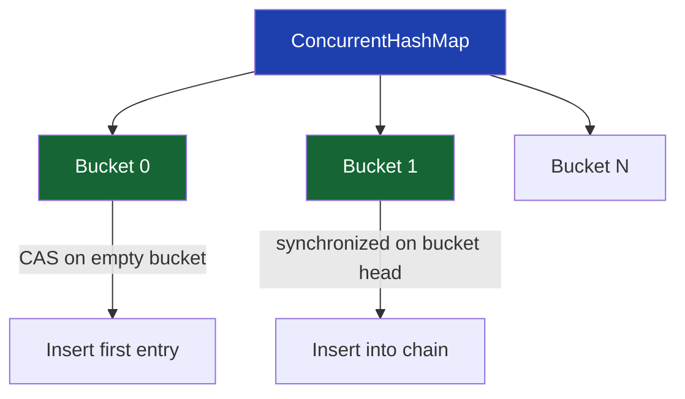
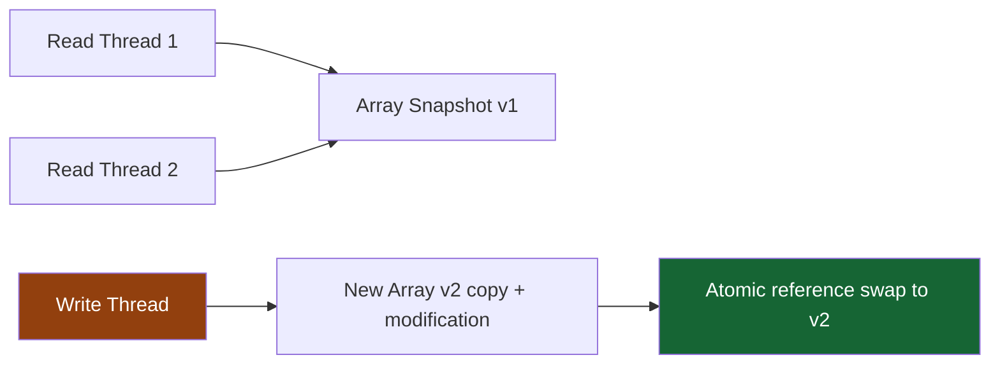
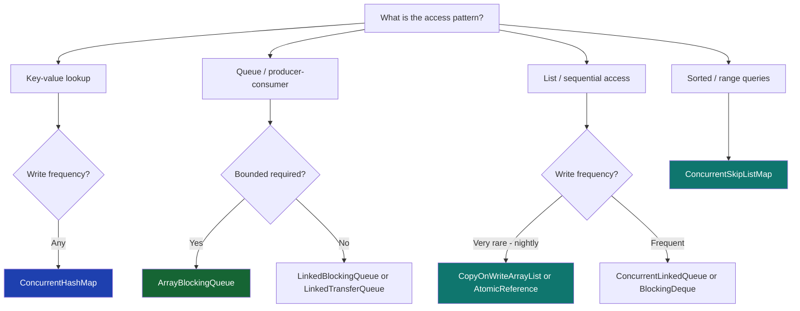

## Overview

The `java.util.concurrent` package ships a set of **concurrent collections** — thread-safe data structures that eliminate the need to wrap `HashMap` or `ArrayList` in `Collections.synchronizedXxx()`. These collections are not just wrappers with a lock; they use segment-level or CAS-based internal strategies to allow significant concurrency.

Choosing the wrong collection under concurrent load is a common source of both correctness failures and performance bottlenecks. This lesson covers every major concurrent collection, their internal concurrency strategies, and direct applications in banking and payment systems.

## Learning Objectives

By the end of this lesson you will be able to:

- Explain how `ConcurrentHashMap` achieves thread safety without a global lock
- Use `compute`, `merge`, and `computeIfAbsent` for atomic compound operations
- Choose between `ArrayBlockingQueue`, `LinkedBlockingQueue`, and `SynchronousQueue`
- Apply `CopyOnWriteArrayList` correctly and explain its performance trade-off
- Use `ConcurrentSkipListMap` for sorted concurrent access
- Identify common misuses of concurrent collections that break atomicity
- Select the right concurrent collection for each financial system access pattern

## Business Context

A payment routing service maintains three shared data structures:

1. **Active sessions map** — 50,000 entries, 2,000 concurrent reads per second, 50 writes per second
2. **Payment queue** — 400 producer threads feeding 20 consumer threads
3. **Fee schedule list** — read by all payment threads, updated nightly by one admin thread

Using `HashMap`, `LinkedList`, and `ArrayList` with `synchronized` blocks produces 40% CPU time in lock contention. The wrong collection choice for each data structure amplifies the problem. The right choices eliminate the contention entirely.

## ConcurrentHashMap

`ConcurrentHashMap` is the most important concurrent collection in Java. It replaces `HashMap` in multi-threaded contexts and significantly outperforms `Collections.synchronizedMap(new HashMap<>())` by using per-bucket (node-level) CAS and synchronization instead of a single global lock.

### Internal Concurrency Strategy



- Empty bucket insertion: **CAS** — no lock
- Non-empty bucket (chain/tree): **synchronized on the bucket head** — only that bucket is locked
- Multiple threads writing to different buckets proceed **in parallel**
- Global resize: `size()` aggregates striped counters — approximate under concurrent modification

### Basic Operations

```java17
import java.util.concurrent.ConcurrentHashMap;

public class SessionStore {

    private final ConcurrentHashMap<String, UserSession> sessions
        = new ConcurrentHashMap<>();

    // Thread-safe get / put / remove — no additional synchronization needed
    public UserSession get(String sessionId) {
        return sessions.get(sessionId);
    }

    public void put(String sessionId, UserSession session) {
        sessions.put(sessionId, session);
    }

    public void remove(String sessionId) {
        sessions.remove(sessionId);
    }

    // Conditional remove — only removes if value matches (atomic check-and-remove)
    public boolean invalidate(String sessionId, UserSession expected) {
        return sessions.remove(sessionId, expected);
    }
}
```

### Atomic Compound Operations

The most critical feature of `ConcurrentHashMap` is its set of **atomic compound operations**. The naïve `get-then-put` pattern breaks atomicity — use these instead:

```java17
// WRONG: check-then-act — a race condition between get() and put()
public void recordFailure_WRONG(String accountId) {
    Integer count = failureCounts.get(accountId);
    // Another thread may insert between get() and put()!
    failureCounts.put(accountId, count == null ? 1 : count + 1);
}

// CORRECT: computeIfAbsent — atomic get-or-create
private final ConcurrentHashMap<String, List<Payment>> pendingByAccount
    = new ConcurrentHashMap<>();

public void addPending(String accountId, Payment payment) {
    pendingByAccount
        .computeIfAbsent(accountId, k -> new CopyOnWriteArrayList<>())
        .add(payment);
}

// CORRECT: compute — atomic read-modify-write
private final ConcurrentHashMap<String, Integer> failureCounts
    = new ConcurrentHashMap<>();

public void recordFailure(String accountId) {
    failureCounts.compute(accountId, (k, v) -> v == null ? 1 : v + 1);
}

// CORRECT: merge — atomic update-or-create with BiFunction
private final ConcurrentHashMap<String, Long> totalByAccount
    = new ConcurrentHashMap<>();

public void recordAmount(String accountId, long amountPence) {
    totalByAccount.merge(accountId, amountPence, Long::sum);
}
```

```java21
// Java 21 — same API; no new ConcurrentHashMap methods in Java 17-21
// Virtual threads accessing ConcurrentHashMap: safe — CHM operations are
// non-blocking for most cases (CAS on empty buckets) and briefly synchronized
// only for non-empty buckets — no pinning concern for most workloads
public class PaymentAggregator {

    private final ConcurrentHashMap<String, Long> totalByAccount
        = new ConcurrentHashMap<>();
    private final ConcurrentHashMap<String, Integer> countByAccount
        = new ConcurrentHashMap<>();

    public void record(String accountId, long amountPence) {
        totalByAccount.merge(accountId, amountPence, Long::sum);
        countByAccount.merge(accountId, 1, Integer::sum);
    }

    public record AccountSummary(long totalPence, int count) {}

    public AccountSummary getSummary(String accountId) {
        return new AccountSummary(
            totalByAccount.getOrDefault(accountId, 0L),
            countByAccount.getOrDefault(accountId, 0)
        );
    }
}
```

> [!WARNING]
> **`compute`, `merge`, and `computeIfAbsent` lock the bucket while the function runs.** The function must be:
> - **Fast** — no I/O, no blocking calls
> - **Side-effect free** — the function may be retried
> - **Non-recursive** — calling `compute` on the same key inside the function deadlocks immediately
>
> Never call a database or external service inside a `ConcurrentHashMap` compute function.

### Iteration and Weak Consistency

`ConcurrentHashMap` iterators are **weakly consistent**: they reflect the state at or after the iterator was created but do not throw `ConcurrentModificationException`. Modifications during iteration may or may not be visible in the iteration.

```java17
// Safe to iterate while other threads modify — no CME
// But new entries added during iteration may not appear
sessions.forEach((id, session) -> {
    if (session.isExpired()) {
        sessions.remove(id); // Safe — will not corrupt iteration
    }
});

// Parallel iteration (Java 8+) — uses ForkJoinPool.commonPool()
sessions.forEachValue(1000L, session -> metricsService.record(session));
```

## BlockingQueue

`BlockingQueue` implementations provide **blocking** `put()` (waits if full) and `take()` (waits if empty) operations. They are the standard mechanism for producer-consumer patterns in Java without explicit `Condition` variables.

### Variants and Trade-offs

| Implementation | Bounded? | Ordering | Use Case |
|---|---|---|---|
| `ArrayBlockingQueue` | Yes (fixed) | FIFO | Fixed-size payment queues, back-pressure |
| `LinkedBlockingQueue` | Optional | FIFO | High-throughput queues, unbounded risk |
| `PriorityBlockingQueue` | No | Priority | Priority payment processing |
| `SynchronousQueue` | N/A (capacity 0) | Direct handoff | Thread pool work transfer |
| `DelayQueue` | No | Delay expiry | Scheduled payment retries |
| `LinkedTransferQueue` | No | FIFO + handoff | High-throughput with optional backpressure |

### Payment Processing Queue

```java17
import java.util.concurrent.ArrayBlockingQueue;
import java.util.concurrent.BlockingQueue;

public class PaymentProcessingPipeline {

    // Bounded — back-pressure when processors are overwhelmed
    // 10,000 capacity: if processors fall behind, intake blocks until space frees
    private final BlockingQueue<Payment> queue =
        new ArrayBlockingQueue<>(10_000);

    // Producer: payment intake service (400 threads)
    public void submit(Payment payment) throws InterruptedException {
        queue.put(payment); // Blocks if queue is full — applies back-pressure
    }

    // Non-blocking offer with timeout — for time-sensitive intake
    public boolean trySubmit(Payment payment, long timeoutMs)
            throws InterruptedException {
        return queue.offer(payment, timeoutMs, TimeUnit.MILLISECONDS);
    }

    // Consumer: payment processor thread
    public void processLoop() throws InterruptedException {
        while (!Thread.currentThread().isInterrupted()) {
            Payment payment = queue.take(); // Blocks until a payment is available
            process(payment);
        }
    }

    private void process(Payment payment) { /* ... */ }
}
```

```java21
// Java 21 — virtual threads work excellently with BlockingQueue
// Virtual threads blocking on take() park rather than pinning a carrier thread
// This is the recommended pattern for virtual-thread-based consumers
public class PaymentProcessingPipeline {

    private final BlockingQueue<Payment> queue = new ArrayBlockingQueue<>(10_000);

    // Start N virtual thread consumers
    public void startConsumers(int count) {
        try (var executor = Executors.newVirtualThreadPerTaskExecutor()) {
            for (int i = 0; i < count; i++) {
                executor.submit(() -> {
                    try {
                        while (!Thread.currentThread().isInterrupted()) {
                            Payment p = queue.take(); // Parks virtual thread — no carrier pinning
                            process(p);
                        }
                    } catch (InterruptedException e) {
                        Thread.currentThread().interrupt();
                    }
                });
            }
        }
    }

    public void submit(Payment payment) throws InterruptedException {
        queue.put(payment);
    }

    private void process(Payment payment) { /* ... */ }
}
```

> [!IMPORTANT]
> **Prefer `ArrayBlockingQueue` over `LinkedBlockingQueue` for payment queues.** `LinkedBlockingQueue` is unbounded by default — a slow consumer leads to unlimited memory growth and eventual `OutOfMemoryError`. `ArrayBlockingQueue` enforces a fixed capacity, providing back-pressure at intake. Always size the capacity based on maximum acceptable backlog, not unlimited growth.

### SynchronousQueue — Zero-Capacity Handoff

`SynchronousQueue` has zero capacity. A `put()` blocks until another thread calls `take()` — a direct thread-to-thread handoff. This is the queue used internally by `Executors.newCachedThreadPool()`.

```java17
// SynchronousQueue: used for direct handoff to thread pool workers
// No buffering — if no worker is available, put() blocks
BlockingQueue<Runnable> workQueue = new SynchronousQueue<>();
ThreadPoolExecutor pool = new ThreadPoolExecutor(
    0, 200,                        // 0 core threads, 200 max
    60L, TimeUnit.SECONDS,
    workQueue,                      // Direct handoff — creates new thread if needed
    new ThreadPoolExecutor.AbortPolicy()
);
```

## CopyOnWriteArrayList

`CopyOnWriteArrayList` is a thread-safe `List` where every mutating operation (`add`, `set`, `remove`) creates a **complete new copy** of the backing array. Reads never block — they always see a consistent snapshot.



### Fee Schedule — Read-Heavy, Write-Rare

```java17
import java.util.concurrent.CopyOnWriteArrayList;

public class FeeScheduleRegistry {

    // Read by thousands of payment threads; updated at most once per night
    private final CopyOnWriteArrayList<FeeRule> rules = new CopyOnWriteArrayList<>();

    // Reads are lock-free — iterates the current snapshot
    public Optional<FeeRule> findRule(PaymentType type, Money amount) {
        for (FeeRule rule : rules) { // Snapshot iteration — never throws CME
            if (rule.matches(type, amount)) return Optional.of(rule);
        }
        return Optional.empty();
    }

    // Writes are expensive (full array copy) but rare
    public void addRule(FeeRule rule) {
        rules.add(rule); // O(n) copy — acceptable for nightly updates
    }

    public void replaceAll(List<FeeRule> newRules) {
        // Atomic swap of entire list via clear + addAll — not atomic as a pair
        // Better: replace the CopyOnWriteArrayList reference itself via AtomicReference
        // for atomic bulk replacement
    }
}
```

```java21
// Java 21 — CopyOnWriteArrayList works identically
// For bulk atomic replacement (nightly fee schedule update),
// use AtomicReference<List<FeeRule>> with an immutable List.copyOf
// rather than CopyOnWriteArrayList for bulk swap scenarios
public class FeeScheduleRegistry {

    // Immutable list inside AtomicReference — single atomic swap for bulk update
    private final AtomicReference<List<FeeRule>> rules =
        new AtomicReference<>(List.of());

    public Optional<FeeRule> findRule(PaymentType type, Money amount) {
        return rules.get().stream()
            .filter(r -> r.matches(type, amount))
            .findFirst();
    }

    // Atomic bulk replace — all readers immediately see full new schedule
    public void replaceSchedule(List<FeeRule> newRules) {
        rules.set(List.copyOf(newRules));
    }
}
```

> [!WARNING]
> **`CopyOnWriteArrayList` is not suitable for high-write-rate scenarios.** Each write copies the entire array — O(n) time and memory. Use it only when reads vastly outnumber writes. If you need high-write-rate concurrent list access, use `ConcurrentLinkedQueue` or a `LinkedBlockingDeque`.

## ConcurrentSkipListMap

`ConcurrentSkipListMap` is a concurrent, sorted map — the thread-safe equivalent of `TreeMap`. Unlike `ConcurrentHashMap`, it maintains keys in natural sorted order and supports navigation operations.

```java17
import java.util.concurrent.ConcurrentSkipListMap;

// Sorted, thread-safe map of transactions by timestamp
// Supports efficient range queries: "all transactions between T1 and T2"
public class TransactionLedger {

    private final ConcurrentSkipListMap<Instant, Transaction> ledger
        = new ConcurrentSkipListMap<>();

    public void record(Transaction tx) {
        ledger.put(tx.getTimestamp(), tx);
    }

    // Efficient range query — O(log n) + O(k) for k results
    public NavigableMap<Instant, Transaction> getRange(Instant from, Instant to) {
        return ledger.subMap(from, true, to, true);
    }

    // Latest transaction
    public Optional<Transaction> getLatest() {
        return Optional.ofNullable(ledger.lastEntry()).map(Map.Entry::getValue);
    }

    // All transactions since a given time — for reconciliation
    public SortedMap<Instant, Transaction> getSince(Instant since) {
        return ledger.tailMap(since);
    }
}
```

## Choosing the Right Concurrent Collection



| Data structure | Thread-safe? | Use |
|---|---|---|
| `HashMap` | No | Single-threaded only |
| `Collections.synchronizedMap` | Yes | Simple, low-concurrency wrapper |
| `ConcurrentHashMap` | Yes | Standard concurrent map — preferred |
| `ArrayList` | No | Single-threaded only |
| `Collections.synchronizedList` | Yes | Needs external lock for compound ops |
| `CopyOnWriteArrayList` | Yes | Read-heavy, write-rare lists |
| `ArrayBlockingQueue` | Yes | Bounded producer-consumer |
| `LinkedBlockingQueue` | Yes | Unbounded or optional-bounded queue |
| `PriorityBlockingQueue` | Yes | Priority-ordered processing |
| `ConcurrentSkipListMap` | Yes | Sorted concurrent map |
| `ConcurrentLinkedQueue` | Yes | Non-blocking unbounded queue |

---

<!-- KNOWLEDGE-CHECK [
  {
    "id": "kc-cc-01",
    "question": "Two threads simultaneously call `failureCounts.get(accountId)` on a ConcurrentHashMap — both get `null` — then both call `failureCounts.put(accountId, 1)`. What is the final count?",
    "options": [
      "2 — both increments are recorded",
      "1 — the second put overwrites the first",
      "null — ConcurrentHashMap does not allow concurrent puts",
      "A ConcurrentModificationException is thrown"
    ],
    "correct": 1,
    "explanation": "Both threads read null (no entry), both compute count=1, both put count=1. The second put overwrites the first. The final count is 1 — one failure was lost. This is the check-then-act race condition. The fix is `failureCounts.compute(accountId, (k, v) -> v == null ? 1 : v + 1)` — atomic read-modify-write."
  },
  {
    "id": "kc-cc-02",
    "question": "A payment intake service uses `LinkedBlockingQueue` with no capacity limit. The processing thread falls behind due to a downstream timeout. What eventually happens?",
    "options": [
      "The queue blocks new payments via back-pressure",
      "The queue grows unboundedly until OutOfMemoryError occurs",
      "ConcurrentModificationException is thrown",
      "LinkedBlockingQueue automatically limits itself to 10,000 entries"
    ],
    "correct": 1,
    "explanation": "LinkedBlockingQueue with no capacity argument defaults to Integer.MAX_VALUE capacity — effectively unbounded. A slow consumer allows the queue to grow indefinitely. Each Payment object occupies memory; eventually the heap is exhausted and OutOfMemoryError occurs. The fix: use ArrayBlockingQueue with a fixed capacity, or LinkedBlockingQueue with an explicit capacity bound, to enforce back-pressure."
  },
  {
    "id": "kc-cc-03",
    "question": "A `CopyOnWriteArrayList` holds 50,000 fee rules. A nightly batch job calls `add()` for each of 1,000 new rules. What is the performance impact?",
    "options": [
      "1,000 O(1) appends — CopyOnWriteArrayList is optimised for append",
      "1,000 full array copies — O(50,000 × 1,000) = 50 million object copies",
      "1 full array copy of 51,000 entries at the end of the batch",
      "No copy — CopyOnWriteArrayList batches writes automatically"
    ],
    "correct": 1,
    "explanation": "Each add() on CopyOnWriteArrayList copies the entire backing array. With 50,000 entries and 1,000 adds, the first add copies 50,000 entries, the second copies 50,001, etc. Total copies ≈ 50 million object references. For bulk updates, use AtomicReference<List<FeeRule>> and replace the entire list atomically with List.copyOf(newRules) — a single copy operation."
  },
  {
    "id": "kc-cc-04",
    "question": "Inside a `ConcurrentHashMap.compute()` call, can you call `compute()` again on the same key?",
    "options": [
      "Yes — ConcurrentHashMap is reentrant for compute operations",
      "No — it deadlocks, because compute() holds a lock on the bucket",
      "Yes — but only if the second compute() uses a different function",
      "No — ConcurrentModificationException is thrown"
    ],
    "correct": 1,
    "explanation": "compute(), computeIfAbsent(), and merge() synchronize on the bucket containing the key while the function executes. Calling compute() on the same key inside the function attempts to acquire the same bucket lock — which is already held by the outer compute(). This causes an immediate deadlock. The function must complete without touching the same ConcurrentHashMap key."
  }
] -->

---

<!-- PRACTICAL-CHALLENGE {
  "id": "pc-concurrent-collections",
  "title": "Concurrent Data Store for Payment Gateway",
  "description": "Implement the shared data layer for a payment gateway using the correct concurrent collection for each access pattern.",
  "tasks": [
    {
      "id": "pc-cc-01",
      "description": "Implement `SessionRegistry` using `ConcurrentHashMap` with: `createSession(userId)` using `computeIfAbsent` to avoid duplicate session creation, `recordActivity(sessionId)` using `compute` to atomically update a last-active timestamp, and `evictExpired()` that iterates and removes sessions expired more than 30 minutes ago."
    },
    {
      "id": "pc-cc-02",
      "description": "Implement `PaymentPipeline` with an `ArrayBlockingQueue` of capacity 5,000. Add `submit(Payment)` that returns false (non-blocking) rather than blocking when full. Add a monitoring method `getQueueDepthPercent()` that returns the fill percentage as a double 0.0–1.0."
    },
    {
      "id": "pc-cc-03",
      "description": "Implement `FeeScheduleService` that stores fee rules in an `AtomicReference<List<FeeRule>>`. Implement `reload(List<FeeRule> newRules)` that atomically replaces the schedule, and `findApplicableRule(Payment)` that reads without any locking. Write a test that calls reload() while 100 threads are calling findApplicableRule() and verifies no thread ever sees a partially updated list."
    },
    {
      "id": "pc-cc-04",
      "description": "Implement `TransactionRangeQuery` using `ConcurrentSkipListMap<Instant, Transaction>`. Implement `record(Transaction)`, `getRange(Instant from, Instant to)`, and `getSince(Instant)`. Explain why ConcurrentSkipListMap is chosen over ConcurrentHashMap for this use case."
    }
  ]
} -->
